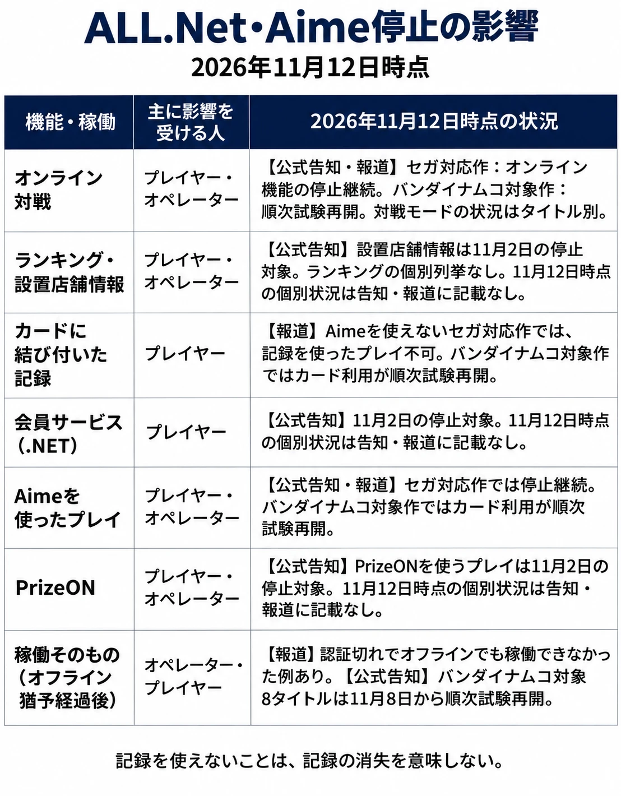

# ゲームセンターの台はなぜ止まったのか——ALL.Net・Aimeの停止と、店が台を動かし続ける条件

> 本稿は2026年11月12日時点の情報に基づき、11月15日に一部を追記し、11月27日時点の状況に更新しました。侵入の経路や原因、情報流出の調査結果は、11月27日時点で公表されていません。[[1](#ref-1)][[2](#ref-2)]

## 1. ゲームセンターで何が起きたか

ゲームセンターで、いつもの台に電源が入っている。けれど、ほかの店の相手とは対戦できず、カードをかざしても自分の記録で遊べない。店内だけで遊ぶつもりで出かけても、オフラインでの稼働まで止まった台がある。今回の停止は、どの機能で遊べるかに加え、店がその台で遊びを提供できるかにまで及んだ。[[3](#ref-3)][[4](#ref-4)]

セガ フェイブは11月2日、ゲーム機をつなぐネットワークサービス「ALL.Net」と、ICカードなどでプレイヤーを識別する「Aime」に関係するサーバーの一部が、第三者による不正アクセスを受けたと発表した。調査と安全性の確認のため、関連サービスは11月1日15時から停止した。初期調査では顧客や取引先の情報の流出は確認されておらず、決済情報は不正アクセスを受けたサーバーに保有していなかったと同社は説明している。[[3](#ref-3)]

11月2日18時時点の告知に挙がった停止項目は、対応タイトルのオンラインプレイ、公式サイトの設置店舗情報、各タイトルの「.NET」、Aimeを使ったプレイ、PrizeONを使ったプレイ、セガ ラッキーくじオンライン、SEGA IDの新規登録の7つである。ゲーム機を離れ、遊べる店を調べたり、会員サービスで成績を見たりする場面にも影響が広がった。[[3](#ref-3)]

その後の再開は、タイトルごとに段階を追って進んだ。ゲーム機の再開について、公式の告知は「試験的な稼働再開」という言葉を使っている。[[4](#ref-4)][[1](#ref-1)]

| 日時 | 公式の告知 |
| --- | --- |
| 11月1日15時 | ALL.Net・Aime関連サービスを停止する[[3](#ref-3)] |
| 11月8日 | バンダイナムコエクスペリエンスの対応タイトルのうち、『太鼓の達人』など8タイトルが順次、試験的に稼働を再開する[[4](#ref-4)] |
| 11月15日 | 一部機能の復旧に伴い、セガ製品の一部が試験的に稼働を再開する。Aimeのサービスサイトも一部の機能を再開する。同日、一部のタイトルは対象から外れ、メンテナンスを続ける[[5](#ref-5)][[6](#ref-6)][[1](#ref-1)] |
| 11月16日 | 『セガNET麻雀 MJ Arcade』が試験的に稼働を再開する[[1](#ref-1)] |
| 11月21日 | 『CHUNITHM』『maimai でらっくす』、プリクラ3機種（totolu、NICO MAKE、cherrit）などが試験的に稼働を再開する。『英傑大戦』は対人戦を除いて再開する[[1](#ref-1)] |
| 11月25日11時 | セガ ラッキーくじオンラインがサービスを再開する[[7](#ref-7)] |
| 11月27日9時 | 『英傑大戦』の対人戦、『HOUSE OF THE DEAD ～SCARLET DAWN～』、『BINGO THEATER』、ALL.Net P-ras MULTI バージョン3の大半のタイトルが試験的に稼働を再開する[[1](#ref-1)] |

11月27日9時時点でメンテナンスが続くのは、ALL.Net P-ras MULTI バージョン2と、バージョン3のうち再開しなかったタイトルである。SEGA IDの新規登録は、11月15日の更新で再開の対象から除かれ、その後の更新にも再開の記載はない。停止から約4週間で、試験稼働はほぼすべての対応タイトルに広がった。[[1](#ref-1)]

一方、侵入の経路や原因、情報流出の調査結果は、11月27日時点で公表されていない。セガ フェイブは11月2日の第一報で、調査の完了には一定の期間が必要だと説明していた。同社のニュースのページには、11月27日時点で、一部サービスの復旧を伝えた11月16日の第二報より後の続報は載っていない。[[3](#ref-3)][[2](#ref-2)]

11月9日には株式会社セガが、一部のメールマガジンの配信委託先であるアララ株式会社が不正アクセスを受け、配信に使ったメールアドレスなどが流出したと公表した。セガは、これをセガ フェイブのアーケード向けサーバーへの不正アクセスとは別事案としている。不正アクセスを受けた企業の初動については、[ゲーム会社で個人データ漏えいが起きたときの最初の48時間](personal-data-breach-first-48-hours-game-company.md)を参照してほしい。[[8](#ref-8)]

***

## 2. アーケードゲームの直接の顧客は誰か

アーケードゲームの筐体を買い、店に置くのは、ゲームセンターを運営する事業者である。こうした事業者をオペレーターと呼ぶ。プレイヤーは店でプレイの対価を支払い、メーカーにとっても遊びを届ける相手になる。その台を導入し、どこに置き、いつ入れ替えるかを決める直接の顧客はオペレーターだ。

バンダイナムコホールディングスの『統合レポート2025』は、アミューズメントユニットのビジネスモデルの一例として、業務用ゲームを開発し、自社グループや他社が運営する施設に販売し、バージョンアップを提供する流れを示している。ゲーム機がプレイヤーに届くまでには、製品を作る側と、施設で稼働させる側の判断がある。[[9](#ref-9)]

オペレーターが台を見るときには、遊びの魅力に加え、営業時間中に客を迎えられるか、フロアの一角を使って稼働を続けられるかが判断材料になる。ある機能が使えない日に店がどんな遊び方を案内できるかも、製品を運用する条件の一つだ。オペレーターやインカム（台の稼働で得られる収入）の実務は、[アーケードゲーム／ゲームセンターの歴史の第10章](arcade-game-center-history.md#第10章運営ビジネスの実務--オペレーターインカムロケテ)で扱っている。

***

## 3. 遊びの機能と、台の稼働が止まる

ネットワークにつながるアーケードゲームには、店舗間・全国の通信対戦、店舗別や全国のランキング、カードにひもづくセーブデータ、各タイトルの会員サービスなど、サーバーが支える機能がある。たとえば、いつもと違う店で同じカードを使って続きから遊ぶには、その台からプレイヤーを識別し、記録を読み出せる必要がある。使えなくなる機能の組み合わせは、タイトルによって異なる。[[3](#ref-3)][[10](#ref-10)]

もう一つの依存先は、店がそのゲームを稼働させる権利を確かめる仕組みだ。重田雄一のGame\*Sparkの記事は、バンダイナムコエクスペリエンスのALL.Net対応タイトルについて、オフラインで稼働できる期間は最大72時間で、ライセンス認証が切れると動かなくなったと報じている。『太鼓の達人』では、オフラインでも稼働できなくなった例があった。72時間は報道に基づく値で、公式告知ではタイトル別の認証期限は示されていない。[[11](#ref-11)][[4](#ref-4)]

ALL.Net・Aimeの停止で影響を受けた機能と台の稼働（2026年11月12日時点）。公式告知：セガ フェイブの11月2日発表、バンダイナムコエクスペリエンスの11月8日更新。報道：Game\*Sparkの11月5日・8日・12日記事。[[3](#ref-3)][[4](#ref-4)][[11](#ref-11)][[10](#ref-10)][[12](#ref-12)]

筐体の導入とソフトの提供を組み合わせる形は以前からあった。コナミは2010年に、プレイヤーが支払った代金をメーカーとオペレーターで分ける「e-AMUSEMENT Participation」を発表した。2012年にGAME Watchが紹介したセガの「ALL.Net P-ras MULTI」は、対応基板を購入すると、ソフトが無償で提供される仕組みだった。収益分配の経緯は、[アーケードゲーム／ゲームセンターの歴史の第9章](arcade-game-center-history.md#レベニューシェアモデルへの転換)も参照してほしい。[[13](#ref-13)][[14](#ref-14)]

筐体とソフトの提供条件が分かれる形では、店がどのタイトルを稼働できるかをネットワーク経由で確かめる設計もありうる。今回、認証切れで停止したと報じられた台は、その確認ができなくなると、対戦や記録の機能だけでなく、その場で遊ぶための稼働も止まりうることを示した。[[11](#ref-11)]

***

## 4. 一つの基盤の停止が、別のメーカーの台に届く

バンダイナムコエクスペリエンスの対応タイトルも、セガ フェイブのALL.Netを利用している。店に異なるメーカーの台が並んでいても、共通の基盤に依存していれば、その基盤の停止で複数の台が同時に影響を受ける。今回は基盤の一部機能の復旧を受け、バンダイナムコエクスペリエンスが11月8日から次の8タイトルを順次、試験的に再開すると案内した。[[4](#ref-4)][[10](#ref-10)]

- 『太鼓の達人』
- 『機動戦士ガンダム エクストリームバーサス2 インフィニットブースト』
- 『マリオカート アーケードグランプリ デラックス』
- 『アイドルマスター TOURS』
- 『ジョジョの奇妙な冒険 ラストサバイバー』
- 『釣りスピリッツ ワンダー』
- 『湾岸ミッドナイト マキシマムチューン 6RR PLUS』
- 『機動戦士ガンダム アーセナルベース』

店頭での影響も報じられた。タイトーステーション 町田店の公式Xアカウントは、画面が暗くなった台の写真を添えて店の状況を伝えた。Game\*Sparkによると、同店では『機動戦士ガンダム EXVS.』や『アイドルマスター TOURS』などが稼働できず、写真付きの投稿は予想以上に広がったため11月5日に削除された。[[11](#ref-11)]

一方、ITmedia NEWSが11月5日に訪れた別のゲームセンターでは、ビデオゲーム機に稼働停止や機能制限が出るなか、クレーンゲームなどは通常どおり動いていた。台の組み合わせによって、同じ基盤の停止でも、店が提供できる遊びは変わる。[[15](#ref-15)]

影響は、ゲーム機の外にも及んだ。セガの音楽ゲームの公式全国大会『KING of Performai The 8th』は、ALL.Netの緊急メンテナンスの影響を受け、12月9日に予定していた最終予選（LCQ）を、これ以上の日程調整は難しいとして全部門で中止した。2027年2月14日の全国決勝大会は、予定どおり観客を入れて開くための調整を続けるとしている。[[16](#ref-16)][[17](#ref-17)]

セガ フェイブは、同社のサーバーへの不正アクセスに伴う調査と安全性の確認のため、キャラクターグッズなどが当たるくじをオンラインで販売するセガ ラッキーくじオンラインも、11月1日15時から25日11時ごろまで止めた。停止中に販売する予定だったくじは販売期間を延ばし、一部はお届けの時期も遅れた。[[7](#ref-7)]

***

## 5. オペレーターは次に何を置くか

編者は、今回のように店が台を動かせない期間が続くことは、アーケードゲームのパブリッシャーにとって致命的な事態だと考える。オペレーターは限られた床面積のなかで、写真を撮るプリクラ、景品を獲得するクレーンゲームなどのプライズ機、メダルゲーム機、ビデオゲーム機の配置を決めている。編者の見方では、ネットワークへの依存が大きいビデオゲーム機は、店に置き続けてもらううえで、外部サービスの停止が稼働に直結しにくい台より不利になりうる。今回のように実際に動かせない期間を経験すれば、次の導入や入れ替えの際に、ビデオゲーム機を置く判断を見送る店も増えるだろう。

今回の事案より前の業界動向として、セガサミーホールディングスは『統合報告書2025』で、消費動向やニーズの変化によって施設オペレーターの設備投資意欲が弱まることをリスクに挙げていた。その対応の一つが、投資効率の高いプライズ機に経営資源を集中することだった。同報告書は、アミューズメント機器市場でプライズ分野の好調が続いているとも述べている。プライズ機が店内で存在感を増した経緯は、[アーケードゲーム／ゲームセンターの歴史のプライズゲームの節](arcade-game-center-history.md#ufoキャッチャーとプライズゲームの台頭)を参照してほしい。[[18](#ref-18)]

導入を検討する店にとって、作品の人気と、営業日にその台を動かせる見通しは、どちらも判断に必要だ。たとえば、ネットワーク停止中も店内対戦で大会を開ける台なら、告知を変えて会場を使える。稼働そのものが止まる台なら、別の催しに切り替えるか、開催を見送る判断が要る。平常時には見えにくい仕様の差が、運営の選択肢の差になる。

***

## 6. 基盤が止まったら、この台は店で何ができるか

ライセンス認証にオフラインでの猶予を設ける場合、猶予が短いほど、稼働の権利を改めて確認できない状態が長く続くのを抑えやすい。その分、正規に導入した店の台も、基盤が止まると早く動かなくなる。猶予を長く取れば店は営業を続けやすくなるが、稼働条件が変わっても、次にサーバーと通信できるまで反映が遅れる。どちらを重く見るかは、タイトルの提供条件と、停止時に店へ残したい遊び方によって変わる。

共通の基盤には、同じカードを対応タイトルで使え、店をまたいで記録を引き継ぎ、離れた相手とも対戦できる利点がある。開発側も、カード認証や記録の管理を各タイトルで一から用意する負担を減らせる。その一方で、基盤の停止は、同じ機能を使う複数のタイトルやメーカーへ同時に届く。

再開の進め方も、店の運用に関わる。11月21日の再開では、ALL.Netの公式Xが、再開のタイミングは設置店舗ごとに異なると案内した。Aimeのお知らせは、店舗側でソフトウェアの更新を終えてからゲーム機が稼働するとし、利用者に店舗への過度な問い合わせを控えるよう求めている。いつ遊べるかを、店も来店客に答えにくい期間が続いたことになる。[[19](#ref-19)][[1](#ref-1)]

プランナーが仕様を決める段階で持っておきたい問いは、 **基盤が止まったら、この台は店で何ができるか** である。カードを使えなくてもゲストで遊べるか。全国対戦を止めても、同じ店の台どうしでは対戦できるか。記録を読み出せない間は保存を伴わない遊び方にできるか。認証の猶予が終わるとき、店員は何が止まるかを来店客に説明できるか。再開するときに店で要る作業は何で、それが済んだかを店が確かめられるか。遊び方と店の運用を一緒に考えると、残す機能を決めやすくなる。

サーバーがなくなった後に遊びをどう残すかという長期の問いは、[ゲーム保存とプレイ可能なアーカイブの記事](game-preservation-playable-archives-and-live-service-limits.md)で扱っている。

***

## 7. まとめ

2026年11月27日時点で、ALL.Net・Aimeに対応するタイトルの試験稼働は、ALL.Net P-ras MULTIの一部を除き、ほぼすべてに広がった。停止から約4週間である。侵入の経路や原因、情報流出の調査結果はまだ公表されていない。調査結果が出たら、この記事も見直す。[[1](#ref-1)][[3](#ref-3)][[2](#ref-2)]

プレイヤーにどう遊んでもらうかを仕様に落とし込むとき、アーケードゲームには一つ前の問いがある。店がその台を動かせるか、である。

***

## References

1. [Aimeサービスサイト「【11月27日 09:00 更新】11月15日 9:00 ALL.NetおよびAime各サービスの試験的稼働再開について」][1] — Aime公式サイト、2026年11月27日9時更新。11月15日・16日・21日・27日の更新履歴を参照。

[1]: https://my-aime.net/news/detail?newsId=296

2. [セガ フェイブ「【第二報】ALL.Net・Aimeの一部サービス復旧および対応タイトルの試験稼働再開について」][2] — セガ フェイブ公式サイト、2026年11月16日。

[2]: https://www.segafave.co.jp/news/261116_1/

3. [セガ フェイブ「【第一報】当社サーバーへの不正アクセスに関するお詫びとお知らせ」][3] — セガ フェイブ公式サイト、2026年11月2日。停止項目は同日18時時点。

[3]: https://www.segafave.co.jp/news/261102_1/

4. [バンダイナムコエクスペリエンス「【11/8更新】ALL.Netに関する各種サービス停止に伴い一時停止していたゲーム機の、試験的な稼働再開に関するご案内」][4] — バンダイナムコエクスペリエンス公式サイト、2026年11月8日更新。

[4]: https://xp.bandainamco-am.co.jp/important_20261102/index.html

5. [ALL.Netサービス情報「11月15日(日) 9:00 現在【ALL.Net、Aimeメンテナンスについて】」][5] — ALL.Net公式X、2026年11月15日9時。運営元の公式アカウントによる告知。

[5]: https://x.com/allnet_info/status/2121755060623602091

6. [Game\*Spark「ゲーセンALL.Net・Aime不正アクセス問題、セガ13タイトル試験稼働へ！メンテから2週間…『オンゲキ』『頭文字DAC』など再開。『maimai』は引き続き停止」][6] — Game\*Spark、2026年11月15日。

[6]: https://www.gamespark.jp/article/2026/11/15/174885.html

7. [セガ ラッキーくじオンライン「緊急メンテナンス終了および各くじ製品の対応について（11/25 11:00更新）」][7] — セガ ラッキーくじオンライン公式サイト、2026年11月25日11時更新。

[7]: https://www.segaluckykujionline.net/blog/2026-11-1-1

8. [セガ「業務委託企業への不正アクセスによる個人情報流出に関するお詫びとお知らせ」][8] — 株式会社セガ公式サイト、2026年11月9日。

[8]: https://www.sega.co.jp/release/261109_1.html

9. [バンダイナムコホールディングス「統合レポート2025 アミューズメントユニット」][9] — バンダイナムコホールディングス、2025年、46〜47ページ。「アミューズメントユニットにおけるビジネスモデルの一例」を参照。

[9]: https://www.bandainamco.co.jp/ir/library/assets/pdf/2025/integratedreports2025_jp_46-47.pdf

10. [Game\*Spark「ゲーセン不正アクセス問題、『ガンダムEXVS.』『太鼓の達人』など試験的に稼働再開へ！バンナムタイトルはオフラインでも稼働できなくなっていた」][10] — Game\*Spark、2026年11月8日。

[10]: https://www.gamespark.jp/article/2026/11/08/174618.html

11. [重田雄一「不正アクセス問題の影響で過酷な現状を投稿するゲーセン…『ガンダムEXVS.』『ツアマス』などプレイできず。オフラインでも稼働できなくなった『太鼓の達人』も【UPDATE】」][11] — Game\*Spark、2026年11月5日。GameBusiness.jpにも11月6日掲載。

[11]: https://www.gamespark.jp/article/2026/11/05/174508.html

12. [Game\*Spark「ゲーセン不正アクセス問題、ALL.Net・Aimeの停止は約半月になるか…大きな進展がない場合、次回報告は11月17日。いまだ再開の目処立たず」][12] — Game\*Spark、2026年11月12日。

[12]: https://www.gamespark.jp/article/2026/11/12/174775.html

13. [touge「アーケード業界のビジネスモデル刷新にまた一歩。KONAMI，インカムのレベニューシェアモデル『e-AMUSEMENT Participation』発表。第一弾は『麻雀格闘倶楽部』」][13] — 4Gamer、2010年11月19日。

[13]: https://www.4gamer.net/games/117/G011746/20101119062/

14. [佐伯憲司「セガ、『SEGA PRIVATE SHOW 2012 -SUMMER-』開催」][14] — GAME Watch、2012年7月6日。ALL.Net P-ras MULTIの提供形態を参照。

[14]: https://game.watch.impress.co.jp/docs/news/545425.html

15. [吉川大貴「ゲーセンに真っ暗な画面ずらり……セガ系システムの障害が長期化、復旧めど立たず　原因は不正アクセス」][15] — ITmedia NEWS、2026年11月6日。関東圏の店舗取材。

[15]: https://www.itmedia.co.jp/news/article/2611/06/2000002941/

16. [KING of Performai公式X「【LCQ開催中止のお知らせ(2/3)】」][16] — X、2026年11月24日。

[16]: https://x.com/kop_sega/status/2125049427157283023

17. [KING of Performai公式X「【LCQ開催中止のお知らせ(3/3)】」][17] — X、2026年11月24日。

[17]: https://x.com/kop_sega/status/2125049495000142270

18. [セガサミーホールディングス「統合報告書2025」][18] — セガサミーホールディングス、2025年。PDFの26ページ「外部環境〜リスクと機会〜」を参照。

[18]: https://www.segasammy.co.jp/cms/wp-content/uploads/pdf/ja/ir/ir_2025_print_jp_.pdf#page=26

19. [ALL.Netサービス情報「11月21日(土) 9:00 現在 【ALL.Net、Aimeメンテナンスについて】」][19] — ALL.Net公式X、2026年11月21日9時。運営元の公式アカウントによる告知。

[19]: https://x.com/allnet_info/status/2123929383509352936

----

この文書は、Perplexity、Claude、ChatGPT の3つのAIの支援を受けて著述されたものです。引用画像を除き、MIT License にて提供されています。
