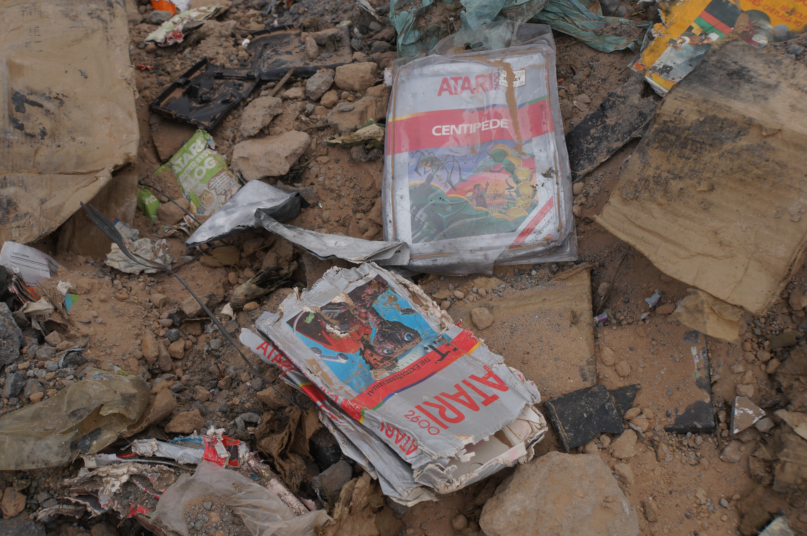

# アタリショックとは何だったのか——1983年の北米ゲーム市場の崩壊と、任天堂の答え

> 2026年11月11日改版：記事全体を全面的に書き直しました。内容の変更はGitの履歴から追えます。

## はじめに

日本で「アタリショック」と呼ばれるのは、1983年前後に北米の家庭用ゲーム機市場が急速に縮小した出来事である。北米では「Video Game Crash of 1983」などと呼ばれる。日本では、粗製濫造されたソフトによって市場が崩れたという説明をよく耳にする。実際、この時期にはソフトの供給が膨らむ一方、家庭でゲームを遊ぶ機器の選択肢も変わりつつあった。[[1](#ref-1)][[2](#ref-2)]

年末商戦を前にしたアタリの業績発表から、任天堂が北米でNintendo Entertainment System（NES）を売り出すまでをたどると、売れ行きの悪化がなぜ市場全体の問題になり、ゲーム機を再び店頭に並べるために何が求められたのかが見えてくる。

***

## 年表：アタリの成長から北米でのNES発売まで

| 年月 | 出来事 | 出典 |
| --- | --- | --- |
| 1976年10月 | ワーナー・コミュニケーションズがアタリの経営権を取得。 | [[3](#ref-3)][[4](#ref-4)] |
| 1981年10月 | アタリが取引先に1982年分のほぼ全量の発注を求める。 | [[5](#ref-5)][[6](#ref-6)] |
| 1982年12月 | ワーナーが第4四半期の減益見通しを発表。翌日、株価が16ポイントを超えて下落。 | [[7](#ref-7)][[8](#ref-8)] |
| 1983年7月 | 任天堂が日本でファミリーコンピュータを発売。 | [[9](#ref-9)][[10](#ref-10)] |
| 1984年7月 | ワーナーがアタリの家庭用ゲーム機と家庭用パソコンの事業を売却。 | [[11](#ref-11)] |
| 1985年6月 | 任天堂がシカゴのCESでNESを披露。 | [[9](#ref-9)] |
| 1985年9月 | 日本でファミコン用の『スーパーマリオブラザーズ』が発売。 | [[9](#ref-9)] |
| 1985年10月 | 任天堂がニューヨークのトイザらスでNESの販売を開始。 | [[9](#ref-9)] |

***

## 1982年までの急成長

アタリは1977年、カートリッジを差し替えて別のゲームを遊べる家庭用ゲーム機VCS（Video Computer System、後のアタリ2600）を発売した。アーケードで親しまれた『Asteroids』などを家庭でも遊べるようになり、アタリの事業は急成長した。親会社のワーナー・コミュニケーションズは1976年にアタリを買収しており、最盛期にはアタリがワーナーの利益の約3分の1を占めた。[[12](#ref-12)][[4](#ref-4)]

1982年12月のニューヨーク・タイムズによれば、アタリの売上は1978年の2億ドル弱から、1982年にはおよそ10倍に伸びた。同紙が1981年10月時点の状況として伝えたところでは、アタリは家庭用ゲーム機とソフトの市場で約8割を占め、主な競合はマテルだった。本体を購入した家庭が次のカートリッジを買うたびに売上が積み上がり、当時の証券アナリストは、アタリの1981年の営業利益の過半をカートリッジが稼いだと見積もっている。[[5](#ref-5)]

その勢いを示す一本が、アーケードで人気を集めた『パックマン』のアタリ2600版である。家庭用版は画面の出来を広く批判されたが、売れ行きは非常によかった。ワーナーの共同最高執行責任者エマニュエル・ジェラード氏は、他社との競争が本格化する直前にこの成功を経験したため、アタリが次の商品も売れると楽観してしまったと振り返っている。作品の出来への評価と売れ行きは、同じ方向に動くとは限らなかった。[[5](#ref-5)]

ソフトを作る会社も増えた。アタリを離れたプログラマーらは1979年にアクティビジョンを設立し、アタリ2600向けに『Pitfall!』や『River Raid』などを送り出した。本体を買った人にとっては遊べる作品が増え、開発会社にとっては本体を作らずに、すでに普及したゲーム機の利用者に作品を届けられるようになった。[[13](#ref-13)]

***

## 1982年12月、最初の兆し

1982年12月8日、ワーナーは第4四半期の1株当たり利益が60〜65セントと、前年同期の1.17ドルの半分程度になる見込みだと発表した。アタリのカートリッジの販売不振が大きく響き、業務用ゲーム機の売り上げ減や玩具事業に関する一時費用も重なった。翌9日、ワーナーの株価は16ポイントを超えて下落した。[[7](#ref-7)][[8](#ref-8)]

業績見通しを発表した8日には、アタリの家庭用部門の社長だったペリー・D・オダック氏の解任も発表された。同氏の社長在任は約6か月だった。ニューヨーク・タイムズが報じた当時の人事では、同じ時期に家庭用パソコン部門の営業・マーケティング幹部と家庭用ゲーム部門の営業幹部も交代しており、いずれも就任から1年に満たなかった。ワーナーのジェラード氏は急成長に伴う負担の表れと見ていた。一方、アタリの元幹部らは、会長兼CEOのレイモンド・カサール氏は経営方針や部下への評価を頻繁に変えていたと語っている。[[5](#ref-5)][[14](#ref-14)]

12月23日付のクリスチャン・サイエンス・モニターは、ワーナーの役員・取締役9人が、業績発表前の8〜10月に計770万ドル分のワーナー株を売却していたと報じた。同紙が伝えた発表後の下落幅は30ポイント近くで、発表翌日だけの値動きより大きかった。[[15](#ref-15)]

受注の変調は、発表より前に始まっていた。アタリは1981年10月、取引先に翌年分のカートリッジをほぼ全量まとめて発注するよう求めていた。それまで品不足を経験していた取引先は、実際に必要と見込む数量より多めに注文した。ところが1982年の半ばにはソフトを出す会社が増え、アタリへの注文の取り消しが相次ぐようになった。ワーナーはその影響を12月の見通しに織り込んだ。株価の下落は、成長を続けてきた事業の変調が表面化した早い兆しだった。[[5](#ref-5)][[6](#ref-6)][[8](#ref-8)]

***

## 崩壊を招いた要因

**ソフトの供給過剰と質のばらつき。** 本体メーカー以外の会社が参入し、遊べる作品は増えた。その一方で、開発を急いだ作品も店頭に並び、新作の供給が市場の需要を上回った。The Strong National Museum of Playは、アクティビジョンのように評価の高い作品を出した会社と、作り込みの浅いソフトを急いで発売した会社が同時に存在したと説明している。[[2](#ref-2)]

**ゲーム機の普及の飽和とパソコンとの競合。** 家庭用ゲーム機がすでに広く普及した市場では、新たに本体を買う家庭を増やし続けることが難しくなる。そこへ、ゲームも遊べる家庭用パソコンが選択肢に加わった。ファミコンの開発を率いた上村雅之氏は、アタリショック以降の北米では家庭用テレビゲーム機の市場が急速に縮小し、代わってパソコン仕様の機器が主流になっていたと振り返っている。[[2](#ref-2)][[12](#ref-12)][[9](#ref-9)]

**アタリ自身の受注と生産の判断。** アタリは年末商戦に映画の人気を取り込めると見込み、映画『E.T.』のゲーム化を進めた。一方、ワーナーの12月の発表には、カートリッジの注文取り消しがすでに表れていた。需要を強く見込んで生産を進めていても、注文が取り消されれば、その分の販売は見込めなくなる。供給が増えた時期にこうした判断のずれが重なり、アタリは売れ残りを抱えた。[[1](#ref-1)][[8](#ref-8)]

***

## 『E.T.』と埋立地：伝説と実像

映画を原作とするアタリ2600用の『E.T. the Extra-Terrestrial』（以下『E.T.』）は、1982年12月に発売され、後にアタリショックを象徴する作品になった。The Strongは、カートリッジの所蔵品解説で、この一本だけに市場崩壊の原因を求めることはできないとしている。ドキュメンタリー『ATARI GAME OVER』の日本語版プロデューサー、黒川文雄氏へのファミ通.comの取材でも、崩壊は複数の事情が重なった出来事として扱われている。[[16](#ref-16)][[3](#ref-3)]

1983年、アタリは売れ残った商品をニューメキシコ州アラモゴードの埋立地で処分した。2014年4月の発掘で『E.T.』とともに『Centipede』や『Asteroids』なども見つかり、埋設の実在が物証で確かめられた。The Henry Fordは処分されたカートリッジを約70万本とする。元アタリの担当者ジェームズ・ヘラー氏がAP通信に語った72万8,000本は、テキサス州エルパソの倉庫にあり、同氏が処分を任されたカートリッジの総数である。[[1](#ref-1)][[17](#ref-17)][[18](#ref-18)]

*画像引用：撮影 taylorhatmaker ／ [CC BY 2.0](https://creativecommons.org/licenses/by/2.0/) ／ [Wikimedia Commons](https://commons.wikimedia.org/wiki/File:Atari_E.T._Dig-_Alamogordo,_New_Mexico_(14036097792).jpg) 経由。WebP変換。*

***

## 崩壊の後：アタリの事業は分かれた

『TIME』の当時の報道によれば、アタリは1983年の最初の9か月で5億3,600万ドルの損失を出した。[[19](#ref-19)]

1984年7月、ワーナーはアタリの家庭用ゲーム機と家庭用パソコンの事業を、コモドール創業者のジャック・トラミエル氏が率いる会社へ売却した。家庭向け事業はアタリ・コーポレーションに引き継がれ、業務用ゲーム事業は別に存続した。[[12](#ref-12)][[11](#ref-11)]

***

## 同じころ、日本では

北米の家庭用ゲーム機市場が縮んだ1983〜85年、日本ではファミコンが普及していった。任天堂で開発第2部の部長を務めていた上村雅之氏は、それまで業務用ビデオゲームの開発を率いていた。上村氏の回想によれば、1981年11月、山内溥社長から電話で、カセット式の家庭用テレビゲーム機の開発を任された。[[20](#ref-20)]開発陣は、すでにアーケードで人気のあった『ドンキーコング』を家庭で遊べるようにすることを目標に据えた。1983年7月15日の本体発売に合わせて、『ドンキーコング』『ドンキーコングJR.』『ポパイ』の3作品を発売した。[[9](#ref-9)][[20](#ref-20)]

上村氏によると、本体が100万台に達するまでには約11か月かかった。生産したうち良品になる割合を「歩留まり」という。ファミコンの歩留まりは、任天堂がすでに作っていたゲーム＆ウオッチよりはるかに悪かった。販売が伸びてからも、良品として出荷できる台数が需要に追いつかなかった。上村氏が振り返る当時の品薄は、生産の難しさから生じたものである。[[21](#ref-21)]

発売当初には、家庭で遊ぶうちに見つかる不具合もあった。上村氏が挙げる例が、1983年12月発売の『ベースボール』で、一定の条件下でグラウンドの白線が消えるというものだ。上村氏は、グラフィック表示用のチップの発熱が原因だったと説明している。任天堂は年末商戦を前に対象の本体の出荷を止め、回収と修理を経て市場に戻した。ソフトを増やしていくのと並行して、本体を安定して遊べる状態で届ける仕事も必要だった。[[9](#ref-9)][[21](#ref-21)]

1985年9月13日には『スーパーマリオブラザーズ』が発売され、大きなヒットとなった。北米で任天堂がゲーム機を再び店頭に置いてもらおうとしていた時期、日本では新作ソフトがファミコンの普及を後押ししていた。[[9](#ref-9)]

本体の価格と性能をどう両立させたかは、[ファミコンの価格と性能を扱った記事](famicom-price-performance-cartridge-expansion.md)で詳しく取り上げている。

***

## 任天堂の答え：日本のファミコンと北米のNES

### 日本ではカセットの品質を保証する制度を整えた

任天堂は1983年7月15日、日本でファミリーコンピュータ（ファミコン）を発売した。日本のファミコンには、北米のNESが後に採用したようなカセット認証用のロックアウト機構はなかった。[[9](#ref-9)][[10](#ref-10)][[22](#ref-22)]

ファミコンの普及に伴い、他社からソフトを作りたいという申し出が増えた。当初は他社が自らカセットを製造する例があり、不良品の回収をきっかけに任天堂にも苦情が寄せられた。ファミコン発売当時、任天堂の総務部の責任者だった今西紘史氏によれば、任天堂は自社でカセットを製造し、その品質を保証するライセンス制度を整えていった。制度が完全に整ったのは、今西氏の記憶では1986年1月ごろである。ここで問題になったのは、買ったカセットが製品として正常に使えるかという品質である。[[21](#ref-21)]

山内溥氏の判断とライセンスの考え方は、[山内溥の意思決定を扱った記事](hiroshi-yamauchi-decision-making.md)で詳しく取り上げている。

### 北米では店頭での見せ方と発売の条件を変えた

任天堂は1985年6月、シカゴのCES（家電見本市）でNESを披露した。上村氏によれば、家庭用ゲーム機に対する小売店の反応は厳しかったが、トイザらスが関心を示し、10月18日にニューヨークの同チェーンの店舗で販売が始まった。[[9](#ref-9)]

小売店に家庭用ゲームが再び売れると見てもらうため、任天堂は当時のロボット玩具ブームに着目し、NESのセットにゲームと連動するロボットのR.O.B.を同梱した。ゲーム機に慎重な小売店にも、当時人気のあった玩具と結びつけて新製品を紹介できた。[[23](#ref-23)]

ソフトには、認証と契約の両方で発売の条件を設けた。NESは「10NES」というロックアウト機構で、正規のカートリッジを認証した。1992年の米連邦巡回控訴裁判所の判決によれば、任天堂はライセンスを受けた会社が出せるNESの新作を各社年5本までに制限していた。認証が管理するのはカートリッジを本体で動かせるかどうかであり、年5本という条件が管理するのは各社の発売本数である。[[24](#ref-24)]

ロックアウトの技術は、[任天堂のハードウェアにおけるコピー対策を扱った記事](nintendo-hardware-anti-piracy-report.md)で解説している。

***

## 日本語圏でよく聞く説明と、確かめられること

| よく聞く説明 | 確かめられること |
| --- | --- |
| 粗製濫造のソフトだけが原因だった | ソフトの供給過剰と質のばらつきに、ゲーム機市場の飽和、パソコンとの競合、アタリの注文取り消しや在庫の問題が重なった。[[1](#ref-1)][[2](#ref-2)][[12](#ref-12)][[8](#ref-8)][[9](#ref-9)] |
| 『E.T.』が崩壊を起こし、数百万本が埋められた | 『E.T.』は複数の要因が重なった崩壊を象徴する作品である。アラモゴードで処分されたカートリッジは約70万本とされ、発掘では複数の作品が見つかった。[[1](#ref-1)][[16](#ref-16)][[18](#ref-18)] |
| アタリは倒産した | ワーナーは1984年に家庭向け事業を売却した。家庭向け事業と業務用ゲーム事業は別々に存続した。[[12](#ref-12)][[11](#ref-11)] |
| ファミコンも最初からロックアウトで守られていた | カセット認証の10NESを搭載したのは北米のNESである。日本では任天堂がカセットの製造と品質保証を担うライセンス制度を整えた。[[22](#ref-22)][[21](#ref-21)][[24](#ref-24)] |

***

## プランナーが持ち帰れること

### 品質として何を保証するか

日本のファミコンでは、不良カセットの回収を経て、任天堂がカセットを製造し、製品としての品質を保証する制度を整えた。編者がここで注目するのは、保証する範囲を具体的にできることだ。たとえば、購入者がカセットを挿せば正常に起動し、遊べるという約束なら、どの状態を出荷前に確かめ、店頭に出たあとに問題が起きたときに誰が対応するかを決められる。遊びの面白さへの評価とは別に、購入者と小売店の双方が製品を扱う前提を支えられる。[[21](#ref-21)]

### 発売の枠をどう管理するか

北米のNESでは、各社の新作を年5本までとする契約条件があった。編者の考えでは、発売枠を考えるときは、枠が何を調整するためのものかを先に決めておきたい。各社の本数を抑えれば、個々の会社は限られた枠をどの企画に使うか選ぶことになる。一方、複数社の作品が同じ時期に集中するかどうかは、年単位の本数からは分からない。どの時期にどれだけの新作を届けたいのかまで考えると、本数と発売時期を別々に検討できる。[[24](#ref-24)]

### 需要の読みが外れたときに、どう立て直すか

アタリは翌年分の注文を早い段階で集めたが、競争が激しくなると取り消しが相次いだ。編者がこの事例から持ち帰りたいのは、当初の注文量、取り消しを差し引いた注文量、実際の売れ行きを区別することだ。どの数字が見込みから外れたら次の生産を減らすのか、どの時点まで数量を変えられるのかを、発注時に決めておく。売れ行きの変化を見て供給を調整できれば、小売店に余分な在庫を抱えさせる事態を減らせる。[[5](#ref-5)][[8](#ref-8)]

## References

英語資料は、本文では日本語で要約した。

1. [Kristen Gallerneaux「Unearthing the Atari Tomb: How E.T. Found a Home at The Henry Ford」][1] — The Henry Ford、2015年7月10日。発掘の経緯と所蔵品の解説。

[1]: https://www.thehenryford.org/collections/explore/articles/atari-tomb

2. [Eric Wheeler「What Video Game Crash?」][2] — The Strong National Museum of Play、2011年4月26日。

[2]: https://www.museumofplay.org/blog/what-video-game-crash/

3. [小山太輔「DVD『ATARI GAME OVER』プロデューサー黒川氏に聞く、アタリショックのこと、DVDのこと、『E.T.』のこと」][3] — ファミ通.com、2015年9月15日。

[3]: https://www.famitsu.com/news/201509/15088577.html

4. [Computer History Museum「January 8th, 1984 New York Times article on Video Game Crash」][4] — CHM Revolution。1984年1月8日付の新聞記事の所蔵資料解説。

[4]: https://www.computerhistory.org/revolution/computer-games/16/192/790

5. [Andrew Pollack「The Game Turns Serious at Atari」][5] — The New York Times、1982年12月19日。アタリの売上・市場シェア、家庭用版『パックマン』の売れ行き、人事と受注の経緯。

[5]: https://www.nytimes.com/1982/12/19/business/the-game-turns-serious-at-atari.html

6. [Mirko Ernkvist「Down Many Times, but Still Playing the Game: Creative Destruction and Industry Crashes in the Early Video Game Industry 1971-1986」][6] — History of Insolvency and Bankruptcy、Södertörn Academic Studies 38、2008年。186〜187ページの「Atari’s fall」を参照。

[6]: https://sh.diva-portal.org/smash/get/diva2%3A15847/FULLTEXT01.pdf

7. [The Observer「1982年12月10日号」][7] — University of Notre Dame Archives、1982年12月10日。3ページの株式市場報道。

[7]: https://archives.nd.edu/observer/1982-12-10_v17_070.pdf

8. [米ニューヨーク州南部地区連邦地方裁判所「In re Warner Communications Securities Litigation」][8] — 618 F. Supp. 735、1985年。業績見通しの発表と翌日の株価下落に関する事実経過。

[8]: https://openjurist.org/618/fsupp/735/in-re-warner-communications-securities-litigation-1793072

9. [上村雅之「ゲーム産業の系譜：第3回 ファミコン苦難の船出からブーム爆発、スーパーファミコンへ」][9] — コンピュータエンターテインメント協会（CESA）、2026年10月8日。

[9]: https://www.cesa.or.jp/genealogy/uemura/uemura03.html

10. [任天堂「会社の沿革」][10] — 任天堂公式サイト。1983年のファミリーコンピュータ発売。

[10]: https://www.nintendo.co.jp/corporate/history/index.html

11. [United Press International「Warner sells Atari operations」][11] — UPI、1984年7月2日。ワーナーによる事業売却発表の報道。

[11]: https://www.upi.com/Archives/1984/07/02/Warner-sells-Atari-operations/2550457588800/

12. [Atari「History」][12] — Atari公式サイト。VCSの展開、市場の飽和と事業の分割。

[12]: https://atari.com/pages/history

13. [Atari「Atari x Activision: The Collection」][13] — Atari公式サイト。アクティビジョンの設立とアタリ2600向けの作品。

[13]: https://atari.com/pages/activision

14. [The Christian Science Monitor「Stock of Atari gamemaker plunges on earnings news」][14] — The Christian Science Monitor、1982年12月10日。

[14]: https://www.csmonitor.com/1982/1210/121019.html

15. [The Christian Science Monitor「'Lucky insiders,' Fed money gauge, new accounts - a range of views」][15] — The Christian Science Monitor、1982年12月23日。ワーナー役員・取締役による株式売却についての当時の報道。

[15]: https://www.csmonitor.com/1982/1223/122349.html

16. [The Strong National Museum of Play「Video game:Atari E.T. The Extra-Terrestrial」][16] — Google Arts & Culture。1982年製の所蔵品（資料番号111.4437）の解説。

[16]: https://artsandculture.google.com/asset/video-game-atari-e-t-the-extra-terrestrial-atari-inc/CQH7EfIr72eR_Q?hl=en

17. [Associated Press「Diggers find Atari's E.T. games in landfill」][17] — CBS News掲載、2014年4月。発掘現場でのジェームズ・ヘラー氏の証言。

[17]: https://www.cbsnews.com/news/diggers-find-ataris-et-games-in-landfill/

18. [Xbox Wire「Long-Buried E.T. Cartridges Unearthed at New Mexico Landfill」][18] — Xbox Wire、2014年4月26日。発掘に参加した側の報告。

[18]: https://news.xbox.com/en-us/2014/04/26/ent-atari-dig/

19. [William McWhirter「The Zinger of Silicon Valley」][19] — TIME、1984年2月6日。損失額の対象期間は1983年の最初の9か月。

[19]: https://time.com/archive/6699839/the-zinger-of-silicon-valley/

20. [上村雅之「ゲーム産業の系譜：第2回 任天堂での開発三昧の日々、そしてファミコンの誕生」][20] — コンピュータエンターテインメント協会（CESA）。カセット式ゲーム機の開発とファミコンの発売時の作品。

[20]: https://www.cesa.or.jp/genealogy/uemura/uemura02.html

21. [任天堂「社長が訊く『スーパーマリオ２５周年』 ファミコンとマリオ篇 3. トラブル続きだったファミコン黎明期」][21] — 任天堂公式サイト。今西紘史氏らによるライセンス制度の回顧。

[21]: https://www.nintendo.co.jp/n10/interview/mario25th/vol2/index3.html

22. [Casey O’Donnell「The Nintendo Entertainment System and the 10NES Chip: Carving the Video Game Industry in Silicon」][22] — Games and Culture、第6巻第1号、2011年。日本のファミコンとNESの認証機構の違い。

[22]: https://study.sagepub.com/sites/default/files/O%E2%80%99Donnell%2C%20C.%20%282011%29.%20The%20Nintendo%20entertainment%20system%20and%20the%2010NES%20chip.pdf

23. [Jon-Paul Dyson「Playthings Magazine Documents the History of Electronic Games」][23] — The Strong National Museum of Play、2010年11月4日。当時の玩具業界誌に基づくR.O.B.の解説。

[23]: https://www.museumofplay.org/blog/playthings-magazine-documents-the-history-of-electronic-games/

24. [米連邦巡回控訴裁判所「Atari Games Corp. v. Nintendo of America Inc.」][24] — 975 F.2d 832、1992年9月10日。10NESとライセンス条件に関する判決の事実関係。

[24]: https://law.justia.com/cases/federal/appellate-courts/F2/975/832/163650/

----

この文書は、Perplexity、Claude、ChatGPT の3つのAIの支援を受けて著述されたものです。引用画像を除き、MIT License にて提供されています。
