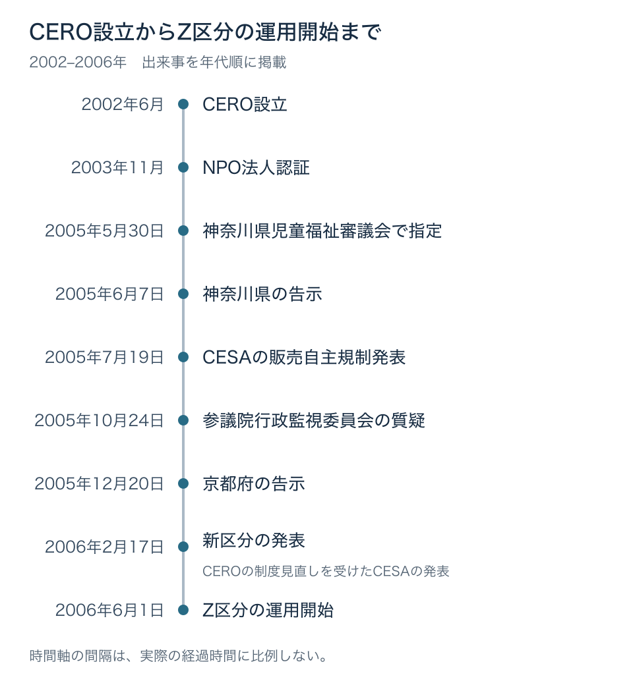

# その年齢表示は、目安か、販売の条件か――CEROの設立からGTA IIIの有害図書指定、Z区分と条例の連動まで

2003年に国内で発売された『グランド・セフト・オートIII』（以下、GTA III）には、CEROの「18歳以上対象」という表示が付いていた。それは、購入するときの目安だった。同じソフトが、2005年の神奈川県では、18歳未満への販売を禁止される「有害図書類」の側に移った。ソフトの対象年齢を示すことと、その年齢に達しない人に売れないことのあいだには、ルールの違いがある。[[1](#ref-1)][[2](#ref-2)]

本稿は「ゲームと行政のあいだ」第3回である。[第1回](game-and-government-regulation-map.md)ではゲームに届くルールの経路を、[第2回](diet-1986-177-and-pc-game-self-regulation.md)では1986年の国会答弁とPCゲームの自主規制をたどった。今回は、 **その年齢表示は、目安か、販売の条件か** を判断軸にする。

レーティングとは、ここではゲームの表現内容を審査し、対象となる年齢を区分して示す仕組みのことである。業界が作った表示は、販売店の対応や、自治体が定める条例に参照されるようになる。2002年から2006年までを順に見ていこう。

***

## 2002年――発売の二択から、年齢別の情報へ

2002年6月5日の総会を経て、コンピュータエンターテインメントレーティング機構（CERO）が任意団体として設立された。任意団体とは、法人格を持たず、参加者の合意で活動する団体である。設立を発表した業界団体のコンピュータエンターテインメントソフトウェア協会（CESA、同年7月にコンピュータエンターテインメント協会へ改称）は、約4年前から会員各社に表現内容の自主規制を求めていたが、独立した機構で運用すべきだとの結論に至ったと説明した。[[3](#ref-3)][[4](#ref-4)]

同年7月29日の説明会では、設立の狙いがより具体的に語られた。CESAは、それまでの扱いを「これまでは発売可能か、禁止かの2択しかなかった」と説明した。大人向けには提供できる表現を含む作品でも、幼い子どもが遊ぶことまで考えると発売を見送る。この問題を、年齢別の区分によって改善しようとしたのである。[[4](#ref-4)]

当時の説明では、表示年齢に達しない人が購入しようとしても、CEROが強制的に止めることはできないとされていた。表示は、ユーザーが選ぶための情報として位置付けられていた。[[4](#ref-4)]

2003年11月には、東京都から特定非営利活動法人（NPO法人）として認証された。NPO法人とは、社会のための活動を行い、利益を構成員に分配することを目的としない法人である。法人となったCEROも、ゲームを選ぶための情報を提供する審査機関という立場で活動を続ける。[[5](#ref-5)]

出典：CEROの設立・法人認証。[[3](#ref-3)][[5](#ref-5)] 神奈川県・京都府の指定。[[1](#ref-1)][[8](#ref-8)] 販売自主規制・国会質疑。[[7](#ref-7)][[2](#ref-2)] 新区分の発表・運用開始。[[10](#ref-10)][[11](#ref-11)]

***

## 2005年5〜6月――神奈川県がGTA IIIを指定する

2005年5月30日、神奈川県児童福祉審議会でGTA IIIが有害図書類に指定され、6月7日に県が告示した。児童福祉審議会は、子どもの福祉に関する事柄を検討する会議体であり、告示は行政による正式な公表である。指定の理由は、残虐な表現だった。本作には、すでにCEROの「18歳以上対象」という表示があった。[[1](#ref-1)]

「有害図書類」は、条例に基づき、青少年への販売などを制限する対象に指定された出版物を指す。この枠には、ゲームソフトも含まれる。神奈川県での指定によって、GTA IIIは18歳未満への販売禁止の対象となった。当時のITmedia NEWSの報道は、ほかのソフトと区別して陳列することも義務付けられると伝えている。[[1](#ref-1)][[6](#ref-6)]

ここで変わったのは、その地域で売るときの条件である。CEROの表示は購入の判断材料だったが、条例による指定は、販売する側に禁止や陳列上の対応を求める。誰が、どのルールに基づいて対象を決めたのかによって、同じソフトの売り方が変わった。

***

## 2005年7月――CESAが販売店への協力要請を発表する

2005年7月19日、CESAは「18歳以上対象」の家庭用ゲームソフトについて、18歳未満への販売を自主的に規制するよう、全国の販売店に協力を求めると発表した。[[7](#ref-7)]

具体的には、明らかに18歳未満と分かる購入希望者には、18歳以上対象の商品であることを説明し、販売しない。一方、親や保護者が同伴し、その同意があれば販売する。18歳未満かどうか判断できない場合には、販売店が年齢を確認するという内容だった。あわせて、年齢区分を意識しやすい陳列の工夫と、店頭での制度の告知強化も求めた。[[7](#ref-7)]

これは販売店への協力要請であり、強制力はなく、実施方法も販売店に委ねられた。神奈川県の条例による販売禁止と、保護者の同伴・同意を例外として認める業界の販売自主規制は、根拠と条件が異なる。

会見でCESA調査広報委員長の和田洋一氏は、この取り組みを行政への対応ではなく、業界自身が進めるものと説明した。条例による規制には抜け道が生まれうるため、自分たちで実行することが実効性につながるという見方を示したのである。[[7](#ref-7)]

年齢区分が、表示を見て選ぶための情報から、店頭で誰に売るかを判断する基準にもなり始めた。

***

## 2005年10月――国会が問うのは、表示の普及と売り方の実効性

2005年10月24日、第163回国会の参議院行政監視委員会第1号で、浮島とも子議員（公明党）がゲームの自主規制について質問した。答えたのは、経済産業省商務情報政策局長の豊田正和政府参考人である。[[2](#ref-2)]

発言76で豊田局長は、CEROによる審査と年齢表示の仕組みを説明し、2005年8月に発売されたソフトについて「レーティングマーク表示率は九六％」と述べた。これに対する発言77で、浮島議員は、CEROの表示は購入の目安であって年齢による購入制限ではないと指摘し、神奈川県の指定にも触れた。表示が広まっていることと、対象年齢に沿った販売が行われることは、別の論点として問われている。[[2](#ref-2)]

発言78で豊田局長が挙げたのは、CESAが販売店に求めた三つの対応だった。[[2](#ref-2)]

- 年齢区分に合うユーザーへの販売を徹底すること。
- 顧客が年齢区分を認識しやすいよう、陳列を明確にすること。
- 店頭でレーティング制度の告知を強めること。

さらに、主要なゲームソフト販売店約8,000店に、制度に関するポスターなどを送付したと説明した。政府の答弁は、業界の取り組みを紹介し、その販売実態を把握していくというものだった。[[2](#ref-2)]

### PCゲームの自主規制ともつながる

発言80では、パソコン用ゲームソフトの一部が、家庭用ゲームソフトのレーティングを受けていないことも認められた。そこで挙げられたのが、[第2回](diet-1986-177-and-pc-game-self-regulation.md)で扱ったコンピュータソフトウェア倫理機構、いわゆるソフ倫である。発言82では、ソフ倫は任意団体で、特定の所管があるわけではないとして、自主規制団体としての状況を見守る考えを示した。[[2](#ref-2)]

文部科学省スポーツ・青少年局長の素川富司政府参考人は、発言84で、業界団体に実効性のある自主規制の策定と運用を求めていると説明した。保護者への周知については、全国フォーラムでのパンフレット配付を挙げた。また、家庭教育手帳には、レーティング制度そのものではないが、テレビゲームに関する家庭のルールづくりを含めていると述べた。[[2](#ref-2)]

この質疑で政府が示した対応は、第2回と同じく、業界の自主規制を徹底し、保護者に周知する方向へ戻っている。国会で対応が問われたことと、新しい法律ができたことを分けて読む必要がある。

***

## 2005年12月――京都府の指定と、新区分をめぐる協議

2005年12月20日、京都府は告示第658号で、GTA IIIと『グランド・セフト・オート・バイスシティ』を有害図書類に指定した。根拠は、京都府青少年の健全な育成に関する条例第13条の2第1項である。告示には、カプコンが発売する二つのソフト名が記されている。[[8](#ref-8)]

自治体が作品を個別に指定する一方で、業界の区分自体を見直す協議も進んでいた。2006年2月20日付の土本学氏の業界コラムは、2005年12月に東京都が開いた会議でCEROの新区分案が示されたと伝えている。また、東京都・神奈川県・埼玉県・千葉県の一都三県が、2006年1月10日に共同でゲームソフトの規制に乗り出すと発表したとも報じている。[[9](#ref-9)]

作品ごとの指定と、複数の作品に共通する区分の見直し。この二つが並行していた時期を経て、2006年の制度変更へ進む。

***

## 2006年――Z区分が、販売しないことを前提にする

2006年2月17日、CESAは、CEROのレーティング制度の見直しを受け、18歳未満への販売を禁止する区分を設けると発表した。新区分は次の五つである。表内の名称は当時の発表表記による。[[10](#ref-10)]

| 区分 | 対象年齢の表示 |
|---|---|
| A | 全年齢対象 |
| B | 12才以上対象 |
| C | 15才以上対象 |
| D | 17才以上対象 |
| Z | 18才以上のみ対象 |

従来の「18才以上対象」に対して販売自粛への協力を求めていた扱いから、Z区分では18歳未満への販売禁止を求める扱いへ強めた。新制度による審査は3月1日から適用し、販売方法は5月31日までに切り替える方針が示された。ここでいう販売禁止は、法的拘束力のない業界の自主規制として販売店に求めるものだった。[[10](#ref-10)]

文部科学省の資料も、Z区分を、18歳未満の人に販売・頒布しないことを前提とする区分と説明し、2006年6月1日から運用していると記している。年齢の数字に「のみ」が加わり、誰に販売するかという条件が区分の前提になったのである。[[11](#ref-11)]

### 条例が、業界の区分を参照する

同じ文部科学省資料は、条例によって、CEROがZ区分としたソフトを18歳未満への販売・頒布禁止の対象にする措置も整理している。その接続方法の一つが「団体指定」である。これは、条例で指定した業界団体が、その審査基準などに基づいて選んだ出版物を、有害図書類として扱う仕組みを指す。[[11](#ref-11)]

作品を一本ずつ審議して指定する方法に対し、団体指定では、業界団体の判断を条例側の対象選びに利用する。業界が付けた年齢区分が、条例の販売制限につながる「言葉」になるのである。

ただし、Z区分の新設によって、全国一律の法律上の販売禁止が生まれたわけではない。同資料は、2006年11月時点の都道府県ごとの対応を並べている。業界の自主規制と、その区分を取り込む自治体の条例を、販売する地域に即して読む必要がある。[[11](#ref-11)]

***

## 三つの説明――誰が線を動かしたと語るのか

この経緯を誰の働きかけによるものと説明するかは、当事者の記録で一致していない。時点も立場も異なる三つの説明を並べておこう。

CESAの和田洋一氏は、2005年7月の会見で、販売自主規制を行政への対応ではなく、業界の自主的な取り組みと説明した。[[7](#ref-7)]

元神奈川県知事の松沢成文議員（当時の会派は次世代の党）は、2015年5月19日、第189回国会の参議院文教科学委員会第9号の発言92で、知事時代を振り返った。全国知事会を代表して業界団体に販売等の自主規制を促し、それを受けてCEROがZ区分を設けたという説明である。その区分について「残虐性のあるもの、それを十八歳以上のみを対象とすることにして」と述べた。[[12](#ref-12)]

一方、2022年11月27日公開のGame*Sparkのインタビューでは、政府や行政との関係を問われたCERO事務局が、次のように回答している。[[13](#ref-13)]

> ゲームの表現内容を規制する法律はなく、従って政府や行政からの要請や指導などは一切受けておりません。

これらはそれぞれ、業界団体、元知事、審査機関という立場から語られた説明である。

***

## 考察――企画で選ぶのは、表現と、その区分が届く先

ここからは、以上の経緯をゲームの企画判断に置き換えて考える。

年齢区分は、パッケージの表示欄を埋める情報であると同時に、ほかのルールから参照される言葉でもある。D区分の「17才以上対象」に収めるか、Z区分の「18才以上のみ対象」となるかによって、販売店での扱い、地域ごとの扱い、売り場や宣伝の条件が変わりうる。審査結果が出てから売り方を考えると、制作側と販売側で想定が食い違う可能性がある。

企画段階で、狙う区分と、その区分を参照するルールを一緒に確かめておきたい。想定する販売地域の条例、販売店の運用、宣伝媒体の条件について、誰が何を確認するかを決める。区分名だけで結論を出さず、その名前が引用される先までたどるのである。

海外版との表現の差分も、区分の選択として記録できる。ローカライズでどの表現を修正し、どの対象年齢と販売条件を見込んだのかを残しておけば、後の移植や再発売で判断を引き継ぎやすい。各国の制度や表現調整については、[海外展開とレーティングを扱う記事](game-global-rating-regulations.md)を参照してほしい。

一方で、区分の境界に収めるために表現を削ることが、作品の意図を損なう場合もある。描写の意味や物語上の役割を失ってまで対象年齢を下げるのか、それとも、想定する年齢層に作品を届けるために売り方を組み立てるのか。そこには、制作と販売の両方から検討すべき選択がある。

保護者が選ぶための情報という役割も残る。売りやすい区分に収めることだけを目的にすれば、どんな内容の作品で、誰に向けて作ったのかを伝える視点が弱まりかねない。表現の意図、対象読者への説明、販売の条件をそろえて判断することが、企画の仕事になる。

***

## 企画段階の点検表

- 狙う年齢区分と、その年齢の人に届けたい理由を説明できるか。
- その区分は、購入の目安か、販売しないことを前提とする区分か。
- 販売予定地域の条例は、その区分や作品をどう扱っているか。
- 販売店の年齢確認、区分陳列、宣伝の条件を販売担当者と確認したか。
- 海外版との表現の差分と、区分を選んだ理由を記録したか。
- 区分を調整するための修正が、作品の意図や保護者への情報提供を損なわないか。

次回は、コンプガチャと景品表示法を扱う。ゲームの仕組みが、既存のルールにある「カード合わせ」という言葉で読まれた過程をたどる。

年齢の数字が何を意味するかは、その表示を使うルールによって変わる。企画で確かめたいのは、 **その年齢表示は、目安か、販売の条件か** である。

## References

1. [鴫原盛之「【今日はなんの日？】マンガで振り返るゲーム業界：「グランド・セフト・オートIII」が神奈川県のゲームソフト有害図書類に指定・告示される（2005年6月7日）」][1] — GAME Watch、2024年6月7日。

[1]: https://game.watch.impress.co.jp/docs/kikaku/1594325.html

2. [国立国会図書館「第163回国会 参議院 行政監視委員会 第1号」][2] — 国会会議録検索システム、2005年10月24日。発言75〜84、特に76〜78、80、82、84。

[2]: https://kokkai.ndl.go.jp/simple/detail?minId=116314281X00120051024&spkNum=78#s78

3. [北村孝和「CESA、ゲームソフトに年齢別レーティングを設定する独立機構「CERO」を設立」][3] — GAME Watch、2002年6月6日。

[3]: https://game.watch.impress.co.jp/docs/20020606/cero.htm

4. [船津稔「コンピュータエンターテインメントレーティング機構が説明会を開催」][4] — GAME Watch、2002年7月29日。

[4]: https://game.watch.impress.co.jp/docs/20020729/cero.htm

5. [CERO「CEROについて」][5] — CERO公式サイト、日付記載なし。「沿革」「法人概要」。

[5]: https://www.cero.gr.jp/publics/index/3/

6. [ITmedia NEWS「「グランド・セフト・オート3」を有害図書類指定へ――神奈川県」][6] — ITmedia NEWS、2005年5月30日。6月7日の告示予定と、18歳未満への販売禁止・区別陳列の義務についての当時の報道。

[6]: https://www.itmedia.co.jp/news/spv/0505/30/news029.html

7. [佐伯憲司「CESA、「年齢別レーティング制度」を活用した販売自主規制を開始」][7] — GAME Watch、2005年7月19日。

[7]: https://game.watch.impress.co.jp/docs/20050719/cesa.htm

8. [京都府知事「京都府告示第658号」][8] — 京都府、2005年12月20日。青少年の健全な育成に関する条例第13条の2第1項に基づく2作品の指定。

[8]: https://www.pref.kyoto.jp/seisho/documents/h171220kokuji.pdf

9. [土本学「【Sales INSIDE】第4回 ゲームの自主規制区分に関して」][9] — インサイド、2006年2月20日。東京都の会議と一都三県の発表についての当時の業界コラム。

[9]: https://www.inside-games.jp/article/2006/02/20/17930.html

10. [電撃オンライン編集部「CEROのレーティング制度が3月1日をもって変更。18才未満への販売禁止区分を新設」][10] — 電撃オンライン、2006年2月17日。CESAの発表、区分呼称、審査適用と販売方法の切替期日。

[10]: https://dengekionline.com/data/news/2006/2/17/72008f2f0cd326ab00c34934e7de450c.html

11. [文部科学省「都道府県の青少年保護育成条例における有害図書類等の指定等に関する規定について」][11] — 中央教育審議会答申参考資料、2006年11月現在。「有害図書類の指定方法」「CEROの自主規制に対応した措置」と都道府県別の表。

[11]: https://www.mext.go.jp/b_menu/shingi/chukyo/chukyo0/toushin/07020115/021.htm

12. [国立国会図書館「第189回国会 参議院 文教科学委員会 第9号」][12] — 国会会議録検索システム、2015年5月19日。発言90の会派表記、発言92の松沢成文議員による回顧。

[12]: https://kokkai.ndl.go.jp/simple/detail?minId=118915104X00920150519&spkNum=92#s92

13. [Game*Spark編集部「なぜ「ゲームの表現」は規制されるのか？CEROこと“コンピュータエンターテインメントレーティング機構”にインタビュー」][13] — Game*Spark、2022年11月27日。CERO事務局の回答。

[13]: https://www.gamespark.jp/article/2022/11/27/124800.html

----

この文書は、Perplexity、Claude、ChatGPT の3つのAIの支援を受けて著述されたものです。引用画像を除き、MIT License にて提供されています。
