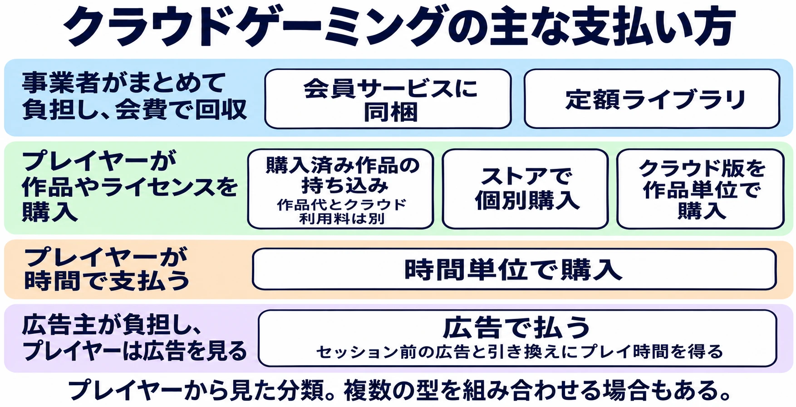

# クラウドゲーミングのサーバー代は誰が払うのか——定額・無制限から時間で売る形へ、各社の選択をたどる

> 2026年11月12日改版：記事全体を全面的に書き直しました。内容の変更はGitの履歴から追えます。

> 2026年11月13日更新：Xboxの広告付きクラウドゲーミングの発表を反映しました。

> 料金・プラン・提供状況は2026年11月13日時点の情報です。

## 1. はじめに

同じゲームを買った二人がいる。片方は自分の本体にインストールし、もう片方はクラウドで遊ぶ。クラウドでは、操作を受け取ったサーバーがゲームを動かし、その映像を端末へ送る。手元に高性能な本体や大きな空き容量がなくても遊べる代わりに、プレイしている間は提供側のサーバーに実行枠が要る。

会費や作品の価格が同じでも、短時間で切り上げる人と毎晩何時間も遊ぶ人では、使う実行枠の時間が違う。サーバーの維持には固定費もあるが、利用時間やピーク時の同時接続が増えれば、提供側はそれを支える容量を確保する必要がある。クラウドで作品を届けるには、 **遊ばれた時間に応じて増えやすい費用を、誰が、どの支払いから賄うか** を決めることになる。

操作の反応が遅れる仕組みは [ゲームの入力遅延](game-input-lag-guide.md)、通信による遅れを目立ちにくくする技術は [家庭用ゲーム機のネット対戦](console-online-multiplayer-latency-techniques.md) で扱う。

***

## 2. 代金の払い方の型

### 会員サービスに同梱する

PlayStation Plus プレミアムでは、ゲームカタログやオンラインマルチプレイなどと一緒にクラウドストリーミングを提供する。PS5向けタイトルのクラウドストリーミングは2023年10月に始まり、2025年11月6日にはPlayStation Portalにも正式実装された。Portalではカタログの対象作に加え、PlayStation Storeで購入済みの対応PS5ダウンロード版も配信できる。作品をすでに持っていても、クラウドで動かす機能を利用するにはプレミアム会費が要る。[[1](#ref-1)][[2](#ref-2)][[3](#ref-3)]

### 定額でライブラリを利用する

Xboxは2025年10月1日にGame Passのプランを刷新した。Xbox Cloud Gamingはベータを終え、Essential、Premium、Ultimateの全3プランで利用できるようになった。会員はプランに応じたカタログの対象作を遊べるほか、購入済みの対象作もストリーミングできる。PlayStation Plusと重なる部分はあるが、ここでは、個々の作品を買わずにカタログから選んで遊べる点に着目する。[[4](#ref-4)][[5](#ref-5)]

### 購入済みの作品を持ち込む

GeForce NOWでは、SteamやEpic Games Storeなどで入手した対応作品をNVIDIAのサーバーで動かす。有料会員が支払うのはクラウドで動かすための会費であり、買い切り作品の代金は購入元のストアへ払う。ストアで購入済みでも、そのストア版がGeForce NOWの配信対象かどうかで利用の可否が変わる。[[6](#ref-6)][[7](#ref-7)]

### 配信サービスのストアで作品を個別に買う

Google Stadiaでは、プレイヤーがStadiaストアで作品を個別に購入できた。別に会員制のStadia Proがあり、個別購入した作品はProを解約しても、Stadiaのサービスが続く間は遊べた。作品を買う店と、作品を動かすクラウドを同じサービスが提供していた。[[8](#ref-8)]

### クラウド版を作品単位で売る

Nintendo Switchでは、他社の配信技術を使ったクラウド版が作品ごとに販売されてきた。たとえば『Control Ultimate Edition – Cloud Version』ではUbitusが505 Gamesと組んで配信した。これらのクラウド版では、任天堂のストアが販売の窓口となり、外部の事業者がゲームを動かす基盤を担う。[[9](#ref-9)]

2018年に日本で配信された『バイオハザード7 レジデント イービル クラウドバージョン』では、180日プレイ券が2,000円だった。180日は利用券の有効期間である。2022年2月10日には『キングダム ハーツ』シリーズのSwitch向けクラウド版が発売され、作品別の購入やセット購入ができた。[[10](#ref-10)][[11](#ref-11)][[12](#ref-12)]

### プレイ時間を売る

HoYoverseの『Genshin Impact · Cloud』では、有料の残高から支払う場合、プレイ1分につき10 Cloud Coinsを消費する。一定期間使えるCloud Passもあり、パスが有効な間はパスが優先され、パスがなければ無料時間、Cloud Coinsの順で使う。公式告知の対象は米国・カナダと東南アジア・南アジアの一部で、日本は対象に含まれない。[[13](#ref-13)][[14](#ref-14)][[15](#ref-15)]

日本では、同じHoYoverseの『ゼンレスゾーンゼロ』クラウド版が2026年2月6日に正式リリースされた。配信時の案内では初回ログインで10時間の体験時間が付与され、30日分のフリーパスは2,600円だった。作品内の課金とは別に、クラウドで遊ぶ時間や期間に料金を設定した例である。[[16](#ref-16)]

### 広告で払う

プレイヤーが代金の代わりに広告を見て、遊ぶ時間を得る型もある。GeForce NOWの無料会員は、ゲームを選んだ後、各セッションの開始前に最長2分のビデオ広告を見る。広告はプレイ中には表示されない。[[6](#ref-6)]

Xboxは2026年7月23日、Xbox Insider向けに、所有する一部の作品を広告付きで無料でストリーミングできる試験を始めた。1回のプレイは1時間までで、広告はプレイの前に流れる。11月12日には、Microsoftの広告事業が広告主向けに「XBOX Video for Brands」を発表した。スキップできない3分間の広告を見ると30分間プレイでき、Game Passへの加入は要らない。対象作品、提供地域、一般向けの開始日は示されておらず、日本で提供されるかも発表されていない。[[17](#ref-17)][[18](#ref-18)][[19](#ref-19)]

この型では、サーバー代の一部を広告主が負担し、プレイヤーは広告を見る時間で支払う。

七つの型は、プレイヤーから見て何に代金を払うかで分けたものだ。会費と作品代、定額と時間枠のように、複数の型を組み合わせるサービスもある。事業者間で費用をどう分けるかは、購入画面からは分からない。

| 型と例 | 誰が何にいくら払うか | プレイ時間の上限・利用期限 |
| --- | --- | --- |
| 会員サービスに同梱（PS Plus プレミアム） | プレイヤーが会員特典一式に月1,550円（日本、1か月利用権）[[20](#ref-20)]。購入済み作品を使う場合の作品代は別 | 公式プラン案内に月間枠の記載なし。会員資格が必要 [[3](#ref-3)] |
| 定額ライブラリ（Game Pass） | プレイヤーがカタログなどに月会費。日本ではEssentialが850円、Premiumが1,300円、Ultimateが1,550円 | 通常3プランに月間枠あり。追加時間は別売り [[21](#ref-21)][[22](#ref-22)] |
| 購入済み作品の持ち込み（GeForce NOW） | プレイヤーが作品代を外部ストアに、クラウドの有料会費をNVIDIAに支払う。日本でのUltimate提供開始時は月3,580円。無料プランもある | PerformanceとUltimateは月100時間。1回の接続にもプラン別の上限がある [[6](#ref-6)][[7](#ref-7)] |
| 個別購入（Stadia、終了済み） | プレイヤーがStadiaストアに作品ごとの代金を支払う。Proは任意で、カナダ向け公式ブログでは月9.99ドル | 当時の購入案内に月間枠の記載なし。サービス終了で配信終了 [[8](#ref-8)] |
| 作品単位（Switch向けクラウド版） | プレイヤーが作品ごとの代金を支払う。『バイオハザード7』の180日券は2,000円。『キングダム ハーツ』の単品は発売時5,280円から | 『バイオハザード7』の旧券は180日の有効期限。『キングダム ハーツ』は販売終了後のプレイ期限あり [[10](#ref-10)][[11](#ref-11)][[12](#ref-12)] |
| 時間単位（Genshin Impact · Cloud） | プレイヤーが有料分を1分10 Cloud Coinsで支払う。Cloud Passも選べる | 無料時間・コイン残高またはパスの有効期間による [[13](#ref-13)] |
| 広告付き（GeForce NOWの無料プラン、Xboxの広告付きクラウド） | プレイヤーは代金の代わりに、セッション前の広告を見る。広告主が広告枠に支払う | GeForce NOWは広告が最長2分。Xboxは3分の広告で30分（広告主向けの発表。一般向けの開始日は未発表） [[6](#ref-6)][[18](#ref-18)] |

***

## 3. 2025〜2026年、「無制限」が後退した

**GeForce NOW** は2025年9月10日、Ultimate向けにGeForce RTX 5080クラスのサーバーを順次導入し始めた。一方、PerformanceとUltimateの定額料金に含まれるプレミアム利用時間は月100時間となった。未使用分は最大15時間を翌月に繰り越せ、超過分は15時間単位で追加購入できる。[[6](#ref-6)][[23](#ref-23)][[24](#ref-24)]

月間枠は2025年から導入され、対象の既存会員には2026年1月まで無制限で使える経過措置があった。NVIDIAの現行FAQでは、無制限の旧プランの権利を持つ会員の移行時期を、2026年1月15日以降の最初の請求日としている。基本のFounders会員には、資格を維持する限り無制限の例外もある。NVIDIAは月間枠を導入した理由として、品質や応答性を保ち、待ち時間を短くすることを挙げている。[[6](#ref-6)][[24](#ref-24)]

**Amazon Luna** は2026年4月10日、ゲームストア、個別購入、他社サブスクリプションの取り扱いを終了した。購入済みの対象作品や持ち込んだ外部ライブラリは6月10日までLunaで遊べた。ここで変わったのは、外部ストアで持っているゲームをLunaの実行枠で遊べる範囲である。[[25](#ref-25)][[26](#ref-26)][[27](#ref-27)]

**Xbox** は2026年11月からGame Passの通常3プランに月間クラウド時間枠を設けた。日本のXbox公式ストアにも時間枠が表示されている。Xboxの発表では、枠を使い切った後は追加時間を購入できる。Xboxは、利用者が増え、プレイが長くなるほど提供コストが増えると説明している。会員資格を持たない人が時間を買う仕組みも発表され、10月にはInsider向けに試験提供が始まった。プランごとの枠と作品を供給する側への影響は [「Xbox」はいま、いくつの器を指しているのか](xbox-multiple-containers-and-game-pass-supplier-decisions.md) で扱う。[[21](#ref-21)][[22](#ref-22)][[28](#ref-28)]

三つの変更が重なったことで、クラウド利用の条件がどこで決まるかが見えやすくなった。GeForce NOWとXboxは、会費で遊べる時間に枠を置き、さらに遊ぶ人から追加料金を受け取る。Lunaは、外部ライブラリにクラウドの実行枠を提供する仕組みを閉じた。時間枠を設けると、事業者は会費に含める利用量を定められ、プレイヤーは残り時間や追加料金を考えて遊ぶことになる。毎月の支払いが同じでも、遊ぶ時間の長い人ほどこの変更の影響を受けやすい。

一方でXboxは、時間枠を導入した同じ11月に、会費を払わずに広告を見て遊ぶ経路も広告主向けに発表した。編者には、遊ぶ時間を会費、追加購入、広告のどれで賄うかを、プレイヤーごとに選ばせる形へ近づいているように見える。[[18](#ref-18)]

***

## 4. サービスが終わるとき、購入者に何が残るか

**Stadiaでは返金が行われた。** Googleは2022年9月29日に終了を発表し、2023年1月18日にサービスを終えた。Google Storeで購入した対象のハードウェアと、Stadiaストアで購入した作品や追加コンテンツが返金対象となった。Stadia Proの会費は返金対象外だった。[[29](#ref-29)][[30](#ref-30)]

**Lunaでは購入元のストアに作品が残った。** EA、Ubisoft、GOGなどのストアで買った作品は、Lunaでの配信終了後も購入元のサービスで利用できた。対象作品のセーブデータは6月10日の配信終了から90日間ダウンロードできた。Amazonの案内によれば、持ち出したデータが他のサービスで使えるかは作品や移行先に依存する。[[26](#ref-26)][[27](#ref-27)]

**『キングダム ハーツ』では、割引購入とセーブの引き継ぎが用意された。** Switch向けクラウド版は2026年6月9日に販売を終了し、購入者は2027年6月9日までプレイできる。2026年10月8日には本体で動くSwitch 2版が発売され、『KINGDOM HEARTS -HD 1.5+2.5 ReMIX-』にはSwitch版も出た。クラウド版の所有者は対応するダウンロード版をニンテンドーeショップで割引購入し、セーブデータを引き継げる。移行先のダウンロード版は別途購入が必要で、パッケージ版は割引対象外である。[[31](#ref-31)][[32](#ref-32)]

購入した作品へのアクセス、支払った代金、プレイの進行状況は、それぞれ別に扱われる。返金で戻るのは代金であり、購入元に作品が残っても、続きから遊ぶにはセーブデータの互換性が要る。終了に向けた準備や告知は [サービス終了をどう設計するか](service-shutdown-design-and-practice.md) で扱う。

***

## 5. 作品をクラウドに載せるとき、プランナーが確かめること

### 操作のどこで遅れが響くか

アクションや対戦では、攻撃を見てから回避する場面や、相手の動きに合わせて入力する場面で遅れが響きやすい。入力を急がないコマンド選択型の作品は比較的許容しやすい。ジャンル名で判断を終えると、コマンド選択型に含まれるタイミング入力や、アクションでも落ち着いて操作できる場面を見落とす。チュートリアル、戦闘、対戦など、具体的な場面を対象地域の回線と端末で遊んで確かめる。

### 1回のプレイをどこで区切れるか

月間枠、1回の接続上限、再接続時の待ち行列は、それぞれ違う形でプレイに影響する。たとえばボス戦の直前しかセーブできない作品では、接続が切れると再び順番を待ち、戦闘をやり直すことになる。1回のプレイの長さとセーブまでの間隔を照らし合わせ、残り時間が少ない状態でも進行を保存できるか、切断後にどこから再開できるかを確認する。Xboxが広告主向けに発表した広告付きの経路では、1回の広告で遊べるのは30分である。30分の中で一区切りつく遊びがあるか、時間切れの前に保存できるかで、その経路で作品を試した人の印象は変わる。[[18](#ref-18)]

### どこで配信し、どこにつながるか

ストアで入手できる地域と、接続できるサーバーは別の条件である。『ゼンレスゾーンゼロ』の国内向けクラウド版は、案内上の接続先がAsiaのみで、サーバー切り替えにも対応しない。このAsia表記から物理的な配信拠点までは分からない。配信先を決める際は、提供事業者にストリーミングを処理する拠点と対象地域を確かめ、プレイヤーが実際に使う回線で接続や混雑時の待ち時間を試す。[[16](#ref-16)]

### 購入者に何を約束するか

ストアや購入画面で伝えるべきなのは、何を買うのか、いつまで使えるのか、配信を終えた後に何を続けられるのかである。購入元で遊び続けられる場合でも、手元に対応端末があるかで利用できる人は変わる。別の版へ移行できる場合は、セーブを引き継げる版、追加購入の要否、引き継ぎに使うアカウントを確かめる。配信事業者と作品の販売元が異なる場合は、購入履歴やセーブを誰が管理し、終了時に誰が対応するかも確認しておく。

***

## 6. むすび

配信先を選ぶときは、作品にいくら払ってもらうかに加え、遊ぶ時間が増えたときに誰の負担が増えるかを見ておきたい。契約や販売ページで確認する項目は、プレイヤーが買うものによって変わる。

| 課金の型 | 作品を載せる前に確かめること |
| --- | --- |
| 会員サービスに同梱 | どの会員・端末が対象か。カタログ収録と購入済み作品の配信で、利用できる条件はどう違うか |
| 定額ライブラリ | カタログ掲載が終わった後も購入版で続けられるか。会費内の時間枠で一つの遊びを区切れるか |
| 購入済み作品の持ち込み | 対応するストア・エディション・追加コンテンツはどれか。購入元の本体版とセーブが同期するか |
| ストアで個別購入 | 購入した権利がどのサービスにひも付くか。終了時に返金や別の版への移行を誰が扱うか |
| クラウド版を作品単位で販売 | 利用券の有効期限と配信終了日はいつか。本体で動く版へ移る場合に、購入やセーブはどう扱われるか |
| 時間単位で販売 | 時間の計測はいつ始まり、いつ止まるか。待機や切断が残高にどう影響し、時間切れの前に保存できるか |
| 広告付き | 1回の広告で得られる時間の中に、遊びの区切りと保存の機会があるか。広告と待ち時間を合わせて、遊び始めるまでにどれくらいかかるか |

## References

1. [ソニー・インタラクティブエンタテインメント「PS5®のクラウドストリーミングが『PlayStation®Plusプレミアム』加入者を対象に今月サービス開始！」][1] — PlayStation.Blog 日本語、2023年10月12日。

[1]: https://blog.ja.playstation.com/2023/10/12/20231012-ps5/

2. [ソニー・インタラクティブエンタテインメント「PS Portalのクラウドストリーミング機能が明日11月6日より正式実装！ PS Storeで購入したダウンロード版PS5®ゲームもストリーミング可能に」][2] — PlayStation.Blog 日本語、2025年11月5日。

[2]: https://blog.ja.playstation.com/2025/11/05/20251105-psportal/

3. [ソニー・インタラクティブエンタテインメント「PlayStation Plus サービス内容・プラン」][3] — PlayStation公式、2026年11月12日確認。

[3]: https://www.playstation.com/ja-jp/ps-plus/

4. [Xbox Wire「Updates to Xbox Game Pass: Introducing Essential, Premium, and Ultimate Plans」][4] — Xbox Wire、2025年10月1日。

[4]: https://news.xbox.com/en-us/2025/10/01/xbox-game-pass-ultimate-premium-essential-plans

5. [Xbox Wire「Getting Started with Xbox Cloud Gaming」][5] — Xbox Wire、2025年12月19日。

[5]: https://news.xbox.com/en-us/2025/12/19/getting-started-with-xbox-cloud-gaming/

6. [NVIDIA「GeForce NOW に関するよくある質問 (FAQ)」][6] — NVIDIA公式。対応ストア、月間枠、超過時の選択肢、経過措置。

[6]: https://www.nvidia.com/ja-jp/geforce-now/faq/

7. [NVIDIA「NVIDIA、GeForce NOW を日本で提供開始」][7] — NVIDIA公式、2024年4月。日本提供開始時の料金。

[7]: https://www.nvidia.com/ja-jp/about-nvidia/press-releases/2024/geforce-now-japan-launch/

8. [Phil Harrison「Play Stadia Pro for free, starting today」][8] — Google Canada Blog、2020年4月8日。個別購入とStadia Proの条件。

[8]: https://blog.google/intl/en-ca/products/devices-services/play-stadia-pro-for-free-starting-today/

9. [Ubitus「Ubitus Partners with 505 Games to Release “Control Ultimate Edition – Cloud Version” on Nintendo Switch™」][9] — Ubitus公式、2020年10月28日。

[9]: https://ubitus.ai/?p=516

10. [カプコン「利用手順を教えてください（バイオハザード7 レジデント イービル クラウドバージョン）」][10] — カプコン公式サポート。180日利用券の案内。

[10]: https://www.capcom.co.jp/support/faq/platform_switch_bh7cloud_0141277.html

11. [ファミ通.com「『バイオハザード7』“クラウドバージョン”がSwitchで配信開始　2000円で180日間、全内容をプレイ可」][11] — ファミ通.com、2018年5月24日。2,000円の税込・税別表記は当時の報道に差があるため、本文では2,000円という金額のみを記載。

[11]: https://www.famitsu.com/news/201805/24157801.html

12. [スクウェア・エニックス「『キングダムハーツ』シリーズ Nintendo Switch クラウドバージョン 2022年2月10日（木）発売決定」][12] — スクウェア・エニックス公式、2022年1月18日。

[12]: https://www.jp.square-enix.com/company/ja/news/2022/html/3bd7aaba631ed475d66920cb5a81fb19aeccc881.html

13. [HoYoverse「Genshin Impact · Cloud FAQ」][13] — Genshin Impact · Cloud 公式。課金順序と1分あたりの消費量。

[13]: https://cloudgenshin.hoyoverse.com/en-us/faq

14. [HoYoverse「Genshin Impact · Cloud US & Canada Open Beta on iOS, Android, and PC Now Available!」][14] — Genshin Impact · Cloud 公式。

[14]: https://cloudgenshin.hoyoverse.com/en-us/news/124125

15. [HoYoverse「Genshin Impact · Cloud: Indonesia, Thailand, Philippines, Laos, Cambodia, Bangladesh, Myanmar Open Beta Now Available!」][15] — Genshin Impact · Cloud 公式。

[15]: https://cloudgenshin.hoyoverse.com/en-us/news/122943

16. [Keiichi Yokoyama「『ゼンレスゾーンゼロ』クラウド版、国内向けに2月6日正式リリースへ。高画質・高フレームレートで爽快アクションが遊べる」][16] — AUTOMATON、2026年1月30日。HoYoverseの配信告知に基づく報道。

[16]: https://automaton-media.com/articles/newsjp/zzz-20260130-414736/

17. [Team XBOX「Beginning Ad-supported Game Streaming Test & Learn」][17] — Xbox Wire、2026年7月23日。Xbox Insider向けの試験。

[17]: https://news.xbox.com/en-us/2026/07/23/game-streaming-ad-supported-xbox-insiders/

18. [Meredith Barrett「XBOX Video for Brands: A new way to get closer to play」][18] — Microsoft Advertising Blog、2026年11月12日。広告主向けの発表。3分間の広告で30分のプレイ、スキップ不可、Game Pass不要。対象作品・地域・開始日の記載なし。

[18]: https://about.ads.microsoft.com/en/blog/post/november-2026/xbox-video-for-brands-a-new-way-to-get-closer-to-play

19. [Hideaki Fujiwara「Xboxクラウドゲーミング、広告を見れば無料で遊べる仕組みが広告主向けに正式発表」][19] — AUTOMATON、2026年11月13日。

[19]: https://automaton-media.com/articles/newsjp/20261113-479008/

20. [GIGAZINE「プレステのオンラインゲームでは必須の有料サブスク「PlayStation Plus」が値上げ」][20] — GIGAZINE、2026年5月19日。日本の各プランの料金と、日本が値上げの対象外であることの確認に使用。

[20]: https://gigazine.net/news/20260519-playstation-plus-price-raising

21. [Microsoft「XBOX Game Pass Essential — XBOX Game Pass Essential 1 か月間」][21] — Xbox公式ストア、2026年11月12日確認。通常3プランの日本での月額とクラウド時間枠。

[21]: https://www.xbox.com/ja-JP/games/store/p/CFQ7TTC0K5DJ/000C

22. [Team XBOX「XBOX Cloud Gaming の今後の変更について」][22] — Xbox Wire Japan、2026年9月4日。

[22]: https://news.xbox.com/ja-jp/2026/09/04/xbox-cloud-gaming-changes/

23. [GeForce NOW Community「Paint It Blackwell: GeForce RTX 5080 SuperPOD Rollout Begins」][23] — NVIDIA Blog、2025年9月10日。

[23]: https://blogs.nvidia.com/blog/geforce-now-thursday-blackwell-rtx-launch/

24. [NVIDIA「GeForce NOW Performance へようこそ: Priority メンバーは即座にアップグレード」][24] — NVIDIAブログ、2024年11月。月間枠の当初発表と追加購入の単位。

[24]: https://blogs.nvidia.co.jp/blog/geforce-now-thursday-performance-membership/

25. [Video Games Chronicle「Amazon Luna has stopped offering individual games and subscriptions from third-party stores」][25] — VGC、2026年4月10日。Amazonの案内を掲載。

[25]: https://www.videogameschronicle.com/news/amazon-luna-has-stopped-offering-individual-games-and-subscriptions-from-third-party-stores/

26. [GOG「Important update: Amazon Luna on GOG」][26] — GOG公式、2026年4月。GOGライブラリの扱い。

[26]: https://www.gog.com/en/news/important_update_amazon_luna_on_gog

27. [Lincoln Carpenter「Amazon's Luna cloud gaming service is ending support for game purchases and subscriptions from third-party stores, and users will lose streaming access to purchased third-party games in June」][27] — PC Gamer、2026年4月10日。Amazonの案内に基づく報道。保存データのダウンロード期間と互換性。

[27]: https://www.pcgamer.com/software/platforms/amazons-luna-cloud-gaming-service-is-ending-support-for-game-purchases-and-subscriptions-from-third-party-stores-and-users-will-lose-streaming-access-to-purchased-third-party-games-in-june/

28. [Team XBOX「Cloud Playtime Now Available to Test with XBOX Insiders」][28] — Xbox Wire、2026年10月21日。

[28]: https://news.xbox.com/en-us/2026/10/21/cloud-playtime-now-available-to-test-with-xbox-insiders/

29. [Phil Harrison「A message about Stadia and our long term streaming strategy」][29] — The Keyword、2022年9月29日。

[29]: https://blog.google/products-and-platforms/products/stadia/message-on-stadia-streaming-strategy/

30. [Google「Stadia Announcement FAQ」][30] — Stadia Help。返金対象とStadia Pro会費の扱い。

[30]: https://support.google.com/stadia/answer/12790109?hl=en

31. [スクウェア・エニックス「『KINGDOM HEARTS Switch Cloud Version』販売終了及びサービス終了のお知らせ(6/10)」][31] — スクウェア・エニックス サポートセンター、2026年6月10日。

[31]: https://support.jp.square-enix.com/news.php?drt=1781017200&id=19066&la=0&n=2&tag=ab4073e28135a1345b861beefd8b6a2c459e1ed4

32. [スクウェア・エニックス「KINGDOM HEARTS Collection [I〜III]」][32] — スクウェア・エニックス公式。発売日と対応機種。

[32]: https://www.jp.square-enix.com/kingdom/collection/

----

この文書は、Perplexity、Claude、ChatGPT の3つのAIの支援を受けて著述されたものです。引用画像を除き、MIT License にて提供されています。
