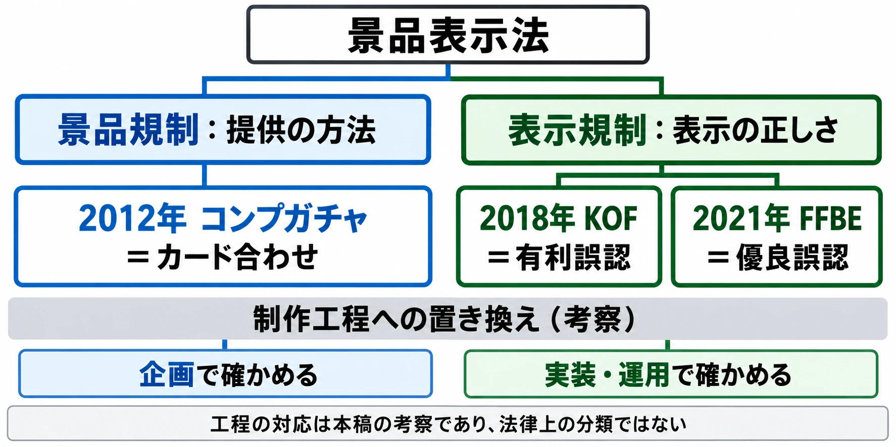

# その仕組みは、提供の方法で読まれるか、表示で読まれるか――コンプガチャを止めた行政の道具と、その後の措置命令

2012年5月18日に消費者庁がコンプガチャについて見解を公表し、7月1日には改正された運用基準が施行された。およそ1か月半で、ゲームの報酬設計に対する行政の運用が変わった。新しい法律を作らずに、何を使って変えたのだろうか。[[1](#ref-1)][[2](#ref-2)]

本稿は「ゲームと行政のあいだ」第4回である。[第1回](game-and-government-regulation-map.md)では規制が届く経路を、[第2回](diet-1986-177-and-pc-game-self-regulation.md)では国会答弁とPCゲームの自主規制を、[第3回](cero-z-rating-gta3-ordinance-link.md)ではCEROの年齢表示と自治体の条例の連動をたどった。今回は、行政が既存のルールをゲームに当てはめる道具を見る。

景品表示法は、過大な景品や誤解を招く広告などから消費者の商品選びを守る法律である。柱は二つある。 **景品規制** は、取引に誘うために付ける景品の金額や提供の方法を扱う。 **表示規制** は、商品・サービスの内容や取引条件を、実際よりよく見せていないかを扱う。同じガチャでも、報酬の渡し方と、画面に示した説明とでは、問われることが変わる。[[1](#ref-1)][[2](#ref-2)]

判断軸は、 **その仕組みは、提供の方法で読まれるか、表示で読まれるか** である。

***

## 行政が動く前に――相談、報道、業界の対応

消費者庁は、どこから問題を知ったのか。2012年5月9日の会見で、福嶋浩彦長官は、全国の消費生活センターに寄せられた相談をPIO-NETで見ていると説明した。PIO-NETとは、各地の相談情報を登録して共有する「全国消費生活情報ネットワーク・システム」である。[[3](#ref-3)]

長官が示したコンプガチャに関する相談は、2010年度から計65件。そのうち37件が2012年に入ってからだった。「1カ月で数十万円の請求が来てしまったみたいな、ちょっと見過ごせない例もいくつかあると認識しています」と述べ、登録までに時間がかかるため、把握された件数は実際より少ない可能性にも触れている。相談件数は、行政が見ていた問題の入口であった。[[3](#ref-3)]

その前の2〜4月にも、規制をめぐる報道と業界の対応が続いていた。2月8日のGameBusiness.jpは、消費者庁がアイテム課金への規制を強化するのではないかという観測と、DeNA・グリー側の、適切な表示を行っているという認識を伝えている。記事によれば、こうした観測は、消費者庁が2011年10月28日に公表した、インターネット取引の広告表示に関する留意事項（基本無料のアイテム課金について、無料の範囲や内容の明確化を求めるもの）を受けて、前年末ごろから広がっていた。この時点の記事は、規制強化が決まったという発表を伝えるものではない。[[4](#ref-4)]

業界側では、グリーが未成年者の課金額の上限を4月1日から導入するとしたことが3月19日に報じられ、3月21日にはプラットフォーム事業者6社が利用環境向上のための連絡協議会を設立した。4月20日には、日本オンラインゲーム協会（JOGA）が、過度な課金の防止などを掲げる「オンラインゲーム安心安全宣言」を公表している。[[5](#ref-5)][[6](#ref-6)][[7](#ref-7)]

5月5日のGameBusiness.jpは、同日付の読売新聞朝刊を情報源として、消費者庁がコンプガチャを「カード合わせ」にあたると判断し、近く見解を出す方針だと伝えた。記事は、当面は業界団体などを通じて指導し、従わない事業者には措置命令を出す方針も報じている。措置命令とは、行政が事業者に対し、消費者の誤認を解くための周知や再発防止などを命じる処分である。[[8](#ref-8)]

相談の積み重なり、規制をめぐる報道、業界の先回りした対応が重なるなかで、行政の見解が公になる段階へ進んだ。どれか一つを行政判断の原因と決めることはできない。

カード合わせの歴史や、2012年の詳しい時系列、業界の自主規制の展開は、[コンプガチャ規制から確率表示までの歴史](gacha-regulation-japan-history.md)を参照されたい。ここからは、行政が何を使って運用を具体化したかに絞る。

***

## 会見からQ&Aへ――法律の条文を変えずに使った道具

まず、文書の違いを押さえよう。 **告示** は、ここでは法律に基づいて景品の制限などを具体化し、公に示した定めである。 **運用基準** は、その定めを具体的な事例にどう当てはめるかを示すものだ。 **長官通達** は、長官名で行政の取扱いを示す文書であり、今回の運用基準はこの形式で改められた。[[1](#ref-1)][[2](#ref-2)]

### 会見は、判断の方向と対象を示す

5月9日の会見で福嶋長官は、「一般論として景品表示法上の問題点がある」と述べた。同時に、どの個別事例がどうかを判断した発言ではないと明言した。見解を出す目的には事業者への注意喚起を挙げ、「過剰に規制するつもりはありません」とも述べている。[[9](#ref-9)]

会見によって、行政が何を問題として検討しているかが伝わる。一方、会見そのものが、告示の書換えや個別事業者への措置命令になるわけではない。この段階で示されたのは、カード合わせという方法に着目し、まず考え方を公にして是正を促す方向だった。[[3](#ref-3)][[9](#ref-9)]

### 見解の公表は、既存の言葉への当てはめを明確にする

5月18日の公表資料は、有料ガチャで特定の異なる種類のアイテムをそろえると別のアイテムなどを受け取れる仕組みを、既存の「カード合わせ」にあたるものとして説明した。後の消費者庁Q&Aも、この見解は既存の告示の解釈を明確にしたもので、告示の内容自体は変わっていないと説明している。[[1](#ref-1)][[2](#ref-2)]

変わったのは、オンラインゲームの仕組みを既存のルールでどう読むかが明示されたことである。カード合わせを制限する定めを新しく作ったのではなく、その言葉にデジタルの報酬設計を当てはめた。

### 意見を募り、運用基準にゲームの例を書き込む

運用基準の改正案については、5月18日〜6月18日にパブリックコメントが行われ、約330件の意見が寄せられた。パブリックコメントとは、行政がルールの案を公表し、広く意見を募って、その意見を考慮して内容を決める手続である。ここで意見を募った対象は、法律を新設する案ではなく、運用基準の改正案だった。[[10](#ref-10)]

6月28日に公表された改正運用基準は、消費者庁長官通達第1号という形を取った。「カード合わせ」の項目にオンラインゲームの例を記し、7月1日から施行すると定めている。会見で伝えた方向、見解で示した解釈が、継続して参照できる具体例になったのである。[[11](#ref-11)]

### 施行日は、周知してから執行する区切りになる

消費者庁Q&AのQ29は、見解で示した解釈は5月18日より前の行為にも当てはまるとしたうえで、消費者庁として執行する時期は一定の期間を置いた7月1日からと説明している。同日より前の行為については、消費者庁が調査し、景品表示法に抵触していたかどうかを判断することはないとしている。[[2](#ref-2)]

ここでは、ルールの解釈と、行政が調査・判断を行う時期が分けられている。7月1日を区切りにしたのは、見解の周知と対応への移行期間を置く設計だった。

### Q&Aは、個々の企画に当てはめる補助になる

2013年1月には、消費者庁が「インターネット上の取引と『カード合わせ』に関するQ&A」を公表したことが報じられた。Q&Aは、一問一答で具体的な仕組みの考え方を示す資料である。新たな法律を作る道具とは役割が異なり、企画担当者が自分の案を照らす補助になる。個々の線引きは、[既存記事](gacha-regulation-japan-history.md)と消費者庁Q&Aを参照されたい。[[2](#ref-2)][[12](#ref-12)]

| 道具 | 何を変えたか | 何を変えなかったか |
|---|---|---|
| 相談情報の把握 | 行政が問題の実態を知る材料を蓄積した | 相談の登録だけで個別事例の判断が確定するわけではない |
| 長官会見 | 検討の方向と注意喚起の意図を伝えた | 個別事業者への処分ではない |
| 見解の公表 | 既存の告示の解釈を明確にした | 告示自体の内容は変えていない |
| パブリックコメント | 改正案に対する意見を集めた | 法律の新設を行う手続ではない |
| 長官通達による運用基準の改正 | オンラインゲームの具体例を書き込んだ | 法律の条文は変えていない |
| 施行日の設定 | 執行を始める時期を明示した | 告示の解釈と執行開始時期を同一にはしていない |
| Q&A | 事例への当てはめ方を補った | 個別企画の判断を一律に確定するものではない |

表は、会見、公表資料、運用基準、Q&Aをもとに役割を整理したものである。[[1](#ref-1)][[2](#ref-2)][[3](#ref-3)][[9](#ref-9)][[10](#ref-10)][[11](#ref-11)][[12](#ref-12)]

これらは、法律の条文を変えずに、解釈を明らかにし、運用を具体化する道具だった。[第1回の地図](game-and-government-regulation-map.md)で、省庁は「運用を通じて実際に効く」とした経路が、この事例に現れている。

***

## もう一つの道――表示の正しさを問う措置命令

景品規制が問うのは、どんな条件で追加の景品を渡すかという「提供の方法」である。これに対し、表示規制が問うのは、画面などで示した内容が実際と合っているかだ。後年の二つの措置命令には、同じガチャを別の言葉で読む経路が見える。

### 2018年のKOF――確率の数字が実際と違った

2018年1月26日、消費者庁は『THE KING OF FIGHTERS '98 ULTIMATE MATCH Online』（以下、KOF）を提供するアワ・パーム・カンパニー・リミテッドに措置命令を出した。対象は2016年12月31日〜2017年1月4日の「クーラ限定ガチャ」である。[[13](#ref-13)]

「出現確率：3％」と表示されていたが、1回ずつ利用する場合のクーラの出現確率は0.333％だった。10回分まとめて利用する場合にも、「万能破片」の1回を除いた9回のうち8回が0.333％だったとされている。[[13](#ref-13)]

これは景品表示法第5条第2号の **有利誤認** 、すなわち取引条件を実際よりも著しく有利に見せる表示とされた。命令は同法第7条第1項に基づくもので、消費者への周知、再発防止、同様の表示を行わないことを求めた。問われたのは、入手しやすさを示す数字と実際の確率との食い違いである。[[13](#ref-13)]

### 2021年のFFBE幻影戦争――各枠の抽選方法の説明が実際と違った

2021年6月28日付で、消費者庁はスクウェア・エニックスとgumiの両社に措置命令を出し、翌29日に公表した。対象は、両社が共同して供給する『WAR OF THE VISIONS ファイナルファンタジー ブレイブエクスヴィアス 幻影戦争』（以下、FFBE幻影戦争）の5種類の召喚である。根拠は同法第5条第1号の **優良誤認** 、商品・サービスの内容を実際よりも著しく優れたものに見せる表示とされたことである。[[14](#ref-14)]

2020年11月14日〜16日、ゲーム内には「召喚は1回ごとに、その提供割合にもとづいて抽選を行います」などと表示されていた。一方、実際には、提供割合に基づいてランダムに配列した2種類のリストのどちらを使うかを抽選し、並び順に沿って連続する10枠分を提供していた。次の利用者には、前の利用者の結果の続きから提供される仕組みだった。[[14](#ref-14)][[15](#ref-15)]

全体の提供割合には問題がなかったが、10枠の組み合わせは限られた。各枠を表示どおりに抽選すれば出る可能性のあった組み合わせの多くが、実際の仕組みでは提供されなかったのである。消費者庁は、実際のものよりも著しく優良であると示す表示にあたるとした。[[14](#ref-14)][[15](#ref-15)]

スクウェア・エニックス側は、意図したものではなく、チェック機能の不全と、開発・運営を担うgumi社内の審査・監督体制の不全による人的ミスで実装された不具合だったと説明した。また、公表時点で改修は完了しており、チェック機能の見直しと管理の強化を図るとしている。これは事業者自身による原因と対応の説明である。[[15](#ref-15)]

KOFでは確率の数字が、FFBE幻影戦争では抽選方式の説明が問われた。 **確率の数字が正しくても、抽選の仕組みの説明が実際と違えば、表示の問題になりうる** 。2012年のカード合わせとは、確かめる対象が異なる。

出典：消費者庁の公表資料・Q&Aと、KOF・FFBE幻影戦争の措置命令に関する資料。[[1](#ref-1)][[2](#ref-2)][[13](#ref-13)][[14](#ref-14)] 制作工程への置き換えは本稿の考察。

***

## 国会の答弁にも、方法と表示の区別が現れる

2018年4月11日の衆議院内閣委員会第9号で、消費者庁の福岡徹審議官は、全国の消費生活センター等に寄せられたオンラインゲームの相談件数を答弁した。全体では2012年度の5,325件から2017年度の3,891件へ、未成年者については2013年度の2,057件から2017年度の1,471件へ減っていた。いずれも2017年度の値は暫定集計である。[[16](#ref-16)]

これはオンラインゲーム全体の相談についての数字であり、5月9日の会見で示されたコンプガチャの65件とは対象も集計期間も異なる。この推移だけから、特定の規制や自主対応の効果を切り分けることはできない。

2023年3月30日の衆議院消費者問題に関する特別委員会第3号では、日本維新の会の池畑浩太朗委員の質問に、尾崎正直内閣府大臣政務官が答えた。発言98の答弁は、次の三点を示している。[[17](#ref-17)]

- コンプガチャは、提供方法が「射幸心をあおる度合いが著しく高い」とされ、カード合わせに該当するため、景品表示法で禁止されている。
- ガチャ全般は通常の取引活動であり、「一律に規制するということは景品表示法の目的に沿うものではない」とする。
- 「出現しないにもかかわらず出現すると表示をしていたり」、出現確率を実際より高く表示したりするなど、実際と異なる表示は同法上の問題となる。

ここでいう射幸心とは、偶然の結果で価値のあるものを得たいと期待する気持ちである。答弁は、特定の提供方法への規制と、実際と異なる表示への規制を分けて述べている。本稿の判断軸である「方法」と「表示」が、国会での政府の説明にも現れている。[[17](#ref-17)]

***

## ゲームへの置き換え――企画と検証をつなぐ（考察）

ここからは、事例を制作工程に置き換えた考察である。工程への割当ては、確認漏れを防ぐための整理であり、法的な線引きそのものではない。

「方法」は、企画の段階で確かめたい。追加報酬を受け取る条件が、有料のランダム提供を通じて、特定の異なる種類の組み合わせをそろえさせる形になっていないか。企画書では、抽選で買うものと、その後にもらう報酬を分けて図にすると、検討する箇所が見えやすい。詳しい当てはめは、[既存記事](gacha-regulation-japan-history.md)と消費者庁Q&Aに戻って確かめる。

「表示」は、実装と運用の両方で確かめたい。提供割合の表だけでなく、「1回ごと」「1枠ごと」といった説明が、実際の抽選処理や設定と一致しているかを見る。FFBE幻影戦争について事業者が示した説明からも、意図と、チェックの仕組みが働いたかどうかは、別に確かめる必要があると考えられる。

そこで、QA、すなわち品質を確かめる工程に、表示と実装の照合を組み込む。表示文ごとに、対応する仕様・設定・確認担当者を結び付け、抽選方式や提供割合を変更したときには説明文も一緒に点検する。大量の抽選結果から割合を調べる確認に加え、各枠を決める処理や利用者間で引き継がれる状態も確かめる。全体の割合の検証だけでは、組み合わせの制約を見落とす可能性があるためだ。

**確率を表示しているかと、表示が実際に一致しているかは、別の確認項目である** 。確率表示を求めるルールの層については、[既存記事の整理](gacha-regulation-japan-history.md)を参照されたい。

一方、説明を細かくするほど、検証の負担と誤りの余地も増える。画面、告知、ヘルプに似た説明を増やせば、更新漏れも起こりやすい。必要な情報を伝えたうえで、利用者の選択に関わる事項を明確にし、運用体制で正しさを保てる粒度を選ぶことが重要になる。情報を増やす判断と、その説明を維持できるかという判断を一緒に行いたい。

***

## 企画・実装・運用で確かめること

- 有料のランダム提供と追加報酬について、受け取り条件を分けて説明できるか。
- 特定の異なる種類の組み合わせをそろえる条件がある場合、消費者庁Q&Aと具体的な仕様を照合したか。
- 確率を表示する要否と、表示した数字・説明の正しさを、別々に確認しているか。
- 「1回ごと」「1枠ごと」などの文言が、抽選処理、設定、利用者間で共有する状態と一致しているか。
- 設定や抽選方式を変更するとき、関連する画面・告知・ヘルプを照合する担当と工程があるか。
- 説明の詳しさが、必要な情報を伝えつつ、更新と検証を続けられる粒度になっているか。

次回の第5回では、香川県のゲーム条例を取り上げる。地域の条例がプレイ時間に触れるとき、誰にどんな対応を求めるのかを考える。

行政の道具を知ることは、企画のどこを点検し、どの説明を実装と照合するかを知ることでもある。 **その仕組みは、提供の方法で読まれるか、表示で読まれるか** 。

## References

1. [消費者庁「オンラインゲームの『コンプガチャ』と景品表示法の景品規制について」][1] — 消費者庁、2012年5月18日。現行掲載版は2016年4月1日一部改定。

[1]: https://www.caa.go.jp/policies/policy/representation/fair_labeling/guideline/pdf/120518premiums_1.pdf

2. [消費者庁「インターネット上の取引と『カード合わせ』に関するQ&A」][2] — 消費者庁。とくにQ28・Q29を参照。

[2]: https://www.caa.go.jp/policies/policy/representation/fair_labeling/faq/card

3. [堀内彰宏「コンプガチャは『景品表示法上の問題点がある』――消費者庁、来週にも公式見解を表明」（2ページ目）][3] — Business Media 誠、2012年5月9日。長官会見の質疑応答要旨。

[3]: https://www.itmedia.co.jp/makoto/articles/1205/09/news105_2.html

4. [土本学「アイテム課金制に規制強化の噂も・・・MobageやGREEは『適切な表示がされている』」][4] — GameBusiness.jp、2012年2月8日。

[4]: https://www.gamebusiness.jp/article/2012/02/08/5384.html

5. [近藤智子「グリー、未成年者の課金額を制限、RMT行為も利用規約で禁止へ」][5] — GameBusiness.jp、2012年3月19日。

[5]: https://www.gamebusiness.jp/article/2012/03/19/5699.html

6. [富岡昌「DeNA、グリー、ミクシィなど6社、ソーシャルゲームの利用環境向上のため連絡協議会を設立」][6] — GameBusiness.jp、2012年3月21日。

[6]: https://www.gamebusiness.jp/article/2012/03/21/5715.html

7. [富岡昌「JOGA、ガイドラインを強化した『オンラインゲーム安心安全宣言』を作成」][7] — GameBusiness.jp、2012年4月20日。

[7]: https://www.gamebusiness.jp/article/2012/04/20/5913.html

8. [土本学「消費者庁、コンプガチャを禁止へ・・・ソーシャルゲーム各社に近く通知」][8] — GameBusiness.jp、2012年5月5日。同日付の読売新聞朝刊を情報源とする報道。

[8]: https://www.gamebusiness.jp/article/2012/05/05/5998.html

9. [堀内彰宏「コンプガチャは『景品表示法上の問題点がある』――消費者庁、来週にも公式見解を表明」（1ページ目）][9] — Business Media 誠、2012年5月9日。長官会見の質疑応答要旨。

[9]: https://www.itmedia.co.jp/makoto/articles/1205/09/news105.html

10. [籠谷千穂「消費者庁、コンプガチャ規制の基準を明記した景品表示法の運用基準を発表」][10] — GameBusiness.jp、2012年6月29日。

[10]: https://www.gamebusiness.jp/article/2012/06/29/6366.html

11. [消費者庁「『懸賞による景品類の提供に関する事項の制限』の運用基準」][11] — 消費者庁、2012年6月28日、消費者庁長官通達第1号。第4項と附則を参照。

[11]: https://www.caa.go.jp/policies/policy/representation/fair_labeling/guideline/pdf/120702premiums_1.pdf

12. [津田啓夢「消費者庁、“ガチャ”などソーシャルゲーム関連のQ&Aを公表」][12] — INTERNET Watch、2013年1月10日。

[12]: https://internet.watch.impress.co.jp/docs/news/581166.html

13. [gamebiz「消費者庁、『KOF'98 UM OL』運営会社に景品表示法に基づく措置命令…出現確率0.3％のキャラを3％であるかのように表示」][13] — gamebiz、2018年1月26日。実際の確率の記述は記事本文の0.333％による。

[13]: https://gamebiz.jp/news/202734

14. [消費者庁「株式会社gumi及び株式会社スクウェア・エニックスに対する景品表示法に基づく措置命令について」][14] — 消費者庁、2021年6月29日。命令日は6月28日。概要、別表、両社への命令を収録。

[14]: https://www.caa.go.jp/notice/assets/representation_210629_03.pdf

15. [gamebiz「スクエニ、『FFBE幻影戦争』が『1st Anniversaryキャンペーン』で提供された5つのガチャで消費者庁より景品表示法に基づく措置命令を受けたと公表」][15] — gamebiz、2021年6月29日。スクウェア・エニックスのお知らせとプロデューサーレターに基づく説明。

[15]: https://gamebiz.jp/news/299384

16. [衆議院「第196回国会 内閣委員会 第9号」][16] — 国会会議録検索システム、2018年4月11日。発言125、福岡徹・消費者庁審議官の答弁。

[16]: https://kokkai.ndl.go.jp/simple/detail?minId=119604889X00920180411&spkNum=125#s125

17. [衆議院「第211回国会 消費者問題に関する特別委員会 第3号」][17] — 国会会議録検索システム、2023年3月30日。発言97〜98、池畑浩太朗委員の質問と尾崎正直内閣府大臣政務官の答弁。

[17]: https://kokkai.ndl.go.jp/simple/detail?minId=121104536X00320230330&spkNum=98#s98

----

この文書は、Perplexity、Claude、ChatGPT の3つのAIの支援を受けて著述されたものです。引用画像を除き、MIT License にて提供されています。
