# ゲームコンソールのボタン配置はなぜ異なるのか――規格分岐の歴史

> 2026年11月3日改版：記事全体を全面的に書き直しました。内容の変更はGitの履歴から追えます。

## はじめに：同じ「決定」に3つの流儀がある

メニューで項目を選び、決定する。その操作だけでも、ゲーム機を持ち替えると指が迷うことがある。任天堂では右のA、Xboxでは下のAが基本である。PlayStationは日本で右の○を決定に使ってきたが、PS5では世界で下の×に統一された。[[1](#ref-1)]

この3つの流儀には、異なる分岐が重なっている。任天堂ではファミコンの右A・左Bから、スーパーファミコンのひし形4ボタンへと構成が広がった。PlayStationは独自の記号を採用し、さらに日本と欧米で決定の割り当てが分かれた。Xboxは任天堂と同じABXYを使いながら、各文字を別の位置に置いた。[[1](#ref-1)]

歴史を読む鍵は、 **ボタンの表記、物理的な位置、操作の役割を分けること** にある。「Aを押す」と「下を押す」と「決定する」は、それぞれ別の情報なのだ。

----

## 第1章：1ボタンの時代――Atariのジョイスティック

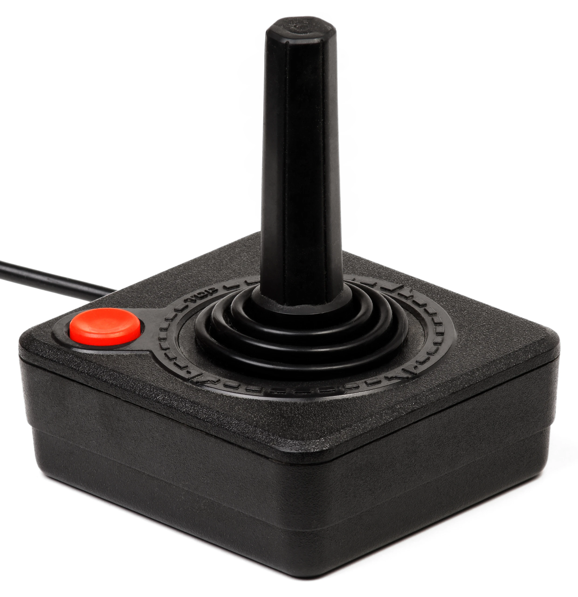
*画像出典（引用）：Evan-Amos, [Atari-2600-Joystick.jpg](https://commons.wikimedia.org/wiki/File:Atari-2600-Joystick.jpg), Wikimedia Commons, Public Domain / CX40ジョイスティックのスティック部分と1ボタン構成を示す資料として引用。WebP変換。*

Atari 2600は1977年に発売された。Science Museum Groupの所蔵品には、1978年の標準ジョイスティックCX40が含まれる。写真の構成は、方向を入力するスティックと、赤いボタン1個である。[[2](#ref-2)]

ボタンが1個なら、複数のアクションボタンのうち「どれを決定にするか」という配置の違いは生まれようがない。本稿で追う分岐は、ボタンが増え、それぞれに名前や役割を割り当てる段階から始まる。

----

## 第2章：十字ボタンと、右A・左B

### 1982年6月、ゲーム＆ウオッチ『ドンキーコング』

ゲーム＆ウオッチの発売は1980年である。十字ボタンを初めて採用したのは、その後の1982年6月発売『ドンキーコング』だった。任天堂の「社長が訊く」で、<ruby>出石武宏<rt>いずし たけひろ</rt></ruby>氏がこの採用を振り返っている。公式の歴史ページでも、マルチスクリーンのシリーズから十字キーが登場したと説明されている。[[3](#ref-3)][[4](#ref-4)]

その形は試作を重ねて磨かれた。開発陣は横井軍平氏に触ってもらい、その感触を受けて作り直したという。方向入力をひとまとまりの十字にする設計には、実際に指で扱ったときの確かさを探る過程があった。[[4](#ref-4)]

### ファミコンの2ボタンと、家庭での使われ方

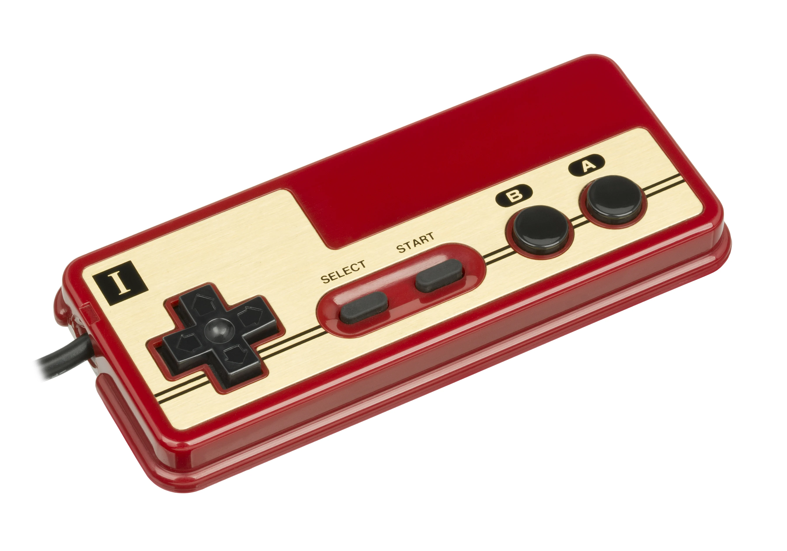
*画像出典（引用）：Evan-Amos, [Nintendo-Famicom-Controller-I-FR.jpg](https://commons.wikimedia.org/wiki/File:Nintendo-Famicom-Controller-I-FR.jpg), Wikimedia Commons, Public Domain / ファミコンIコントローラーのA・Bボタン配置を示す資料として引用。WebP変換。*

1983年発売のファミリーコンピュータは、十字ボタン、A・B、SELECT・STARTという構成を採った。写真では右がA、左がBである。後の任天堂式配列を読むとき、まず覚えておきたい左右関係だ。[[5](#ref-5)]

発売後には、四角いボタンが戻らなくなる問題が起きた。<ruby>上村雅之<rt>うえむら まさゆき</rt></ruby>氏は打鍵テストを100万回行っていたと述べている。それでも家庭で強く押される使われ方を十分には見込めず、問題は四角を丸くすることで解決した。[[6](#ref-6)]

これは、作り手が家庭でどれほど強く遊ばれるかを見誤った例でもある。部品を何回押せるかという試験と、夢中になった人がどう押すかという現実には隔たりがあった。

----

## 第3章：セガのA・B・Cは左から並ぶ

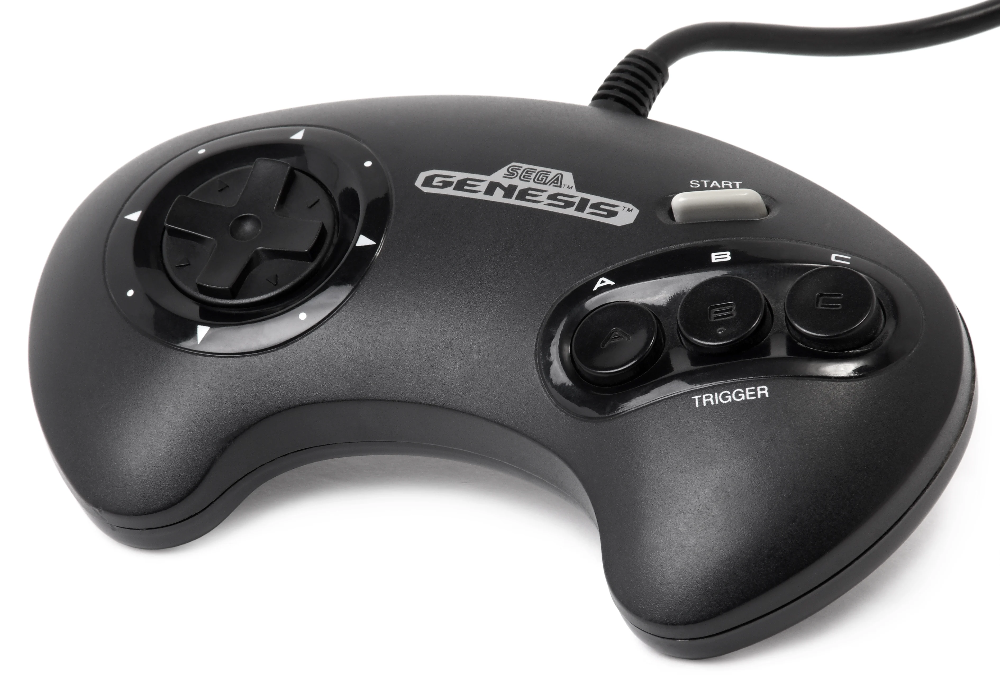
*画像出典（引用）：Evan-Amos, [Sega-Genesis-3But-Cont.jpg](https://commons.wikimedia.org/wiki/File:Sega-Genesis-3But-Cont.jpg), Wikimedia Commons, Public Domain / セガ系3ボタンの左始点配置を示す資料として引用。WebP変換。*

メガドライブは1988年10月29日に発売された。付属パッドの3ボタンは、写真のとおり左からA・B・Cと並ぶ。ファミコンと同じA・Bという文字があっても、並ぶ向きは異なる。[[7](#ref-7)]

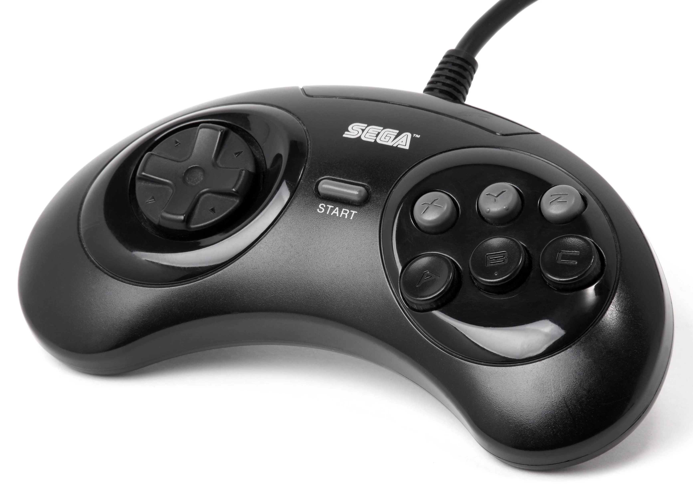
*画像出典（引用）：Evan-Amos, [Sega-Genesis-6But-Cont.jpg](https://commons.wikimedia.org/wiki/File:Sega-Genesis-6But-Cont.jpg), Wikimedia Commons, Public Domain / セガ6ボタン構成を示す資料として引用。WebP変換。*

6ボタンのパッドでは、下段にA・B・C、上段にX・Y・Zが並ぶ。同じ6個でも、後に見るひし形4ボタンとは配置のまとまり方が違う。写真からは、セガが正面のボタンを横2段に増やした姿を読み取れる。

セガサターンの発売は1994年11月22日である。1990年代前半には、任天堂のひし形、セガの横2段、そしてPlayStationの記号という、異なる構成が並ぶことになる。[[8](#ref-8)]

----

## 第4章：スーパーファミコンのひし形とL・R

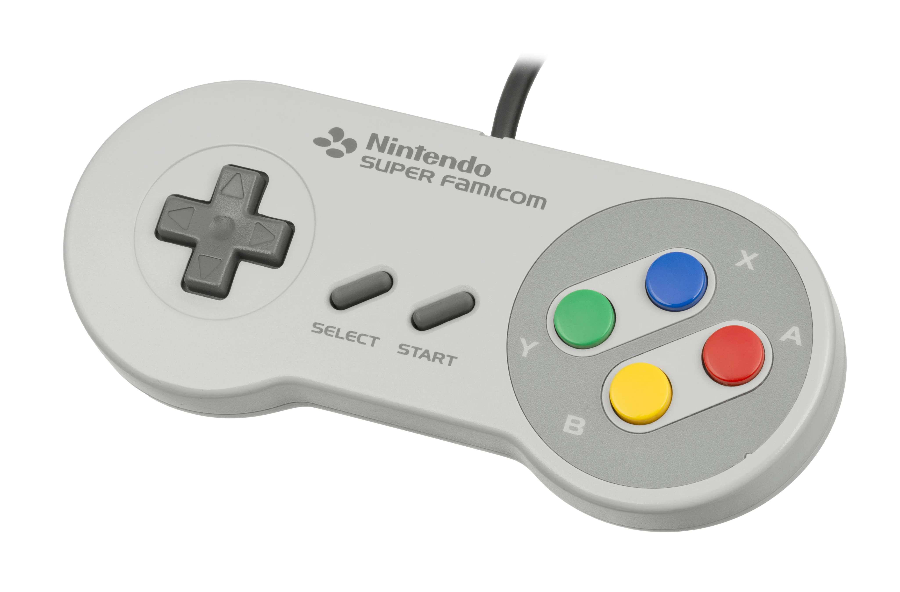
*画像出典（引用）：Evan-Amos, [Super-Famicom-Controller.jpg](https://commons.wikimedia.org/wiki/File:Super-Famicom-Controller.jpg), Wikimedia Commons, Public Domain / スーパーファミコンのABXYダイヤモンド配置を示す資料として引用。WebP変換。*

1990年発売のスーパーファミコンでは、A・BにX・Yが加わり、正面がひし形の4ボタンになった。写真の上がX、右がA、下がB、左がYである。上辺にはL・Rもあり、正面の4ボタンと、別の指で扱うボタンを組み合わせる構成が見える。[[5](#ref-5)]

右A・左Bというファミコンの2ボタンから、右A・下Bを含むひし形へと変わった。ここでできた4文字と位置の組み合わせは、後のSwitchにも残る。

### なぜ追加された文字はX・Yなのか

X・Yという命名について、任天堂の設計者による公式の説明は確認できない。報じられている説の一つに、CAD（コンピュータ支援設計）の座標軸にちなむというものがある。

Damien McFerran氏によるTime Extensionの2025年9月27日付記事は、1993年のNintendo Power誌の読者欄でそのように回答されたとする説を紹介している。ただし、記事の根拠はSasha's RetrobytesによるBluesky投稿であり、誌面の回答の原文は確認されていない。命名の確定した由来として扱える段階ではない。[[9](#ref-9)]

----

## 第5章：PlayStationは文字から記号へ

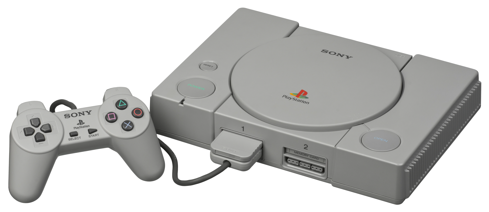
*画像出典（引用）：Evan-Amos, [PlayStation-SCPH-1000-with-Controller.jpg](https://commons.wikimedia.org/wiki/File:PlayStation-SCPH-1000-with-Controller.jpg), Wikimedia Commons, Public Domain / 初代PlayStationコントローラーの記号ボタンを示す資料として引用。WebP変換。*

初代PlayStationは、日本で1994年12月3日、北米で1995年9月9日、欧州で1995年9月29日に発売された。正面の4ボタンには△・○・×・□が置かれ、この記号は以後のPlayStationにも続く。[[10](#ref-10)]

### 記号に与えられた意味

デザインを担当した<ruby>後藤禎祐<rt>ごとう ていゆう</rt></ruby>氏は、2010年に報じられたインタビューで、それぞれに意味と色を与えたと説明している。Gematsuが伝えた対応は次のとおりである。[[11](#ref-11)]

| 記号 | 意味 | 色 |
| --- | --- | --- |
| △ | 視点。頭や方向を表す | 緑 |
| □ | 紙。メニューや文書を表す | 桃色 |
| ○ | 「はい」という判断 | 赤 |
| × | 「いいえ」という判断 | 青 |

グリップ付きの形も、開発時から支持が一致していたわけではない。ソニー上層部がSFCに似た平らな形を求めるなか、後藤氏と当時の社長・<ruby>大賀典雄<rt>おおが のりお</rt></ruby>氏はグリップ付きの試作を支持した。[[12](#ref-12)]

### 同じ記号でも、地域で役割が変わった

日本では○が決定、×がキャンセルとして使われた。一方、欧米では×が決定、○がキャンセルだった。右の○と下の×という物理的な位置も、ボタンに印刷された記号も同じでありながら、地域によって役割が入れ替わったのである。[[1](#ref-1)]

ここには、機種間の表記の違いに加え、 **同じ機種の地域差** という別の分岐がある。記号に与えた意味と、メニューで実際に使う操作の慣習は、分けて考える必要がある。

----

## 第6章：アナログ入力が加わった1990年代

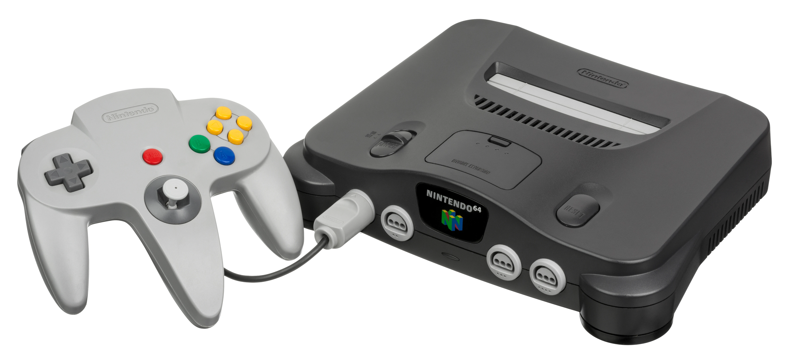
*画像出典（引用）：Evan-Amos, [Nintendo-64-wController-L.jpg](https://commons.wikimedia.org/wiki/File:Nintendo-64-wController-L.jpg), Wikimedia Commons, Public Domain / NINTENDO64コントローラーのA・B・Cボタン配置を示す資料として引用。WebP変換。*

1996年発売のNINTENDO64では、中央のグリップに3Dスティックが置かれた。写真では右側にA・Bと4個の黄色いボタンが見え、SFCのひし形4ボタンとは異なる配置である。任天堂のコントローラーも、世代ごとに同じ外形を保ってきたわけではない。[[5](#ref-5)]

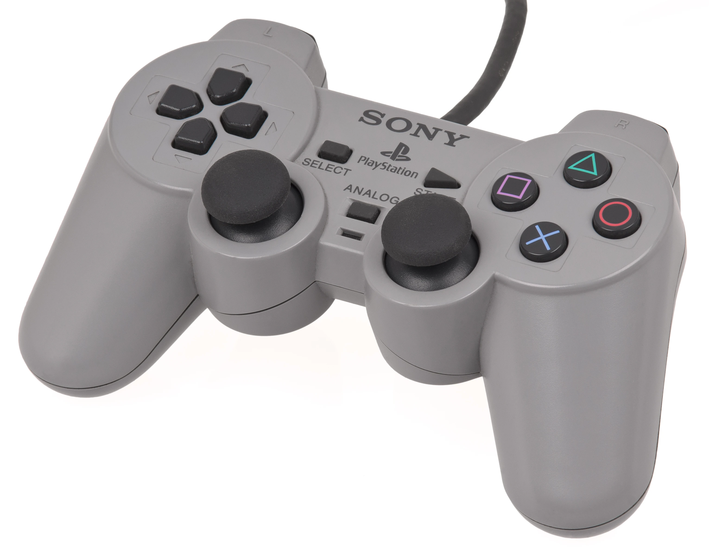
*画像出典（引用）：Evan-Amos, [PSX-DualShock-Controller.jpg](https://commons.wikimedia.org/wiki/File:PSX-DualShock-Controller.jpg), Wikimedia Commons, Public Domain / DualShockの左右対称スティック配置を示す資料として引用。WebP変換。*

PlayStationでは1997年4月にアナログコントローラ、同年11月にDUALSHOCKが登場した。公式の歴史ページは、DUALSHOCKの振動モーターと長軸のアナログスティックを紹介している。[[10](#ref-10)]

写真では、DUALSHOCKの2本のスティックは左右の下側に並ぶ。NINTENDO64の中央のスティックとは位置が違う。方向入力の手段が増えても、正面のボタンをどの位置に置き、どう名付けるかという違いは残った。

----

## 第7章：Xbox――ドリームキャストの影響と下のA

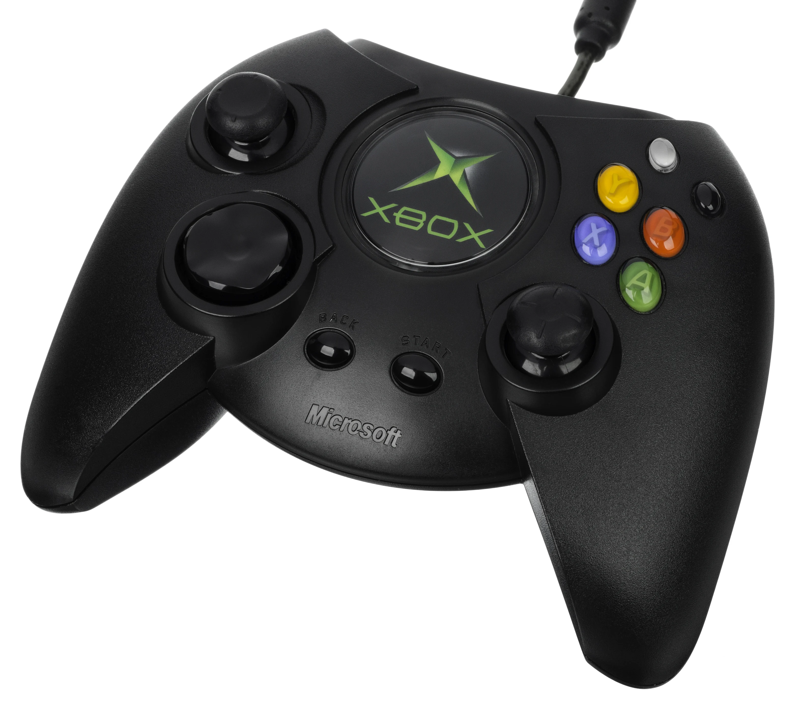
*画像出典（引用）：Evan-Amos, [Xbox-Controller-Duke-FL.jpg](https://commons.wikimedia.org/wiki/File:Xbox-Controller-Duke-FL.jpg), Wikimedia Commons, Public Domain / 初代Xbox DukeコントローラーのABXY配置を示す資料として引用。WebP変換。*

Xboxは2001年11月15日に北米で発売された。[[13](#ref-13)]

開発に関わったシーマス・ブラックリー氏は、後にコントローラーの試作図を公開している。GameSpotは同氏の「Dreamcast was king. Influence.」という発言を紹介した。当時のドリームキャストが試作に影響を与えたという説明であり、図にもVMUを思わせる要素が見える。[[14](#ref-14)]

Xboxの4ボタンは、下がA、右がB、左がX、上がYである。この対応はUnityとSDLのドキュメントでも確認できる。任天堂と同じ4文字を使いながら、AとB、XとYの位置がそれぞれ入れ替わっている。[[15](#ref-15)][[16](#ref-16)]

Xboxで基本となる下のAによる決定は、欧米のPlayStationで使われてきた下の×と位置が一致する。一方、任天堂の右Aとは「A」という名前が一致する。同じ位置を頼りにするか、同じ文字を頼りにするかで、指の行き先が変わる。[[1](#ref-1)]

初代Xboxの写真では、左スティックが上側、右スティックが下側にある。DUALSHOCKの写真と比べると、この配置の違いも見て取れる。

----

## 第8章：SwitchとSwitch 2に続くABXY

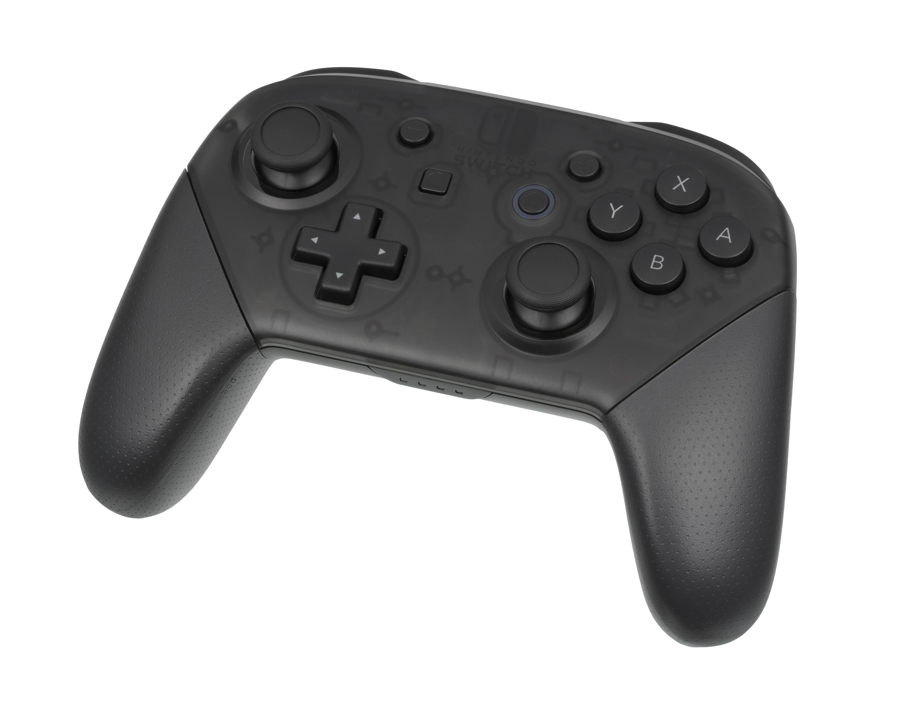
*画像出典（引用）：Evan-Amos, [Nintendo-Switch-Pro-Controller-FL.jpg](https://commons.wikimedia.org/wiki/File:Nintendo-Switch-Pro-Controller-FL.jpg), Wikimedia Commons, Public Domain / Nintendo Switch ProコントローラーのABXY配置を示す資料として引用。WebP変換。*

2017年発売のNintendo Switchでは、Joy-ConとProコントローラーがABXYを維持した。公式仕様にはJoy-Con（R）のA/B/X/Yと、ProコントローラーのABXYボタンが記載されている。Proコントローラーの写真でも、右A・下B・左Y・上Xという並びが確認できる。[[5](#ref-5)][[17](#ref-17)][[18](#ref-18)]

Joy-Conを分離して使う形、Joy-Conグリップに取り付ける形、別売のProコントローラーなど、Switchでは持ち方の選択肢が広がった。そのなかでも、通常の両手持ちで使うABXYの並びはSFCと共通している。[[19](#ref-19)]

Switch 2のJoy-Con 2にもA/B/X/Yがある。任天堂サポートの図には、これらに加えてCボタンも示されている。新しいボタンが加わっても、ABXYという4文字は引き継がれている。[[20](#ref-20)]

----

## 第9章：PS5の決定ボタン統一と、残った境界

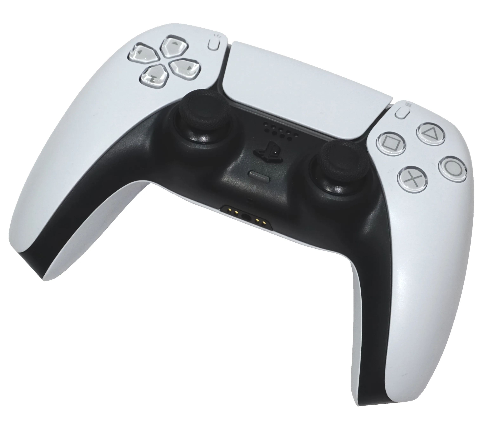
*画像出典（引用）：Alex Cochrane, [Playstation DualSense Controller.png](https://commons.wikimedia.org/wiki/File:Playstation_DualSense_Controller.png), Wikimedia Commons, [CC BY-SA 4.0](https://creativecommons.org/licenses/by-sa/4.0/) / PS5標準のDualSense ワイヤレスコントローラーを示す資料として引用。WebP変換。*

PS5では、日本でも下の×が決定になった。PlayStation公式サポートは、×を「選んだ項目を決定」、○を「操作を取り消す」ためのボタンとして説明している。[[21](#ref-21)]

### 広報説明と、市場の変化を読む解釈

VGCの2020年10月5日付報道によると、広報担当者はこの変更を「globally unify」、すなわち世界で操作を統一するためだと説明した。これは地域差をそろえるという説明である。[[22](#ref-22)]

一方、Impress Watchの西田宗千佳氏は、欧米の慣習に沿うPCゲームが日本でも増えたことを背景として挙げている。こちらは西田氏による解釈であり、SIEが示した変更理由とは区別して読む必要がある。[[1](#ref-1)]

統一後も境界は残る。西田氏は、PS4用ソフトには統一が100%及ばないと指摘する。PS5で遊んでいても、PS4用ソフトに入ると決定ボタンが変わり得るため、本体側の統一だけで操作の混乱がすべて解消するわけではない。[[1](#ref-1)]

### Steamで使われるコントローラー

Valveの2024年6月26日付発表によれば、Steamでコントローラーを使ったセッションの59%がXbox、26%がPlayStation、10%がSteam Deckだった。これは全PC利用者の所有率ではなく、Steamのコントローラー使用セッションにおける割合である。Xbox系の配置に接する機会の多さを示す数字として読める。[[23](#ref-23)]

この数字はPS5の変更後の集計であり、その変更の原因を直接証明するものではない。それでも、家庭用機とPCをまたいで操作を設計するとき、異なる表記のコントローラーを同じゲームが受け入れる状況はよく見えてくる。

----

## 第10章：プランナーは何で仕様を書くか

### 位置を扱う仕組みと、画面に見せるラベル

Unity Input Systemでは、ひし形の下のボタンを`buttonSouth`と呼ぶ。XboxならA、PlayStationなら×に相当する。同様に`buttonEast`は右、`buttonWest`は左、`buttonNorth`は上である。ボタンに書かれた文字よりも、位置を共通の扱いにしている。[[15](#ref-15)]

SDL3にもSOUTH・EAST・WEST・NORTHという区分がある。ひし形の下・右・左・上に対応し、表示ラベルは`SDL_GetGamepadButtonLabel()`で取得する。入力の位置と、画面に見せる表記を分けられる仕組みである。[[16](#ref-16)]

ただし、下のボタンを共通に扱えることと、すべての機種で下を決定にすべきことは別の判断である。任天堂の右Aで決定する慣習まで含めて設計するには、位置の上に「決定」「キャンセル」という役割を置くと整理しやすい。[[1](#ref-1)]

### 仕様書では役割を先に書く

たとえば、仕様書の本文には「決定で選択中の項目を実行する」「キャンセルで一つ前の画面へ戻る」と書く。そのうえで、機種ごとにボタンの位置・表記・表示するアイコンを対応させる。

次は架空のゲームのメニュー仕様例である。各機種の全ソフトに共通する規則を示す表ではない。PS4欄は日本向けの従来の割り当てを採る例とする。

| 役割 | 任天堂（Switch） | Xbox | PlayStation（日本向けPS4） | PlayStation（PS5） |
| --- | --- | --- | --- | --- |
| 決定：選択項目を実行 | 右のA／Aアイコン | 下のA／Aアイコン | 右の○／○アイコン | 下の×／×アイコン |
| キャンセル：前の画面へ戻る | 下のB／Bアイコン | 右のB／Bアイコン | 下の×／×アイコン | 右の○／○アイコン |

この分け方なら、「決定の処理」を変えずに、割り当てと案内表示を機種に合わせられる。仕様変更の際も、処理の変更なのか、割り当ての変更なのか、アイコンの変更なのかを明示できる。

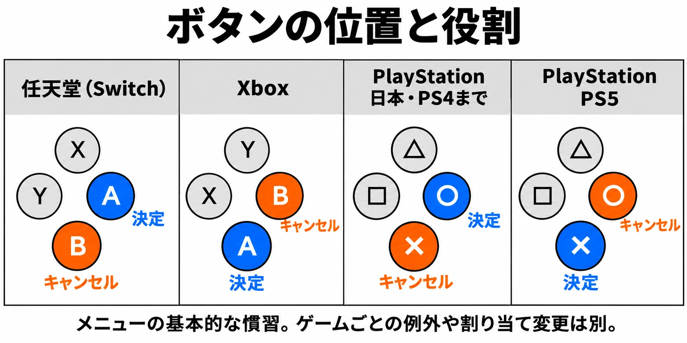

図はメニューの基本的な慣習を示す。ゲームごとの例外、PS4用ソフト、ボタン割り当て変更は別とする。[[1](#ref-1)][[15](#ref-15)][[16](#ref-16)][[20](#ref-20)][[21](#ref-21)]

PCなどでプレイ中にコントローラーとキーボードを行き来する場合は、現在の入力に応じて案内を切り替える設計も必要になる。この点は既刊の[複数入力の切り替え](multi-input-switching-ux-design.md)で扱っている。

----

## まとめ：名前・位置・役割を分けて受け継ぐ

1ボタンのジョイスティックから、A・B、ひし形のABXY、PlayStationの記号へ。ボタンが増える過程で、先行者の慣習、ブランドの記号、地域の慣習が重なり、現在の3つの流儀が生まれた。

任天堂の右A、Xboxの下A、そして日本の右○から世界の下×へ移ったPlayStation。その違いは、いまもSwitch・PlayStation・Xboxを行き来するたびに表面化する。PS5の統一も、任天堂とXboxの文字配置までそろえるものではない。

プランナーが尊重すべきなのは、プレイヤーがそれぞれの機種で身に付けた操作の感覚である。仕様書ではまず「何をするか」という役割を定め、次に位置と表記を対応させる。その整理が、異なるコントローラーでも迷わず遊べる操作と案内につながる。

## References

1. [西田宗千佳「PS5のボタンはなぜ「×で決定」に変わったのか」][1] — Impress Watch、2020年11月16日。市場環境についての解釈とPS4用ソフトの例外を参照。

[1]: https://www.watch.impress.co.jp/docs/series/nishida/1289191.html

2. [Science Museum Group「Atari 2600 Video Computer System」][2] — Science Museum Group Collection、日付記載なし。CX40の所蔵品説明を含む。

[2]: https://collection.sciencemuseumgroup.org.uk/objects/co8225511/atari-2600-video-computer-system

3. [任天堂「HISTORY｜ゲーム&ウオッチ スーパーマリオブラザーズ」][3] — 任天堂、日付記載なし。

[3]: https://www.nintendo.co.jp/hardware/gamewatch/history.html

4. [任天堂「社長が訊く『ゲーム＆ウオッチ』5. 30年前の『ボール』を忠実に復刻」][4] — 任天堂、2010年。十字ボタンの試作と『ドンキーコング』の発売月の注記を参照。

[4]: https://www.nintendo.co.jp/n10/interview/game_and_watch/vol1/index5.html

5. [任天堂「会社の沿革」][5] — 任天堂、日付記載なし。各ゲーム機の発売年を参照。

[5]: https://www.nintendo.co.jp/corporate/history/index.html

6. [任天堂「社長が訊く『スーパーマリオ25周年』ファミコンとマリオ 篇 3. トラブル続きだったファミコン黎明期」][6] — 任天堂、2010年。

[6]: https://www.nintendo.co.jp/n10/interview/mario25th/vol2/index3.html

7. [セガ「メガドライブ」][7] — セガハード大百科、日付記載なし。

[7]: https://sega.jp/history/hard/megadrive/

8. [セガ「セガサターン」][8] — セガハード大百科、日付記載なし。

[8]: https://sega.jp/history/hard/segasaturn/

9. [Damien McFerran「Here's Why Controllers Have 'A, B, X & Y' Buttons, And Not 'A, B, C & D'」][9] — Time Extension、2025年9月27日。Nintendo Power読者欄に関するBluesky投稿を紹介した記事。命名説の紹介として参照。

[9]: https://www.timeextension.com/news/2025/09/heres-why-controllers-have-a-b-x-and-y-buttons-and-not-a-b-c-and-d

10. [ソニー・インタラクティブエンタテインメント「PlayStation 1994｜PlayStationの歴史年表」][10] — PlayStationの歴史年表、日付記載なし。各地域の発売日、1997年のコントローラーを参照。

[10]: https://www.playstation.com/ja-jp/playstation-history/1994-ps-one/

11. [Sal Romano「PlayStation’s iconic face buttons explained」][11] — Gematsu、2010年8月26日。後藤氏の発言を紹介。記事の出典表記は1UP via Gizmodo。発言の大意は本稿による日本語訳。

[11]: https://gematsu.com/2010/08/playstations-iconic-face-buttons-explained

12. [Randy Nelson「PS1 designer on the fight for controller handles, what the button icons really mean」][12] — Engadget、2010年8月25日。ファミ通インタビューの1UPによる英訳を紹介。

[12]: https://www.engadget.com/2010-08-25-ps1-designer-on-the-fight-for-controller-handles-what-the-butto.html

13. [Microsoft「Xbox Erupts on the Scene」][13] — Microsoft、2001年11月15日。

[13]: https://news.microsoft.com/source/2001/11/15/xbox-erupts-on-the-scene/

14. [Eddie Makuch「Look at These Dreamcast-Inspired Original Xbox Controller Prototypes」][14] — GameSpot、2016年6月28日。ブラックリー氏による試作図と発言を紹介。

[14]: https://www.gamespot.com/articles/look-at-these-dreamcast-inspired-original-xbox-con/1100-6441308/

15. [Unity Technologies「Gamepad」][15] — Unity Input System 1.11マニュアル、日付記載なし。

[15]: https://docs.unity3d.com/Packages/com.unity.inputsystem@1.11/manual/Gamepad.html

16. [SDL「SDL_GamepadButton」][16] — SDL3 Wiki、日付記載なし。位置と表示ラベルの区別を参照。

[16]: https://wiki.libsdl.org/SDL3/SDL_GamepadButton

17. [任天堂「Joy-Con(L)/(R)の主な仕様」][17] — 任天堂、日付記載なし。

[17]: https://www.nintendo.com/jp/hardware/switch/modal/specs/joy-con.html?width=960

18. [任天堂「Nintendo Switch Proコントローラーの主な仕様」][18] — 任天堂、日付記載なし。

[18]: https://www.nintendo.com/jp/hardware/switch/accessories/procon.html?width=960

19. [任天堂「周辺機器｜Nintendo Switch」][19] — 任天堂、日付記載なし。

[19]: https://www.nintendo.com/jp/hardware/switch/accessories/index.html

20. [Nintendo「Joy-Con 2 Diagram」][20] — Nintendo Support、日付記載なし。A/B/X/Y ButtonとC Buttonを参照。

[20]: https://en-americas-support.nintendo.com/app/answers/detail/a_id/68499

21. [ソニー・インタラクティブエンタテインメント「PS5のボタンの機能」][21] — PlayStationサポート、日付記載なし。

[21]: https://www.playstation.com/ja-jp/support/hardware/ps5-button-functions/

22. [Andy Robinson「After 26 years, PS5 will make ‘X’ its default select button in Japan」][22] — VGC、2020年10月5日。広報担当者の説明を紹介。

[22]: https://videogameschronicle.com/news/after-26-years-ps5-will-make-x-its-default-select-button-in-japan

23. [Valve「Steam入力とコントローラのサポートに関するアップデート」][23] — Steam、2024年6月26日。コントローラーを使ったセッションの機種別割合を参照。

[23]: https://steamcommunity.com/games/593110/announcements/detail/4142827237888316812

----

この文書は、Perplexity、Claude、ChatGPT の3つのAIの支援を受けて著述されたものです。引用画像を除き、MIT License にて提供されています。
