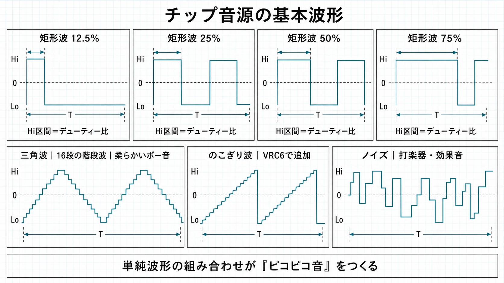
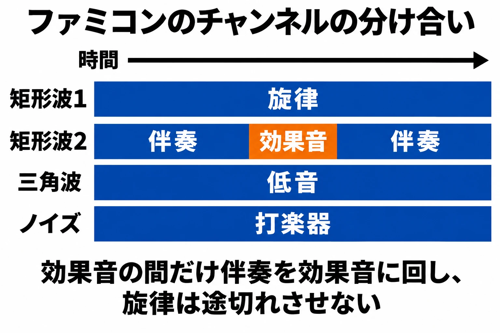

# 決まった波を選ぶか、波の形を描くか——ゲーム機サウンドの歴史②

[第1回「ゲーム機の音は、何が鳴らしてきたのか」](console-game-sound-history.md)では、ゲーム機が音を鳴らす仕組みの変化を見渡した。そこで示した「音を鳴らす4つの方法」のうち、今回は「決まった形の波を作る」方法を詳しく扱う。矩形波・三角波・ノイズを鳴らす音源から、波の形を自分で書き込む波形メモリ音源へと、音色の選択肢が広がった過程をたどる。

初期のゲーム機で音楽を作ることは、備え付けの小さな楽器編成で曲を書くことに似ている。高い音を得意とする楽器、低音を受け持つ楽器、打楽器のような音を出す楽器。それぞれに出せる音の特徴があり、同時に演奏できる人数にも限りがある。その「同時にひとつの音を受け持つ枠」を、本稿では **チャンネル** と呼ぶ。曲の旋律も、敵に当たった音も、この枠を使って鳴る。

波の形を描けるようになると、備え付けの楽器を選ぶだけでなく、楽器の音色そのものに手を入れる余地が生まれた。ただし、音色の選択肢と、同時に音を鳴らせる数は別の条件である。どの音を旋律にし、どこへ伴奏や効果音を置くか。この配分を手がかりにすると、機種ごとの数字が、実際の曲の作り方につながって見えてくる。

***

## 第1章　選べる波は限られていた：ファミコンの本体音源とPSG

ファミコンの本体には、矩形波が2チャンネル、三角波が1チャンネル、ノイズが1チャンネル、短い録音を再生するものが1チャンネルあり、合計は5チャンネルとなる。矩形波は、高い状態と低い状態を交互に繰り返す、四角い形の波である。その幅の割合を **デューティー比** と呼び、幅を変えることで、同じ高さの音でも響きが変わる。音程が「ドかレか」という高さの違いなら、音色は「同じドでもどんな響きか」という違いであり、矩形波の幅を変える話は後者に当たる。Rodrigo Copettiの解説では、ファミコンはこの違いによって3種類の矩形波の音色を作る。三角波は、上り坂と下り坂が続くような形の波で、低音によく使われる。ただし、そのチャンネルには音量を直接変える機能がない。5つの枠は、同じ楽器を5人に渡した編成ではなく、性質の違う楽器を組み合わせた編成なのである。[[1](#ref-1)]

ノイズは、「ザーッ」「シャッ」といった雑音を作る音源で、打楽器の役割などを担う。ファミコンでは、きれいな雑音と機械的な響きの雑音が、それぞれ16通り、合わせて32通り用意されている。録音用のチャンネルは、音の高さを表す値を少しずつ上下させるデルタ変調という方法で、太鼓などの短い音の再生に使われた。扱う値の細かさは7bit、再生の速さは約15.7kHzである。ここでは、7bitは音の波の高さを区切る細かさ、kHzは音の値を送り出す速さの単位、と押さえればよい。本体だけでも、波を作る音と短い録音の両方があった。そのうえで、旋律や伴奏を受け持つ矩形波、低音の三角波、打楽器のノイズという役割を見ておくと、曲の骨組みをつかみやすい。[[1](#ref-1)]

波形の模式図は第1回から再掲。

この編成で曲を演奏している途中にも、ゲームは効果音を鳴らす必要がある。Copettiが紹介するのは、矩形波の一方で旋律を、もう一方で伴奏を鳴らし、効果音が必要な間だけ、伴奏のチャンネルを効果音へ回す方法だ。効果音が終わると、その枠は伴奏へ戻る。旋律を続けながら、ゲームの出来事を知らせられるのである。[[1](#ref-1)] たとえば、演奏中の小さな合奏で、伴奏者が一瞬だけ合図の音を担当し、その後に演奏へ戻る場面を思い浮かべるとよい。聞き手には曲と効果音が同時にあるように聞こえても、その裏では担当の交代が起きている。楽譜に音符を置くことに加え、出来事が割り込んだときに、どの担当を譲るかまで考える必要があった。

Rodrigo Copetti「NES / Famicom Architecture」の説明をもとに作成。[[1](#ref-1)] 特定の作品の譜面ではなく、手法を説明する概念図である。

同じ時代には、簡単な波やノイズを、プログラムから音程や音量を指定して鳴らす **PSG** という音源も広く使われた。PSGはProgrammable Sound Generatorの略である。MSXの標準的なPSGであるAY-3-8910系は3声、つまり3つの発音枠を持ち、各声で音程のある音とノイズを切り替えられる。[[2](#ref-2)] 一方、1985年10月20日発売のセガ・マークIIIは、公式仕様でPSG音源3音とノイズ1音を備える。[[3](#ref-3)] どちらも小さな編成だが、ノイズを独立した枠で使うか、ほかの音と枠を分け合うかという違いがある。機種名の横に「3音」「4音」と並んでいても、その数だけで同じ編成とはいえない。マークIIIに後から加わるFMサウンドユニットは、第3回で扱う。

PSGという名前は、プログラムから制御する音源を広く指すこともあり、後で扱うPCエンジンの音源もそう呼ばれる。本稿ではまず、「あらかじめ用意された形の波を選ぶ」という音色の作り方に注目したい。型紙を選ぶように音の形を決め、繰り返す速さで音程を変え、鳴らす長さや音量の変化で音の表情を付ける。次の章では、この編成自体を本体の外から広げる方法を見る。

***

## 第2章　足りない音をカートリッジで足す：拡張音源

本体に用意された音源へ、追加の回路で音を足すものを **拡張音源** と呼ぶ。日本のファミコンには、本体で混ぜた音をカートリッジへ送り、追加の音と混ぜて戻せる端子があった。海外向けのNESでは、この仕組みが不正対策の仕組みに置き換わっている。[[1](#ref-1)] 端子とカートリッジの関係は、既刊[『同じ値段で、何が飛び抜けていたのか――ファミコンの性能を、同時代の機械とカートリッジから読む』](famicom-price-performance-cartridge-expansion.md)で詳しく扱った。ここで注目するのは、追加の音源を持つソフトでは、作曲の出発点となる楽器編成も変わるという点である。カートリッジを替えることが、ゲームの内容とともに、演奏に参加する楽器を替えることにもなった。

コナミのVRC6は、矩形波2チャンネルとのこぎり波1チャンネルを加える。のこぎり波は、斜めに上がって急に落ちる形を繰り返す波で、矩形波や三角波とは異なる響きを持つ。追加の矩形波は幅を8段階で設定でき、本体より細かく音色を選べる。[[4](#ref-4)] コナミが独自に開発したVRC6を最初に導入した作品が、1989年の『悪魔城伝説』である。[[5](#ref-5)] 本体の音にさらに別の担当を重ねられる一方、北米版『Castlevania III』は、この拡張を使わず、本体の5チャンネルだけで音を鳴らしている。[[1](#ref-1)] 同じ系列の作品を地域違いで見比べても、音を出す側の編成が一致するとは限らなかった。

  <iframe
    src="https://www.youtube.com/embed/8FJd-qBKiZE"
    title="悪魔城伝説（FC）Beginning（教会、町、墓場ステージ）"
    style="width: 100%; height: 100%; border: 0;"
    allow="accelerometer; autoplay; clipboard-write; encrypted-media; gyroscope; picture-in-picture; web-share"
    allowfullscreen>
  </iframe>

*『悪魔城伝説』（ファミコン版、VRC6使用）「Beginning（教会、町、墓場ステージ）」。配信元：Konami Kukeiha Club - Topic（『ミュージックフロム 悪魔城ドラキュラ 黒』、℗ 2021 Konami Digital Entertainment）。<https://www.youtube.com/watch?v=8FJd-qBKiZE>*

  <iframe
    src="https://www.youtube.com/embed/916OqKkrjfY"
    title="Castlevania III Dracula's Curse（NES）Beginning"
    style="width: 100%; height: 100%; border: 0;"
    allow="accelerometer; autoplay; clipboard-write; encrypted-media; gyroscope; picture-in-picture; web-share"
    allowfullscreen>
  </iframe>

*同じ曲の北米NES版『Castlevania III: Dracula's Curse』。拡張音源を使わず、本体の5チャンネルで鳴らしている。配信元：Konami Kukeiha Club - Topic（『ミュージックフロム 悪魔城ドラキュラ 黒』、℗ 2021 Konami Digital Entertainment）。<https://www.youtube.com/watch?v=916OqKkrjfY>*

別の例が、サンソフトのSunsoft 5Bである。これはMSXのPSGと同じAY-3-8910系の音源で、矩形波を3チャンネル追加する。採用された作品は『ギミック!』だけだ。[[6](#ref-6)] 『ギミック!』は1992年に日本で発売され、北欧向けのNES版『Mr. Gimmick』は追加の音源チップを使わずに作られた。[[7](#ref-7)] その音楽は、本体の5チャンネルに合わせて編曲し直されている。[[8](#ref-8)] これは、音源の追加が「同じ曲を別の音色で鳴らす」だけにとどまらない例である。枠が減れば、同時に置いていた音をどう収めるかから考え直すことになる。曲を載せる先の条件が、編曲を変えるのである。

追加する音源にも、異なる方向があった。ナムコのNamco 163は、波の形を書き込める波形メモリ音源で、最大8チャンネルを扱う。ただし、チャンネルを増やすほど出力の順番待ちが長くなり、音が低くなるうえ、雑音も生じるため、多くの作品は4チャンネルで使った。[[9](#ref-9)] 任天堂のMMC5は、本体とほぼ同じ矩形波を2チャンネル加える。[[10](#ref-10)] 拡張音源という同じ呼び名でも、使い慣れた種類の音を増やすものと、波形そのものを作れるものがある。次章の波形メモリは、本体の設計としても、追加の音源としても選ばれた方式なのだ。

***

## 第3章　波の形を描く：波形メモリ

**波形メモリ** は、波がひと回りする1周期分の形を、小さな記憶領域に数値で書き込み、それを繰り返して鳴らす方式である。決まった形の波を選ぶ方法を「用意された型紙を使うこと」にたとえるなら、こちらは「型紙の輪郭を自分で描くこと」だ。書き込む値は、波を左から右へ細かく区切った、それぞれの位置の高さを表す。全体を順に読み、最後まで来たら先頭に戻ることで、同じ形が繰り返される。読み進める速さを変えれば、同じ形でも異なる音程で鳴らせる。[[11](#ref-11)] ただし、描くための点の数も、高さの細かさも有限である。「自由に描ける」とは、その小さな枠の中で、用意された形以外も選べるという意味になる。たとえば、方眼紙に波を描く場面を考えると、横のマスの数が1周期の値の数、縦の目盛りが値の細かさに相当する。横のマスを増やすことと、縦の目盛りを細かくすることは違う。この区別が分かれば、以下に出てくる「32個」「4bit」といった数字も、曲の長さではなく、繰り返す小さな形をどこまで描けるかの条件だと読める。

1986年発売のファミリーコンピュータ ディスクシステムは、この方法の音源を1チャンネル加えた。[[12](#ref-12)] 1周期を64個の値で描き、それぞれの高さは6bitで表す。6bitとは、高さを64段階から選べるという意味だ。横方向にいくつの点を並べられるかと、縦方向の高さを何段階で選べるかは、別の条件になる。さらにディスクシステムには、波形とは別の表を使って、音の高さを揺らす変調の仕組みがある。[[13](#ref-13)] ファミコン本体の矩形波や三角波に、輪郭を描ける担当がひとつ加わったのである。追加されたのはひとつの枠でも、その枠が使える音の形は、本体に用意された形から広がっていた。

  <iframe
    src="https://www.youtube.com/embed/Kch3uUciCZ8"
    title="ドラキュラII 呪いの封印（FDS）Bloody Tears（昼の道BGM）"
    style="width: 100%; height: 100%; border: 0;"
    allow="accelerometer; autoplay; clipboard-write; encrypted-media; gyroscope; picture-in-picture; web-share"
    allowfullscreen>
  </iframe>

*ディスクシステムの拡張音源を使った『ドラキュラII 呪いの封印』（1987年）「Bloody Tears（昼の道BGM）」。配信元：Konami Kukeiha Club - Topic（『ミュージックフロム 悪魔城ドラキュラ 黒』、℗ 2021 Konami Digital Entertainment）。<https://www.youtube.com/watch?v=Kch3uUciCZ8>*

1987年発売のPCエンジンでは、本体の6チャンネルが波形メモリを中心に組み立てられている。1周期は32個の5bitの値、つまり32の位置に対して、高さを32段階で書く。最後の2チャンネルはノイズにも使え、2番目のチャンネルで1番目の音の高さを揺らす機能も持つ。また、波形を繰り返す方法に加え、録音の値を直接書き込んで鳴らす方法もあった。[[11](#ref-11)] ここで扱っているのは、HuCARDのゲームが使う本体音源である。6つの枠すべてについて音色の輪郭を用意できることは、ディスクシステムのように描ける担当を追加する構成との大きな違いだ。一方、ノイズへ切り替えた枠は、その間ノイズの担当になる。選べる役割が増えても、ひとつの枠を何に使うかという判断は残る。

1989年発売のゲームボーイは、矩形波2チャンネル、波形メモリ1チャンネル、ノイズ1チャンネルを組み合わせた。[[14](#ref-14)] 波形メモリは1周期が32個の4bitの値で、高さを16段階から選べる。左右に音を振り分けるステレオにも対応するが、左右の違いを聞けるのはヘッドホンで、本体のスピーカーはモノラルである。そして『ポケットモンスター 赤・緑』では、ポケモンの鳴き声が音楽のチャンネルをすべて使う。[[15](#ref-15)] 第1章では伴奏の担当だけを効果音へ回したが、こちらは曲全体の枠を鳴き声へ渡す例だ。携帯機でも、音色を工夫することと、曲と効果音の間で枠を分けることは、並んで存在していた。

  <iframe
    src="https://www.youtube.com/embed/Q53CDIGPJ58"
    title="Pokémon Game Sound Library『ポケモン 赤・緑』BGM集"
    style="width: 100%; height: 100%; border: 0;"
    allow="accelerometer; autoplay; clipboard-write; encrypted-media; gyroscope; picture-in-picture; web-share"
    allowfullscreen>
  </iframe>

*『ポケットモンスター 赤・緑』のBGM集（全45曲）。配信元：ポケモン公式YouTubeチャンネル「Pokémon Game Sound Library」。<https://www.youtube.com/watch?v=Q53CDIGPJ58>*

MSXでは、コナミが1987年の『グラディウス2』のゲームROMに、SCCという「ウェーブ音源LSI」、つまり波形を使って音を作る回路を載せ、標準のPSGと組み合わせて鳴らした。[[16](#ref-16)][[17](#ref-17)] SCCは5チャンネルを持ち、波形は1周期を32バイトで記憶する。ただし、4番目と5番目のチャンネルは同じ波形を共有し、後継のSCC+では独立した。[[18](#ref-18)] ここでは「5つの枠」と「それぞれに別の波の形を与えられるか」が分かれる。下の表で比較すると、波形メモリという同じ方法でも、描ける担当の数、形を描くための値の数、ほかに使える音に違いがあることが分かる。音源の名前だけでなく、その組み合わせまでが演奏の条件となった。

| 音源 | 発売年 | 波形メモリのチャンネル数 | 1周期の値の数と細かさ | ほかに持つ音 |
| --- | --- | --- | --- | --- |
| ディスクシステム | 1986年 | 1 | 64個・6bit | ファミコン本体の矩形波2・三角波1・ノイズ1・録音1と併用 |
| PCエンジン | 1987年 | 6 | 32個・5bit | 最後の2チャンネルはノイズにも使用可能。録音の直接出力も可能 |
| ゲームボーイ | 1989年 | 1 | 32個・4bit | 矩形波2・ノイズ1 |
| SCC（MSX用『グラディウス2』搭載） | 1987年 | 5（4番目と5番目は波形を共有） | 32個（32バイト）・値の細かさは— | MSX本体のPSG3声と併用 |

出典は本文を参照。発売年は日本での発売年で、SCCの行は『グラディウス2』の発売年。「—」は値の細かさを示していない項目である。

  <iframe
    src="https://www.youtube.com/embed/wxJVzRBiEDo"
    title="MSX RACING SPIRIT サウンドトラック（MSX版）MSX Racing Shuffle（タイトル）"
    style="width: 100%; height: 100%; border: 0;"
    allow="accelerometer; autoplay; clipboard-write; encrypted-media; gyroscope; picture-in-picture; web-share"
    allowfullscreen>
  </iframe>

*SCCを搭載した同じコナミのMSX作品『F-1スピリット』（1987年）の「MSX Racing Shuffle（タイトル）」。収録アルバムは商標の都合で『MSX RACING SPIRIT サウンドトラック（MSX版）』と改題されている。配信元：Konami Kukeiha Club - Topic（℗ Konami Digital Entertainment）。<https://www.youtube.com/watch?v=wxJVzRBiEDo>*

***

## 第4章　制約は、書き方になった

ここからは、これまでの事例を踏まえた **編者の考察** である。決まった波を選ぶ音源と、波を描く音源には、音色を用意する手順の違いがある。その一方で、どちらも、旋律・伴奏・低音・打楽器・効果音を、限られたチャンネルに割り当てる必要があった。使える音源を確認してから役割を決めることは、曲を鳴らすための準備であり、曲の書き方そのものでもあったと捉えられる。どの波の形を使うかと、その波にどの仕事をさせるかが、ひと続きの判断になるからだ。

ファミコンで伴奏のチャンネルを効果音に回す方法は、旋律を続けるための配分である。対して『ポケットモンスター 赤・緑』の鳴き声は、その瞬間に全チャンネルを使う。前者では、曲の一部が役割を譲り、後者では、曲を鳴らしていた枠全体が別の音へ渡る。同じ「曲と効果音を鳴らす」という仕事でも、何を続け、どこを明け渡すかが違う。編者は、こうした違いを、楽曲とゲームの出来事の間に置かれた、演奏上の優先順位として読めると考える。作曲を完成した曲だけの問題として見ると、この交代の手順が見えにくくなる。

『ギミック!』の地域版の違いは、さらに曲全体の編成へ目を向けさせる。追加の3チャンネルがある版と、本体の5チャンネルだけで鳴らす版では、音を置ける場所が変わる。そこで必要になったのが、編曲し直すことだった。編者がここから読み取るのは、チャンネル数が曲の密度だけでなく、音の役割をどこへ置くかという手順を左右したという点である。このことは、旋律、伴奏、低音、打楽器という言葉を、固定された部品名ではなく、その場で割り当てる役割として見ることにもつながる。曲の中で必要な役割を並べ、それぞれをどの枠が引き受けるかを考えれば、音源の構成が曲の組み立てに関わる理由が分かりやすい。波形メモリで音色の輪郭を変えられても、担当を増やすには別の枠が要る。音色を作れる自由と、音を重ねられる自由を分けて考えると、この時代の条件を整理しやすい。

現在のゲーム制作にも、同時に鳴らす音の数を管理し、必要な音を優先する仕事がある。たとえば、同じ種類の効果音が重なったときにいくつまで残すか、操作の結果を知らせる短い音をどう聞き取りやすくするか、といった判断だ。新人プランナーがここから持ち帰れるのは、「どんな音が欲しいか」に加え、「重なったとき、どの音を聞かせたいか」を言葉にする視点である。現在の制御方法については、既刊[『ゲームの効果音・環境音はどう作られているか』](game-sound-effects-ambient-audio-production-practice.md)と[『UIサウンド・フィードバックSE設計基礎』](ui-feedback-sound-effect-design-basics-for-planners.md)へ譲る。歴史上の小さな合奏を知ることは、ゲームの中で音に役割を持たせる考え方を知ることでもある。

***

## まとめ　選ぶ波から、描く波へ

矩形波や三角波、ノイズを備えた音源では、用意された波の特徴を生かして曲を作った。カートリッジの拡張音源は、担当する音の数と種類を広げた。波形メモリでは、さらに、ひと回り分の波の輪郭を数値で描き、音色そのものを用意できるようになった。選ぶ波から描く波へという広がりは、ディスクシステム、PCエンジン、ゲームボーイ、MSXで、それぞれ異なる編成として現れた。

その間も、旋律・伴奏・効果音は、限られた発音枠を分け合っていた。何を鳴らせるかという仕組みと、何をいつ鳴らすかという判断が結び付いて、実際に聞こえるゲームの音になる。次回の第3回は、波の形を描く代わりに、波どうしを作用させて音色を作るFM音源を扱う。

## References

1. [Rodrigo Copetti「NES / Famicom Architecture」][1] — Architecture of Consoles。Audio節。本体音源の構成、伴奏と効果音の切り替え、ファミコンとNESの拡張音源の違い。

[1]: https://www.copetti.org/writings/consoles/nes/

2. [MSX Wiki contributors「PSG」][2] — MSX Resource Center Wiki。標準PSGの3声と音程・ノイズの制御。

[2]: https://www.msx.org/wiki/PSG

3. [セガ「セガ・マークⅢ」][3] — セガハード大百科。発売日と音源仕様。

[3]: https://www.sega.jp/history/hard/segamark3/

4. [NESdev Wiki contributors「VRC6 audio」][4] — NESdev Wiki。矩形波とのこぎり波の構成、矩形波の幅。

[4]: https://www.nesdev.org/wiki/VRC6_audio

5. [GAME Watch「ファミコン＆KONAMIファン感涙！ 『ミュージック フロム コナミアンティークス 〜ファミリーコンピュータ〜』試聴レポート」][5] — GAME Watch、2023年11月15日。『悪魔城伝説』の発売年とVRC6の導入。

[5]: https://game.watch.impress.co.jp/docs/kikaku/1546206-3.html

6. [NESdev Wiki contributors「Sunsoft 5B audio」][6] — NESdev Wiki。AY-3-8910系の音源と『ギミック!』での採用。

[6]: https://www.nesdev.org/wiki/Sunsoft_5B_audio

7. [Time Extension「Gimmick! Designer Tomomi Sakai On Making A Nintendo Masterpiece」][7] — Time Extension。日本版の発売年と北欧向けNES版の音源の違い。

[7]: https://timeextension.com/features/gimmick-designer-tomomi-sakai-on-making-a-nintendo-masterpiece

8. [Time Extension「Gimmick! Is Getting A New Arranged Album, Featuring An All-Star Line Up」][8] — Time Extension、2025年1月。Sunsoft 5Bの追加3チャンネルとNES版の編曲。

[8]: https://www.timeextension.com/news/2025/01/gimmick-is-getting-a-new-arranged-album-featuring-an-all-star-line-up

9. [NESdev Wiki contributors「Namco 163 audio」][9] — NESdev Wiki。最大発音数とチャンネル数による出力への影響。

[9]: https://www.nesdev.org/wiki/Namco_163_audio

10. [NESdev Wiki contributors「MMC5 audio」][10] — NESdev Wiki。追加の矩形波チャンネル。

[10]: https://www.nesdev.org/wiki/MMC5_audio

11. [Rodrigo Copetti「PC Engine / TurboGrafx-16 Architecture」][11] — Architecture of Consoles。Audio節。発売年、波形メモリ、ノイズ、音程の変調、録音の直接出力。

[11]: https://www.copetti.org/writings/consoles/pc-engine/

12. [任天堂「ファミコン年表」][12] — 任天堂。ディスクシステムの発売年。

[12]: https://www.nintendo.com/jp/famicom/history/index.html

13. [NESdev Wiki contributors「FDS audio」][13] — NESdev Wiki。波形メモリの値の数と細かさ、変調の仕組み。

[13]: https://www.nesdev.org/wiki/FDS_audio

14. [任天堂「会社の沿革」][14] — 任天堂。ゲームボーイの発売年。

[14]: https://www.nintendo.co.jp/corporate/history/index.html

15. [Rodrigo Copetti「Game Boy / Color Architecture」][15] — Architecture of Consoles。Audio節。発音枠、波形メモリ、ステレオ出力、『ポケットモンスター』の鳴き声。記事中の例示は海外版『Pokémon Red/Blue』。

[15]: https://www.copetti.org/writings/consoles/game-boy/

16. [コナミ「GRADIUS 2（MSX版）」][16] — コナミ商品・サービス情報サイト。ゲームROM内のSCCとPSGの併用。

[16]: https://www.konami.com/games/jp/ja/products/dl_win_gradius2_egg/

17. [D4エンタープライズ「グラディウス2」][17] — プロジェクトEGG。MSX版の発売年。

[17]: https://www.amusement-center.com/project/egg/game/?product_id=1244

18. [MSX Wiki contributors「Konami SCC」][18] — MSX Resource Center Wiki。5チャンネル、32バイトの波形、波形共有とSCC+の違い。

[18]: https://www.msx.org/wiki/Konami_SCC

英語資料の説明は本稿で日本語に要約した。

----

この文書は、Perplexity、Claude、ChatGPT の3つのAIの支援を受けて著述されたものです。引用画像を除き、MIT License にて提供されています。
