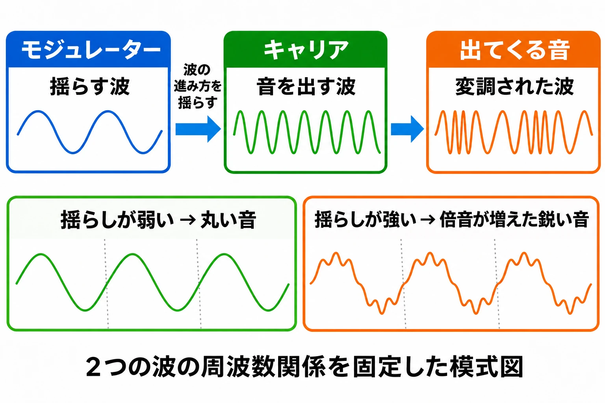

# 波で波を揺らして、音色を作る——ゲーム機サウンドの歴史③

[第2回「決まった波を選ぶか、波の形を描くか」](console-game-sound-history-02-pulse-and-wavetable.md)では、矩形波などの決まった形を選ぶ音源から、波の形を書き込む波形メモリ音源へと進んだ。今回は、波どうしを作用させて音色を作る **FM音源** を扱う。[第1回](console-game-sound-history.md)で触れた「波の進み方を揺さぶる」とは何か。その中身を見てから、この仕組みを載せたゲーム機の音を聴いていく。

同じFM音源でも、用意された楽器の音色を選ぶものと、音色を細かく組み立てられるものがある。何音を同時に鳴らせるかに加え、ひとつの音をどう作れるかに注目すると、機種ごとの違いをつかみやすい。

***

## 第1章　研究室の発見が、小さなチップになるまで

FM合成法を1967年に発見したのは、スタンフォード大学でコンピュータによる音の合成を研究していたジョン・チョウニング博士である。ヤマハはこの技術に着目し、1975年に同大学と独占契約を結んだ。製品として実を結んだのが、1981年のデジタルキーボード「GS1」と、1983年のデジタルシンセサイザー「DX7」である。その後、FM音源はパソコンやゲーム機、携帯電話にも広がった。[[1](#ref-1)]

発見から商品化までには時間がかかった。ヤマハのイノベーションロードの解説は、実用化のために半導体技術の進化を待ち、1981年に商品化したと説明している。[[2](#ref-2)] 音を計算で作れることと、それを家庭へ持ち込める大きさや費用で製造できることには、隔たりがあったのである。

ヤマハは音を計算する手順を改良し、出力の一部を自分へ戻して音色を変える **フィードバックFM** を開発した。さらに、合成に必要な回路をLSI、つまり大規模集積回路として小さな半導体チップへまとめ、量産につなげた。[[3](#ref-3)] 電気学会の資料によれば、当初のFM音源は打楽器系以外の音色の再現が不得手だったが、改良によって管楽器や、弦をはじく撥弦楽器まで扱えるようになった。同資料は、FM音源のハードウェア規模が、当時のアナログシンセサイザー方式より圧倒的に小さかったとも述べている。[[4](#ref-4)] 音色の幅を広げながら、小型化と量産を進められたことが、ゲーム機にも載せられる下地となったと捉えられる。

次は、発見の経緯を本人が語る英語の動画である。約5分の話から、楽器やゲーム機の音につながった研究の出発点に触れられる。

  <iframe
    src="https://www.youtube.com/embed/lhgFB90GlWY"
    title="John Chowning: FM Synthesis"
    style="width: 100%; height: 100%; border: 0;"
    allow="accelerometer; autoplay; clipboard-write; encrypted-media; gyroscope; picture-in-picture; web-share"
    allowfullscreen>
  </iframe>

*Stanford Historical Society「John Chowning: FM Synthesis」。配信元：Stanford Historical Society（スタンフォード大学「50 Stanford Stories for 50 Years」、英語）。<https://www.youtube.com/watch?v=lhgFB90GlWY>*

***

## 第2章　音を出す波と、揺らす波

FMはFrequency Modulation、すなわち **周波数変調** の略である。周波数とは、波が1秒間に何回繰り返すかを表す量で、音の高さに関わる。変調とは、ある信号を使って別の信号の性質を変えることである。FM合成では、音として出力する波である **キャリア** を、別の波である **モジュレーター** が揺らす。なめらかな山と谷を繰り返す正弦波どうしからでも、複雑な響きを作れる。[[5](#ref-5)]

ここで揺らすのは、波を読み進めるタイミング、すなわち波の進み方である。音量どうしを単純に掛け算する仕組みとは区別したい。揺らしの強さや、2つの波の速さの関係を変えると、音に含まれる高い成分の出方が変わる。基準となる音の整数倍の周波数を持つ成分を **倍音** と呼び、その含まれ方は音色を左右する。設定次第で、金属的な響きまで作れる。丸い音から鋭い音へ、同じ音程のまま響きを変えられるのが、この方法の面白さである。[[5](#ref-5)]

波を作る単位ひとつを **オペレーター** と呼ぶ。音を外へ出す役ならキャリア、別のオペレーターを揺らす役ならモジュレーターとなる。2つを組み合わせて初めて、揺らす側と揺らされる側の組ができる。そして、オペレーターをどうつなぐかを **アルゴリズム** と呼ぶ。[[5](#ref-5)] 2オペレーターなら基本となる2つの単位で音を作り、4オペレーターなら、さらに段階を重ねたり、複数の音の成分を組み合わせたりできる。オペレーター数は、同時に鳴る音の数ではなく、ひとつの音色を組み立てるための単位の数である。

波形は仕組みを示す模式図である。下段の点線は同じ長さの周期を区切り、揺らしの強さによる音色の違いを示す。ヤマハの解説をもとに作成。[[5](#ref-5)]

FM合成では、楽器を録音した断片であるサンプルを保存せず、波の速さや揺らしの強さなどの設定値から音を作れる。[[5](#ref-5)] 音色ごとに長い録音を用意する代わりに、小さな設定の組を持てばよい。この性質は、記憶容量が限られたゲーム機にとって都合がよかったと考えられる。

以下では、ヤマハ製チップの型番にYM2413（OPLL）、YM2612（OPN2）のような呼び名を添える。OPLLはヤマハの製品資料の表題にも記された呼び名で、OPN2も同じ系列の呼び名として、愛好家や開発者のあいだで広く使われる。[[6](#ref-6)] まずは2オペレーターのYM2413（OPLL）、次に4オペレーターのYM2612（OPN2）を見ていこう。

***

## 第3章　OPLL：用意された音色から、FMを使う

### YM2413（OPLL）の手軽さ

YM2413（OPLL）は、1チャンネルにつき2オペレーターで音を作り、9チャンネルを同時に鳴らせる。リズムモードに切り替えると、旋律用のFM6チャンネルと、5種類のリズム音を使える。通常の音色選択には、固定の15音色と、自作音色用の1枠があり、合わせて16枠となる。[[6](#ref-6)] 自作音色の設定は全チャンネルで共有するため、同時に用意できる自作音色は1種類である。[[7](#ref-7)]

用意された音色を選べば、波の設定をすべて作らなくても演奏を始められる。自作音色の枠を使えば独自の響きにも手を入れられるが、複数の異なる自作音色を同時に並べる自由はない。手軽に使えることと引き換えに、音色を自由に作る範囲を絞ったチップといえる。

### セガ・マークIIIと、日本版マスターシステム

1985年10月20日発売のセガ・マークIIIは、矩形波などを作るPSG音源を備えていた。[[8](#ref-8)] この本体に別売のFMサウンドユニットをつなぐと、YM2413（OPLL）によるFM音源を追加できた。[[7](#ref-7)] 対応ソフトでは、単純な波を選ぶ音色に加え、波を作用させて作る楽器風の響きを使えるようになる。

1987年10月18日発売の日本版マスターシステムは、そのFMサウンドユニットを本体へ内蔵した。[[9](#ref-9)] 一方、海外版マスターシステムにはFM音源がない。[[7](#ref-7)] 同じ系列のゲーム機でも、地域や周辺機器の有無によって、ゲームで使える音の編成が違ったのである。

### MSX-MUSIC：同じ曲をFMとPSGで聴く

MSX-MUSICは、YM2413（OPLL）を使うMSXのFM音源規格である。MSX2+の一部機種などでは本体に内蔵され、拡張カートリッジでも利用できた。[[10](#ref-10)] その代表が、パナソニックから1988年に登場したFM-PACである。[[11](#ref-11)] 第2回で扱った、波形を書き込むSCCとは、音色を作る方法が異なる。

MSXには、標準のPSGとFMの両方で音楽を鳴らせる作品があった。『F-1スピリット 3Dスペシャル』の「Glory」は、その違いを同じ曲で聴ける例である。先にFM版、続いてPSG版を置く。旋律を追いながら、音の立ち上がりや、伸びている間の響きに耳を向けると、音色の違いを比べやすい。

  <iframe
    src="https://www.youtube.com/embed/A-M8NBXzb-g"
    title="F-1スピリット 3Dスペシャル Glory FM版"
    style="width: 100%; height: 100%; border: 0;"
    allow="accelerometer; autoplay; clipboard-write; encrypted-media; gyroscope; picture-in-picture; web-share"
    allowfullscreen>
  </iframe>

*『F-1スピリット 3Dスペシャル』（MSX2+）「Glory」FM版。配信元：Konami（『MSX RACING SPIRIT 3D SPECIAL サウンドトラック（MSX版）』、℗ Konami）。<https://www.youtube.com/watch?v=A-M8NBXzb-g>*

  <iframe
    src="https://www.youtube.com/embed/Q7rEXoEMCA8"
    title="F-1スピリット 3Dスペシャル Glory PSG版"
    style="width: 100%; height: 100%; border: 0;"
    allow="accelerometer; autoplay; clipboard-write; encrypted-media; gyroscope; picture-in-picture; web-share"
    allowfullscreen>
  </iframe>

*同じ曲のPSG版。『F-1スピリット 3Dスペシャル』（MSX2+）「Glory」。配信元：Konami（『MSX RACING SPIRIT 3D SPECIAL サウンドトラック（MSX版）』、℗ Konami）。<https://www.youtube.com/watch?v=Q7rEXoEMCA8>*

### ファミコンのVRC7：カートリッジに載ったFM音源

第2回では、ファミコンへ別の音を加える方法としてVRC6やディスクシステムを扱った。その拡張音源の流れに、FM合成を持ち込んだのがコナミの **VRC7** である。YM2413（OPLL）の派生で、2オペレーターのFM音源を6チャンネル持つ。リズム音の機能はなく、固定音色もYM2413（OPLL）とは異なる独自のものが用意されている。VRC7の音源機能を採用したゲームは『ラグランジュポイント』だけである。[[12](#ref-12)]

本体側の矩形波などに、FMで組み立てた音色が加わる。次のオープニングでは、旋律と伴奏の響きに注目すると、第2回の本体音源やVRC6とは異なる音色の選択肢を聴き取れる。

  <iframe
    src="https://www.youtube.com/embed/WwPAF670RX4"
    title="ラグランジュポイント オープニング"
    style="width: 100%; height: 100%; border: 0;"
    allow="accelerometer; autoplay; clipboard-write; encrypted-media; gyroscope; picture-in-picture; web-share"
    allowfullscreen>
  </iframe>

*『ラグランジュポイント』（ファミコン、VRC7使用）オープニング。配信元：Konami（『ピコっとゲームクラシック』、2016年、℗ Konami）。<https://www.youtube.com/watch?v=WwPAF670RX4>*

パソコンでもFM音源は広く使われたが、その歩みは既刊[『MSX』の記事](msx-standard-home-pc-game-history.md)と[『PC-8000／8800／9800シリーズ』の記事](pc-8000-8800-9800-series-history.md)へ譲り、ここからは家庭用ゲーム機のメガドライブへ進む。

***

## 第4章　OPN2：メガドライブの4オペレーター

1988年10月29日発売のメガドライブは、YM2612（OPN2）によるFM6チャンネルと、矩形波などを作るPSG音源を組み合わせた。PSG側は矩形波3チャンネルとノイズ1チャンネルである。FMのうち1チャンネルは、録音した音を鳴らすPCM再生へ切り替えられる。[[13](#ref-13)]

YM2612（OPN2）は、1チャンネルにつき4オペレーターを使う。[[14](#ref-14)] YM2413（OPLL）の2オペレーターから、ひとつの音に関わる単位が増え、つなぎ方も選べる。音色は固定の楽器一覧から選ぶのではなく、各オペレーターの設定とアルゴリズムを組み合わせて用意する。揺らしを重ねる音、複数の成分を重ねる音など、音色の組み立てに幅が生まれたのである。

その音源へ演奏の指示を出すのは、曲のデータを読み、チップの設定を更新する **サウンドドライバー** というプログラムである。基本となる構成では、サブCPUのZ80が、専用の8KBのメモリを使ってこの仕事を担う。ただし、初代『ソニック・ザ・ヘッジホッグ』では、メインCPUの68000がサウンドドライバーを動かした。[[14](#ref-14)][[13](#ref-13)] 音を作る担当は音源チップでも、「いつ、どの設定で鳴らすか」を進める担当はプログラムであり、その置き方には選択肢があった。

まずは『ソニック・ザ・ヘッジホッグ』のグリーンヒルゾーンを聴いてみよう。メガドライブではFM音源とPSG音源を同時に鳴らせるため、ゲームの曲として聞こえるのは、両者を組み合わせた音である。[[14](#ref-14)] ひとつのチップ名だけで曲全体の響きを捉えず、複数の音源が同じ演奏に参加していることを思い出したい。

  <iframe
    src="https://www.youtube.com/embed/NaAb1s0MCQQ"
    title="ソニック・ザ・ヘッジホッグ グリーンヒルゾーン メガドライブ版"
    style="width: 100%; height: 100%; border: 0;"
    allow="accelerometer; autoplay; clipboard-write; encrypted-media; gyroscope; picture-in-picture; web-share"
    allowfullscreen>
  </iframe>

*『ソニック・ザ・ヘッジホッグ』（メガドライブ版）グリーンヒルゾーン。配信元：Universal Music（『Sonic The Hedgehog 1&2 Soundtrack』、℗ 2011 DCT Records）。<https://www.youtube.com/watch?v=NaAb1s0MCQQ>*

もうひとつの例が、『ベア・ナックルII』の「Go Straight」である。4オペレーターで作る音色と、PCMのドラムが組み合わさる例として聴ける。波から合成する音と、録音を再生する音が、ひとつの曲の中で役割を分けている。PCMの詳しい仕組みは次回に回そう。

  <iframe
    src="https://www.youtube.com/embed/H_8rqx7KWeo"
    title="ベア・ナックルII Go Straight"
    style="width: 100%; height: 100%; border: 0;"
    allow="accelerometer; autoplay; clipboard-write; encrypted-media; gyroscope; picture-in-picture; web-share"
    allowfullscreen>
  </iframe>

*『ベア・ナックルII』「Go Straight」。配信元：Wayô Records（『Streets of Rage 2 Perfect Soundtrack』、2020年、℗ YUZO KOSHIRO / SEGA、SEGA公認）。<https://www.youtube.com/watch?v=H_8rqx7KWeo>*

***

## 第5章　同じFMでも、音色を作る自由が違う

今回扱ったチップを並べると、オペレーター数、同時に鳴るチャンネル数、音色を用意する方法が、それぞれ別の条件だと分かる。

| チップ（型番と呼び名） | 搭載機・拡張機器（年） | 1チャンネルのオペレーター数 | FMのチャンネル数 | 音色の作り方 |
| --- | --- | --- | --- | --- |
| YM2413（OPLL） | マークIII用FMサウンドユニット／日本版マスターシステム（本体は1987年）／MSX-MUSIC（FM-PACは1988年） | 2 | 9、または旋律6＋リズム5音 | 固定15音色＋共有する自作1音色。プリセット中心 |
| VRC7 | ファミコン『ラグランジュポイント』 | 2 | 6（リズムなし） | 独自の固定音色＋共有する自作1音色。プリセット中心 |
| YM2612（OPN2） | メガドライブ（1988年） | 4 | 6（うち1つをPCMに切り替え可能） | 各オペレーターの設定とつなぎ方から、音色を自由に組む |

出典は本文を参照。年は日本での発売年を示し、YM2413（OPLL）の行は、本体と拡張機器の年を区別した。VRC7の行は、ファミコン本体に加わる音源部分の仕様である。

YM2413（OPLL）の9チャンネルと、YM2612（OPN2）の6チャンネルを比べると、発音枠は前者のほうが多い。一方、ひとつの音色を組み立てるオペレーターは後者のほうが多い。数字をひとつだけ見て音源の豊かさを決めるよりも、「同時に何音を置けるか」と「それぞれの音をどこまで作れるか」を分けて見ると、設計の違いが見えてくる。

***

## まとめ　波を描く方法から、波を作用させる方法へ

第2回の波形メモリは、繰り返す波の輪郭を書き込んで音色を用意する方法だった。今回のFM音源は、波どうしを作用させ、その関係を設定して音色を作る方法である。出発点が単純な波でも、揺らし方を変えることで、多彩な響きを組み立てられた。

その仕組みは、プリセットを中心に使うYM2413（OPLL）やVRC7、4オペレーターを組み合わせるYM2612（OPN2）として、異なる形でゲームに入った。音源を知る手がかりは、同時発音数だけでなく、音色を用意する方法にもある。次回の[第4回](console-game-sound-history-04-pcm-sampling.md)では、録音した音そのものを鳴らすPCMへ進む。

## References

1. [ヤマハ「ジョン・チョウニング博士「Technical Grammy Award」受賞」][1] — ヤマハ、2026年2月3日。発見、独占契約、GS1・DX7と他分野への普及。

[1]: https://www.yamaha.com/ja/newsroom/topics/2026/26020301/

2. [ヤマハ「ジョン・チョウニング博士、テクニカル・グラミー賞を受賞」][2] — イノベーションロード、2026年2月3日。半導体技術の進化と商品化。

[2]: https://www.yamaha.com/ja/about/experience/innovation-road/information/2026/00098/

3. [ヤマハ「「FM音源の実用化と普及」が第18回電気技術顕彰「でんきの礎」として顕彰」][3] — ヤマハ、2025年3月26日。フィードバックFMと自社でのLSI化。

[3]: https://www.yamaha.com/ja/news_release/2025/25032601/

4. [電気学会「FM音源の実用化と普及」][4] — 第18回「でんきの礎」、2025年。音色の拡大、ハードウェア規模、小型化と量産。

[4]: https://www.iee.jp/file/foundation/data02/ishi-18/ishi-0607.pdf

5. [ヤマハ「What Lies at the Heart of the FM-X」][5] — ヤマハ。オペレーター、キャリア、モジュレーター、アルゴリズムの定義。

[5]: https://uk.yamaha.com/en/musical-instruments/keyboards/explore/montage-portal/essentials/fm-x.html

6. [ヤマハ「YM2413 9-ch, 2-op. FM sound generator（OPLL）」][6] — ヤマハ製品資料。第三者アーカイブ所蔵の原資料。2オペレーター、発音モード、固定15音色と自作音色用レジスタ。

[6]: https://www.quarter-dev.info/archives/yamaha/YM2413.pdf

7. [Rodrigo Copetti「Sega Master System Architecture」][7] — Architecture of Consoles。FM Expansion節。自作音色の共有、マークIIIの拡張と国内外のマスターシステムの違い。

[7]: https://www.copetti.org/writings/consoles/master-system/

8. [セガ「セガ・マークⅢ」][8] — セガハード大百科。発売日とPSG音源。

[8]: https://www.sega.jp/history/hard/segamark3/

9. [セガ「マスターシステム」][9] — セガハード大百科。日本版の発売日とFMサウンドユニット内蔵。

[9]: https://www.sega.jp/history/hard/mastersystem/

10. [MSX Wiki contributors「MSX-MUSIC」][10] — MSX Resource Center Wiki。開発者向けwiki。YM2413を使う規格と本体内蔵機。

[10]: https://www.msx.org/wiki/MSX-MUSIC

11. [MSX Wiki contributors「Panasoft SW-M004」][11] — MSX Resource Center Wiki。開発者向けwiki。FM-PACの登場年と搭載チップ。

[11]: https://www.msx.org/wiki/Panasoft_SW-M004

12. [NESdev Wiki contributors「VRC7 audio」][12] — NESdev Wiki。開発者向けwiki。YM2413の派生、6チャンネル、固定音色、自作音色、リズム出力の不在、採用作。

[12]: https://www.nesdev.org/wiki/VRC7_audio

13. [セガ「メガドライブ」][13] — セガハード大百科。発売日、音源構成、PCM切り替え、Z80Aと8KBのメモリ。

[13]: https://www.sega.jp/history/hard/megadrive/

14. [Rodrigo Copetti「Mega Drive / Genesis Architecture」][14] — Architecture of Consoles。Audio節。FM合成、YM2612、PSG、PCM、サウンドドライバーと初代ソニック。

[14]: https://www.copetti.org/writings/consoles/mega-drive-genesis/

英語資料の説明は本稿で日本語に要約した。

----

この文書は、Perplexity、Claude、ChatGPT の3つのAIの支援を受けて著述されたものです。引用画像を除き、MIT License にて提供されています。
