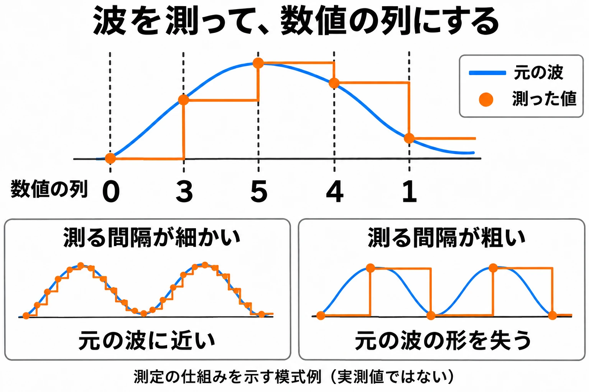

# 録った音を、小さく詰めて鳴らす——ゲーム機サウンドの歴史④

[第3回「波で波を揺らして、音色を作る」](console-game-sound-history-03-fm-synthesis.md)で扱ったFM音源は、波の速さや揺らし方の設定値から音を作った。今回の **PCM** は、録音した音そのものを数値として持ち、それを鳴らす方法である。楽器や声の響きを取り込める一方、録音を持つぶん、データは大きくなる。

限られた容量へ録音をどう収め、複数の楽器としてどう演奏させるのか。スーパーファミコンとゲームボーイアドバンスは、その仕事を異なる担当へ割り振った。仕組みを見てから、それぞれの音の違いに耳を向けていこう。

***

## 第1章　音の波を、数値の列にする

PCMはPulse-Code Modulation、すなわち **パルス符号変調** の略である。音の波を一定の間隔で測り、そのときの値を数値の列として記録する。ひとつひとつの測定値を **サンプル** と呼ぶ。楽器の短い録音全体を指して「サンプル」と呼ぶこともあるため、以下では、個々の測定値と録音の断片を文脈で区別する。[[1](#ref-1)]

1秒間に測る回数が **サンプリング周波数** である。たとえば32kHzなら、1秒間に32,000回測る。1回の値をどれだけ細かく表すかを決めるのが **ビット数** である。測る回数を増やせば細かな波の変化を捉えやすくなり、ビット数を増やせば波の高さを細かく記録できる。同じ長さの録音なら、どちらを増やしても必要なデータ量は増える。[[1](#ref-1)][[2](#ref-2)]

測定の仕組みを示す模式例。波形と数値は実測値ではない。CopettiのPCMの説明をもとに作成。[[1](#ref-1)]

録音した音を鳴らす仕組みには、すでに前の回でも触れた。[第2回](console-game-sound-history-02-pulse-and-wavetable.md)のファミコンには、変化の方向を記録するDPCMによるサンプル再生があった。[第3回](console-game-sound-history-03-fm-synthesis.md)のメガドライブでも、FMの1チャンネルをPCM再生へ切り替えられた。今回は、その録音を「楽器」として本格的に演奏させる音源へ進む。

短い録音を用意し、鳴らす高さや長さを変えて並べれば、曲になる。そこで必要になるのは、録音を小さく持つ工夫と、いつ、どの音を鳴らすかを進める仕組みである。

***

## 第2章　スーパーファミコン：専用の音源で、録音を楽器として鳴らす

### ソニーの音源と、独立した音の担当

スーパーファミコンは、日本では1990年に発売された。[[3](#ref-3)] 音源を供給したのはソニーである。[[2](#ref-2)] プレイステーション事業の立ち上げに関わった丸山茂雄氏は、インタビューで、ソニーの久夛良木健氏がスーパーファミコンの音源チップを手がけたと語っている。その位置づけは、ソニーが部品メーカーとして作り、京都の任天堂へ納めた、というものである。[[4](#ref-4)]

音の仕事は、ゲーム本体のメインCPUから独立した仕組みが担う。8bitのCPUである **SPC700** が演奏の指示を進め、実際に音を鳴らす **S-DSP** を動かす。S-DSPは8チャンネルの録音を再生し、16bit・32kHzで混ぜて出力する。音声データと音を鳴らすプログラムは、64KBの専用メモリであるPSRAMに置かれる。[[2](#ref-2)]

この64KBは、その場の演奏に使う作業用の場所である。カートリッジに保存された音声データやプログラムを、メインCPUが音源側へ送り込む。曲や場面に応じて必要なデータを読み込むことで、ゲームの進行に沿って演奏を切り替えられる。[[2](#ref-2)]

### BRRで小さく詰め、ループで長く鳴らす

録音を保存するときには、必要なデータ量を小さくする **圧縮** を使う。スーパーファミコンの **BRR** は、前の値から次の値を予測する仕組みなどを用いるADPCMの一種である。16サンプルをひとまとまりにし、制御情報の1バイトと、各サンプルを4bitで表した8バイトの、合計9バイトへ詰める。[[5](#ref-5)]

同じ16サンプルを16bitのまま記録すると32バイトになるため、9バイトはその約3.6分の1である。この比は、16bitの値を16個保存した場合と、BRRの1ブロックの大きさを比べた計算である。4bitというのは圧縮して保存するデータ側の単位であり、S-DSPの16bit出力とは役割が違う。[[5](#ref-5)]

さらに、録音の途中へ戻る **ループ点** を指定できる。短い録音の一部を繰り返せば、鍵盤を押している間のように、長く伸びる音を作れる。長い音のすべてを録音しておく代わりに、繰り返せる部分を持つ工夫である。[[5](#ref-5)]

録音を異なる高さで鳴らすときには、データを読み進める速さを変える。その際、記録した点のあいだの値を求めてつなぐ処理を **補間** と呼ぶ。S-DSPは、隣り合う4点を使う **ガウス補間** で、点のあいだを滑らかにつなぐ。圧縮した録音を戻すことと、再生する速さに合わせて点のあいだをつなぐことは、それぞれ別の仕事なのである。[[5](#ref-5)][[6](#ref-6)]

### 8チャンネルへ、曲と効果音を配る

S-DSPには、音を左右へ配置するステレオの定位、音の立ち上がりから消えるまでの音量変化を作る **ADSR**、音を遅らせて戻す **エコー**、ノイズ、チャンネルどうしで音程を揺らすピッチモジュレーションがある。エコーは遅延音による効果で、残響を表すリバーブとは区別される。エコーを使うと、戻す音のための作業領域も64KBから確保する。その領域の管理を誤れば、音声データやプログラムなど、ほかのデータを上書きしてしまう。[[2](#ref-2)]

曲を進めてS-DSPを操作するのは、各ゲームが用意する **サウンドドライバー** というプログラムである。任天堂にも「Nintendo SPC Sound Engine」というドライバーがあったが、Copettiは、その文書が分かりにくく、多くの開発者が自作したと説明している。[[2](#ref-2)]

8チャンネルを曲と効果音へどう配るかも、ゲーム側の設計となる。Copettiが挙げる『星のカービィ3』では、曲に5チャンネル、効果音に3チャンネルを使う。[[2](#ref-2)] 同時に鳴らせる枠の中で、音楽を続けながら操作や出来事を伝える音も置くのである。

### 録音が楽器になる音を聴く

まずは『悪魔城ドラキュラ』の「カラクリ館」を聴いてみよう。旋律や伴奏の、音が鳴り始める瞬間と、伸びている間の響きに耳を向けたい。後でゲームボーイアドバンスの同じ曲へ戻るため、ここでは音色の輪郭を覚えておこう。

  <iframe
    src="https://www.youtube.com/embed/uVat1df05Rw"
    title="悪魔城ドラキュラ カラクリ館 スーパーファミコン版"
    style="width: 100%; height: 100%; border: 0;"
    allow="accelerometer; autoplay; clipboard-write; encrypted-media; gyroscope; picture-in-picture; web-share"
    allowfullscreen>
  </iframe>

*『悪魔城ドラキュラ』（スーパーファミコン）「カラクリ館（ステージ4BGM）」。配信元：Virgin Music Group（『ミュージックフロム 悪魔城ドラキュラ 黒』、℗ 2021 Konami Digital Entertainment）。<https://www.youtube.com/watch?v=uVat1df05Rw>*

『ファイナルファンタジーVI』の「アリア」は、歌声のような音色を録音で鳴らしている例として聴ける。短い録音が、曲の中で声を思わせる楽器の役割を受け持つことに注目したい。

  <iframe
    src="https://www.youtube.com/embed/MLHR9ltzuWM"
    title="ファイナルファンタジーVI アリア"
    style="width: 100%; height: 100%; border: 0;"
    allow="accelerometer; autoplay; clipboard-write; encrypted-media; gyroscope; picture-in-picture; web-share"
    allowfullscreen>
  </iframe>

*『ファイナルファンタジーVI』「アリア」。配信元：NexTone（『FINAL FANTASY VI Original Soundtrack』、1994年）。<https://www.youtube.com/watch?v=MLHR9ltzuWM>*

『聖剣伝説2』の「天使の怖れ」でも、音の立ち上がりや、伸びる音どうしの重なりを追ってみよう。同じ本体でも、用意した録音と鳴らし方によって、聞こえる楽器の組み合わせは変わる。

  <iframe
    src="https://www.youtube.com/embed/xgM9f0CSFe8"
    title="聖剣伝説2 天使の怖れ"
    style="width: 100%; height: 100%; border: 0;"
    allow="accelerometer; autoplay; clipboard-write; encrypted-media; gyroscope; picture-in-picture; web-share"
    allowfullscreen>
  </iframe>

*『聖剣伝説2』「天使の怖れ」。配信元：NexTone（『Secret of Mana (Original Soundtrack)』）。<https://www.youtube.com/watch?v=xgM9f0CSFe8>*

***

## 第3章　ゲームボーイアドバンス：CPUが混ぜて、録音を鳴らす

### 互換音源に加わった、2つのDirect Sound

ゲームボーイアドバンスは、日本では2001年に発売された。[[3](#ref-3)] 第2回で扱ったゲームボーイの矩形波・波形メモリ・ノイズの音源を互換用に残し、録音を鳴らす **Direct Sound** を2チャンネル加えた。[[1](#ref-1)]

Direct Soundが受け取る値は、符号付きの8bitである。音楽CDの16bitと比べると、値を表すためのビット数が半分になる。表せる段階は8bitが256段階、16bitが65,536段階なので、波の高さの細かさには大きな差がある。Copettiは、8bitを採用した背景を、本体を安価に保つためと説明している。[[1](#ref-1)]

データは各チャンネルの16バイトの **FIFO** へ送られる。FIFOとは、先に入れたデータから順番に取り出す待ち行列である。メモリからデータを運ぶ **DMA** と、取り出すタイミングを刻むタイマーを各チャンネルに使い、次々と音を流していく。サンプリング周波数はゲーム側が選べ、通常の8bitの条件では上限65kHzとされる。[[1](#ref-1)]

### 楽器を混ぜる仕事は、メインCPUへ

スーパーファミコンでは、S-DSPが各チャンネルの楽器を鳴らして混ぜた。ゲームボーイアドバンスでは、メインCPUが曲を進め、複数の楽器の録音を計算で重ねる。この、複数の音を混ぜ合わせる処理が **ミキシング** である。混ぜた結果をDirect Soundの2チャンネルへ流す。[[1](#ref-1)]

2チャンネルは、CPUが先に混ぜた結果を送り出すための枠である。曲の楽器は、その手前でいくつも重ねられる。ゲームボーイアドバンスのBIOS、つまり本体に組み込まれた基本プログラムにも、曲を順番に進めるシーケンサーがあり、この作業を助ける。[[1](#ref-1)]

音の細かな変化を保つ録音や、高いサンプリング周波数を使うほど、カートリッジの容量やCPUの処理時間を多く使う。ゲームの動作と音の処理は、同じCPUの時間を分け合うことになる。各ゲームは、音へどれだけの容量と処理を割くかを選んだ。[[1](#ref-1)]

互換音源も演奏に参加でき、多くのゲームでは伴奏や効果音に使われた。『MOTHER3』には、部屋の雰囲気に応じて、同じ曲の旋律を受け持つ音源を切り替える例がある。録音を鳴らすDirect Soundと、ゲームボーイから続く音源を、場面の表現として使い分けたのである。[[1](#ref-1)]

### 同じ「カラクリ館」を、別の仕組みで聴く

2001年発売の『悪魔城ドラキュラ Circle of the Moon』[[7](#ref-7)]には、公式配信の曲名にもあるとおり、スーパーファミコン版『悪魔城ドラキュラ』の「カラクリ館」が収録されている。先ほどのスーパーファミコン版を振り返り、同じ旋律の立ち上がりや、伴奏と重なる部分がどう聞こえるかを聴いてみよう。

専用の音源で楽器を鳴らして混ぜる方法と、CPUで混ぜた音を流す方法。その違いを念頭に置いて聴きたい。聞こえ方の差には、音源の仕組みだけでなく、移すときの編曲や用意した録音も関わる。

  <iframe
    src="https://www.youtube.com/embed/eRL4_MLG9cg"
    title="悪魔城ドラキュラ Circle of the Moon カラクリ館"
    style="width: 100%; height: 100%; border: 0;"
    allow="accelerometer; autoplay; clipboard-write; encrypted-media; gyroscope; picture-in-picture; web-share"
    allowfullscreen>
  </iframe>

*『悪魔城ドラキュラ Circle of the Moon』（ゲームボーイアドバンス）「カラクリ館（SFC版「悪魔城ドラキュラ」より）」。配信元：Virgin Music Group（『ミュージックフロム 悪魔城ドラキュラ 黒』、℗ 2021 Konami Digital Entertainment）。<https://www.youtube.com/watch?v=eRL4_MLG9cg>*

### マサラタウンを、ゲームボーイとアドバンスで聴く

もうひとつ、第2回で聴いた『ポケットモンスター 赤・緑』へ戻ってみよう。BGM集の2分11秒から始まる「マサラタウンのテーマ」である。矩形波などによる旋律と伴奏の輪郭を、まず耳に残しておきたい。

  <iframe
    src="https://www.youtube.com/embed/Q53CDIGPJ58?start=131"
    title="ポケットモンスター 赤・緑 マサラタウンのテーマ 2分11秒から"
    style="width: 100%; height: 100%; border: 0;"
    allow="accelerometer; autoplay; clipboard-write; encrypted-media; gyroscope; picture-in-picture; web-share"
    allowfullscreen>
  </iframe>

*『ポケットモンスター 赤・緑』BGM集。「マサラタウンのテーマ」は2分11秒から。配信元：ポケモン公式YouTubeチャンネル「Pokémon Game Sound Library」。<https://www.youtube.com/watch?v=Q53CDIGPJ58&t=131>*

次は、2004年発売のリメイク『ポケットモンスター ファイアレッド・リーフグリーン』の同じ曲である。[[8](#ref-8)] BGM集の4分4秒から聴ける。ゲームボーイの音源による演奏から、録音を楽器として使えるゲームボーイアドバンスの演奏へ、同じ町の旋律がどう移ったか。音が鳴り始める部分や、音を伸ばしている間の響きを比べると、違いを追いやすい。

  <iframe
    src="https://www.youtube.com/embed/YLzt-WYPqsc?start=244"
    title="ポケットモンスター ファイアレッド・リーフグリーン マサラタウンのテーマ 4分4秒から"
    style="width: 100%; height: 100%; border: 0;"
    allow="accelerometer; autoplay; clipboard-write; encrypted-media; gyroscope; picture-in-picture; web-share"
    allowfullscreen>
  </iframe>

*『ポケットモンスター ファイアレッド・リーフグリーン』BGM集。「マサラタウンのテーマ」は4分4秒から。配信元：ポケモン公式YouTubeチャンネル「Pokémon Game Sound Library」。<https://www.youtube.com/watch?v=YLzt-WYPqsc&t=244>*

***

## 第4章　録音を鳴らす担当が、音の設計を変える

2機種を並べると、録音を保存する形式、音を混ぜる担当、最後に送り出すチャンネルの数が、それぞれ違う条件だと分かる。

| 機種（日本での発売年） | 音を鳴らす担当 | 録音のチャンネル数 | ビット数 | サンプリング周波数 | 音声用メモリ |
| --- | --- | --- | --- | --- | --- |
| スーパーファミコン（1990年） | SPC700が演奏を進め、S-DSPが再生・ミキシング | 8 | 出力16bit。保存はBRRの4bitデータ＋制御情報 | 出力32kHz | 専用PSRAM 64KB。音声・プログラム・エコー用領域で共有 |
| ゲームボーイアドバンス（2001年） | メインCPUが演奏・ミキシングし、Direct Soundへ送る | 2（混ぜた結果を流す枠） | Direct Soundへの入力8bit | 上限65kHz（実際の値はゲームによる） | 各チャンネルに16バイトのFIFO。録音や作業データはカートリッジ・本体のメモリを利用 |

出典は本文を参照。スーパーファミコンの32kHzは公称値で、実際の出力周波数には本体による差がある。[[6](#ref-6)] 同機の録音素材すべてを32kHzで保存するという意味ではない。また、ゲームボーイアドバンスのFIFOは、音を順に送り出すための小さな待ち行列であり、録音全体を収める場所とは役割が異なる。

スーパーファミコンの8チャンネルは、音源が個別に扱う楽器の枠である。ゲームボーイアドバンスの2チャンネルは、CPUが複数の楽器を混ぜた結果を受け取る枠である。数だけを比べるより、どの段階で何を担当する枠なのかを見ると、設計の違いをつかみやすい。

***

## まとめ　録音を持ち、演奏として組み立てる

PCMによって、録音した音の波を数値として持ち、ゲームの楽器として鳴らせるようになった。その録音を小さく詰め、短い部分を繰り返して伸ばせば、限られた容量でも演奏を組み立てられる。

スーパーファミコンは、圧縮した録音を専用メモリへ送り、独立したCPUと音源で鳴らした。ゲームボーイアドバンスは、メインCPUが楽器を混ぜ、その結果を録音用のチャンネルへ流した。録音を使うという共通点からも、仕事の割り振りが違えば、音に使う容量や処理の配分は変わる。次回の[第5回](console-game-sound-history-05-cd-era.md)では、CDから録音した音楽そのものを流す時代へ進む。

## References

1. [Rodrigo Copetti「Game Boy Advance Architecture」][1] — Architecture of Consoles。Audio節。PCM、Direct Sound、FIFO、DMA、タイマー、CPUによるミキシング、互換音源、BIOSのシーケンサー。

[1]: https://www.copetti.org/writings/consoles/game-boy-advance/

2. [Rodrigo Copetti「Super Nintendo / Famicom Architecture」][2] — Architecture of Consoles。Audio節。ソニーの音源供給、SPC700、S-DSP、PSRAMへの読み込み、エコー、サウンドドライバー、チャンネル配分。

[2]: https://www.copetti.org/writings/consoles/super-nintendo/

3. [任天堂「会社の沿革」][3] — 任天堂。スーパーファミコンとゲームボーイアドバンスの日本での発売年。

[3]: https://www.nintendo.co.jp/corporate/history/index.html

4. [電ファミニコゲーマー編集部「「久夛良木が面白かったからやってただけ」 プレイステーションの立役者に訊くその誕生秘話【丸山茂雄×川上量生】」][4] — 電ファミニコゲーマー、2016年10月25日。2ページ目の丸山茂雄氏の発言。音源チップの担当と部品メーカーとしての供給についての証言。

[4]: https://news.denfaminicogamer.jp/interview/ps_history/2

5. [SNESdev Wiki contributors「BRR samples」][5] — SNESdev Wiki。開発者向けwiki。ブロック形式、圧縮、ループ、4点ガウス補間。

[5]: https://snes.nesdev.org/wiki/BRR_samples

6. [SNESdev Wiki contributors「S-DSP」][6] — SNESdev Wiki。開発者向けwiki。8ボイス、ステレオ16bit出力、出力周波数と補間。

[6]: https://snes.nesdev.org/wiki/S-DSP

7. [コナミ「悪魔城ドラキュラ Circle of the Moon」][7] — Castlevania ポータルサイト。日本での発売日は2001年3月21日。

[7]: https://www.konami.com/games/castlevania/jp/ja/page/history_2001_gba

8. [任天堂「ポケットモンスター ファイアレッド・リーフグリーン」][8] — 任天堂。ゲームボーイアドバンス版の発売日は2004年1月29日。

[8]: https://www.nintendo.co.jp/n08/bprj/index.html

英語資料の説明は本稿で日本語に要約した。

----

この文書は、Perplexity、Claude、ChatGPT の3つのAIの支援を受けて著述されたものです。引用画像を除き、MIT License にて提供されています。
