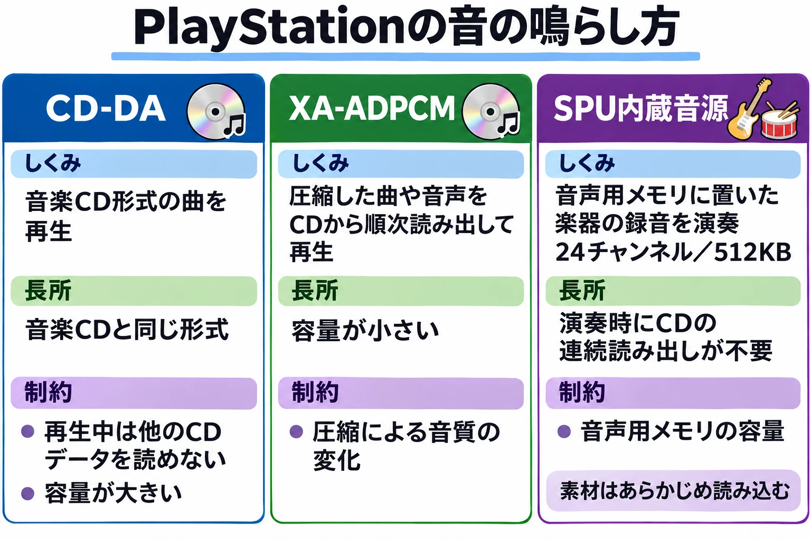

# 録音を流すか、その場で鳴らすか——ゲーム機サウンドの歴史⑤

[第4回「録った音を、小さく詰めて鳴らす」](console-game-sound-history-04-pcm-sampling.md)では、録音を小さく詰め、本体の音源で楽器として鳴らす仕組みを見た。PCMは、音の波を数値の列として記録する方法だった。短い録音も、高さや鳴らすタイミングを変えれば、曲を演奏するための素材になる。

CDは、録音した曲そのものを大量に収められる。では、CDを使うゲーム機は、録音を流すだけになったのだろうか。答えは、 **場面に応じて方法を選んだ** である。曲を完成した録音として流す方法と、楽器をその場で鳴らして組み立てる方法が、同じゲーム機に並ぶようになった。[[1](#ref-1)]

***

## 第1章　CDの音楽を流すということ

### 完成した演奏を、そのまま届ける

**CD-DA** は、音楽CDと同じ形式で、録音した曲を流す方式である。音を圧縮せずに収めるため、圧縮による情報の削減を伴わず、音楽CDの品質で再生できる。そのぶん、ディスクの容量を多く使う。[[1](#ref-1)]

楽器の短い録音と演奏の指示を持つ方法では、ゲーム機が曲を組み立てる。CD-DAでは、すでに演奏し終えた曲を再生する。旋律も伴奏もひとつの録音にまとまっているため、その中の楽器だけを別の楽器へ差し替えることはできない。

この違いは、どちらの音が好ましいかという評価とは別の話である。録音した演奏を届けたいのか、ゲームの進行に合わせて演奏の組み立てを変えたいのかで、使いたい仕組みが変わる。

### 音楽と、ゲームデータの読み込み

CDから音を読みながら流す方法を **ストリーミング** と呼ぶ。曲全体を最初に本体のメモリへ収める代わりに、再生に必要な分を順に読み続ける方法である。

ここで、音楽にもゲームデータにも同じCDドライブを使うことが関わってくる。PlayStationでは、CD-DAを再生している間、CDドライブは音楽の読み出しに占有され、ほかのゲームデータを読み込めない。[[1](#ref-1)]

たとえば、場面転換に合わせて次の背景や登場人物のデータをCDから読みたいとする。CD-DAを流し続ける時間と、次のデータを読み込む時間を、同じドライブへ同時に任せることはできない。曲をどう流すかは、場面の長さや、読み込みをどこへ置くかにもつながるのである。

***

## 第2章　PCエンジンCD-ROM²：CDの音楽をゲームへ

### 本体の音源へ、CDとADPCMを加える

PCエンジンのCD-ROMシステムは、1988年12月に登場した。[[2](#ref-2)] CDドライブと、起動用の基本プログラムであるBIOSにあたる **System Card** を組み合わせて使う。System Cardは、ゲームを起動し、CDドライブを扱うための処理を提供する。[[3](#ref-3)]

CD-ROM側には、汎用RAMが64KB、ADPCMの録音用RAMが64KB、セーブ用が2KBあった。 **ADPCM** は、前の値からの変化や予測を利用して、音の記録に必要なデータ量を減らす圧縮方法である。第4回で扱ったスーパーファミコンのBRRも、その一種だった。[[3](#ref-3)]

SUPER CD-ROM²では、Super System Cardによって汎用RAMが256KBへ増えた。さらに、アーケードカードには2MBのRAMが搭載された。これらの汎用RAMの拡張と、ADPCM用の64KBは、用途の異なる場所である。[[3](#ref-3)]

CDの大容量とCDの音楽が使えるようになっても、[第2回](console-game-sound-history-02-pulse-and-wavetable.md)で扱った本体の波形メモリ音源は残っている。波形からその場で音を作る方法に、ADPCMの録音再生と、CDの曲を流す方法が加わったのである。[[3](#ref-3)]

### 「Bloody Tears」から「血の涙」へ

1993年10月29日発売の『悪魔城ドラキュラX 血の輪廻』は、PCエンジン SUPER CD-ROM²の作品である。コナミは、CD-ROMの大容量を生かし、肉声やアニメによる演出、荘厳なBGMを取り入れたと紹介している。[[4](#ref-4)]

まず、第2回で聴いたディスクシステムの『ドラキュラII 呪いの封印』へ戻ってみよう。「Bloody Tears（昼の道BGM）」の旋律と伴奏が、それぞれどんな輪郭で聞こえるかを耳に残しておきたい。

  <iframe
    src="https://www.youtube.com/embed/Kch3uUciCZ8"
    title="ドラキュラII 呪いの封印（FDS）Bloody Tears（昼の道BGM）"
    style="width: 100%; height: 100%; border: 0;"
    allow="accelerometer; autoplay; clipboard-write; encrypted-media; gyroscope; picture-in-picture; web-share"
    allowfullscreen>
  </iframe>

*『ドラキュラII 呪いの封印』（ディスクシステム）「Bloody Tears（昼の道BGM）」。配信元：Konami Kukeiha Club - Topic（『ミュージックフロム 悪魔城ドラキュラ 黒』、℗ 2021 Konami Digital Entertainment）。<https://www.youtube.com/watch?v=Kch3uUciCZ8>*

次は『悪魔城ドラキュラX 血の輪廻』の「血の涙」である。「血の涙／Bloody Tears」という曲名の系譜をたどりながら、旋律を受け持つ音や、伴奏の重なり、音を伸ばす部分の響きへ耳を向けてみよう。音源の違いに加え、曲として用意された音色や編曲も、聞こえ方に関わっている。

  <iframe
    src="https://www.youtube.com/embed/HQ7WfXZiSaQ"
    title="悪魔城ドラキュラX 血の輪廻 血の涙"
    style="width: 100%; height: 100%; border: 0;"
    allow="accelerometer; autoplay; clipboard-write; encrypted-media; gyroscope; picture-in-picture; web-share"
    allowfullscreen>
  </iframe>

*『悪魔城ドラキュラX 血の輪廻』（PCエンジン）「血の涙」。配信元：Virgin Music Group（『ミュージックフロム 悪魔城ドラキュラ 黒』、℗ 2021 Konami Digital Entertainment）。<https://www.youtube.com/watch?v=HQ7WfXZiSaQ>*

***

## 第3章　メガCD：PCMとCDの音を混ぜる

メガCDは、1991年12月12日に発売された、メガドライブへ接続する拡張機器である。専用CPUとして68000（12.5MHz）を備え、PCM音源を加えた。追加されたPCM音源はステレオ8チャンネル、サンプリング周波数は最大32kHzで、PCM波形用メモリは512Kbitだった。[[5](#ref-5)]

[第3回](console-game-sound-history-03-fm-synthesis.md)で扱った、メガドライブ本体のFM音源とPSG音源も残る。PSGは、矩形波やノイズを鳴らす音源である。本体のFM・PSGに、メガCDのPCMとCDの音が加わる構成となった。

第4回で見た **ミキシング** は、複数の音を混ぜ合わせる処理だった。セガの仕様には、PCMとCDの音をミキシングでき、ミキシング端子から入る音とも混ぜられるとある。[[5](#ref-5)] 本体側の音を合わせる経路も含め、CDで録音した曲を流しつつ、その場で鳴らすFM・PSG・PCMを重ねられる仕組みである。

CDを加えることは、音を作る担当も増やすことだった。完成した録音を流す役割と、楽器や効果音を個別に鳴らす役割を、一緒に使えるようになったのである。

***

## 第4章　セガサターンとPlayStation：内蔵音源も、CDも

### セガサターン：PCMとFMを備えた音の担当

セガサターンは、1994年11月22日に発売された。サウンド専用CPUに68EC000（11.3MHz）、サウンドRAMに4Mbitを備え、倍速CDドライブを搭載する。音源の仕様は、PCMまたはFMで32チャンネル、16bit、サンプリング周波数は最大44.1kHzである。[[6](#ref-6)]

音源はヤマハ製で、専用CPUが音を鳴らすプログラムを動かす。4Mbit、すなわち512KBのサウンドRAMは、録音だけでなく、そのプログラムや音の処理の作業領域にも使われる。[[7](#ref-7)]

音へ効果をかける **DSP** も備える。エコーは遅らせた音を重ねる効果、リバーブは空間の残響を表す効果、コーラスは音をわずかにずらして重ね、厚みや揺らぎを作る効果である。こうした処理を、音源側で扱えた。[[7](#ref-7)]

第3回のFM音源も、ここではPCMと並ぶ選択肢として残っている。ただし、PCM32チャンネルとFM32チャンネルが別々にあるという意味ではなく、同じ音源の枠を使う。[[7](#ref-7)]

CD-DAの音は、CD側から音源へ直接送られる。楽器の録音をサウンドRAMへ置いて演奏する経路と、CDの曲を流す経路の両方を備えていた。[[7](#ref-7)]

### PlayStation：録音を鳴らす24チャンネル

PlayStationは、日本では1994年12月3日に発売された。[[8](#ref-8)] 音を受け持つ **SPU** は、24チャンネル、16bit、44.1kHzの音源である。サウンドRAMは512KBあり、そのうち録音を置けるのは508KBで、リバーブを使うとさらに減る。[[1](#ref-1)]

録音は、1サンプルあたり4bitのADPCMとして圧縮して持つ。4bitは保存するデータ側の単位で、SPUの16bit出力とは役割が異なる。第4回のスーパーファミコンと同様、圧縮して持った録音を戻し、楽器として鳴らす仕組みである。[[1](#ref-1)]

### 同じ本体にある、3つの方法

PlayStationでは、次の3つを区別すると分かりやすい。ここでいう **ループ** は、決めた位置へ戻って同じ音を繰り返し鳴らすことである。[[1](#ref-1)]

- **SPU-ADPCM**：楽器などの録音をサウンドRAMへ読み込み、SPUで展開して鳴らす。どの録音を、いつ、どの高さで鳴らすかという指示から、曲をその場で組み立てられる。
- **XA-ADPCM**：圧縮した音声をCDから読みながら流す。CDコントローラーが展開してSPU側へ送るため、メインCPUやSPUが展開を担う負担は小さい。一方、SPUで録音を鳴らすときのようなループ機能はない。
- **CD-DA**：音楽CDと同じ非圧縮の録音を流す。3方式のうち、圧縮による情報の削減を伴わずに再生できる一方、ディスクの容量を多く使い、再生中はCDドライブのほかの読み込みがふさがる。

第1回の比較図を、ここでも見てみよう。CDは、完成した曲を流す場所にも、SPUで使う楽器の録音を収める場所にもなる。

出典：Rodrigo Copetti「PlayStation Architecture」のAudio節をもとに作成。[[1](#ref-1)]

### 『ファイナルファンタジーVII』の声のような音へ

Copettiは、短い録音を組み合わせてSPUで曲を演奏する代表例として、『ファイナルファンタジーVII』を挙げている。[[1](#ref-1)] CDのゲームでも、楽器をその場で鳴らす方法が使われたのである。

「片翼の天使」では、声のように聞こえる音色の立ち上がりや、繰り返す響きへ耳を向けたい。第4回の『ファイナルファンタジーVI』「アリア」と同じく、録音を楽器として鳴らす音が、歌声のように聞こえる例として聴いてみよう。

  <iframe
    src="https://www.youtube.com/embed/pzQE_7mn8ts"
    title="ファイナルファンタジーVII 片翼の天使"
    style="width: 100%; height: 100%; border: 0;"
    allow="accelerometer; autoplay; clipboard-write; encrypted-media; gyroscope; picture-in-picture; web-share"
    allowfullscreen>
  </iframe>

*『ファイナルファンタジーVII』「片翼の天使」。配信元：NexTone（『FINAL FANTASY VII Original Soundtrack』、1997年）。<https://www.youtube.com/watch?v=pzQE_7mn8ts>*

***

## 第5章　CDの容量と、演奏のためのメモリ

4つの機種を並べると、CDを使うようになっても、本体側の音源が演奏を担い続けたことが分かる。

| 機種（日本での発売年） | CDの音楽 | 本体側の音源 | 音声用メモリ |
| --- | --- | --- | --- |
| PCエンジンCD-ROM²（1988年） | CD-DA | 本体の波形メモリ音源＋CD-ROM側のADPCM再生 | ADPCM用64KB。別に汎用RAM 64KBとセーブ用2KB |
| メガCD（1991年） | CDの音をPCMやミキシング端子の入力と混ぜられる | 本体のFM・PSG＋追加のPCMステレオ8チャンネル | 追加のPCM波形用512Kbit（64KB） |
| セガサターン（1994年） | CD-DAをCD側から音源へ直接送る | PCMまたはFMで32チャンネル、DSP | サウンドRAM 4Mbit（512KB）。録音・プログラム・DSPの作業領域で共有 |
| PlayStation（1994年） | CD-DA、圧縮音声のXA-ADPCM | SPUでADPCMの録音を24チャンネル再生 | サウンドRAM 512KB。録音用は508KBで、リバーブ使用時はさらに減少 |

出典は本文を参照。PCエンジンの汎用RAMは、SUPER CD-ROM²で256KBへ拡張され、アーケードカードには2MBのRAMが搭載された。音声専用の容量とは区別したい。[[3](#ref-3)] 表のKbit・Mbitはビット、KBはバイトを表し、括弧内はバイトへ換算した値である。

CDには多くの曲や録音を保存できる。それでも、その場で楽器として鳴らす録音には、音源のメモリへ収まる容量という条件が残る。一方、CDから曲を読み続けるなら、ドライブを使う時間が必要となる。 **保存できる量と、演奏中に使える場所や時間は、それぞれ別の条件** なのである。

***

## まとめ　録音を流し、必要な音をその場で鳴らす

CDは、録音した曲をゲームへ持ち込む道を広げた。PCエンジンCD-ROM²とメガCDでは、本体の音源にCDや追加音源が加わった。セガサターンとPlayStationでも、CDの録音再生と、内蔵音源による演奏が並んでいた。

完成した録音を届けたい場面には、曲を流す方法がある。楽器や演奏をその場で変えたい場面には、内蔵音源で組み立てる方法がある。CD時代の音を考えるときには、音色だけでなく、容量、メモリ、読み込みの時間をどう使う仕組みだったかにも目を向けたい。

次回の[第6回](console-game-sound-history-06-software-audio.md)では、音を鳴らす仕事が、専用の音源チップからソフトウェアへ移っていく流れをたどる。

## References

1. [Rodrigo Copetti「PlayStation Architecture」][1] — Architecture of Consoles。Audio節。SPU、ADPCM、3つの再生方式、CD-DAの読み込み制約、シーケンス演奏と『Final Fantasy VII』。

[1]: https://www.copetti.org/writings/consoles/playstation/

2. [財団法人データベース振興センター「CD-ROM調査研究報告書」][2] — 1989年3月。本文25ページ（PDFの37ページ目）、1988年12月のPCエンジン用CD-ROMシステム発売の記録。

[2]: https://www.jipdec.or.jp/archives/publications/J0000664.pdf

3. [Rodrigo Copetti「PC Engine / TurboGrafx-16 Architecture」][3] — Architecture of Consoles。Audio節、CD-ROM Expansion節。本体音源、System Card、各用途のRAMと拡張。

[3]: https://www.copetti.org/writings/consoles/pc-engine/

4. [コナミ「悪魔城ドラキュラX 血の輪廻」][4] — Castlevania ポータルサイト。発売日、対応機種、CD-ROMによる音声・映像・BGMの紹介。

[4]: https://www.konami.com/games/castlevania/jp/ja/page/history_1993_pce

5. [セガ「メガCD」][5] — セガハード大百科。発売日、CPU、PCM音源と波形用メモリ、ミキシング機能。

[5]: https://www.sega.jp/history/hard/mega-cd/

6. [セガ「セガサターン」][6] — セガハード大百科。発売日、サウンドCPU、サウンドRAM、PCM／FM音源、DSP、CDドライブ。

[6]: https://www.sega.jp/history/hard/segasaturn/

7. [Rodrigo Copetti「Sega Saturn Architecture」][7] — Architecture of Consoles。Audio節。ヤマハ製音源、DSPの効果、サウンドRAMの用途、CD-DAの経路。

[7]: https://www.copetti.org/writings/consoles/sega-saturn/

8. [ソニー・インタラクティブエンタテインメント「PlayStation 1994」][8] — PlayStation history。日本での発売日は1994年12月3日。

[8]: https://www.playstation.com/en-us/playstation-history/1994-ps-one/

英語資料の説明は本稿で日本語に要約した。

----

この文書は、Perplexity、Claude、ChatGPT の3つのAIの支援を受けて著述されたものです。引用画像を除き、MIT License にて提供されています。
