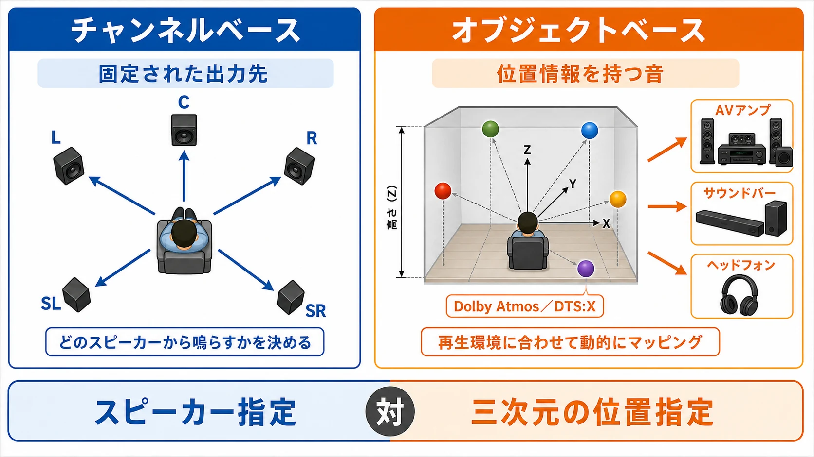

# 音を、どこから聞かせるか——ゲーム機サウンドの歴史⑦

第2回から[第6回「音源チップから、プログラムへ」](console-game-sound-history-06-software-audio.md)までは、音を「何で、いくつ鳴らすか」の歴史を見てきた。決まった波を組み合わせ、録音を楽器として使い、やがて演奏や加工をプログラムへ任せるようになった。

本編の最終回では、その音を **どこから聞かせるか** へ進む。前後左右のスピーカーで聞き手を囲む方法から、音の位置を伝える方法、ヘッドホンで全方位を表すための演算装置まで、ゲーム機の音の出口をたどってみよう。

最初に、[第1回](console-game-sound-history.md)の区別を思い出したい。音源のチャンネルは、楽器や効果音など「演奏中の音の枠」である。一方、出力のチャンネルは、左右や後方など「スピーカーへ渡す音の分け方」を指す。たくさんの音を混ぜて左右の2チャンネルへ送ることもできる。この先の5.1chや7.1chは、主に出口側の話である。

***

## 第1章　スピーカーの数を増やす：サラウンド

### 前後左右へ、音を割り振る

**サラウンド** は、前後左右などに置いたスピーカーへ音を割り振り、聞き手を音で囲む方法である。5.1chの「5」は主なスピーカー向けの5つの出力、「.1」は低音専用の出力を指す。

こうした、どのスピーカー向けの音かを基準にする方法を **チャンネルベース** と呼ぶ。前方、中央、後方といったスピーカーの配置が決まっていることを前提に、それぞれへ渡す音を用意する。

2006年9月、ドルビー日本支社は、PlayStation 3のゲームタイトルにドルビーデジタル5.1インタラクティブサラウンドが、WiiにドルビープロロジックIIが採用されたと発表した。家庭用ゲーム機でも、周囲から音を聞かせるための方式が採用されていたのである。[[1](#ref-1)]

### PS3の出力と、Xbox 360の展開回路

ソニー・インタラクティブエンタテインメントのPS3の仕様には、サウンド出力としてLPCM 7.1ch、ドルビーデジタル5.1ch、DTS 5.1chなどが挙げられている。[[2](#ref-2)] **リニアPCM（LPCM）** は、圧縮しない形で音を渡すPCMである。録音を数値で表すPCMを、音の出口でも使っている。[[3](#ref-3)]

第6回のXbox 360にも、複数チャンネルの音を扱う回路が登場した。XMAという圧縮形式を展開する専用回路は、最大5.1chの音声を展開できる。これは圧縮データを元へ戻す段階の仕様であり、音源が同時に鳴らせる楽器の数とは分けて読む必要がある。[[4](#ref-4)]

ここでの空間の表現は、 **出力先を分け、その配置に沿って音を届ける** ことで成り立つ。次に見る方式では、音を渡すときの基準が、スピーカーから音そのものの位置へ広がる。

***

## 第2章　音の位置を渡す：オブジェクトベース

**オブジェクトベース** は、音に空間上の位置などの情報を付け、再生する側がスピーカーの配置やヘッドホンに合わせて鳴らし方を決める方法である。「右後ろのスピーカー向けの音」として渡す代わりに、「この位置で鳴っている音」として扱う。

Xbox Oneは、日本では2014年9月4日に発売された。[[5](#ref-5)] 2017年にはWindows SonicとDolby Atmosに対応し、MicrosoftはXbox Wireで、周囲に加えて上下方向も表現する空間音響を紹介した。ヘッドホン向けの方式と、対応するホームシアター向けの方式が用意されている。[[6](#ref-6)]

第1回の図で、音を渡すときの違いを振り返ろう。

チャンネルベースでは、出力先ごとに分けた音が中心となる。オブジェクトベースでは、位置の情報を受け取った再生側が、実際の機器に合わせて出力を組み立てる。 **空間のどこに音を置くかと、どの機器で聞かせるかを分けて扱える** ことが、考え方の変化である。

***

## 第3章　ヘッドホンで全方位を表す：PS5のTempest

### 音の方向を、加工によって表す

2020年3月、PS5のリード・システムアーキテクトであるマーク・サーニーは、技術解説「Road to PS5」で **Tempest 3D AudioTech Engine** を説明した。音がどこから聞こえるかを、ゲーム機の重要な処理として担う仕組みである。[[7](#ref-7)]

Tempestは、 **HRTF（頭部伝達関数）** に基づいて音を加工し、3Dオーディオを表現する。HRTFとは、頭や耳の形などによって、ある方向から来る音が耳へ届くまでにどう変わるかを表すものである。ヘッドホンの左右の音にも方向の手がかりを持たせ、全方位の音を表現する。[[8](#ref-8)][[9](#ref-9)]

  <iframe
    src="https://www.youtube.com/embed/GSG17Wzbo1Y"
    title="Tempest 3Dオーディオ｜PlayStation®5"
    style="width: 100%; height: 100%; border: 0;"
    allow="accelerometer; autoplay; clipboard-write; encrypted-media; gyroscope; picture-in-picture; web-share"
    allowfullscreen>
  </iframe>

*『Tempest 3Dオーディオ｜PlayStation®5』。2021年5月21日公開、約20秒の宣伝映像。配信元：PlayStation Japan公式YouTubeチャンネル。<https://www.youtube.com/watch?v=GSG17Wzbo1Y>*

PC Watchの発表時の解説では、ヘッドホン、テレビのステレオスピーカー、6chのサラウンドスピーカーが、Tempestで想定する再生環境として挙げられた。聞こえ方には個人差があるため、発売時には5つのプリセットが用意された。[[8](#ref-8)][[9](#ref-9)]

### 音のための専用の演算装置

第6回では、専用の音源チップが受け持っていた仕事が、プログラムへ移っていく流れを見た。Tempestでは、そのプログラムによる音の処理を支えるために、音専用の演算装置が置かれている。

発表時のPC Watchの解説によると、TempestはAMDのGPU技術をもとにした装置である。GPUは本来、画像の計算を得意とする演算装置だ。その技術を音の処理に使う。よく使うデータを一時的に置くキャッシュを持たず、PS3のSPUのように、DMAという直接データを転送する仕組みでデータを扱う。性能とデータ転送の能力は、PS4の8つのCPUコアと同等と説明された。[[8](#ref-8)]

一方、2021年5月のAV Watchによる開発陣への取材では、Tempestは3Dオーディオ専用のハードウェアであり、性能の数値は公開されていないが「PS4の数倍」とされた。[[9](#ref-9)]

機材の歴史として見ると、音を計算するプログラムに、 **音のための専用の演算装置が組み合わされた** ことが要点である。昔の音源チップが持っていた決まった音色や発音枠を戻すのではなく、空間を表すための計算を専用の装置に任せる構成になった。

### 聞く人に合わせる機能も加わる

2024年9月のシステムソフトウェア更新では、個人用3Dオーディオプロファイルを作る機能が加わった。ヘッドホンやイヤホンを使い、音の聞こえ方についての質問に答えて、自分に合わせたプロファイルを作るものである。[[10](#ref-10)]

音の出口を整える対象は、スピーカーの配置だけでなく、聞く人ごとの違いにも広がった。HRTFの詳しい仕組み、PS5の対応環境、ゲームでの使い方は、既刊[『ゲームにおける環境音と3Dオーディオ』](game-ambient-sound-and-3d-audio-planner-guide.md)を参照してほしい。

***

## 第4章　Nintendo Switch 2：ステレオから5.1chまで

2025年に発売されたNintendo Switch 2は、TVモードでHDMIケーブルを通じたリニアPCM 5.1ch出力に対応する。[[11](#ref-11)][[12](#ref-12)] テレビにつなぐときには、複数のスピーカーへ分けて渡すための音声を出せる。

本体の内蔵スピーカーはステレオである。その一方、ヘッドホン出力時と内蔵スピーカー出力時には、サラウンド効果を付けて出力できる。内蔵スピーカー出力時のサラウンド効果には、本体の更新が必要となる。[[12](#ref-12)]

ここでは、スピーカーの数と、空間を感じさせるための処理を分けて考えたい。TVモードの5.1chは出力の分かれ方を表し、ヘッドホンや本体のスピーカーでは、出ていく音にサラウンド効果を付ける。同じ本体でも、 **テレビ、ヘッドホン、内蔵スピーカーという出口に合わせて、音の出し方を変える** のである。

***

## 第5章　5機種で見る、音の出口と空間の表現

ここまでの機種を並べてみよう。発売年は日本での年である。PS3はソニーの歴史資料、WiiとNintendo Switch 2は任天堂の会社の沿革、Xbox Oneは日本での発売告知、PS5は発売時の公式解説による。[[13](#ref-13)][[11](#ref-11)][[5](#ref-5)][[14](#ref-14)]

| 機種（日本での発売年） | 空間の表現に関わる主な出力・機能 | 出典 |
| --- | --- | --- |
| PlayStation 3（2006年） | LPCM 7.1ch、ドルビーデジタル5.1ch、DTS 5.1chなど。ゲームタイトルにドルビーデジタル5.1インタラクティブサラウンドを採用 | [[1](#ref-1)][[2](#ref-2)] |
| Wii（2006年） | ドルビープロロジックIIを採用 | [[1](#ref-1)] |
| Xbox One（2014年） | 2017年にWindows SonicとDolby Atmosに対応。ヘッドホンや対応ホームシアターで空間音響を表現 | [[6](#ref-6)] |
| PlayStation 5（2020年） | Tempestによる3Dオーディオ。発売時の5つのプリセットに加え、2024年に個人用3Dオーディオプロファイルの作成機能を追加 | [[8](#ref-8)][[9](#ref-9)][[10](#ref-10)] |
| Nintendo Switch 2（2025年） | TVモードでHDMI経由のリニアPCM 5.1ch。ヘッドホンと内蔵スピーカーの出力にサラウンド効果。内蔵スピーカーの効果には本体更新が必要 | [[12](#ref-12)] |

表には、本体の発売時点だけでなく、その後に追加された機能も時期を添えて記した。出力の形式、採用したサラウンド方式、専用の演算装置は、それぞれ異なる側面を示す。数字の大きさを比べるよりも、音をどこで加工し、どの出口へ送る設計なのかに注目したい。

***

## まとめ　音色から容量、処理、そして空間へ

[第1回](console-game-sound-history.md)で、編者はゲーム機サウンドの歴史を、制約の中心が **音色→容量→処理→空間** へ移る流れとして捉えた。本編の各回を振り返ると、その中身が見えてくる。

[第2回「決まった波を選ぶか、波の形を描くか」](console-game-sound-history-02-pulse-and-wavetable.md)と[第3回「波で波を揺らして、音色を作る」](console-game-sound-history-03-fm-synthesis.md)では、波の形や組み合わせを工夫して音色を作った。使える音の枠と、その音源が作れる響きが、曲の組み立て方に結びついていた。

[第4回「録った音を、小さく詰めて鳴らす」](console-game-sound-history-04-pcm-sampling.md)では、録音を楽器にすることで、音の選択肢が広がった。その音をどれだけメモリへ収めるかが大きな条件となる。[第5回「録音を流すか、その場で鳴らすか」](console-game-sound-history-05-cd-era.md)では、CDの容量を使い、完成した曲を流す方法も広がった。

[第6回「音源チップから、プログラムへ」](console-game-sound-history-06-software-audio.md)では、演奏や加工の担当が変わり、音へどれだけの処理時間とメモリを配るかが重要になった。そして今回の第7回では、出力先へ音を割り振り、位置の情報を渡し、聞き手に届く方向を演算によって表す機材を見た。

それぞれの時代の条件は、次の時代にも残り続けた。音色を選び、録音を収め、処理を配分する仕事の上に、音をどこから聞かせるかという仕事が重なっている。ゲーム機の音は、 **何を鳴らすかと、どう届けるかを一緒に設計するもの** へ広がったのである。

本編はここで一区切りとなる。[番外編](console-game-sound-history-extra-chiptune.md)では、昔の音源の音を、いまの音楽として作る文化である **チップチューン** を扱う。かつての制約が、選び取る音楽の個性へ変わるところを見ていこう。

## References

1. [Phile-web「「PS3」がドルビーTrue HDを採用」][1] — Phile-web、2006年9月22日。ゲームタイトルのドルビーデジタル5.1インタラクティブサラウンドと、WiiのドルビープロロジックIIの採用。

[1]: https://www.phileweb.com/news/d-av/200609/22/16670.html

2. [ソニー・インタラクティブエンタテインメント「PS3のシリーズごとの機能の違い」][2] — PlayStationサポート。CECH-L00シリーズなどのサウンド出力欄。

[2]: https://www.playstation.com/ja-jp/support/hardware/ps3-models-differences/

3. [ソニー「リニアPCM録音」][3] — ソニー。リニアPCMの非圧縮という性質。

[3]: https://www.sony.jp/ic-recorder/about_ic-recorder/function/pcm_rec.html

4. [Rodrigo Copetti「Xbox 360 Architecture」][4] — Architecture of Consoles。Audio節、XMA展開回路の仕様。

[4]: https://www.copetti.org/writings/consoles/xbox-360/

5. [日本マイクロソフト「Xbox One、本日2014年9月4日よりいよいよ発売開始」][5] — News Center Japan、2014年9月3日。日本での発売日は本文に記された9月4日。

[5]: https://news.microsoft.com/ja-jp/2014/09/03/blog-xbox-one-launch-2/

6. [James Shields「Experience Your Games in Full Audio Immersion with Windows Sonic and Dolby Atmos Spatial Sound」][6] — Xbox Wire、2017年11月13日。Xbox Oneの空間音響と再生環境。

[6]: https://news.xbox.com/en-us/2017/11/13/xbox-one-x-windows-sonic-dolby-atmos-feature/

7. [GAME Watch「読み込み速度「PS4の100倍」、PS4下位互換は「ほとんど全て」！プレイステーション 5技術解説動画詳報」][7] — GAME Watch、2020年3月19日。サーニーによるTempestの技術解説。

[7]: https://game.watch.impress.co.jp/docs/news/1241854.html

8. [劉尭「「PS5」は5.5GB/sで容量825GB SSDを内蔵。長いローディング画面と決別」][8] — PC Watch、2020年3月19日。Tempestの構成、HRTF、再生環境、性能とデータ転送の説明。

[8]: https://pc.watch.impress.co.jp/docs/news/1241853.html

9. [西田宗千佳「PS5開発陣に聞く「Tempest 3Dオーディオ」の意義と可能性」][9] — AV Watch、2021年5月11日。専用ハードウェア、性能の説明、5つのプリセット。

[9]: https://av.watch.impress.co.jp/docs/series/rt/1323407.html

10. [若井宏美「PS5の最新アップデートで、ホーム画面へのWelcomeハブの追加、パーティーのシェア、個人用3Dオーディオプロファイルの作成などの新機能が登場！」][10] — PlayStation.Blog 日本語、2024年9月12日。ヘッドホン・イヤホンを使用し、聞こえ方への質問に答える方式。

[10]: https://blog.ja.playstation.com/2024/09/12/20240912-ps5/

11. [任天堂「会社の沿革」][11] — 任天堂。Wii（2006年）、Nintendo Switch 2（2025年）の発売年。

[11]: https://www.nintendo.co.jp/corporate/history/index.html

12. [任天堂「機能・仕様｜Nintendo Switch 2」][12] — 任天堂。音声出力・スピーカー欄。2026年11月11日確認。

[12]: https://www.nintendo.com/jp/hardware/switch2/specs/index.html

13. [ソニー・インタラクティブエンタテインメント「2007年 PlayStation 3 - PlayStation Vita」][13] — PlayStation歴史年表。日本でのPS3発売日は2006年11月11日。

[13]: https://www.playstation.com/ja-jp/playstation-history/2007-ps3-ps-vita/

14. [ソニー・インタラクティブエンタテインメント「徹底解説！ PlayStation 5」][14] — PlayStation.Blog 日本語、2020年11月10日。日本での発売日は2020年11月12日。

[14]: https://blog.ja.playstation.com/2020/11/10/20201110-ps5/

英語資料の説明は本稿で日本語に要約した。

----

この文書は、Perplexity、Claude、ChatGPT の3つのAIの支援を受けて著述されたものです。引用画像を除き、MIT License にて提供されています。
