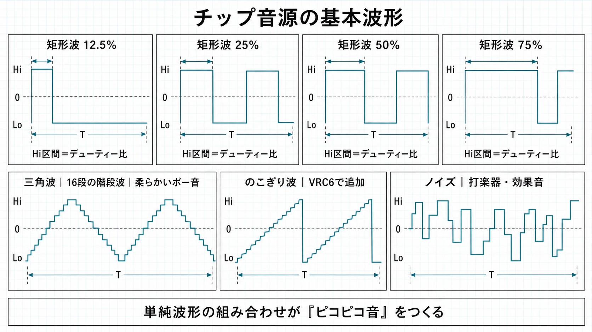
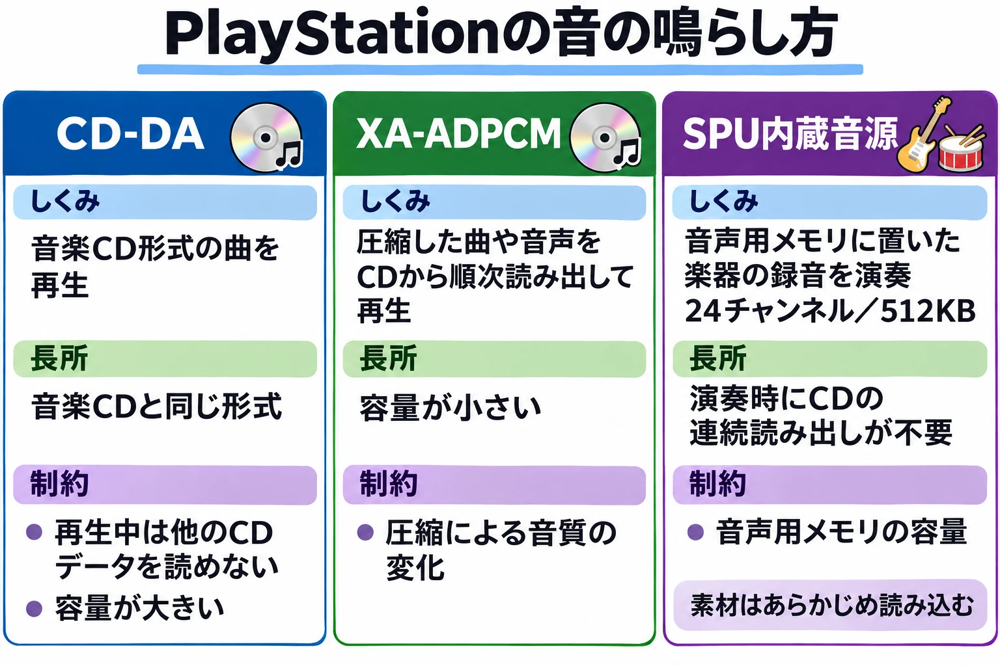
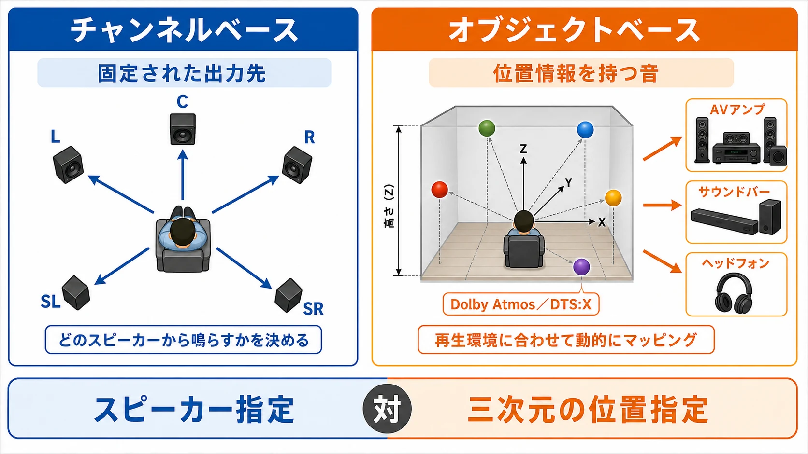

# ゲーム機の音は、何が鳴らしてきたのか——ゲーム機サウンドの歴史①

> 2026年11月8日改版：記事全体を全面的に書き直し、シリーズ「ゲーム機サウンドの歴史」の第1回としました。内容の変更はGitの履歴から追えます。

同じメロディーでも、ファミコンで鳴らす音と、スーパーファミコンで鳴らす音は違う。どんな音色を出せるか、いくつの音を重ねられるか、録音をどれだけ使えるか。音を作って鳴らす仕組みである「音源」は、作曲家が書ける曲の形に深く関わってきた。

大きな流れを並べると、波を作る、波どうしを作用させる、録った音を鳴らす、録った曲を流す、CPUで混ぜる、音の位置を描く、となる。「ピコピコ音から立体音響へ」という変化の間には、音を用意する方法も、曲を演奏する担当も変わる過程があった。本シリーズは、その過程を時代順に追う。第1回では全体を見渡し、各機種の細かな仕組みは後の回に譲る。

| 年 | 機種 | 音の鳴らし方 |
| --- | --- | --- |
| 1983 | ファミコン | 決まった波形を作る音源と、短い録音の再生 |
| 1985 | セガ・マークIII | 矩形波などを作る音源。後に周辺機器でFM音源を追加 |
| 1986 | ディスクシステム | ファミコンに波形メモリ音源を追加 |
| 1987 | PCエンジン | 書き込んだ波形を繰り返して鳴らす |
| 1988 | メガドライブ | FM音源と、矩形波などを作る音源の組み合わせ |
| 1988 | PCエンジンCD-ROM² | 本体音源に加え、CDの音楽や録音を再生 |
| 1989 | ゲームボーイ | 矩形波・ノイズと、書き込める波形 |
| 1990 | スーパーファミコン | 録った楽器の音を音源で演奏 |
| 1991 | メガCD | PCM音源とCDの音楽を、本体音源に追加 |
| 1994 | セガサターン | 内蔵音源による演奏とCDの音楽の再生 |
| 1994 | PlayStation | 内蔵音源、CDの音楽、圧縮音声の読み出しを使い分け |
| 1996 | NINTENDO 64 | 汎用の演算装置で録音を加工・合成 |
| 2000 | PlayStation 2 | 専用音源による演奏を継承・拡張 |
| 2001 | ゲームボーイアドバンス | 従来型の音源に加え、CPUで混ぜた録音を再生 |
| 2006 | PlayStation 3 | CPU側のソフトウェアで音を混ぜる |
| 2014 | Xbox One | ソフトウェアで音を処理。2017年にはDolby Atmosに対応 |
| 2020 | PlayStation 5 | Tempest 3Dオーディオで音の位置を表現 |
| 2025 | Nintendo Switch 2 | リニアPCMによる複数スピーカーへの音声出力 |

年は日本での発売年。音の鳴らし方は代表的な機能を示し、発売後の追加機能はその旨を記した。出典は各章の本文を参照。

***

## 第1章　音を鳴らす4つの方法

**決まった形の波を作る。** 音は空気の振動であり、電気信号の変化をスピーカーで振動に変えれば聞こえる音になる。初期のゲーム機は、信号を高低に切り替える矩形波や、山と谷を繰り返す三角波、不規則な変化を生むノイズを使った。笛の長さを変えるように、波の繰り返しを速くすれば高い音、遅くすれば低い音になる。波形メモリは、繰り返す波の形を小さな記憶領域に書き込む方式である。楽器そのものの形を少し作り替えるように、音色の選択肢を広げられる。[[1](#ref-1)][[2](#ref-2)]

**波どうしを作用させて音色を作る。** FMは「周波数変調」の略で、ある波によって別の波の細かな揺れ方を変える音の合成方法である。「波を掛け合わせる」とイメージしてよいが、単に音量を掛け算する仕組みではなく、波の進み方を揺さぶるのが要点だ。設定を変えれば、録音を持たなくても、丸い音から金属的な響きまで組み立てられる。[[3](#ref-3)]

**録った音を鳴らす。** PCMは、音の波を一定の間隔で測り、数値として記録する方法である。録ったピアノの短い音を、速さや高さを変えて再生すれば、複数の音符を演奏できる。こうした録音の断片を「サンプル」と呼ぶ。保存には、前後の値の差などを使ってデータを小さくするADPCMという圧縮方式も使われた。「録った音を演奏に使う」という仕組みと、「データをどう保存するか」という方式を分けると理解しやすい。[[4](#ref-4)]

**CPUで計算して混ぜる。** CPUは、プログラムの指示に従って計算する装置である。複数の音の数値を計算し、ひとつの出力にまとめる作業を「ミキシング」と呼ぶ。専用音源に演奏を任せる代わりに、ソフトウェアで録音の再生速度や音量を変え、効果音や曲を混ぜる方法もある。PCMは音の記録方法、ソフトウェア処理は演奏や加工の担当を指すため、両者は組み合わせて使える。[[5](#ref-5)]

***

## 第2章　1980年代：波を作る音源

1983年に日本で発売されたファミコンでは、音の種類ごとに担当が分かれていた。音源でひとつの音を受け持つ枠を「チャンネル」、同時に鳴らせる音の数を「同時発音数」と呼ぶ。本体には矩形波2チャンネル、三角波1チャンネル、ノイズ1チャンネル、録音した音を差分で扱うDPCMが1チャンネルあった。矩形波で旋律、三角波で低音、ノイズで打楽器を受け持つ、といった編成が自然に生まれる。BGMと効果音も限られた枠を分け合うため、効果音の間だけ伴奏を休ませる工夫が必要だった。[[1](#ref-1)][[6](#ref-6)]

音色の選択肢は、本体の外側からも広がった。1986年発売のディスクシステムには波形メモリ音源があり、コナミのVRC6など、カートリッジ側に追加した拡張音源も使われた。[[7](#ref-7)][[8](#ref-8)][[1](#ref-1)] 本体に備わる音が同じでも、ソフトや周辺機器の構成によって聞こえる音は変わる。カートリッジによる拡張の背景は、既刊の[ファミコンの性能とカートリッジを扱った記事](famicom-price-performance-cartridge-expansion.md)でも解説している。

1987年発売のPCエンジンは、波形メモリを中心に据えた。6チャンネルを持ち、ひとつの波の形を32個の5bitの値、つまり細かく区切った高さの数値で書く。[[2](#ref-2)] 1989年発売のゲームボーイにも、矩形波やノイズに加え、自分で波の形を書き込める音源がある。[[6](#ref-6)][[9](#ref-9)] MSXでは、コナミが『グラディウス2』のROMにSCCという波形を書き込める音源用回路を搭載した。[[10](#ref-10)]

別の道を進んだのがFM音源だ。1985年発売のセガ・マークIIIは、後にFMサウンドユニットで音源を追加でき、日本版マスターシステムはそれを内蔵した。1988年発売のメガドライブは、FM音源と、矩形波などを作るPSG音源を組み合わせている。[[11](#ref-11)][[12](#ref-12)][[13](#ref-13)][[3](#ref-3)] 波の形を書いて作る音色と、波どうしの作用から作る音色。この違いが、同じ時代のゲーム機にも異なる響きをもたらした。矩形波と波形メモリはシリーズの第2回で扱う。FM音源はシリーズの第3回で扱う。

***

## 第3章　1990年代前半：録った音を鳴らす

1990年発売のスーパーファミコンでは、ソニーが開発した音源が、録った楽器の音を演奏する役割を担った。使えるのは8チャンネル、音声用メモリは64KBである。[[6](#ref-6)][[4](#ref-4)] 作曲家は、出せる波の形から楽器を連想する方法に加え、使いたい楽器の録音を素材として選べるようになった。息を吹き込む音や弦を弾く音など、単純な波だけでは作りにくい響きを、短い録音の中に持ち込めることが大きい。

曲を鳴らす際は、楽器の素材と、どの音をいつ鳴らすかという演奏指示を組み合わせる。ひとつの録音を異なる高さで使い、音の一部を繰り返して長く伸ばすこともできる。[[4](#ref-4)] 素材の選び方が、曲全体の響きを左右するようになるのである。

ここで制約の中心に現れるのが容量だ。64KBには、再生時に必要な楽器の録音だけでなく、音を動かすプログラムや演奏データも収める必要がある。その場で鳴らすための一式を、小さな作業場所にそろえるのである。[[4](#ref-4)] どの部分を残し、どこを繰り返すかという編集も、音色作りの一部となった。

携帯機でも、2001年発売のゲームボーイアドバンスがPCM再生を備え、従来のゲームボーイ系の音源と併用できた。こちらはCPUで楽器の音を混ぜてから再生へ送る方法が使われ、録音を扱う仕組みにも複数の設計があった。[[6](#ref-6)][[14](#ref-14)] スーパーファミコンとゲームボーイアドバンスを通じたPCMの使い方は、シリーズの第4回で扱う。

***

## 第4章　1990年代：CDが持ち込んだ「録った曲」

PCエンジンには1988年にCD-ROM²が加わり、本体の音源に加えてCDの音楽を再生できるようになった。[[15](#ref-15)][[2](#ref-2)] セガも1991年にメガCDを発売し、追加のPCM音源とCDの音を組み合わせた。[[16](#ref-16)] CDが広げたのは、素材となる楽器を置く場所だけではない。演奏を完成させた「曲そのもの」を収録し、それを流す選択肢である。楽譜と楽器を渡してゲーム機に演奏させる方法に、できあがった録音を渡す方法が加わった。

1994年発売のPlayStationでは、複数の方法を使い分けられた。内蔵の音声処理装置SPUは24チャンネルと512KBの音声用メモリを持ち、楽器の録音を演奏できる。CD-DAは音楽CDと同じ形式のトラックをそのまま流す方式で、XA-ADPCMは圧縮した音声をCDから少しずつ読みながら鳴らす方式である。このように、全体を一度にメモリへ置かず、順次読み出して再生することを「ストリーミング」と呼ぶ。CD-DAはこれらの選択肢で最も高い音質を得られる一方、再生中は別のゲームデータをCDから読めなくなる。[[17](#ref-17)][[18](#ref-18)]

出典：Rodrigo Copetti「PlayStation Architecture」のAudio節をもとに作成。[[18](#ref-18)]

同じ1994年発売のセガサターンも、内蔵音源による演奏とCDの音楽の再生を備えた。[[19](#ref-19)] CDを使う機種でも、場面に合わせて音を細かく制御したければ内蔵音源で演奏し、完成した録音をそのまま聞かせたければCDから流す、と考えられる。曲を保存できる容量が広がった後も、読み込みの都合と、演奏をどこまで変えたいかが選択に関わる。この時代の音源とCDの使い分けは、シリーズの第5回で扱う。

***

## 第5章　2000年代：専用チップからソフトウェアへ

音を演奏する担当にも変化があった。1996年発売のNINTENDO 64は、決まった演奏機能を持つ専用音源チップを置かず、グラフィックスの座標計算も受け持つRSPという、プログラムで動かす演算装置で録音を展開し、加工して混ぜた。[[6](#ref-6)][[5](#ref-5)] そのため「音源の枠がいくつあるか」に加えて、音の計算にどれだけ時間を回せるかが重要になる。複数の音を重ねるほど計算が増えるため、ほかの仕事と処理能力を分け合う必要がある。ソフトウェアで音を作る道は、CDの大容量化と並行して進んでいた。

2000年発売のPlayStation 2は、SPU2という専用音源を引き継ぎ、48チャンネルに拡張した。[[20](#ref-20)][[21](#ref-21)] 下の比較で使う「サンプリング周波数」は、音の波を1秒間に何回の数値で扱うかを表す。専用音源の発音数が増える流れと、その発想自体が変わる流れを分けて読むとよい。

| 機種 | 音を鳴らす担当 | 同時発音数 | 音声用メモリ | サンプリング周波数 |
| --- | --- | --- | --- | --- |
| スーパーファミコン（1990年） | 専用音源 | 8 | 64KB | 32kHz |
| PlayStation（1994年） | 専用音源（SPU） | 24 | 512KB | 44.1kHz |
| PlayStation 2（2000年） | 専用音源（SPU2） | 48 | 2MB | — |
| PlayStation 3（2006年） | CPU内の演算装置（ソフトウェア） | 実装と処理負荷による | — | — |

*数字はRodrigo Copettiによる各機種の解説のAudio節による。「—」は、採用した出典で確認できない、または専用の枠を持たない項目。PlayStation 3の行の出典は、次の段落を参照。[[4](#ref-4)][[18](#ref-18)][[21](#ref-21)]*

2006年発売のPlayStation 3では、専用音源の代わりに、CPUに含まれる演算装置がソフトウェアで音を処理する。音の演奏、ミキシング、ストリーミングをプログラムが担う構成である。[[22](#ref-22)][[23](#ref-23)] これにより、発音数は専用音源の固定された枠だけでは語れなくなる。音の数に加え、圧縮を戻す処理や響きの加工などに何を使うかで、必要な計算量が変わるからだ。

作る側は、機種ごとに異なる音源を操作する仕事から、プログラム上で音の振る舞いを組み立てる仕事へと重点を移していく。Wwise、FMOD、CRI ADXのように、音声の再生や制御を支える共通ソフトウェアを「ミドルウェア」と呼び、その役割と音楽の変化の作り方は既刊[『インタラクティブ／アダプティブミュージック――変化するゲーム音楽の設計と実装』](interactive-adaptive-music-explained.md)で解説している。専用音源からソフトウェアへ向かう過程と機種ごとの違いは、シリーズの第6回で扱う。

***

## 第6章　2010年代〜：音がどこから聞こえるか

音を重ねる力に加え、「音をどこから聞かせるか」もゲーム機の重要な役割になった。左右や後方のスピーカーに音を割り振るサラウンドは、聞き手を音で囲む方法である。従来のチャンネルベースは「どのスピーカー向けの音か」を基準にする。対してオブジェクトベースでは、音に空間上の位置などを付け、再生側がスピーカーの配置やヘッドホンに合わせて聞こえ方を組み立てる。2014年に日本で発売されたXbox Oneは、2017年にDolby Atmosへ対応し、Microsoftは上下方向も含むゲームの空間音響を紹介した。[[24](#ref-24)][[25](#ref-25)]

2020年発売のPlayStation 5は、Tempest 3Dオーディオ技術によって、あらゆる方向にある音の位置を表現する。[[26](#ref-26)][[27](#ref-27)] ここで意味を持つのは、敵や物が画面の外にあっても、その方向を音から感じられることだ。近づく足音も、聞き手との位置関係によって情報になる。

聞こえ方には個人差もある。PS5には2024年9月のシステムソフトウェア更新で、ヘッドホンやイヤホンを使い、音の聞こえ方に関する質問に答えて個人用3Dオーディオプロファイルを作る機能が加わった。[[28](#ref-28)] 耳や頭の形による聞こえ方を表すHRTFという技術の詳しい仕組みは、既刊[『ゲームにおける環境音と3Dオーディオ』](game-ambient-sound-and-3d-audio-planner-guide.md)に譲る。

2025年発売のNintendo Switch 2は、TVモードでHDMI経由のリニアPCM 5.1ch出力に対応する。リニアPCMはPCMの一種で、ここでの5.1chは、主なスピーカー用の音声と低音用の音声への分かれ方を示す。[[6](#ref-6)][[29](#ref-29)] 先に扱った音源のチャンネルが「演奏中の音の枠」だったのに対し、こちらは「出力先に渡す音の分け方」である。音を何個作れるかと、何方向へ出すかは別の話なのだ。サラウンド、Dolby Atmos、Tempest、Switch 2を含む空間の表現は、シリーズの第7回で扱う。

***

## まとめ　制約の中心が移ると、曲の作り方も変わる

編者は、この歴史を **音色→容量→処理→空間** へと制約の中心が移った過程として捉えている。波を作る時代には、出せる波形と音の枠をどう組み合わせるかが問われた。録った音を使えると、何をどれだけ詰めるかが重要になった。CDは完成した曲を流す余地を広げ、ソフトウェアは音の処理方法を組み替えられるようにし、空間音響は聞き手との位置関係を表現の対象にした。これは、各世代を見通すための編者の考察である。

実際の機械では、これらの方法が重なっている。ファミコンにも短い録音の再生があり、CD時代にも楽器の音をその場で演奏する仕組みが残った。音源が変わるたび、作曲家は音色を選び、素材を編集し、演奏と再生の配分を考えてきた。機種を見比べる際には、「どれほど高音質か」に加えて、 **何が音を作り、何を素材にし、どこで演奏を完成させるのか** を問うと、その曲の形を支えた条件が見えてくる。

かつての少ない音色や発音数は、現在ではあえて選ぶ表現の様式にもなっている。そうした制約を音楽の個性として受け継ぐチップチューンは、シリーズの番外編で扱う。

## References

1. [Rodrigo Copetti「NES / Famicom Architecture」][1] — Architecture of Consoles。Audio節。

[1]: https://www.copetti.org/writings/consoles/nes/

2. [Rodrigo Copetti「PC Engine / TurboGrafx-16 Architecture」][2] — Architecture of Consoles。Audio、CD-ROM Expansion節。

[2]: https://www.copetti.org/writings/consoles/pc-engine/

3. [Rodrigo Copetti「Mega Drive / Genesis Architecture」][3] — Architecture of Consoles。Audio節。

[3]: https://www.copetti.org/writings/consoles/mega-drive-genesis/

4. [Rodrigo Copetti「Super Nintendo / Famicom Architecture」][4] — Architecture of Consoles。Audio節。

[4]: https://www.copetti.org/writings/consoles/super-nintendo/

5. [Rodrigo Copetti「Nintendo 64 Architecture」][5] — Architecture of Consoles。Audio節。

[5]: https://www.copetti.org/writings/consoles/nintendo-64/

6. [任天堂「会社の沿革」][6] — 任天堂。各機種の発売年。

[6]: https://www.nintendo.co.jp/corporate/history/index.html

7. [任天堂「ファミコン年表」][7] — 任天堂。ディスクシステムの発売年。

[7]: https://www.nintendo.com/jp/famicom/history/index.html

8. [NESdev Wiki contributors「FDS audio」][8] — NESdev Wiki。波形メモリによる音声生成の説明。

[8]: https://www.nesdev.org/wiki/FDS_audio

9. [Rodrigo Copetti「Game Boy / Color Architecture」][9] — Architecture of Consoles。Audio節。

[9]: https://www.copetti.org/writings/consoles/game-boy/

10. [コナミ「GRADIUS 2（MSX版）」][10] — コナミ商品・サービス情報サイト。ゲームROM内のSCCと音声の説明。

[10]: https://www.konami.com/games/jp/ja/products/dl_win_gradius2_egg/

11. [セガ「セガ・マークⅢ」][11] — セガハード大百科。発売日と内蔵音源。

[11]: https://www.sega.jp/history/hard/segamark3/

12. [セガ「マスターシステム」][12] — セガハード大百科。日本版のFMサウンドユニット内蔵、および海外版との相違。

[12]: https://www.sega.jp/history/hard/mastersystem/

13. [セガ「メガドライブ」][13] — セガハード大百科。発売日と音源仕様。

[13]: https://www.sega.jp/history/hard/megadrive/

14. [Rodrigo Copetti「Game Boy Advance Architecture」][14] — Architecture of Consoles。Audio節。

[14]: https://www.copetti.org/writings/consoles/game-boy-advance/

15. [財団法人データベース振興センター「CD-ROM調査研究報告書」][15] — 1989年3月、JIPDECアーカイブ。第2章「国内で利用可能なCD-ROMの機能別分析」、本文34ページ（PDF46ページ）。PCエンジンCD-ROMシステムの国内発売時期。

[15]: https://www.jipdec.or.jp/archives/publications/J0000664.pdf

16. [セガ「メガCD」][16] — セガハード大百科。発売日とPCM・CD音声のミキシング。

[16]: https://www.sega.jp/history/hard/mega-cd/

17. [ソニー・インタラクティブエンタテインメント「PlayStation」][17] — PlayStationの歴史。日本での発売年。

[17]: https://www.playstation.com/en-us/playstation-history/1994-ps-one/

18. [Rodrigo Copetti「PlayStation Architecture」][18] — Architecture of Consoles。Audio節。

[18]: https://www.copetti.org/writings/consoles/playstation/

19. [セガ「セガサターン」][19] — セガハード大百科。発売日と音声・CD仕様。

[19]: https://www.sega.jp/history/hard/segasaturn/

20. [ソニー・インタラクティブエンタテインメント「2000年 PlayStation 2 - PSP」][20] — PlayStationの歴史。日本での発売日。

[20]: https://www.playstation.com/ja-jp/playstation-history/2000-ps2-psp/

21. [Rodrigo Copetti「PlayStation 2 Architecture」][21] — Architecture of Consoles。Audio節。

[21]: https://www.copetti.org/writings/consoles/playstation-2/

22. [ソニー・インタラクティブエンタテインメント「PlayStation 3 - PlayStation Vita」][22] — PlayStationの歴史。日本での発売日は2006年11月11日。

[22]: https://www.playstation.com/ja-jp/playstation-history/2007-ps3-ps-vita/

23. [Rodrigo Copetti「PlayStation 3 Architecture」][23] — Architecture of Consoles。Audio節。

[23]: https://www.copetti.org/writings/consoles/playstation-3/

24. [日本マイクロソフト「Xbox One、本日2014年9月4日よりいよいよ発売開始」][24] — News Center Japan、2014年9月4日。

[24]: https://news.microsoft.com/ja-jp/2014/09/03/blog-xbox-one-launch-2/

25. [James Shields「Experience Your Games in Full Audio Immersion with Windows Sonic and Dolby Atmos Spatial Sound」][25] — Xbox Wire、2017年11月13日。

[25]: https://news.xbox.com/en-us/2017/11/13/xbox-one-x-windows-sonic-dolby-atmos-feature/

26. [ソニー・インタラクティブエンタテインメント「徹底解説！ PlayStation 5」][26] — PlayStation.Blog 日本語、2020年11月10日。日本での発売日。

[26]: https://blog.ja.playstation.com/2020/11/10/20201110-ps5/

27. [Mary Yee「PS5の『超高速SSD』と『“Tempest” 3Dオーディオ技術』が実現する未来のゲーム体験とは？ PS5ゲーム開発者が語る」][27] — PlayStation.Blog 日本語、2020年9月1日。

[27]: https://blog.ja.playstation.com/2020/09/01/20200901-ps5/

28. [若井宏美「PS5の最新アップデートで、ホーム画面へのWelcomeハブの追加、パーティーのシェア、個人用3Dオーディオプロファイルの作成などの新機能が登場！」][28] — PlayStation.Blog 日本語、2024年9月12日。ヘッドホン・イヤホンを使用し、聞こえ方への質問に答える方式。

[28]: https://blog.ja.playstation.com/2024/09/12/20240912-ps5/

29. [任天堂「機能・仕様｜Nintendo Switch 2」][29] — 任天堂。音声出力とTVモードの条件。

[29]: https://www.nintendo.com/jp/hardware/switch2/specs/index.html

日付のない技術解説・仕様・沿革ページの確認日は2026年11月7日。英語資料の説明は本稿で日本語に要約した。

----

この文書は、Perplexity、Claude、ChatGPT の3つのAIの支援を受けて著述されたものです。引用画像を除き、MIT License にて提供されています。
