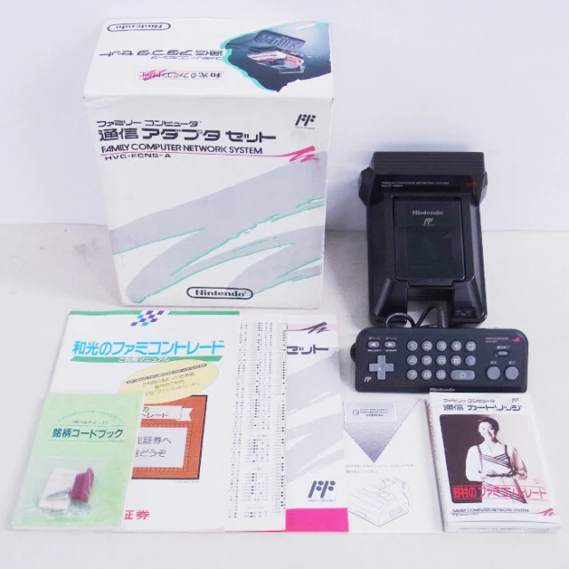
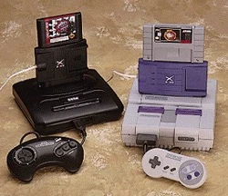
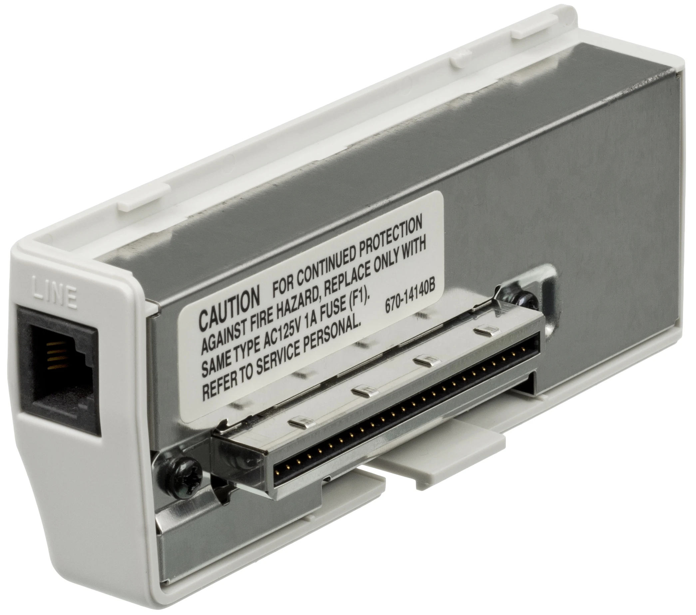
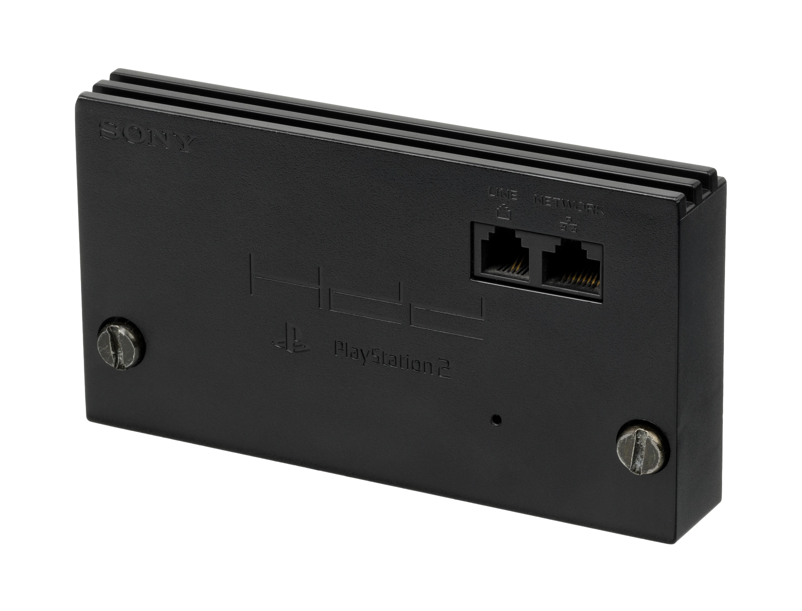
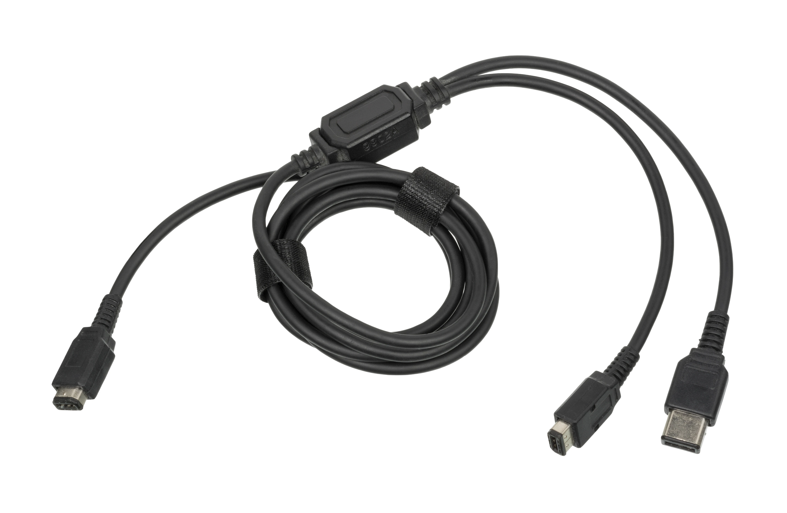

# 家庭用ゲーム機とオンライン環境の歴史

## 概要

家庭用ゲーム機とネットワークの関係は、1980年代後半の電話回線接続から始まり、インターネット普及を経て、現代の常時接続オンラインゲームへと40年近い歴史を持つ。据え置き型ゲーム機と携帯ゲーム機では、ネットワーク活用の方向性が大きく異なる形で発展してきた。

----

## 第1章：据え置き機と電話回線の黎明期（1980年代後半〜1990年代中期）

### ファミコン通信アダプタ——ゲームではなく金融から始まった接続

ゲーム機とネットワークを結びつけた初期の用途には、株式取引や銀行業務があった。1987年7月、山一證券（当時）の「山一のサンライン」が登場し、ファミリーコンピュータ（ファミコン）に **通信アダプタ** を取り付けて、電話回線で証券会社などへ接続できるようになった。1988年頃からは、野村證券・新日本証券・コスモ証券などが専用の通信カートリッジを相次いで発売した。[[1](#ref-1)][[2](#ref-2)]

*画像出典（引用）：BEEP「[ファミリーコンピュータ『通信アダプタ』](https://www.beep-shop.com/item_entry/73296/)」掲載写真 / ファミコン通信アダプタを示す資料として引用。*

ゲームへの転用も試みられた。任天堂公式の通信アダプタに対応した **通信将棋倶楽部** ・ **通信囲碁倶楽部** （コナミ開発）は「幻のゲーム」とされる。販売店BEEPの商品解説では、関係者の話として、当時の任天堂社長・山内溥氏が囲碁好きだったことがきっかけで話が進んだこと、通信アダプタの回線使用料が非常に高額だったため多くのプロジェクトが中止になったらしいことが紹介されている。[[2](#ref-2)]

### XBANDと電話回線対戦——距離が値段になった時代

1994年、アメリカのカタパルト社が家庭用ゲーム機向けの電話回線通信対戦サービス「XBAND」を米国で開始した。日本では1996年にサービスが開始され、スーパーファミコンなどで電話回線を介した対戦が可能になった。[[3](#ref-3)]

*画像出典：Mord3n, [Xbands.jpg](https://commons.wikimedia.org/wiki/File:Xbands.jpg), Wikimedia Commons, GFDL 1.2 or later / Genesis/Mega Drive用・Super Nintendo用のXBANDモデム。*

仕組みはモデムを通じてネットワークへ接続し、マッチングが成立すると対戦相手のモデムへ直接電話をかける方式だった。米国では市内通話を基本としたが、遠距離対戦用の「XBAND Nationwide」は長距離電話の原価を反映した有料サービスで、開発責任者も多くの利用者にとって高額だったと振り返っている。[[4](#ref-4)]

----

## 第2章：ドリームキャストとインターネット接続の幕開け（1998年〜2001年）

### モデム標準搭載という賭け

ゲーム機とネットワークの歴史において最大の転換点は、1998年にセガが発売した **ドリームキャスト** （DC）だった。ブロードバンドが一般に普及していなかったダイヤルアップ接続の時代に、モデムを **標準搭載** して出荷したのである。国内向けは33.6kbps、海外向けは56kbpsのモデムを全台に搭載し、ユーザーがネットワーク機能を利用できる環境を整えた。[[5](#ref-5)]

*画像出典：Evan-Amos, [Sega-Dreamcast-Modem-Dialup-FL.jpg](https://commons.wikimedia.org/wiki/File:Sega-Dreamcast-Modem-Dialup-FL.jpg), Wikimedia Commons, Public Domain / ドリームキャスト用の北米向け56Kダイヤルアップモデム。*

セガはさらにプロバイダ事業「セガプロバイダ」を立ち上げ、利用料を無料にしたうえで専用通信ソフト「ドリームパスポート」を本体に同梱し、インターネットへ接続できる環境を整えた。ゲームのためにインターネット接続するという体験を、一般ユーザーに開いた機器だと言える。[[5](#ref-5)]

### ファンタシースターオンラインの衝撃

DCのオンライン環境が花開いたのが、2000年12月21日発売の **ファンタシースターオンライン（PSO）** だった。アナログ回線が主流だった当時、家庭用ゲーム機で本格的なオンラインRPGを実現した画期的タイトルである。その後PSOはPC・ゲームキューブ・Xboxへと移植され、Xboxの『Xbox Liveスタータキット』にはPSO『エピソード1＆2』が同梱されるなど、戦略的にも重要なタイトルとなった。[[6](#ref-6)][[7](#ref-7)][[8](#ref-8)]

一方でDCは販売競争で苦戦し、セガはハードウェア開発から撤退することになる。しかしDC＋PSOが切り拓いた「家庭用ゲーム機でオンラインゲームをする」という体験は、次世代機が引き継いでいく。[[5](#ref-5)]

----

## 第3章：ブロードバンド時代のPS2とXbox（2002年〜2005年）

### PS2とブロードバンドアダプタ

PlayStation 2（PS2）では、オンライン接続のための周辺機器が提供された。SCEは2001年7月19日、40GBのHDD（ハードディスク）とネットワークアダプタからなる **PS2専用HDDユニット** を先行発売した。外付型（SCPH-10210）は19,000円、EXPANSION BAYタイプ（SCPH-10260）は18,000円（いずれも税別）で、本体の型番に応じて接続方式が異なっていた。2002年以降には、提携ISP経由で「 **PlayStation BB Unit** 」も販売された。[[9](#ref-9)][[10](#ref-10)]

*画像出典：Evan-Amos, [Sony-PlayStation-2-Network-Adaptor-Front.jpg](https://commons.wikimedia.org/wiki/File:Sony-PlayStation-2-Network-Adaptor-Front.jpg), Wikimedia Commons, Public Domain / 初期型PS2用ネットワークアダプター。*

そのPS2のオンライン環境を最大限に活用したのが、2002年5月発売の **ファイナルファンタジーXI（FFXI）** である。FFXIは家庭用ゲーム機向けとして初のMMORPG（大規模多人数オンラインRPG）として運営を開始し、「ネットカフェではなく家のPS2でMMORPGを遊ぶ」という体験を実現した。FFXIのPS2版サービスは長年継続され、最終章「ヴァナ・ディールの星唄」（2015年実装）の完結を経て、2016年3月31日にPS2版・Xbox 360版の両サービスが終了した（PC版は現在も継続）。[[11](#ref-11)][[12](#ref-12)][[13](#ref-13)]

### Xbox Liveの確立——現代オンラインサービスの原型

2002年11月（米国）・2003年1月（日本）に、マイクロソフトの初代Xbox向けオンラインサービス **Xbox Live** がスタートした。本体のLAN端子で接続でき、 **ボイスチャット** を共通機能として利用できる設計は、現代のオンラインゲームの雛型となった。[[14](#ref-14)][[8](#ref-8)][[15](#ref-15)]

Xbox Liveはサブスクリプション制を採用し、後にXbox 360・Xbox One・Xbox Series X/Sへと継承されていく。初代Xboxでのオンラインサービスは2010年4月に終了した。本体でのオンラインマルチプレイを含む有料プランはXbox Live Gold、Xbox Game Pass Coreを経て、2025年10月に **Xbox Game Pass Essential** へ改称された。[[16](#ref-16)][[17](#ref-17)]

----

## 第4章：WiiとPS3の世代——オンラインが標準装備へ（2006年〜2013年）

### ニンテンドーWi-Fiコネクションの始動

任天堂は2005年11月、DS・Wii向けオンラインサービス「 **ニンテンドーWi-Fiコネクション** 」の日本サービスを開始した。対戦や協力プレイに特化したサービスで、無料で利用できる点が特徴だった。フレンドとの通信や、世界中のプレイヤーとの対戦が可能だった。[[18](#ref-18)][[19](#ref-19)]

Wiiでは **WiiConnect24** という補完サービスも提供されていた。本体がスタンバイ状態でも24時間インターネットへ常時接続し、データを自動送受信する機能で、ニンテンドーWi-Fiコネクションとは役割が異なるサービスだった。「Wii伝言板」でのWiiメッセージ交換サービスは2013年6月28日に終了した。またWiiでは **Wiiショッピングチャンネル** が2006年にスタートし、バーチャルコンソールでファミコン・スーパーファミコン・NINTENDO64の旧作ソフトをダウンロード購入できるようになった。同サービスは段階的に終了し、コンテンツ購入は2019年1月31日をもって終了した。[[20](#ref-20)][[21](#ref-21)]

ニンテンドーWi-FiコネクションはDS・Wii向けサービスとして2014年5月20日に終了した。[[18](#ref-18)]

### PlayStation 3とPlayStation Networkの開設

2006年11月、PS3と同時に **PlayStation Network（PSN）** のサービスが北米・日本でスタートした。PSNはインターネット接続を前提とした本格的なオンラインプラットフォームで、基本サービスは無料だった。2010年には有料サービス「 **PlayStation Plus（PS+）** 」が追加され、毎月無料ゲームの提供や会員限定割引などが始まった。PSNはPS4・PS Vita・PSPにも展開され、PlayStation Storeでのゲーム購入もネット経由が標準化した。[[22](#ref-22)][[23](#ref-23)]

----

## 第5章：Nintendo Switch Online と近代オンライン対戦（2017年〜現在）

### Nintendo Switch Online——有料化で整備された任天堂のオンライン環境

Nintendo Switchは2017年のローンチ当初、オンラインプレイが無料の体験期間として提供された。2018年9月に有料化が確定し、 **Nintendo Switch Online** として月額300円・年額2,400円（税込）の料金体系でサービスが正式スタートした。主なサービスは①オンライン対戦・協力プレイ、②ファミコン・スーパーファミコンのクラシックゲーム遊び放題、③セーブデータお預かりなど。[[24](#ref-24)][[25](#ref-25)]

2021年10月には上位プラン「 **Nintendo Switch Online＋追加パック** 」が開始され、NINTENDO 64・メガドライブのタイトルが追加された。現在の追加パックでは、さらにゲームボーイアドバンス・ゲームキューブ・バーチャルボーイを含む5つのハードのタイトルが対象になっている。ゲームキューブはNintendo Switch 2限定で、バーチャルボーイには専用ハードが必要だ。[[26](#ref-26)][[27](#ref-27)]

2025年6月発売の **Nintendo Switch 2** では、専用の「 **ゲームチャット** 」機能が追加された。Joy-Con 2（R）のCボタンから起動でき、最大12人でのボイスチャットに対応するほか、ゲーム画面のリアルタイム共有およびビデオチャット（別売USBカメラが必要）は最大4人まで可能。本体に内蔵されたマイクは、ゲーム音や周囲の雑音を自動で除去し、声だけをクリアに届けるノイズキャンセリング機能を備える。[[28](#ref-28)]

### PlayStation PlusとXboxの進化

PlayStation Plusは2022年に「Essential」「Extra」「Premium」の3プランへ再編された。Essentialではオンラインマルチプレイ・毎月無料ゲームを、Extraでは数百本のゲームカタログ遊び放題を、Premiumではクラシックスカタログやクラウドストリーミングを提供している。[[29](#ref-29)][[30](#ref-30)]

Xboxでは、Xbox Live Gold→Xbox Game Pass Core→Xbox Game Pass Essentialへと有料プランの名称・内容が変遷している。2025年10月の再編でStandardはPremiumへ改称され、Ultimateは名称を維持した。EssentialはXbox本体・PC・クラウドで50本以上のゲームと、本体でのオンラインマルチプレイを含む。[[17](#ref-17)]

----

## 第6章：携帯ゲーム機の通信史

### 有線通信の誕生——ゲームボーイの通信ケーブル（1989年〜）

1989年発売のゲームボーイには、最初から通信機能が組み込まれていた。専用の **通信ケーブル（DMG-04A）** を使って2台のゲームボーイを接続し、対戦や交換ができる仕組みだ。初代ゲームボーイは後継機（ゲームボーイポケット/カラー）と端子の形状が異なるため、「ゲームボーイシリーズ専用変換コネクタ（MGB-004）」を使うことで異機種間の通信も可能になった。最大4台での通信プレイを可能にする「4人用アダプタ（DMG-07）」も発売されている。[[31](#ref-31)]

*画像出典：Evan-Amos, [Nintendo-Game-Boy-Link-Cable-Dual.jpg](https://commons.wikimedia.org/wiki/File:Nintendo-Game-Boy-Link-Cable-Dual.jpg), Wikimedia Commons, Public Domain / ゲームボーイ用通信ケーブル。*

この通信ケーブルを「交換」という革新的な使い方で体験に組み込んだのが、1996年発売の『 **ポケットモンスター** 』シリーズだった。『赤・緑』では、一方にしか出現しないポケモンがいるため、図鑑の完成には通信ケーブルを使った友人との交換が必要だった。[[32](#ref-32)]

### 赤外線通信——ゲームボーイカラーの実験（1998年〜）

1998年発売の **ゲームボーイカラー（GBC）** には、本体上部に **赤外線通信ポート** が搭載された。本体を近づけてデータのやり取りができたが、転送できるデータ量が少ない制約があった。『ポケットモンスター 金・銀』の「ふしぎなおくりもの」機能など、軽量なデータ交換には活用されたが、ポケモンの交換・対戦には依然として通信ケーブルが必要だった。[[33](#ref-33)]

赤外線ポートは次世代機のゲームボーイアドバンスには引き継がれなかった。後にニンテンドーDSやPSPで採用されるローカル無線通信（Wi-Fiベース）にその役割を譲り渡すことになる。[[33](#ref-33)]

### モバイルアダプタGB——携帯電話回線への接続（2001年〜2002年）

任天堂は2000年8月24日、ゲームボーイカラー・ゲームボーイアドバンス向けの「モバイルシステムGB」を発表した。標準小売価格5,800円の **モバイルアダプタGB** でゲーム機と携帯電話を接続し、メールやコンテンツダウンロード、ゲームデータの交換などを行う仕組みだった。対応する通信機器は、NTTドコモ・au・J-PHONE・Tu-KaのPDC携帯電話とDDIポケットのPHSとされた。発売日は当初の2000年12月14日から2001年1月27日に延期された。[[34](#ref-34)][[35](#ref-35)]

しかし2002年12月14日、サービスはわずか約2年で終了した。利用には携帯電話端末・アダプタ・対応ゲームソフトが必要で、通信費も発生した。ゲーム機だけで通信が完結する方式とは異なり、携帯電話回線への接続環境をそろえる必要があった。[[36](#ref-36)][[34](#ref-34)]

### ニンテンドーDSとPSP——無線LAN内蔵で変わった「通信ゲーム」の意味（2004年〜）

2004年12月、 **ニンテンドーDS** と **PSP** （プレイステーション・ポータブル）がほぼ同時に発売された。これら2機種の共通点は、 **本体に無線LAN機能を内蔵** していた点だ。DSとPSPは、別売りの通信アダプタを使わずに無線通信が可能だった。[[19](#ref-19)][[37](#ref-37)][[38](#ref-38)]

これによりローカル通信で遊ぶ際の **回線代が不要** になった。ゲーム機同士がインターネットを経由せずに直接「ローカル無線通信」を行うためだ。特にPSPの「 **アドホックモード** 」（PSP同士が直接通信するモード）では、対応ソフトを持ち寄って通信プレイを楽しめた。[[19](#ref-19)][[37](#ref-37)]

DSでは「DSワイヤレスプレイ」「DSダウンロードプレイ」「 **すれちがい通信** 」などの無線通信機能が用意された。すれちがい通信は、電源を入れたまま本体を持ち歩くことで、すれちがった相手とデータのやり取りができる機能だった。[[19](#ref-19)][[39](#ref-39)]

PSPは「インフラストラクチャーモード」により無線LANアクセスポイント経由でインターネットへ接続し、オンライン対戦も可能だった。2009年発売のPSP Goは物理メディア（UMD）ドライブを廃止し、ゲームをすべてダウンロード購入する設計を採用した。[[40](#ref-40)][[41](#ref-41)]

### ニンテンドーWi-Fiコネクションと3DSのオンライン環境

ニンテンドーDSはローカル無線通信（アドホック）だけでなく、Wi-Fiアクセスポイント経由でインターネットに接続する「 **ニンテンドーWi-Fiコネクション** 」にも対応していた。2005年11月に開始されたこのサービスにより、世界中のプレイヤーとオンライン対戦が可能になった。無料で利用できたことも特徴で、DS・Wii向けサービスとして2014年5月20日に終了した。[[19](#ref-19)][[18](#ref-18)]

2011年発売の **ニンテンドー3DS** では、すれちがい通信が本体機能として常駐動作するよう強化された。スリープ中でも無線LANを探索して情報を自動受信する「 **いつの間に通信** 」も搭載され、オンラインプレイサービスは2024年4月9日午前9時（日本時間）に終了した。ローカル通信は現在も利用可能だ。[[42](#ref-42)][[43](#ref-43)]

----

## 総括：電話代の重さから常時接続の当然化へ

| 時代 | 主なネットワーク方式 | 代表例 |
| ------------- | ------------------- | --------------------------------------------- |
| 1980年代後半〜1990年代中期 | 電話回線（有線・従量課金） | ファミコン通信アダプタ、XBAND |
| 1998〜2001年 | 電話回線モデム標準搭載 | ドリームキャスト、PSO |
| 2002〜2005年 | ブロードバンド（有線LAN） | PS2 BB Unit + FFXI、Xbox Live |
| 2004〜 | 無線LAN（ローカル・インフラ） | DSワイヤレスプレイ、PSPのアドホックモード |
| 2006〜2013年 | 常時接続・プラットフォームサービス | PSN、WiiConnect24、ニンテンドーWi-Fiコネクション |
| 2017年〜現在 | サブスクリプション型オンラインサービス | Nintendo Switch Online、PS Plus、Xbox Game Pass |

家庭用ゲーム機のオンライン環境は、「電話代が怖くて長時間遊べない」時代から、「接続しないとゲームが成立しない」時代へと劇的に変容した。ファミコンで株取引をした1980年代後半から約40年、現在のNintendo Switch 2のゲームチャットに至るまで、「誰かとつながってゲームをする」という体験の進化は止まっていない。[[28](#ref-28)]

## References

1. [龍田優貴「ファミコンのディスクシステムにあった「謎の端子」 幻になりかけた「任天堂の構想」が？」][1] — マグミクス、2024年2月29日。

[1]: https://magmix.jp/post/216822/2

2. [BEEP「ファミリーコンピュータ『通信アダプタ』」][2] — BEEP。1988年の登場、用途、対応ソフトを参照。写真の引用元。

[2]: https://www.beep-shop.com/item_entry/73296/

3. [デジタルコンテンツ協会「デジタルコンテンツ制作の先端技術応用に関する調査研究 報告書」][3] — デジタルコンテンツ協会、2009年3月。第3章3.2.11、194ページのXBANDの米国開始年と国内展開を参照。

[3]: https://www.dcaj.or.jp/project/report/pdf/2008/dc_08_03.pdf

4. [Ken Horowitz「Interview: Konstantin Othmer (Catapult VP of Product Dev.)」][4] — Sega-16、2007年7月27日。カタパルトの開発責任者へのインタビュー。米国での接続方式と遠距離対戦料金に関する回答を参照。

[4]: https://www.sega-16.com/2007/07/interview-konstantin-othmer/

5. [セガ「セガハードストーリー 最終回 ゲームの未来を変えた先進的ハード 『ドリームキャスト』」][5] — セガ、2018年11月5日。

[5]: https://www.sega.jp/history/hard/column/column_06.html

6. [ウワーマン「DC版『ファンタシースターオンライン』が発売された日」][6] — ファミ通.com、2021年12月21日。

[6]: https://www.famitsu.com/news/202112/21245240.html

7. [土井大輔「『ファンタシースターオンライン』全サービス終了、10年の歴史に幕を下ろす」][7] — GameBusiness.jp、2010年12月29日。

[7]: https://www.gamebusiness.jp/article/2010/12/29/2752.html

8. [GAME Watch「「Xbox Live」で「PSO」を体験! ボイスコミュニケーションの可能性は?」][8] — GAME Watch、2002年11月11日。

[8]: https://game.watch.impress.co.jp/docs/20021111/live.htm

9. [ソニー・コンピュータエンタテインメント「“PlayStation 2”専用ハードディスクドライブユニット 7月19日から先行発売」][9] — SCE、2001年7月4日。

[9]: https://sonyinteractive.com/uploads/sites/5/2023/02/010704.pdf

10. [ソニー・コンピュータエンタテインメントジャパン「「“PlayStation 2” BB Pack」『SCPH-50000 MB/NH』2004年11月3日（水）から価格引下げ」][10] — SCEJ、2004年10月26日。脚注1のHDDユニットとPlayStation BB Unitの販売時期を参照。

[10]: https://sonyinteractive.com/uploads/sites/5/2023/02/041026a.pdf

11. [ファミ通.com「『FF11』24周年・藤戸洋司P/Dインタビュー。ソロプレイの強化を軸とした24年目の決意と“冒険者との絆”」][11] — ファミ通.com、2026年5月18日。

[11]: https://www.famitsu.com/article/202605/75074

12. [Stephanie Chang「『ファイナルファンタジーXI』の20周年を記念して、開発チームとともにその長い歴史を振り返ります！」][12] — PlayStation.Blog、2022年5月31日。

[12]: https://blog.ja.playstation.com/2022/05/31/20220531-ffxi/

13. [スクウェア・エニックス「「ファイナルファンタジーXI」Windows版への移行について」][13] — FINAL FANTASY XI公式サイト、2016年3月16日。

[13]: https://www.playonline.com/ff11/polnews/news24513.shtml

14. [GAME Watch「東京ゲームショウ2002レポート Xbox Live本サービスの開始時期が発表される」][14] — GAME Watch、2002年9月21日。

[14]: https://game.watch.impress.co.jp/docs/20020921/xbox01.htm

15. [Xbox「Holiday Xbox Deals, the latest gaming news and more」][15] — Xbox Wire。公式番組の書き起こし。Xbox Liveの2002年11月15日の開始に言及。

[15]: https://news.xbox.com/en-us/podcast/holiday-xbox-deals-the-latest-gaming-news-and-more/

16. [Game*Spark「Microsoft、初代Xboxのオンラインサービス提供を2010年4月で打ち切りに」][16] — Game*Spark、2010年2月5日。

[16]: https://www.gamespark.jp/article/2010/02/05/21902.html

17. [Jez Corden「Xbox Game Pass is getting Ubisoft+ Classics and some other big new features — but one tier is getting a big, big price increase」][17] — Windows Central、2025年10月1日。

[17]: https://www.windowscentral.com/gaming/xbox/xbox-game-pass-october-2025-changes

18. [任天堂「「ニンテンドーDS」および「Wii」ソフトの「ニンテンドーWi-Fiコネクション」サービス終了のお知らせ」][18] — 任天堂サポート、2014年2月27日。

[18]: https://support.nintendo.com/jp/information/2014/0227.html

19. [任天堂「DSワイヤレス通信について」][19] — 任天堂。

[19]: https://www.nintendo.co.jp/ds/software/playstyle/index.html

20. [任天堂「WiiConnect24」][20] — 任天堂。

[20]: https://www.nintendo.co.jp/wii/features/wiiconnect24.html

21. [ファミ通.com「任天堂が“Wiiショッピングチャンネル”を2019年1月31日で終了することを明らかに」][21] — ファミ通.com、2017年9月29日。

[21]: https://www.famitsu.com/news/201709/29143089.html

22. [ソニー・インタラクティブエンタテインメント「詳細年表・PlayStationの歩み」][22] — SIE。

[22]: https://sonyinteractive.com/jp/our-company/expanded-company-timeline/

23. [ソニー・コンピュータエンタテインメント「PlayStation Network向け定額制サービスパッケージ「PlayStation Plus」を2010年6月29日より全世界同時提供開始」][23] — SCE、2010年6月16日。

[23]: https://sonyinteractive.com/jp/press-releases/2010/100616e/

24. [押野由宇「「Nintendo Switch Online」詳細公開、月300円から。ファミコンもオンライン対戦できる」][24] — PHILE WEB、2018年5月8日。

[24]: https://www.phileweb.com/news/hobby/201805/08/1893.html

25. [ITmedia NEWS「「Nintendo Switch Online」有料化は9月から」][25] — ITmedia NEWS、2018年2月1日。

[25]: https://www.itmedia.co.jp/news/articles/1802/01/news084.html

26. [ファミ通.com「“Nintendo Switch Online+追加パック”が本日よりサービス開始」][26] — ファミ通.com、2021年10月26日。

[26]: https://www.famitsu.com/news/202110/26238467.html

27. [任天堂「Nintendo Switch Online ＋ 追加パック」][27] — 任天堂。対象ハードと利用条件を参照。

[27]: https://www.nintendo.com/jp/nintendo-switch-online/expansion-pack/index.html

28. [任天堂「ゲームチャット」][28] — 任天堂。

[28]: https://www.nintendo.com/jp/hardware/switch2/gamechat/index.html

29. [PlayStation.Blog「PlayStation Plus 2022年9月のゲームカタログに『DEATHLOOP』『ドラゴンボール ゼノバース2』などが登場！」][29] — PlayStation.Blog、2022年9月1日。

[29]: https://blog.ja.playstation.com/?p=212514

30. [ソニー・インタラクティブエンタテインメント「PlayStation Plus」][30] — PlayStation公式サイト。

[30]: https://www.playstation.com/ja-jp/ps-plus/

31. [任天堂「ゲームボーイミクロ 周辺機器」][31] — 任天堂。

[31]: https://www.nintendo.co.jp/n08/hardware/micro/equipment/index.html

32. [任天堂「ポケットモンスター赤・緑」][32] — 任天堂。

[32]: https://www.nintendo.co.jp/n02/dmg/apajapbj/index.html

33. [マグミクス編集部「若い世代は知らない…「ゲームボーイカラー」にあった「謎の四角形」の意味とは」][33] — マグミクス、2025年3月29日。

[33]: https://magmix.jp/post/290364

34. [任天堂「「モバイルシステムGB」について」][34] — 任天堂、2000年8月24日。

[34]: https://www.nintendo.co.jp/corporate/release/2000/000824c.html

35. [工藤ひろえ「任天堂、モバイルアダプタGBの発売を延期」][35] — ケータイWatch、2000年10月31日。

[35]: https://k-tai.watch.impress.co.jp/cda/article/news_toppage/31649.html

36. [船津稔「任天堂、12月14日で「モバイルシステムGB」全サービスを終了」][36] — GAME Watch、2002年5月16日。

[36]: https://game.watch.impress.co.jp/docs/20020516/nintendo.htm

37. [ソニー・コンピュータエンタテインメント「新携帯型ゲーム機 PSP「プレイステーション・ポータブル」（PSP-1000）発売」][37] — SCE、2004年10月27日。

[37]: https://sonyinteractive.com/uploads/sites/5/2023/02/041027a.pdf

38. [任天堂「ニンテンドーDS」][38] — 任天堂。発売日とワイヤレス通信機能を参照。

[38]: https://www.nintendo.co.jp/ds/series/ds/index.html

39. [任天堂「社長が訊く『ニンテンドー3DS』」][39] — 任天堂。すれちがい通信の本体機能への組み込みに関する説明を参照。

[39]: https://www.nintendo.co.jp/3ds/interview/hardware/vol1/index7.html

40. [カプコン「インフラストラクチャーモードとは何ですか？/ 設定はどうすればいいですか？」][40] — カプコンサポート。

[40]: https://www.capcom.co.jp/support/faq/platform_psp_mhp_036957.html

41. [ソニー・コンピュータエンタテインメント「新しいデジタルライフスタイルを提案する PSP「プレイステーション・ポータブル」go」][41] — SCE、2009年6月3日。

[41]: https://sonyinteractive.com/jp/press-releases/2009/090603a/

42. [任天堂「すれちがい通信といつの間に通信」][42] — 任天堂。

[42]: https://www.nintendo.co.jp/hardware/3dsseries/features/network.html

43. [Taijiro Yamanaka「ニンテンドー3DS/Wii U向けタイトルのオンラインサービスが4月9日午前9時に終了へ。購入済みソフトやDLCの再ダウンロードは当面可能」][43] — AUTOMATON、2024年1月24日。

[43]: https://automaton-media.com/articles/newsjp/20240124-279956/

----

この文書は、Perplexity、Claude、ChatGPT の3つのAIの支援を受けて著述されたものです。引用画像を除き、MIT License にて提供されています。
