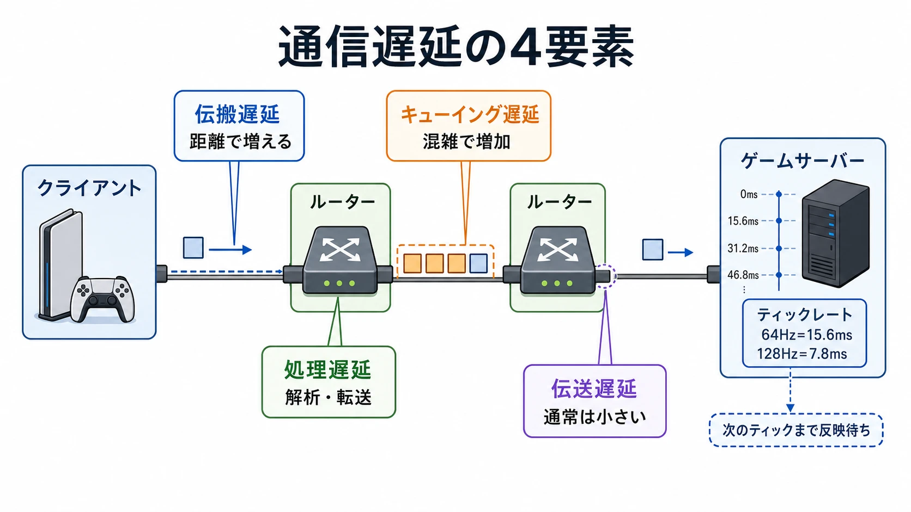
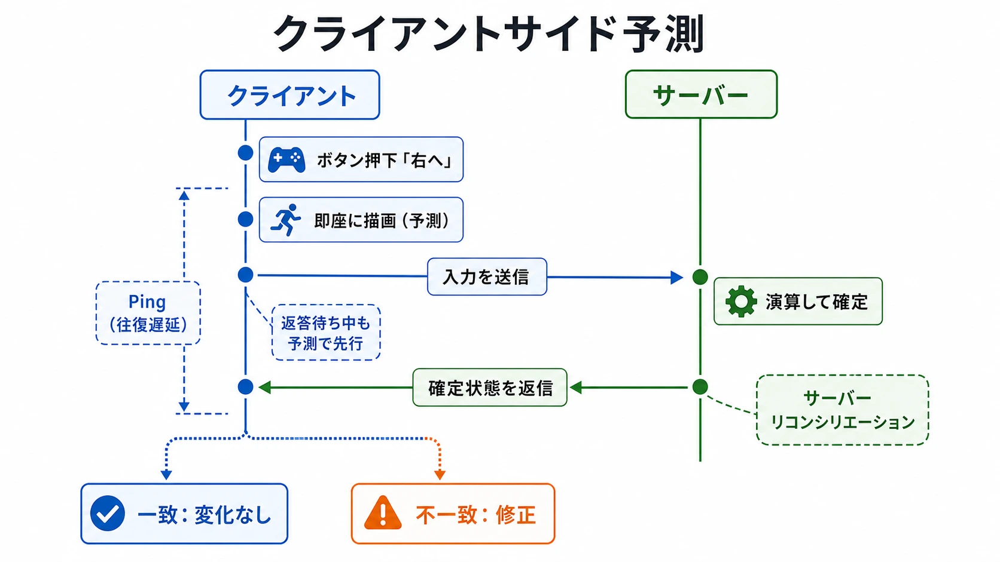

# 家庭用ゲーム機のネット対戦――物理的遅延の構造と遅延を隠す技術

> **注意**：この記事は2026年11月に改版しました。本文を支える出典を一次資料や公式ドキュメントへ差し替え、いくつかの数値を訂正しています。変更の履歴は、このブログのGitHubリポジトリで確認できます。

## はじめに

オンライン対戦ゲームを快適に遊べているとき、実は目には見えない複雑な「嘘」がいくつも重なり合っている。今まさに戦っている相手の位置は少し前の状態であり、自分の操作結果も、ゲーム機がサーバーの返答を待たずに予測して表示していることがある。本稿では、その必要性を物理法則から解き明かし、開発者が積み上げてきた技術を解説する。

ネットワークの層の整理は、シリーズ「ゲームプランナーのためのネットワーク入門」の[第1回](planner-network-intro-01-which-layer-is-the-error.md)で扱っている。

----

## 第1章：光速という絶対的な壁

### 1-1. 光速の壁とは何か

真空中の光速は299,792,458m/sという定義値である。通信もこの速度の制約を受ける。[[1](#ref-1)]

光ファイバー中の信号は光速の約3分の2で進む。ITU-T G.114は伝搬時間の見積もりに片道5µs/kmを示す。1秒÷0.000005秒＝200,000なので、これは秒速約20万kmに当たる。[[2](#ref-2)]

### 1-2. 地球の大きさとPingの下限

地球の直径を約12,742kmと置き、地球を貫く直線を真空中の光速で往復すると仮定すれば、12,742×2÷299,792.458秒、すなわち約85msである。表面に沿った真裏までの約20,000kmを光ファイバー相当で往復すれば、20,000×2×5µs＝約200msになる。いずれも伝搬だけの計算である。[[1](#ref-1)][[2](#ref-2)]

下表は、概算の直線距離×2×5µsで求めた、伝搬による理論的な下限の計算例である。最後の行だけは表面経路を使う。実際のケーブル経路や測定したPingを示す表ではない。

| 区間 | 計算に使う概算距離 | 理論的RTT下限 |
| --- | --- | --- |
| 東京〜大阪 | 約400km | 約4ms |
| 東京〜北京 | 約2,100km | 約21ms |
| 東京〜ロンドン | 約9,600km | 約96ms |
| 東京〜ニューヨーク | 約10,800km | 約108ms |
| 地球の真裏（表面経路） | 約20,000km | 約200ms |

日本からブラジルのような遠距離対戦では、伝搬だけでも大きな時間が必要になる。現実には経路の迂回や機器の処理、混雑も加わる。

### 1-3. なぜ「回線速度（Mbps）」より「Ping（ms）」が大事か

Mbpsは単位時間に運べる量、msは届くまでの時間を表す。帯域を増やしても、距離による待ち時間が消えるわけではない。

Starlinkの2024年の資料は、Webページの読み込みでは帯域を約10Mbps以上へ増やす効果が頭打ちになる一方、遅延を減らすと読み込み時間が大きく短くなると説明する。これはWebページについての説明であり、ゲームの必要帯域を示す数値ではない。ゲームでも、必要なデータ量と操作への応答時間を分けて設計する必要がある。[[3](#ref-3)]

----

## 第2章：物理的遅延の構造

### 2-1. レイテンシを構成する4つの要素

KuroseとRossの教科書は、ネットワーク内の遅延を次の4要素に整理する。[[4](#ref-4)]

1. **伝搬遅延**：信号が距離を移動する時間。
2. **処理遅延**：パケットを調べ、送り先などを判断する時間。
3. **キューイング遅延**：送信待ちの列に並ぶ時間。混雑に左右される。
4. **伝送遅延**：パケットの全ビットを回線へ送り出す時間。データ量と回線の伝送速度で決まる。

ゲームでは、通信に加えてサーバーの更新周期も考える。ValveによればSourceエンジンのゲームでは通常、専用サーバーがワールドのシミュレーション、ルール、入力処理に権威を持つ。[[5](#ref-5)] RiotはVALORANTで全プレイヤーに128ティックのサーバーを提供すると説明する。[[6](#ref-6)] 更新間隔を1÷周波数で計算すると、64Hzなら約15.6ms、128Hzなら約7.8msである。これは更新間隔であり、その値が常に入力待ち時間として丸ごと加わるという意味ではない。



### 2-2. ジッターとパケットロス

遅延は大きさだけでなく、ばらつきも問題になる。RFC 3550の到着間隔ジッターは、送信側と受信側でのパケット間隔の差を使い、その絶対値を平滑化して見積もる値である。一定の間隔で送っても到着間隔が揺れると、表示側はその揺れに対応しなければならない。[[7](#ref-7)]

パケットが途中で失われることをパケットロスと呼ぶ。UDPを使う場合、UDP自体は失われたデータを再送しない。ゲーム側での補完や再送の要否が問題になる。詳しくは[シリーズ第4回：TCPとUDP](planner-network-intro-04-tcp-and-udp.md)を参照してほしい。

### 2-3. P2P方式と専用サーバー方式の違い

ここではP2Pのうち、プレイヤーの1台がホストを兼ねるリスンサーバー型と、専用サーバー型を比較する。すべてのP2Pがこの構成というわけではない。Unreal Engineでは、サーバーが唯一の権威あるゲーム状態を持ち、リスンサーバーのホストはクライアント参加者より有利になると説明されている。[[8](#ref-8)]

| 比較項目 | P2P（ここではリスンサーバー型） | 専用サーバー |
| --- | --- | --- |
| ホスト | プレイヤーの端末が兼任 | 専用のサーバー |
| 接続条件 | ホストが有利になりうる | 全員がリモート接続 |
| 改ざんへの耐性 | ホスト自体の信頼性が問題になる | 改ざんされたクライアントに強い |
| 費用 | 既存のゲーム端末を使い、追加のサーバー費用なし | サーバー費用がかかる |

Unityも、専用サーバーは一般に高価である一方、改ざんされたクライアントに強いと説明する。専用サーバーはホスト参加者の優位を避けやすいが、プレイヤーごとの距離や回線の差まで消すものではない。[[9](#ref-9)]


```
# 仕上げAIへ図表制作依頼
対象：image/console-online-p2p-dedicated-server-v2.webp。背景は白。ラベルとaltは日本語。
左にP2P（リスンサーバー型）、右に専用サーバー。下に特徴ラベル。左は「ホストが有利になりうる」「追加のサーバー費用なし」「ホストが改ざんされると弱い」。右は「全員がリモート接続」「サーバーが権威」「改ざんされたクライアントに強い」「サーバー費用」。Pingほぼ0、全員が公平、切断で崩壊は使わない。
```

----

## 第3章：遅延を「隠す」技術

物理的な遅延はゼロにはできない。そこで、応答を予測し、過去の状態を参照し、表示を補う技術が必要になる。

### 3-1. クライアントサイド予測（Client-Side Prediction）

ボタンを押した瞬間、手元のクライアントはサーバーの返答を待たずに操作結果を表示する。Sourceではサーバーと同じコードとルールで自分の入力結果を予測する。[[5](#ref-5)]

1. 自分の入力から移動結果を予測し、すぐ表示する。
2. 入力をサーバーへ送り、権威ある結果を受け取る。
3. 予測と結果を比較し、食い違えばクライアントの位置を修正する。

この整合処理は一般にサーバーリコンシリエーションと呼ばれる。Sourceでは修正が目立つ場合に短い時間をかけて徐々に直す。操作への即応性と、最終的な状態の決定権を分ける仕組みである。[[5](#ref-5)]



### 3-2. ラグ補償（Lag Compensation）—「時間を巻き戻す」技術

撃つ側Aが照準を合わせた相手Bは、サーバーの現在より過去の位置に表示されていることがある。ラグ補償は、Aが見ていた時点へ他のプレイヤーの位置を戻して判定する仕組みだ。Bernierの2001年の論文は、この方法とトレードオフを説明している。[[10](#ref-10)]

Sourceでは直近1秒間の全プレイヤーの位置を記録する。「現在のサーバー時刻−パケットの遅延−クライアントの表示補間」で命令の作成時刻を推定し、他のプレイヤーをその時点へ戻して当たり判定を行い、処理後は元へ戻す。往復Pingをそのまま引く計算ではない。[[5](#ref-5)]

巻き戻しで助けられるのは撃つ側である。撃たれたBは、物陰に入った後に撃たれたように感じることがある。Riotは、500msの遅延があるプレイヤーが、物陰へ移動して0.5秒後の相手を倒せてしまう例を挙げ、悪用を防ぐため巻き戻しの上限を調整していると説明する。[[10](#ref-10)][[6](#ref-6)]


```
# 仕上げAIへ図表制作依頼
対象：image/console-online-lag-compensation-v2.webp。背景は白。ラベルとaltは日本語。
3コマ。①撃った側Aの画面：遅れて届いた過去のBに照準。②サーバーの現在：Bは物陰へ移動済み。③サーバーがBをAの見ていた時点へ戻して判定。下に1本の時間軸を置き、「Aが見ていた時点」「サーバーの現在」の2点のみを示し、その差を「パケットの遅延＋表示の補間」とする。注記は「撃った側Aは、見えたとおりに当たる」「撃たれた側Bは、物陰に入ったのに撃たれたと感じることがある」。低Ping側が有利／高Ping側が不利は使わない。
```

### 3-3. 推測航法（Dead Reckoning）—「動きを予測する」

推測航法は、最後に分かっている位置と速度から、その先の位置を推定する考え方である。Aronsonは、推定と実際の差がしきい値を超えたときに新しい更新を送る方式を説明している。毎回すべての位置を送る代わりに、共有した推定を使って更新の間をつなぐ。[[11](#ref-11)]

一方、補間は受信済みの状態と状態の間を埋める方法である。未来を推定する外挿とは区別したい。Sourceは既定で100msの補間期間（cl_interp 0.1）を使い、スナップショットが1つ失われても補間に必要な2つを確保できるようにしている。滑らかさを支える待ち時間でもあり、ラグ補償の計算にも関わる。[[5](#ref-5)]

### 3-4. ディレイベース方式 vs ロールバック方式（格闘ゲームの場合）

60fpsの場合、1フレームは1÷60秒＝約16.7msである。入力をどのフレームで反映するかが、対戦の操作感を左右する。

#### ディレイベース方式（Delay-Based Netcode）

入力の反映を遅らせ、相手の入力の到着を待って同期する。インサイドの記事は、2フレームの遅延があるなら、その2フレームの画面を意図的に止めて同期する例で説明している。同じフレームで同じ状態を共有しやすい一方、待ち時間が操作感に現れる。[[12](#ref-12)]

#### ロールバック方式（Rollback Netcode）

自分の入力をすぐ反映し、届いていない相手の入力は直前と同じ行動が続くと予測して進める。予測が外れたら、そのフレームへ戻して実際の入力から現在まで再計算する。巻き戻した区間は、画面に描かずに何フレーム分も続けて計算し直す。補正によって、相手が飛んだように見えることもある。[[12](#ref-12)][[13](#ref-13)] GGPOの開発者ガイドは、ゲームのシミュレーションが完全に決定論的であること、つまり同じ状態と入力から1フレーム進めると全プレイヤーで同じ状態になることを求めている。また、巻き戻しの間に生じた演出や音は、巻き戻しが終わるまで後回しにするよう求めている。[[14](#ref-14)]

『ストリートファイターV』はロールバック方式を採用する。GGPOを採用したという意味ではない。[[12](#ref-12)] GGPO公式サイトは、2009年に作られたSDKがP2Pゲームでのロールバック利用を開拓したと説明する。[[13](#ref-13)] ソースコードはMIT Licenseで公開されている。[[15](#ref-15)]


```
# 仕上げAIへ図表制作依頼
対象：image/console-online-delay-vs-rollback-v2.webp。背景は白。ラベルとaltは日本語。
上段ディレイ方式：入力の反映を数フレーム遅らせ、相手の入力の到着を待つ。全員が同じフレームで同じ状態を見る。下段ロールバック方式：自分の入力はすぐ反映し、相手の入力は予測。実際の入力が届いた時点で予測開始フレームまで状態を戻し、届いた入力で現在まで一気に再計算。巻き戻した区間を描画せずに再計算する囲みを置く。予測が外れたときだけ表示を補正し、相手が飛んだように見える場合がある。フレーム番号は記号として使い、時間の数値は「1フレーム＝約16.7ms（60fpsの場合）」以外描かない。
```

----

## 第4章：ネットワーク通信の基礎

### 4-1. TCPとUDPの使い分け

TCPは、接続が維持できる範囲で再送などによりデータの到達と順序を守る。UDP自体は到達も順序も保証しない。[[16](#ref-16)][[17](#ref-17)] ゲームエンジンは、その上に通信の仕組みを用意する。たとえばUnreal EngineのRPCではreliable／unreliableを選べる。必要な信頼性をメッセージごとに考えることが重要だ。[[18](#ref-18)]

詳しくは[シリーズ第4回：TCPとUDP](planner-network-intro-04-tcp-and-udp.md)で扱っている。

### 4-2. NAT越え（NAT Traversal）の問題

家庭のNATとポートの事情は[シリーズ第3回](planner-network-intro-03-ip-nat-ports.md)を参照してほしい。NATの背後にいる端末同士の接続を助ける標準として、次の仕組みがある。

- **STUN**：NATの外側から見た自分のIPアドレスとポートを知るための仕組み。単独であらゆるNAT越えを解決するものではない。[[19](#ref-19)]
- **TURN**：中継サーバーを通して相手とパケットを交換する仕組み。[[20](#ref-20)]
- **ICE**：端末の直接の候補、STUNで得た外側から見た候補、TURNの中継候補などを集め、接続性を確認して通信経路を選ぶ手順。[[21](#ref-21)]

中継の実例としてValveのSteam Datagram Relayがある。IPアドレスを相手に明かさず通信を中継することで、サーバーとプレイヤーをDoS攻撃から守ると説明されている。これはTURNの採用を示す例ではなく、中継という設計の実例である。[[22](#ref-22)]


```
# 仕上げAIへ図表制作依頼
対象：image/console-online-nat-stun-turn-v2.webp。背景は白。ラベルとaltは日本語。
プレイヤーA・Bと各家庭のNATルーター、上にSTUN、下にTURN中継。STUNは外側から見たアドレスとポートを知らせ、TURNは通信を中継する関係を示す。「コンソールはP2P失敗時にリレーへ切替」は置かず、「ICE：直接、外側から見たアドレス、中継の候補から、つながる経路を選ぶ」と注記する。
```

----

## 第5章：コンソールオンラインの進化史

### 5-1. ドリームキャストとXbox Liveの衝撃

ドリームキャストは1998年11月27日に日本で発売され、本体に33.6kbpsのモデムを内蔵していた。ネット接続を前提にした家庭用ゲーム機の姿を示した例である。[[23](#ref-23)]

Xbox Liveは2002年11月15日に米国とカナダで始まった。Microsoftの発表では、世界共通の一つのIDであるゲーマータグ、フレンドを探して誘う仕組み、全マルチプレイゲームに統合された音声チャット、ワンボタンで対戦に入るQuickMatchを掲げている。対戦の通信だけでなく、相手を見つけて一緒に遊ぶ仕組みもサービスとして整えた。[[24](#ref-24)]

### 5-2. 現代のコンソールインフラ

ゲームを支える基盤は、クラウドとコンテンツ配信の領域にも広がっている。ソニーとMicrosoftは2019年5月16日、Microsoft Azureを用いた将来のクラウドソリューションの共同開発を検討する覚書を発表した。対象は両社のゲームとコンテンツ配信サービスを支える基盤である。[[25](#ref-25)]

### 5-3. 低軌道衛星通信（Starlink）の可能性

ITU-T G.114は高度36,000kmの静止軌道衛星について、地上局間の宇宙空間の伝搬だけで片道260msと見積もる。往復なら260×2＝520msとなり、500msを超える。[[2](#ref-2)]

Starlinkの2024年の資料によれば、利用者から衛星を経て地上へ戻る光速の伝搬は片道1.8〜3.6msで、往復は通常10ms未満である。これは回線全体の測定遅延ではない。同資料は米国のピーク時の遅延中央値を48.5msから33msへ下げたと報告し、安定した中央値20msを目標に掲げる。[[3](#ref-3)]

Handleyの2018年の論文は、衛星間レーザーで結ぶ低軌道衛星網について、約3,000kmを超える距離では、どんな地上の光ファイバー網よりも低遅延で通信できうると予備的に評価した。これは構想をモデル化した評価であり、現在のサービスが常に地上回線より速いという測定結果ではない。[[26](#ref-26)]

----

## 第6章：権威サーバーとチート対策

### 6-1. 権威サーバー（Authoritative Server）とは

Unreal Engineの説明ではサーバーが唯一の権威あるゲーム状態を持ち、Sourceでもサーバーがワールドのシミュレーション、ルール、入力処理に権威を持つ。クライアントの予測を許しながら、最終決定はサーバーに集める構造である。[[8](#ref-8)][[5](#ref-5)]

高橋・橋本の研究は、プレイヤーの端末を完全には信頼できないため、ゲームサーバー側でもチート対策が必要だという前提に立つ。権威サーバーは、送られた入力や状態をサーバー側のルールで検証する土台になる。ただし、サーバーを置くだけですべてのチートを防げるわけではなく、何を検証するかという設計が必要である。[[27](#ref-27)]

### 6-2. チートと補償技術のトレードオフ

ラグ補償は撃つ側の見え方を尊重する一方、撃たれる側には過去へ戻された判定として現れる。Riotが巻き戻しの上限を調整して悪用を防ぐと説明するように、どこまで過去の状態を認めるかもサーバー側のルールになる。遅延を隠す技術と、その技術を許す範囲は一緒に設計する必要がある。[[6](#ref-6)]

----

## まとめ：「見えない努力」が生み出す没入感

オンライン対戦のなめらかな体験は、光速という制約の上に工夫を積み重ねて成立している。クライアントサイド予測は自分の操作への反応を早め、補間や推測航法は更新の間をつなぎ、ラグ補償やロールバックは時間の食い違いを処理する。

ゲームプランナーが最初に問うべきは、「このゲームジャンルは何msのレイテンシまで許容できるか」である。許容できる遅延と、そのとき使う隠す技術を、ジャンルと遊びから決めたい。即応性、表示の滑らかさ、判定の納得感のどこを優先するかで、選ぶ仕組みは変わる。

物理的な遅延は消せない。その制約の中で、操作への応答と対戦の公平性をどう両立させるかが、ネット対戦の設計を支える問いである。

## References

<a id="ref-1"></a>1. [BIPM「SI base unit: metre」][1] — 公式ドキュメント。

[1]: https://www.bipm.org/en/si-base-units/metre

<a id="ref-2"></a>2. [ITU-T「G.114: One-way transmission time」][2] — 2003年5月。Table A.1。

[2]: https://www.itu.int/rec/T-REC-G.114-200305-I/en

<a id="ref-3"></a>3. [Starlink「Improving Starlink’s Latency」][3] — 2024年。

[3]: https://www.starlink.com/public-files/StarlinkLatency.pdf

<a id="ref-4"></a>4. [James F. Kurose、Keith W. Ross『Computer Networking: A Top-Down Approach』][4] — Pearson、第8版対応の著者公開教材、Chapter 1。

[4]: https://gaia.cs.umass.edu/kurose_ross/online_lectures.htm

<a id="ref-5"></a>5. [Valve「Source Multiplayer Networking」][5] — Valve Developer Community、2026年11月1日確認。

[5]: https://developer.valvesoftware.com/wiki/Source_Multiplayer_Networking

<a id="ref-6"></a>6. [Matt deWet、David Straily「Peeking into VALORANT’s Netcode」][6] — Riot Games、2020年7月28日。

[6]: https://www.riotgames.com/en/news/peeking-valorants-netcode

<a id="ref-7"></a>7. [H. Schulzrinneほか「RTP: A Transport Protocol for Real-Time Applications」][7] — RFC 3550、2003年7月、6.4.1節。

[7]: https://www.rfc-editor.org/rfc/rfc3550.html

<a id="ref-8"></a>8. [Epic Games「Networking Overview for Unreal Engine」][8] — 公式ドキュメント、2026年11月1日確認。

[8]: https://dev.epicgames.com/documentation/en-us/unreal-engine/networking-overview-for-unreal-engine

<a id="ref-9"></a>9. [Unity「Network topologies」][9] — Netcode for GameObjects 2.5 Manual、2026年11月1日確認。

[9]: https://docs.unity3d.com/Packages/com.unity.netcode.gameobjects@2.5/manual/terms-concepts/network-topologies.html

<a id="ref-10"></a>10. [Yahn W. Bernier「Latency Compensating Methods in Client/Server In-game Protocol Design and Optimization」][10] — Valve、2001年。

[10]: https://developer.valvesoftware.com/wiki/Latency_Compensating_Methods_in_Client/Server_In-game_Protocol_Design_and_Optimization

<a id="ref-11"></a>11. [Jesse Aronson「Dead Reckoning: Latency Hiding for Networked Games」][11] — Game Developer、1997年9月19日。

[11]: https://www.gamedeveloper.com/programming/dead-reckoning-latency-hiding-for-networked-games

<a id="ref-12"></a>12. [田下広夢「格ゲーのオンライン対戦を快適にするロールバック方式と未来予測のからくり」][12] — インサイド、2022年5月22日。

[12]: https://www.inside-games.jp/article/2022/05/22/138312.html

<a id="ref-13"></a>13. [GGPO「GGPO」][13] — 公式ドキュメント、2026年11月1日確認。

[13]: https://www.ggpo.net/

<a id="ref-14"></a>14. [GGPO「GGPO Developer Guide」][14] — GitHub（pond3r/ggpo、doc/DeveloperGuide.md）、2026年11月1日確認。決定論的なシミュレーションの要件、巻き戻し中のフレーム処理と演出の扱いを参照。

[14]: https://github.com/pond3r/ggpo/blob/master/doc/DeveloperGuide.md

<a id="ref-15"></a>15. [GGPO「ggpo」][15] — GitHub、MIT License。

[15]: https://github.com/pond3r/ggpo

<a id="ref-16"></a>16. [W. Eddy編「Transmission Control Protocol (TCP)」][16] — RFC 9293、2022年8月。

[16]: https://www.rfc-editor.org/rfc/rfc9293.html

<a id="ref-17"></a>17. [J. Postel「User Datagram Protocol」][17] — RFC 768、1980年8月。

[17]: https://www.rfc-editor.org/rfc/rfc768.html

<a id="ref-18"></a>18. [Epic Games「Remote Procedure Calls」][18] — 公式ドキュメント、2026年11月1日確認。

[18]: https://dev.epicgames.com/documentation/en-us/unreal-engine/remote-procedure-calls-in-unreal-engine

<a id="ref-19"></a>19. [M. Petit-Hugueninほか「Session Traversal Utilities for NAT (STUN)」][19] — RFC 8489、2020年2月。

[19]: https://www.rfc-editor.org/rfc/rfc8489.html

<a id="ref-20"></a>20. [T. Reddyほか「Traversal Using Relays around NAT (TURN)」][20] — RFC 8656、2020年2月。

[20]: https://www.rfc-editor.org/rfc/rfc8656.html

<a id="ref-21"></a>21. [A. Keranenほか「Interactive Connectivity Establishment (ICE)」][21] — RFC 8445、2018年7月。

[21]: https://www.rfc-editor.org/rfc/rfc8445.html

<a id="ref-22"></a>22. [Valve「Steam Datagram Relay」][22] — Steamworks Documentation、2026年11月1日確認。

[22]: https://partner.steamgames.com/doc/features/multiplayer/steamdatagramrelay

<a id="ref-23"></a>23. [INTERNET Watch「メールやチャットも楽しめるDreamcastのインターネット機能」][23] — 1998年11月30日。

[23]: https://internet.watch.impress.co.jp/www/article/981130/dricas.htm

<a id="ref-24"></a>24. [Microsoft「Xbox Live Arrives in Stores, Sparking the Next Revolution in Video Games」][24] — 2002年11月15日。

[24]: https://news.microsoft.com/2002/11/15/xbox-live-arrives-in-stores-sparking-the-next-revolution-in-video-games/

<a id="ref-25"></a>25. [Microsoft「Sony and Microsoft to explore strategic partnership」][25] — 2019年5月16日。

[25]: https://news.microsoft.com/source/?p=19039

<a id="ref-26"></a>26. [Mark Handley「Delay is Not an Option: Low Latency Routing in Space」][26] — HotNets ’18、2018年11月。

[26]: https://discovery.ucl.ac.uk/id/eprint/10062262/

<a id="ref-27"></a>27. [高橋康佑、橋本正樹「Intel SGXを用いたサーバーにおけるチート対策のクライアント委任手法」][27] — 情報処理学会研究報告、2021-CSEC-92、No.28、2021年3月8日。

[27]: https://ipsj.ixsq.nii.ac.jp/records/210125

----

この文書は、Perplexity、Claude、ChatGPT の3つのAIの支援を受けて著述されたものです。引用画像を除き、MIT License にて提供されています。
