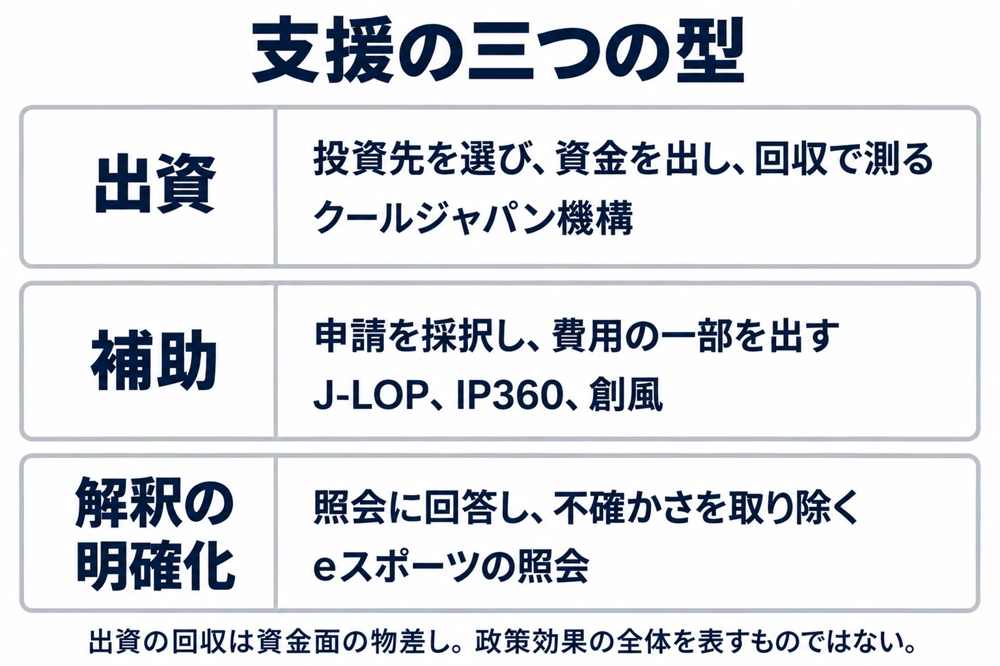

# その支援は、何を目標にし、何で測られているか――クールジャパン機構からIP360まで、振興策の物差しを並べる

ゲームを海外へ届けるには、開発費に加えて翻訳や宣伝の費用がかかる。大会を開くなら、賞金にどのルールが適用されるかも知りたい。行政には、事業に資金を出したり、事業者が抱える法適用の不確かさを小さくしたりする道具がある。ゲームを「育てる」側では、どのような目標が掲げられ、その成果は何で測られているのだろうか。

本稿は「ゲームと行政のあいだ」第7回、本編の最終回である。[第1回](game-and-government-regulation-map.md)ではルールの経路を、[第2回](diet-1986-177-and-pc-game-self-regulation.md)では国会と自主規制を、[第3回](cero-z-rating-gta3-ordinance-link.md)では年齢表示と条例を、[第4回](complete-gacha-administrative-tools-and-display-enforcement.md)ではコンプガチャと行政の道具を、[第5回](kagawa-game-ordinance-process-lawsuit-aftermath.md)では罰則のない条例を、[第6回](payment-network-invisible-regulation-japan-platforms.md)では決済網の規約を見た。ここまでの6回は、主にゲームを「止める」側から、仕様や販売の条件が決まる経路をたどってきた。

今回は「育てる」側へ進む。判断軸は、 **その支援は、何を目標にし、何で測られているか** である。予告では「振興策の採点」としていたが、本稿で行うのは、物差しをそろえて記録を並べることである。施策の良し悪しを判定する点数は付けない。支援を使う開発者にも、支援策の報道を読むプレイヤーにも、金額の見出しから一歩進んで考えるための材料を示したい。

***

## 物差しを先に決める

以降の節では、三つの問いを共通して置く。

- 何を目標に掲げたか。
- 成果を何で測るか。あるいは、何なら測れるか。
- 誰が検証したか。

たとえば、海外展開を支える制度について、採択件数が多いことと、海外売上が増えることは別の出来事である。前者は支援がどれだけ届いたかを、後者は事業がどれだけ売れたかを示す。売上が増えたとしても、その増加のどこまでが支援によるものかは、さらに別の問いになる。

検証する主体にも目を向ける。事業を運営した団体の集計、制度を所管する省庁の点検、有識者による検討、報道機関の分析は、それぞれ立場と扱う範囲が違う。同じ「成果」という言葉が使われていても、誰が、何を基に述べているのかまで読む必要がある。

まずは、支援の働き方を三つに分けておこう。

***

## 出資で支える――クールジャパン機構

### 海外需要を開き、投資を回収する

クールジャパン機構の正式名称は、株式会社海外需要開拓支援機構である。2013年に設立され、経済産業省が所管する官民ファンドである。官民ファンドとは、国と民間が資金を出し、政策上の目的に沿って事業へ投資する仕組みだ。[[1](#ref-1)]

ここでいう出資は、会社の株式などを取得して事業に資金を供給し、その成長や将来の売却などを通じて回収を目指すことを指す。費用の一部を補う補助金とは、お金の戻り方が違う。機構には海外需要の開拓という政策上の目的と、投資先から資金を回収するという収益面の課題がある。

資金面の物差しとして、累積損益がある。これまでの利益と損失を積み上げた数字だ。財政制度等審議会の財政投融資分科会の資料によれば、2025年度決算で累積損益は▲540億円となり、修正後の計画で目標にしていた▲426億円を下回った。▲はマイナスを表す。[[2](#ref-2)]

この数字は、機構全体の収益面を点検する材料になる。一方、海外需要の開拓という政策効果の全体や、個々の支援先の損益を、そのまま示すものではない。

### 検証の対象は、個別案件から組織まで

経済産業省の「海外需要開拓支援機構の検証等に係る検討会」は、2026年7月29日に始まった。[[3](#ref-3)]共同通信は、経営や会計の専門家らが投資実績と組織体制を議論し、年内に結論を出す予定だと伝えている。[[4](#ref-4)] 財投分科会の資料では、制度面、投資事業面（個別投資案件の政策効果と収益性）、組織・経営面の三つの観点から検証する方針が示された。[[2](#ref-2)]

ゲームとの接点を、2026年10月19日の第4回検討会の資料1「これまでのメディア・コンテンツ案件の状況」から見てみる。メディア・コンテンツの対象は17件、支援決定額は円建て14件の合計で約509億円（ほかにドル建て3件）である。[[5](#ref-5)] 通貨が違うため、ここでドル建て案件を円に換算して足し合わせることはしない。

ゲーム関連では、ワンダープラネットへの支援が載っている。スマホ向けアプリゲームの開発・運営に対するもので、支援決定額10億円、2019年7月公表、2024年3月にEXITと記載されている。EXITとは、保有する株式の売却などによって投資を終え、資金を回収することである。資料には個別の損益は記載されていない。[[5](#ref-5)] この案件がEXITしたという事実から、利益や損失の額までは読み取れない。

同資料は、メディア・コンテンツ案件の損失の要因として、需要と収益化の想定とのずれ、市場環境の変化、経営・ガバナンス上の課題を挙げている。具体例は、ファン基盤が有料利用につながらないこと、外部プラットフォームへの依存、IP価格の高騰、動画配信の台頭である。IPは、ここでは作品やキャラクターなどの知的財産を指す。また、実現益が出た案件は、既存事業を基盤にEXITを判断し、事業会社への売却で利益を確保した点が共通していたとしている。[[5](#ref-5)] これらは複数案件についての整理であり、ワンダープラネット一社の事情を説明する記述としては扱わない。

### 中間整理を伝えた報道

2026年10月27日には検討会の中間整理が公表された。NHKは「投資の判断が不十分」、日本経済新聞は「過剰なリスクテイク」が損失原因、時事通信は「統廃合の方針確認」と、それぞれ見出しで伝えている。[[6](#ref-6)] [[7](#ref-7)] [[8](#ref-8)]

ここでは、報道がどこに焦点を当てたかを並べた。投資判断、引き受けたリスク、組織の今後は関連しているが、同じ問いではない。年内に組織体制の結論を出すという当初の予定と、10月時点の中間整理も、段階を分けて読む必要がある。[[4](#ref-4)]

この施策については、累積損益という資金面の結果があり、その結果を受けて個別案件の政策効果・収益性と組織の仕組みを検証する過程がある。支援決定額だけを見る場合より、点検の対象が具体的になる。

***

## 費用を補助する――J-LOP

### 翻訳や宣伝の費用を分担する

J-LOPは、2013年3月に創設された「ジャパン・コンテンツ ローカライズ&プロモーション支援助成金」である。総務省と経済産業省が共同で、海外展開のためのローカライズ（字幕・吹替えなど）とプロモーションの経費を最大2分の1まで補助した。[[9](#ref-9)] [[10](#ref-10)]

補助率とは、対象となる経費のうち、制度が負担する割合である。最大2分の1なら、対象経費のすべてを制度が払うわけではない。たとえば対象経費が200万円で補助率が2分の1なら、補助額は100万円になる。これは仕組みを説明する仮の計算例であり、実際には上限や対象経費の条件も関わる。

J-LOPで掲げられた方向は、日本のコンテンツの海外展開を広げることだった。経団連の2015年の提言は、82か国に向けた3,815件の海外展開事業が採択され、J-LOP利用事業者の海外売上総額が2012年から2015年にかけて約1,250億円増加したとしている。同提言の注記によれば、成果の数字は映像産業振興機構（VIPO）による集計である。[[11](#ref-11)]

ここには二つの物差しがある。採択件数は支援の実施量を、利用事業者の海外売上は支援先の事業の動きを表す。経団連は、この記録を基に後継制度の措置や予算規模の確保を要望していた。[[11](#ref-11)]

### 売上の増加と、補助による増加を分ける

約1,250億円は、利用事業者の売上の増加分である。補助がその増加をもたらしたのか、もともと伸びる事業者が補助を使ったのかは、この数字だけでは区別できない。

たとえば海外向けのタイトル投入や販売地域の拡大が進んでいた企業では、補助の利用と売上の増加が同時に起こりうる。補助の効果を切り分けるには、支援を受けなかった場合との比較など、もう一段の検証が必要になる。これはJ-LOPの成果を否定する話ではなく、集計値が答えられる問いの範囲である。

本稿で参照する記録では、VIPOによる集計と、それを用いた経団連の提言までをたどれる。第三者が補助の因果的な効果を検証したかどうかは、なお資料上の空白として残る。

後継制度としてJ-LOP+が設けられ、その後もJ-LOXなど、海外展開のローカライズや宣伝を支える事業が続いた。[[11](#ref-11)] [[12](#ref-12)] 制度名が続いていても、異なる年度・制度の件数や売上を一つの集計として混ぜないことが大切である。

***

## 解釈を明らかにする――eスポーツの賞金の照会

支援には、資金の交付以外の働きもある。eスポーツの賞金をめぐる、消費者庁の法令適用事前確認手続がその例になる。法令適用事前確認手続（ノーアクションレター）とは、具体的な事業の計画について、ある法令が適用されるかを事前に行政へ照会し、回答を得る手続である。[[13](#ref-13)]

日本eスポーツ連合の2019年8月5日付の照会に対し、消費者庁は2019年9月3日に回答した。賞金の提供が「仕事の報酬等」と認められる場合の、景品表示法上の扱いが示された。[[13](#ref-13)] [[14](#ref-14)]

ここでの働きは、事業者が抱えていた法適用の不確かさを取り除くことである。照会した具体的な内容と回答の範囲を基に、大会の設計を考えられるようになる。景品表示法、賭博罪、風営法の関係や回答の詳しい条件は、[大会賞金を扱った既存記事](esports-tournament-prize-gambling-and-amusement-business-law.md)へ譲る。

物差しは、出資の回収額や補助先の海外売上とは違う。支援金を交付せずに事業の前提を明らかにした例であり、効果を金額だけで測ることは難しい。行政にも照会者にも手続に伴う作業はあるため、「予算ゼロで済む」とまでは言えない。

また、消費者庁はこの照会に法的な回答をした主体であり、回答後の産業振興効果を検証した主体とは分けて考える必要がある。法適用について何が明らかになったかと、その結果として大会や売上がどれだけ増えたかは、別々の問いなのである。

***

## いま動いている支援――IP360と創風

### 海外売上の目標と、支援の原則

IP360は、コンテンツ産業成長投資支援事業の通称である。日本発コンテンツの海外売上を2033年までに20兆円とする官民目標に向け、令和7年度補正予算で350億円規模が措置された。[[12](#ref-12)] [[15](#ref-15)] 補正予算とは、年度の当初に決めた予算へ、その後の事情に応じて追加や変更を行う予算である。

ゲーム分野については、2024年の海外売上3.4兆円から2033年に12兆円とする見通しが、経済産業省の仮説として示されている。[第1回](game-and-government-regulation-map.md)で紹介した第18回エンタメ・クリエイティブ産業政策研究会の資料である。[[16](#ref-16)] これは産業全体の目標であり、一つの補助事業の達成額でも、補助によって生まれる売上の推計値でもない。

ジャーナリスト・研究者のまつもとあつし氏がITmedia NEWSに寄稿した記事は、2025年11月の研究会で示された「エンタメ政策5原則」を、次のように紹介している。[[17](#ref-17)]

- 大規模・長期・戦略的に支援する。
- 日本で創り、世界に届ける取組を支援する。
- 作品の中身に口を出さない。
- 制度を簡素化し、真っすぐ届ける。
- 挑戦者を優先する。

目標が「どこへ向かうか」なら、原則は「どう支援するか」である。両方を置くことで、海外売上の増加だけでなく、どんな申請者へ、どんな条件で支援が届くかも読む対象になる。

### 採択の範囲をそろえて、批判と反論を読む

同記事によれば、2026年6月29日に公表されたメニュー3「大規模作品製作支援」の第1回採択は、90件の申請に対して27件（19者）だった。大手企業が中心で、DeNA、コナミ、スクウェア・エニックス、セガ、コーエーテクモなどが挙がった。[[17](#ref-17)]

6月下旬にはDeNAのスマホゲーム開発への15億円の支援が報じられ、SNSで公費を既存の有力企業へ配ることへの批判が広がった。一方、MIXIの木村弘毅社長は、補助額は他国と比べて少なすぎ、産業を絞った「選択と集中」が必要だという趣旨の投稿をしたと、まつもと氏は伝えている。[[17](#ref-17)] 企業への採択という事実と、その配分に対する意見を分けて置こう。ここで15億円という額は、報道された支援額として扱う。

まつもと氏自身は、支援規模の小ささを課題としつつ、議論を規模より仕組みに向けるべきだとしている。企業に投資額の半分の自己負担を求め、大規模作品支援には収益納付のルールもあるため、無条件の資金配布とは異なるとする一方、すでに稼いでいるIPへの偏りや、新しいIPの育成・文化のアーカイブへの支援の薄さを指摘している。[[17](#ref-17)] 収益納付とは、補助した事業が一定の収益を上げた場合に、定められた条件に従ってその一部を国へ納める仕組みである。

ここで、27件という数字の範囲を広げてみる。電ファミニコゲーマーのTAITAI氏が2026年8月7日に公表した集計では、全9メニューの採択は1,709件中162件（9.5%）だった。メニュー1「創風」は819件中34件（4.2%）である。[[18](#ref-18)] 採択率とは、申請された件数のうち、支援の対象に選ばれた件数の割合だ。

同記事によれば、ゲーム分野の創風の採択15件のうち8件は、法人名ではなく個人名で掲載されていた。記事は、制度全体を「大手だけの支援」とみなすのは実態と違うとしている。[[18](#ref-18)] 個人名での掲載は、採択一覧の表記についての事実であり、それだけで制作チームの人数や資金力までは分からない。

大規模作品の枠を見れば大手が中心であり、制度全体には個人向けの枠もある。両方は同時に成り立つ。配分を論じるときは、どのメニューの、どの回の公募かをそろえる必要がある。採択率が示すのは入口の選定結果であり、作品の完成や海外売上という出口の成果は、その先にある。

### 創風では、資金と制作の伴走を組み合わせる

創風のゲーム部門は、経済産業省のクリエイター支援プログラムで、2024年に始まり、2年間で29タイトルを支援した。講義や技術面の伴走支援に加え、制作資金の半額を上限500万円まで補助する。マーベラスのインディーゲーム育成プログラム「iGi」がゲーム部門の事務局を務める。[[19](#ref-19)]

2026年2月20日の2025年度最終成果発表会では、20組がデモを展示し、30社以上のパブリッシャーなどの業界関係者に披露した。そのうち15組がプレゼンテーションを行った。[[19](#ref-19)] 発表の機会が設けられたという記録と、商談や発売後の売上という結果は、ここでも段階が違う。

2024年の第1期募集では、応募にデモまたはバーティカルスライスの提出が求められた。バーティカルスライスとは、遊びや見た目など、完成作の主要な体験を一部分で確かめられる試作である。企画書だけの応募はできず、クリエイターが作品の権利を保持することも説明されていた。[[20](#ref-20)]

この500万円の条件は、2024〜2025年度のゲーム部門についての記録である。2026年のIP360メニュー1について報じられた上限1,000万円とは、年度と対象範囲を分けて扱う必要がある。[[18](#ref-18)] [[19](#ref-19)] 応募時には、その年の、その部門の公募要領を読むことになる。

### 現時点の記録で、どこまで測れるか

IP360は始まったばかりであり、2033年の海外売上目標に対する成果を判定する段階にはない。現時点で見えるのは、公募と採択の件数、支援の配分、自己負担や収益納付といった設計、そして配分をめぐる議論である。

創風には、支援したタイトル数や成果発表会という活動の記録も積み上がっている。一方、支援がなければ成立しなかった作品がどれだけあるか、支援を受けた作品が将来どれだけ海外で売れるかは、それらの件数だけでは測れない。

公募・選定を行う主体、成果を報告する支援先や事務局、その記録を検証する主体を分けて追うことが、これからの読み方になる。本稿で挙げた採択の集計や報道分析は、将来の政策効果の検証に代わるものではない。

***

## 同じ問いで並べてみる

ここまでの記録を、目標・物差し・検証主体の三つで並べる。各行の数字を直接比べて順位を付ける表ではなく、どこまで分かり、どこから先が別の問いになるかを整理したものである。

| 施策 | 型 | 掲げた目標 | 成果の物差し | 検証の主体 | わかっていること・わかっていないこと |
|---|---|---|---|---|---|
| クールジャパン機構 | 出資 | 海外需要の開拓と収益性の確保 | 累積損益、個別案件の政策効果と収益性 | 経産省の検討会。財投分科会でも資料を提示 | 累積損益▲540億円、修正後計画▲426億円。ワンダープラネット案件の個別損益は掲載資料から分からない |
| J-LOP | 補助 | コンテンツの海外展開 | 採択件数、利用事業者の海外売上 | VIPOが集計し、経団連が成果を示した。独立した因果効果の検証は本稿の資料では未詳 | 3,815件の採択、利用事業者の海外売上約1,250億円増。補助が生んだ純増分は切り分けられない |
| eスポーツ賞金の照会 | 解釈の明確化 | 照会した事業に対する法適用の明確化 | 回答で明確になった条件・範囲 | 消費者庁が法的に回答。振興効果の検証とは別 | 2019年9月3日の回答がある。産業効果を示す金額とは結び付けられない |
| IP360 | 補助 | 2033年のコンテンツ海外売上20兆円という官民目標を後押し | 現段階では申請・採択件数と配分。海外売上などの成果は今後 | 経産省・事務局が選定結果を公表、報道が分析。長期の効果検証は今後 | 報道集計では全体1,709件中162件。採択率から将来の売上効果は分からない |
| 創風・ゲーム部門 | 補助・伴走支援 | クリエイターの育成、制作・発信の後押し | 支援タイトル数、試作・発表の実績。発売後の成果は別 | 経産省・部門事務局が支援、発表会を報道が記録 | 2年間で29タイトルを支援。2025年度発表会は20組が展示。事業継続や海外売上の効果は別途追う必要がある |

出典：前節までの各資料。[[2](#ref-2)] [[5](#ref-5)] [[11](#ref-11)] [[13](#ref-13)] [[14](#ref-14)] [[12](#ref-12)] [[18](#ref-18)] [[19](#ref-19)] [[20](#ref-20)]

出資の損益、補助先の売上、法解釈の回答は、同じ単位では並ばない。共通にできるのは、目標とのつながりを問い、数字や記録の射程を確かめる読み方である。

***

## ゲームへの置き換え――ここからは考察

### 支援先を選ぶ型と、事業の前の障害を取り除く型

支援の働きを考えると、行政が投資先や採択先を選んで資金を出す型と、事業の前にある不確かさや手間を取り除く型に分けて読める。前者を「勝ち馬を選ぶ型」と呼ぶなら、クールジャパン機構はその例である。eスポーツの照会は、具体的な計画に対する法適用を明らかにする後者の例と読める。

ただし、この分け方は優劣の判定にはならない。選ぶ型でも、選定の基準が明確で、採択後の結果を検証し、次の判断へ戻す仕組みがあれば機能しうる。逆に、取り除く型は、回答や手続の改善があったことを記録できても、それによって生まれた事業の売上を数字で示しにくい。

開発現場でも、あるチームへ追加予算を付ける判断と、複数チームが使う申請手順を簡単にする判断では、働き方が違う。前者は選定と資金の使途を、後者は解消した手間と残った障害を見たくなる。施策も、まず何を変える道具なのかを読んでから、成果の記録へ進むと理解しやすい。

### 応募条件を、企画の条件として読む

支援を使う側では、募集を見つけた時点で、作品の進捗と資金計画を照らし合わせたい。創風の第1期で求められたデモやバーティカルスライスは、企画の面白さを文章で説明するだけでなく、遊べる形で示すための条件だった。試作をいつまでに作るかは、応募を考える前から制作日程に関わる。

自己負担も、企画の規模に関わる。補助金は制作費の全額ではない。対象経費や上限によって、必要な自己資金は変わる。採択後の事業計画には自己負担を組み込み、収益納付があるメニューでは、その発生条件と計算の対象も入れる必要がある。作品の売上と、手元に残る資金の見込みを分けて考えるのである。

権利の条件も早めに読む。クリエイターが権利を保持できるか、他社との契約済み企画を応募できるかは、その後のパブリッシャーとの交渉にも関わる。同じ名称の支援でも年度や部門で条件が変わりうるため、過去の紹介記事を入口にし、その回の公募要領を判断の基にする。

### 「何億円を支援」の先を読む

支援策の見出しを見たら、まず目標、物差し、検証主体の三つを確かめたい。目標が海外売上なら、支援額や採択件数に加えて、将来どんな売上の記録が出るのかを見る。人材育成なら、発表会の参加数から先の制作継続も問いになる。

加えて、数字の範囲をそろえる。機構全体の累積損益と一社への支援額、IP360の一つのメニューと全体の採択率、産業全体の売上目標と補助先の売上は、それぞれ集計の単位が違う。その違いを保ったまま読むことで、批判と反論が同じ対象について話しているかも見えてくる。

***

## 支援を使う前、報道を読むときの点検表

- 目標は海外売上、人材育成、需要開拓、法適用の明確化のどれか。複数あるなら分けて読む。
- お金は出資か補助か。交付額、回収額、損益、売上を区別する。
- 件数や割合は、どの年度・部門・公募回を分母にした数字かを確かめる。
- 支援先の売上増加と、支援によって生まれた増加を分ける。
- 集計した主体、制度を運営した主体、検証した主体を確かめる。
- 応募前に、試作の提出、対象経費、自己負担、収益納付、権利の条件を事業計画と照らす。
- まだ測れない成果は、次にどんな記録が出れば判断できるかを考える。

***

## 本編7回の判断軸を持ち帰る

本編では、ゲームと行政の関係を、一つの「規制」や「支援」という言葉でまとめず、実際に条件が届く経路から見てきた。最後に、各回の判断軸を並べておこう。

| 回 | 判断軸 |
|---|---|
| [第1回](game-and-government-regulation-map.md) | その仕様は、どのルールの、どの言葉で読まれるか |
| [第2回](diet-1986-177-and-pc-game-self-regulation.md) | 国が線を引かないとき、その線は誰が引くか |
| [第3回](cero-z-rating-gta3-ordinance-link.md) | その年齢表示は、目安か、販売の条件か |
| [第4回](complete-gacha-administrative-tools-and-display-enforcement.md) | その仕組みは、提供の方法で読まれるか、表示で読まれるか |
| [第5回](kagawa-game-ordinance-process-lawsuit-aftermath.md) | 罰則のない決まりは、誰に何を求めているか |
| [第6回](payment-network-invisible-regulation-japan-platforms.md) | その代金は、誰の規約を通って届くか |
| 第7回 | その支援は、何を目標にし、何で測られているか |

番外編では、海外との比較を扱う予定である。国内で見てきた道具や判断軸を手掛かりに、制度の違いを考えていく。

支援を使うときには、応募できるかに加えて、何を実現し、その結果をどう説明するかを考えたい。報道を読むときには、金額の大きさから、目標と記録のつながりへ視線を進めたい。 **その支援は、何を目標にし、何で測られているか。**

## References

1. [経済産業省「株式会社海外需要開拓支援機構について」][1] — 経済産業省、2024年6月。設立（2013年11月）、根拠法、監督官庁、官民ファンドとしての位置づけ。

[1]: https://www.meti.go.jp/policy/mono_info_service/mono/creative/240618_cooljapanfund.pdf

2. [財務省理財局「説明資料（株式会社海外需要開拓支援機構）」][2] — 財政制度等審議会 財政投融資分科会、2026年7月15日、資料4-2。累積損益と検証の三つの観点。

[2]: https://www.mof.go.jp/about_mof/councils/fiscal_system_council/sub-of_filp/report/zaitoa20260715/zaito20260715_kaizenncj2.pdf

3. [経済産業省「海外需要開拓支援機構の検証等に係る検討会」][3] — 経済産業省。会合・配布資料の一覧。

[3]: https://www.meti.go.jp/shingikai/mono_info_service/cool_japan_fund/index.html

4. [共同通信「クールジャパン機構の検証初会合 経産省、統廃合へ議論」][4] — 熊本日日新聞掲載、2026年7月29日。

[4]: https://kumanichi.com/articles/2019191

5. [海外需要開拓支援機構「これまでのメディア・コンテンツ案件の状況」][5] — 経済産業省 第4回検討会、2026年10月19日、資料1。

[5]: https://www.meti.go.jp/shingikai/mono_info_service/cool_japan_fund/pdf/004_01_00.pdf

6. [NHK「クールジャパン機構に関する中間整理 「投資の判断が不十分」」][6] — NHK、2026年10月27日。本文では見出しが伝える範囲を参照。

[6]: https://news.web.nhk/newsweb/na/nd-20261027de66644

7. [日本経済新聞「クールジャパン機構、「過剰なリスクテイク」が損失原因 中間整理公表」][7] — 日本経済新聞、2026年10月27日。本文では見出しが伝える範囲を参照。

[7]: https://www.nikkei.com/article/DGXZQOUA2732T0X21C26A0000000/

8. [時事通信「クールジャパン機構、統廃合の方針確認 有識者議論の中間整理公表―経産省」][8] — 時事ドットコム、2026年10月27日。本文では見出しが伝える範囲を参照。

[8]: https://www.jiji.com/jc/article?k=2026102701099&g=eco

9. [総務省「ジャパン・コンテンツ ローカライズ&プロモーション支援助成金の募集の開始」][9] — 総務省、2013年3月。

[9]: https://www.soumu.go.jp/menu_news/s-news/01ryutsu04_02000026.html

10. [総務省北陸総合通信局「「ジャパン・コンテンツ ローカライズ&プロモーション支援助成金（J−LOP）」説明会・個別相談会の開催」][10] — 総務省、2014年10月29日。経費の最大2分の1という補助率。

[10]: https://www.soumu.go.jp/soutsu/hokuriku/press/2014/pre141029-1.html

11. [日本経済団体連合会「コンテンツの海外展開に対する支援の継続・拡充に関する緊急要望」][11] — 経団連、2015年11月30日。採択件数、海外売上の増加、VIPO集計という注記を参照。

[11]: https://www.keidanren.or.jp/policy/2015/111.html

12. [まつもとあつし「クールジャパンの失敗は生かされず？ 経産省肝いりで始まった後釜施策「IP360」の光と影」第1ページ][12] — ITmedia NEWS、2026年7月9日、7月29日更新。制度の名称、予算、従来の補助事業との関係。

[12]: https://www.itmedia.co.jp/news/article/2607/04/1260704032/

13. [消費者庁「法令適用事前確認手続」][13] — 消費者庁。不当景品類及び不当表示防止法の整理番号7、照会2019年8月5日・回答2019年9月3日。

[13]: https://www.caa.go.jp/law/nal/

14. [消費者庁「2019年9月3日付回答書」][14] — 消費者庁、2019年9月3日。日本eスポーツ連合の照会への回答。

[14]: https://www.caa.go.jp/law/nal/pdf/info_nal_190903_0002.pdf

15. [多賀秀明「経産省「IP360」開発プラットフォーム構築支援、6月30日から第2回公募を開始」][15] — GameBusiness.jp、2026年6月24日。

[15]: https://www.gamebusiness.jp/article/2026/06/24/27310.html

16. [経済産業省「第18回エンタメ・クリエイティブ産業政策研究会 資料3」][16] — 経済産業省、2026年3月27日。ゲーム分野の海外売上に関する仮説。

[16]: https://www.meti.go.jp/shingikai/mono_info_service/entertainment_creative/pdf/018_03_00.pdf

17. [まつもとあつし「クールジャパンの失敗は生かされず？ 経産省肝いりで始まった後釜施策「IP360」の光と影」第2ページ][17] — ITmedia NEWS、2026年7月9日、7月29日更新。5原則、メニュー3の採択結果、DeNAの支援額に関する報道、木村弘毅氏の投稿、自己負担・収益納付と配分に関する論評。5原則の参照先は経済産業省の第8回研究会資料3、採択結果の参照先は同省の2026年採択一覧。

[17]: https://www.itmedia.co.jp/news/article/2607/04/1260704032/2

18. [TAITAI「「DeNAに15億円」で物議を醸した経産省コンテンツ補助金「IP360」は実際どうなのか？ 公式資料から分かる数値と情報を読み解いてみる」][18] — 電ファミニコゲーマー、2026年8月7日。公表資料に基づく集計。記事は資料の調査・作成にミラレソ株式会社の協力を受けたと記す。

[18]: https://news.denfaminicogamer.jp/kikakuthetower/260807r

19. [大陸新秩序「経産省のクリエイター支援プロジェクト「創風」2025年度 ゲーム部門の最終成果発表会が開催に。15組のクリエイターが成果物のゲームをプレゼン」][19] — 4Gamer.net、2026年3月7日。発表会の開催日は2026年2月20日。

[19]: https://www.4gamer.net/games/991/G999104/20260227040/

20. [GameBusiness.jp「経産省主導クリエイター創出プログラム「創風」ゲーム部門が募集開始―インディーゲーム開発を支援、iGiが運営を担当」][20] — GameBusiness.jp、2024年3月25日。第1期の応募条件と権利保持。

[20]: https://www.gamebusiness.jp/article/2024/03/25/22878.html

----

この文書は、Perplexity、Claude、OpenAI Codex の3つのAIの支援を受けて著述されたものです。引用画像を除き、MIT License にて提供されています。
