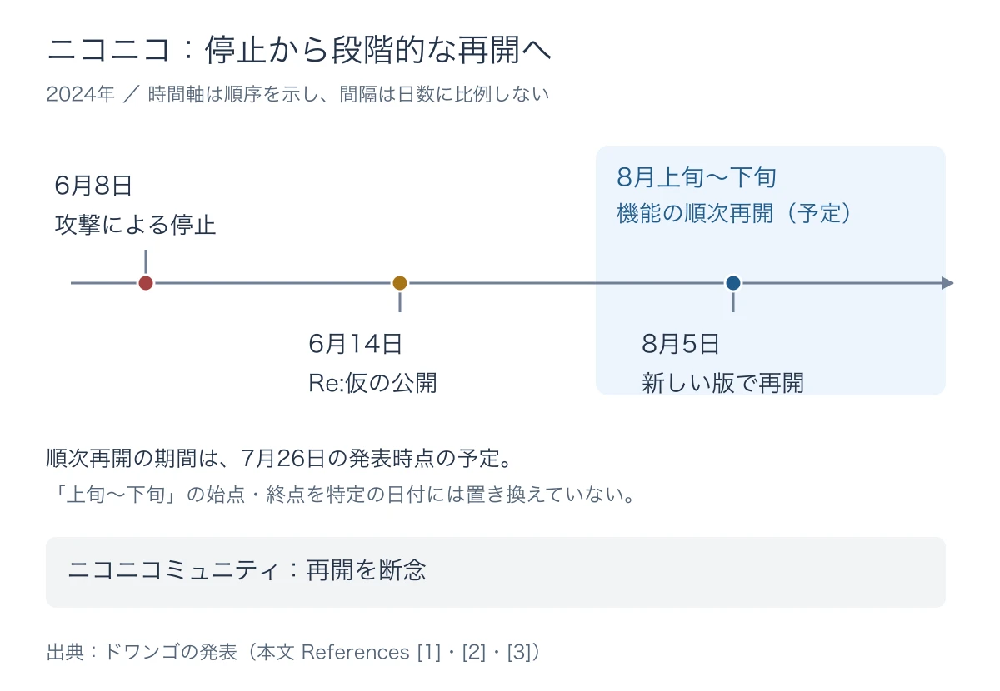

# 止まっている間、何を残し、どの時計を止めるか――ニコニコの段階的な再開とFFXIVの自動撤去停止から、停止中の仕様を考える

[第3回](external-dependency-inventory-when-partners-stop.md)では、ゲームが頼る外部サービスや委託先を、機能ごとに書き出した。その依存先が止まったとき、次に考えるのは「どこまでサービスを続けられるか」である。

サービスをすべて止めるほかに、使える機能に絞って運営を続ける選択肢がある。これを **縮退運転** と呼ぶ。購入は止めても遊べるようにする、ログインが使えなくても公開情報を読めるようにする、といった形だ。

一方、遊ぶ入口が閉じても、ゲームの中の期限は進みうる。イベントが終わり、連続ログインが途切れ、長期間利用されていない家が回収される。プレイヤーが行動できない間に、行動しなかったことによる損失だけが生じる場合がある。

本稿の問いは、 **「止まっている間、何を残し、どの時計を止めるか」** である。2024年のニコニコの段階的な再開と、『ファイナルファンタジーXIV』（以下、FFXIV）のハウジング自動撤去カウンターの一時停止から、停止中と再開時の仕様を考える。

***

## ニコニコは、見ることとコメントすることから戻した

### ログインに頼らない臨時サービス

2024年6月8日、ニコニコはランサムウェアを含む大規模なサイバー攻撃によって、サービス全般が利用できなくなった。ランサムウェアは、データを使えなくするなどして身代金を要求する不正なソフトウェアである。ドワンゴは被害への対応と復旧を進めながら、6月14日15時に「ニコニコ動画（Re:仮）」を公開した。[[1](#ref-1)]

「Re:仮」は、社内の開発チームが停止後に3日で作った臨時サービスである。2006年のサービス開始当初の動画視聴とコメント機能を模し、2007年に人気だった作品を中心に、選ばれた一部の動画だけを見られるようにした。動画を絞った理由には負荷への配慮があり、アカウントなしで利用できた。 **平時から用意されていた縮退版を切り替えて動かした事例ではない。** [[1](#ref-1)]

当時はニコニコのサービス全般に加え、外部サービスでのニコニコアカウントによるログインも止まっていた。[[1](#ref-1)] その状況で、アカウントによる認証に頼らず、動画を見てコメントを交わす体験を先に戻した、と読める。すべての機能が戻るまで待つ間にも、利用者が触れられる部分を作ったのである。

### 無事なデータと、先に戻す相手

この選択を支えたのが、データの置き場所である。ニコニコは、パブリッククラウドと、KADOKAWAグループのデータセンター内に構築されたプライベートクラウドを併用していた。 **パブリッククラウド** は、事業者が広く提供するサーバーなどの計算資源をネットワーク経由で使う仕組み、 **プライベートクラウド** は、特定の組織向けに用意されたクラウド環境である。 **データセンター** は、サーバーや通信設備をまとめて設置・運用する施設を指す。

攻撃を受けたのは後者だった。一方、投稿された動画データやニコニコ動画の映像配信システムはパブリッククラウド上にあり、被害を受けていなかった。[[1](#ref-1)] 動画データが残っていたことが、視聴の体験を先に戻すための土台になった。

戻す順番には、利用者の違いも表れている。ドワンゴの6月14日の発表では、N予備校はN高等学校・S高等学校の生徒向けには復旧済みとされていた。[[1](#ref-1)] 同じサービス名の中でも、誰が何のために使う機能を先に戻すか、という単位で考えられる。

### 再開は段階ごとに進み、戻らない機能もあった

ニコニコ動画は8月5日、新バージョン「帰ってきたニコニコ」として再開した。[[2](#ref-2)] 再開は、機能ごとに段階を分けて進める計画だった。

7月26日の公式発表は、ユーザー生放送を8月上旬、ニコニ広告・ギフトを8月中旬、プレミアム会員の入退会を8月中旬から決済手段ごとに、ニコニコチャンネルを8月中旬〜下旬に順次再開する予定として示した。「Re:仮」も、新しい版への移行に伴って終了する方針だった。これらの時期は、その発表時点での再開予定である。[[3](#ref-3)]

一方、ニコニコミュニティは、復旧に必要なデータとシステムの消失により、再開を断念した。[[3](#ref-3)] 復旧の案内には、「待てば戻るもの」と「戻らないもの」の両方が含まれていた。

出典：ドワンゴの発表を基に作成。[[1](#ref-1)][[2](#ref-2)][[3](#ref-3)]

停止中の料金については、6月14日の時点で、プレミアム会員などの6月・7月の月額料金を補償する方針が示された。その後、7月26日の発表では対象期間が8月分まで延長された。[[1](#ref-1)][[3](#ref-3)] 補填の対象や判断の整理は、[障害時の補填を考える記事](live-service-game-incident-compensation-framework.md)で扱っている。

この事例から仕様へ持ち帰れるのは、残せる体験を機能ごとに考える視点である。停止後に作られた「Re:仮」と同じ対応を、どのサービスでも実行できるとは限らない。平時に縮退の候補を書いておけば、停止中に「何を残したいか」から一つずつ決める手間を減らせる。

***

## 残せる範囲は、エンジニアの見立てと突き合わせる

無事なデータがどこまであるか、残った仕組みを安全に使えるか、機能を切り離して動かせるか。こうした判断には、ゲーム側のエンジニアや基盤を担当する技術者の見立てが要る。

ITmedia NEWSが伝えたドワンゴの説明では、冗長構成やバックアップは用意されていたものの、データセンター内のサーバーがすべて使えなくなる事態は想定を超えていた。ニコニコ動画やニコニコ生放送は、システムを一から作り直すような規模の作業が必要だと説明された。[[4](#ref-4)]

**冗長構成** は、一部が故障しても別の機器や経路で動かせるよう、仕組みを複数用意することだ。 **バックアップ** は、失ったデータなどを戻せるように保存しておく複製である。備えがどこまで機能するかは、被害の範囲と復旧に使える環境に左右される。

プランナーの持ち場は、プレイヤーにとって残したい機能と、その優先順位の候補を用意することだ。「購入より、手持ちのキャラクターで遊べることを先に」「対戦を止めるならランキングも止めたい」といった要求を示し、エンジニアが示す実現可能な範囲と突き合わせる。

たとえば「ソロプレイだけ残す」という案でも、開始時の認証や終了時の報酬保存が止まった仕組みに頼っていれば、そのままでは成立しない。残す機能が、止める機能を呼び出す場面まで確かめる必要がある。

[第1回](it-team-to-players-no-impact-statement-capcom-2020.md)で扱った、情シスやエンジニアの説明を受けてプレイヤーへ伝える流れもここにつながる。まず安全に提供できる範囲を確かめ、その範囲を利用者の行動に結びつく言葉にする。

***

## ゲームの中の「時計」を棚卸しする

縮退する機能を決めたら、その機能に結びつく期限も書き出す。止めるのはサーバーの時刻全体ではなく、イベント終了や資産回収などを判断する個々の仕組みである。

扱いの候補は、大きく三つに分けられる。残り時間の消費を **止める**、終了日時や受け取り期限を **延ばす**、動かせる機能との関係から **そのまま進める**、である。次の表は、特定のゲームの実例ではなく、仕様を点検するための記入例だ。

| 時計を持つ要素 | プレイヤーに起こりうること | 決めておく扱いの例 |
|---|---|---|
| イベント期間 | 遊べない間に参加・報酬受け取りが終わる | 進行を止め、再開後の参加期間と受け取り期間を延ばす |
| ログインボーナスの連続日数 | ログインできない日が連続記録を切る | 停止中の日を失敗扱いにせず、連続判定を止める |
| スタミナ | 自然回復が上限に達し、その後の回復分を使えない | 回復をそのまま進めるか、別の受け取り方法を用意するか決める |
| シーズンパス・月額の利用期間 | 有料で利用できる時間だけが減る | 利用不能の範囲に応じて期間を延ばす |
| 期限付きの無償通貨 | 使う機会がないまま失効する | 失効処理を止めるか、期限を延ばす |
| 期間限定の販売 | 買えない間に販売が終わる | 購入を止め、再開後の販売期間を決める |
| ランキング | 遊べる人だけが記録を更新する | 記録更新を止め、結果の確定方法を別途決める |
| 放置への罰・資産回収 | 行動できない間に所有物を失う | 回収までのカウンターを止める |

全部を一律に延ばせば済むわけではない。遊べる人と遊べない人が混在するランキングでは、単純な延長が参加機会の差を広げることもある。どの機能が、誰にとって、どれだけ使えないかと合わせて決めたい。[ログインボーナスの記事](login-bonus-retention-tips.md)で扱う継続の仕組みも、ログインできない期間をどう数えるかまで含めると、停止中の仕様につながる。

### FFXIVでは、家を失うまでの時計を止める

FFXIVのハウジングは、ゲーム内の土地に家を建て、家具などを配置して自分たちの場所を作る遊びである。個人の家に加え、フリーカンパニー（プレイヤーの集まり）が所有する家もある。

2015年に更新された公式の自動撤去の説明では、現実の時間で45日以上、個人の家なら所有者、フリーカンパニーの家ならそのメンバーの入室がない場合に、家と土地が撤去の対象になる。土地を買ってから45日以上、家を建てていない場合も対象だ。長期間使われていない土地を、ほかのプレイヤーが利用できるようにする仕組みである。[[5](#ref-5)]

撤去されると家は失われる。同じ説明では、再設置可能な庭具・調度品と、購入時の土地価格の80％分のゲーム内通貨を回収できるとされている。建築物権利証書や外装、個室、地下工房とその中の資産、撤去時に消滅する庭具・調度品は回収できず、撤去から35日が経過すると回収可能だったものも受け取れなくなる。[[5](#ref-5)] 家を持っていた状態が、そのまま保存されるわけではない。

土地の販売には、2022年のパッチ6.1で抽選方式が加わった。現在の公式ガイドは、先着方式と抽選方式を案内し、それぞれにフリーカンパニー用・個人用・制限なしの区分を示している。また、自動撤去で空いた土地にも、先着販売では一定時間、抽選販売では次の応募期間まで、購入や引越ができない時間が設けられる。[[6](#ref-6)] 撤去された土地を別のプレイヤーが購入すれば、元の所有者が同じ住所に戻れる保証はない。

編者の実感では、ハウスを持つには相当のプレイ時間とゲーム内資産を投じる必要がある。ライトプレイヤーである編者は、まだ土地の入手に至っていない。それだけに、ようやく手に入れた土地に家を建てた人が、遊びに戻れない間にその場所を失うことの重さを感じる。家具や通貨を一部回収できても、築いた場所をそのまま取り戻せるとは限らない。

### 原因と影響に合わせて、停止の範囲を変える

FFXIVは、プレイヤーが遊びに戻りにくい状況に応じて、自動撤去カウンターを一時停止してきた。

| きっかけ | 停止と再開の案内 | 止めた範囲 |
|---|---|---|
| 新型コロナウイルスの感染拡大 | 2020年3月に停止 | 全ワールド [[7](#ref-7)] |
| 能登半島地震 | 2024年1月4日に停止。7月16日のパッチ7.01で再開と案内 | Elemental・Gaia・Mana・Meteor配下の全ワールド [[8](#ref-8)][[9](#ref-9)] |
| 北米のハリケーン・ヘリーン | 2024年10月2日に停止 | Aether・Crystal・Dynamis・Primal配下の全ワールド [[10](#ref-10)] |
| PHPの重大な脆弱性への対応 | 2026年10月22日に停止。26日17時に再開と告知（日本時間） | 全ワールド [[11](#ref-11)][[12](#ref-12)][[13](#ref-13)] |

ここで挙げたElementalなどは、プレイヤーが利用するワールドを束ねるデータセンターの名称である。能登半島地震では日本の、ハリケーン・ヘリーンでは北米のデータセンター配下のワールドを対象に止めた。設備そのものの被災を示す区分ではなく、プレイヤーへの影響を踏まえた停止範囲である。両告知とも、災害による被害その他の要因を考慮したとしている。[[8](#ref-8)][[10](#ref-10)]

一方、PHP対応では全ワールドの新規ログインが止まったため、自動撤去カウンターも全ワールドで停止された。新規ログイン停止の告知は10月22日1時38分、カウンター停止の公式Bluesky投稿は1時52分で、告知の間隔は14分である。これは実際の停止開始時刻同士の差ではない。[[11](#ref-11)][[12](#ref-12)] 詳しい経緯は[PHP対応の緊急メンテナンスの記事](php-emergency-maintenance-who-decides-to-stop.md)で扱っている。

これらは、原因と影響の範囲に合わせて、保護の範囲を変える運用と読める。また、PHP対応の告知が短い間隔で続いたことからは、カウンターを止める手順が前もって用意されていたことがうかがえる。社内でどう判断したかまでは、告知からは分からない。

***

## 縮退のメニューを、平時に仕様へ書く

機能と時計を一緒に並べると、停止中の運営を具体化できる。

以下は、架空のオンラインRPG「灯台の旅団」を想定した記入例である。このゲームにはソロ探索、協力戦、ランキング、アイテム購入があり、ソロ探索の認証・報酬保存と協力戦の仕組みを切り離せる設計を前提とする。各段階へ移れるかどうかは、エンジニアが安全性と動作を確認して決める。

| 段階 | 残す機能 | 止める機能 | 時計の扱い |
|---|---|---|---|
| 購入だけ止める | ソロ探索・協力戦・所持品の利用 | 課金と購入処理 | 販売期限を延ばす。通常の遊びに関する時計は原則そのまま |
| ソロプレイに絞る | ソロ探索とその報酬保存 | 協力戦・ランキング更新・購入 | 協力イベントとランキングを止める。関連するパスの期間を延ばす |
| 閲覧だけにする | 安全な時点で保存した所持品・進捗の閲覧 | プレイ・報酬受領・所持品変更・購入 | イベント、通貨失効、放置による回収を止め、連続ログインの失敗判定も止める |
| 告知だけにする | ゲーム基盤とは別に用意した公開告知 | ゲームへのログインと全機能 | 閲覧段階の保護に加え、月額などの利用期間を延ばす |

段階は、必ず上から順に移るものではない。認証基盤が使えなければ、購入だけ止める案を飛ばして、告知だけにする判断もありうる。

閲覧だけ残す場合にも、表示した所持品や進捗がいつの状態かを示す必要がある。また、「閲覧できた」ことを「通常どおり遊べた」と数えるかは別の判断だ。画面を開けても、家を維持するための入室やイベントの進行ができなければ、その時計を進める根拠にはならない。

時計の停止や期限の延長は、運営がサーバー側で操作できるようにしておく。対象の地域・ワールド・機能を選べること、止めた時点の残り時間を記録すること、切り替えの結果を確かめられることまで、エンジニアと仕様に落とす。停止中に操作する経路も、故障した認証や管理画面に頼りきりになっていないか確認したい。

[期間限定イベント設計の記事](limited-time-event-design-practices.md)の「途中終了や延長に備える」は、短い障害などでのイベント延長と判断者の準備につながる。本稿で広げたいのは、数週間に及ぶ停止や、一部の機能だけで続ける場合である。再開日をずらすだけでなく、その間に何ができ、何が失われずに残るかを仕様として持つ。

***

## 戻すときにも、残り時間と行動を案内する

### 時計を再開する前に、戻れる時間を設ける

FFXIVの能登半島地震とハリケーン・ヘリーンに伴う停止告知は、カウンターを再開するときは、停止時点の残り時間から進むと説明した。また、すでに自動撤去の準備状態になっていても、ハウスに入るか、土地に家を建てることで取り消せると案内していた。[[8](#ref-8)][[10](#ref-10)] 個人の家なら所有者、フリーカンパニーの家ならそのメンバーの入室が解除に必要である。[[5](#ref-5)]

つまり、停止期間の分だけ残り時間を減らさずに守りつつ、戻ったプレイヤーが撤去を取り消すための行動も示していた。最初から全員に同じ日数を与え直す方式とは異なる。

PHP対応時には、10月22日21時16分ごろに新規ログインが再開された。[[14](#ref-14)] 同日21時48分には、カウンターは26日17時に再開すると事前告知した。ログイン再開からカウンター再開まで、日を置く運用だった。[[13](#ref-13)] 能登半島地震に伴う停止の再開告知では、カウントがメンテナンス中に再開され、残り日数によってはその間に撤去される可能性も明記された。[[9](#ref-9)] 再開時刻と、プレイヤーが行動できる時間の関係まで案内する必要がある。

### 機能ごとの再開状況を、プレイヤーの判断につなぐ

ニコニコの段階的な再開では、機能ごとの予定と、再開を断念したサービスが分けて示された。[[3](#ref-3)] ゲームでも「復旧しました」の一言にまとめず、利用者が次に何をできるかへ分解したい。

- どの機能が、いつから使えるか。利用経路やワールドで違いがあるか。
- 止めていた時計は、いつ、どの残り時間から進むか。
- 自分の残り期限や保存された進捗を、どの画面で確かめられるか。
- 損失を避けるために、入室や報酬受領などの行動が必要か。
- 戻らない機能やデータは何か。別途案内する事項は何か。

画面で残り時間を確認できるなら、その場所を告知から案内する。確認機能もまだ使えないなら、その状態で期限を進めてよいかを判断し直す。 **止めることと同じくらい、戻す条件を前もって知らせることが大切である。**

利用できなかった期間への補填は、[補填の記事](live-service-game-incident-compensation-framework.md)のように対象と根拠を整理して伝える。その前提となる技術上の確認は、[第1回](it-team-to-players-no-impact-statement-capcom-2020.md)で扱った説明の流れに沿って、確認済みの範囲と今後案内する事項を分ける。

***

## 停止中の仕様も、ゲームの仕様である

ニコニコの事例は、無事なデータと仕組みを使い、体験の一部から戻す選択を示している。FFXIVの事例は、遊びに戻れない期間に、プレイヤーの資産を失わせる時計を止める選択を示している。

平時に書いておきたいのは、残したい機能の候補、止める・延ばす・進める時計、その対象範囲、そして再開時に伝えることだ。プランナーが優先順位を用意し、エンジニアと実行できる形にする。

**「止まっている間、何を残し、どの時計を止めるか」** を平時に仕様として書いておくことが、停止中のプレイヤーの損失を小さくする。

次回、第5回は「アカウント乗っ取りとフィッシング」を扱う。

## References

1. [ドワンゴ「当社サービスへのサイバー攻撃に関するご報告とお詫び」][1] — ドワンゴ、2024年6月14日。停止の経緯、システムと動画データの影響範囲、Re:仮、N予備校、補償方針。

[1]: https://dwango.co.jp/download/5095930952941568/

2. [ドワンゴ「8月5日15時、ニコニコが再開 新バージョン名は『帰ってきたニコニコ』」][2] — ドワンゴ、2024年8月5日。

[2]: https://dwango.co.jp/news/5137977441255424/

3. [ドワンゴ「～ニコニコ動画が8/5に再開、新バージョンに～ ニコニコの復旧状況およびサービス停止に伴う補償について」][3] — ドワンゴ、2024年7月26日。KADOKAWA公式サイト掲載の発表資料。機能ごとの時期は発表時点の予定。

[3]: https://group.kadokawa.co.jp/information/media-download/1366/c6cbfa26fb96e9b6/

4. [吉川大貴「ニコニコを襲ったサイバー攻撃の全体像まとめ 動画データは無事か、復旧に1カ月かかる理由は」][4] — ITmedia NEWS、2024年6月14日。冗長構成・バックアップと復旧規模についてのドワンゴの説明を参照。

[4]: https://www.itmedia.co.jp/news/article/2406/14/1240614183/

5. [スクウェア・エニックス「土地／ハウスの自動撤去について」][5] — The Lodestone、2015年10月20日更新の説明。現行の仕様と異なる可能性がある。撤去対象、準備の解除、撤去後の回収を参照。土地の販売方式と自動撤去後の購入・引越制限は現行の購入ガイド（[[6](#ref-6)]）による。

[5]: https://jp.finalfantasyxiv.com/lodestone/topics/detail/f46839170d13fa5afdb826f2623bd68a290e2f45

6. [スクウェア・エニックス「土地追加・購入ガイド」][6] — The Lodestone、2026年10月30日確認。パッチ6.1での抽選方式追加と、先着・抽選の販売区分を参照。

[6]: https://jp.finalfantasyxiv.com/lodestone/playguide/contentsguide/housing_land/

7. [スクウェア・エニックス「Temporary Suspension of Automatic Housing Demolition」][7] — The Lodestone、2020年3月。新型コロナウイルスの感染拡大に伴う全ワールドでの停止。本文の大意は本稿による。

[7]: https://fr.finalfantasyxiv.com/lodestone/news/detail/8d673e933d41c36d770b83171b211113e4ab392f

8. [スクウェア・エニックス「Temporary Suspension of Automatic Housing Demolition」][8] — The Lodestone、2024年1月4日。能登半島地震に伴う停止。停止日時は1月4日3時23分（PST）、日本時間では同日20時23分。本文の大意は本稿による。

[8]: https://na.finalfantasyxiv.com/lodestone/news/detail/f16f73706038fcacfe744a76f79d58aee49e7344

9. [スクウェア・エニックス「[続報]ハウジングの自動撤去カウンター 再開のお知らせ(7/10)」][9] — The Lodestone、2024年7月10日。日本データセンターも予定どおりパッチ7.01から再開すると案内。

[9]: https://jp.finalfantasyxiv.com/lodestone/news/detail/de7281d28d63918b0420b1cc8e71580311698ec4

10. [スクウェア・エニックス「Temporary Suspension of Automatic Housing Demolition」][10] — The Lodestone、2024年10月2日。ハリケーン・ヘリーンに伴う停止。停止日時は10月2日1時8分（PDT）、日本時間では同日17時8分。本文の大意は本稿による。

[10]: https://na.finalfantasyxiv.com/lodestone/news/detail/ba09171e22be42e7fc0eacb40cc1acf0b50ae326

11. [スクウェア・エニックス「全ワールド 新規ログイン一時停止のお知らせ(10/22)」][11] — The Lodestone、2026年10月22日1時38分（日本時間）。

[11]: https://jp.finalfantasyxiv.com/lodestone/news/detail/d9b4c1cf9d163fd1e4133bf615e7ed7e80b4aff2

12. [FINAL FANTASY XIV／FF14「新規ログインが停止されたことに伴い、全ワールドでハウジング自動撤去カウンターを停止いたしました。」][12] — 公式Bluesky、2026年10月22日1時52分（日本時間）。

[12]: https://bsky.app/profile/jp.finalfantasyxiv.com/post/3myfmdkxngs2c

13. [スクウェア・エニックス「ハウジングの自動撤去カウンター再開のお知らせ(10/22)」][13] — The Lodestone、2026年10月22日21時48分（日本時間）。26日17時の再開を予告。ログイン再開の経緯は本文からリンクしたPHP対応の記事を参照。

[13]: https://jp.finalfantasyxiv.com/lodestone/news/detail/8f253ab2452ca6e374677f7bc847b49b9b9317d4

14. [スクウェア・エニックス「[続報]全ワールド 新規ログイン再開のお知らせ(10/22)」][14] — The Lodestone、2026年10月22日。時刻は日本時間。

[14]: https://jp.finalfantasyxiv.com/lodestone/news/detail/f4889d558e4ae44695c87cafd4daaaf57ffdcb58

----

この文書は、Perplexity、Claude、ChatGPT の3つのAIの支援を受けて著述されたものです。引用画像を除き、MIT License にて提供されています。
