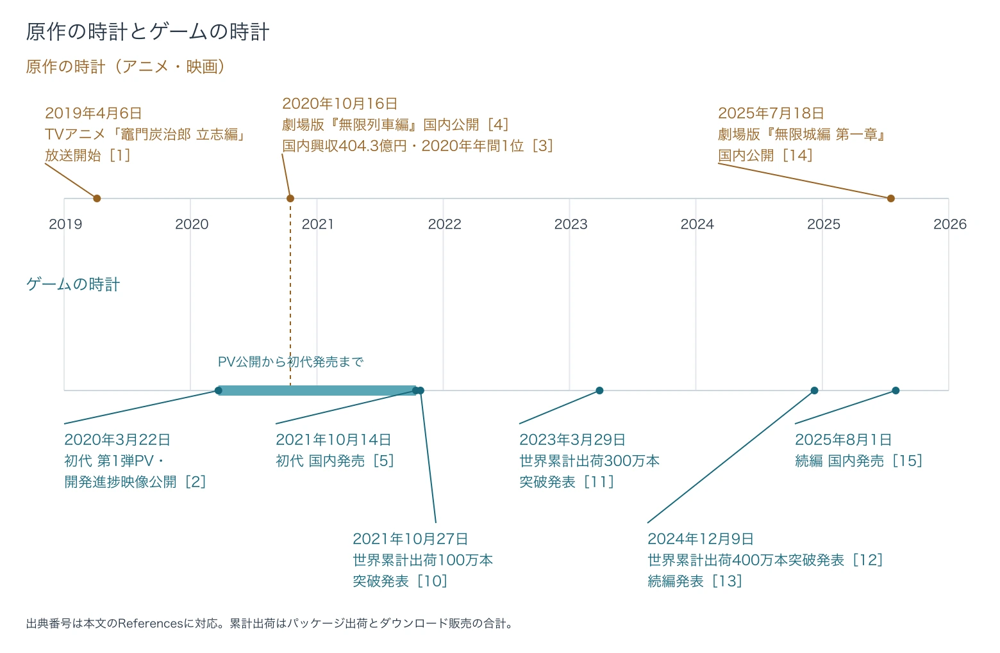
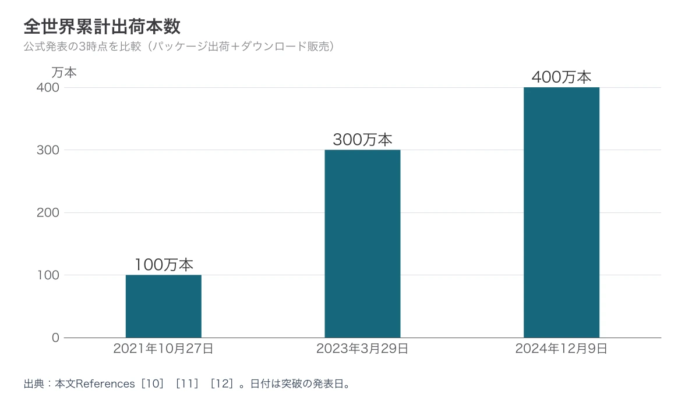

# 『鬼滅の刃 ヒノカミ血風譚』は、なぜ急拡大したアニメIPをゲームへ着地させられたのか――協働とタイミングの成功事例

> 2026年11月26日改版：続編『鬼滅の刃 ヒノカミ血風譚2』の発売を反映し、図版を差し替えて、最新の情報に更新しました。内容の変更はGitの履歴から追えます。

ゲームを作っている途中で原作アニメの映画が記録的なヒットを飛ばしたら、発売を待つ人は何を遊びたくなるのか。『鬼滅の刃 ヒノカミ血風譚』の第1弾PVが出た年、劇場版『無限列車編』が公開され、ゲームは発表時よりも大きな期待を背負うことになった。

その期待をたどる手がかりは、技を出した瞬間の画面と、店頭に並ぶ商品にある。サイバーコネクトツーがゲームの中で呼吸の技を動かし、アニメを手がけたufotableの描き下ろしが告知や購入特典に使われた。発売時の批評では戦闘演出やアニメ再現が評価される一方、ストーリーモードの短さや対戦の奥行きには留保がついた。対戦の競技性を突き詰めることと、急成長したIPの「顔」を発売時の期待に間に合わせること。その優先順位を、公開から発売までの時間と、アニメ制作側との接点からたどる。

「他メディアIPのゲーム化 成功・失敗事例シリーズ」第3回。前回は[『Marvel's Avengers』は、なぜ大型IPをゲームとして定着させられなかったのか――座組みから読む失敗事例](marvel-avengers-crystal-dynamics-ip-adaptation-failure-case-study.md)で、大型IPとゲームの運営構造のかみ合わせを見た。

***

## 開発中に変わった前提：2019年のアニメ化から、2021年の発売まで

TVアニメ「鬼滅の刃」竈門炭治郎 立志編は2019年4月6日に放送が始まった。[[1](#ref-1)] アニメーション制作を手がけたのはufotableである。家庭用ゲーム『鬼滅の刃 ヒノカミ血風譚』の第1弾PVと開発進捗映像が公開されたのは、2020年3月22日である。[[2](#ref-2)]

約7か月後の2020年10月16日、『劇場版「鬼滅の刃」無限列車編』が国内で公開された。日本映画製作者連盟の2020年興行統計では、国内興行収入404.3億円で年間1位である。[[3](#ref-3)][[4](#ref-4)] アニプレックスも国内歴代1位と世界累計約517億円を報告した。[[4](#ref-4)] ゲームの開発中に、原作アニメが国内史上最大級の映画興行を持つIPになったのである。

映画のヒットで観客が増え、声や音楽、カメラの動き、技の軌跡まで覚えている人がゲームを迎えることになった。ゲームは国内で2021年10月14日に発売され、ソロプレイではTVアニメの「竈門炭治郎 立志編」から劇場版「無限列車編」までを扱った。[[5](#ref-5)] 映画館で見た戦いが、そのままゲームで体験する場面の比較対象になったのである。

***

## ufotableの視覚言語を、操作できる画面へ移す

『鬼滅の刃』において、呼吸の技は、画面を見た瞬間に作品が分かる目印である。水流が刀筋に沿って走る「水の呼吸」、炎や雷の軌跡、奥義の直前に切り替わる構図は、原作アニメの体験そのものに含まれる。ゲームでは、プレイヤーがボタンを押してから技が出るまでの短い時間に、その見覚えのある動きを立ち上げる必要がある。

サイバーコネクトツーは、Unreal Engine 4上でアニメ作品のビジュアルを再現するため、内製ツールを含むエフェクト制作を行った。技術講演の記録では、シネマティクスにUE4標準と内製を合わせた7種類のポストエフェクトを用い、被写界深度やBloomもシーンごとに使い分けたことが示されている。[[6](#ref-6)] 入力への反応、カメラ、攻撃が当たる範囲、相手との距離、処理負荷を考えながら、技の軌跡と画面の密度を保つ必要がある。

原作アニメスタジオとの接続も、商品体験の一部になった。アニプレックスは、ufotable描き下ろしのイメージビジュアルを週刊少年ジャンプの誌面で紹介し、早期購入特典のクリアファイルにも使った。[[7](#ref-7)] アニメ側が提供する視覚資産を、ゲームのプロモーションと商品へ直接組み込むことで、サイバーコネクトツーのゲーム内表現と同じ「アニメ版らしさ」の基準で接続した。これは、受け手の認知を途切れさせない設計だった。

この「エフェクトという名の顔」は、実写IPにおける俳優の顔に近い。ファンが最初に照合するのは、細かな数値バランスより、技を出した瞬間に水、炎、雷が自分の知っている『鬼滅の刃』として見えるかである。その見覚えを、キャラクターの3Dモデル、技のエフェクト、カメラが一緒になって支えている。

画像出典（引用）：[ゲーム「鬼滅の刃 ヒノカミ血風譚」公式サイト「ゲーム概要」](https://game.kimetsu.com/hinokami/)（アニプレックス）。掲載画面は開発中のもの。©吾峠呼世晴／集英社・アニプレックス・ufotable ©「鬼滅の刃 ヒノカミ血風譚」製作委員会

***

## 原作再現を優先したことの利益とコスト

発売時のGAME Watchのレビューは、原作の戦いを再現する特殊アクション、ソロプレイでの物語理解、バーサスモードでの戦略性を高く評価した。[[8](#ref-8)] 一方、海外レビューでは、派手なボス戦とカットシーンが評価され、ストーリーモードの短さやコンテンツ量、対戦の奥行きには留保が置かれた。[[9](#ref-9)]

二つの評を並べると、名場面を操作する面白さと、繰り返し対戦する面白さに、それぞれ異なる作り込みが要ることが見えてくる。本作のソロプレイは、原作の印象的な局面を、探索、会話、ボス戦、演出でつなぐ。そこでは、初見の視聴者にも物語を追わせ、既存ファンには「ここを操作したかった」と思わせることが第一の成果になる。対して長く対戦し続けるアクションには、キャラクター数、読み合い、調整、練習の余地、対戦環境を積み上げる必要がある。

両方を最高水準にするには、それぞれに大きな制作コストと検証期間が要る。本作は、アニメの見せ場を濃く移植する方を優先し、ストーリーの長さや対戦の厚みで制約を受け入れた。この取捨選択は、アニメの見せ場を遊びたいファンが発売日に手に取る理由を作るうえで合理的だった。

企画の初めに、「忠実さ」と「ゲームとしての深み」は別々の問いで確かめたい。原作を知る人は、技を出した瞬間に見覚えのある動きだと感じるか。対戦を続けた人には、次の一戦で試したい選択肢が残っているか。どちらを発売時の約束の中心に置くかで、制作や検証にかける時間も変わる。

***

## 商業的結果：初動を継続的なシリーズへつないだ

初代の国内発売から13日後の2021年10月27日、全世界累計出荷100万本の突破が発表された。[[10](#ref-10)] アニプレックスは2023年3月29日に300万本、2024年12月9日に400万本の突破を発表した。[[11](#ref-11)][[12](#ref-12)] この累計にはパッケージ版の出荷とダウンロード版の販売が含まれる。アニメで見た場面を遊べる作品は、発売直後から数年にわたって手に取られた。

セガは2024年12月9日に続編『鬼滅の刃 ヒノカミ血風譚2』を発表した。[[13](#ref-13)] 翌年の2025年7月18日に『劇場版「鬼滅の刃」無限城編 第一章 猗窩座再来』が国内で公開され、[[14](#ref-14)] 2週間後の8月1日にゲームの続編が国内で発売された。ソロプレイは「遊郭編」「刀鍛冶の里編」「柱稽古編」を追体験でき、対戦には40体以上のキャラクターが登場する。発売時には、映画の登場キャラクターを対戦に加える有料の「無限城編 第一章」キャラクターパスの発売予定も示された。[[15](#ref-15)]

キャラクターパスは同年10月30日に配信が始まった（キャラクターは順次配信）。[[16](#ref-16)] 初代が「無限列車編」までを収めたあと、テレビで放送された編は続編のソロプレイへ、続編の発売直前に公開された映画のキャラクターは追加コンテンツを通じて対戦へ入った。アニメや映画が先へ進むたびに、ゲームで遊べる範囲も広がるシリーズになったのである。

***

## プランナーへの示唆：急成長するIPの変化を設計へ織り込む

### 1. 原作制作スタジオと、守る表現を早く共有する

アニメ原作では、作品の顔はキャラクター設定表だけに存在しない。エフェクト、撮影、色、音、間の取り方に分散している。ライセンサーから資料を受け、完成物を承認してもらうだけでは、その顔をゲームで再構成するための判断が遅れる。

早い段階で、何をアニメ固有の表現として守るかを原作制作側と共有する必要がある。描き下ろしがあるなら、ゲームの画面、トレーラー、特典を見たときに同じ作品だと伝わるよう、使い方を計画する。共同で作る範囲、監修の判断者、確認の頻度、エンジン上で再現が難しい場合の代替案まで、早めに決めておきたい。

### 2. 文化的ピークは、発売日の追い風であると同時に比較基準を引き上げる

映画の記憶が新しいうちにゲームを出せば、人の関心を集めやすい。その時期に迎える観客が持ち込むのは、映画館で見た画面の記憶でもある。『無限列車編』の後に発売した本作では、呼吸の技や決戦の見せ場を、自分で炭治郎を動かす画面でも期待に応えられる密度で示す必要があった。

企画段階では、原作側の放送・映画・大型イベントの複数シナリオを置きたい。人気が大きく伸びた場合は、発売時に何が比較対象になり、求められる品質の下限がどこまで上がるかを考える。演出の作り込み、ローカライズ、販促素材に手を足せるよう、日程と予算の余力も見積もっておく。

### 3. 原作の顔とゲームの深みは、意図して優先順位を分ける

本作は、アニメの戦闘を操作できることへ大きく投資した。ソロプレイで名場面を体験したい人と、対戦を繰り返して上達したい人では、同じ戦闘でも楽しみにする部分が違う。発売日にどちらの期待を優先するかで、演出と対戦に配分する工数が決まる。

もし独立した対戦ゲームとして長く遊ばせるなら、原作再現に必要な演出資産と並行して、対戦の読み合い、モード、キャラクター追加、調整運営へ投資しなければならない。逆に「名場面を自分で動かす」ことを最優先するなら、ゲーム全体の長さや対戦の奥行きに関する期待を、販売前から正確に置くべきである。

***

## おわりに：変化したIPに、変化しない制作原則で応えた

第1弾PVが出たときと発売日とでは、観客が『鬼滅の刃』と聞いて思い浮かべる画面が変わっていた。その間に、サイバーコネクトツーは呼吸の技を操作できる画面に移し、商品や告知にはufotableの描き下ろしが加わった。開発中に比較基準が上がるなかで、何を作品の顔として届けるかが、ゲーム内外の判断をつないだ。

大型IPのゲーム化では、発売日に遊ぶ人が真っ先に何を期待するかを考えたい。その期待を制作側で共有できれば、映画館で見た刀筋を、自分の操作で画面に描く体験へ変えられる。

次回の[『ザ・ロード・オブ・ザ・リング：ゴラム』は、なぜIPの「独自解釈」をゲームの価値へ変えられなかったのか――適性、ライセンス、実行力から読む失敗事例](lord-of-the-rings-gollum-daedalic-ip-adaptation-failure-case-study.md)では、原作から選び取った題材を、遊びの価値へ変える条件を考える。

***

## References

1. [アニメ「鬼滅の刃」公式サイト「TVアニメ放送情報公開！AbemaTVでは地上波同時・独占先行配信決定！」][1] — アニメ「鬼滅の刃」竈門炭治郎 立志編 公式サイト、2019年2月28日。初回放送日。

[1]: https://kimetsu.com/anime/risshihen/news/?id=49977

2. [アニプレックス「家庭用ゲーム『鬼滅の刃 ヒノカミ血風譚』第1弾PV&開発進捗レポート映像を公開！」][2] — ゲーム「鬼滅の刃 ヒノカミ血風譚」公式サイト、2020年3月22日。

[2]: https://game.kimetsu.com/hinokami/news/?id=56331

3. [日本映画製作者連盟「2020年（令和2年）興行収入10億円以上番組」][3] — 日本映画製作者連盟、2021年1月。国内興行収入と順位。

[3]: https://www.eiren.org/toukei/img/eiren_kosyu/2020.pdf

4. [アニプレックス「『劇場版『鬼滅の刃』無限列車編』全世界累計来場者約4135万人・総興行収入約517億円記録のご報告」][4] — PR TIMES、2021年5月24日。国内公開日と世界累計興行収入。

[4]: https://prtimes.jp/main/html/rd/p/000003008.000016356.html

5. [セガ「セガ、家庭用ゲーム『鬼滅の刃 ヒノカミ血風譚』のアジア・欧米での発売を決定　人気アニメを原作とする家庭用ゲームの世界展開の一翼を担う」][5] — セガ公式サイト、2021年6月28日。開発元、発売日、ソロプレイの収録範囲。

[5]: https://www.sega.co.jp/release/210628_1.html

6. [wvigler「サイバーコネクトツーのエフェクト開発事例ーアニメ作品のビジュアル表現をUE4上で再現した内製ツールなどの技術解説【UNREAL FEST 2022】」][6] — ゲームメーカーズ、2022年8月11日。内製ツールとポストエフェクトに関する講演の記録。

[6]: https://gamemakers.jp/article/2022_08_11_10558/

7. [アニプレックス「家庭用ゲーム『鬼滅の刃 ヒノカミ血風譚』 ufotable描き下ろしイメージビジュアル第2弾公開!!」][7] — アニプレックス オフィシャルサイト、2021年8月10日。誌面での公開と早期購入特典への使用。

[7]: https://www.aniplex.co.jp/lineup/kimetsu_gamehinokami/news/detail/?id=58277

8. [アドえもん「『鬼滅の刃 ヒノカミ血風譚』レビュー」][8] — GAME Watch、2021年10月13日。アクション、ソロプレイ、バーサスモードの評価。

[8]: https://game.watch.impress.co.jp/docs/review/rev1/1356713.html

9. [Robert Ramsey「Demon Slayer: Kimetsu no Yaiba - The Hinokami Chronicles Review (PS5)」][9] — Push Square、2021年10月13日。演出と収録内容の評価。

[9]: https://www.pushsquare.com/reviews/ps5/demon-slayer-kimetsu-no-yaiba-the-hinokami-chronicles

10. [アニプレックス「家庭用ゲーム『鬼滅の刃 ヒノカミ血風譚』全世界累計出荷100万本突破！」][10] — ゲーム「鬼滅の刃 ヒノカミ血風譚」公式サイト、2021年10月27日。

[10]: https://game.kimetsu.com/hinokami/news/?id=58959

11. [アニプレックス「家庭用ゲーム『鬼滅の刃 ヒノカミ血風譚』 全世界累計出荷300万本突破！」][11] — ＠Press、2023年3月29日。

[11]: https://www.atpress.ne.jp/news/4464907

12. [アニプレックス「家庭用ゲーム『鬼滅の刃 ヒノカミ血風譚』全世界累計出荷400万本突破！」][12] — ゲーム「鬼滅の刃 ヒノカミ血風譚」公式サイト、2024年12月9日。累計出荷本数の集計範囲も記載。

[12]: https://game.kimetsu.com/hinokami/news/?id=66782

13. [SEGA「Demon Slayer -Kimetsu no Yaiba- The Hinokami Chronicles 2 Arrives in 2025」][13] — SEGAプレスサイト、2024年12月9日。続編の発表。

[13]: https://sega.prezly.com/demon-slayer-kimetsu-no-yaiba-the-hinokami-chronicles-2-arrives-in-2025

14. [アニメ「鬼滅の刃」公式サイト「『劇場版『鬼滅の刃』無限城編』第一章、2025年7月18日(金)公開決定！　プロモーションリール２０２５やキービジュアルを公開！」][14] — 『劇場版「鬼滅の刃」無限城編 第一章 猗窩座再来』公式サイト、2025年3月1日。国内公開日。

[14]: https://kimetsu.com/anime/mugenjyohen_movie/news/?article_id=67257

15. [アニプレックス「『鬼滅の刃 ヒノカミ血風譚2』 本日2025年8月1日（金）発売！」][15] — ゲーム「鬼滅の刃 ヒノカミ血風譚2」公式サイト、2025年8月1日。発売日、ソロプレイの収録範囲、対戦のキャラクター数、キャラクターパスの発売予定。

[15]: https://game.kimetsu.com/hinokami2/news/?id=68381

16. [アニプレックス「キャラクターパス」][16] — ゲーム「鬼滅の刃 ヒノカミ血風譚2」公式サイト、公開日記載なし。「無限城編 第一章」キャラクターパスの配信日と内容。

[16]: https://game.kimetsu.com/hinokami2/dlc/character-pass.html

----

この文書は、Perplexity、Claude、ChatGPT の3つのAIの支援を受けて著述されたものです。引用画像を除き、MIT License にて提供されています。
