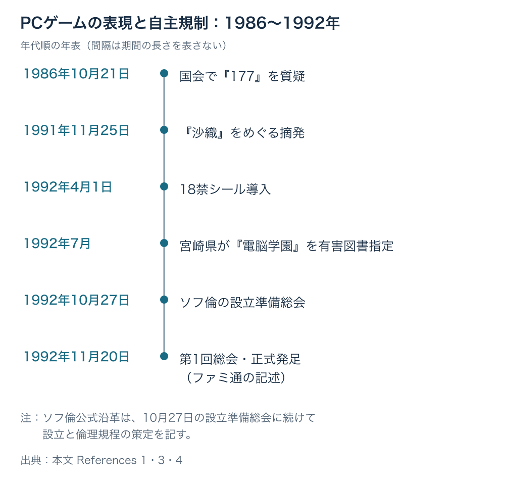

# 国が線を引かないとき、その線は誰が引くか――1986年の国会答弁から、PCゲームの自主規制が生まれるまで

1986年10月21日、衆議院決算委員会。国のお金の使い方を調べるこの委員会で、草川昭三委員は、学校に入るコンピューターの値段を尋ねていた。機種が変わっても同じソフトを使えるかという「互換性」も論点だった。通商産業省と文部省が答えたあと、草川委員は、家庭に入り込むパソコンとテレビゲームへ話を移す。そこで取り上げたのが、PCゲーム『177』だった。会議の発言を文字で残した会議録の、発言165〜169にあたる。[[1](#ref-1)]

本稿は「ゲームと行政のあいだ」第2回である。[第1回](game-and-government-regulation-map.md)では、法律・条例・業界基準などがゲームに届く経路を整理した。今回は一つの質疑を追い、 **国が線を引かないとき、その線は誰が引くか** を考える。

ここでいう「線」は、どの表現を作るか、誰を対象にするか、どこで売るかを決める境界である。国会の問いに対し、それぞれの省庁はどんな道具で答えたのだろうか。

***

## 通産省には業界への指導、警察庁には法令の当てはめを問う

発言169で、草川委員は、保護者から寄せられた心配やゲームの内容紹介を取り上げ、通商産業省に業界への働きかけができるかを問う。学校用機器の導入から、家庭で子どもが触れるソフトへと、同じコンピューターをめぐる問いが移ったのである。[[1](#ref-1)]

答えたのは、近藤隆彦説明員（通商産業省機械情報産業局情報処理振興課長）である。発言170では、業界に自粛を求めることと、年齢制限をわかりやすく表示させることを挙げ、団体を通じて指導する方針を述べた。ここで団体の名前は示されていない。[[1](#ref-1)]

続く発言171で、草川委員は警察庁に刑法の解釈を含む見解を求める。発言172で答える根本芳雄説明員（警察庁刑事局保安部少年課長）は、「一つは刑法に当たるかどうか」と述べた。次に挙げたのが、青少年保護育成条例である。これは、地域の議会が定め、青少年を取り巻く環境などについてルールを設ける条例だ。[[1](#ref-1)]

その道具の一つが「有害図書指定」、つまり、青少年に有害と判断した図書類を指定し、条例に基づく販売制限などの対象にする仕組みである。根本説明員は、中身を検討して法令に当てはめられるかを判断する必要があると述べる。同時に、子ども向けに作らないことや、売り方の自主規制も求めている。警察の答えにも、作り手と販売側の判断が含まれていた。[[1](#ref-1)]

***

## 文部省には教育の対応を問い、大臣へつなぐ

発言173で、草川委員は、ソフトを作ってコピーし、紹介雑誌などを通じて急速に広められることを指摘する。親や周囲が気づくまでに広がるという問題から、子どもの教育を担う文部省へ見解を求めた。[[1](#ref-1)]

発言174の答弁者は、澤田道也政府委員（文部省社会教育局長）である。当時の「政府委員」は、大臣に代わって専門分野の説明や答弁をする官僚を指す。澤田政府委員は、日本パーソナルコンピュータソフトウェア協会を挙げ、業界へ改めて注意を促すことと、PTAなど地域を通じて親への啓発を行うことを述べた。PTAは保護者と教職員による団体であり、社会教育は学校の授業以外で行う学習や地域の教育活動をいう。[[1](#ref-1)]

この答弁には、団体による自主的な取り組みが届く範囲の問題も現れる。澤田政府委員は、その規制の外にいる中小業者のソフトへの対応が難しいことを認めていた。団体への働きかけだけで、すべての作り手を覆えるわけではない。[[1](#ref-1)]

発言175で草川委員が大臣の見解を求めると、発言176で塩川正十郎国務大臣（文部大臣）が答える。表現の自由との兼ね合いで取り締まりの難しさに言及し、まず制作者の自粛を求め、親や周囲の大人が注意を続けるという考えを述べた。[[1](#ref-1)]

四つの答えを、使おうとした道具で並べると、次のようになる。肩書きと引用は会議録による。質疑の全文は国会会議録検索システムで公開されており、答弁の言葉を詳しく確かめたい向きは、参考文献[1]のリンク先の会議録を参照されたい。[[1](#ref-1)]

| 発言番号 | 答えた人（肩書き） | 答えの道具 | 短い引用 |
|---|---|---|---|
| 170 | 近藤隆彦説明員（通商産業省機械情報産業局情報処理振興課長） | 業界への自粛の要請、年齢表示の指導 | 「業界に自粛の要請とか」 |
| 172 | 根本芳雄説明員（警察庁刑事局保安部少年課長） | 刑法、青少年保護育成条例 | 「法令に違反するものはきちんと私どもで対処していく」 |
| 174 | 澤田道也政府委員（文部省社会教育局長） | 業界団体への注意喚起、PTAなどを通じた啓発 | 「社会教育の活動を通じて注意を喚起してまいりたい」 |
| 176 | 塩川正十郎国務大臣（文部大臣） | 制作者の自粛、親と大人の注意 | 「制作する人が自粛をしていただくということがまず第一。」 |

どの答弁も、対応策を既存の法令・条例、業界の自粛、家庭や地域での注意へ戻している。この質疑で新しい法律の制定は示されず、『177』を対象とする新制度が作られる展開にもならなかった。第1回の判断軸、 **その仕様は、どのルールの、どの言葉で読まれるか** が、当時の答弁にも表れている。刑法に当てはめるのか、条例の有害指定として扱うのか、業界への指導で対応するのかで、使う道具が変わるのである。[[1](#ref-1)][[2](#ref-2)]

***

## 『177』の販売を変えたのは、発売元の判断だった

国会の後の経過について、森瀬繚によるファミ通.comの記事は、行政から直接の働きかけはなかったと説明している。同記事によれば、新聞報道による強い非難を受け、発売元のデービーソフトが販売を自粛し、一部を変更した改訂版を出して収束した。同社はその後、このジャンルから撤退した。[[2](#ref-2)]

『177』が「発禁になった」という俗説も、同記事は否定している。[[2](#ref-2)]

国会で問題になること、行政が販売を禁止すること、発売元が販売を自粛することは、それぞれ別の出来事である。この事例で販売の線を引き直した主体として記されているのは、発売元だった。

***

## 1991年、『沙織』の摘発――既存の刑法の言葉で

5年後の1991年11月25日、京都府警少年課は関係会社を家宅捜索し、猥褻文書販売目的所持の容疑で3名を現行犯逮捕した。家宅捜索とは、捜査機関が令状に基づいて会社の事務所などを調べ、証拠を探す手続である。ファミ通.comの別の記事が伝える、成人向けPCゲーム『沙織』をめぐる摘発である。[[3](#ref-3)]

同記事によれば、発端は京都の男子中学生の万引きと補導だった。補導は、警察が少年に注意や指導などを行うことであり、逮捕とは異なる。同記事は、万引きされたソフトを『沙織』とみられるものとして記している。[[3](#ref-3)]

1986年の根本説明員が挙げた「刑法」という道具が、1991年には実際の摘発で使われた。扱われたのは、既存の刑法にある、わいせつな文書などを販売目的で持つ行為である。国会答弁とこの摘発は、時期も対象も異なる。ここでは、1986年の答弁が1991年の捜査を引き起こしたとは位置づけず、既存法を使う対応が後年に現れた例として年代順に置く。[[1](#ref-1)][[3](#ref-3)]

***

## 1992年、18禁シールとソフ倫――業界が線を引く

1992年1月ごろから、メーカーや出版社、日本パーソナルコンピュータソフトウェア協会（パソ協）などが話し合いを始め、4月1日に18禁シールが導入された。ソフ倫の公式沿革にも、警察庁からパソ協に対し、倫理審査機関の設置や審査基準、少年への販売禁止、区分した取り扱いなどを求めたことが記されている。要請の主体は、1986年に国会で答弁した根本説明員と同じ、警察庁の少年課長の職であった。同一人物であるかは確認していない。業界の自主規制は、行政の要請とも接点を持ちながら整えられていった。[[3](#ref-3)][[4](#ref-4)]

1986年の近藤説明員は、すでに「年齢の制限の問題をきちっと、はっきりとわかりやすく書くとか」と答弁していた。その6年後に、18禁シールが導入される。ただし、この時間の並びだけで、答弁がシール導入の直接の原因だったとはいえない。年齢を表示するという対応が、異なる時点の資料にそれぞれ現れているのである。[[1](#ref-1)][[3](#ref-3)]

同年7月には、『電脳学園』が宮崎県から有害図書指定を受けた。ファミ通の記事によれば、対象はパッケージ版ではなく、ソフトの自動販売機「ソフトベンダーTAKERU」で販売された製品だった。年齢表示による自主的な対応と、自治体の条例による指定が、同じ年に並んでいる。[[3](#ref-3)]

10月27日に設立準備総会が開かれ、11月20日の第1回総会でコンピュータソフトウェア倫理機構（ソフ倫）が正式に発足したと、ファミ通の記事は伝える。一方、公式沿革は10月27日の設立準備総会に続けて設立と倫理規程の策定を記している。[[3](#ref-3)][[4](#ref-4)]

出典：国会会議録、ファミ通.com、ソフ倫公式沿革。配置は年代順を示し、期間の長さや因果関係を表さない。[[1](#ref-1)][[3](#ref-3)][[4](#ref-4)]

対象年齢を示す仕組みは、その後も別の領域で整えられていく。第3回では、2002年に設立されたCEROと、その後の販売区分をめぐる経過を扱う。[[5](#ref-5)]

***

## ゲームの企画に置き換える――ここからは考察

国が新しい道具を持たないときにも、表現と販売の判断は必要になる。その線を引く役は、作り手、業界団体、流通や販売店に回ってくる。『177』では発売元が販売を変え、1992年には業界が年齢表示と審査の仕組みを整えていった。既存の法令や条例による線と、作る側・売る側が選ぶ線が、重なり合っている。

プランナーが握れることの一つは、想定する対象年齢を、自分の企画の言葉で説明できるようにすることである。どの表現を誰に届けたいのか、その理由は何か。表示する年齢と、遊んでほしい相手の想定を、企画書の段階でつなげておきたい。

もう一つは、販売経路ごとの基準を把握することである。制作会社が選んだ対象年齢を、販売店がどのように受け取り、誰に販売するかまでが、作品を届ける経路になる。審査の担当者と販売の担当者に、同じ仕様を説明できる状態が必要だと考えられる。

その際、業界団体の基準と、自社が追加で選ぶ判断は分けて記録したい。たとえば、ある表現を変更するとしても、団体の基準に合わせる変更なのか、自社の対象読者に合わせた編集なのかでは、次の企画に引き継ぐ意味が変わる。理由を残せば、基準が変わったときにも判断を見直せる。

ただし、「作り手が引けばよい」という説明だけでは、この歴史を捉えきれない。作り手が引く線は、ゆるくもきつくもなりうる。各社の判断だけでは対象年齢の扱いが揃わず、共通基準を求める理由になる一方、批判を広く見積もって必要以上に表現を狭める可能性もある。

1986年の澤田政府委員が述べた、団体の規制の外にいる中小業者への対応の難しさも残る。共通の線を作ることと、その線がすべての作り手・売り手に届くことは、別の課題である。[[1](#ref-1)]

***

## 自分の企画では、誰が線を引くか

今回の質疑と経過を、自分の企画に持ち帰るなら、次の点を点検できる。

- 想定する対象年齢と、その年齢に向けた表現である理由を説明できるか。
- 既存の法律・条例、業界団体の基準、自社の判断を分けて把握しているか。
- 販売経路ごとに、取り扱いの条件と判断する相手を確認しているか。
- 年齢表示が、宣伝・パッケージ・販売時の扱いで揃っているか。
- 表現を変えた理由と、参照した基準の版・日付を記録しているか。
- 自主的な判断が、対象者への配慮不足や過度な萎縮に傾いていないか。

1986年の答弁は、それぞれの担当者が持つ道具を示していた。その後の摘発や自主規制も、誰が何を根拠に判断するかという問いを残す。自分の作品を作り、届けるときにも、 **国が線を引かないとき、その線は誰が引くか** を考えたい。

## References

1. [衆議院「第107回国会 衆議院 決算委員会 第1号」][1] — 国会会議録検索システム、1986年10月21日。発言165〜176を参照。本文の引用は会議録の表記による。

[1]: https://kokkai.ndl.go.jp/simple/detail?minId=110704103X00119861021&spkNum=169#s169

2. [森瀬繚「エロゲー雑誌が国会の俎上にあがった日。1980年代のアダルトゲーム黎明期事情（後編）【『16bitセンセーション ANOTHER LAYER』連動企画第11回】」][2] — ファミ通.com、2023年12月17日。『177』の販売自粛、改訂版、行政による直接の働きかけがなかったとする説明を参照。

[2]: https://www.famitsu.com/news/202312/17328014.html

3. [森瀬繚「1990年代のPC美少女ゲーム業界と“沙織事件”。成人ゲームと“ソフ倫”の誕生【テレビアニメ『16bitセンセーション ANOTHER LAYER』連動企画 第2回】」][3] — ファミ通.com、2023年10月15日。1991年の摘発、1992年の18禁シール、有害図書指定、ソフ倫の設立過程を参照。

[3]: https://www.famitsu.com/news/202310/15320304.html

4. [コンピュータソフトウェア倫理機構「沿革」][4] — ソフ倫公式サイト、2026年10月27日参照。1992年の行政からの要請、シール、10月27日の設立準備総会と設立・倫理規程策定の記述を参照。

[4]: https://www.sofurin.org/about/details/

5. [船津稔「コンピュータエンターテインメントレーティング機構が説明会を開催」][5] — GAME Watch、2002年7月29日。設立当時の説明会報道。

[5]: https://game.watch.impress.co.jp/docs/20020729/cero.htm

----

この文書は、Perplexity、Claude、ChatGPT の3つのAIの支援を受けて著述されたものです。引用画像を除き、MIT License にて提供されています。
