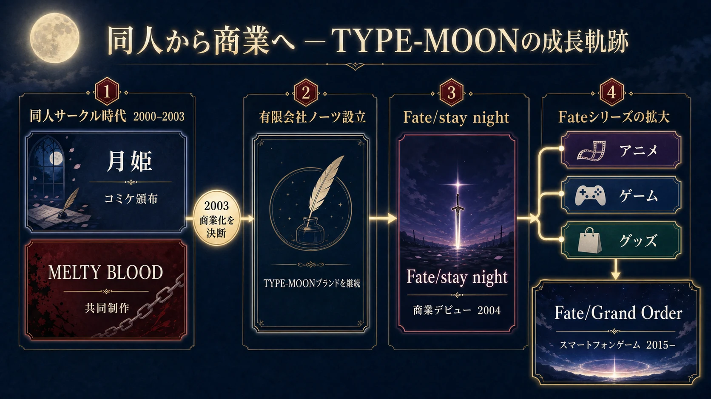

# 同人ゲームの系譜：日本のコミックマーケット文化が育てたゲームたち

> 2026年11月6日改訂：『東方紅魔郷：New Classic』の発売を受けて関連する記述を更新し、あわせて出典と制作体制の記述を見直しました。

***

## はじめに：同人ゲームとは何か

「同人ゲーム」とは、個人や小規模なサークルが自主制作・頒布するゲームの総称である。その文化を考えるうえで重要なのが、 **「作りたいものを作り、同好の人と共有する」という表現の動機** だ。コミックマーケット（通称：コミケ）準備会も、同人誌を中心に多様な表現者を受け入れ、表現の可能性を広げる「場」を理念に掲げている。[[1](#ref-1)]

同人ゲームは「インディーゲーム」と重なる領域を持つが、呼び名にはそれぞれの文化的な背景がある。本稿では、日本の同人誌文化・コミケと結びついたゲームの歴史を整理する。特に東方Project、月姫（TYPE-MOON）、黄昏フロンティア、ひぐらしのなく頃にを中心事例として取り上げ、各作品がどのように誕生し、発展し、文化的影響を及ぼしてきたかを分析する。

***

## 第1章：前史——PC-98時代と同人ソフトの揺籃期（1980年代〜1990年代）

### 1-1. パソコン雑誌から生まれた自主制作文化

日本における自主制作ゲームの歴史は、1980年代のパソコン雑誌文化と深く結びついている。「マイコンBASICマガジン」などには読者が作ったゲームのプログラムリストが掲載され、読者はそれを手入力して遊んだ。ゲームを作る人と遊ぶ人が、誌面を通して作品と技術を共有していたのである。[[2](#ref-2)]

1988年4月には、パソコンゲームソフトの展示イベント「パソケット」が開催された。自作ゲームを雑誌で発表するだけでなく、イベントへ持ち込み、人に見せる場も育っていった。同人ソフトを介して制作者と遊び手が出会う流通は、後のコミケでの頒布にもつながる文化的な土台となった。[[3](#ref-3)]

### 1-2. ブームの終焉とコミケへの収束

初期の同人ソフトブームから次の世代へと移る中でも、コミケなどでの自主制作活動は続いた。やがてPC-98からWindowsへの移行期に東方Projectが、2000年には月姫が登場する。制作環境が変わっても、自分の作品を作り、直接届ける営みは受け継がれた。[[4](#ref-4)][[5](#ref-5)][[6](#ref-6)]

***

## 第2章：年代別発展——1990年代から2010年代の変遷

### 1990年代：PC-98という土壌での発芽

| 出来事 | 内容 |
|--------|------|
| 1990年代 | 初期の同人ソフトブームから次の世代へ移る中で、PC-98などでの自主制作活動が続く[[4](#ref-4)][[5](#ref-5)][[6](#ref-6)] |
| 1996年 | 東方靈異伝が大学の学園祭で発表される[[4](#ref-4)] |
| 1997〜98年 | ZUN SOFT名義で東方封魔録・夢時空・幻想郷・怪綺談を発表[[7](#ref-7)] |
| 1990年代末〜2002年 | 就職を挟んで個人制作から離れた時期を経て、東方紅魔郷で制作を再開[[4](#ref-4)] |
| 2000年 | 12月のコミケ59で月姫を頒布[[5](#ref-5)][[6](#ref-6)] |

PC-98版東方Projectは、大学の学園祭で発表された第一作『東方靈異伝』から始まる。当時は「ZUN SOFT」名義で活動していた。第一作はブロック崩しの要素を持つ作品で、[[8](#ref-8)] 1997年の第二作『東方封魔録』から縦スクロールシューティングへと進んだ。大学祭での展示をきっかけにコミケへ持ち込まれ、頒布されるようになったのである。[[7](#ref-7)][[4](#ref-4)][[9](#ref-9)]

### 2000年代前半：「奇跡の3タイトル」の登場

| 年 | 作品・出来事 | サークル |
|----|-----------|--------|
| 2000年12月 | 月姫コミケ59頒布[[5](#ref-5)][[6](#ref-6)] | TYPE-MOON |
| 2002年 | 東方紅魔郷リリース（Windows移行）[[10](#ref-10)] | 上海アリス幻樂団 |
| 2002年夏 | ひぐらしのなく頃に（鬼隠し編）コミケ62発表[[11](#ref-11)] | 07th Expansion |
| 2002年 | MELTY BLOOD（月姫の対戦格闘ゲーム）発表[[12](#ref-12)] | TYPE-MOON×渡辺製作所 |
| 2003年 | TYPE-MOON、有限会社ノーツを設立し商業化[[13](#ref-13)] | — |
| 2004年1月 | Fate/stay night 商業デビュー[[14](#ref-14)] | TYPE-MOON（商業化後） |

本稿では、この時期を同人ゲームの存在感が大きく広がった節目として捉える。月姫・東方・ひぐらしの三作を並べると、ビジュアルノベル、弾幕シューティング、サウンドノベルという異なる遊び方から、それぞれのファンコミュニティが育ったことが見えてくる。

**東方Projectのプラットフォーム転換** が特に重要だ。ZUNは上海アリス幻樂団としてWindows向け第6作『東方紅魔郷』を2002年に発表した。[[10](#ref-10)] 「スペルカード」は、弾幕に名前を与え、敵の個性と結びつける仕組みである。ZUNは、敵を魅力的に見せるために必殺技のような名前を付けたと説明している。攻略する楽しさと、キャラクターの表現を見る楽しさが結びついた設計といえる。[[4](#ref-4)]

**月姫** は2000年12月のコミケ59で頒布されたビジュアルノベルである。[[5](#ref-5)][[6](#ref-6)] 奈須きのこのシナリオと武内崇のグラフィックを中心に、伝奇的な世界設定を描いた。[[15](#ref-15)] TYPE-MOONはその後、2003年に有限会社ノーツを設立して商業化へ移行した。[[13](#ref-13)]

**ひぐらしのなく頃に** は2002年8月10日のコミケ62で「鬼隠し編」が発表されたサウンドノベルである。竜騎士07を中心とする07th Expansionが制作し、選択肢のない物語を読みながら村の事件を考察する楽しみを育てた。[[11](#ref-11)]

### 2000年代後半：ニコニコ動画と二次創作の大爆発

| 年 | 出来事 |
|----|------|
| 2006年4月 | ひぐらし原作のテレビアニメ放送開始[[16](#ref-16)] |
| 2007年以降 | ニコニコ動画などが同人文化のブーム形成に影響[[1](#ref-1)] |
| 2007年 | 東方風神録リリース（第10作）[[17](#ref-17)] |
| 2000年代後半 | 東方の音楽アレンジや動画など、二次創作を介した受容が広がる[[18](#ref-18)] |

ニコニコ動画は、東方Projectをゲームの外へ広める有力な場となった。音楽アレンジや映像作品が別の創作を呼び、ゲームを遊んだことのない人がキャラクターや楽曲から東方を知る入口にもなった。二次創作が媒体を渡っていくこと自体が、作品との出会いを増やしていったのである。[[18](#ref-18)]

ひぐらし原作のテレビアニメは2006年に放送された。[[16](#ref-16)] 同人ゲームから商業アニメへと接点が広がった事例であり、ゲームを遊ぶ人に加えて、映像を入口にする人にも物語が届くようになった。

### 2010年代：Steam・DLsiteによる流通革命と国際化

| 年 | 出来事 |
|----|------|
| 2010年代 | デジタル配信が個人・小規模チームの作品の流通を広げる[[19](#ref-19)] |
| 2017年 | 上海アリス幻樂団の原作として初めて、東方天空璋がSteamで配信開始[[20](#ref-20)][[21](#ref-21)] |
| 2020年 | 東方LostWordなど、企業による二次創作スマホゲームが展開[[22](#ref-22)] |
| 2021年 | 東方憑依華がNintendo Switch/PS4に登場。発売元はPhoenixx[[23](#ref-23)] |
| 2026年9月10日 | 東方紅魔郷：New Classicのダウンロード版がNintendo Switch/Switch 2/PS5/Steamで発売[[24](#ref-24)] |

2017年の『東方天空璋』のSteam配信は、上海アリス幻樂団の原作をダウンロードで購入する入口を広げた。ZUNはこの決断の背景として、Steamの基準緩和とSteam Directの影響を挙げている。[[20](#ref-20)] DLsiteなどの販売サービスも含め、コミケ会場へ行かなくても作品に触れられる流通が、同人ゲームの届け方を広げた。

***

## 第3章：主要作品の詳細分析

### 東方Project——「一人の宇宙」が生んだコンテンツ帝国

#### サークル構造と制作体制

上海アリス幻樂団は、ZUNが主宰する個人サークルである。原作のシューティング作品では、プログラミング、グラフィック、音楽など制作の主要部分をZUN自身が手掛ける。[[25](#ref-25)] 一方、黄昏フロンティアとの共同制作など、複数の制作者が関わる公式作品も展開されている。[[26](#ref-26)][[27](#ref-27)]

この個人制作を軸とする活動が、東方Projectの独自性を支えてきた。2026年6月には、過去作を現在の環境で遊べるようにするための新サークル「上海アリスReprise」の結成が発表された。ZUNも参加するこのサークルと並行して、上海アリス幻樂団の従来の活動も続けるとされている。[[28](#ref-28)]

#### 二次創作エコシステムの設計

東方Projectの特徴の一つが、 **二次創作を支えるルールと流通** である。公式ガイドラインは個人のファン活動を基本的に認める一方、二次創作であることの明記、素材利用の制限、頒布先などの条件を設けている。企業が営利目的で活動する場合は個別の問い合わせが必要だ。[[29](#ref-29)] こうした枠組みのもとで、漫画、音楽、ゲームなど幅広い創作が育ち、2013年のKAI-YOUの紹介では、東方はコミケのジャンル別サークル数で1位とされていた。[[30](#ref-30)]

2018年4月には、「ニコニコ書籍」と「BOOK☆WALKER」で、東方二次創作の公認電子書籍流通が始まった。[[31](#ref-31)] BOOTHの有料ダウンロード作品に関する公認ルールは2019年8月1日施行で、商品タグに「東方Project」を加え、版権使用料・処理手数料を負担する仕組みである。[[32](#ref-32)] 創作者が利用できる販路と条件を明確にすることが、ファン活動を続ける基盤になっている。

#### コンソール初登場：東方紅魔郷 New Classic（2026年）

2026年6月9日のNintendo Directで発表された『東方紅魔郷：New Classic』は、同年9月10日にダウンロード版が発売された。発売元はAlliance Artsである。[[33](#ref-33)][[24](#ref-24)] 東方Projectの原作シューティングを、家庭用ゲーム機でも遊べるようにした作品だ。

- **『東方紅魔郷』初の公式リメイク**
- **東方原作シューティングのコンソール初登場** （Nintendo Switch / Nintendo Switch 2 / PS5。PCはSteam）
- **ZUN本人によるNew Classic版BGMの全曲アレンジ**
- 発売日：2026年9月10日（ダウンロード版）
- 対応言語：現行の公式サイトでは12言語・地域表記。日本語、英語、フランス語、イタリア語、ドイツ語、スペイン語（スペイン・ラテンアメリカ）、ポルトガル語（ブラジル）、ロシア語、韓国語、中国語（簡体字・繁体字）。Classic版のテキストは日本語である。[[24](#ref-24)]

2002年の原作から24年を経て、グラフィックや音楽を作り直したNew Classic版と、当時のゲームを可能な限り再現したClassic版を収録した。過去の作品を遊ぶ入口を、現行のPCと家庭用ゲーム機へ広げたのである。[[24](#ref-24)]

***

### 月姫とTYPE-MOON——同人から商業帝国へのロールモデル

#### 商業化のプロセス

TYPE-MOONは1999年に結成された同人サークルを前身とする。[[13](#ref-13)] 奈須きのこ（シナリオ）と武内崇（グラフィック）らは、月姫で伝奇ビジュアルノベルを作り上げた。[[15](#ref-15)] さらに、渡辺製作所との共同制作による対戦格闘ゲーム『MELTY BLOOD』が2002年に登場し、同じ登場人物と設定を別のジャンルへ広げていった。[[34](#ref-34)][[12](#ref-12)]

TYPE-MOONは2003年に有限会社ノーツを設立し、商業ブランドへ移行した。[[13](#ref-13)] 2004年1月30日にリリースされた『Fate/stay night』は商業デビュー作となり、テレビアニメや劇場アニメなどへと展開した。[[14](#ref-14)] 同人時代に築いた制作の中心を保ちながら、新作を商業流通へ送り出したのである。

月姫リメイク版『月姫 -A piece of blue glass moon-』は2021年8月26日にPS4/Nintendo Switchでリリースされた。[[35](#ref-35)] 同年9月30日には『MELTY BLOOD: TYPE LUMINA』も家庭用ゲーム機とSteamで発売された。[[34](#ref-34)] 約20年を経て原点となる作品群が新たな形で届けられたことからも、同人時代のキャラクターと世界設定が商業展開の礎になっていることがうかがえる。

***

### 黄昏フロンティア——東方エコシステムの「設計者」

黄昏フロンティアは、主にWindows用ゲームを制作してきた同人ゲームサークルである。東方Projectでは上海アリス幻樂団と共同制作し、弾幕シューティングのキャラクターや設定を、対戦格闘に近い弾幕アクションへ展開してきた。これらは公式の東方Project作品として位置づけられている。[[27](#ref-27)][[23](#ref-23)]

#### 主要作品一覧

| タイトル | ジャンル | 概要 |
|---------|--------|------|
| 東方萃夢想（2004年） | 対戦弾幕アクション | 上海アリス幻樂団との共同制作第1弾[[27](#ref-27)] |
| 東方緋想天（2008年） | 対戦弾幕アクション | 共同制作。天候や事前のデッキ構築を取り入れる[[36](#ref-36)] |
| 東方非想天則（2009年） | 対戦弾幕アクション | 共同制作。緋想天の拡張作で、単体でも遊べる[[37](#ref-37)] |
| 東方心綺楼（2013年） | 弾幕アクション | 共同制作。宗教家たちが人気を競う空中対戦[[38](#ref-38)] |
| 東方深秘録（2015年） | 弾幕アクション | 共同制作。都市伝説を題材にした対戦[[39](#ref-39)] |
| 東方憑依華（2017年） | 対戦弾幕アクション | 共同制作。「完全憑依」を軸にしたタッグ対戦[[40](#ref-40)] |
| 東方剛欲異聞（2021年） | 横画面弾幕水アクション | 共同制作。対戦中心の作品群から異なるアクション形式へ展開[[41](#ref-41)] |

黄昏フロンティアとの共同制作は、通常のファンによる二次創作と区別する必要がある。『東方憑依華』も公式作品第15.5弾であり、ZUNの監修のもとで物語が作られている。Nintendo Switch/PS4版は、Phoenixxから2021年4月22日に配信された。[[23](#ref-23)]

黄昏フロンティアは、東方Projectの遊び方を広げる役割を担ってきた。弾幕を避ける楽しさやキャラクターの必殺技を、相手と駆け引きする対戦や、横画面のアクションへと組み替えている。同じ世界設定を異なるゲーム体験として提示する点に、この協働の面白さがある。

***

### ひぐらしのなく頃に——口コミ伝播とメディアミックスの教科書

#### 制作体制：一人のビジョン、最小限のリソース

07th Expansionは、竜騎士07を中心とする同人サークルである。ひぐらしのなく頃には、竜騎士07が物語やキャラクター表現の中心を担い、弟とともに制作を始めた作品だ。[[11](#ref-11)] 限られた体制の中で、物語の引力を前面に押し出したのである。

「選択肢も分岐もない一本道シナリオ」でミステリー・ホラーを構築するという手法は、読んだ後に考える楽しさを際立たせた。竜騎士07によれば、当初は選択肢を追加する予定もあったが、次の物語を書くうちに、選択肢のない形式が作品の特徴になっていった。[[11](#ref-11)] 続く編を待ち、前の編を読み返す構成は、会場で次の作品を買い求める頒布の周期とも相性がよかったと考えられる。

#### 商業化と広がり

ひぐらしのなく頃には、漫画、アニメ、実写など多方面に展開した。[[11](#ref-11)] 2006年のテレビアニメに続き、2020〜2021年には『ひぐらしのなく頃に業』『ひぐらしのなく頃に卒』が放送された。[[42](#ref-42)] 原作の同人ゲームと商業メディアでの展開が並び立つことで、異なる入口から物語に触れられるようになった。[[43](#ref-43)]

***

## 第4章：商業化プロセスの比較分析

各作品の商業化プロセスをサークル構造と合わせて整理すると、本稿では大きく3つのパターンに分けられる。

| パターン | 代表例 | 特徴 |
|--------|-------|------|
| **完全商業移行型** | TYPE-MOON → ノーツ社 | 同人時代の名称を商業ブランドとして継承し、法人でゲームを制作 |
| **同人維持・公認展開型** | 東方Project（ZUN） | 個人制作を軸に、共同制作・許諾した二次創作・新サークルの開発を並行 |
| **IP商業展開型** | 07th Expansion（ひぐらし） | 原作同人を保持しながら、IPとしてアニメ・漫画・ゲームの商業展開を許諾 |

**TYPE-MOONの完全商業移行** は、法人化して作品を商業流通へ届けるケースである。奈須きのこ・武内崇らを中心とする創作を継続し、『Fate/stay night』から多数のシリーズ作品へ広がった。[[14](#ref-14)] 制作者の持ち味と世界設定を引き継ぐことが、同人と商業を橋渡しするうえで重要だったと考えられる。

**ZUNは個人制作を軸に活動を広げてきた。** 上海アリス幻樂団の活動を続けながら、公式の共同制作や、条件を定めた二次創作の流通を並行させている。[[29](#ref-29)][[27](#ref-27)] 『東方紅魔郷：New Classic』も、ZUNが参加する上海アリスRepriseの開発とAlliance Artsの販売によって届けられた。[[33](#ref-33)][[28](#ref-28)] 同人活動の継続と商業的な流通の活用が両立している点が特徴だ。

***

## 第5章：コラム——インディーゲームと同人ゲーム、2つの独立精神

同人ゲームとインディーゲームは、自主性の強い個人・小規模制作という点で重なる。違いを考えるには、作品の規模や収益だけでなく、どのような発表の場やコミュニティから育ったかに目を向けると分かりやすい。[[19](#ref-19)][[1](#ref-1)]

### 起源の違い

**インディーゲーム（欧米）** の発展には、フリーウェアやシェアウェア、Modの制作・配布などが背景にある。2000年代後半以降、Steamや家庭用ゲーム機のダウンロード販売が整い、小規模な制作者の作品が商業流通でも存在感を増した。[[19](#ref-19)] 独立した制作姿勢を支える場として、デジタル配信が大きな役割を果たしたのである。

**日本の同人ゲーム** には、コミケなどの即売会で、自分の作った作品を同好の人に届ける文化がある。コミケ準備会は、作品の流通に加え、参加者同士のコミュニケーションを促す役割も説明している。[[1](#ref-1)] その場への参加と作品の発表が結びついている点に、この文化の特徴がある。

### 傾向の比較

| 観点 | インディーゲーム（欧米中心） | 同人ゲーム（日本中心） |
|-----|---------------------------|------------------|
| **一次/二次創作** | オリジナル作品に加え、Modなどの改変文化も背景にある | オリジナル作品と二次創作の両方がある |
| **商業志向** | 自主性の強い制作と、商業販売が両立する | 趣味の発表と、頒布・販売による活動の継続が両立する |
| **コミュニティ** | 配信ストアや開発者イベントなど、多様な接点を持つ | コミケ・即売会などでの対面の接点が歴史的に重要 |
| **IPの扱い** | オリジナル作品も、権利者の許諾を要する作品もある | 二次創作の条件は権利者の方針やガイドラインによる |
| **流通** | Steamや家庭用ゲーム機のデジタル配信など | 即売会、同人ショップ、DLsite、BOOTH、Steamなど |
| **成功の定義** | 収益、表現、コミュニティの継続など、制作者による | 収益、表現、コミュニティの継続など、制作者による |

この表は、本稿で扱った事例と流通の特徴を整理したものであり、地域や呼称によって制作者の目的を一律に分けるものではない。[[19](#ref-19)][[1](#ref-1)][[29](#ref-29)][[32](#ref-32)]

### 交差点：Steamがつないだ2つの文化

『東方天空璋』の2017年のSteam展開に続き、『東方憑依華』も2018年1月にSteamで配信された。[[20](#ref-20)][[44](#ref-44)] 同じストアで作品に出会えるようになったことで、同人ゲームとインディーゲームの流通上の接点は広がっている。

文化的な背景の違いは、ゲームプランナーがプレイヤーとの接点を考える手掛かりになる。即売会で制作者から作品を受け取る体験と、世界共通のストアでゲームを見つける体験では、会話の生まれ方も異なる。ただし、仲間との交流と顧客への販売は、どちらの文化にも共存する。制作方針に合う出会いの場をどう組み合わせるかが、コミュニティや販売の設計に関わるのである。

***

## 第6章：同人ゲームが与えた業界への影響

### ジャンル・デザインの革新

東方Projectの「スペルカード」は、攻略する弾幕とキャラクターの表現を結びつけた。弾幕に名前があることで、プレイヤー同士が攻略を話す際にも共通の言葉を持てる。[[4](#ref-4)] ひぐらしの選択肢のない形式も、読み進めた後に事件を考え、他の人と語りたくなる体験を作った。[[11](#ref-11)] 両者からは、操作の仕組みと、作品について語り合う楽しさを一緒に設計する視点を読み取れる。

### 「一人制作」の可能性の実証

ZUNが個人制作を軸に東方Projectを作り続けてきたことは、一人の表現がゲームの核になり得る実例である。[[26](#ref-26)] 竜騎士07のひぐらしも、協力者とともに、一人の書き手の物語を中心に育った。[[43](#ref-43)][[11](#ref-11)] 両者は、作品の核をどこに置き、限られたリソースをどう集中させるかを考える事例といえる。

### DLsiteとデジタル流通市場の拡大

同人ゲームをダウンロードで購入できるようになったことで、コミケに行けない地域のプレイヤーにも作品が届くようになった。DLsite運営会社のエイシスは、2020年度の会社売上高を250億円と発表している。これは同人ゲームだけの売上ではなく、電子書籍や音声作品なども扱う運営会社の数字である。[[45](#ref-45)] またDLsiteの会員数は、2022年10月時点で900万を突破したと発表された。[[46](#ref-46)] 作品を継続して届けるための販売基盤が育ったことを示す数字である。

***

## おわりに：「場」が育てる文化

コミックマーケットが1975年に始まったとき、参加したのは32サークル・約700人だった。[[1](#ref-1)] 半世紀後の2025年12月開催のコミックマーケット107では、2日間の入場者数が合計30万人と報告されている。[[47](#ref-47)] 多様な表現を受け入れる「場」として成長する中で、東方Project・月姫・ひぐらしのなく頃にのようなゲームも育ち、同人の外へ広がっていった。

これらの作品を読み解く鍵の一つが、 **「余白の豊かさ」** である。キャラクターや設定について考えたり、自分なりの表現を加えたりする余地が、作品を受け取った後にも残っている。東方では、考察も含めた派生的な楽しみ方が、媒体を渡る創作の連鎖につながっている。[[18](#ref-18)] ゲームを届けることと、その後も参加したくなる場を育てることは、地続きなのである。

ゲームプランナーにとってこれらの事例が示唆するのは、「完璧な完成品」ではなく「参加の余地を持つ未完のシステム」こそが、長期的なコミュニティと文化的生命力を生む、ということかもしれない。

## References

1. [コミックマーケット準備会「コミックマーケットとは何か？」][1] — コミックマーケット準備会、2014年1月。理念、歴史、作品流通と交流の役割を参照。

[1]: https://www.comiket.co.jp/info-a/WhatIsJpn201401.pdf

2. [AKIBA PC Hotline!編集部「“ベーマガ”の読者向けイベントが11月に開催、総合司会は山下章 氏」][2] — AKIBA PC Hotline!、2015年7月。読者投稿のプログラムリストと手入力文化を参照。

[2]: https://akiba-pc.watch.impress.co.jp/docs/news/news/713449.html

3. [ユウメディア「会社沿革」][3] — スタジオYOU、日付記載なし。1988年4月のパソケット開催を参照。

[3]: https://www.youyou.co.jp/company/history.html

4. [4Gamer.net編集部「『東方』制作者インタビュー『シューティングの方法論』第1回」][4] — 4Gamer.net、2005年ごろ（ページに掲載日の記載なし）。大学祭での発表、就職後の制作再開、スペルカードの設計についてのZUNの発言を参照。

[4]: https://www.4gamer.net/specials/shanghai_alice/zone_z.shtml

5. [4Gamer.net編集部「平成ゲーム史まとめ。30年間を年表とコラムで振り返る」][5] — 4Gamer.net、2019年4月。2000年12月29日の『月姫』発売という年表情報を参照。

[5]: https://www.4gamer.net/games/999/G999905/20190415008/index_4.html

6. [Wikipedia執筆者「月姫（ゲーム）」][6] — Wikipedia日本語版、2026年11月5日確認。百科事典的資料。完全版の初頒布がコミックマーケット59であったという年表情報のみ参照。発売年月は4Gamer.netの年表を参照。

[6]: https://ja.wikipedia.org/wiki/月姫_(ゲーム)

7. [電ファミニコゲーマー編集部「『UNDERTALE』トビー・フォックス×『東方』ZUN×Onion Games木村祥朗鼎談」][7] — 電ファミニコゲーマー、2018年10月19日。ZUN SOFT名義の旧シリーズの作品と年を参照。

[7]: https://news.denfaminicogamer.jp/interview/181019

8. [F5/菊地将平「スマホアプリ『東方ダンマクカグラ』の発表が目玉！ 25周年を祝した『東方ダンマク祭』をレポート」][8] — 4Gamer.net、2020年10月14日。初期作品の紹介と『東方靈異伝』のゲーム形式を参照。

[8]: https://www.4gamer.net/games/534/G053405/20201014121/

9. [戸塚伎一「自作ゲームは、遊ぶだけでなく自作してこそおもしろい!? “自作ゲームエリア”体験リポート【闘会議2015】」][9] — ファミ通.com、2015年2月9日。1997年の『東方封魔録』が縦スクロールシューティング路線の出発点であることを参照。

[9]: https://www.famitsu.com/news/201502/09071204.html

10. [アンノウンX「東方紅魔郷 ～ the Embodiment of Scarlet Devil.」][10] — 東方ダンマクカグラ公式サイト、日付記載なし。原作紹介と発売日を参照。

[10]: https://danmaku.jp/archive/origin/o001/

11. [電撃オンライン編集部「『ひぐらしのなく頃に』15周年。竜騎士07さんと15年間をインタビューで振り返る」][11] — 電撃オンライン、2017年8月19日。初頒布、弟との制作開始、選択肢を設けなかった経緯、メディア展開についての本人の発言を参照。

[11]: https://dengekionline.com/elem/000/001/577/1577295/

12. [4Gamer.net編集部「対戦格闘『MELTY BLOOD Act Cadenza Ver.B』PC版が7月下旬に登場」][12] — 4Gamer.net、2007年4月20日。2002年のTYPE-MOONと渡辺製作所による合作を参照。

[12]: https://www.4gamer.net/news/history/2007.04/20070420121953detail.html

13. [Wikipedia執筆者「TYPE-MOON」][13] — Wikipedia日本語版、2026年11月5日確認。百科事典的資料。1999年の結成と2003年の有限会社ノーツ設立という年表情報のみ参照。

[13]: https://ja.wikipedia.org/wiki/TYPE-MOON

14. [カワチ「『Fate/stay night』が発売された日。同人サークルだったTYPE-MOONの商業デビュー作品。いまなお続く『Fate』シリーズの原点がここにある」][14] — ファミ通.com、2026年1月30日。商業デビュー作の発売日とシリーズ展開を参照。

[14]: https://www.famitsu.com/article/202601/64311

15. [TYPE-MOON「月姫」][15] — TYPEMOON.COM、日付記載なし。同人作品としての位置づけとビジュアルノベルの紹介を参照。

[15]: https://typemoon.com/contents/iqgifq/

16. [07th Expansion「2004年～2006年 イベント、商品情報告知一覧」][16] — 07th Expansion公式サイト、2004〜2006年。2006年春のアニメ放送に関する当時の告知を参照。

[16]: https://07th-expansion.net/hi_aj/kokuti/2004_2006.htm

17. [上海アリス幻樂団「東方風神録 ～ Mountain of Faith.」][17] — 東方Projectよもやまニュース、日付記載なし。2007年8月17日発売、第10弾を参照。

[17]: https://touhou-project.news/titles/th10/

18. [東方我楽多叢誌編集部「“派生しやすさ”が、コミュニティを渡り新たな流行を生み出していく。あなたはどこで東方動画を観ていますか？『東方動画から考える動画という作品形態』」][18] — 東方我楽多叢誌、2023年3月28日。動画、音楽アレンジ、考察を介した受容と創作の連鎖を参照。

[18]: https://touhougarakuta.com/article/230328a/

19. [Game*Spark編集部「平成ゲームメモリアル第5回『2010年代の大変化って？ーSteam・インディーゲーム・基本無料』」][19] — Game*Spark、2019年4月21日。2ページ目の配信ストア、小規模制作、Modからの展開に関する座談会を参照。

[19]: https://www.gamespark.jp/article/2019/04/21/89120_2.html

20. [Arkblade「【デジゲー博2017】東方Project、Steamへ―ZUN氏に気になるあれこれを直撃インタビュー」][20] — Game*Spark、2017年11月14日。上海アリス幻樂団の原作のSteam初展開と、Steam DirectについてのZUNの発言を参照。

[20]: https://www.gamespark.jp/article/2017/11/14/76810.html

21. [上海アリス幻樂団／メディアスケープ「東方天空璋 ～ Hidden Star in Four Seasons.」][21] — Steam公式ストア、2026年11月5日確認。開発元・発売元を参照。ストアの発売日欄は原作頒布日の2017年8月11日を表示するため、Steam展開の時期は2017年11月のインタビューと区別した。

[21]: https://store.steampowered.com/app/745880/

22. [グッドスマイルカンパニー「グッドスマイルカンパニー×NextNinja 新作『東方LostWord』本日より正式サービス開始！」][22] — 公式プレスリリース、2020年4月30日。二次創作スマートフォン向けRPGのサービス開始を参照。

[22]: https://special.goodsmile.info/corporatepdf/2020/20200430_touhoulostword.pdf

23. [Phoenixx「『東方憑依華 ～ Antinomy of Common Flowers.』Nintendo Switch版／PlayStation 4版の配信日が4月22日に決定！」][23] — Phoenixx公式プレスリリース、2021年3月21日。配信年、発売元、上海アリス幻樂団と黄昏フロンティアの合作、ZUNの監修を参照。

[23]: https://phoenixx.ne.jp/プレスリリース-22/

24. [上海アリス幻樂団／上海アリスReprise「東方紅魔郷：New Classic」][24] — 公式サイト、2026年11月5日確認。ダウンロード版の発売済み表示、2026年9月10日の発売日、対応機種、現行の12言語・地域表記、Classic版の日本語テキストを参照。

[24]: https://touhou-project.news/shanghai-alice-reprise/

25. [KLab「『東方Project』公認二次創作モバイルオンラインゲームを開発中！」][25] — 東方Projectよもやまニュース、2021年4月26日。原作弾幕シューティングの主要部分をZUN一人が制作する体制についての紹介を参照。

[25]: https://touhou-project.news/news/3987/

26. [上海アリス幻樂団／東方よもやま委員会「東方Projectとは」][26] — 東方Projectよもやまニュース、日付記載なし。原作、共同制作、二次創作の区分を参照。

[26]: https://touhou-project.news/touhou_project/

27. [上海アリス幻樂団／黄昏フロンティア「東方萃夢想 ～ Immaterial and Missing Power.」][27] — 東方Projectよもやまニュース、日付記載なし。2004年12月30日の発売と共同開発、ジャンルを参照。

[27]: https://touhou-project.news/titles/th075/

28. [電ファミニコゲーマー編集部「『東方Project』を現環境で遊べるようにする新サークル『上海アリスReprise』結成」][28] — 電ファミニコゲーマー、2026年6月10日。新サークルの目的と上海アリス幻樂団の活動継続を参照。

[28]: https://news.denfaminicogamer.jp/news/260610a

29. [上海アリス幻樂団「東方Projectの二次創作ガイドライン」][29] — 東方Projectよもやまニュース、2024年5月31日更新。ファン活動、頒布先、企業の活動に関する条件を参照。

[29]: https://touhou-project.news/guideline/

30. [KAI-YOU編集部「『東方Project』人気の秘密 二次創作最大コンテンツの理由」][30] — KAI-YOU、2013年。サークル数の評価は記事掲載当時のものとして参照。

[30]: https://kai-you.net/article/1323

31. [佐伯憲司「『東方Project』の二次創作作品が電子書籍として“ニコニコ書籍”と“BOOK☆WALKER”より流通、ことの経緯をZUN氏に聞く」][31] — ファミ通.com、2018年4月25日。2018年4月28日開始の公認流通についての本人への取材を参照。

[31]: https://www.famitsu.com/news/201804/25156325.html

32. [ピクシブ「『東方Project』の二次創作作品をBOOTHで販売するには」][32] — BOOTHヘルプセンター、2026年11月5日確認。2019年8月1日施行、2021年8月13日更改の有料ダウンロード販売ルールを参照。

[32]: https://booth.pixiv.help/hc/ja/articles/19359971022105

33. [ファミ通.com編集部「【東方Project】『東方紅魔郷：New Classic ～ the Embodiment of Scarlet Devil.』9月10日配信」][33] — ファミ通.com、2026年6月10日。発表時の発売元・機種とZUNによる全曲アレンジを参照。対応言語数は現行の公式サイトの表記に従った。

[33]: https://www.famitsu.com/article/202606/77817

34. [TYPE-MOONほか「MELTY BLOOD: TYPE LUMINA」][34] — 公式サイト、日付記載なし。初作の2002年リリースと『TYPE LUMINA』の2021年9月30日発売を参照。

[34]: https://meltyblood.typelumina.com/

35. [TYPE-MOON「月姫 -A piece of blue glass moon-」][35] — 公式サイト、2026年11月5日確認。2021年8月26日のPS4／Nintendo Switch版発売とスタッフを参照。

[35]: https://typemoon.com/products/tsukihime/

36. [上海アリス幻樂団／黄昏フロンティア「東方緋想天 ～ Scarlet Weather Rhapsody.」][36] — 東方Projectよもやまニュース、日付記載なし。2008年5月25日の発売、共同開発、ジャンルとシステムを参照。

[36]: https://touhou-project.news/titles/th105/

37. [上海アリス幻樂団／黄昏フロンティア「東方非想天則 ～ 超弩級ギニョルの謎を追え」][37] — 東方Projectよもやまニュース、日付記載なし。2009年8月15日の発売、共同開発と単体動作する拡張作という位置づけを参照。

[37]: https://touhou-project.news/titles/th123/

38. [上海アリス幻樂団／黄昏フロンティア「東方心綺楼 ～ Hopeless Masquerade.」][38] — 東方Projectよもやまニュース、日付記載なし。2013年5月26日の発売、共同開発、ジャンルと題材を参照。

[38]: https://touhou-project.news/titles/th135/

39. [上海アリス幻樂団／黄昏フロンティア「東方深秘録 ～ Urban Legend in Limbo.」][39] — 東方Projectよもやまニュース、日付記載なし。2015年5月10日の発売、共同開発、ジャンルと題材を参照。

[39]: https://touhou-project.news/titles/th145/

40. [上海アリス幻樂団／黄昏フロンティア「東方憑依華 ～ Antinomy of Common Flowers.」][40] — 東方Projectよもやまニュース、日付記載なし。2017年12月29日の発売、共同開発、ジャンルとタッグ対戦を参照。

[40]: https://touhou-project.news/titles/th155/

41. [上海アリス幻樂団／黄昏フロンティア「東方剛欲異聞 ～ 水没した沈愁地獄」][41] — 東方Projectよもやまニュース、日付記載なし。2021年のSteam版発売、共同開発と横画面弾幕水アクションというジャンルを参照。

[41]: https://touhou-project.news/titles/th175/

42. [ファミ通.com編集部「アニメ『ひぐらしのなく頃に卒』7月1日放送＆初回は2話連続放送が決定。『ひぐらし業』全24話の一挙配信も実施！」][42] — ファミ通.com、2021年6月7日。『卒』の放送開始と『業』の全24話配信についての発表を参照。

[42]: https://www.famitsu.com/news/202106/07222890.html

43. [07th Expansion「ひぐらしのなく頃に」][43] — 07th Expansion公式サイト、2026年11月5日確認。原作の紹介、シナリオの収録内容と頒布情報を参照。

[43]: https://07th-expansion.net/hig_gensaku

44. [黄昏フロンティア「東方憑依華 ～ Antinomy of Common Flowers.」][44] — 公式サイト、日付記載なし。Steam版の2018年1月5日取扱開始を参照。

[44]: https://tasofro.net/touhou155/

45. [エイシス「23年連続で売上高を更新！ 二次元総合ECプラットフォーム運営エイシス、昨対比155％成長の250億円に」][45] — PR TIMES、2021年5月28日。2020年度のエイシスの売上高を参照。DLsiteの同人ゲーム単独の売上ではない。

[45]: https://prtimes.jp/main/html/rd/p/000000165.000042966.html

46. [エイシス「会員数900万突破！『DLsite』は今年で26周年！」][46] — PR TIMES、2022年11月1日。2022年10月時点のDLsite会員数を参照。

[46]: https://prtimes.jp/main/html/rd/p/000000235.000042966.html

47. [コミックマーケット準備会「コミックマーケット107アフターレポート」][47] — 公式サイト、2026年11月5日確認。2025年12月30日・31日の入場者数各15万人を参照。

[47]: https://www.comiket.co.jp/info-a/C107/C107AfterReport.html

----

この文書は、Perplexity、Claude、ChatGPT の3つのAIの支援を受けて著述されたものです。引用画像を除き、MIT License にて提供されています。
