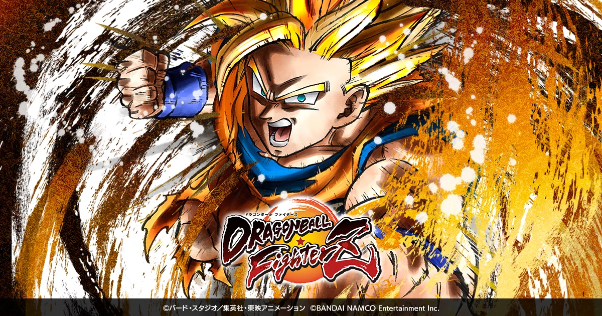
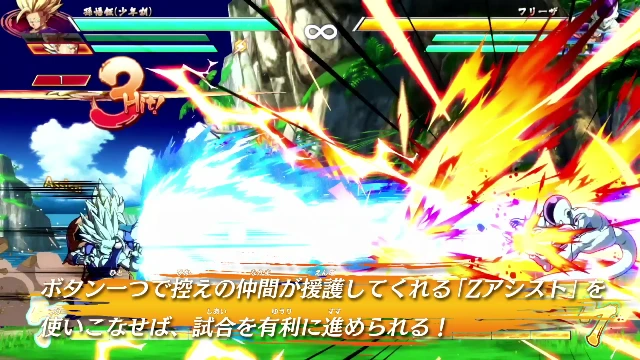
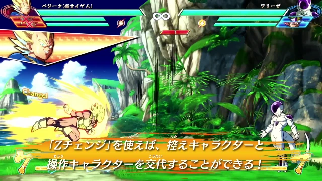
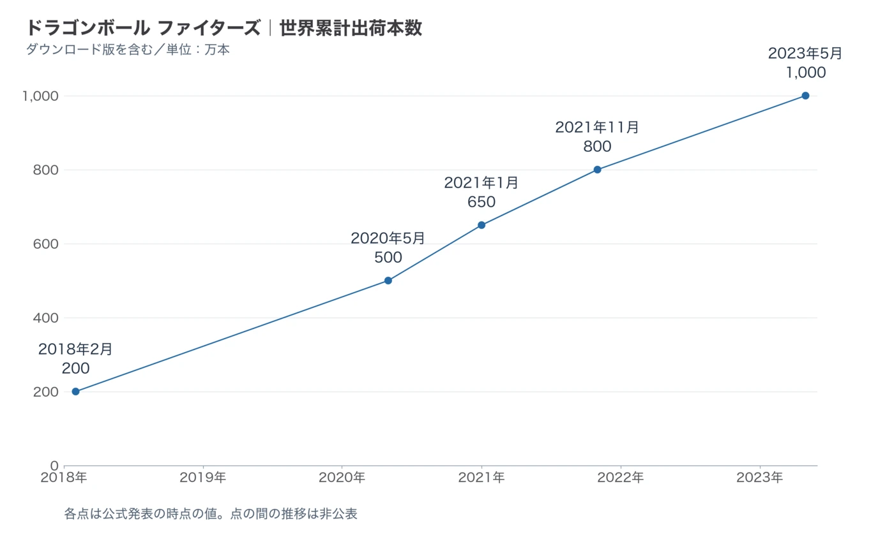

# 『ドラゴンボール ファイターズ』は、なぜ既存の表現基盤を大型IPの成功へ変えられたのか――技術転用と競技性から読む成功事例

> 2026年11月26日改版：The Game Awards 2018の受賞と累計出荷1,000万本到達時の発表を加え、図版を作り直して、最新の情報に更新しました。内容の変更はGitの履歴から追えます。

「他メディアIPのゲーム化 成功・失敗事例シリーズ」の第5回である。前回の[『ザ・ロード・オブ・ザ・リング：ゴラム』は、なぜIPの「独自解釈」をゲームの価値へ変えられなかったのか――適性、ライセンス、実行力から読む失敗事例](lord-of-the-rings-gollum-daedalic-ip-adaptation-failure-case-study.md)では、ゴラムを主人公にした独自解釈を、プレイヤー自身の体験として届ける難しさを見た。

孫悟空のかめはめ波を撃つと、カメラは対戦の横視点から、原作を思わせる角度へ寄る。その一瞬を、プレイヤーは試合のなかで自分の入力で呼び出す。『ドラゴンボール ファイターズ』（DRAGON BALL FighterZ）は、アークシステムワークスが開発し、バンダイナムコエンターテインメントが北中南米・欧州・東南アジアで2018年1月26日、日本を含むアジアのほかの地域で同年2月1日に発売した対戦格闘ゲームである。[[1](#ref-1)]

シリーズの成功事例として、本稿では二つの点を軸に読む。『鬼滅の刃 ヒノカミ血風譚』が作品固有のエフェクト制作とアニメ側の視覚資産との接続を重視したのに対し、本作は『ギルティギア イグザード サイン』で実用化したシェーダー、モデル、リグ（モデルを動かす骨組み）、手作業のアニメーション調整を、一体の制作基盤として持ち込んだ。その画面で原作の共闘や必殺技を楽しむことと、勝つために編成や技の使いどころを考えることを、同じ3対3の対戦ルールに重ねた。初めての一戦を支えた簡略操作から、発売時に課題が残ったオンライン対戦への入り口までをたどる。

*画像出典（引用）：バンダイナムコエンターテインメント「[ドラゴンボール ファイターズ](https://dbfz.bn-ent.net/)」。公式キービジュアルを、作品の題材を示すため必要な範囲で引用。画像内の権利表記を保持したままWebPへ変換。*

***

## 『ギルティギア イグザード サイン』で作った基盤を、別IPへ持ち込む

アークシステムワークスは2014年の『ギルティギア イグザード サイン』で、シリーズ伝統の手描きアニメーションを3Dで再現する手法を取り入れた。同社はこの作品を、3Dセルルックの格闘ゲーム表現が自社の代名詞になった転機として位置づけている。[[2](#ref-2)]

制作基盤は、シェーダー、モデル、リグ、手作業のアニメーション調整を組み合わせたものだった。セルシェーダーは、3Dモデルの明暗を段階的な色面として描き、アニメの塗りに近づける仕組みである。『ギルティギア イグザード サイン』の開発資料では、アーティストが法線や陰影を調整し、光源計算で得られる画を仕上げる方針が説明されている。キャラクターの動きも、補間に任せる範囲を絞り、アーティストが手作業で設定した。[[3](#ref-3)]

この手間が生きるのは、ポーズとカメラがそろい、3Dモデルがアニメの一枚絵に見える瞬間である。アニメでは、動きの全フレームを均等に描かず、ポーズを強調し、必要な箇所だけを動かすリミテッドアニメーションが用いられる。アークシステムワークスはリアルタイム再生の制約下で、この日本的なリミテッドアニメーションを作る方法を研究し、CEDECでも制作手法を共有している。[[4](#ref-4)]

『ドラゴンボール ファイターズ』は、この土台を別の原作へ適用した。3Dのカメラを使えるため、孫悟空のかめはめ波やベジータのファイナルフラッシュで原作を思わせる角度へ寄れる。一方で、対戦中は入力、ヒット判定、画面外への移動、相手との距離が常に変わる。見せ場の演出も、刻々と変わる試合の状態に合わせて描く必要がある。基盤がリアルタイムの格闘ゲームとして既に鍛えられていたことが、IPの見た目を操作可能な体験へ変える前提になった。

開発陣も本作のディレクターに、『ギルティギア イグザード』シリーズのテクニカルアーティストとして評価されていた本村・C・純也氏を据えたと語っている。バンダイナムコエンターテインメントとアークシステムワークスは、アニメファンと格闘ゲームファンの双方へ届くことを企画段階から目標にしていた。[[5](#ref-5)] 開発チームの座組みには、既にある表現パイプラインと、原作の何を見せるかという企画判断の両方が反映されている。

### 『鬼滅の刃 ヒノカミ血風譚』との違いは、作り込む対象にある

同じアニメIPの成功例でも、再現のために手間をかけた対象は作品ごとに異なる。シリーズ第3回の[『鬼滅の刃 ヒノカミ血風譚』は、なぜ急拡大したアニメIPをゲームへ着地させられたのか――協働とタイミングの成功事例](demon-slayer-hinokami-keppuutan-cyberconnect2-ip-adaptation-success-case-study.md)で見たとおり、同作のサイバーコネクトツーは、Unreal Engine 4上で内製ツールと複数のポストエフェクトを組み合わせ、呼吸の技などの画面効果を作品に合わせて作り込んだ。[[6](#ref-6)] 作品固有の水、炎、雷の密度を、ゲーム中のカメラと操作へ合わせ直す解法である。

対して『ドラゴンボール ファイターズ』は、アークシステムワークスが自社の格闘ゲームで培ったセルルック、画面作り、リミテッドアニメーションの生産基盤を転用した。既存の表現工程を出発点に、孫悟空やフリーザのモデル、必殺技、演出を本作用に作り込み、原作らしい画と動きを詰めていった。

プランナーが見極めたいのは、原作の象徴を再現するにはどこに手間をかけるべきかである。原作の象徴が特定のエフェクトや撮影に集中しているなら、作品固有の表現へ制作資源を寄せる必要がある。反対に、開発会社が原作と相性のよい、実戦で検証済みの表現パイプラインを持つなら、基盤の再利用は品質と速度の両方で強い選択肢になる。共通基盤を使う場合も、原作固有のポーズ、カメラ、色、効果音との同期は個別に検証する必要がある。

*画像出典（引用）：バンダイナムコエンターテインメント「[ドラゴンボール ファイターズ道場 其之二](https://dbfz.bn-ent.net/information/?p=165)」。セルルックのリアルタイム対戦画面を示すため必要な範囲で引用。©バード・スタジオ／集英社・東映アニメーション ©Bandai Namco Entertainment Inc.／WebP変換。*

***

## 3対3で、原作の「共闘」と格闘ゲームの研究を重ねる

本作は、各プレイヤーが3人のキャラクターを選んで戦うチーム戦を採用する。バンダイナムコエンターテインメントの公式説明は、操作するキャラクターの交代、控えが一時的に援護するアシスト、3人同時の必殺技を含む3対3の戦略性を、2.5D表現と並ぶ特徴に挙げている。[[1](#ref-1)] 「誰と誰を並べるか」までプレイヤーの選択にした点が重要である。

原作ファンにとって、この編成は孫悟空、ベジータ、ピッコロを同じチームに置く遊びであり、原作では実現しない組み合わせの会話や共闘を想像する余地でもある。格闘ゲームのプレイヤーにとっては、前に出るキャラクター、援護に回すキャラクター、体力回復のための交代順を考えるシステムになる。開発陣も、キャラクターごとのアシスト性能とチーム全体の戦略を考える研究過程を、本作の醍醐味として説明している。[[7](#ref-7)]

空中で追いかけ、コンボをつなぎ、相手を地面へ叩き付ける流れは、ドラゴンボールらしい高速戦闘の再現である。同時に、コンボの途中で誰を呼ぶか、どこで交代するか、必殺技などに使うゲージをどこで消費するかという競技上の選択にもなる。かめはめ波や元気玉も、この一連の判断のなかで使う必殺技である。派手な技は試合の中で撃つ判断を伴い、結果が次の局面へ返ってくる。

キャラクターの採用でも、原作での人気と試合での役割を合わせて考えた。開発陣は、「ほかのキャラクターと差別化しやすいか」「個性的なバトルができるか」を重視したと説明している。[[5](#ref-5)] 大型IPでは、登場人物を多く出すこと自体が目標になりやすい。本作は、原作の顔ぶれを増やす判断を、チーム戦の役割や操作感と結び付けた。IP側の要求と競技側の要求を、キャラクター選定の同じ表に置いたのである。

*画像出典（引用）：バンダイナムコエンターテインメント「[ドラゴンボール ファイターズ道場 其之二](https://dbfz.bn-ent.net/information/?p=165)」。3対3の交代システムを示すため必要な範囲で引用。©バード・スタジオ／集英社・東映アニメーション ©Bandai Namco Entertainment Inc.／WebP変換。*

***

## 簡略操作から、同じ対戦ルールに入る

格闘ゲームは、原作ファンにとって操作の敷居が高くなりやすい。そこで本作は、ボタン連打で連続技へつながる超コンボ、相手へ接近しやすい超ダッシュ、比較的共通性の高い基本操作を用意した。開発陣は、超コンボが空振りでも次の技へつながり、技を出すたびに前進する仕組みを、初心者同士でも距離が開き過ぎないための工夫として説明している。[[7](#ref-7)]

簡略操作は、上級者も使える共通の仕組みである。開発陣が目指したのは、全プレイヤーが同じ操作系で遊び、習熟に応じてできることが増える設計だった。アシスト、交代、空中での位置取り、ゲージ運用を理解するほど、同じ操作のなかで選択肢が広がる。[[7](#ref-7)]

ここには、IPゲームでよく起こる二分法を避ける判断がある。原作再現を優先すると、誰でも派手な技が出せる一方で、上達の余地が薄くなりやすい。逆に競技性だけを優先すると、原作を知る新規プレイヤーが最初の一戦まで届かない。本作の自動連携コンボでは、近づきながら技を当て、ヒットや空振りを見て次の行動を選ぶ。その流れのなかで原作らしい見せ場が生まれる。

簡略操作で使える技が増えると、次は相手の狙いを読み、なぜ負けたかをつかむ段階に入る。チュートリアル、練習モード、対戦相手の探しやすさ、負けた直後にもう一戦したいと思わせるオンライン導線まで、入口の設計は続く。本作のオンライン評価は、その後半が別の難題であったことを示す。

***

## 高評価と販売推移、そして発売時オンラインの課題

批評面では、Metacriticの集計でPlayStation 4版が78件の批評に基づく87点、Xbox One版が86点、PC版が85点、Nintendo Switch版が87点となった。[[8](#ref-8)] 発売を控えた2018年1月23日には、同集計における歴代ドラゴンボールゲーム最高評価として報じられた。[[9](#ref-9)] The Game Awards 2018では「Best Fighting Game」を受賞した。[[10](#ref-10)] この高評価は、原作再現だけでなく、操作の入口とチーム格闘ゲームとしての深みが同時に受け止められた結果と読める。

商業面では、発売直後の勢いに続き、約5年にわたって出荷を伸ばした。公式資料をたどると、2018年2月の200万本、2020年5月の500万本、2021年1月の650万本、同年11月の800万本、2023年5月の1,000万本と到達点が更新された。いずれもダウンロード版を含む累計出荷本数である。[[1](#ref-1)] [[11](#ref-11)] [[12](#ref-12)] [[13](#ref-13)] [[14](#ref-14)] 2023年5月の発表で、バンダイナムコエンターテインメントは、自社が発売した『DRAGON BALL』家庭用ゲームソフトのなかで、発売から世界累計出荷1,000万本に最も早く到達したと述べた。[[10](#ref-10)]

対戦相手を見つけて試合を始めるまでの時間も、対戦ゲームを支える品質の一つである。発売時のレビューは、ロビーがメニューを兼ねる構成と、地域ごとに最大64人へ分かれる仕組みが待ち時間を長くし、対戦相手の母集団を細かく分断していると批判した。[[15](#ref-15)]

この指摘は発売時点のオンライン体験に関するものである。後年には、PlayStation 5、Xbox Series X｜S、PC版を対象に、入力予測のずれを巻き戻して補正するロールバックネットコードが導入された。[[16](#ref-16)] 発売時の対戦導線と後年の通信方式の更新は、競技性を売りにする作品で、オンライン体験の改善が発売後も続いたことを示している。

***

## プランナーへの示唆：IPの顔に合う「蓄積」を見極める

### 1. ライセンス獲得の前に、再利用できる制作基盤を棚卸しする

IPを借りる企画では、原作の人気とあわせ、自社のモデル、アニメーション、シェーダー、カメラ、バトル設計の蓄積で、そのIPの最も重要な瞬間を再現できるかを確かめる。『ドラゴンボール ファイターズ』では、アークシステムワークスのセルルックとリミテッドアニメーションが、原作の戦闘表現と強く噛み合った。

基盤を再利用して生まれた時間を、原作固有の技、ポーズ、キャラクター間の掛け合い、バランス調整へ回せる。基盤とIPの相性が悪ければ、転用はかえって不自然さを増やす。まず「何が既存資産で、何が新規制作なのか」を分ける必要がある。

### 2. 原作再現を、対戦の意思決定へ戻す

名場面をムービーとして再生するだけなら、原作再現とゲームプレイは分離する。本作は、3対3の編成、交代、アシスト、必殺技の連携を通じて、原作キャラクターを選ぶこと自体が勝敗に関わるようにした。ファンサービスの手応えは、それがプレイヤーの選択をどう変えるかにも表れる。

そのためには、原作上の人気とゲーム内の役割を別々に検討する必要がある。人気キャラクターでも、既存キャラクターと戦い方が重なるなら、アシスト、固有技、交代時の価値のいずれかを設計し直さなければならない。逆に、競技上の役割だけを優先して原作の顔を外せば、IPを借りる意味が薄くなる。

### 3. 初心者向け機能は、上達の道筋まで含めて設計する

自動連携コンボは、同じルールのなかで最初の成功を作り、次に試せる選択を見せる。本作のように基本操作を共通化するなら、簡略操作の先にアシスト、交代、ゲージといった理解可能な深みを置く必要がある。

練習で覚えた技を対戦で試す段階では、対戦相手の見つけやすさ、待ち時間、通信品質、再戦のしやすさが、習熟の継続を左右する。バトルデザインとオンライン機能を別工程の付加要素として扱うと、入口だけを広げて、その先で顧客を失う危険がある。

***

## おわりに：培った表現基盤で、原作の共闘を対戦にする

『ドラゴンボール ファイターズ』の出発点には、手描きアニメーションの見え方を3Dのリアルタイム格闘ゲームで成立させるアークシステムワークスの基盤があった。開発陣は、その基盤がドラゴンボールの高速戦闘、派手な必殺技、三人の共闘という原作の顔と噛み合うと判断し、競技ルールと操作の入口まで一つの製品へ組み込んだ。

『鬼滅の刃 ヒノカミ血風譚』のように作品固有のエフェクトを深く作り込む成功もある。本作が示したのは、もう一つの道である。自社の表現基盤が原作の中心体験と一致するなら、それを転用し、個別制作を原作固有の価値へ集中させられる。その戦いを繰り返し遊ぶには、対戦相手を見つけて、快適に試合を始められることも大切である。IPゲームを長く遊ばれる製品にするには、再現、競技、接続を同じ優先度で完成させる必要がある。

次回の[『New ガンダムブレイカー』は、なぜ「ユーザーの声に応える刷新」を前作からの後退にしてしまったのか](new-gundam-breaker-crafts-meister-ip-adaptation-failure-case-study.md)では、シリーズの失敗事例として、刷新の判断を重ねるなかで前作の遊びを手放した例を扱う。

***

## References

1. [バンダイナムコエンターテインメント「2.5D表現による『ドラゴンボール』本格対戦格闘ゲーム『ドラゴンボール ファイターズ』 『ドラゴンボール』ゲームシリーズ 最速の累計出荷本数200万本を突破！」][1] — バンダイナムコエンターテインメント、2018年2月1日。発売日・地域、開発元、3対3の仕様を掲載。東南アジア地域の発売日は1月26日。

[1]: https://bandainamcoent.co.jp/corporate/press/release/63/pdf/20180201-1.pdf

2. [アークシステムワークス「アークシステムワークス35年の歴史」][2] — アークシステムワークス35周年特設サイト、公開日記載なし。2014年の項を参照。

[2]: https://www.arcsystemworks.jp/35th/history/

3. [4Gamer.net「GDCの舞台で世界に披露された『GUILTY GEAR Xrd -SIGN-』の『アニメにしか見えない3Dグラフィックス』制作手法」][3] — 4Gamer.net、2015年3月18日。

[3]: https://www.4gamer.net/games/216/G021678/20150317055/

4. [本村・C・純也「GUILTY GEAR Xrd におけるリアルタイム・リミテッドアニメーション」][4] — CEDiL、2015年（CEDEC 2015）。

[4]: https://cedil.cesa.or.jp/cedil_sessions/view/1384

5. [touge、ハメコ。「『ドラゴンボール ファイターズ』開発陣インタビュー。バンダイナムコエンターテインメント×アークシステムワークスが目指す“格闘ゲームの次のステージ”とは」][5] — 4Gamer.net、2017年12月15日。1ページ目。企画意図、技術体制、キャラクター選定。

[5]: https://www.4gamer.net/games/384/G038402/20171211079/

6. [wvigler「サイバーコネクトツーのエフェクト開発事例ーアニメ作品のビジュアル表現をUE4上で再現した内製ツールなどの技術解説〖UNREAL FEST 2022〗」][6] — ゲームメーカーズ、2022年8月11日。

[6]: https://gamemakers.jp/article/2022_08_11_10558/

7. [touge、ハメコ。「『ドラゴンボール ファイターズ』開発陣インタビュー。バンダイナムコエンターテインメント×アークシステムワークスが目指す“格闘ゲームの次のステージ”とは」][7] — 4Gamer.net、2017年12月15日。2ページ目。チームの編成と立ち回り、超コンボ、共通の操作系。

[7]: https://www.4gamer.net/games/384/G038402/20171211079/index_2.html

8. [Metacritic「Dragon Ball FighterZ Reviews」][8] — Metacritic、随時更新。各機種のMetascoreと批評件数。2026年11月26日確認。

[8]: https://www.metacritic.com/game/dragon-ball-fighterz/

9. [Paul Tamburro「Dragon Ball FighterZ is the Highest-Rated Dragon Ball Game Ever」][9] — GameRevolution、2018年1月23日。発売前のMetacritic集計に基づく報道。

[9]: https://www.gamerevolution.com/news/364319-dragon-ball-fighterz-metacritic-is-the-highest-rated-dragon-ball-game-ever

10. [ファミ通.com「『ドラゴンボール ゼノバース2』『ドラゴンボール ファイターズ』それぞれ世界累計出荷本数が1000万本を突破。特別なログインボーナスやDLC無料開放などのキャンペーンを実施」][10] — ファミ通.com、2023年5月13日。バンダイナムコエンターテインメントの発表を掲載。受賞および同社の家庭用『DRAGON BALL』タイトル内での到達記録。

[10]: https://www.famitsu.com/news/202305/13302144.html

11. [バンダイナムコエンターテインメント「5月21日(木) 『500万本突破記念！ アイテムプレゼント』実施のお知らせ」][11] — 『ドラゴンボール ファイターズ』公式サイト、2020年5月21日。

[11]: https://dbfz.bn-ent.net/information/?p=997

12. [バンダイナムコエンターテインメント「史上初！『DRAGON BALL』のあらゆる魅力を世界中に伝える全世界同時配信型オンラインイベント『DRAGON BALL Games Battle Hour』を開催！」][12] — バンダイナムコエンターテインメント、2021年2月4日。4ページ目に2021年1月の650万本到達を記載。

[12]: https://www.bandainamco.co.jp/cgi-bin/releases/index.cgi/press/10155?entry_id=7064

13. [バンダイナムコエンターテインメント「『DRAGON BALL(ドラゴンボール)』を題材にした家庭用ゲームソフト 『ドラゴンボール ゼノバース2』『ドラゴンボール ファイターズ』それぞれ世界累計出荷本数800万本突破！」][13] — バンダイナムコエンターテインメント、2021年11月。

[13]: https://www.bandainamcoent.co.jp/corporate/press/top/single.html?q=phgOHLAbM

14. [バンダイナムコエンターテインメント「1000万本突破記念！『1000時間DLC無料開放キャンペーン』開催のお知らせ」][14] — 『ドラゴンボール ファイターズ』公式サイト、2023年5月。

[14]: https://dbfz.bn-ent.net/information/?p=2557

15. [Mike Epstein「‘Dragon Ball FighterZ’ review」][15] — Digital Trends、ページ記載日2023年4月25日。発売時のオンライン対戦を扱うレビュー。

[15]: https://www.digitaltrends.com/gaming/dragon-ball-fighterz-review/

16. [Bandai Namco Entertainment America「DRAGON BALL FighterZ Rollback Netcode Update」][16] — Bandai Namco Entertainment America、2024年2月28日。

[16]: https://www.bandainamcoent.com/news/dragon-ball-fighterz-rollback-netcode-update

----

この文書は、Perplexity、Claude、ChatGPT の3つのAIの支援を受けて著述されたものです。引用画像を除き、MIT License にて提供されています。
