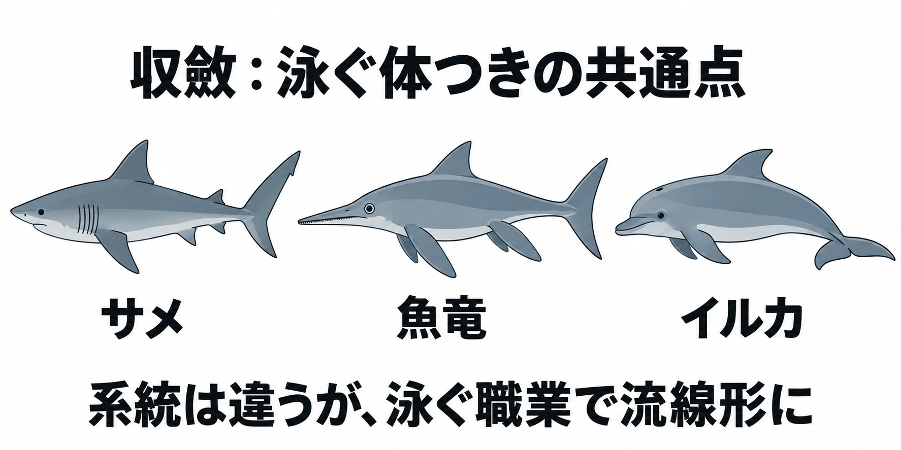
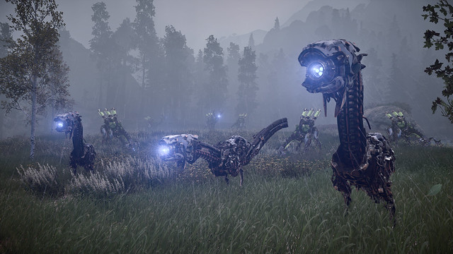
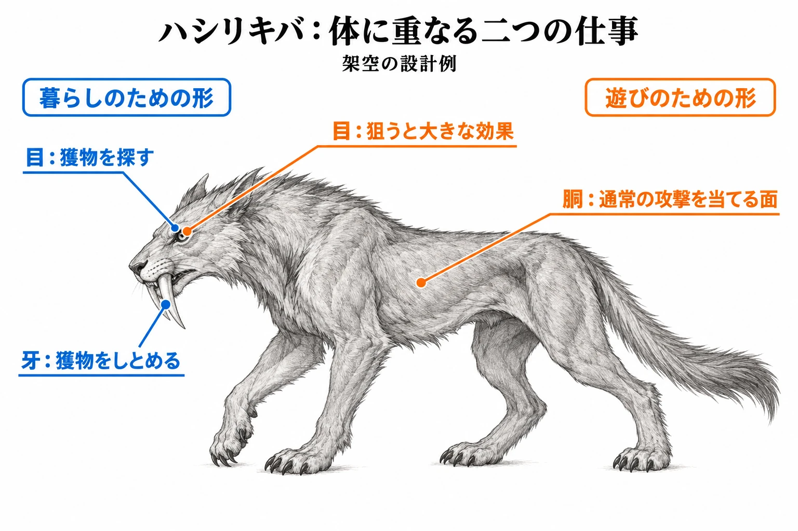

# その体の形は、何をするための形か――職業から生き物の体を描き起こす

「川沿いの草原で若草を食べ、草原の捕食者に狙われる生き物」。架空の草食獣クサハミの職業を一文にしたメモがある。隣に白紙を置き、体を描き始める。草を食べる歯はどんな形か。敵に気づく目はどこに置くか。逃げるための脚はどうするか。

[前回の記事](ecology-niche-food-web-creature-jobs.md)では、居場所と食べ物を「職業」と呼び、生き物の配置や行動を考えた。シリーズ「生態学から生き物をつくる」の第2回では、その職業から体の形を決めていく。

本稿の芯は、 **ゲームの生き物の体には、仕事が二つある** ということだ。一つは、食べる、見つける、移動するといった暮らしを支える仕事。もう一つは、攻撃を当てる面や、狙うべき弱点として遊びを支える仕事である。

どちらも、形に働きを持たせる話だ。判断軸は、 **その体の形は、何をするための形か** である。

***

## 1. 形は働きに合わせて似てくる――相似

相似とは、由来の異なる生き物の器官が、同じ働きをするために似た形を持つことである。器官は、翼や目など、一定の働きを担う体の部分を指す。『最新 地学事典』の小寺春人による解説では、こうした器官を相似器官と呼ぶ。[[1](#ref-1)]

『改訂新版 世界大百科事典』の田隅本生による解説が挙げる例は、鳥の翼とセミの羽である。別々の起源から生じた器官が、空を飛ぶという共通の働きに適した形を持つ。相似は、起源の共通性を指す「相同」と対になる語でもある。[[1](#ref-1)]

これを設計の手がかりにすると、体の部位を選ぶ理由が変わる。「翼を付ける」の前に、「空を飛んで何をするのか」を置ける。まず働きを決め、その働きを担う形を探すのである。

***

## 2. 同じ職業から、似た体に行き着く――収斂

収斂（しゅうれん）とは、祖先からの枝分かれの道筋である系統が違う生物が、それぞれ独立に似た器官や体の形へ進化することである。『改訂新版 世界大百科事典』の速水格による解説は、多くの場合、動き方や食べ物の類似と関係すると説明する。[[2](#ref-2)]

例は、サメ、中生代に栄えた魚竜、イルカである。骨格の基本的なつくりは大きく違う。それでも、泳ぐのに適した流線形という、水の抵抗を受けにくい体つきになっている。[[2](#ref-2)]

参考文献[[2](#ref-2)]に基づく模式図。体の大きさの比率を示すものではない。

もう一つの例は、オーストラリアの有袋類という哺乳類の一群である。同じ解説は、旧大陸のネズミやモグラ、オオカミなどに相当する種が生まれ、似た姿を示した例として紹介している。[[2](#ref-2)]

前回の「職業」に引きつければ、別の系統の生き物が、別の土地で似た職業に就いたと捉えられる。暮らしの中で求められる働きが近ければ、体の形も似ることがある。同じ職業から似た姿を考えることには、生態学上の手がかりがあるのだ。

設計では、ここを形の候補を探す入口にできる。泳ぐ職業なら、泳ぐための体つきを参考にする。食べ物を得る方法まで決まれば、次は口や歯へと考えを進められる。

***

## 3. 歯、目、くちばしは、職業の名札になる

浜松市動物園の教材「肉食動物について学ぼう」は、歯と目を通して、肉食動物と草食動物の違いを説明している。ここでは、その教材にある基本的な対比を手がかりにする。[[3](#ref-3)]

肉食動物では、獲物をしとめるための犬歯、つまり牙が大きく発達している。草食動物は、草をすりつぶすための大きく平らな歯を持つ。歯を見ると、食べ物と、それをどう扱うかが結びつく。[[3](#ref-3)]

目にも、暮らしの違いが表れる。同教材では、肉食動物は視野全体が狭い一方、両目で見える範囲が広く、獲物との距離をつかみやすいと説明する。草食動物は、種類による違いはあるものの、顔を動かさずにほぼ周り全体を見渡せるという。[[3](#ref-3)]

この対比を体の設計に使うなら、「何を見たい目なのか」を考える。獲物との距離をつかむためか、周囲の敵に気づくためか。目の配置に、暮らしの中での役目を持たせるのである。

くちばしも、食べ方を伝える部位だ。かわさき宙と緑の科学館の「鳥のくちばし」は、何を食べるかによって形が違うと説明する。たとえば、カワセミは水中に飛び込んで魚をつかまえる。オシドリは水ごと吸い込み、餌だけを残す。[[4](#ref-4)]

同じ水辺の生き物でも、餌の得方は違う。体の部位を、その働きと一緒に見ると職業を読む手がかりになる。架空の生き物でも、「この口で何を得るのか」が分かれば、形が職業の名札になる。

***

## 4. ゲームの形には、二つ目の職業がある

ゲームでは、暮らしを支える形に、プレイヤーが働きかける場所としての役目が加わる。『Horizon Zero Dawn』の制作過程には、その二つ目の仕事がよく表れている。

同作のGame DirectorであるMathijs de Jonge氏は、ウォッチャーについて、複数の動物を組み合わせた姿を目指したと説明する。一種の動物をそのまま機械に置き換える形とは区別している。[[5](#ref-5)]

制作中には、サソリのような機械も試された。しかし、脚が細く、撃って当てられる面がほとんどなかったため、射撃に問題が生じたという。この案は採用を見送られた。ウサギのような機械も試されたが、見た目が奇妙だったとde Jonge氏は振り返っている。[[5](#ref-5)]

サソリ型の件からは、設計上の考察として、 **暮らしの形として成り立っても、遊びの形として成り立たなければ採らない** という判断を読み取れる。攻撃を当てる面も、体に必要な働きの一つなのだ。

同作のLead Quest DesignerであるDavid Ford氏は、ウォッチャーの側面や装甲を撃つと、倒すまでに時間がかかると説明する。一方、目を狙えば一撃で倒せるという。どこを狙うかによって結果が変わる。[[5](#ref-5)]

PlayStation Blog掲載のウォッチャーの画像。頭部の目と体の形を確認できる。

出典：Gillen McAllister「[The Making of Horizon Zero Dawn’s Machines](https://blog.playstation.com/2017/02/24/the-making-of-horizon-zero-dawns-machines/)」（PlayStation Blog、2017年2月24日）。© Sony Interactive Entertainment / Guerrilla Games。本文の説明に必要な範囲で引用。

ここから設計に引きつけると、体には「攻撃を受け止める面」と「狙う意味のある場所」を用意できる。大きさや位置を決めるときも、その場所でプレイヤーに何をさせたいのかを問える。

***

## 5. 職業の一文から、部位を一つずつ決める

ここからは、以上の資料をゲームへ置き換える考察である。架空の生き物の設計例として、暮らしのための形を決め、そこへ遊びのための形を重ねていく。

### 食べ物と敵から、必要な部位を選ぶ

冒頭のクサハミに戻ろう。「若草を食べる」からは、草をすりつぶす平らな歯を選べる。「草原の捕食者に狙われる」からは、周囲を見渡す目の配置と、逃げるための脚を考えられる。

脚についても、「逃げるため」と書いてから形を決める。必要な移動を支える形として、企画の中で具体化していく。部位ごとに働きを一つ添えると、描く形の理由を共有しやすくなる。

### 一つの部位に、二つの仕事を重ねる

次は、前回登場した架空の捕食者ハシリキバを、プレイヤーが戦う相手にする案を考える。「草原でクサハミやタネネズミを探して食べる」という職業から、獲物を見る目と、獲物をしとめる牙を選ぶ。

その目を、狙うと大きな効果が得られる弱点に設定してみる。獲物を見つけるための部位に、プレイヤーが狙う場所という二つ目の仕事が重なる。これは本稿の架空の仕様だ。

さらに、胴には通常の攻撃を当てる面を確保する。目を狙うか、胴へ攻撃を当てるかという選択を作れる。暮らしを支える体つきと、攻撃対象として必要な面積を、一体の生き物の中で両立させるのである。

### 職業の違いを、働く部位に出す

収斂の例が示すように、似た職業の生き物が似た姿になることは自然に起こる。ゲームの設計でも、同じ働きから似た形が生まれることはある。

前回は「同じ職業は、同じ場所で重ならない」という見方を、配置を点検する手がかりにした。今回はそこから一歩進め、見分けさせたい二種の職業を並べる。食べ物や餌の得方を分けたなら、その違いを口や歯など、仕事をする部位に出せる。

たとえば、架空の水辺の生き物を二種作るなら、一方は魚をつかまえ、もう一方は水ごと餌を取り込む職業にできる。先ほどの鳥の例を手がかりに、それぞれの口へ違う働きを持たせる案だ。職業の違いが、体の違いを選ぶ理由になる。

ウォッチャーで複数の動物を組み合わせたという発言も、この発想につなげられる。設計案としては、動物を丸ごと写す代わりに、職業に必要な部位を組み合わせる。ただし、組み合わせるたびに「この部位は何をするのか」を説明する。働きでつなぐと、形を選ぶ基準が保てる。

***

## 6. 体の形を決める前の5つの点検

企画書をまとめる前や、コンセプトアートを発注する前に、職業の一文と体の案を並べ、次の5項目を確かめる。

- どこで何を食べ、何に狙われる生き物かを、一文で言えるか。
- 歯、目、口、脚などの形に、暮らしの中での働きを添えられるか。
- 戦う相手なら、攻撃を当てる面と、狙う意味のある場所を決めたか。
- 暮らしを支える部位に、遊びのための仕事も重ねられるか。
- 見分けさせたい生き物同士で、職業の違いが働く部位に表れているか。

白紙の隣に置いた職業のメモは、歯や目を選ぶ手がかりになる。さらに、どこへ攻撃を当て、何を狙わせたいかを重ねれば、暮らしと遊びの両方から体を考えられる。

部位を一つ足すたびに、同じ問いへ戻ろう。 **その体の形は、何をするための形か** 。

## References

1. [「相似」各辞典の解説][1] — コトバンク、掲載日不明。定義は『最新 地学事典』（小寺春人執筆）、鳥の翼とセミの羽の例および相同との関係は『改訂新版 世界大百科事典』（田隅本生執筆）を参照。2026年10月12日閲覧。

[1]: https://kotobank.jp/word/%E7%9B%B8%E4%BC%BC-89381

2. [「収斂」各辞典の解説][2] — コトバンク、掲載日不明。『改訂新版 世界大百科事典』（速水格執筆）の定義、サメ・魚竜・イルカおよびオーストラリアの有袋類の例を参照。2026年10月12日閲覧。

[2]: https://kotobank.jp/word/%E5%8F%8E%E6%96%82-77516

3. [浜松市動物園「肉食動物について学ぼう！」][3] — 浜松市動物園、日付の表記なし。引率者・保護者向けの解答・解説。「見え方のちがい」「歯のちがい」を参照。

[3]: https://hamazoo.net/pdf/education/carnivore_answer.pdf

4. [かわさき宙と緑の科学館「鳥のくちばし」][4] — かわさき宙と緑の科学館、日付の表記なし。カワセミとオシドリの説明を参照。

[4]: https://www.nature-kawasaki.jp/wp/wp-content/uploads/2023/02/2023.2.26torinokutibasi.pdf

5. [Gillen McAllister「The Making of Horizon Zero Dawn’s Machines」][5] — PlayStation Blog、2017年2月24日。Mathijs de Jonge氏（Game Director）とDavid Ford氏（Lead Quest Designer）の制作・戦闘に関する説明を参照。

[5]: https://blog.playstation.com/2017/02/24/the-making-of-horizon-zero-dawns-machines/

----

この文書は、Perplexity、Claude、ChatGPT の3つのAIの支援を受けて著述されたものです。引用画像を除き、MIT License にて提供されています。
