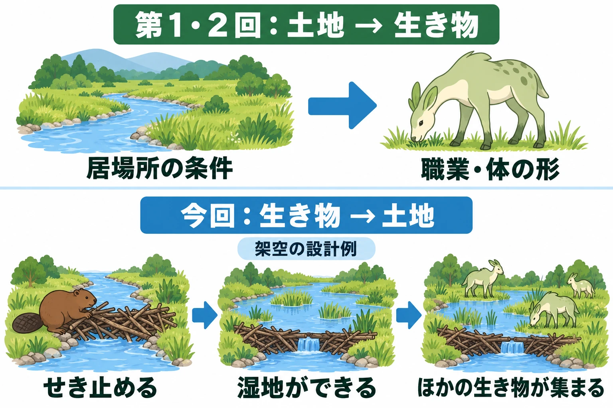
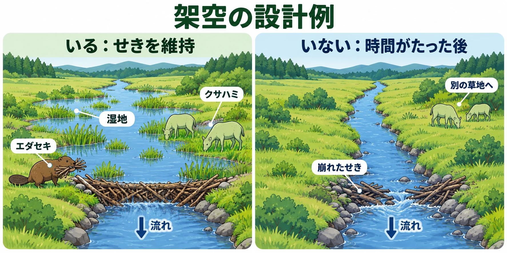

# その生き物がいなくなると、土地はどう変わるか――生態系エンジニアとキーストーン種から、場所を変える生き物を考える

架空の草原の川に、木の枝を集めて流れをせき止める生き物を置いてみよう。名前は「エダセキ」とする。せき止めた場所の上流側に水がたまり、岸に湿地が広がる。その縁に若草を置けば、クサハミが食べに来る場所を作れる。

これは、この草原のための架空の設計案である。エダセキがいない草原では、川はせき止められずに流れる。同じ場所に湿地はなく、クサハミは別の草地に集まると決めてみる。生き物の有無が、景色と出会いの両方を変えるのだ。

[前回の第5回](ecology-warning-colors-mimicry-readable-danger.md)では、警告色と擬態から、見た目で危険を伝える方法を考えた。[第1回](ecology-niche-food-web-creature-jobs.md)と、それに続く第2回では、土地に合う職業や体の形を考えた。今回は向きを逆にして、生き物の働きから土地を決める。

シリーズ「生態学から生き物をつくる」の第6回で通す判断軸は、 **その生き物がいなくなると、土地はどう変わるか** である。ここで見る「土地」には、水や土の様子に加え、そこで暮らす生き物の顔ぶれも含める。

***

## 1. 場所を作る生き物――生態系エンジニア

生態系エンジニアとは、住んでいる場所の環境を変え、ほかの生き物にも影響を与える動植物のことである。コトバンクの『デジタル大辞泉』は、その例にビーバーを挙げる。ダムを作ることで、小魚や水草などの繁殖を促すという。[[1](#ref-1)]

ミズーリ州自然保護局の『Missouri Conservationist』でも、ビーバーは場所を作る生き物として紹介される。ミズーリ大学で野生動物生態学を専門とする助教のMichael Byrne氏は、生態系エンジニアを、景観を変えて他種が頼る生態系そのものを生み出す生物と説明する。生態系とは、生き物と周囲の環境をひとまとまりに捉えたものである。[[2](#ref-2)]

ビーバーはダムによって湿地を作り、維持する。Byrne氏によると、その力の源は水を利用できることにある。景観は、多様な生息地のモザイク、つまり異なる居場所の寄せ集めになる。記事が挙げるのは、ムシクイ類、サギ、両生類、カワウソ、チョウ、カワセミなどが必要とする生息地である。[[2](#ref-2)]

ゲームの設計に引きつければ、生き物の仕事を「何を食べるか」から「どんな場所を残すか」へ広げられる。エダセキなら、枝を運ぶ動作と、湿地のある景色をつなぐ。その湿地を利用する生き物まで決めると、仕事の結果が周囲に見えてくる。

環境を変える働きは、人との軋轢も生む。同局で野生動物による被害を扱う生物学者のJoe DeBold氏は、洪水が問題になる場合もあると述べている。[[2](#ref-2)] この点は、後で「生き物の仕事がプレイヤーの通り道をふさぐ場合」を考える手がかりになる。

***

## 2. いなくなると、周りが変わる――キーストーン種

キーストーン種とは、いなくなると周囲の生き物の顔ぶれが大きく変わる、要となる種である。コトバンクの『デジタル大辞泉』では、個体数が少なくても環境への影響が大きい種と説明される。その種が絶えると、地域の生物群集、つまり一緒に暮らす生物の集まりの構成が大きく変わる。[[3](#ref-3)]

同じページの『日本大百科全書（ニッポニカ）』によると、この考え方はロバート・T・ペインが1969年に提唱した。ペインは北太平洋沿岸の潮間帯で、食べる関係の頂点にいるヒトデを取り除いた。潮間帯とは、潮の満ち引きで水につかったり現れたりする場所である。すると、ヒトデに食べられていたイガイが大量に増え、そこでの生態系が崩れたという。[[3](#ref-3)]

同項目は、ケルプというコンブ目の海藻の生息地に住むラッコも、別の例に挙げている。[[3](#ref-3)]

二つの言葉は、見るところが違う。生態系エンジニアでは、環境を作り変える働きに注目する。キーストーン種では、その種を失ったときに周囲がどれほど変わるかに注目する。この区別を使えば、「場所を作る仕事」と「その仕事を失う影響」を分けて考えられる。

架空の草原でも、エダセキがいなくなった後を描いてみよう。湿地は残るのか。水辺を使っていた生き物は、そこで暮らし続けるのか。 **その生き物がいなくなると、土地はどう変わるか** という問いが、周囲との結びつきを点検する問いになる。

***

## 3. 場所どうしの影響をつなぐ――『モンスターハンター：ワールド』

生き物の働きが届く範囲を考えるには、場所どうしのつながりも手がかりになる。『モンスターハンター：ワールド』の開発者インタビューには、フィールド間の関係を設計した話がある。ここでは、場所が別の場所へ影響する例として見ていこう。

同作のエグゼクティブ・ディレクター／アートディレクターである藤岡要氏は、各フィールドの地形や風土が互いに影響し合って成り立つと説明する。こうしたつながりは、シリーズで初めての設計だという。[[4](#ref-4)]

ディレクターの徳田優也氏は、古代樹の森の水源から大蟻塚の荒地へ水が流れ込み、沼地を作っていると述べる。また、陸珊瑚の台地の豊かな生態系は、その下にあるフィールドの生態系にも影響している。横にも縦にも、場所どうしの関係がある。[[4](#ref-4)]

ここからは設計への読み替えである。架空の生き物が水の流れを変えるなら、その影響をどの場所まで届かせるかを決められる。エダセキのいる川辺と、その下流の草原を一緒に見直すのだ。一方で起きたことが他方へどう届くかを決めると、生き物の仕事で場所をつなげられる。

***

## 4. 生き物の振る舞いを世界に残す――Minecraft

Minecraftのハチは、花粉を運んでいる間、上を飛んだ植物の成長を助ける。公式記事「Mob Menagerie: Bee」は、この働きが農場で役立つと紹介している。[[5](#ref-5)] 飛び回る行動に、植物が育つという結果が結びついている。

スニッファーは、絶滅していた古代のモブ、つまりゲーム内の生き物として紹介された。公式の実装予告記事によれば、モブ投票で選ばれた生き物である。自分たちが初めてオーバーワールドを歩いていた頃の種を嗅ぎ当て、プレイヤーはその種を植えられる。それによって、新しい装飾用の植物を世界に加えられる。[[6](#ref-6)]

投票前のスニッファー紹介記事でも、古代の種を探し出す能力が中心に置かれていた。[[7](#ref-7)] 生き物が見つけることと、プレイヤーが育てることが、一つの流れになっている。

設計上の手がかりは、振る舞いが作物や植物の姿として残る点にある。ハチでは植物の成長に、スニッファーではプレイヤーの植える植物につながる。地面の形を大きく変えるほかにも、生き物の仕事を目に見える結果へ結びつける方法がある。

今回の判断軸で見直すなら、その生き物がいなくなったときに「新しい変化を起こす働き」が失われるのか、「すでにできた場所」まで変わるのかを分けて考えたい。自分のゲームでどちらを選ぶかによって、守る理由も変わる。

***

## 5. ゲームへの置き換え――痕跡と変化を決める

ここからは、架空の草原を使った設計上の考察である。エダセキのいる場所と、いなくなった場所を並べ、プレイヤーに何を見せるかを決めていく。

### 仕事を、地形の痕跡として見せる

せき止めた川、掘り返した土、運ばれた枝を残してみる。枝を抱えて歩く姿と、川に積まれた枝が対応していれば、プレイヤーは生き物の仕事を追いやすい。姿が見えないときにも、痕跡から近くにいることを推測できる。

さらに、エダセキが作った湿地の縁に若草を置き、そこへクサハミが来ると決める。枝を運ぶ仕事が、別の生き物との出会いを支える。この関係を先に見せれば、後でエダセキがいなくなったときにも、何が変わったのかを比べられる。

### 倒す・守る選択と、場所の変化を結びつける

エダセキを倒した場合は、枝の補修が止まり、時間とともにせきが崩れる設定にできる。湿地が失われ、クサハミが別の草地へ移ると決めれば、討伐の結果が場所に残る。守った場合には、補修が続き、水辺の居場所が保たれる。

この変化を入れるなら、続く期間も決めたい。その後ずっと湿地が失われたままなのか。エダセキが戻ってせきを作り直せば、湿地も戻るのか。再訪したときの景色まで含めて選ぶ。

場所を変えない設計も選べる。たとえば、討伐後もせきと湿地が残ると決めれば、通り道や採集場所を安定させられる。 **倒す・守るで何を変え、何を保つかを、遊びの目的に合わせて決める** ことが大切である。

### 変化が遊びを妨げる場面も決める

ビーバーの洪水の話を設計に置き換えると、水が広がってプレイヤーの通り道をふさぐ場面を考えられる。エダセキを守れば湿地は保たれるが、近道が水につかる。倒せば、時間がたった後に近道を通れるようになる。こうすれば、守ることにも別の負担が生まれる。

この負担を障害として使うなら、水が上がる兆しや迂回路を見せたい。移動を妨げたくない場所なら、水が広がる範囲を道の手前までに留める方法もある。生き物の仕事と、プレイヤーが進める範囲を一緒に決めるのだ。

### 影響が届く先を決める

場所どうしをつなぐなら、上流のエダセキの仕事と、下流で見える結果を対にする。たとえば、せきが保たれている間は下流の浅瀬を渡れ、崩れた直後は水が増えて渡れなくなる、という架空のルールを作れる。

この案では、上流のせきと下流の水位を、同じ川をたどって確かめられるようにする。変化の原因を見つけられれば、下流で困ったプレイヤーが上流の生き物を調べに行く理由になる。影響を広げる範囲は、プレイヤーに追ってほしい因果関係に合わせて決めたい。

***

## 6. 企画書を見直すための点検表

生態系エンジニアは場所を作り、ほかの生き物の暮らしを支える。キーストーン種は、失われたときに周囲の顔ぶれを大きく変える。この二つの見方を使うと、生き物の設定を地形の痕跡や、プレイヤーの選択後に残る景色へつなげられる。

企画書では、次の点を確かめたい。

- その生き物は何をして場所を変え、そこを誰が利用するのか。
- 仕事の痕跡を見て、プレイヤーが生き物の働きを推測できるか。
- 倒す・守ることで何が変わるのか。変えない部分と、変化が残る期間や戻る条件も決めたか。
- 変化が通り道をふさぐ場合、障害として使うのか、妨げを避けるのか。
- 影響は別の場所まで届くのか。原因と結果をプレイヤーがたどれるか。

まず、その生き物のいる景色を描く。次に、いなくなった後の景色を描く。二つを並べて答えたいのは、 **その生き物がいなくなると、土地はどう変わるか** である。

次回の最終回では、これまでの見方を逆に使い、架空の生き物の分類体系そのものを作る。

## References

1. [「生態系エンジニア」各辞典の解説][1] — コトバンク、日付記載なし。『デジタル大辞泉』を参照。2026年10月14日閲覧。

[1]: https://kotobank.jp/word/%E7%94%9F%E6%85%8B%E7%B3%BB%E3%81%88%E3%82%93%E3%81%98%E3%81%AB%E3%81%82-2100591

2. [Kristie Hilgedick「Beavers」][2] — ミズーリ州自然保護局『Missouri Conservationist』、2022年7月1日。

[2]: https://mdc.mo.gov/magazines/missouri-conservationist/2022-07/beavers

3. [「キーストーン種」各辞典の解説][3] — コトバンク、日付記載なし。『デジタル大辞泉』および『日本大百科全書（ニッポニカ）』を参照。2026年10月14日閲覧。

[3]: https://kotobank.jp/word/%E3%81%8D%E3%83%BC%E3%81%99%E3%81%A8%E3%83%BC%E3%83%B3%E7%A8%AE-3149378

4. [ぽんきち「『モンスターハンター：ワールド』クリエイターインタビュー 世界の中へと飛び込んでいくときの、例えようもない“ワクワク感”」][4] — ファミ通.com、2017年11月2日。

[4]: https://www.famitsu.com/news/201711/02144595.html

5. [Duncan Geere「Mob Menagerie: Bee」][5] — Minecraft公式、2023年9月15日。

[5]: https://www.minecraft.net/en-us/article/bee

6. [Sofia Dankis「Sniffer coming to Minecraft 1.20」][6] — Minecraft公式、2023年2月13日。

[6]: https://www.minecraft.net/en-us/article/sniffer-coming-minecraft-120

7. [Sofia Dankis「Mob Vote 2022: Sniffer」][7] — Minecraft公式、2022年10月4日。投票前の候補紹介。投票結果は参考文献6を参照。

[7]: https://www.minecraft.net/en-us/article/mob-vote-2022-sniffer

----

この文書は、Perplexity、Claude、OpenAI Codex の3つのAIの支援を受けて著述されたものです。引用画像を除き、MIT License にて提供されています。
