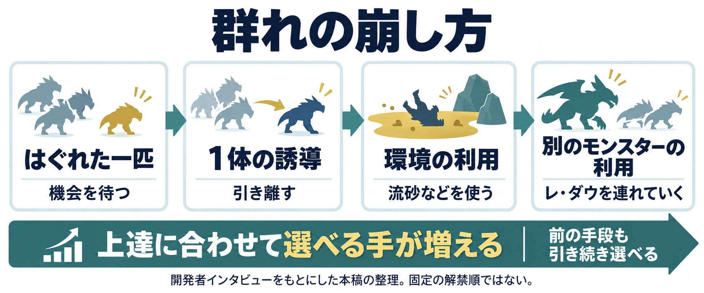
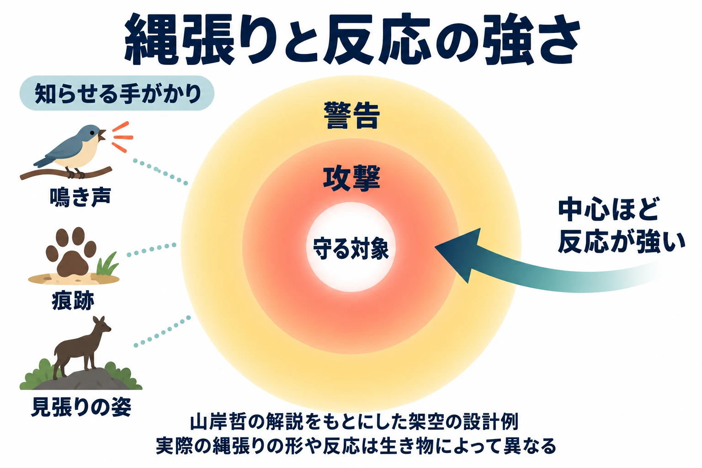

# 一匹か、群れか――群れの崩し方と、縄張りで守る場所を決める

架空の草原で、タネネズミが一匹、草の実を探している。プレイヤーは近づき、狩る機会をうかがう。今度は、数十匹が固まっている場面を作ってみよう。その数は、この草原のための架空の設定である。一斉に向かってくるなら、近づく前に足が止まる。離れた一匹を待つか、群れを散らすかを考え始める。

同じ生き物でも、一匹でいるか、誰かと一緒にいるかで、出会いの意味が変わる。さらに、近くの岩場をハシリキバが守っているとしたらどうだろう。タネネズミを追ううちに、別の生き物の縄張りへ踏み込む場面も作れる。

[前回の第3回](ecology-predator-prey-player-in-the-food-chain.md)では、食べる側と食べられる側の間にプレイヤーを置いた。シリーズ「生態学から生き物をつくる」の第4回では、誰と一緒にいて、どこを守るかを考える。

群れは、一匹ずつなら弱い相手も、自然の脅威として感じさせる設計につながる。その脅威をどう崩せるかが遊びになる。縄張りでは、守る場所をどう知らせ、踏み込んだ相手にどう反応するかが遊びになる。判断軸は、 **一匹か、群れか。どこを守り、どう崩させるか** である。

***

## 1. 群れは、個体どうしの関係から考える

コトバンク「群れ」の『改訂新版 世界大百科事典』で、伊谷純一郎は、群れを一般に同じ種の個体の集合を表す語として説明する。異なる種が混ざる群れは、混群と呼ばれる。長く続く群れ、季節的な群れ、繁殖のための群れなど、続き方や集まる目的にも違いがある。[[1](#ref-1)]

同じページの『日本大百科全書（ニッポニカ）』で、桜井道夫は、個体どうしが引き合う場合と、場所の条件によって集まる場合を分けている。前者を「群れ」、後者を「集まり」などと呼んで区別することがある。[[1](#ref-1)]

この区別を設計に使えば、タネネズミを置くときに二つの案を比べられる。仲間について移動するのか。それぞれが草の実のある場所へ来たのか。同じ密集した姿でも、一匹が動いたあとにほかの個体がどうするかは、別々に考えられる。

桜井の解説は、群れの働きの一つに外敵への防衛を挙げる。また、偶蹄類、つまりシカやウシなどの仲間を例に、開けた場所では集団に加わることが各個体の平均的な利益につながると説明する。[[1](#ref-1)]

これをゲームへ置き換えるなら、まず「まとまっていると、相手にとって何が手ごわいか」を決める。そこから、まとまりを崩したときに生まれる隙を考えるのである。

***

## 2. 群れの崩し方を、上達に合わせて増やす

『モンスターハンターワイルズ』のディレクター、徳田優也氏は、2024年9月28日公開のAUTOMATONの合同インタビューで、自然の厳しさを描くために群れを着想したと語る。個々に動きながら群れとしても自然に見えるよう、モンスターのAI、つまり行動を決める仕組み自体を見直したという。[[2](#ref-2)]

群れへの対処にも幅がある。徳田氏の説明を、本稿では「崩し方の段階」として次のように整理する。これは、上達に伴って選べる手が増える流れである。[[2](#ref-2)]

| 崩し方の段階 | インタビューで示された手段 |
| --- | --- |
| はぐれた一匹 | 単体でいるときを狙う |
| 1体の誘導 | ひと手間かけて1体を誘導する |
| 環境の利用 | スリンガーこやし弾や大こやし玉を使い、流砂などを利用する |
| 別のモンスターの利用 | レ・ダウを群れへ連れていき、一網打尽にする |

徳田氏は、ドシャグマの群れについて、最初ははぐれた一匹を狩り、上達すればレ・ダウを利用する例を挙げている。[[2](#ref-2)][[3](#ref-3)]

ここからは設計上の読み取りである。最初は、群れが崩れる機会を待つ。次に、自分で一体を引き離す。さらに、周囲の環境や別の生き物まで使って、群れ全体に働きかける。上達を、 **出会いの状況を自分で変えられること** と結びつけられるのだ。

AUTOMATONの開発者インタビュー（2024年9月28日）をもとにした本稿の整理。ゲーム内で固定された解禁順を示すものではない。[[2](#ref-2)]

『Horizon Zero Dawn』にも、群れのまとまりが対処を変える例がある。PlayStation Blogで、Guerrilla GamesのManaging Director、Hermen Hulst氏は、一体を誘い出しても群れとして振る舞おうとする機械がいると説明する。[[4](#ref-4)]

同作のLead Quest Designer、David Ford氏は、ウォッチャーへの攻撃に時間をかける間に、仲間が群がって圧倒してくると語る。[[4](#ref-4)] この例を設計に引きつけると、一体を引き離す難しさと、ほかの個体が加わるまでの余裕も、崩し方を決める要素になる。

***

## 3. 縄張りには、守るものと知らせ方がある

縄張りとは、ほかの個体やグループに対して、一匹または複数で防衛する地域である。相手には、同じ種も異なる種も含まれる。『改訂新版 世界大百科事典』の山岸哲による解説は、守る対象として、まず食物、次に交尾の相手を挙げている。[[5](#ref-5)]

同じページの『日本大百科全書（ニッポニカ）』で、幸田正典は、食物の確保、異性の獲得と保持、巣の安全などを縄張りの働きとして説明する。[[5](#ref-5)] 設計でも、守る場所の中心に何があるかを先に決めると、近づく相手へ反応する理由を作りやすい。

縄張りには、範囲を知らせる振る舞いもある。山岸の解説では、さえずる小鳥は声によって、哺乳類は主にマーキング、つまりにおいづけによって、ほかの個体へ立ち入りを拒む信号を送る。[[5](#ref-5)]

境界の成り立ちにも注目したい。山岸はホオジロの調査を例に、隣り合う個体の行動圏、つまり日常的に活動する範囲の中心から、外側ほど攻撃性が弱くなると説明する。縄張りの境界は、両者の攻撃性の強さの釣り合いによって決まる。[[5](#ref-5)]

ここからゲームへ持ち込める手がかりは二つある。縄張りを知らせることと、場所によって反応の強さを変えることである。

***

## 4. 境界を知らせ、近づくほど反応を強める――設計上の考察

ここからは、生態学を手がかりにしたゲーム設計の考察である。縄張りをマップへ置くときは、プレイヤーが踏み込む前に気づける手がかりを用意する。鳴き声、地面に残る痕跡、見張りに立つ姿などが候補になる。

においづけを設定に使う場合も、プレイヤーが知覚できる形へ変換する。たとえば、岩に体をこすりつける動作を見せ、その岩の近くで警告するようにする。行動と場所を結びつければ、「この辺りを守っている」と学ぶ機会になる。

次に、守る対象へ近づくほど反応を強める。外縁では声による警告だけ、中心では攻撃、という案が考えられる。警告を受けて引き返せる余地を作れば、プレイヤーは進むか退くかを選べる。この段階分けは、山岸の解説から着想した架空の仕様である。

山岸哲による縄張りの解説をもとにした架空の設計例。円形の範囲や警告・攻撃の段階が、実在の生き物すべてに共通するわけではない。[[5](#ref-5)]

生き物が普段いる範囲と、その外へ出る余地も一緒に考えられる。『Rain World』のlevel designer、James Therrien氏は、Game Developerの記事で「room attractiveness」という仕組みを説明している。これは、場所への引きつけやすさを使って一定の縄張りに留めつつ、外で食べ物の音やにおいを感じれば出ていける仕組みである。[[6](#ref-6)]

この例から読み取れるのは、居場所に傾向を持たせながら、境界を越える行動も残せるということだ。設計では、「どこを守るか」に加えて「何が起きたらそこを離れるか」を決められる。プレイヤーがその条件を見つければ、誘導する手も生まれる。

***

## 5. 草原に、群れの崩し方と縄張りを置く――設計上の考察

ここからは、タネネズミとハシリキバを使った架空の設計案である。タネネズミは、仲間とまとまって動くものとする。一匹なら対処しやすいが、群れで一斉に向かってくると危険になる。まず、この差を出会いの中で見せる。

### タネネズミには、まとまりを崩す手を用意する

最初の手は、はぐれた一匹を待つことである。プレイヤーは群れを観察し、安全に近づける機会を探す。

次の手として、音で群れを散らせるようにする。音に驚く動作と、ばらける様子を見せる。プレイヤーは、自分で作った隙に近づける。これは、この架空の生き物に与える反応である。

さらに、タネネズミを食べる捕食者、ハシリキバを誘導する手を用意する。群れは崩れるが、今度はハシリキバへの対処が必要になる。誘導する経路と、そのあと自分が逃げる経路まで考えられれば、選択肢が一つ増える。

### ハシリキバには、守る中心と離れる条件を決める

ハシリキバは、岩場にある巣を一匹で守る設定にする。外縁には足跡と、岩へ体をこすりつける姿を置く。近づいたプレイヤーには声で警告し、さらに巣へ迫ると攻撃する。

タネネズミを使って誘導できるようにするなら、縄張りを離れる条件も必要になる。たとえば、外縁付近で獲物を見つけると追い、巣から離れすぎると戻る、と決める。プレイヤーが追跡と帰還を観察できれば、どこまで誘導できるかを試せる。

群れと縄張りを重ねると、同じ草原で選ぶ手が増える。慣れないうちは、はぐれたタネネズミを待ち、ハシリキバの警告を聞いて退く。慣れたら、音で群れを崩す。さらに、ハシリキバの動ける範囲を読んで、群れへ誘導する。

こうした流れでは、 **生き物のまとまり方と守る場所を理解することが、上達になる** 。一つの強い手だけに頼らず、状況に応じて待つ、散らす、誘導する手を選べるかを点検したい。

***

## 6. 群れと縄張りを見直す5つの点検

企画書を開いたら、次の項目をマップと行動の仕様に照らし合わせる。

- 一匹でいる場面と群れでいる場面で、プレイヤーの近づき方が変わるか。
- 群れを崩す手と、崩れたときに生まれる隙が決まっているか。
- 誰が、どこで、何を守るのかを一文で言えるか。
- 縄張りの手がかりと、外縁から中心へ進んだときの反応を結びつけているか。
- 上達すると、群れの崩し方や縄張りへの対処で選べる手が増えるか。

草原で群れを見たプレイヤーが足を止め、岩場からの声を聞いて進路を考える。その判断のために、仲間との関係、守る場所、崩せる条件を用意する。生き物を配置するときの判断軸は、 **一匹か、群れか。どこを守り、どう崩させるか** である。

## References

1. [「群れ」各辞典の解説][1] — コトバンク、掲載日不明。『改訂新版 世界大百科事典』（伊谷純一郎執筆）と『日本大百科全書（ニッポニカ）』（桜井道夫執筆）を参照。2026年10月13日閲覧。

[1]: https://kotobank.jp/word/%E7%BE%A4%E3%82%8C-642590

2. [Tamio Kimura「『モンスターハンターワイルズ』開発者合同インタビュー。あえて「群れ」との戦闘を押し出す理由や、防具の“男性用・女性用の制限撤廃”の裏側などを訊いた」][2] — AUTOMATON、2024年9月28日。発売前の徳田優也氏の説明を要約。モンスター名は公式表記に統一した。

[2]: https://automaton-media.com/articles/interviewsjp/monsterhunterwilds-20240927-312348/

3. [カプコン「MONSTERS｜モンスターハンターワイルズ」][3] — 『モンスターハンターワイルズ』公式サイト、掲載日不明。「ドシャグマ」の表記を参照。2026年10月13日閲覧。

[3]: https://www.monsterhunter.com/wilds/ja-jp/monster/

4. [Gillen McAllister「The Making of Horizon Zero Dawn’s Machines」][4] — PlayStation Blog、2017年2月24日。Hermen Hulst氏とDavid Ford氏の群れに関する説明を参照。

[4]: https://blog.playstation.com/2017/02/24/the-making-of-horizon-zero-dawns-machines/

5. [「縄張り」各辞典の解説][5] — コトバンク、掲載日不明。『改訂新版 世界大百科事典』の動物の縄張りに関する項（山岸哲執筆）と、『日本大百科全書（ニッポニカ）』の動物に関する項（幸田正典執筆）を参照。2026年10月13日閲覧。

[5]: https://kotobank.jp/word/%E7%B8%84%E5%BC%B5%E3%82%8A-108710

6. [Chris Priestman「Crafting the complex, chaotic ecosystem of Rain World」][6] — Game Developer、2017年3月28日。James Therrien氏による「room attractiveness」の説明を参照。

[6]: https://www.gamedeveloper.com/design/crafting-the-complex-chaotic-ecosystem-of-i-rain-world-i-

----

この文書は、Perplexity、Claude、ChatGPT の3つのAIの支援を受けて著述されたものです。引用画像を除き、MIT License にて提供されています。
