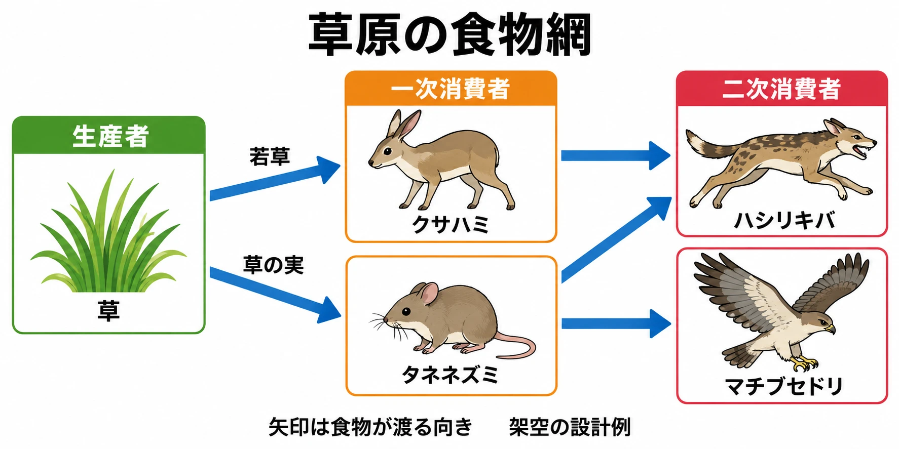
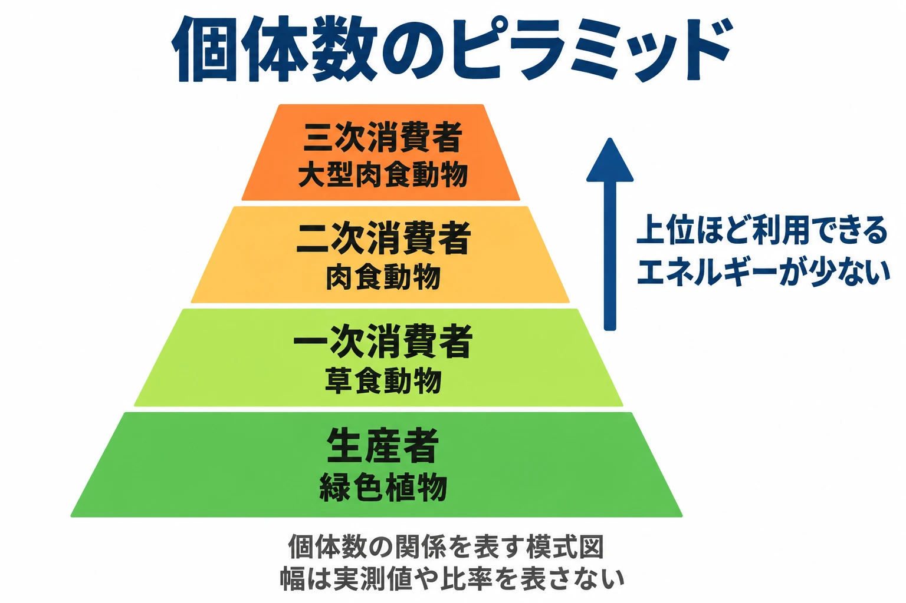

# その生き物の「職業」は何か――ニッチと食物網から居場所と役目を決める

草原のマップを開き、草食の生き物と、それを狙う捕食者を置く。どちらを何匹、どこに置こうか。草食の生き物を広く散らし、捕食者を道の近くに置けば、ひとまず出会いは作れる。

そこから、食べ物を探す動きや、獲物を見つけて近づく場面を作りたい。配置だけを決めた段階では、そうした関係は生まれない。何を求めてその場所にいるのかを、行動と結びつける必要がある。

シリーズ「生態学から生き物をつくる」の第1回では、生き物の居場所と役目から配置を考える。判断軸は、 **その生き物の職業（居場所と食べ物）を、一文で言えるか** である。

***

## 1. ニッチは生き物の「職業」である

生態的地位、別名ニッチとは、生き物が自然の中で占める立場のことである。まずは「どこで、何を食べ、何に食べられるか」という職業として捉えると、ゲームに使いやすい。

『改訂新版 世界大百科事典』の浦本昌紀による解説は、その考えをダーウィンの『種の起原』（1859年）までさかのぼる。「自然の経済における場所」という考えである。この「経済」は、自然の秩序を意味する。エルトンは1927年、食物や敵との関係からニッチを定義し、人間社会の職業になぞらえた。[[1](#ref-1)]

同じ項目では、グリネルが1914年にこの語を別の意味で使い、生息場所の単位として捉えた経緯も説明される。その後の研究の主流は、ハッチンソンが1944年・1957年に提唱した多次元ニッチである。これは、さまざまな環境条件との関係をまとめて扱う考え方だ。本稿では、その入口としてエルトンの「職業」に重心を置く。[[1](#ref-1)]

たとえば、架空の草食獣「クサハミ」を考える。「川沿いの草原で若草を食べ、草原の捕食者に狙われる生き物」とすれば、居場所、食べ物、敵が一文に入る。

ここからは設計上の考察である。この職業を決めると、川沿いに出現させる、若草のある場所で足を止める、捕食者が近づくと逃げる、という行動の候補が出る。職業の一文を、配置と振る舞いを決める起点にするのだ。

***

## 2. 食べる関係は網になる

食べる・食べられる関係を順につないだものが、食物連鎖である。『改訂新版 世界大百科事典』の林秀剛による解説では、緑色植物を生産者、植物を食べる動物を一次消費者、その動物を食べる肉食動物を二次消費者、さらにそれを食べる大型肉食動物を三次消費者と整理する。この食物関係の段階を栄養段階と呼び、連鎖は通常4〜5段階である。[[2](#ref-2)]

『ブリタニカ国際大百科事典 小項目事典』は、現実には連鎖が単独で存在することはまれで、複数の連鎖がつながると説明する。その網状の関係が食物網である。同じ項目は、上位の段階ほど利用できるエネルギーが少なくなり、個体数を図示するとピラミッド状になるとも説明している。[[2](#ref-2)]

これを架空の草原に置き換えてみよう。若草を食べるクサハミ、草の実を食べるタネネズミ、その両方を狙うハシリキバを設定する。さらに、タネネズミを狙う別の捕食者マチブセドリを加える。一つの獲物を複数の捕食者が食べ、一つの捕食者が複数の獲物を食べる網ができる。

この網は、生き物の職業を相手との関係まで含めて点検する道具になる。クサハミにとっての「敵」は、ハシリキバにとっては「食べ物」である。一方の設定を決めると、もう一方の行動を考える手がかりも増える。

***

## 3. 同じ職業は、同じ場所で重ならない

浦本の解説は、同じ生態的地位を占める2種は同じ生息場所に共存できない、というガウゼの法則を紹介している。この問題は1940年頃から大きく議論されるようになったという。[[1](#ref-1)]

ここからはゲームへの当てはめである。同じ場所で、同じものを食べ、同じ相手に襲いかかる敵を2種置くと、プレイヤーには片方が「色違い」に見える可能性がある。そこで、職業の一文を並べ、行動として見える違いを探す。

たとえば、同じ草原の草食獣でも、一方は川沿いで若草を食べ、もう一方は乾いた場所で草の実を探す、と分けられる。食べ物と居場所の違いが、立ち止まる場所や探し物をする動きの違いになる。

これは、生態学の法則をヒントにした設計の点検である。ゲームに似た敵を置くこと自体の是非は、遊びの目的に応じて判断する。職業を分ける狙いは、プレイヤーが見て理解できる違いを作ることにある。

***

## 4. ゲームは生き物に職業を与えている

『Horizon Zero Dawn』の発売前の公式紹介では、機械獣は役割を表す「クラス」で分類されている。2017年2月10日のPlayStation Blogは、サンダージョーとストームバードを戦闘型、スナップモーを獲得型、ベヒモスを輸送型として紹介した。[[3](#ref-3)]

同記事によれば、スナップモーは水中や水辺にいて、堆積物から鉱物を集める。ベヒモスは、小型の獲得型機械が持つ積荷を腹部の格納容器へ移す。[[3](#ref-3)]

ここから読み取れるのは、資源の「獲得→輸送」という職業の連鎖である。スナップモーには何を集めるかがあり、ベヒモスには誰から積荷を受け取るかがある。資源の流れで役割をつなぐ発想は、架空の生き物を設計するときにも使える。なお、この紹介はスナップモーからベヒモスへの直接の受け渡しを述べたものではない。

土地との結びつきは、『モンスターハンター：ワールド』にも見られる。ディレクターの徳田優也氏は、2017年11月2日のファミ通.comのインタビューで、各フィールドの特性に適応した生物としてモンスターを造形したと説明している。例は、上昇気流の強い陸珊瑚の台地に合うパオウルムーとレイギエナである。[[4](#ref-4)] 本稿の設計に引きつければ、土地の条件から、そこで成り立つ職業を考える手がかりになる。

***

## 5. 職業から、行動・出現場所・数を決める

ここからは、生態学の考え方をゲームへ置き換える設計案である。職業の一文を作ったら、マップ上の配置と、プレイヤーが見られる行動へ変換する。

### 食べ物のある場所に、仕事をする場面を置く

架空の生き物に「水辺で鉱物を集め、大型の捕食者に狙われる」という職業を与えたとする。まず、鉱物を得られる水辺を出現場所にする。次に、そこで採集する動きを作る。

さらに「採集中は無防備になる」と決めれば、プレイヤーが近づく機会を作れる。これは職業から考えた架空の仕様である。職業に、行動の切り替わりや隙を加えることで、観察する意味が生まれる。

### ピラミッドを、遭遇の配分に使う

個体数のピラミッドは、敵の出現数を考える出発点にできる。草食の生き物を見かけやすくし、それを狙う捕食者は少なくする。上位の捕食者は、少数で、強く、広い範囲を動く存在として設計する案が考えられる。

このうち、戦闘上の強さや移動範囲は、遊びに合わせて加える設計判断である。栄養段階だけから攻撃力や巡回距離が決まるわけではない。たとえば、上位の捕食者を広く動かすなら、移動先にも食べ物となる生き物を配置すると、職業と行動をつなげられる。

具体的な出現数は、マップの広さや、どの程度の頻度で出会わせたいかを踏まえて調整する。その際にも、何を食べて暮らす存在なのかを一文に戻って確かめる。

### 同じ場所の職業を並べて点検する

最後に、同じ場所へ置く生き物の職業を並べる。食べ物も居場所も同じなら、両方を置くことで何を見せたいのかを確かめる。職業の違いを作るなら、食べるものか、それを探す場所から考えるとよい。

職業を一文で言えると、配置にも行動にも理由ができる。逆に、その一文が曖昧なままでは、置き場所も振る舞いも決めにくい。「ここで、この食べ物を得るために、この行動をする」までつなげてみよう。

***

## 6. 生き物の職業を見直す5つの点検

企画書や設定資料を開いたら、次の5項目をマップと照らし合わせる。

- どこで何を食べ、何に食べられるかを、一文で言えるか。
- 食べ物や獲物は、その生き物が出現する場所にあるか。
- 食べ物を探す・集める・食べる行動が、プレイヤーに見えるか。
- 食物網の上位と下位で、出現数の配分に理由があるか。
- 同じ場所にいる生き物同士で、職業の違いが行動や居場所に表れているか。

最初の草原に戻ろう。クサハミを若草のある川沿いに置き、それを狙うハシリキバを近くに置く。草を食べる姿と、獲物へ近づく姿を作れば、プレイヤーは生き物同士の関係を読み取れる。配置の判断軸は、 **その生き物の職業（居場所と食べ物）を、一文で言えるか** である。

シリーズの最後には、この見方を逆に使い、架空の生き物の分類体系そのものを作る回を予定している。

## References

1. [浦本昌紀「生態的地位」][1] — コトバンク、掲載日不明。『改訂新版 世界大百科事典』の浦本昌紀による項を参照。2026年10月12日閲覧。

[1]: https://kotobank.jp/word/%E7%94%9F%E6%85%8B%E7%9A%84%E5%9C%B0%E4%BD%8D-161967

2. [「食物連鎖」各辞典の解説][2] — コトバンク、掲載日不明。栄養段階は『改訂新版 世界大百科事典』（林秀剛執筆）、食物網とエネルギー・個体数のピラミッドは『ブリタニカ国際大百科事典 小項目事典』を参照。2026年10月12日閲覧。

[2]: https://kotobank.jp/word/%E9%A3%9F%E7%89%A9%E9%80%A3%E9%8E%96-80281

3. [Samrat Sharma「A Closer Look at the Menacing Machines of Horizon Zero Dawn」][3] — PlayStation Blog、2017年2月10日。発売前の公式紹介。

[3]: https://blog.playstation.com/2017/02/10/a-closer-look-at-the-menacing-machines-of-horizon-zero-dawn/

4. [ぽんきち「『モンスターハンター：ワールド』クリエイターインタビュー 世界の中へと飛び込んでいくときの、例えようもない“ワクワク感”」][4] — ファミ通.com、2017年11月2日。徳田優也氏による、フィールドへの適応を意識した造形の説明を参照。

[4]: https://www.famitsu.com/news/201711/02144595.html

----

この文書は、Perplexity、Claude、ChatGPT の3つのAIの支援を受けて著述されたものです。引用画像を除き、MIT License にて提供されています。
