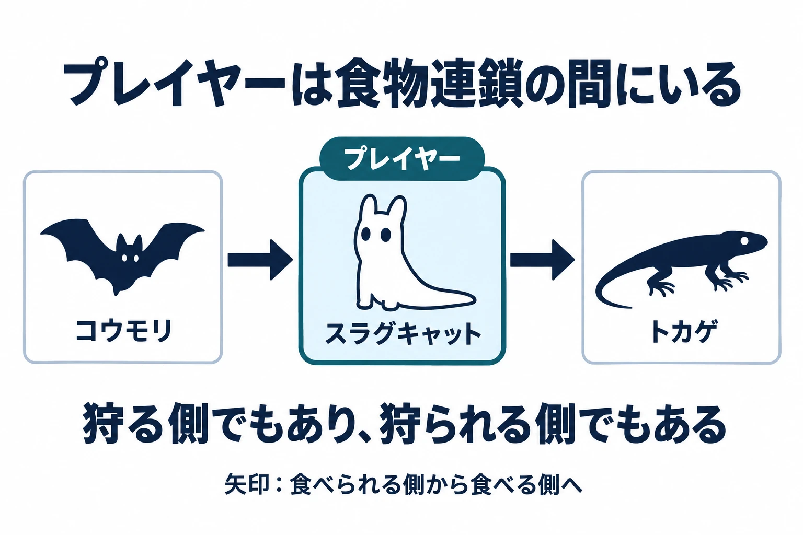

# プレイヤーは、食物連鎖のどこにいるか――捕食者と被食者から遊びの関係を決める

架空の草原に、クサハミを狩るハシリキバの姿を作ろう。プレイヤーは遠くからその様子を見て、近づくか、隠れて通り過ぎるかを選ぶ。生き物同士の食べる関係を、行動を決める手がかりにするのである。

企画書のハシリキバは、プレイヤーに向かってくる前に、草食獣のクサハミを狩っているだろうか。プレイヤーがいないときは、何をしているだろうか。攻撃の相手をプレイヤーだけにすると、クサハミを追う姿も、その狩りを見て進路を選ぶ場面も生まれない。

[第1回](ecology-niche-food-web-creature-jobs.md)では、居場所と食べ物を「職業」と呼び、生き物の配置を決めた。第2回では、その職業から体の形を考えた。シリーズ「生態学から生き物をつくる」の第3回では、食べる側と食べられる側の間にプレイヤーを置き、狩る遊びと逃げる遊びをつなぐ。

判断軸は、 **その生き物は誰を食べ、誰に食べられるか。プレイヤーはその間のどこにいるか** である。

***

## 1. 捕食者と被食者は、相手との関係で決まる

捕食とは、生きた動物を捕らえて食べることである。食べる側を捕食者、食べられる側を獲物、または被食者と呼ぶ。コトバンク「捕食」に掲載された『世界大百科事典（旧版）』の「餌」の項は、このように説明する。[[1](#ref-1)]

同じ解説では、食べる側と食べられる側の関係が食物連鎖を形作るとされる。それは、生態的平衡、つまり自然界の生き物のつり合いを保つうえで重要な役割を持つ。[[1](#ref-1)]

『精選版 日本国語大辞典』の「被食者」は、一般に、食べられる側は捕食者より小柄で、運動力も小さく、個体数は多いと説明する。[[2](#ref-2)] この「数が多い」は、第1回で見た、上位ほど数が少なくなるピラミッドにつながる。

架空の草原なら、ハシリキバはクサハミに対する捕食者であり、クサハミはハシリキバに対する被食者である。まず相手を名指しすると、「敵」「味方」というプレイヤーから見た分類に、食べ物を得るための関係を加えられる。

***

## 2. 食べる側の数は、食べられる側の数につられて動く

『改訂新版 世界大百科事典』の今泉吉典による解説は、カナダのオオヤマネコがユキウサギを主食とすると述べる。ウサギの数の増減に応じて、オオヤマネコの生息数が **約10年** を周期に大きく変動することが知られている。[[3](#ref-3)]

食べる側の数は、食べられる側の数に左右される。この関係をゲームの設計へ引きつけると、獲物の数を変えることは、捕食者をどう扱うか考えるきっかけになる。

たとえば、プレイヤーがクサハミを狩って数を減らせるとする。そのとき、ハシリキバの暮らしにも変化を持たせるか。ここから先は、自然の事実を手がかりにした設計上の問いである。ゲームの中で何を変えるかは、狩りの結果をどこまで遊びに返したいかで決められる。

***

## 3. プレイヤーを連鎖の「間」に置く――Rain World

『Rain World』について、Joar Jakobsson氏は、試作の出発点を次の連鎖で説明している。コウモリを食べるスラグキャットと、そのスラグキャットを食べるトカゲである。スラグキャットは、プレイヤーが操作する生き物だ。[[4](#ref-4)]

この配置を遊びの関係として読むと、主人公には食べ物を追う理由と、自分を食べる相手から逃げる理由がある。獲物へ近づく場面と、捕食者を避ける場面が、同じ主人公の行動としてつながる。

「プレイヤーはその間のどこにいるか」という問いに、この試作は明快な位置を与えている。 **食べる側でもあり、食べられる側でもある** 場所だ。狩りに出ることと、身を守ることを一緒に考える構造になる。

Joar Jakobsson氏による試作の説明をもとにした模式図。[[4](#ref-4)]

さらにJames Therrien氏は、画面の外でも生き物が生き続け、餌を狩り、縄張り争いをしていると述べる。[[4](#ref-4)] プレイヤーが見ている間にも、その外側にも、生き物同士の関係が続いているのである。

***

## 4. 自分のために生きる敵と、予測しにくさを一緒に設計する

生き物に自分の暮らしを持たせるなら、出会いの面白さと、動きを読み切れない難しさを一緒に扱う必要がある。誰を食べに行くかで行き先が変わる設計では、プレイヤーとの出会い方も変わるからだ。

Jakobsson氏は、AIの生き物をプレイヤーの障害物として置く発想から、自分自身のために生きる存在へと捉え直した。同時に、自分の身を守る敵は、とても難しく、苛立たしいものになりうるとも述べている。[[4](#ref-4)]

同記事が紹介するJakobsson氏の狙いは、敵を、プレイヤーが出し抜ける程度に賢い相手にすることだった。同記事は、このAIがプレイヤーに、敵と正面から対峙するより、かわすことを促すと説明する。[[4](#ref-4)]

Therrien氏は、生き物の行き先を制限しすぎると、ただのプラットフォーマー（足場を跳び移って進む形式のゲーム）になってしまったと振り返り、混沌を保とうとしたと説明する。[[4](#ref-4)]

ここから得られる設計上の問いは、自由に動く相手に対して、プレイヤーが何を見て判断できるかである。ハシリキバがクサハミを追っているなら、その行動を見て道を選べる。一方、行き先が変わっても手がかりが得られなければ、逃げる判断は難しくなる。生き物の自由と、プレイヤーが状況を読む機会を組み合わせたい。

***

## 5. 架空の草原へ置き換える――設計上の考察

ここからは、これまでの関係を使った架空の設計案である。プレイヤーを草原で暮らす生き物として置き、何を食べ、誰に食べられるかを決める。

### プレイヤーの位置から、遊びの中心を選ぶ

狩る側を中心にするなら、クサハミを食べるプレイヤーを置く。狙いを定めて近づき、獲物を追うことを主な遊びにできる。

狩られる側を中心にするなら、プレイヤーをハシリキバの獲物として置く。隠れる場所を探し、接近を見て逃げることに重心を置ける。

その間に置くなら、プレイヤーはクサハミを食べ、ハシリキバには食べられると決める。獲物を追いたい場所が、自分も狙われる場所になる。狩りを続けるか、身を隠すかを、その場の関係から選ばせられる。

### 食べ合う関係を、見て判断できる場所に置く

草原を見渡せる場所から、ハシリキバがクサハミを狩る場面を見せる案を考えよう。プレイヤーは、誰が誰を食べるかを行動で知る。そのうえで、近づく道と、距離を取る道を選べるようにする。

ここで確かめたいのは、食べ合う場面が判断に使えるかである。関係を見たあとで進路を選べれば、観察が遊びにつながる。プレイヤーがいなくても続く暮らしに、プレイヤーが見て考える入口を用意するのだ。

### 獲物を減らした結果を、どこまで返すか決める

プレイヤーがクサハミを減らしたら、ハシリキバが別の獲物であるタネネズミを探すようにする案がある。餌を探す場所も変えるなら、次に通る道の危険にも変化を持たせられる。

ハシリキバの振る舞いを変えない設計も選べる。たとえば、クサハミを狩る結果を食料の獲得に絞り、捕食者を避ける場面は安定して遊べるようにする。何を連動させるかを、プレイヤーに経験してほしい変化から決めるのである。

### 自由に動かす範囲と、読める手がかりを決める

ハシリキバが獲物を求めて移動できる範囲を決めたら、その範囲をプレイヤーの目線で見直す。遠くから姿を見られる場所はあるか。狩りをやめて逃げる道を選べるか。隠れて様子を見る余地はあるか。

関係が分かっていても、対処する機会がなければ判断を行動に移せない。遭遇する場所に変化を持たせながら、観察や退避の機会を残す。どこまで自由に動かし、どこで遊びとして読める形に留めるかを、食べる相手との関係ごとに決めたい。

***

## 6. 企画書で点検する、食べる関係とプレイヤーの位置

草原の設定とマップを並べ、次の項目を点検する。

- その生き物が誰を食べ、誰に食べられるかを言えるか。
- プレイヤーの位置は、狩る側、狩られる側、その間のどこか。中心にしたい遊びと合っているか。
- プレイヤーがいなくても食べる関係が続き、その関係を見て判断できる場面があるか。
- プレイヤーが獲物を減らしたとき、捕食者の振る舞いを変えるか、変えないかを決めたか。
- 生き物を自由に動かす範囲に、プレイヤーが観察し、隠れ、逃げる機会があるか。

最初の草原に戻ろう。ハシリキバがクサハミを狩り、プレイヤーもクサハミを食べる。そのプレイヤーを、ハシリキバが獲物として狙う。こう置くと、食べ物を得る行動と、身を守る行動を同じ場所で選ぶことになる。

生き物の関係を決めることは、プレイヤーが何を追い、何から逃げるかを決めることでもある。判断軸は、 **その生き物は誰を食べ、誰に食べられるか。プレイヤーはその間のどこにいるか** である。

次回は、群れと縄張りから、生き物が集まる場所と守る場所を考える。

## References

1. [「捕食」各辞典の解説][1] — コトバンク、掲載日不明。『世界大百科事典（旧版）』「餌」の項（執筆者表記なし）を参照。2026年10月13日閲覧。

[1]: https://kotobank.jp/word/%E6%8D%95%E9%A3%9F-630059

2. [「被食者」各辞典の解説][2] — コトバンク、掲載日不明。『精選版 日本国語大辞典』を参照。2026年10月13日閲覧。

[2]: https://kotobank.jp/word/%E8%A2%AB%E9%A3%9F%E8%80%85-610089

3. [「おおやまねこ」各辞典の解説][3] — コトバンク、掲載日不明。『改訂新版 世界大百科事典』「オオヤマネコ」（今泉吉典執筆）のカナダにおけるユキウサギとの関係を参照。2026年10月13日閲覧。

[3]: https://kotobank.jp/word/%E3%81%8A%E3%81%8A%E3%82%84%E3%81%BE%E3%81%AD%E3%81%93-3146142

4. [Chris Priestman「Crafting the complex, chaotic ecosystem of Rain World」][4] — Game Developer、2017年3月28日。Joar Jakobsson氏とJames Therrien氏の発言を参照。

[4]: https://www.gamedeveloper.com/design/crafting-the-complex-chaotic-ecosystem-of-i-rain-world-i-

----

この文書は、Perplexity、Claude、OpenAI Codex の3つのAIの支援を受けて著述されたものです。引用画像を除き、MIT License にて提供されています。
