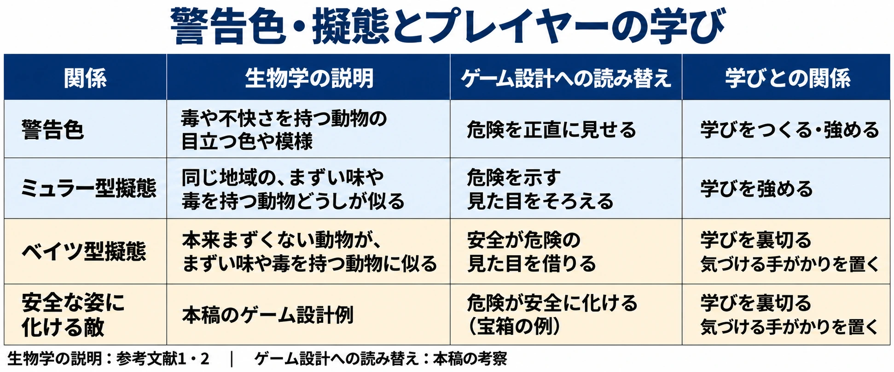
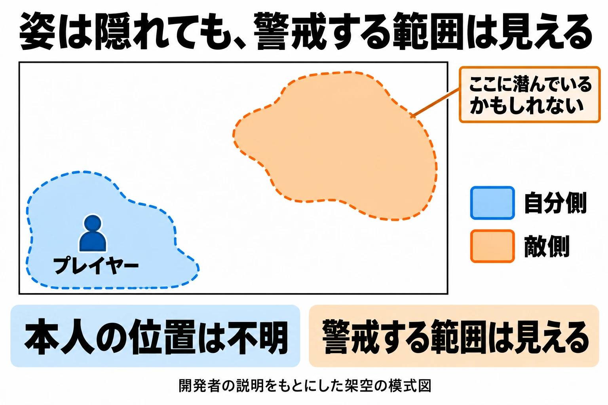

# その見た目で、危険は伝わるか――警告色と擬態で、学ばせる見た目とだます見た目を決める

架空の草原で、タネネズミが草の実を探している。そのそばに、毒を持つ生き物を置いてみよう。背中には、草の中でも目に入る帯模様がある。近づいて触れたプレイヤーは、毒を受ける。このとき、どう見せれば「この模様には、次から気をつけよう」と思えるだろうか。

毒があるという設定を、プレイヤーが使える知識にする。そのためには、見た目と、実際に起こることを結びつける必要がある。さらに、同じ模様を持つ無害な生き物を置けば、その知識を頼りにした判断が揺さぶられる。

[前回の第4回](ecology-herds-territories-how-to-break-and-guard.md)では、群れの崩し方と縄張りの知らせ方を考えた。シリーズ「生態学から生き物をつくる」の第5回では、警告色と擬態から、見た目で危険を伝える方法と、見た目でだます方法を考える。

判断軸は、 **その見た目で、危険をプレイヤーに伝えられるか。だますなら、何で気づかせるか** である。

***

## 1. 警告色は、経験と結びつく見た目である

警告色とは、毒や不快さを持つ動物に見られる、よく目立つ色や模様である。コトバンク「警告色」の『百科事典マイペディア』は、有毒な針や牙、不快な味や臭気を持つ動物について説明している。例は毒ヘビ、ハチ、ある種の鱗翅類、つまりチョウやガの幼虫である。[[1](#ref-1)]

同じページの『ブリタニカ国際大百科事典 小項目事典』では、警戒色とも呼ばれる。一度襲って不快な経験をした捕食者、つまり食べる側の動物は、その経験を色と結びつける。そして、多くの場合、その相手を避けるようになるという。[[1](#ref-1)]

ここからは、プレイヤーの学習への読み替えである。草原の生き物に触れて毒を受けたとき、帯模様が目に残っていれば、次の出会いで判断材料になる。「あの見た目と、この危険がつながっている」と覚えられるからだ。

一度の経験が次の判断に生きるように、見た目と結果を近づけて見せたい。たとえば、接触した相手が分かる場面で毒の効果を示す。別の敵の攻撃と重なれば、何が毒の原因だったかが曖昧になる。これは、すべてのプレイヤーが必ず一度で覚えるという法則ではなく、学びを支える設計の目標である。

警告色を手がかりにするなら、 **目立つ姿を覚え、その記憶を次に使えること** まで考える。色や模様は、経験を思い出すための目印になる。

***

## 2. 危険な者どうしで、警告をそろえる――ミュラー型擬態

ミュラー型擬態は、まずい味や毒を持ち、同じ地域で暮らす複数の動物が、似た外見を持つことである。コトバンク「擬態」の『改訂新版 世界大百科事典』で、常喜豊はこのように説明している。[[2](#ref-2)]

これをゲーム設計へ読み替えると、危険な生き物どうしで、警告の見た目を共有する案になる。草原で帯模様と毒の関係を覚えたら、別の生き物にも同じ帯模様がある。プレイヤーは、近づく前から毒を警戒できる。

作品全体やシリーズ全体で、色、模様、形に共通の意味を持たせることもできる。一度の学びを、初めて見る相手へ持ち運べるのである。

その際は、共有する意味を絞ると考えやすい。「この帯模様は毒を示す」と決めれば、体格や暮らし方には違いを付けられる。 **何が同じ危険なのか** がそろっているほど、見た目を頼りにした判断が役立つ。

***

## 3. 危険な姿を借りる、安全な姿に化ける

ベイツ型擬態は、本来まずくない動物が、まずい味や毒を持つ別の動物に外見を似せ、外敵から逃れることである。常喜豊の解説では「ベーツ型擬態」と表記される。本稿ではベイツ型擬態で統一する。[[2](#ref-2)]

同じ項目の『日本大百科全書（ニッポニカ）』で、桑村哲生は、擬態を他の生物や無生物に形、色、行動などを似せ、第三者をだます現象として説明している。[[2](#ref-2)]

ゲームへの読み替えでは、無害な生き物に毒持ちと同じ帯模様を付ける案が考えられる。プレイヤーは毒を恐れて避ける。実際には近づいても安全だが、これまでの学びが相手を守るのである。

逆向きの設計もある。危険な敵が、安全だと思っていた宝箱などに化ける案だ。こちらは「近づいてよい」という学びを利用して、プレイヤーを誘う。

両者を本稿では、学んだ見た目と実際の性質が食い違う設計として扱う。「危険が安全に化ける」はベイツ型と逆向きの関係を示す説明であり、「逆のベイツ型」という生物学上の分類名を置くものではない。

生物学の説明は参考文献1・2に基づく。ゲーム設計への読み替えは本稿の考察である。[[1](#ref-1)][[2](#ref-2)]

***

## 4. だますなら、気づける手がかりを置く

だます見た目には、見破るための手がかりを組み合わせたい。初めての出会いで見逃しても、あとから「あれが手がかりだった」と結びつけられるものを置く。そうすれば、次は何を見るか、どう動くかを考えられる。

「わからん殺し」は、何が起きたか分からないまま倒されることを指す。本稿では、これを **プレイヤーが何も学べない失敗** として捉える。これはゲーム設計上の考察である。原因も見分け方も分からなければ、再挑戦しても判断を変える根拠がなく、ストレスが残りやすい。

警告色の説明で重要だったのは、経験と見た目の結びつきである。擬態で予想を裏切るときにも、結びつける先が必要になる。だまされた事実だけを残すと、「どれも信用できない」で終わってしまう。見破る根拠まで残せば、「次はここを確かめよう」へ進める。

### 行動する前に、確かめる余地をつくる

手がかりの候補には、見た目のわずかな違い、動きや音、置かれ方の不自然さがある。架空の宝箱なら、留め具の形が違う、近づくと身じろぎする、場違いな向きで置かれている、といった案だ。これらは本稿の設計例である。

手がかりは、プレイヤーが行動を決める前に受け取れる位置に置く。たとえば音を聞いて足を止められるなら、観察するか、通り過ぎるかを選べる。開けたあとに初めて現れる違いだけでは、その場で見破る材料にならない。

### 失敗のあとに、意味を結びつける

最初は不自然さを見逃すこともある。そこで正体を現す瞬間には、何にだまされたかが分かるようにする。先ほど動いた部分が口だったと分かれば、動きと危険がつながる。

この場面で残したいのは、次に使える短い理解だ。「動く箱を確かめよう」「この置かれ方に注意しよう」と言えるなら、失敗は観察の仕方を変える。単に正体を知るだけでなく、遭遇前の手がかりを思い出せることが重要である。

### 同じ手がかりを、次の判断にも使えるようにする

見破る規則に一貫性があれば、プレイヤーは経験を積み重ねられる。同じ手がかりの意味が理由なく変わると、学んだことを試しにくい。驚かせるたびに規則を崩す設計には、慎重になりたい。

無害な生き物が危険な姿を借りる場合にも、見破る意味を用意できる。毒持ちと違う動きを知れば、安全な道を選べる、といった案である。観察によって選択が増えるなら、だましを解くことが遊びになる。

### 『ミミックロジック』は、手がかりを読むことが遊びになる

AUTOMATONの2024年2月28日の紹介によると、『ミミックロジック』では、宝箱に化けたミミックを見た目で判別できない。そこで宝箱の声を聴き、嘘をつくミミックを発言の矛盾から推理する。誤ってミミックを開けるとゲームオーバーになる。[[3](#ref-3)]

この例を設計上の手がかりとして読むと、見破る材料を、外見以外にも置けると分かる。箱の姿が同じでも、発言を照らし合わせて判断できる。何を確かめるかが、遊びの中心に据えられている。

同記事は、ミミックを特定しきれない場合には、確信を持てない箱を開けずに進む判断にも触れている。[[3](#ref-3)] 見破る手がかりに加え、分からないときにどうするかも選べる。この組み合わせを、架空の生き物との出会いにも応用できる。

***

## 5. 隠れる力を、プレイヤーに渡す――スプラトゥーン

常喜豊の解説は、周囲の色や模様に似て隠れる「隠蔽的擬態」と、目立つことで利益を得る「標識的擬態」を区別する。前者の例は、枯れ葉に似た羽を持つコノハチョウである。[[2](#ref-2)]

隠れる仕組みを、プレイヤー自身の力にする例が『スプラトゥーン』だ。任天堂の「社長が訊く」で、本作のプログラムディレクターである佐藤慎太郎氏は、企画の核に隠れることがあったと説明する。試作では、真上から見ると豆腐型のキャラクターが自分の塗ったインクと同じ色になり、見えなくなった。3D画面では位置が分かったため、伏せる操作を追加したという。岩田氏も、この仕組みを保護色と捉えている。[[4](#ref-4)]

本作のディレクター、阪口翼氏は、ヒト型にすると姿がうっすら見え、遊びの意味が変わったと語る。完全に消えることが必要だったのである。プロデューサーの野上恒氏は、その不可視性が待ち伏せや隠密行動を可能にし、敵のインクへ向かう際の警戒を生むと説明している。[[4](#ref-4)]

本稿が設計として読み取るのは、 **隠れる本人は見えなくても、隠れうる場所は見えている** という関係である。敵の色のインクが、「このあたりにいるかもしれない」と考える範囲になる。

隠れる側には、姿を消して相手の行動を待つ選択がある。向かう側には、見えている場所を警戒する判断がある。相手の位置を確定できなくても、警戒する根拠があるから、緊張感を遊びにできるのだ。

開発者の説明をもとにした架空の模式図。製品版のマップや射程を再現したものではなく、領域の面積比にも意味はない。[[4](#ref-4)]

***

## 6. 色と形に、見分ける役目を持たせる――Valve

Game Developerが伝えたMicrosoft Gamefestでの講演では、Valveの開発者が、見分けやすさと遊びの関係を説明している。『チームフォートレス2』のアートディレクター、Moby Francke氏は、チームを色で、敵のクラス、つまり役割の種類をシルエットで見分けさせたと語る。シルエットは、一目で読み取れる体の輪郭である。[[5](#ref-5)]

色の区別は周囲の造形にも及ぶ。赤チームには暖色と木やレンガ、青チームには寒色とコンクリートや鋼を使っている。Francke氏は、シルエットをキャラクターデザインの基礎としても位置づけている。[[5](#ref-5)]

同じ講演で、『Left 4 Dead』チームのRandy Lundeen氏は、初期の生存者がゾンビの群れと見分けにくく、作り直した経緯を説明した。また、写実的で暗い霧では輪郭を読み取りにくかったため、霧を明るくしたという。[[5](#ref-5)]

ここからの読み取りは、見分けるための情報を複数の特徴に担わせることだ。色で所属を読み、形で役割を読む。そして、背景の中でもその特徴が見えるようにする。この考え方を、毒持ちの生き物を知らせる設計へ持ち帰れる。

***

## 7. 草原に、学べる危険と見破れる擬態を置く

ここからは、本稿の考察による架空の設計例である。まず、毒を持つ生き物の警告を決める。帯模様に加え、背中の突起や、接触前に体を持ち上げる動きにも同じ危険を担わせる。どの特徴を覚えれば、次に距離を取れるかを考える。

色覚には多様性があるため、危険の区別は色に加え、形・模様・動きでも伝えたい。同じ色が見分けにくくても、突起や帯の配置で判断できるようにする。詳しい考え方は[ゲームのアクセシビリティ設計](game-accessibility-design-guide.md)で扱っている。

次に、その帯模様を借りる無害な生き物を置くかを決める。置くなら、見破る手がかりも同時に決める。たとえば、こちらは背中が丸く、体を持ち上げる動きもしない。遠目には警戒するが、少し観察すると区別できる案だ。これは実在の動物の説明ではなく、この草原のための設定である。

最初の出会いでは、毒持ちの特徴と毒の効果を結びつける。その学びを使える出会いを経てから、似た姿の無害な生き物を置く。こうすれば、「帯模様に注意する」という知識に、「形と動きも確かめる」という知識を足せる。

待ち伏せする生き物を置くなら、隠れうる場所を見せる案もある。たとえば、特定の模様を持つ草むらに姿が溶け込む設定にする。本人の位置は分からなくても、草むらの範囲は見える。プレイヤーは、近づく前に立ち止まったり、別の道を選んだりできる。

現実の生き物へ話を戻すと、擬態の働きには解釈の慎重さも必要である。コトバンクの『ブリタニカ』は、人間の目からの解釈であり、実際の機能が不明な場合もあると注記している。[[2](#ref-2)] 現実の擬態を紹介するときは、似て見えることだけを根拠に、その働きを断定しすぎないようにしたい。

***

## 8. 企画書やアートの発注前に、見た目と経験をつなぐ

警告色は、危険と見た目を結びつける手がかりになる。ミュラー型擬態からは、その学びを別の相手にも使える設計を考えられる。見た目を借りたり、安全な姿に化けたりする設計では、見破る根拠まで含めて用意したい。

隠れる遊びでは、警戒する場所を見せる方法もある。相手の正体や位置をすべて明かさなくても、何を疑い、どう確かめるかを示せる。

企画書やアートの発注前には、次の点を確認したい。

- その生き物が持つ危険と、覚えてほしい見た目が結びついているか。
- 初めて危険に遭ったあと、何が原因だったかをプレイヤーが理解できるか。
- 共通の色・模様・形を持つ生き物には、共通して警戒すべき意味があるか。
- だます相手には、行動前に確かめられ、見破ったあとも使える手がかりがあるか。
- 姿を隠す相手には、隠れうる場所など、警戒や回避の判断材料があるか。
- 色だけでなく、形・模様・動きからも危険を読み取れるか。

判断軸は、 **その見た目で、危険をプレイヤーに伝えられるか。だますなら、何で気づかせるか** である。出会ったあとに次の判断が変わるよう、姿と経験を一緒に設計したい。

次回は、環境を作り変える生き物を考える。

## References

1. [「警告色」各辞典の解説][1] — コトバンク、日付表記なし。『百科事典マイペディア』の定義・動物例と、『ブリタニカ国際大百科事典 小項目事典』の学習の説明を参照。2026年10月14日閲覧。

[1]: https://kotobank.jp/word/%E8%AD%A6%E5%91%8A%E8%89%B2-254679

2. [「擬態」各辞典の解説][2] — コトバンク、日付表記なし。『改訂新版 世界大百科事典』（常喜豊執筆）、『日本大百科全書（ニッポニカ）』（桑村哲生執筆）、『ブリタニカ国際大百科事典 小項目事典』を参照。2026年10月14日閲覧。

[2]: https://kotobank.jp/word/%E6%93%AC%E6%85%8B-50808

3. [Taijiro Yamanaka「ウソつき見破りローグライク『ミミックロジック』Steamにて好評スタート。宝箱の声を聴き、矛盾からウソつきミミックを探す論理パズル」][3] — AUTOMATON、2024年2月28日。宝箱の声と矛盾を用いる推理、および開けるかどうかの判断を参照。

[3]: https://automaton-media.com/articles/newsjp/20240228-284088/

4. [任天堂「社長が訊く『Splatoon（スプラトゥーン）』 2. もがいてウサギ」][4] — 任天堂、日付表記なし。佐藤慎太郎氏、阪口翼氏、野上恒氏による隠れる遊びの説明を参照。担当の表記は同インタビューの[「1. はじめは豆腐」](https://www.nintendo.co.jp/wiiu/interview/agmj/vol1/index.html)の注記に基づく。2026年10月14日閲覧。

[4]: https://www.nintendo.co.jp/wiiu/interview/agmj/vol1/index2.html

5. [Christian Nutt・Michael Zenke「In-Depth: How Valve Makes Art To Enhance Gameplay」][5] — Game Developer、2008年7月29日。Microsoft Gamefestの講演レポート。Moby Francke氏とRandy Lundeen氏の、色・シルエット・見分けやすさに関する説明を参照。

[5]: https://www.gamedeveloper.com/art/in-depth-how-valve-makes-art-to-enhance-gameplay

----

この文書は、Perplexity、Claude、OpenAI Codex の3つのAIの支援を受けて著述されたものです。引用画像を除き、MIT License にて提供されています。
