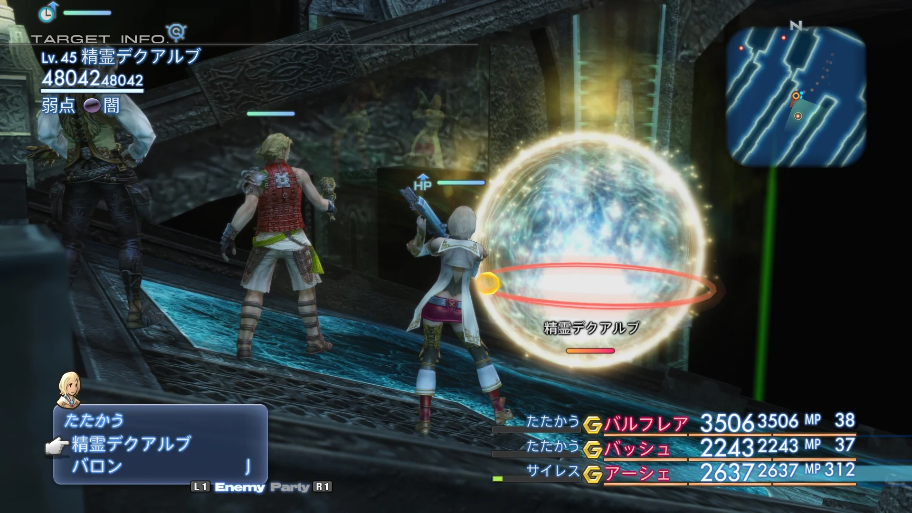
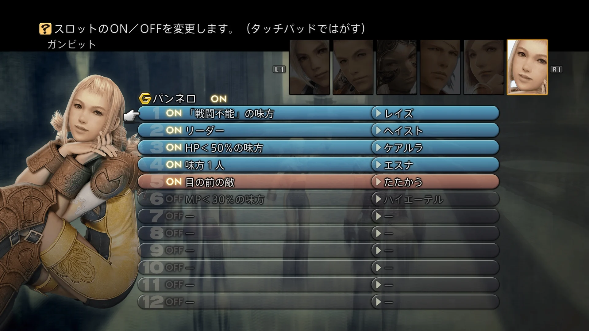
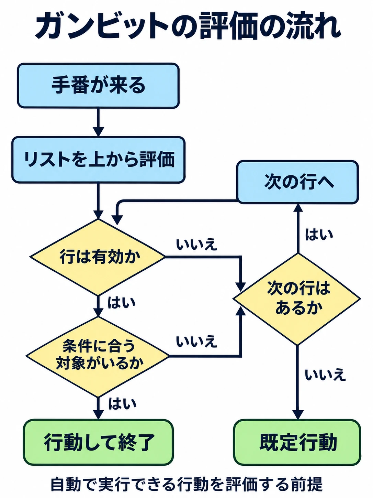

# 仲間に任せるとき、プレイヤーは何を決めるのか——FF12のガンビットが開いた「AIを組む遊び」と、開発の道具としてのその後

> 2026年11月12日改版：記事全体を全面的に書き直しました。内容の変更はGitの履歴から追えます。

***

## 1. はじめに

仲間の体力が減るたびに回復を指示する。その判断を仲間に任せる。さらに、どこまで体力が減ったら回復するか、攻撃と回復が両方できるときはどちらを優先するかを、あらかじめ決めておく。『ファイナルファンタジーXII』（以下、FF12）の「ガンビット」でプレイヤーが扱うのは、この三つ目の判断だ。

仲間に戦闘を任せる仕組みには、『ドラゴンクエストIV』の「さくせん」から続く系譜がある。その変遷は [ゲームのAIは何のために賢くなってきたのか](history-of-ai-in-video-games.md) で紹介している。FF12では、仲間に何を任せるかに加え、任せ方そのものをプレイヤーが組めるようにした。何を事前に決めさせ、戦闘中のどの判断を任せ、いつ手を入れられるようにするか。この三つを軸に見ると、FF12で遊びになった仕組みが、FF14で開発の道具にもなった経緯が見えてくる。

***

## 2. ガンビットはなぜ生まれたか

FF12では、フィールドで見えている敵と、その場で戦闘に入る。探索から戦闘までをシームレスにつなぎ、リアルタイムで進めるのが開発時の狙いだった。オリジナル版のプロジェクトマネージャーで、リマスター版『ザ ゾディアック エイジ』のプロデューサーを務めた加藤弘彰氏によれば、従来のコマンド式にリアルタイム要素を足すだけでは、進行が速すぎて操作が難しくなる懸念があった。その解決策として採用されたのがガンビットである。[[1](#ref-1)]


*画像出典（引用）：[Gematsu, "Final Fantasy XII: The Zodiac Age screenshots"](https://www.gematsu.com/2017/05/final-fantasy-xii-zodiac-age-screenshots-2)。Square Enix公開スクリーンショット。本文中の戦闘UI解説のため引用。*

発想の源の一つは『ファイナルファンタジーIV』（以下、FF4）にあった。加藤氏は、FF4の戦闘システムの裏側に、モンスターのAIを制御するガンビットに似た仕組みがあり、それを別の方向に発展させたと語っている。オリジナル版でリードプログラマーを務めた片野尚志氏も、伊藤裕之氏が手がけたFF4のモンスターAIがガンビットに近かったと振り返る。開発側がモンスターの行動を決めるために使っていた発想が、FF12ではプレイヤーが仲間を動かすための仕組みになった。[[1](#ref-1)][[2](#ref-2)]

伊藤氏は別のインタビューで、『ファイナルファンタジー』の戦闘システム全体の発想を語る際に、NFLのアメリカンフットボールを例に挙げている。双方が戦略を持ち、個々のプレーを事前に組み立てておく点が、伊藤氏の考え方に近かったという。[[3](#ref-3)]

***

## 3. 仕組み——対象・条件・行動・優先順位

ガンビットの一行は「誰に、どんなとき、何をするか」を表す。たとえば「HPが半分未満の味方にケアル」なら、対象は味方、条件はHPが半分未満、行動はケアルである。設定画面では「HPが半分未満の味方」に当たる対象条件を選び、隣に行動を割り当てる。[[4](#ref-4)][[5](#ref-5)]


*画像出典（引用）：[Gematsu, "Final Fantasy XII: The Zodiac Age screenshots"](https://www.gematsu.com/2017/05/final-fantasy-xii-zodiac-age-screenshots-2)。Square Enix公開スクリーンショット。本文中のガンビットUI解説のため引用。*

自動で行動を選ぶときは、リストの上から順に確認し、最初に条件を満たして実行できる行動を選ぶ。回復を上、攻撃を下に置けば、回復が必要な味方がいるときはそちらを優先する。逆に、攻撃できる敵がいれば攻撃する設定を先に置くと、その行が選ばれて下の回復まで判定が届かない。並び順は、両方できる場面でどちらを先にするかという意思表示だ。[[4](#ref-4)][[5](#ref-5)]

個々の行はON/OFFを切り替えられる。ガンビットが有効でも、戦闘中にコマンドを手入力して、その場で別の行動を指示できる。冒険を進めるにつれて、選べる対象条件の種類や設定枠が増える。設定枠は序盤は3つほどで、最大12まで増える。これにより、回復と攻撃だけの設定から、仲間の役割に応じた設定へ広げていける。[[4](#ref-4)][[5](#ref-5)][[6](#ref-6)]

次の図は、上から順に判定する考え方をターン制に移した概念図である。「手番」はその応用例で評価を始めるタイミング、「既定行動」は最後の行まで該当しなかったときに取る行動を指す。



***

## 4. なぜ遊びになり、なぜ批判されたか

PC GamerのSarah James氏は2021年の記事で、周囲のプレイヤーから「ゲームが勝手に遊んでしまう」と感じるという不満があったと振り返る。操作する手応えを得るため、パーティーリーダーのガンビットを切る人もいたという。一方、James氏は、行動を考える作業が戦闘前に移ったと捉える。難しい戦闘では戦況に応じて設定を調整したり、手動で魔法を使ったりする場面も残るからだ。[[5](#ref-5)]

編者は、ガンビットの遊びの中心を「組む、観察する、直す」の繰り返しに見る。たとえば、回復が遅れたとき、次の戦闘では回復の優先順位だけを上げてみる。それで仲間が倒れにくくなれば、並び順の効果が分かる。反対に、回復のたびに攻撃の手が止まって苦戦するようなら、回復を始めるHPの基準を見直すか、回復役を別に置く判断が生まれる。

同じ設定で勝てる相手が続くなら、入力を繰り返さずに探索を進められる。その快適さと、戦闘のたびに自分で判断したいという欲求は、同じ設計から生まれる。設定を考え直す局面がどの程度あるか、思わぬ展開にその場で対応できるかで、戦闘を見守る時間の意味は変わる。

***

## 5. 設計に落とす

ターン制RPGに応用するなら、各キャラクターの手番開始時に、その時点の戦況を使って毎回リストの先頭から評価する。必要なデータは、行の優先順位、有効か無効か、対象を選ぶ条件、その対象に対して行う行動である。自動で行動を選ぶ場合の流れは、次のように書ける。

```
手番の開始時に、優先順位の高い行から順に調べる
    無効な行は飛ばす
    条件に合い、行動を実行できる対象を探す
    対象が見つかったら、その行動を選んで評価を終える
どの行も選ばれなければ、既定行動を選ぶ
```

既定行動は、すべての行が無効だったり、条件に合う相手がいても必要なMPが足りなかったりするときに使う。たとえば「防御」を既定にすれば、設定から漏れた場面でも手番は進む。希少なアイテムを使うかどうかなど、人に判断を戻したい場面があるなら、どの手番で自動選択を止めて指示を求めるかも決めておく。

編者の考えでは、設定画面では優先順位がひと目で分かり、条件と行動を別々に選べ、行ごとにON/OFFを切り替えられると試しやすい。戦闘後に「どの行が発動したか」を記録で見返せれば、回復しなかった原因を並び順や条件から調べられる。序盤は回復と攻撃を試せる程度の選択肢に絞り、結果を読めるようになってから条件や枠を開放すると、覚えることを段階的に増やせる。ゲームの目的に応じたAI手法の選び方は [敵AI設計の実務](enemy-ai-design-practices.md) を参照してほしい。

***

## 6. 似た仕組みを持つ作品

BioWareの『Dragon Age: Origins』（2009年）では、直接操作しているキャラクター以外の仲間はAIで行動する。プレイヤーは事前に「作戦」を設定でき、戦闘中も操作するメンバーを切り替えて手動で指示できる。作戦のルールを上から順に判定し、最初に条件を満たしたルールの行動を実行する点は、ガンビットと共通する。普段の回復は作戦に任せ、特定の仲間を動かしたい局面で操作を引き取る、という役割分担ができる。[[7](#ref-7)][[8](#ref-8)]

ヴァニラウェア開発の『ユニコーンオーバーロード』（2024年）では、部隊同士が接触したあとの戦闘は、事前に設定した「作戦」に沿って自動で進む。プレイヤーはスキルの優先順位と、いつ誰に使うかを決める。公式サイトによると、条件はスキルごとに二つまで設定でき、二つ指定した場合は両方を満たしたときに発動する。戦闘中にコマンドを差し込むFF12や『Dragon Age: Origins』に比べ、調整の機会は部隊編成や次の交戦に備える段階に置かれている。[[9](#ref-9)][[10](#ref-10)]

***

## 7. 開発の道具としてのガンビット——FF14

2012年の『ファイナルファンタジーXIV: 新生エオルゼア』（以下、FF14）のインタビューで、プロデューサーの吉田直樹氏は、開発側がガンビットで敵のAIを制御していると明かした。仕組みが洗練されていて分かりやすく、簡易AIを作りやすいことに加え、FF12を手がけたプログラマーが多く参加していたことを理由に挙げている。[[11](#ref-11)]

同じ取材でUIを担当した皆川裕史氏は、当初、FF12のようにプレイヤーがガンビットを組めるUIを取り入れようとしたところ、「そこまでいったらBOTになっちゃうよ！」と止められたと振り返った。事前に決めた条件で戦闘中のターゲット選びまで任せられれば、プレイヤー本人が判断する場面は減る。皆川氏は、作戦を組んで戦闘を見守る遊び方が成り立つFF12と、プレイヤーがその場で操作することを重視した新生FF14の設計判断を、ここで説明している。[[11](#ref-11)]

FF14にはその後、プレイヤーが操作するキャラクターにNPCが同行する仕組みも加わった。導入時期を並べると、どの機能についての発言かを追いやすい。

| パッチ | 追加された機能 | プレイヤーにできること |
|---|---|---|
| 3.4 | 冒険者小隊 | NPCを集めて小隊を編成し、育成や任務への派遣を行う。[[12](#ref-12)] |
| 4.1 | 冒険者小隊の攻略任務 | 小隊員とダンジョンに入り、号令で行動をある程度指示する。[[13](#ref-13)] |
| 5.0 | フェイス | 『漆黒のヴィランズ』のメインストーリーに登場するダンジョンを、仲間NPCと攻略する。[[14](#ref-14)] |
| 6.1 | コンテンツサポーター | 対応するコンテンツをサポートNPCと攻略する。導入時には『新生エオルゼア』のパッチ2.0範囲も対応した。[[15](#ref-15)] |

2021年の『暁月のフィナーレ』の取材では、吉田氏はフェイスの行動改善を説明する際に「ガンビット（AIの思考）」という言葉を使った。たとえば回復役が倒れそうな味方を最優先で回復し、タンクが全体攻撃の前に被害を抑える技を使うといった改善である。この取材で説明されたのは、フェイスの行動の変化である。2012年に語られた敵AIとの実装上の関係は、これらの取材では明らかにされていない。[[11](#ref-11)][[16](#ref-16)]

2022年には、吉田氏は冒険者小隊について、フェイスとは別の仕組みで、プランナーがスクリプトに書いたIF文、つまり条件分岐の集まりに近いと説明した。同時期の合同インタビューでは、スタッフの多くがフェイスの行動を決めるアルゴリズムを汎用的に書けるよう準備を進めてきたことや、メインクエストのダンジョン側にも大きく手を入れたことを語っている。NPCの行動を作る道具と、NPCが攻略できるダンジョンの設計は、どちらも対応範囲を広げるうえで必要だった。[[17](#ref-17)][[18](#ref-18)]

***

## 8. むすび

AIを組む権限をどこに置くかは、誰に何を考えてほしいかで決まる。FF12ではプレイヤーが仲間の優先順位を決め、戦闘中に例外を手動で扱う。新生FF14の開発では、開発者が敵の行動を組むためにガンビットを使い、プレイヤー側の操作を自動化する案は見送った。二つの事例を企画時の判断に引き直すと、次のように整理できる。[[1](#ref-1)][[11](#ref-11)]

| 観点 | プレイヤーにAIの組み立てを開く | AIの組み立てを開発側に残す |
|---|---|---|
| オフラインかオンラインか | 一人用の戦闘では、設定の結果を自分の攻略に引き受けられる。オンラインでは設定の影響がどこまで及ぶかも考える。 | 共有の場では、NPCの判断を開発側で調整しながら、プレイヤー本人に求める操作を定められる。 |
| BOTへの悪用の懸念 | プレイヤー本人の操作まで任せられると、無人での反復が共有の報酬や競争に及ぼす影響が問題になり得る。 | プレイヤー自身の操作を残し、開発側が定義したNPCの行動に自動化の範囲を絞れる。 |
| 学習の負担 | 条件や優先順位を覚える必要がある。初期設定を用意し、変更できる項目を段階的に増やせる。 | プレイヤーは設定の書き方を覚えずに遊べる。開発側には、NPCの行動を予測しやすくする責任が残る。 |
| 試行錯誤のしやすさ | 自分で一行を変えて結果を比べられる。選ばれた行が分かると、次の変更を決めやすい。 | 開発側が条件や行動を変えて検証する。プレイヤーの試行錯誤は編成や戦闘中の立ち回りに置ける。 |

たとえば回復ひとつでも、プレイヤーに「どこまでHPが減ったら回復するか」を考えてほしいのか、「仲間の回復を見越して自分はいつ攻撃に踏み込むか」を考えてほしいのかで、開くべき設定は変わる。試作では、戦闘前の設定、戦闘中の操作、戦闘後の見直しのどこでプレイヤーが判断し、その判断の結果をどこで確かめられるかまで決めておきたい。

## References

<a id="ref-1"></a>1. [Clara Hertzog「Extended Play: How Final Fantasy XII’s Gambit Created One of the Most Distinct RPGs Ever」][1] — PlayStation.Blog、2017年7月7日。加藤弘彰氏・片野尚志氏への取材。

[1]: https://blog.playstation.com/2017/07/07/extended-play-how-final-fantasy-xiis-gambit-created-one-of-the-most-distinct-rpgs-ever/

<a id="ref-2"></a>2. [Alex Wawro「Why Final Fantasy IV was key to FFXII's AI-driven Gambit system」][2] — Game Developer、2017年7月5日。Polygonの取材における片野尚志氏の発言を紹介している。

[2]: https://www.gamedeveloper.com/design/why-i-final-fantasy-iv-i-was-key-to-i-ffxii-i-s-ai-driven-gambit-system

<a id="ref-3"></a>3. [Jason Schreier「Wow, Final Fantasy’s Combat Really Is Based On Football」][3] — Kotaku、2012年10月23日。1UPのJeremy Parish氏による伊藤裕之氏へのインタビューの一部を掲載している。

[3]: https://kotaku.com/wow-final-fantasys-combat-really-is-based-on-football-5954150

<a id="ref-4"></a>4. [アサミリナ「「ファイナルファンタジーXII」発売17周年！ 未だに斬新さのあるガンビットシステム。現代になって改めて見直されている至極の名作！」][4] — GAME Watch、2023年3月16日。優先順位、設定枠の数、手動コマンドに関する記述。

[4]: https://game.watch.impress.co.jp/docs/kikaku/1485808.html

<a id="ref-5"></a>5. [Sarah James「15 years on, Final Fantasy 12's combat system is still the best」][5] — PC Gamer、2021年10月25日。

[5]: https://www.pcgamer.com/15-years-on-final-fantasy-12s-combat-system-is-still-the-best/

<a id="ref-6"></a>6. [Harvey Randall「Turn-based RPGs are officially back in fashion, but I want more: It's time for modern developers to take another pass at FF12's gambit system」][6] — PC Gamer、2025年6月9日。対象条件の入手と設定枠の開放に関する記述を参照。

[6]: https://www.pcgamer.com/games/final-fantasy/turn-based-rpgs-are-officially-back-in-fashion-but-i-want-more-its-time-for-modern-developers-to-take-another-pass-at-ff12s-gambit-system/

<a id="ref-7"></a>7. [Electronic Arts「Dragon Age: Origins from BioWare Has Gone Gold on All Platforms」][7] — Electronic Arts、2009年10月23日。

[7]: https://news.ea.com/press-releases/press-releases-details/2009/Dragon-Age-Origins-from-BioWare-Has-Gone-Gold-on-All-Platforms/default.aspx

<a id="ref-8"></a>8. [Electronic Arts「Dragon Age: Origins」PlayStation 3版取扱説明書][8] — Electronic Arts、2009年。戦闘と「Combat Tactics」の項を参照。

[8]: https://eaassets-a.akamaihd.net/eahelp/manuals/dragon-age-origins-manuals_Sony%20Playstation%203.pdf

<a id="ref-9"></a>9. [アトラス「アトラス×ヴァニラウェアが挑む、新生シミュレーションRPG『ユニコーンオーバーロード』 2024年3月8日（金）発売決定！」][9] — アトラス公式サイト、2023年9月。

[9]: https://www.atlus.co.jp/news/22249/

<a id="ref-10"></a>10. [アトラス「SYSTEM — ステージ・バトル」][10] — 『ユニコーンオーバーロード』公式サイト、公開日記載なし。「バトル」と「作戦」の項を参照。

[10]: https://unicorn-overlord.com/system/stage-battle/

<a id="ref-11"></a>11. [中村聖司「『FFXIV: 新生エオルゼア』プロデューサー吉田直樹氏、UIアーティスト皆川裕史氏インタビュー（後編）」][11] — GAME Watch、2012年10月12日。

[11]: https://game.watch.impress.co.jp/docs/interview/565505.html

<a id="ref-12"></a>12. [スクウェア・エニックス「3.4 パッチノート 公開！」][12] — The Lodestone、2016年9月。

[12]: https://jp.finalfantasyxiv.com/lodestone/topics/detail/b2ae6bf59ac6553e554c55b6f2a91b493fef0e19

<a id="ref-13"></a>13. [スクウェア・エニックス「4.1パッチノート公開！」][13] — The Lodestone、2017年10月。

[13]: https://jp.finalfantasyxiv.com/lodestone/topics/detail/070a1dc3c34e11d49e5ee169f002b1a4ba6849a1

<a id="ref-14"></a>14. [スクウェア・エニックス「5.0パッチノート公開！」][14] — The Lodestone、2019年6月。

[14]: https://jp.finalfantasyxiv.com/lodestone/topics/detail/a4e218620c071ac211fb713bde888de90461f1fd

<a id="ref-15"></a>15. [スクウェア・エニックス「6.1パッチノート公開！」][15] — The Lodestone、2022年4月。

[15]: https://jp.finalfantasyxiv.com/lodestone/topics/detail/b85ab23e734c5f65640c8bea29bc104fa5823a6f

<a id="ref-16"></a>16. [編集O「『FF14』メディアツアー・吉田直樹P/Dインタビュー！ 『暁月のフィナーレ』＝ENDWALKERに込めた想いとは？」][16] — 電撃オンライン、2021年10月13日。

[16]: https://dengekionline.com/articles/99793/

<a id="ref-17"></a>17. [石井聡（クラフル）「『FFXIV』吉田直樹プロデューサーPLLフォローインタビュー」][17] — GAME Watch、2022年2月21日。

[17]: https://game.watch.impress.co.jp/docs/interview/1390020.html

<a id="ref-18"></a>18. [ファミ通.com編集部「『FF14』吉田直樹P/D合同インタビュー。『今後の10年に向け、さらに間口を3倍にも4倍にも広げたい』」][18] — ファミ通.com、2022年2月22日。

[18]: https://www.famitsu.com/news/202202/22252178.html

----

この文書は、Perplexity、Claude、ChatGPT の3つのAIの支援を受けて著述されたものです。引用画像を除き、MIT License にて提供されています。
