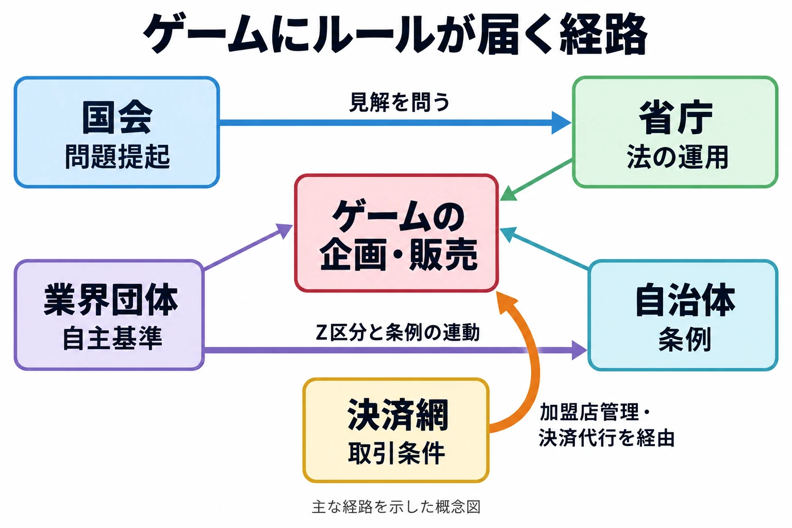

# その仕様は、誰のルールで止まるか――国会・省庁・自治体・業界団体・決済網から見るゲーム規制の地図

> **注意：** 本稿は制度と事例を整理するもので、法的助言ではありません。個別の企画・運用は、最新の法令・規約と具体的な仕様をもとに、法務部門や専門家に確認してください。

「この表現、大丈夫？」。企画会議で、登場人物の設定画を前に誰かが尋ねる。別の担当者は、有料のランダム報酬について同じ言葉を口にする。さらに販売担当者は、「そもそも、この内容で決済を使えるのか」と問い返す。これは架空の場面である。

三人の「大丈夫」を判定する物差しは、同じだろうか。表現の対象年齢、景品の提供方法、カード決済の取扱条件では、参照するルールも判断する相手も変わる。

本稿は「ゲームと行政のあいだ」第1回である。全7回と番外編を通じて考える判断軸は、 **その仕様は、どのルールの、どの言葉で読まれるか** 。まずはルールが届く経路を地図にし、企画段階でどこを見積もればよいかを整理する。

***

## 規制は、既存のルールの言葉に置き換えてやってくる

これまでの主な事例を見ると、ゲームへの規制は、ゲーム専用の新しいルールを作る形よりも、既存の法律・条例などの言葉にゲームを当てはめる形で現れてきた。

刑法の条文番号を題名にした『177』は、1986年に国会で取り上げられた。ゲームが議論の対象となり、政府に対応が問われる経路が、ここに見える。国会で取り上げることと、販売を規制する制度が成立することは、別の段階である。[[1](#ref-1)]

『グランド・セフト・オートIII』（以下、GTA III）は、2005年に神奈川県の青少年保護育成条例に基づく「有害図書類」に指定された。5月30日の県児童福祉審議会での指定を経て、6月7日に告示、すなわち行政による正式な公表が行われた。ゲームソフトが、青少年への販売などを制限するための「図書類」という枠で扱われたのである。[[2](#ref-2)]

コンプガチャについては、2012年5月、消費者庁が、オンラインゲームで偶然性を利用して有料でアイテムを提供し、特定の数種類を揃えたプレーヤーに別のアイテムを提供する方法は、景品表示法の告示にある「カード合わせ」にあたるとの見解を示した。景品表示法は景品や広告表示を規律する法律であり、告示はそのルールを具体化する公的な定めである。さらに、当てはめ方を示す運用基準に例が追加され、同年7月1日から適用された。経緯の詳細は[コンプガチャ規制の歴史](gacha-regulation-japan-history.md)で扱っている。[[3](#ref-3)][[4](#ref-4)]

企画書では「ゲーム内アイテム」「成人向け表現」と呼んでいるものが、別の場では「景品類」「有害図書類」と読まれる。その言い換えを見積もることが、設計の判断になる。

***

## 規制の地図――5つの主体

ルールの出どころと、実際に届く効力を分けておこう。ここでいう「規制」は、法律による制限に加え、自主基準や取引条件によって販売・運営が制約される場合も含めた広い意味で用いる。

国会の「質問主意書」は、議員が政府の見解を文書で求める仕組みであり、「答弁書」はそれに対する政府の文書回答である。業界の「レーティング」は、表現内容を審査し、対象年齢などを示す仕組みを指す。決済網の「アクワイアラ」は、店とカード取扱いの契約を結び、加盟店を管理する側の金融機関などである。決済代行会社は、店が決済を導入・処理する窓口を担う。

| 主体 | 主な道具 | 効力の性質 | 事例 | 扱う回 |
|---|---|---|---|---|
| 国会 | 質疑、質問主意書 | 問題を提起し、政府の見解を引き出す | 『177』（1986年）、決済停止に関する質問主意書と答弁書（2024年） | 第2回・第6回 |
| 省庁 | 既存の法律の運用基準、見解の公表 | 法律の当てはめ方を示し、運用を通じて実際に効く | 消費者庁のコンプガチャ見解（2012年） | 第4回・第7回 |
| 自治体 | 条例（地域の議会が定めるルール） | 販売規制（有害図書類の指定）、努力義務 | GTA IIIの指定（2005年）、香川県の条例（2020年施行） | 第3回・第5回 |
| 業界団体 | 自主規制、レーティング | 行政などによる規制に先回りして基準を作る | CEROの設立（2002年）、Z区分（2006年） | 第3回・第4回 |
| 決済網 | 国際ブランドの規約。アクワイアラ、決済代行会社を経由して加盟店へ届く | 新たな立法や行政処分を通らず、取引条件で制約する。止めた理由が説明されないことがある | DLsiteのVisa・Mastercard停止（2024年）、Steamの規則追加（2025年） | 第6回 |

表の事例の出典は、国会が[[1](#ref-1)][[5](#ref-5)][[6](#ref-6)]、省庁が[[3](#ref-3)][[4](#ref-4)]、自治体が[[2](#ref-2)][[7](#ref-7)]、業界団体が[[8](#ref-8)][[9](#ref-9)]、決済網が[[10](#ref-10)][[11](#ref-11)]である。

主体どうしはつながっている。Z区分の新設後、条例によってCEROのZ区分ソフトを有害図書類とみなし、18歳未満への販売・頒布等を禁止する措置が各地に広がった。業界の自主規制と自治体の条例が連動した例である。[[9](#ref-9)]

一方、同じ表の中でも、国会で問うこと、販売を禁止すること、努力を求めること、契約に基づいて取引を止めることでは効き方が違う。香川県の条例について、高松地裁は2022年8月30日、努力目標であり権利の制約を課すものではないとして合憲と判断し、原告が控訴せず確定した。条例の詳細と海外との比較は[プレイ時間の上限とコンテンツ消費設計](game-play-time-limits-content-consumption-design.md)を参照されたい。[[7](#ref-7)]

決済停止は国会の問いにもなった。2024年の質問主意書に対し、政府は12月27日の答弁書で、取引上強い立場を利用して相手に不利益を与える「優越的地位の濫用」にあたるかについて、「個別具体的な事情により判断されることとなり、一概にお答えすることは困難である」とした。質問と答弁は、個々の決済停止の評価を一括して決めるものではない。[[5](#ref-5)][[6](#ref-6)]

***

## 順番を確かめる――CEROとGTA III

CEROは2002年に設立された。当時の説明会を伝えるGAME Watchは、CESAの説明として「これまでは発売可能か、禁止かの2択しかなかった」と記している。対象年齢を分けて示す仕組みは、発売の可否だけで扱っていた表現を、年齢別に伝えるための基準でもあった。[[8](#ref-8)]

その制度のもとでGTA IIIは「18歳以上対象」とされ、2005年に神奈川県から有害図書類に指定された。その後に新設されたのがZ区分である。文部科学省の資料は「18才未満の者に対して販売したり頒布したりしないことを前提とする区分(Z区分)を設け、平成18年6月1日より運用している」と記す。2002年の設立、2005年の指定、2006年6月1日のZ区分運用開始という順番になる。対象年齢を示す段階から、販売時の扱いを伴う区分へと制度が変わった経過は、第3回でたどる。[[2](#ref-2)][[9](#ref-9)]

海外向けの企画で審査先と基準を整理する際は、[各国のレーティング審査](game-global-rating-regulations.md)も入口になる。

***

## 行政は、止めるだけではない

行政との接点には、事業を進めるための条件を明らかにする働きもある。2019年、消費者庁への照会によって、eスポーツ大会の賞金が「仕事の報酬等」の提供と認められる場合の扱いが示された。これは、具体的な事業計画について事前に法律の適用を問い合わせ、その前提のもとで回答を得る手続によるものだ。大会の条件を整理することが、賞金設計を進める材料になった。[[12](#ref-12)] 大会運営側の論点は[eスポーツ大会賞金の賭博法制論点](esports-tournament-prize-gambling-and-amusement-business-law.md)で扱っている。

産業を育てる政策もある。経済産業省のIP360は、日本発コンテンツの海外展開などを支援する施策である。同省が仮説として示した分野別目標では、ゲームの海外売上を2024年の3.4兆円から2033年に12兆円へ拡大する目標が示されている。これは目標値であり、達成した実績ではない。支援の仕組みをどう採点するかは、第7回で扱う。[[13](#ref-13)][[14](#ref-14)]

***

## ゲームの仕様に置き換える――ここからは考察

企画段階では、自分の仕様をルール側の言葉に翻訳してみるとよい。有料のランダム報酬は、景品表示法の「取引」「景品類」「カード合わせ」という言葉で読まれうる。年齢にかかわる表現は、レーティングの区分と条例の販売制限で読まれうる。成人向けの要素は、決済規約や加盟店審査の言葉で読まれうる。具体的な仕様を添えて相談できれば、どの条件を変えると判断が変わるかも検討しやすい。関係する法律を広く拾う入口には、[ゲームプランナー向け法令ガイド](game-planner-japanese-law-guide.md)がある。

これまでの事例からは、業界が行政などによる規制に先回りして共通基準を作る型が繰り返されてきたと考えられる。共通基準には、企画者・販売店・利用者が判断を共有しやすくなる利点がある。一方、先回りを重ねるほど、求められる範囲を広く見積もり、本来は不要だった表現の変更や企画の断念を招く可能性もある。基準の根拠と、自社が追加で選ぶ慎重な運用を区別して記録することが、萎縮を点検する手がかりになる。

決済については、理由が説明されない停止も想定に入る。DLsiteは2024年4月3日からVisa・Mastercardの利用を停止し、理由は明らかにされていない。[[10](#ref-10)] Steamでも2025年、決済処理業者やカードネットワーク、銀行などの基準に抵触するコンテンツを扱う規則が追加されており、経緯は[Steamの成人向け規制と決済網](steam-adult-content-payment-banking-bottlenecks.md)で整理している。[[11](#ref-11)]

この性質を踏まえると、決済手段を複数持つこと自体が、販売を続けるための設計上の備えになる。DLsiteは停止後の2025年10月に「みんなの銀行決済」を導入し、決済手段を広げた。[[15](#ref-15)] 複数の手段があっても、同じ上流の判断で止まる可能性は残るため、支払方法の数に加え、それぞれがどの事業者を経由するかも見ておきたい。

***

## この先の予定と、企画書の点検表

本シリーズは、次の順で進める予定である。

| 回 | 扱うテーマ（予定） |
|---|---|
| 第2回 | 『177』と国会、1990年代の条例とPCゲーム |
| 第3回 | CEROの設立、GTA III、Z区分 |
| 第4回 | コンプガチャと景品表示法 |
| 第5回 | 香川県のゲーム条例 |
| 第6回 | 決済網という見えない規制 |
| 第7回 | 振興策の採点 |
| 番外編 | 海外との比較 |

サイバー対策については、同じ形の地図を描いた記事として、「情シスとプレイヤーのあいだを走る」番外編[「その対策は、義務か、努力か、取引の条件か」](government-cyber-policy-what-it-asks-of-game-companies.md)がある。

各回を読む前にも、企画書では次の点を点検できる。

- その仕様は、法律・条例・業界基準・取引規約のうち、どれと接点があるか。
- 企画書の言葉を、ルールのどの言葉に置き換えると検討しやすいか。
- 判断する主体と、実際に販売・運営を制限する主体は誰か。
- 対象年齢、販売地域、報酬の提供条件を、具体的に説明できるか。
- 外部の基準と、自社が追加で選ぶ運用を区別しているか。
- 決済が止まった場合の代替手段と、経由する事業者を把握しているか。
- 参照したルールの版・日付と、専門家に確認したい条件を記録しているか。

企画会議の「大丈夫？」を、相談できる問いへと具体化する。その出発点は、 **その仕様は、どのルールの、どの言葉で読まれるか** である。

## References

1. [森瀬繚「エロゲー雑誌が国会の俎上にあがった日。1980年代のアダルトゲーム黎明期事情（後編）」][1] — ファミ通.com、2023年12月17日。

[1]: https://www.famitsu.com/news/202312/17328014.html

2. [GAME Watch「【今日はなんの日？】マンガで振り返るゲーム業界：『グランド・セフト・オートIII』が神奈川県のゲームソフト有害図書類に指定・告示される（2005年6月7日）」][2] — GAME Watch、2024年6月7日。

[2]: https://game.watch.impress.co.jp/docs/kikaku/1594325.html

3. [三柳英樹「消費者庁、『コンプガチャ』は景表法違反と正式見解、7月1日以降は行政処分も」][3] — INTERNET Watch、2012年5月18日。

[3]: https://internet.watch.impress.co.jp/docs/news/533860.html

4. [消費者庁「インターネット上の取引と『カード合わせ』に関するQ&A」][4] — 消費者庁、2026年10月27日参照。2012年7月1日の運用基準施行と、告示の既存規定との関係を参照。

[4]: https://www.caa.go.jp/policies/policy/representation/fair_labeling/faq/card

5. [衆議院「クレジットカード及び決済代行会社の決済拒否に関する質問主意書」][5] — 衆議院、2024年12月17日提出、質問第95号。

[5]: https://www.shugiin.go.jp/internet/itdb_shitsumon.nsf/html/shitsumon/a216095.htm

6. [内閣「クレジットカード及び決済代行会社の決済拒否に関する質問に対する答弁書」][6] — 衆議院、2024年12月27日、内閣衆質二一六第九五号。

[6]: https://www.shugiin.go.jp/internet/itdb_shitsumon.nsf/html/shitsumon/b216095.htm

7. [瀬戸内海放送「香川ゲーム条例違憲訴訟 原告側が控訴せず『合憲』判決が確定」][7] — KSBニュース、2022年11月1日。

[7]: https://news.ksb.co.jp/article/14720085

8. [GAME Watch「コンピュータエンターテインメントレーティング機構が説明会を開催」][8] — GAME Watch、2002年7月29日。船津稔。CESAによる設立の背景説明を参照。

[8]: https://game.watch.impress.co.jp/docs/20020729/cero.htm

9. [文部科学省「都道府県の青少年保護育成条例における有害図書類等の指定等に関する規定について」][9] — 中央教育審議会答申参考資料、2006年11月現在。Z区分の運用開始と条例による措置を参照。

[9]: https://www.mext.go.jp/b_menu/shingi/chukyo/chukyo0/toushin/07020115/021.htm

10. [Impress Watch「『DLSite』でVisa・Mastercardの利用停止」][10] — Impress Watch、2024年4月4日。太田亮三。

[10]: https://www.watch.impress.co.jp/docs/news/1581842.html

11. [Valve「Onboarding」][11] — Steamworks Documentation、2026年10月27日参照。「What you shouldn’t publish on Steam」の決済関係の規定。追加時期と経緯は本文の既存記事も参照。

[11]: https://partner.steamgames.com/doc/gettingstarted/onboarding

12. [消費者庁表示対策課長「法令適用事前確認手続回答通知書」][12] — 消費者庁、2019年9月3日、消表第620号。日本eスポーツ連合の照会に対する回答。

[12]: https://www.caa.go.jp/law/nal/pdf/info_nal_190903_0002.pdf

13. [経済産業省「コンテンツ産業支援メニュー」][13] — 経済産業省、2026年10月27日参照。IP360の方針と支援メニュー。

[13]: https://www.meti.go.jp/policy/mono_info_service/contents/menu_contents.html

14. [経済産業省「目標｜分野別目標：海外売上・民間投資を3倍増（経済産業省の仮説）」][14] — 第18回エンタメ・クリエイティブ産業政策研究会 資料3、2026年3月27日。ゲームの2024年・2033年海外売上目標欄を参照。

[14]: https://www.meti.go.jp/shingikai/mono_info_service/entertainment_creative/pdf/018_03_00.pdf

15. [GameBusiness.jp「VisaやMastercard利用停止中の『DLsite』が新たな決済手段『みんなの銀行決済』提供開始」][15] — GameBusiness.jp、2025年10月7日。

[15]: https://www.gamebusiness.jp/article/2025/10/07/25213.html

----

この文書は、Perplexity、Claude、ChatGPT の3つのAIの支援を受けて著述されたものです。引用画像を除き、MIT License にて提供されています。
