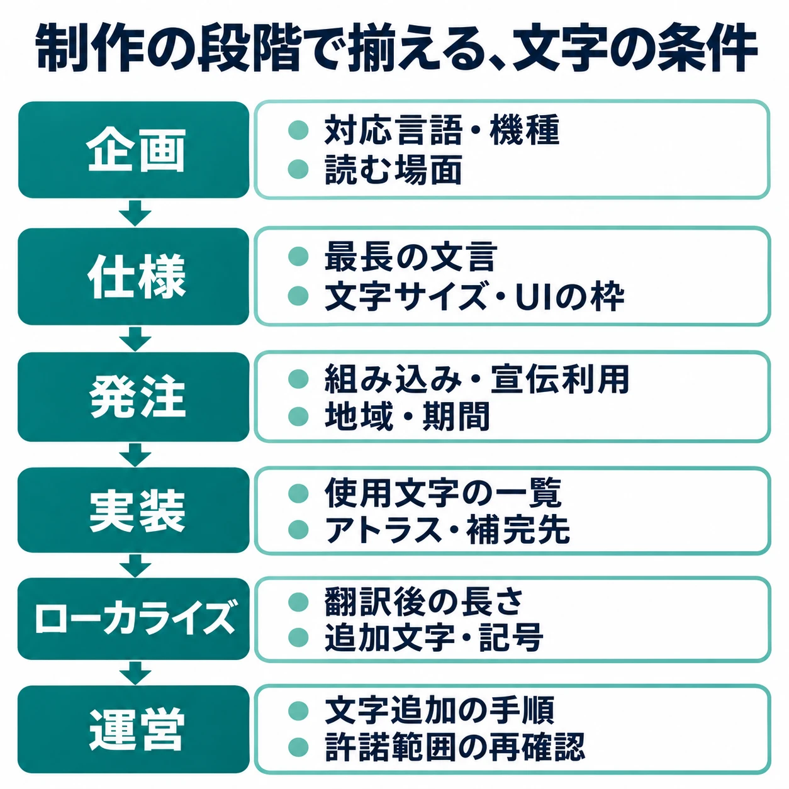

# ゲームの文字は誰が決めるのか――デザイナーの判断を支えるために、プランナーが知っておくこと

> **用語注記：「世界観」という言葉について**
>
> 「世界観」（Weltanschauung）は本来、「ある人物がこの世界をどのように捉えているか」という哲学的な概念を指す言葉です。「創作物の舞台設定やデザインのまとまり」を指す用法は本来の語義からの転用であり、規範的には誤用とする立場もあります（一方で、現在は主要な国語辞典がこの拡張義を採録しています）。本稿では誤解を避けるため、一貫して **「世界設定」** という言葉を使用します。[[1](#ref-1)][[2](#ref-2)]

***

## 1. 「ゲームとフォント」から、制作の段取りへ

2026年11月5日、CGWORLD Game Week 2026で、モリサワによるセッション「ゲームとフォント〜世界観を支える、知っておきたい文字のこと〜」が配信された。概要欄では、登壇者はフォントメーカーの営業担当と、ゲーム業界出身のタイプデザイナーと紹介されている。[[3](#ref-3)] 編者が視聴した流れでは、活版の話から始まり、さまざまなフォントの実例、カーニングのような概念の紹介、世界設定に対するフォントの決め方、フォントライセンスの話へと進んだ。詳しい内容は、[公式配信のアーカイブ](https://youtube.com/live/1nePKfYGHMc)を見てほしい。

文字の形には、作品の空気や話し手の印象を伝える力がある。その書体を最終的に選ぶのはデザイナーだ。そして、その判断には「どんな文章を、どの画面に、何語で表示するか」という条件が必要になる。

本稿では、配信を入口として、ゲーム制作の工程の中でプランナーが文字にどう関わるかを考える。中心になるのは、 **判断に必要な条件を早めに揃え、決まったことを仕様に落とす役割** である。

***

## 2. フォントの判断が、プランナーの仕事に及ぶところ

たとえば、アイテム名を表示するボタンを作るとしよう。仕様書に「名前は12文字まで」と書いても、その12文字がボタンに収まるかは、書体、表示サイズ、字間によって変わる。同じ文字数でも、実際の文字の組み合わせで横幅が異なり、書体によって行の高さの取り方も変わる。

台詞枠や名前欄も同じである。文字数の上限は企画時点で仮置きできるが、表示上の制限として確定するには、採用する書体とサイズを使った検証が要る。文字を大きくする設定を設けるなら、最大サイズでも読めるか、改行や枠の拡張をどう扱うかまで仕様に含めたい。

プランナーの仕事とフォントの接点は、次のように整理できる。

| 接点 | 早めに揃える条件 |
|---|---|
| 文章量とUIの枠 | 台詞の長さ、ボタンの文言、名前の上限、改行や省略のルール |
| 対応言語と文字セット | 表示する言語と、漢字・記号など実際に使う文字の範囲 |
| 読みやすさとアクセシビリティ | 小さな画面、テレビから離れた視聴、文字サイズの設定 |
| ライセンス | ゲームへの組み込み、宣伝素材、機種・地域・期間などの用途 |
| 実装 | 事前に用意できる文章と、名前入力・チャットなど実行中に決まる文章 |

ここでいう **文字セット** は、扱う文字の集合である。日本語では数千字規模になり、多言語ではさらに対象が広がる。「日本語対応」という言葉に加えて、その作品で使う漢字や記号を持っているかを確認する必要がある。

こうした条件は、デザイナー、プログラマー、ローカライズ担当者にまたがる。プランナーが仕様として結び付けておけば、選定後に文章や画面を大きく作り直す事態を減らせる。文字コードや名前の数え方・入力制限は、[名前入力と文字のルールの記事](game-name-input-character-rules.md)で詳しく扱っている。

***

## 3. 選ぶ――世界設定、読みやすさ、文字の数

### 作風を伝える書体と、プレイ中に読む書体

2016年のgamebizのインタビューで、モリサワの担当者は、シリアスな作風や歴史的背景のある作品では明朝体、爽快なアクションではゴシック体が中心になる傾向を説明している。[[4](#ref-4)] これは傾向であり、ジャンルごとの決まりではない。デザイナーが作品の狙いに沿って選ぶための手がかりの一つである。

また、タイトル画面の見出しと、戦闘中に一瞬で読む数字では役割が異なる。プランナーは「古い時代らしくしたい」だけでなく、「この文章は移動中に読む」「この数字は短時間で判別する」と、読む場面も伝えたい。書体の美しさや細かな組版の評価はデザイナーに委ね、その評価に使う状況を具体化するのだ。

2018年のGAME Watchの取材記事は、ゲームがモリサワのフォントを採用する理由として読みやすさを挙げ、HD化で標準フォントの粗が目立つようになったことにも触れている。同記事では、Nintendo Switchに採用された「UD新ゴ」を含むUD書体の展示も紹介された。UDはユニバーサルデザインの略である。[[5](#ref-5)]

読みやすさは実際の画面で確かめたい。携帯画面での小さな文字、テレビから離れて読む説明、動く背景の上の字幕では条件が違う。通常の文字サイズと、プレイヤーが拡大した場合の両方を、確認する画面の一覧に入れておくとよい。

### 言語名と、収録文字の両方を見る

2019年のGAME Watchの記事では、当時紹介されたモリサワのフォントについて、日本語約23,000字、繁体字約13,000字という規模が説明されている。同じデザインで多言語に対応できる点も、強みとして紹介された。[[6](#ref-6)] この数字は2019年当時の記事の説明であり、日本語フォントすべてに共通する収録字数や、ゲームに必要な字数を示すものではない。

企画上の問いは、「何万字あれば十分か」よりも「この作品で使う文字が揃うか」である。登場人物の名前に使う漢字、翻訳先のアクセント付き文字、特殊な記号を、実際の候補で確かめる。言語が変わってもデザインの調子を揃えられるかは、デザイナーとローカライズ担当者に相談する。

### カーニングと字間は、表示幅にも関わる

配信でも紹介された **カーニング** は、特定の文字の組み合わせに応じて間隔を調整することである。たとえば欧文の「AV」では、文字の形に合わせて間を詰めると、見た目の空き方が変わる。一方、文字列全体の字間を一様に広げたり狭めたりする調整もある。TextMesh Proの公式資料にも、文字の組み合わせに応じた間隔調整のデータを取り込む項目がある。[[7](#ref-7)]

プランナーが押さえたいのは、字間の設定によってUIに収まる長さも変わることだ。確認用の画面と実装後の画面で設定が異なると、同じ文言でも折り返しや収まりが変わりうる。

選定前には、実際の台詞やUI文言、文字数が最大の文字列、横幅が大きくなりそうな文字列、対応言語、機種と画面サイズを揃えて渡したい。仮の短文だけで進めるより、デザイナーが完成時の条件に近い状態で判断できる。

***

## 4. ライセンス――担当者に確かめる項目を揃える

フォントの使い方には、文字を画像として素材にする場合と、フォントファイルをゲームに組み込む場合がある。採用候補が決まったら、実装担当者に使い方を聞き、契約やライセンスの担当者へ具体的な用途を渡す。

組み込みの許諾が独立した検討事項になる例として、2019年の「mojimo-game」のインタビューがある。当時のフォントワークスのサービス担当者は、フォントファイルの組み込みを許諾するか社内で議論したうえで、許諾する形にしたと説明している。記事ではPVなどの宣伝利用も許諾範囲として紹介されている。[[8](#ref-8)] これは当時の製品の事例であり、採用時には候補のライセンス条項を個別に確かめる。

プランナーは法律や契約の評価を引き受けるより、次の項目を確認事項として揃えるとよい。

- **組み込み**：フォントファイルをゲームに含める使い方が許諾されるか。画像や文字表示用データへの変換について条件があるか。
- **宣伝利用**：PV、ストアページ、公式サイト、告知画像など、予定する素材に使えるか。
- **機種と地域**：発売する機種、移植先、配信地域が対象に含まれるか。
- **言語と書体**：必要な言語、書体、太さの種類が対象に含まれるか。
- **タイトルと期間**：タイトル数や利用期間が、どの単位で定められているか。
- **運営と更新**：運営が続く場合の更新手続き、契約終了後の配信・更新の扱いをどう確認するか。

確認結果は、対象の契約や条項、確認先、確認日とともに残す。機種追加や海外展開の際に、その条件を見直す担当者も決めておきたい。

### フリーフォントにも、利用条件と収録範囲がある

フリーフォントやオープンライセンスのフォントも、利用条件はそれぞれのライセンスによる。たとえばSIL Open Font License 1.1は、ソフトウェアへの同梱や組み込みを認める一方、再配布時の著作権表示・ライセンスの添付、改変時の予約名の扱いなどを定めている。実際に配布されているフォントのライセンス文書を、担当者が確認できる形で保管したい。[[9](#ref-9)]

収録文字も別に確認する。前述の2019年のインタビューでは、ゲーム開発チームmarumittuのデザイナー、椎野央子氏が、海外展開を考え、フリーフォントで見慣れない文字や記号が表示されない事態を避けたかったと話している。[[8](#ref-8)] 表示できる文字の範囲は、個々のフォントで確かめる必要がある。

***

## 5. 実装――ゲームの中で文字を出す仕組み

### 文字の形と、画像を作るタイミングを分けて考える

**ビットマップ** は、文字の形を画素の集まりとして持つ方式である。決めた大きさの見た目を作れる一方、大きく引き伸ばすと輪郭の粗さが現れやすい。 **ベクター、またはアウトライン** は、輪郭を線や曲線の情報として持つ方式であり、表示する大きさに応じて画像を作れる。

さらに、文字の画像を開発中に作るか、ゲームの実行中に必要に応じて作るかという違いがある。アウトラインのフォントから事前に画像を作る構成もあるため、「元のフォントの形式」と「実行中の表示方式」は分けて相談したい。

プランナーに関わるのは、 **表示する文字を事前に確定できるか** という条件だ。台詞やアイテム名はマスターデータから集められる。プレイヤーが入力する名前やチャットは、実行するまで具体的な文字列が決まらない。その違いを実装担当者へ伝える必要がある。

### UnityのTextMesh Proでは、表示用の文字を用意する

TextMesh ProのFont Asset Creatorでは、元のフォントにある文字がすべて自動で含まれるわけではなく、必要な文字を指定して **フォントアセット**、つまりゲームで文字を表示するためのデータを作る。文字の形である **グリフ** を並べた画像を **アトラス** と呼ぶ。公式資料では、ASCIIの英数字・記号だけなら、多くのフォントで512×512ピクセルが目安になる。文字が多い場合は解像度を大きくするか複数に分け、よく使う文字をメイン、残りを補完用の **フォールバック** に置く方法が説明されている。[[7](#ref-7)]

**SDF（符号付き距離場）** は、文字の輪郭からの距離情報を使う表示方式である。TextMesh Proはこれを用いて、拡大縮小や変形に対して輪郭を滑らかに保ちやすくしている。SDFもアトラスを使い、拡大縮小に強いことと、表示できる文字が揃っていることは別の条件となる。[[10](#ref-10)]

また、 **動的フォントアセット** は、必要になった文字を実行中にアトラスへ追加する。事前に焼き込む方式より柔軟だが、公式資料では処理資源をより多く使い、元のフォントファイルもビルドに含まれると説明されている。[[11](#ref-11)] そのため、ユーザー入力の有無は、表示方式と組み込み許諾の両方に関係する。

### Unreal Engineでも、複数のフォントを組み合わせられる

Unreal Engineの公式資料では、フォントのデータを持つFont Faceアセットと、それを参照するFontアセットが説明されている。Composite Fontでは、標準のフォント群に加えて文字範囲ごとのフォント群を指定でき、複数のフォントを組み合わせて表示する。読み込み方にも選択肢があり、メモリ使用量と読み込み時の処理の関係が変わる。[[12](#ref-12)] プランナーは、言語ごとの表示対象やユーザー入力の範囲を渡し、実機で確認する場面を実装担当者と決めればよい。

### 「豆腐」を、データと仕様の両側から防ぐ

表示できない文字の代わりに出る四角などは、俗に「豆腐」と呼ばれる。元のフォントに必要なグリフがない場合もあれば、フォントにはあっても表示用アセットに入っていない場合や、補完先で見つけられない場合もある。[[7](#ref-7)][[8](#ref-8)]

プランナーができる対策は、テキストのマスターデータから使用文字の一覧を作り、アセット作成と表示確認に渡すことだ。台詞だけでなく、アイテム名、クエスト名、システムメッセージ、記号も含める。アップデートの際には、前回から増えた文字を確認できるようにしたい。

名前やチャットについては、入力を認める文字の範囲、表示できない場合の扱い、表示を試す言語や画面を仕様にする。入力欄だけでなく、ランキングや他プレイヤーの画面へ渡ったときも確認対象になる。文字の扱いは[名前入力の記事](game-name-input-character-rules.md)、翻訳を含む工程全体は[ローカライズの記事](game-localization-guide.md)へつながる。

***

## 6. トリビア――ファミコン版『ドラゴンクエスト』のカタカナ

使える文字が、言葉の選び方にまで関わった例がある。

2009年9月3日のCEDEC基調講演で、『ドラゴンクエスト』のゲームデザイナーである堀井雄二氏は、初代の制作を振り返り、文字を6ビットに収めていたため、カタカナは20文字しか使えなかったと説明している。[[13](#ref-13)] 6ビットで表せる組み合わせは、2を6回掛けた64通りである。これはカタカナだけに使える64枠という意味ではなく、限られた文字などの表現に割り当てる枠である。

開発を担ったチュンソフトの中村光一氏も、同社30周年のインタビューで、使えるカタカナが限られており、残った文字に合わせて魔法や街の名前を考え直したと振り返っている。[[14](#ref-14)]

今日のゲームと当時では、容量も表示の仕組みも大きく違う。それでも、 **書体と文字セットは、書ける言葉の条件になる** という接点が見える。登場人物や技の名前を決める仕事と、表示できる文字を揃える仕事は、制作の途中で合流するのである。

***

## 7. プランナーが、制作の段階ごとに確かめておくこと

ここまでの話を、制作の段取りに置き直してみよう。以下は本稿から整理した確認項目であり、工程が行き来する場合も、変更がほかの担当者へ伝わるように使いたい。

- **企画**：対応言語と機種、想定する画面サイズ、台詞や説明の量、名前入力・チャットの有無を早めに共有する。読む場面や、作品で伝えたい印象もデザイナーへ渡す。
- **仕様**：実際の文言と最長の文字列を用意し、採用候補の書体・サイズでUIの枠を確かめる。文字サイズ変更、改行、省略、入力可能な文字の扱いを決める。
- **発注**：契約担当者に、組み込み、宣伝利用、機種、地域、言語、タイトル数、期間を確認する。外部へ渡す資料にも、採用する書体や表示条件の合意内容を反映する。
- **実装**：テキストのマスターから使用文字の一覧を出す。事前に用意する文字と実行中に追加する文字の扱い、補完先、表示確認の対象を実装担当者と揃える。
- **ローカライズ**：翻訳後の長い文言、追加された文字や記号、言語ごとの書体を確認する。画面上での収まりと、補完先の文字を含む見た目をデザイナー・翻訳担当者と確認する。
- **運営**：更新で文字が増えたときに、誰が一覧を更新し、誰がアセットへ反映して表示を確認するかを決める。言語・機種の追加や運営期間の延長時には、許諾範囲の再確認も段取りに入れる。

書体はデザイナーが選ぶ。その判断を支えるには、実際の文章と表示条件が要る。プランナーが条件を早めに揃え、決まった内容を仕様に残し、変更を関係者へ渡すことで、選ばれた書体がゲームの中で役割を果たせる。 **デザイナーの判断を、仕様と段取りで支えること** が、プランナーの役割である。

## References

1. [さかもと五度「「世界観」の誤用が気になる」][1] — note。「世界観」の用語注記の参照資料。

[1]: https://note.com/sakamoto444/n/n564e428706fd

2. [トライベクトル「翻訳における「ゲームの世界観」をどう表現するのか問題」][2] — トライベクトル。「世界観」の用語注記の参照資料。

[2]: https://www.trivector.co.jp/contents/?p=2801

3. [CGWORLD「ゲームとフォント〜世界観を支える、知っておきたい文字のこと〜｜CGWORLD Game Week Day3-1」][3] — CGWORLD公式YouTubeチャンネル、2026年11月5日。登壇者の紹介は概要欄に基づく。導入の進行順は編者の視聴メモによる。

[3]: https://youtube.com/live/1nePKfYGHMc

4. [gamebiz「『細やかなニュアンスの再現を』…アプリ・ゲーム制作者向けフォント製品『MORISAWA App Tools』をリリース　モリサワの担当者に聞く『その優位性』」][4] — gamebiz、2016年10月21日。モリサワの菊池諒氏・青木友裕氏へのインタビュー。

[4]: https://gamebiz.jp/news/171140

5. [中村聖司「“フォント”のモリサワ、Taipei Game Show 2018に初出展」][5] — GAME Watch、2018年1月25日。

[5]: https://game.watch.impress.co.jp/docs/news/1103120.html

6. [中村聖司「フォントのモリサワ、新書体『UD新ゴ 繁体字』で台湾ゲーム市場を攻略へ」][6] — GAME Watch、2019年1月28日。収録文字の規模と多言語のデザインについての当時の説明を参照。

[6]: https://game.watch.impress.co.jp/docs/news/1166689.html

7. [Unity Technologies「Font Asset Creator」][7] — TextMesh Pro 3.2公式ドキュメント、2026年11月5日参照。Character Set、Atlas Resolution、Get Kerning Pairs、Tips for creating font assetsを参照。

[7]: https://docs.unity3d.com/Packages/com.unity.textmeshpro@3.2/manual/FontAssetsCreator.html

8. [gamebiz「【インタビュー】『ちょうどいい文字を、ちょうどいい価格で』提供する『mojimo-game』とは…個人でも使えるフォントサービスの利点を開発者に訊く」][8] — gamebiz、2019年3月19日。フォントワークスの福島里江氏、marumittuの椎野央子氏、ヘッドハイの一條貴彰氏へのインタビュー。当時の許諾範囲と開発者の経験を参照。

[8]: https://gamebiz.jp/news/233349

9. [SIL「SIL Open Font License Version 1.1」][9] — Open Font License公式サイト、2007年2月26日。PERMISSION & CONDITIONSを参照。

[9]: https://openfontlicense.org/documents/OFL.txt

10. [Unity Technologies「About SDF fonts」][10] — TextMesh Pro 3.2公式ドキュメント、2026年11月5日参照。

[10]: https://docs.unity3d.com/Packages/com.unity.textmeshpro@3.2/manual/FontAssetsSDF.html

11. [Unity Technologies「Dynamic fonts assets」][11] — TextMesh Pro 3.2公式ドキュメント、2026年11月5日参照。

[11]: https://docs.unity3d.com/Packages/com.unity.textmeshpro@3.2/manual/FontAssetsDynamicFonts.html

12. [Epic Games「Font Asset and Editor」][12] — Unreal Engine公式ドキュメント、2026年11月5日参照。Font Assets、Font Face Assets、Example Font Assetを参照。

[12]: https://dev.epicgames.com/documentation/en-us/unreal-engine/font-asset-and-editor-in-unreal-engine

13. [石田賀津男「堀井雄二氏が持つ『ドラゴンクエスト』の文法とは？」][13] — GAME Watch、2009年9月4日。CEDEC 2009の9月3日基調講演「国民的ゲームとは何か？ ～ドラゴンクエストの場合～」の取材記事。

[13]: https://game.watch.impress.co.jp/docs/news/312961.html

14. [ファミ通.com「すべては『ドアドア』から始まった――チュンソフト30周年のすべてを中村光一氏と振り返るロングインタビュー【前編】」][14] — ファミ通.com、2014年6月8日。

[14]: https://www.famitsu.com/news/201406/08054671.html

----

この文書は、Perplexity、Claude、ChatGPT の3つのAIの支援を受けて著述されたものです。引用画像を除き、MIT License にて提供されています。
