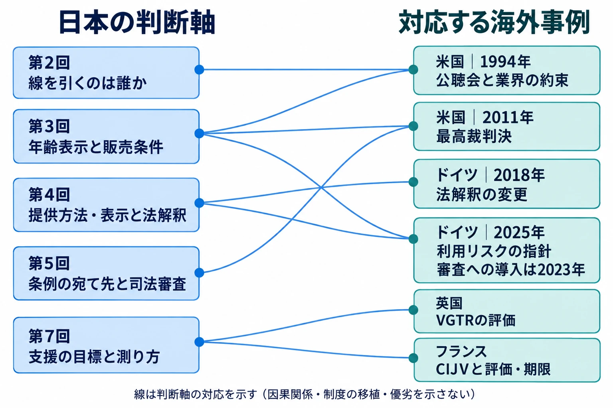

# 同じ問いに、別の国はどの道具で答えたか――米国・ドイツ・英国・フランスから、ゲームと行政のあいだを見直す

ゲームの年齢表示を誰が決めるか。未成年への販売に、どこまで条件を付けられるか。開発を支える資金は、何を条件に渡し、何を成果として数えるか。日本でたどってきた問いには、海外にも議会、行政、業界、裁判所のやり取りがある。

本稿は「ゲームと行政のあいだ」番外編である。判断軸は、 **同じ問いに、別の国はどの道具で答えたか** 。制度の名前を国別に覚えるより、誰が何を問い、相手がどの仕組みで応じたのかを並べたい。

本編では、[第1回](game-and-government-regulation-map.md)でルールが届く経路を地図にし、[第2回](diet-1986-177-and-pc-game-self-regulation.md)で国会と業界の自主規制、[第3回](cero-z-rating-gta3-ordinance-link.md)で年齢表示と条例の連動、[第4回](complete-gacha-administrative-tools-and-display-enforcement.md)で既存の法律の解釈と表示への執行を見た。[第5回](kagawa-game-ordinance-process-lawsuit-aftermath.md)は罰則のない条例の宛て先と訴訟、[第6回](payment-network-invisible-regulation-japan-platforms.md)は決済網の規約、[第7回](content-industry-support-policies-what-they-measure.md)は振興策の目標と測り方を扱った。

今回は、この判断軸に対応し、既存記事で詳しく扱っていない事例を選ぶ。米国では議会の公聴会と業界の約束、州法と最高裁の判断、ドイツでは法解釈の変更と年齢区分に組み込まれた利用リスク、英国とフランスでは税による支援と評価の記録を見る。ルートボックス規制、時間規制、各国のレーティング基準、Stop Killing Games、海外の決済網は、6節で既存記事へ案内する。

比較の単位は、国全体の評判ではなく、個々の制度と出来事である。以下の制度の現状は、2026年10月28日時点の資料を基準とする。

***

## 1．日本の問いと、海外の事例をつなぐ

本編の判断軸は、同じ「ゲーム規制」という言葉の中に異なる働きかけがあることを見分けるためのものだった。国会で説明を求めること、業界が基準を作ること、法律を具体的な仕様に当てはめること、裁判所がそのルールを審査することは、それぞれ別の道具である。振興策にも、資金を出す仕組みと成果を確かめる仕組みがある。

海外事例も、その動作に着目すると本編につながる。1994年の米国では、議会に対して業界が共通の年齢区分を約束した。2011年には、州の販売規制を最高裁が審査した。ドイツでは、既存の条文をどう読むかが変わり、別の時期には法改正を受けて年齢区分が読む対象も広がった。英仏では、開発費を税の仕組みで支え、行政や議会が効果を調べた。

***

## 2．米国――議会の問いに、業界が共通の制度を約束する

### 公聴会で、保護者に渡す情報を問う

米国の上院公聴会とは、上院の委員会などが関係者を呼び、証言や説明を聞く場である。法律を成立させる議決とは別に、問題を整理し、対応を求める働きを持つ。

上院政府問題委員会（Committee on Governmental Affairs）の活動報告によれば、1993年12月9日、ジョー・リーバーマン（Joseph Lieberman）上院議員は、ハーブ・コール（Herb Kohl）議員の司法委員会少年司法小委員会と共同で公聴会を開いた。議題は、保護者が子どもに買うゲームの内容を知るために、年齢・内容の区分が必要かというものだった。教育関係者や専門家に加え、任天堂やセガなどの業界関係者も証言し、業界側は1994年の年末商戦に間に合うよう、信頼できる制度を共同で作ると約束した。[[1](#ref-1)]

この経過を業界側からたどったのが、ESRBの公式オーラルヒストリー、ブレイク・J・ハリス（Blake J. Harris）による「Content Rated By」である。オーラルヒストリーは、当事者の回想を集めて出来事を記録する方法だ。第2回は、1994年1月の家電見本市CES（Consumer Electronics Show）で、業界関係者が統一レーティング制度を協議したと記す。[[2](#ref-2)]

同年2月3日、リーバーマン議員は「Video Game Rating Act of 1994」を提出した。政府側に委員会を設け、ゲームの暴力や性的内容について保護者らに知らせる基準を作る構想だった。業界の協議と、立法による対応の提案が並行していたのである。[[2](#ref-2)]

### 1994年3月4日――企業ごとの表示から、業界の約束へ

3月4日の上院公聴会では、エレクトロニック・アーツ（Electronic Arts、EA）のジャック・ハイスタンド（Jack Heistand）氏が、業界のレーティング委員会を代表して証言した。EAのほか、アクレイム（Acclaim）、アタリ（Atari）、任天堂（Nintendo）、フィリップス（Philips）、セガ（Sega）、3DOなどからなる委員会である。[[2](#ref-2)]

ハイスタンド氏は、参加企業がインタラクティブ市場の60%以上を占めると述べ、次のような制度を作ると約束した。

> universal, responsible, reliable, understandable and independent rating system

共通して使え、責任があり、信頼でき、理解しやすく、独立したレーティング制度、という約束である。リーバーマン議員は、その報告を「a very encouraging report」と評価した。[[2](#ref-2)]

ここで業界が差し出したのは、各社が個別に注意書きを付ける対応から、共通の表示を運用する仕組みへ進む約束だった。議会は、その仕組みの構想と進捗を公の場で聞いた。自主規制の内容だけでなく、誰が代表して約束し、誰に説明するのかという関係も見える。

### ESRBの設立と、審査が始まった日を分ける

エンターテインメント・ソフトウェア・レーティング委員会（Entertainment Software Rating Board、ESRB）の公式年表は、1994年にインタラクティブ・デジタル・ソフトウェア協会（Interactive Digital Software Association、IDSA）がESRBを設立したとする。公式資料で年齢・内容のレーティングを付け始めた年も1994年である。[[3](#ref-3)]

日まで特定されているのは、業務の開始と最初の認定書の発行である。公式オーラルヒストリー第4回は1994年9月16日に活動を開始してレーティングを付け始めたと記し、20周年の公式記事も同日を最初の認定書の発行日としている。組織の設立年と、審査結果を出し始めた日を区別しておきたい。[[4](#ref-4)][[5](#ref-5)]

日本の[第2回](diet-1986-177-and-pc-game-self-regulation.md)では、1986年の国会で各省庁が業界の自粛などによる対応を示した。[第3回](cero-z-rating-gta3-ordinance-link.md)では、2002年にコンピュータエンターテインメント協会（Computer Entertainment Supplier's Association、CESA）が中心となり、コンピュータエンターテインメントレーティング機構（Computer Entertainment Rating Organization、CERO）を設立する経過を見た。

日米に共通するのは、公的な場でゲームへの対応が問われ、業界が自主規制の仕組みを持った点である。米国の今回の記録では、法案の提出と、業界代表による制度の約束が短い期間に並ぶ。日本の1986年と2002年は、対象や時期の異なる出来事であり、一つの国会答弁からCEROが直接生まれたという因果では結ばない。

ESRBの個々の審査基準は、[各国のレーティングを扱う記事](game-global-rating-regulations.md)へ譲る。ここで見るのは、議会の問いに対し、業界がどのような組織と約束で応じたかである。

***

## 3．米国――州の販売規制を、最高裁が審査する

### 7対2の結論と、5人が加わった法廷意見

2011年6月27日、合衆国最高裁判所（Supreme Court of the United States）は、ブラウン対エンターテインメント商業協会事件（Brown v. Entertainment Merchants Association）で、暴力的なゲームの未成年への販売・貸与を制限するカリフォルニア州法を、合衆国憲法修正第1条に反すると判断した。修正第1条は、言論や表現の自由などを保障する条項である。[[6](#ref-6)]

違憲とする結論は7対2だった。ただし、結論に賛成した7人全員が同じ理由を採ったわけではない。裁判所の判断理由を示す中心の文書である **法廷意見** は、アントニン・スカリア（Antonin Scalia）判事が執筆し、ほかの4判事が同調した。サミュエル・アリート（Samuel Alito）判事は別の理由で結論に同意し、ジョン・ロバーツ（John Roberts）長官がそれに同調した。反対意見は2判事である。[[6](#ref-6)]

### ゲームも表現として保護され、規制の根拠が問われる

法廷意見は、ゲームが書籍、演劇、映画と同じく、物語の手法やゲーム固有の特徴によって考えを伝える表現であり、修正第1条の保護を受けるとした。[[6](#ref-6)]

この州法には、 **厳格審査** が適用された。ここでは、表現の内容を理由に制限する政府に対し、非常に重要な目的があり、その達成に必要な範囲へ規制を絞っていることを厳しく示すよう求める審査である。法廷意見は、州が提示した研究によって、暴力的なゲームへの接触が未成年の攻撃的行動を引き起こすことは証明されていないと判断した。これは、この裁判で提出された根拠と規制についての判断として読む必要がある。[[6](#ref-6)]

保護者を助けるという目的に対して、既存の自主規制がどこまで役割を果たしているかも検討された。判決要旨は、次のように述べている。

> The video-game industry's voluntary rating system already accomplishes that to a large extent.

業界の自主的なレーティング制度が、その役割をすでに相当程度果たしているという評価である。判決要旨は読者の便宜のための要約であり、法廷意見そのものとは区別される。[[6](#ref-6)]

### 日本との対比は、何を制限する規定かまでそろえる

日本では、[第3回](cero-z-rating-gta3-ordinance-link.md)で見たように、自治体の条例がCEROのZ区分を有害図書類の指定に取り込み、青少年への販売条件につなげた。一方、[第5回](kagawa-game-ordinance-process-lawsuit-aftermath.md)で扱った香川県の条例をめぐる国家賠償請求では、高松地方裁判所が条例を合憲と判断し、請求を退けた。

米国では州法による販売規制が最高裁で違憲、日本では香川県の条例が地裁で合憲、という結論だけを横に置くと、比較の条件が抜け落ちる。香川県の訴訟では、罰則のない努力目標などが具体的な権利制約を課すかが問題になった。米国の事件は、表現の内容に着目した販売・貸与の制限である。裁判の種類、争われた規定、その効力が異なる。

第3回の「年齢表示は目安か、販売の条件か」と、第5回の「決まりは誰に何を求めるか」を合わせると、比較する前に確認すべきことが見える。 **表示の意味に加え、その表示を使って誰の行動を制限するか** である。

***

## 4．ドイツ――解釈を変える道具と、審査対象を広げる道具

### USKは、業界と州の当局が関わる年齢区分の仕組みである

娯楽ソフトウェア自主規制機関（Unterhaltungssoftware Selbstkontrolle、USK）は、ドイツでゲームの年齢区分審査を担う業界の自主規制機関である。青少年保護法に基づく通常の審査では、独立した専門家の勧告を受け、州側の代表が法的な年齢区分を付与する。[[7](#ref-7)]

### 2018年――条文を変えず、個別に審査する道を開く

2018年8月9日、ドイツのゲーム業界団体gameは、州の最高青少年保護当局による現行法の解釈変更を発表した。州の最高青少年保護当局（Oberste Landesjugendbehörden）とは、各州で青少年保護行政を所管する最上位の当局を指す。裁判所の名前ではない。[[8](#ref-8)]

変更によって、違憲組織のシンボルを含むゲームについても、USKの審査委員会が、当時の刑法（Strafgesetzbuch）86条3項の **社会的相当性条項** を適用できるか、個別に判断することになった。社会的相当性条項は、ここでは、芸術・学術の目的や、現在・歴史上の出来事を描く目的などがある場合に、個々の使用の文脈を判断する例外規定である。[[8](#ref-8)]

gameの発表によれば、それまで、この判断は映画など他のメディアでは行われていたが、ゲームでは行われていなかった。変更後はゲームも個別審査に進める。あらゆる使用を一括して認める変更ではなく、目的と文脈を審査する入口が変わったのである。[[8](#ref-8)]

日本の[第4回](complete-gacha-administrative-tools-and-display-enforcement.md)では、消費者庁がコンプガチャを既存の「カード合わせ」に当たると整理し、見解や運用基準を示した。対象も結論の方向も異なるが、既存の法律を具体的な事例にどう当てはめるかを示すという道具が共通する。ドイツでは個別判断の対象を広げ、日本では既存の禁止への該当性を明らかにした。

### 2023年の導入と、2025年の指針への定着

もう一つの変化は、2021年の青少年保護法（Jugendschutzgesetz）改正を受けた審査実務の変更である。USKは2023年1月から、作品の表現内容に加えて、利用に伴うリスクを法的な年齢区分の審査に取り入れた。2021年の改正、2023年の審査への導入、2025年の指針への反映という順である。[[9](#ref-9)][[7](#ref-7)]

対象には、チャットなどの連絡機能、ゲーム内購入、ルートボックスのようなギャンブルに似た仕組み、過剰な利用を促す仕組み、第三者へのデータ送信などが含まれる。こうした機能の存在だけで機械的に年齢を上げるのではなく、利用による危険や保護の仕組みを含めて評価する。[[9](#ref-9)]

USK諮問委員会は、2024年12月13日に指針の改定を決め、2025年1月1日から適用した。USKが12月16日に公表した説明によると、それまでの審査で、 **利用リスクのあるゲームの約3分の1** が従来より高い年齢区分となった。これは全ゲームを分母にした数字ではない。同日付のgamesmarketも指針改定を報じているが、この割合はUSKの公式発表の対象範囲で読む。[[7](#ref-7)][[10](#ref-10)]

ここには、年齢区分が何を読むかという変化がある。物語や映像に加え、他人との連絡、購入を促す設計、利用を長引かせる仕組みも審査に関わる。[第3回](cero-z-rating-gta3-ordinance-link.md)の年齢表示の意味と、[第4回](complete-gacha-administrative-tools-and-display-enforcement.md)の提供方法や表示の点検が、同じ企画の中で接続する。

ただし、USKが利用リスクを年齢区分に取り入れることと、ルートボックスを賭博法などで規制することは、別の制度上の動作である。各国のルートボックス規制は、[ガチャ規制の比較記事](gacha-regulation-japan-history.md)で扱っている。

***

## 5．英国とフランス――税で支え、どう測るか

日本の[第7回](content-industry-support-policies-what-they-measure.md)では、出資と補助、法解釈を明確にする支援を見た。英国とフランスには、税を通じて開発を支える制度と、その評価の記録がある。 **税額控除** とは、一定の条件に合う支出などに応じて、納める税額から金額を差し引く仕組みである。税額を超える分の扱いは制度によって異なる。

### 5-1．英国――税務当局が聞き取り評価を委託する

#### 文化テストを通ったゲームの開発費を支える

英国のビデオゲーム税控除（Video Games Tax Relief、VGTR）は2014年に始まった。開発費のうち対象となる支出に税の優遇を受ける仕組みで、文化テストへの合格が条件になる。文化テストとは、作品の内容や制作への関わりなどを点数で確かめ、英国的・欧州的な文化とのつながりを認定する審査である。英国映画協会（British Film Institute、BFI）が運用を担う。[[11](#ref-11)]

この条件には、当時の英国も従っていた欧州連合（European Union、EU）の国家補助のルールが関わる。国家補助とは、ここでは、国が税の優遇などで特定の企業・産業を支える措置であり、EU域内の競争や貿易への影響を審査されるものをいう。英国の文化テストに関する規則の説明資料は、文化振興を目的とする例外のもとで、欧州委員会（European Commission）が2014年3月27日にVGTRを承認したと記す。[[12](#ref-12)]

#### 51名への聞き取りが答える問い

英国の歳入関税庁（HM Revenue & Customs、HMRC）は、調査会社イプソスMORI（Ipsos MORI）に評価を委託し、2017年7月20日に「Video Game Tax Relief Evaluation」を公表した。報告書番号はHMRC Research Report 459で、表紙の日付は2017年3月である。[[11](#ref-11)]

調査は2016年8〜11月に、英国の開発者51名へ詳細なインタビューを行った。内訳は、本認定・仮認定の取得者など利用側の34名と、未利用側の17名である。数値を集めて業界全体の比率を推計する調査ではなく、開発者が何を考え、何に困り、制度がどのように制作へ働いたかを掘り下げる **定性調査** だった。[[11](#ref-11)]

報告書は、この調査が英国の開発者全体を統計的に代表するものでも、VGTRによって生まれたゲームの数や価値を測定するものでもないと明記する。51名という人数だけでなく、そもそも何を調べる設計だったかが、結果の読み方を決める。[[11](#ref-11)]

#### 制作の主な動機と、申請時の確認は分かれていた

文化テストについて、多くの開発者は創作判断の主な推進力とは見ていなかった。作りたいゲームが先にあり、物語や登場人物を固める終盤で、条件に合うか確かめる作業と捉えていた。一部には舞台設定や人物の背景を小幅に変えた例があり、英国文化の要素を増やした例もあった。[[11](#ref-11)]

総じてVGTRは歓迎されていたが、活用には余地が残った。報告書は、資金繰りを支え、開発の継続や作品の拡充を可能にしたという声を拾う一方、雇用や海外からの投資への影響は当時まだ限定的で、効果が十分に現れるには早いとする見方も記録している。制度開始から数年の段階での評価である。[[11](#ref-11)]

行政と業界のやり取りとして読むと、税務当局は、申請件数や控除額に加えて、使った側・使わなかった側の経験を外部調査に載せたことになる。創作への影響と、申請の障壁と、産業全体の効果を、同じ数字で済ませずに調べている。

#### VGTRからVGECへ――率と支出の範囲を一緒に読む

その後、英国はビデオゲーム支出クレジット（Video Games Expenditure Credit、VGEC）へ移行した。2024年1月1日に導入され、2025年4月1日以降に制作段階を開始する新作は新制度を使う。旧VGTRは、既存作品についても2027年4月1日に終了する。[[13](#ref-13)][[14](#ref-14)]

VGECの名目の控除率は適格支出の34%である。ただしクレジット自体が課税対象で、対象額にも総中核開発費の80%を上限とする条件がある。総開発費の34%がそのまま手元に戻るという意味ではない。[[15](#ref-15)]

支出の場所の条件も変わる。旧制度では、コアコスト（ゲームの設計、制作、テストにかかる費用）の少なくとも25%を、英国または欧州経済領域（European Economic Area、EEA）で提供された物品・サービスに充てる必要があった。[[14](#ref-14)] 新制度では、コアコストの少なくとも10%が英国での活動に関連することが条件とされる。[[15](#ref-15)] 海外展開の企画では、控除率だけでなく、どこで何を調達するかと、どの時期に制作へ入ったかが条件になる。

### 5-2．フランス――文化審査と、毎年の評価を制度に組み込む

#### 開発費の30%、1社1会計年度600万ユーロが上限

フランスのゲーム制作税額控除（Crédit d'impôt jeu vidéo、CIJV）は、国立映画映像センター（Centre national du cinéma et de l'image animée、CNC）が作品の認定を担う。CNCの制度案内によると、対象となる開発費の30%を控除でき、上限は1社1会計年度600万ユーロである。[[16](#ref-16)]

対象は開発費10万ユーロ以上で、フランスや欧州のゲーム創作の発展と多様性に寄与する作品だ。品質、独創性、革新性、芸術面の支出などを点数で評価し、専門家委員会の選考を経て認定する。成人向けとして明確に販売される作品にも、十分に大きな文化的寄与を点数で認める仕組みがある。[[16](#ref-16)]

認定は開発中の仮認定と、完成後の本認定の2段階である。原則として仮認定から36か月以内に本認定を得る必要があり、得られなければ控除を返還する。開発費が1,000万ユーロを超える作品については72か月の例外が税法にある。開発期間と認定手続も、資金計画に入れる必要がある。[[16](#ref-16)][[17](#ref-17)]

#### 文化を審査する条件には、国家補助としての前提がある

CIJVの成り立ちでは、フランスと欧州委員会のやり取りが重要である。欧州委員会は詳細な審査を経て、2007年12月に制度を承認した。決定文の日付は12月11日で、12月12日付の発表を紹介する欧州オーディオビジュアル観測所（European Audiovisual Observatory）のIRIS Merlinにも経過が記録されている。当時の控除率は20%、承認期間は4年だった。[[18](#ref-18)][[19](#ref-19)]

当初の選定基準は、純粋なシミュレーションゲームも含みうるほど広いと検討された。フランス当局が基準を明確にし、文化的な内容を持つゲームへ対象を絞ったことで、文化振興を目的とする国家補助として承認に至った。作品の文化的な内容を審査する仕組みは、域内の競争への影響を抑えながら文化を支えるという前提と結び付いている。[[18](#ref-18)][[19](#ref-19)]

制度はその後も変わった。2017年の改革では控除率が30%、上限が600万ユーロになり、2022年には文化的な点数基準が改定された。作品の認定条件も、制度開始時のまま固定されているわけではない。[[20](#ref-20)][[21](#ref-21)]

#### 毎年の報告と、議会の検証は何を数えるか

2020年の財政法第29条は、映画・視聴覚・国際制作・ゲームの税額控除について、目的に照らした評価報告書を毎年政府と議会へ提出する仕組みを設けた。2023年版は2024年9月20日に公表されている。CNCの掲載ページにある「2019年比11億ユーロの追加支出」「4万人超の追加雇用」は、これらの制度全体の説明であり、ゲーム単独の成果ではない。[[22](#ref-22)]

ゲーム税制を個別に検証したのが、フランス国民議会（Assemblée nationale）の財政委員会による、2024年5月21日付の第2737号報告書である。報告者はドニ・マセグリア（Denis Masséglia）議員だ。控除額は2016年の1,300万ユーロから2023年の6,600万ユーロへ増えたとし、2023年には予算1,000万ユーロ超の6作品に、控除総額の約60%が集中したと記す。支援額の成長と、配分の集中を同時に見られる。[[20](#ref-20)]

同報告書が紹介する「2017年改革によって約2,500人分の雇用を創出・維持した」という推計は、業界団体側が委託した計量分析に基づく。報告書の要約は、フランス全国ゲーム業界団体（Syndicat national du jeu vidéo、SNJV）と娯楽ソフトウェア出版業界団体（Syndicat des éditeurs de logiciels de loisirs、SELL）の委託とし、本文ではSNJVが調査会社アナリシス・グループ（Analysis Group）へ依頼した経過を説明している。議会自身が雇用を数えて得た数字とは区別する。[[20](#ref-20)]

計量分析とは、データと統計的な方法で関係を推定する分析である。この分析は、同様の税制を持たない他国の雇用と比較し、改革の因果的な効果を取り出そうとした。報告書は行政がその方法を頑健と評価したことも紹介する。一方、産業全体への構造的な影響は測定が難しく、成長には複数の要因が関わり、CIJVだけが原因ではないとも記す。[[20](#ref-20)]

#### 期限は、評価の区切りと現行の条文を分ける

2024年の議会報告書が検討したのは、2023年財政法による2026年12月31日という支出期限だった。報告書は、これを単なる制度の打ち切り予定ではなく、当初の目的に照らして定期的に評価するための区切りと位置付けた。そのうえで2031年までの延長、控除上限の1,000万ユーロへの引上げ、試作費用の対象化などを勧告した。[[20](#ref-20)]

制度に終了や見直しの期限を置くことを **サンセット** と呼ぶ。開発者には、長期の制作計画と期限をどう合わせるかという問題になり、行政や議会には、延長の前に何を検証するかという問題になる。

期限の記録には時点の違いもある。文化省の2022年11月3日の発表は「2028年12月31日まで延長」とする一方、2024年の議会報告書は上記の2026年末を取り上げる。これらの数字の関係は、両文書の記述だけから同一の期限として整理できない。[[21](#ref-21)][[20](#ref-20)]

その後、2025年2月14日付の2025年財政法第104条が、税法220 terdecies条の期限を2031年へ改めた。2026年の同条にも、対象支出の期限は **2031年12月31日** と記載されている。2024年の延長勧告と、後年の法改正によって決まった期限を分けると、提案から制度の変更までの動きが見える。上限引上げなどほかの勧告は、延長と一括して実現したものとは扱わない。[[23](#ref-23)][[24](#ref-24)][[25](#ref-25)]

### 5-3．日本と比べる――支援の条件と、評価が答える範囲

日本の第7回で見たIP360は、エンタメ政策5原則に「作品の中身に口を出さない」を掲げている。フランスのCIJVは、EUの国家補助のルールのもとで、文化的な内容を審査して支援対象を決める。創作に関わる条件の置き方が異なるのは、それぞれの制度の目的と前提の違いとして捉えられる。

測り方にも違いがある。第7回のJ-LOPでは、利用事業者の海外売上などの集計をたどったが、第三者が補助の因果的な効果を検証した資料には至らなかった。これは第7回で扱った資料の範囲であり、検証が一切存在しないとする断定ではない。

英国の2017年評価は、税務当局が外部へ委託した聞き取り調査である。フランスには、法律が求める毎年の評価報告、議会による検証、期限を置いた見直しがある。評価する主体、方法、頻度がそれぞれ違う。[[11](#ref-11)][[20](#ref-20)][[22](#ref-22)]

さらに、 **追加性** 、つまり「支援があったからこそ生まれた活動」をどう測るかを分けたい。英国の報告書は、制度によって生まれたゲームの数や価値を測る調査ではないと明記する。フランスの雇用分析は他国比較による因果推定を試みており、単なる聞き取りとは異なる。ただし、議会報告書自身が複数の要因と測定の難しさを認めている。[[11](#ref-11)][[20](#ref-20)]

したがって、両国の数字を、支援がなければ起きなかった活動を条件なく確定した値として扱うことはできない。同時に、フランスの分析が追加性を調べようとした点も残す必要がある。報告があるか、誰が委託したか、どの方法か、その方法で何が言えるかを、一段ずつ読むことが比較につながる。

***

## 6．すでに扱った海外の話題

個々の規制内容や、今回と別の経路から届く条件は、以下の記事で扱っている。

- ルートボックス規制――ベルギー、オランダ、オーストラリア、韓国など：[ガチャ規制の歴史と各国の対応](gacha-regulation-japan-history.md)
- 中国・韓国の時間規制：[プレイ時間の制限と、コンテンツ消費の設計](game-play-time-limits-content-consumption-design.md)
- 各国のレーティング機関と審査基準：[世界のゲームレーティングと規制](game-global-rating-regulations.md)
- EUの「Stop Killing Games」と欧州委員会の回答：[サービス終了の設計と実務](service-shutdown-design-and-practice.md)、[ゲーム保存と、遊べる状態を残す限界](game-preservation-playable-archives-and-live-service-limits.md)
- 海外の決済網とSteam：[Steamの成人向けコンテンツと決済・銀行の制約](steam-adult-content-payment-banking-bottlenecks.md)

***

## 7．ゲームへの置き換え――ここからは考察

### 同じ問いに対する道具を、仕様と手続へ戻す

ここまでの事例を、本編の判断軸に戻して並べる。表の対応は、法的な効力が同じだという意味ではなく、企画で確かめる問いが重なるという意味である。

| 本編の判断軸 | 日本で見た道具 | 海外で見た道具 |
| --- | --- | --- |
| 第2回：国が線を引かないとき、その線は誰が引くか | 国会答弁、各省庁の対応、業界の自主規制 | 米国の公聴会、法案提出、業界代表による共通制度の約束 |
| 第3回：その年齢表示は、目安か、販売の条件か | CEROの区分、Z区分と条例の連動 | 米国の自主レーティングと州法の審査、ドイツの法的な年齢区分と利用リスク |
| 第4回：その仕組みは、提供の方法で読まれるか、表示で読まれるか | 既存の禁止への当てはめ、見解・運用基準、表示への措置命令 | ドイツの既存法の解釈変更、購入・通信などの利用リスクを読む審査 |
| 第5回：罰則のない決まりは、誰に何を求めているか | 条例の責務・努力目標、国家賠償請求での審査 | 米国の販売・貸与を制限する州法に対する最高裁の違憲判断。義務の強さも事案も異なる |
| 第7回：その支援は、何を目標にし、何で測られているか | 出資・補助・解釈の明確化、実績集計や検証 | 英国の税制と委託した定性評価、フランスの文化審査・年次報告・議会検証・期限 |

海外展開では、企画書に書かれた同じ仕様が、販売国ごとに異なる制度の対象になる。まず、年齢区分が読む範囲を確認する必要がある。映像と物語だけを審査資料にまとめても、購入や通信の仕組みを問われる制度では情報が足りない。チャットの相手、購入の導線、保護者向けの設定などを、仕様として説明できるようにする。

そのうえで、区分を誰が付け、販売店やプラットフォームがどう使い、法律がどこで参照するかまで追う。「何歳以上」という数字だけを国別に置き換えると、販売の条件と利用上の案内を混同するおそれがある。

支援制度を使う場合は、作品の条件と支出の条件を分けると考えやすい。文化審査で何を評価されるか、どの地域の費用が対象か、申請前の支出を扱えるか、完成後の認定に期限があるかを、開発日程と調達計画へ落とす。支援の率は、その条件を通った対象額に掛かる数字である。

### 比較を支える反証――同じ問いでも、前提はそろっていない

道具の対応だけで制度を移せるという考えには、今回の事例そのものが反証を含む。米国の判決は、特定の州法と憲法上の審査を扱った。ドイツの年齢区分には州当局と自主規制機関の共同手続があり、フランスの文化審査にはEUの国家補助の前提がある。法制度、市場規模、支援の目的が異なるため、その仕組みを日本へそのまま当てはめることはできない。

比較から持ち帰れるのは、問いを具体化する方法である。年齢表示を見たら、その効力と読んでいる仕様を問う。支援額を見たら、対象となる費用と成果の測り方を問う。日本の制度も、そうした選択肢と前提の一つとして捉え直せる。

***

## 8．企画に持ち帰る点検表

- 問題を提起した主体と、対応した主体を分けたか。議会、行政、業界、裁判所のどこが動いたか。
- 使われた道具を特定したか。法改正、解釈の変更、自主規制、司法審査、税による支援のどれか。
- 年齢区分が読む範囲を確かめたか。表現に加え、課金、通信、利用を促す仕組みも対象か。
- 表示の効力を確かめたか。情報提供なのか、販売の条件に結び付くのか、誰の行動を定めるのか。
- 支援の条件を日程と費用へ落としたか。文化審査、支出の場所、認定期限、制度の適用期限は何か。
- 成果の数字について、対象、委託者、方法、限界を読んだか。実績の増加と、支援による増加を分けたか。
- 他国との比較で、法制度、市場、EUのルールなどの前提を落としていないか。

本編7回と番外編で追ってきたのは、ゲームの仕様や事業計画が、別の主体の言葉に置き換わる場面だった。表現が年齢表示になり、報酬の渡し方が景品規制の対象になり、開発費が支援制度の適格支出になる。その変換の途中で、誰が何を判断しているかを読むことができる。

海外の記録を重ねると、同じ問いにも、公聴会での約束、裁判所の審査、解釈の変更、文化審査、評価の期限という答え方がある。それぞれの前提を確かめながら、日本の事例へ戻るための問いが、 **同じ問いに、別の国はどの道具で答えたか** である。

## References

1. [米国上院政府問題委員会「Activities of the Committee on Governmental Affairs」][1] — Senate Report 104-27、1995年4月4日。小委員会の活動報告中「Violent Video Games: What Parents Need to Know」「Video Game Violence and Establishing a Video Game Rating System」。1993年12月9日と1994年3月4日の議題・経過。1993年12月9日の公聴会の記述は第X章「Subcommittee on Regulation and Government Information」の項、印刷ページ58〜59（PDFの61〜62ページ）。

[1]: https://www.govinfo.gov/content/pkg/CRPT-104srpt27/html/CRPT-104srpt27.htm

2. [Blake J. Harris「Part 2: Jack Heistand, Chairman of the TBD」][2] — ESRB「Content Rated By: An Oral History of the ESRB」、2019年12月6日。1994年1月のCES、2月3日の法案提出、3月4日の証言と議員の応答。引用の大意・外国語資料の説明は本稿による。

[2]: https://www.esrb.org/about/part-2-jack-heistand-chairman-of-the-tbd/

3. [ESRB「Our History」][3] — ESRB、2026年10月28日参照。1994年の設立と年齢・内容のレーティング。

[3]: https://www.esrb.org/history/

4. [Blake J. Harris「Part 4: Evolution, Expansion & Enforcement (or Lack Thereof)」][4] — ESRB「Content Rated By」、2020年1月13日。1994年9月16日の業務・レーティング開始。

[4]: https://www.esrb.org/about/part-4-evolution-expansion-enforcement-or-lack-thereof/

5. [ESRB「ESRB Celebrates 20 Years of Rating Video Games and Apps」][5] — ESRB、2014年9月16日。最初の認定書の発行日。

[5]: https://www.esrb.org/blog/esrb-celebrates-20-years-of-rating-video-games-and-apps/

6. [合衆国最高裁判所「Brown v. Entertainment Merchants Assn., 564 U.S. 786 (2011)」判決要旨][6] — Cornell Law School Legal Information Institute、2011年6月27日。保護される表現、厳格審査、立証と自主レーティングの扱い、各意見への同調関係。要旨は判例記録官による要約で、法廷意見の一部ではない。

[6]: https://www.law.cornell.edu/supct/html/08-1448.ZS.html

7. [USK「Update der Leitkriterien für Alterskennzeichen: USK-Beirat verankert Nutzungsrisiken in der Bewertung digitaler Spiele」][7] — USK、2024年12月16日。2024年12月13日の決定、2025年1月1日の適用、利用リスクのあるゲームの約3分の1という対象範囲、USKの制度上の役割。

[7]: https://usk.de/update-der-leitkriterien-fuer-alterskennzeichen-usk-beirat-verankert-nutzungsrisiken-in-der-bewertung-digitaler-spiele/

8. [game「German authorities allow inclusion of symbols of unconstitutional organisations in games」][8] — game、2018年8月9日。当時の刑法86条3項の社会的相当性条項と、州当局の解釈変更。

[8]: https://www.game.de/en/german-authorities-allow-inclusion-of-symbols-of-unconstitutional-organisations-in-games/

9. [USK「Guiding criteria of the USK for the Youth protection assessment of digital games」][9] — USK、2024年12月改定、2025年1月1日以降の新規提出に適用。2.3・2.4節の利用リスクと保護措置。法改正と2023年の導入経過は公式発表[7]を併参照。

[9]: https://usk.de/wp-content/uploads/2019/06/USK-Leitkriterien-2024-EN.pdf

10. [Stephan Steininger「USK Advisory Board Expands Guidelines for the Classification of Digital Games」][10] — gamesmarket、2024年12月16日。指針改定の報道。割合の対象範囲はUSK公式発表を参照。

[10]: https://www.gamesmarket.global/use-risks-anchored-usk-advisory-board-expands-guidelines-for-the-classification-of-digital-games-01eb83c94bd433932ba8c7faffefec3a/

11. [HMRC／Ipsos MORI「Video Game Tax Relief Evaluation」][11] — HMRC Research Report 459、2017年7月20日公表。報告書表紙は2017年3月、作成者はNick Pettigrew、Graham Keilloh、Kelly Maguire、Paul Sheriffs、Jayesh Navin Shah。PDF本文のSummary、1.2・1.3節、文化テストと影響を扱う各章。利用側34名には仮認定の取得者も含む。

[11]: https://www.gov.uk/government/publications/video-game-tax-relief-evaluation

12. [英国政府「Explanatory Memorandum to the Cultural Test (Video Games) Regulations 2014」][12] — 英国法令公開サイト、2014年。7.1・7.2節。EUの国家補助と文化振興の例外、VGTRの承認経過。

[12]: https://www.legislation.gov.uk/uksi/2014/1958/pdfs/uksiem_20141958_en.pdf

13. [英国財務省「New tax credits for British film, TV and video game makers start from today」][13] — GOV.UK、2024年1月1日。VGECの導入。

[13]: https://www.gov.uk/government/news/new-tax-credits-for-british-film-tv-and-video-game-makers-start-from-today

14. [HMRC「Claiming Video Games Tax Relief for Corporation Tax」][14] — GOV.UK、2026年10月28日参照。旧制度の支出条件、2025年3月31日後に制作段階を開始する作品の扱い、2027年4月1日の終了。

[14]: https://www.gov.uk/guidance/claiming-video-games-tax-relief-for-corporation-tax

15. [HMRC「Background information and quality report: creative industries tax relief statistics」][15] — GOV.UK、2026年10月28日参照。VGECの課税対象となる34%のクレジット、80%上限、英国支出の条件。

[15]: https://www.gov.uk/government/statistics/background-information-and-quality-report-creative-industries-statistics/background-information-and-quality-report-creative-industries-tax-relief-statistics

16. [CNC「Crédit d'impôt jeu vidéo」][16] — CNC、2026年10月28日参照。控除率、上限、対象作品、認定手続。認定期限の大規模作品向け例外は税法220 X条を併参照。

[16]: https://www.cnc.fr/professionnels/aides-et-financements/jeu-video/credit-dimpot-jeu-video_121078

17. [フランス政府「Code général des impôts, Article 220 X」][17] — Légifrance、2026年10月28日参照。36か月、開発費1,000万ユーロ超の作品の72か月、認定未取得時の返還。

[17]: https://www.legifrance.gouv.fr/codes/article_lc/LEGIARTI000028447989/

18. [欧州委員会「Commission Decision of 11 December 2007 on State Aid C 47/06 … Tax credit introduced by France for the creation of video games」][18] — EU官報、2008年5月6日掲載、決定2008/354/EC。英国法令公開サイト所収。承認時の制度と文化的条件、審査経過。

[18]: https://www.legislation.gov.uk/eudn/2008/354/pdfs/eudn_20080354_adopted_en.pdf

19. [Mara Rossini「European Commission: French Aid Scheme for Video Game Creation Authorised」][19] — 欧州オーディオビジュアル観測所、IRIS 2008-2:1/8。欧州委員会の2007年12月12日付発表IP/07/1908を紹介。選定基準の絞込みと4年間の承認。

[19]: https://merlin.obs.coe.int/article/4433

20. [Denis Masséglia／国民議会財政委員会「Rapport d'information … sur le crédit d'impôt en faveur des entreprises de jeux vidéo」][20] — Assemblée nationale、N° 2737、2024年5月21日。2017年改革、認定期限、控除額と集中、雇用推計の委託主体と方法、効果測定の限界、適用期限と勧告。約60%と6作品の記述は報告書に基づく。

[20]: https://www.assemblee-nationale.fr/dyn/opendata/RINFANR5L16B2737.html

21. [フランス文化省「Le gouvernement modernise le crédit d'impôt jeu vidéo」][21] — Ministère de la Culture、2022年11月3日。文化的点数基準の改定と、同発表における2028年末という期限。

[21]: https://www.culture.gouv.fr/presse/communiques-de-presse/Le-gouvernement-modernise-le-credit-d-impot-jeu-video

22. [CNC「Rapport d'évaluation des crédits d'impôt 2023」][22] — CNC、2024年9月20日。年次提出の根拠と制度ごとの評価。掲載ページの追加支出・雇用は映画等を含む全制度の数字。PDFのゲームの章は印刷頁35〜40。

[22]: https://www.cnc.fr/professionnels/etudes-et-rapports/etudes-prospectives/rapport-devaluation--des-credits-dimpot-2023_2290452

23. [フランス政府「Loi n° 2025-127 du 14 février 2025 de finances pour 2025, Article 104」][23] — Légifrance、2025年2月14日。税法220 terdecies条の期限を2031年に変更。

[23]: https://www.legifrance.gouv.fr/eli/loi/2025/2/14/2025-127/jo/article_104

24. [フランス政府「Code général des impôts, Article 220 terdecies」][24] — Légifrance、2026年10月28日参照。現行の対象支出期限は2031年12月31日。

[24]: https://www.legifrance.gouv.fr/codes/article_lc/LEGIARTI000053544439/

25. [フランス財務省「IS - Prorogation du crédit d’impôt en faveur des créateurs de jeux vidéo prévu à l’article 220 terdecies du CGI」][25] — BOFiP-Impôts、ACTU-2025-00054、2025年4月16日。2025年財政法第104条により2031年12月31日まで延長。

[25]: https://bofip.impots.gouv.fr/bofip/14634-PGP.html/ACTU-2025-00054

----

この文書は、Perplexity、Claude、OpenAI Codex の3つのAIの支援を受けて著述されたものです。引用画像を除き、MIT License にて提供されています。
