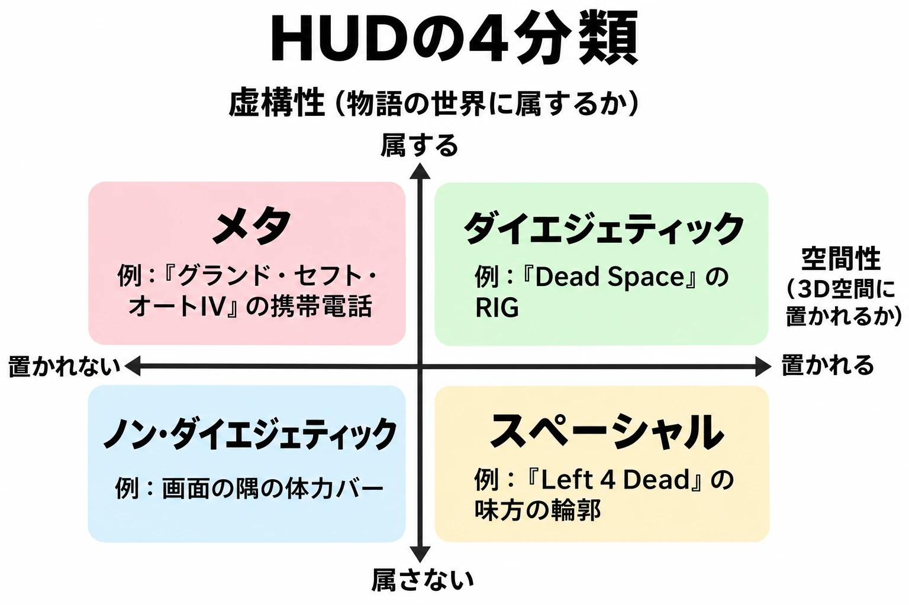
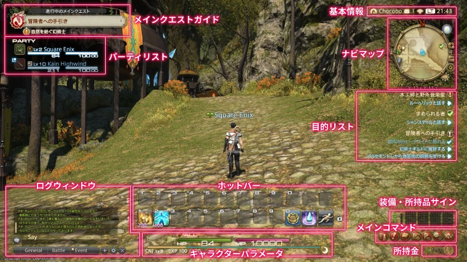

# ゲームのHUDデザイン――情報量と没入感を両立する設計原則

> 2026年11月17日改版：記事全体を全面的に書き直しました。内容の変更はGitの履歴から追えます。

## はじめに

HUD（Head-Up Display、ヘッドアップディスプレイ）とは、プレイ中にゲーム画面に重ねて常に表示される情報だ。体力、残弾、ミニマップなどがこれに当たる。装備の変更や設定の確認のために開くメニュー画面と違い、HUDはキャラクターを動かしながら読める。見せる情報を増やせば判断の手がかりは増えるが、画面に重なる表示が景色やキャラクターの動きに向けたい視線を奪うこともある。多人数の協力を支える『ファイナルファンタジーXIV』（FF14）と、一人で対馬を旅する『ゴースト・オブ・ツシマ』を両極に置き、遊び方に応じて情報の置き場所をどう選ぶかを考える。

***

## 1. HUDを分類する言葉

ダイエジェティック（diegetic）は「物語の世界の内側にある」という意味だ。登場人物が身につけている装置の表示なら、その装置も表示も物語の世界に属する。チャルマース工科大学のエリック・ファーゲルホルト氏とマグヌス・ロレンツォン氏は、2009年の修士論文『Beyond the HUD』で、UI（画面表示や操作の仕組み）を二つの軸で捉えた。一つは **虚構性**、つまりその表示が物語の世界に属するか。もう一つは **空間性**、つまりその表示がゲームの3D空間に置かれているかだ。本稿では、この2軸でできる4つの領域を次の呼び名で示し、論文での呼び名を添える。[[1](#ref-1)]

- **ノン・ダイエジェティック**：物語の世界にも3D空間にも属さない。画面の隅に固定された体力バーのような、従来のHUDが当てはまる。論文はこの領域の要素を「HUD要素」と呼ぶ。
- **ダイエジェティック**：物語の世界に属し、3D空間にも置かれる。『Dead Space』のRIGは、主人公が着るスーツの背中で体力を示す。
- **スペーシャル**：3D空間に置かれるが、物語の世界には属さない。『Left 4 Dead』で壁越しに見える味方の輪郭は、味方の位置に沿って表示されるプレイヤー向けの目印だ。論文ではこの種の表示を「幾何学的要素」と呼ぶ。
- **メタ**：物語の世界に属するが、3D空間の外に表示される。論文は『グランド・セフト・オートIV』の携帯電話を例に挙げる。主人公の持ち物でありながら、画面に重ねて表示される要素で、論文はこの種の要素を「メタ表現」と呼ぶ。[[1](#ref-1)]

画面の縁の血しぶきで被弾を伝える演出は、論文では「メタ知覚」として扱われる。登場人物の体の状態を、知覚に近い形でプレイヤーに伝える要素だ。論文によれば、メタ知覚は通常は物語の世界と結びつかないが、『Killzone 2』は血という世界の素材を使って体力の状態を伝えた例だという。[[1](#ref-1)]

論文はダイエジェティックの中でも、そこから別の情報を推し量れる手がかりを「シグニファイア」と呼ぶ。西部劇を題材にしたシューティングゲーム『Call of Juarez』では、壊れかけた武器から煙が出る。煙も武器もその世界の3D空間にあり、プレイヤーは煙を見て、武器がもうすぐ壊れると推測する。『Dead Space』では、血の跡が危険を知らせると同時に、ゲームを先へ進める方向を示す。[[1](#ref-1)]

同じ『Dead Space』でも、RIGは体力を目盛りとして直接伝え、血の跡はプレイヤーに意味を読み取らせる。手がかりを見つけて意味を考える時間も、探索の一部になる。この違いは、4節で扱う「世界の動きで導く」例にもつながる。

*『Beyond the HUD』の分類をもとに作成。[[1](#ref-1)]*

どの方式で情報を読み取りやすいかは、プレイヤーが何をしているかで変わる。マーガリー・ピーコック氏らは、FPS（キャラクターの目線で遊ぶシューティングゲーム）で情報の表示方式を比較した。残弾の実験では、ゲーム空間内に残弾を数字で示した条件で、弾切れに気づいて装填する成績が最も良かった。一方、体力が一定水準を下回ったことに気づく課題では、HUDに数字で示した条件が最も良い成績を出した。同じFPSの中でも、残弾と体力で適した表示は分かれた。[[2](#ref-2)]

***

## 2. 多人数の協力の極――FF14

FF14のようなMMORPG（大人数が同じ世界で遊ぶオンラインRPG）では、仲間との分担がHUDに載せる情報を増やす。パーティ戦では、タンクが敵の攻撃を引き受け、ヒーラーが仲間の体力を回復し、DPSが攻撃を担う。ヒーラーが全体攻撃に備える場面を考えると、パーティリストで仲間の体力を見ながら、敵の詠唱バーで攻撃が来るまでの猶予を読み、ホットバーで自分の回復スキルがあと何秒で再使用できるかを確かめる。仲間、敵、自分の情報がそろって初めて、回復を今使うか、攻撃の直後まで待つかを決められる。[[3](#ref-3)][[4](#ref-4)][[5](#ref-5)]

*画像引用: [FINAL FANTASY XIV ゲームマニュアル - ゲーム画面の見方](https://jp.finalfantasyxiv.com/game_manual/view/)（公式ゲームマニュアル掲載スクリーンショット, © SQUARE ENIX。本文中のHUD表示例の説明に必要な範囲で引用）*

公式UIガイドによると、プレイヤーは各HUD要素の位置や大きさを好みに合わせて変えられる。例えば、敵の詠唱バーを大きくして視線の届きやすい場所に移せる。2016年6月6日公開の3.3パッチノートでは、「HUDレイアウト変更」でレイアウトを4つまで保存できるようになり、保存した設定をコピー／ペーストする「設定」ボタンも追加された。たとえば普段の配置を複製し、パーティ戦用の配置では仲間の状態を読みやすくする、といった使い分けができる。[[5](#ref-5)][[6](#ref-6)][[7](#ref-7)]

***

## 3. 没入型ソロの極――ゴースト・オブ・ツシマ

『ゴースト・オブ・ツシマ』で目的地を追跡すると、「導きの風」が進む方向を示す。プレイヤーは草木のなびき方から風向きを読み、景色の中に進む先を探す。開発を手がけたサッカーパンチ・プロダクションズのブライアン・フレミング氏は、黒澤明監督の映画で静かな画面の中に風が効果的に使われていたことから着想を得たとファミ通のインタビューで語っている。風を道しるべにしたことで画面に重ねるUIを減らせたという。[[8](#ref-8)][[9](#ref-9)] 風の表現が道案内の仕組みになった経緯は、[その風は、何を伝えるか](weather-season-time-wind-fog-thunder-what-it-tells.md)と[草原・平原の地形設計](open-world-terrain-design-grasslands.md)で扱っている。

戦闘で使う情報は画面にも残る。PlayStation.Blogの開発者Q&Aによると、体力バーのそばに並ぶ円は英語版でResolve（決意）、日本語版で「気力」と呼ばれる資源を表す。気力は回復にも強力な攻撃にも使うため、今どれだけ使えるかが、その場の判断に関わる。進む方向は景色から読み取り、戦闘で使う資源の残量は画面上で確かめられる構成だ。[[9](#ref-9)][[10](#ref-10)] PC版の公式サポートには、風の視認性を上げる設定も記載されている。[[11](#ref-11)]

| 比較する点 | FF14のパーティ戦 | 『ゴースト・オブ・ツシマ』の一人用の旅 |
| --- | --- | --- |
| 想定する遊び方 | 役割を分担して仲間と戦う | 景色を読みながら探索し、戦う |
| HUDの要素量 | パーティリスト、詠唱バー、ホットバーなど、複数の表示を並べる | 道案内の表示を減らし、体力や気力などを画面に残す |
| 情報の置き場所 | パーティの状態や敵の詠唱などを画面に重ねる | 進む方向は景色の中の風で示し、体力や気力は画面に重ねる |
| プレイヤーによる調整 | 位置と大きさを変え、レイアウトを保存・複製できる | 風の視認性を高める設定がある（PC版） |

***

## 4. HUDを減らす方法の型

### 世界の中に置く

『Dead Space』は、プレイ中に必要となる情報のほとんどをゲームの世界の中に置いた。RIGでは、主人公のスーツの背骨に沿った発光部が体力ゲージの役目を果たす。リードUIデザイナーのディノ・イグナシオ氏はGDC 2013の講演で、体力、武器の選択、経路案内などをゲーム内でどう見せたかを紹介した。体力を確認する視線の先に主人公の背中があり、スーツそのものが情報を伝える。[[1](#ref-1)][[12](#ref-12)][[13](#ref-13)]

霧の街を探索するホラーゲーム、リメイク版『SILENT HILL 2』では、探索の手がかりを環境に置く方針が示された。プロデューサーの岡本基氏は、進める場所を黄色いペンキで強調するような目印を使わない方針を示した。AUTOMATON WESTが紹介した例には、アイテムのありかを推測できる照明や、先を調べるきっかけになる倒れたごみ箱がある。アイテム取得などを知らせるアイコンも用意されるが、プレイ中に出るアイコンはどれも、表示するかどうかを設定で選べる。[[14](#ref-14)]

たとえば倒れたごみ箱は、街の一部として目に入り、その先に何かあるかもしれないと思わせる。探索の手がかりを環境に担わせるときは、アイテムを置く場所や照明も、プレイヤーへの伝え方を左右する。詳しくは[『サイレントヒル2』は、なぜカメラを変えるだけでは済まなかったのか](silent-hill-2-camera-change-design-rebuild.md)で扱っている。

### 世界の動きで導く

『ゴースト・オブ・ツシマ』の導きの風は、景色の動きに方向を持たせる例だ。草木のなびく向きが進行方向の手がかりになる。プレイヤーは行き先を確かめるとき、足元の道や前方の地形も同じ景色の中で見られる。[[8](#ref-8)][[9](#ref-9)]

### 物語の側から表示を説明する

歴史を舞台にしたアクションアドベンチャー『アサシン クリード II』では、Xbox 360版の公式マニュアルが、作中の装置「アニムス2.0」の利用中に、HUDが現在の状態を伝えると説明している。体力、装備中の武器、ミニマップなどは画面に重なる。これらを装置の使用中に見える情報とすることで、その表示がなぜ目の前にあるのかを物語の側から説明できる。[[15](#ref-15)]

1節のメタ表現と共通するのは、表示を3D空間の外に置いたまま、物語の世界の中で意味を持たせる点だ。プレイヤーは慣れた位置で情報を読みながら、登場人物が装置を使っているという設定にも触れる。どこで設定を伝えるかという判断は、台詞や資料の配置にも通じる。[その設定は、どこに書くか](worldbuilding-lore-narrative-placement.md)

### 表示をプレイヤーに選ばせる

『ウィッチャー3 ワイルドハント』の2022年の新世代機対応アップデートでは、探索中のミニマップとクエスト目標を非表示にする設定が加わった。目的地を地形から探したいプレイヤーは表示を減らせる。移動中も現在地や目標を確認したいプレイヤーは表示を維持できる。[[16](#ref-16)]

アンドロイドを操作するアクションRPG『NieR:Automata』では、体力ゲージやマップも、キャラクターに機能を加える「プラグイン・チップ」で設定されている。公式生放送を取材した電撃オンラインによると、表示用のチップは外すことができる。チップにはそれぞれコストがあり、プレイヤーは上限の範囲で組み合わせる。組み合わせは3セットまで保存できる。[[17](#ref-17)]

『ウィッチャー3』では、設定画面で表示の見やすさや好みに合わせて選ぶ。『NieR:Automata』では、たとえば道順を覚えた場所でマップ表示を外し、空いた容量を戦闘を助けるチップに回せる。地図があると探索しやすく、外すとほかの機能を積める。この交換によって、どれだけ情報を表示するかがビルド（装備や能力の組み合わせ）の一部になる。

### 必要な場面だけ出す

同じ『ウィッチャー3』の設定を有効にすると、戦闘中や、周囲の手がかりを探る「ウィッチャーの感覚」の使用中には、ミニマップやクエスト目標が表示される。どの表示を減らすかに加え、どの場面で表示を戻すかも設計できる。[[16](#ref-16)]

ピーコック氏らの実験では、弾切れに気づく課題と体力の低下に気づく課題で、良い成績を出せる表示が分かれた。数を減らすこと自体を目標にすると、戦闘中に読み取るべき情報まで視線の届きにくい場所へ移しかねない。残量を即座に読みたいのか、周囲を見ながら方向を知りたいのかを情報ごとに考えると、常時表示、世界の中の手がかり、場面に応じた表示を組み合わせやすくなる。[[2](#ref-2)]

***

## 5. プランナーが設計で考える順序

トイロジックのUIプランナーは、特にオンラインの3Dアクションゲームで、HUDを増やすと没入感が薄れやすく、もともと視界に入るものが多いため状況も把握しにくいと指摘する。その中で、刻々と変わる状況を伝え、マルチプレイではほかの参加者の情報も扱う必要がある。字幕を読めるか、表示色の違いが伝わるか、音で知らせる情報をどう受け取れるかといった課題も同じ場面に重なる。[[18](#ref-18)]

着弾点の表示を例に、トイロジックの記事は画面に重ねる2Dの表示と、ゲーム空間に置く3Dのエフェクトを組み合わせる場合があると説明する。たとえば、地面に現れる目印で着弾場所を示せば、プレイヤーは自分の位置との関係をその場で読める。ここで目印をプレイヤー向けの補助として置くなら、1節のスペーシャルに当たる。[[18](#ref-18)]

UIの磨き込みは開発の後半になりやすく、発売後に更新することも一般的になっていると同記事は述べる。開発中の仕様変更や発売後の調整に対応できるよう、事前に調べたうえで、別案へ改修しやすい構造で実装を進めるという。たとえば着弾地点を計算する処理と、画面や地面でそれをどう示すかを分けて考えれば、同じ攻撃でも表示の案を比較しやすい。[[18](#ref-18)]

トイロジックのUIプランナーは、誰がどの場面で何を知る必要があるかを整理し、既存作品で使われている表示の理由を調べるという。開発中のゲームのスクリーンショットなどで画面のたたき台を作り、UIチームと表現や実装の方法を詰めていく。この仕事を設計の順に落とすと、情報の洗い出し、優先度づけ、置き場所の決定になる。[[18](#ref-18)][[19](#ref-19)]

1. **情報を洗い出す。** 探索、戦闘、協力などの場面ごとに、プレイヤーが下す判断と、その判断に必要な情報を書き出す。ボスが大技を使う場面なら、攻撃が来るまでの時間、味方の体力、対処に使うスキルの再使用時間が候補になる。
2. **優先度を決める。** 見落としたときの影響と、気づくまでに許される時間で順序をつける。攻撃を避ける判断にはすぐ目に入る手がかりがいる。戦闘後に落ち着いて確認できる情報は、常時表示の優先度を下げられる。
3. **置き場所と表示の条件を決める。** 敵や地形と結びついた方が読みやすい情報は空間に置く案を試す。複数の対象を見比べる情報は画面にまとめる案を試す。たたき台は、視点を動かしたときや表示が重なったときにも、必要な情報を間に合うように読めるかをプレイ中の画面で確かめる。

   折りたたみ端末を開いて画面が広がるときは、HUDの部品ごとに配置の基準を決める。端末画面の端と、余白を除いたゲーム画面の枠と、カメラ穴などを避けて安全に表示できる領域では、同じ「右上」でも位置が異なる。たとえば体力は安全に表示できる領域を基準に置き、照準はゲーム画面の中央に合わせる。[その画面は、開いても閉じても同じ遊びになるか](iphone-duo-foldable-game-screen-design.md)

   入力方式に応じた配置も考える。Microsoftの入力に関するアクセシビリティ指針は、モバイル版の対戦ゲームFortniteを、タッチ操作向けのプリセット（あらかじめ用意した配置）を3種類持つ例に挙げる。建築や戦闘など、よく使う操作に応じて配置を選べる例だ。タッチとコントローラーの両方に対応する企画なら、操作ボタンの置き方に加え、入力を切り替えたときも体力や残弾を見失わずに済むかを確かめたい。[[20](#ref-20)] 詳しくは[複数入力方式の切り替えUX設計](multi-input-switching-ux-design.md)で扱っている。

トイロジックのUIプランナーは、字幕や表示の色、サウンドのアクセシビリティも考慮すべき課題に挙げている。プレイヤーが表示の大きさや位置を調整できる設計は、好みへの対応に加え、アクセシビリティの面でも意味を持つ。確認の観点は[ゲームのアクセシビリティ設計](game-accessibility-design-guide.md)で扱っている。[[6](#ref-6)][[18](#ref-18)]

***

## まとめ

FF14のパーティ戦では、仲間の状態と敵の詠唱、自分が使えるスキルを見比べることが連携を支える。『ゴースト・オブ・ツシマ』の旅では、風が進む方向を伝え、戦闘の判断に使う体力と気力は画面で読める。装置や景色に情報を持たせる、物語の側から表示を説明する、設定やビルドの中で表示を選べるようにする、必要な場面で表示する。どの方法を採るかは、プレイヤーがその場で何を見て、何を決めるかから考えると、画面に出す情報と世界に置く情報を決めやすい。

***

## References

1. [Erik Fagerholt、Magnus Lorentzon「Beyond the HUD - User Interfaces for Increased Player Immersion in FPS Games」][1] — チャルマース工科大学修士論文、2009年9月。PDFの6.2.2節、7.2・7.3節および10章を参照。四象限内の個別要素として、論文はメタ知覚やメタ表現、幾何学的要素なども論じている。

[1]: https://publications.lib.chalmers.se/records/fulltext/111921.pdf

2. [Margaree Peacockeほか「An Empirical Comparison of First-person Shooter Information Displays: HUDs, Diegetic Displays, and Spatial Representations」][2] — Entertainment Computing、第26巻、2018年。第5・6節を参照。

[2]: https://www.yorku.ca/mack/ec2018.html

3. [スクウェア・エニックス「パーティプレイ」][3] — FINAL FANTASY XIV ゲームマニュアル。「ロール（役割）」を参照。

[3]: https://jp.finalfantasyxiv.com/game_manual/pp/

4. [スクウェア・エニックス「ゲーム画面の見方」][4] — FINAL FANTASY XIV ゲームマニュアル。パーティリストとホットバーの説明を参照。

[4]: https://jp.finalfantasyxiv.com/game_manual/view/

5. [スクウェア・エニックス「敵の詠唱を見逃さないようにしたい」][5] — FINAL FANTASY XIV UIガイド。

[5]: https://jp.finalfantasyxiv.com/uiguide/battle/battle-target/ecast_setting.html

6. [スクウェア・エニックス「HUDのレイアウトはどこで変更するの？」][6] — FINAL FANTASY XIV UIガイド。

[6]: https://jp.finalfantasyxiv.com/uiguide/know/know-hud/hud-layout.html

7. [スクウェア・エニックス「3.3パッチノート 公開！」][7] — The Lodestone、2016年6月6日。「システム関連」を参照。

[7]: https://jp.finalfantasyxiv.com/lodestone/topics/detail/fda0ba14149c5f4aa498485efe9ef3d98d929cef

8. [西川くん「『ゴースト・オブ・ツシマ』開発者インタビュー。侍を味わうための究極のアクション作りとは？ 登場人物たちの名前の由来も判明」][8] — ファミ通.com、2020年7月18日。

[8]: https://www.famitsu.com/news/202007/18202279.html

9. [Justin Massongill「Ghost of Tsushima: Your questions answered」][9] — PlayStation.Blog、2020年5月29日。開発者Q&A。Resolveの語義は本稿による。

[9]: https://blog.playstation.com/2020/05/29/ghost-of-tsushima-your-questions-answered/

10. [ソニー・インタラクティブエンタテインメント「『Ghost of Tsushima』初心者向け指南」][10] — 今月のPlayStation。日本語版の「気力」の表記を参照。

[10]: https://www.playstation.com/ja-jp/editorial/ghost-of-tsushima-beginners-guide/

11. [ソニー・インタラクティブエンタテインメント「Ghost of Tsushima Director's Cut for PC support」][11] — PlayStationサポート。アクセシビリティ設定を参照。

[11]: https://www.playstation.com/en-us/support/games/ghost-of-tsushima-pc/

12. [Dino Ignacio「Crafting Destruction: The Evolution of the Dead Space User Interface」][12] — GDC 2013。講演概要。

[12]: https://gdcvault.com/play/1017723/Crafting-Destruction-The-Evolution-of

13. [Game Developer編集部「Video: Designing Dead Space's immersive user interface」][13] — Game Developer、2013年6月12日。講演内容の紹介。

[13]: https://www.gamedeveloper.com/design/video-designing-i-dead-space-i-s-immersive-user-interface

14. [Amber V「Silent Hill 2 remake will not use “yellow paint and the like,” producer assures」][14] — AUTOMATON WEST、2024年6月6日。岡本基氏のファミ通インタビューを紹介。

[14]: https://automaton-media.com/en/news/silent-hill-2-remake-will-not-use-yellow-paint-and-the-like-producer-assures/

15. [Ubisoft「Assassin's Creed II — Xbox 360 Manual」][15] — Ubisoft、2009年。「2. HUD」節を参照。

[15]: https://static2.ubi.com/manuals/ac2/xbox/SSA20149_X360_MNL_ONLINE.pdf

16. [Hideaki Fujiwara「『ウィッチャー３ ワイルドハント』新世代アプデのパッチノート公開。改善・改良盛りだくさんでさらに遊びやすく」][16] — AUTOMATON、2022年12月13日。

[16]: https://automaton-media.com/articles/newsjp/20221213-230518/

17. [喜一「『NieR：Automata』エミールまみれのグッズが発売。カスタム要素“プラグイン・チップ”にも注目」][17] — 電撃オンライン、2016年12月27日。第2回公式生放送のレポート。

[17]: https://dengekionline.com/elem/000/001/442/1442635/

18. [KO（トイロジック）「プランナーと HUD のお仕事」][18] — トイログ、2023年10月12日。

[18]: https://blog.toylogic.co.jp/planner/3865.html

19. [トイロジック「ゲームプランナーと HUD のお仕事」][19] — トイロジック公式note、2023年11月14日。トイログ記事の転載。

[19]: https://note.com/toylogic/n/n50f037d8431e

20. [Microsoft「Xbox Accessibility Guideline 107: Input」][20] — Microsoft Learn、2026年11月13日更新。タッチ操作のプリセットの例を参照。

[20]: https://learn.microsoft.com/en-us/xbox/accessibility/xbox-accessibility-guidelines/107

----

この文書は、Perplexity、Claude、ChatGPT の3つのAIの支援を受けて著述されたものです。引用画像を除き、MIT License にて提供されています。
