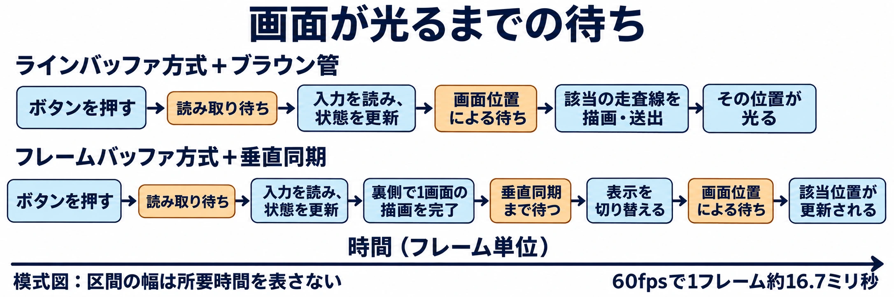
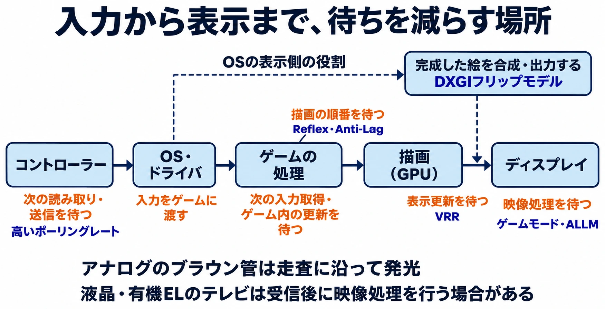

# ゲームの入力遅延――発生要因と削減・隠蔽の技術

> 2026年11月28日改版：記事全体を全面的に書き直しました。内容の変更はGitの履歴から追えます。

ジャンプボタンを押して、画面のキャラクターが地面を離れる。その間に、コントローラーが押下を拾い、OSとドライバがゲームに入力を渡す。ゲームはキャラクターを動かし、GPUがその姿を描く。ディスプレイに映像が届いても、画面のその場所が光るまでにはまだ時間がある。この、ボタンを押してから結果が画面に出るまでの時間が **入力遅延** である。[[1](#ref-1)]

ゲームが作る絵の一枚を **フレーム** と呼ぶ。1秒に60枚を等間隔で作る60fpsなら、1フレームの間隔は1,000ミリ秒 ÷ 60で約16.7ミリ秒だ。テレビやモニター側が1秒に60回画面を更新することは60Hzと表す。両方とも60のときでも、ゲームが新しい絵を作り終える時刻と、画面が次の更新を始める時刻にはずれがありうる。[[1](#ref-1)]

***

## 一枚ぶんの違いは分かるのか

よっしん氏は、遅れの設定を伏せた二つのサンプルを切り替え、実際に操作してどちらが遅いかを20問答える二重盲検テストを自作した。60fpsでは、おおむね1フレームと3フレームの条件は識別でき、1フレームと2フレームの条件は識別できる人と難しい人に分かれたという。結果には参加者やPC環境によるばらつきがあり、公開メモからは参加者数や環境ごとの集計までは分からない。このテストが示すのは、その条件で一枚ぶんの差を見分けた人がいたということだ。[[1](#ref-1)]

見分けられるかと、プレイの成績に響くかは別々に測れる。Worcester Polytechnic InstituteのMark Claypool氏らが、経験者による『Counter-Strike: Global Offensive』の二つの実験を比較した研究では、手元の機器で生じる遅延が命中精度やスコアに影響した。遅延の感じ方に加えて、狙った操作がどれだけ成功するかも観察できる。[[2](#ref-2)]

***

## ファミコン時代、画面は一行ずつ届いた

ブラウン管テレビの中では、電子ビームが画面の左から右へ走り、画面を上から下へ描いていく。その一行が **走査線** である。ファミコンの北米版にあたるNESを再現したコロンビア大学の授業報告には、映像を作る回路（PPU）が、次の走査線に必要なキャラクターのデータを先に拾い、背景と重ねながら画素を順に出力する様子が記されている。[[3](#ref-3)]

この方式では、次の行を描くための材料を小さな一時置き場に取っておく。こうした一時置き場が **バッファ** で、走査線単位の仕組みをここではラインバッファ方式と呼ぶ。NESではキャラクターの柄などを準備し、画素を送り出しながら絵を組み立てる。できた画素に対応する信号がアナログのブラウン管に届くと、電子ビームがその場所の蛍光体を光らせる。完成した一画面を本体やテレビで待つ工程が少ない経路だった。[[3](#ref-3)][[1](#ref-1)]

コントローラーの状態は本体の回路を通してゲームが読む。それでも、ジャンプが見える時刻はゲームがいつ入力を読んで座標を更新するか、映像回路がいつ画面の該当箇所を描くかで決まる。読み取りの直後に押したときは次の読み取りを待つし、同じ絵でも上の行と下の行では光る時刻が違う。短い経路にも、操作した時刻と画面上の位置による待ちがあった。[[3](#ref-3)][[1](#ref-1)]

***

## 一画面を描き終えてから渡す

ゲームの絵を一行ずつ送る代わりに、完成した一画面をメモリから読み出す方式では、画面一枚ぶんの置き場を **フレームバッファ** と呼ぶ。画面に送り出している絵へ直接書き込むと、描画途中の変化が見えてしまうことがある。そこで、表示中の絵と次の絵の置き場を二つに分ける。これがダブルバッファだ。表示中の表側を読み出す間に、裏側で新しい絵を仕上げる。[[4](#ref-4)]

裏側の絵が完成したところで、画面の上半分まで古い絵を送り終えていたとする。そこで新しい絵に切り替えると、上と下に別々のフレームが出る。画面が横に裂けて見える **ティアリング** である。描画途中のちらつきは表と裏の分離で抑え、走査の途中で絵が切り替わる乱れは **垂直同期** で防ぐ。垂直同期を使うと、画面の最後の行を送り終え、次の画面を始めるまでの切れ目に切り替える。絵が先に完成すればその切れ目を待ち、間に合わなければ古い絵を再び表示する。切り替えたあとも、ジャンプが見える位置まで画面の更新が進む時間がある。[[4](#ref-4)]

模式図。区間の幅は所要時間を表さない。[[1](#ref-1)][[3](#ref-3)][[4](#ref-4)]

***

## 描いた絵が出番を待つ、現代のPC

表と裏の二枚しかないと、裏に完成済みの絵が入ったまま切り替えを待っている間、次の絵の置き場が空かない。置き場を三枚にする **トリプルバッファリング** なら、表示中の絵と表示待ちの絵を残したまま、空いた場所で次の絵を描ける。完成した順にすべて表示する設定では、古い絵が先に出る分、新しい入力を含む絵は後ろに並ぶ。新しい絵を優先して古い表示待ちの絵を飛ばせる設定もあり、バッファの枚数と、何枚待たされるかは別の話である。[[4](#ref-4)][[5](#ref-5)]

絵が完成する前にも行列ができる。CPUが入力を取り込んでゲームを進め、GPUに描画の仕事を渡す。CPUが先の仕事を用意しておけばGPUの手が空きにくいが、GPUの処理が追いつかない場面では、先に渡した仕事の後ろに新しい入力を含む仕事が並ぶ。滑らかに絵が出続けていても、画面に出ているのは少し前の操作かもしれない。[[6](#ref-6)]

描き終わった絵の行き先も変わった。Windowsのデスクトップでは、デスクトップ ウィンドウ マネージャー（DWM）がゲーム画面や他のウィンドウを合成する。従来のコピー方式では、ゲームの絵を合成用の領域へ複写する工程があった。DXGIの **フリップモデル** では、DWMがゲーム側のバッファを共有できる。ウィンドウとバッファの構成などの条件がそろえば、Independent Flipで通常のデスクトップ合成を経ずにゲームの絵を表示できる。他のウィンドウが重なるなど、デスクトップの状態が変われば、合成に戻る場合もある。[[7](#ref-7)]

***

## 信号が届いてから、テレビの中で起きること

AV Watchは『ストリートファイターV』の同じ映像信号を同型のテレビ二台に送り、映像モードだけを変えて高速撮影した。ゲームモードの画面にはパンチの命中を示す光が出ているのに、もう一方の画面にはまだ出ていない。差が生まれたのは、ゲームが絵を送り出したあとの区間だ。[[8](#ref-8)]

液晶や有機ELのテレビでは、受け取った信号をパネルに書き込む前に、解像度を変換したり、映像のノイズを抑えたりする処理が入る。前後の絵を使って中間の絵を作る動き補間なら、その材料がそろうまで待つこともある。ブラウン管の走査に合わせて画素を送っていたときに比べ、表示側にも絵を加工する工程が増えた。[[8](#ref-8)][[1](#ref-1)]

映像をパネルに書き込めるようになるまでの時間と、書き込みが始まってから画素の明るさや色が変わるまでの **応答速度** は区別したい。画素の変化が速い有機ELでも、映像の処理を待てば表示は遅れる。ゲームモードは、時間のかかる映像処理の一部を省き、その待ちを短くする。HDMIの **ALLM（自動低遅延モード）** は、ゲーム機などからの信号を受けて、対応テレビが低遅延モードへ自動で切り替わる仕組みだ。[[8](#ref-8)][[9](#ref-9)]

もう一つ、HDMIの **VRR（可変リフレッシュレート）** は画面の更新時刻を変える。固定周期では、次の絵が切り替えにわずかに間に合わなくても、次の機会まで古い絵を表示する。VRRでは対応する更新間隔の範囲内で、新しい絵ができる時刻に合わせて更新を始められる。ALLMがテレビの中の処理を切り替えるのに対し、VRRが調整するのは絵を渡して表示を始める時刻だ。[[9](#ref-9)][[10](#ref-10)]

***

## コントローラーにも、入力を渡す時刻がある

画面から手元へ戻ってみよう。USBでつないだコントローラーでは、PCなどのホストが決まった間隔で機器に入力を読みに行く仕組みがある。これが **ポーリング** で、1秒間に読みに行く回数をポーリングレートと呼ぶ。たとえば1,000Hzなら読み取り間隔は1ミリ秒で、次の読み取りまでの待ちを短くできる。ゲームがその入力を使うのは、さらにその先だ。コントローラー内部でボタンの変化を検出する時刻と、OSが受け取る時刻、ゲームが入力を使う時刻はそれぞれ異なる。[[11](#ref-11)][[1](#ref-1)]

無線では、標準規格のBluetoothと、専用受信機や本体とのあいだで独自の通信方式を使う製品がある。Bluetoothも2.4GHz帯を使うため、製品表示でいう「専用2.4GHz」との違いは通信方式にある。送信の機会や、電波の状態によって再送が必要になるかでも待ちは変わる。たとえばMicrosoftが開発時に紹介したDynamic Latency Inputでは、スティックなどの状態をゲームが必要とする直前に届けるよう、入力の取得と送信の時刻を調整した。通信の速さに加えて、届いた入力をゲームがいつ使えるかまで設計した例である。[[12](#ref-12)][[13](#ref-13)]

よっしん氏のメモでは、主に2020年8月時点の環境について、手元から表示まで合計で約50ミリ秒かかるケースが挙げられている。60fpsならおよそ三枚ぶんの時間だ。氏自身も状況は変わりうると断っており、この値は当時の一例として読める。どこを短くできるかは、機器と設定を含め、経路をたどって考える必要がある。[[1](#ref-1)]

***

## 待ちを減らす技術は、どこに手を入れるか

PCでGPUの仕事がたまる場面に手を入れるのが **NVIDIA Reflex** の低遅延モードだ。対応ゲームでは、CPU側の処理をGPUが描画できる時刻に寄せ、先に作った仕事が長く並ぶのを抑える。**AMD Radeon Anti-Lag** もCPUがGPUより先に進みすぎる場面を狙う。初代はドライバ側で描画命令を渡すタイミングを調整し、Anti-Lag 2はゲームへの組み込みによって、入力を読む直前で処理の歩調を合わせる。待つ位置を入力の取得前へ移すと、描き始める絵により新しい操作を使える。[[6](#ref-6)][[14](#ref-14)]

GPUが絵を完成させたあとの待ちには、ディスプレイの節で見たVRRが効く。固定周期の切れ目を待つ時間を、対応範囲内で減らせるからだ。描画前に仕事がたまる区間と、完成した絵が表示を待つ区間を分けると、同じ「低遅延」の設定でも何を変えるのかが見えてくる。[[10](#ref-10)]

レトロゲームを動かすRetroArchの **Run Ahead（先行実行）** は、ゲームの内部に手を入れる。入力を受け取ってから動きが絵に出るまでゲーム内部で何フレームか進む場合に、エミュレーターが状態を一時保存し、受け取った入力で先のフレームまで速く計算する。途中の絵を出さずに先の結果を表示し、保存した状態に戻して本来の進行を続ける。先行しすぎると本来の動きが飛んで見えることがあり、実行には状態の保存・復元に対応したエミュレーターのコアと、追加計算をこなせる余力が要る。[[15](#ref-15)]

OSの表示側の処理は、GPUで描画したあとの経路に関わる。[[7](#ref-7)]

***

## 待つあいだに、ゲームが返せるもの

剣を振るボタンを押したとき、剣先が敵に届くより前に、肩や腕が動き始める。こうした **予備動作（アンティシペーション）** は攻撃に間を作りながら、操作を受け付けたことも伝えられる。反対に、剣が当たった瞬間に動きを一瞬止める **ヒットストップ** は、命中した瞬間を読み取りやすくする。機器の待ち時間はそのままでも、動き始めと命中のどちらを手応えとして返すかは設計できる。[[16](#ref-16)][[17](#ref-17)]

着地の直前にジャンプを押したとき、入力を短時間だけ覚え、着地した瞬間に実行する設計もある。入力の先行受付は、押し直しを求める代わりに、プレイヤーが出した指示を次に動ける時刻まで預かる。リズムゲームの **オフセット** は、映像や音、判定の基準時刻をずらし、機器ごとに生じる一定のずれを補う。CEDEC 2014で紹介されたアーケード版『太鼓の達人』では、筐体で生じる音と映像の時間差に合わせて、画面の表示を先行させていた。操作にどんな手応えを返すかは、[ゲームフィールの設計を扱った記事](game-feel-design-theory-for-game-planners.md)で詳しく扱う。[[17](#ref-17)]

オンライン対戦では、ここまでの経路に通信の待ちが加わる。**ロールバック** は、相手の入力が届く前に予測してゲームを進め、食い違えば過去の状態から計算し直す。**クライアントサイド予測** は、サーバーの返事が来る前に自機の操作を反映し、確定した状態が届いたところでずれを補正する。どちらも返事を待つ間に何を画面に出すかという設計で、詳しくは[家庭用ゲームのオンライン対戦における遅延対策](console-online-multiplayer-latency-techniques.md)に譲る。

***

## 同じように押せば、同じように返るか

『太鼓の達人』の筐体では、音と映像の機器が決まっているから、測ったずれに合わせて表示を先行させられた。同じ調整を家庭用ゲームに持ち込むと、テレビの映像モードや、音をテレビから出すか別の機器から出すかで、ずれ方が変わる。開発用モニターで気持ちよく叩ける判定でも、別の環境で同じように叩けるかは実際に試して初めて分かる。CEDEC 2014で森口明彦氏が紹介したように、ハイスピード撮影を使えば、入力から表示までの全体の待ちを直接測れる。比較するなら、画面上で反応を見る位置や、どの変化を「反応」と数えるかもそろえたい。[[17](#ref-17)]

森口氏は2019年のCEDECで、「芯（シン）・遅延対策2020」と題して、遅延の短さに加えて安定性を重視する考え方を示した。一定のずれならリズムや判定の基準を合わせられる。あるときだけ描画が間に合わず、次の更新へ持ち越されるような揺れは、固定のオフセットでは取り切れない。測定を繰り返し、軽い場面と負荷の高い場面で、反応がどれだけ前後するかを見ると、平均値だけでは分からなかった失敗を拾える。[[18](#ref-18)][[17](#ref-17)]

ジャンプで狭い足場に渡る場面なら、押してから変化が見えるまでの時間と、着地前に押したボタンが拾われるかの両方を試せる。前者のばらつきが大きければ、描画が混む場面や表示設定を調べる。後者で失敗が続くなら、先行受付や足場の間隔を見直す余地がある。プレイヤーが次の足場へ跳ぶときに頼るのは、前の一跳びで手に覚えたタイミングだ。そのタイミングを繰り返し使えるかまで確かめて、ジャンプの仕様が決まる。

***

## References

1. [よっしん「ゲームの入力遅延問題とその対策」][1] — yosshin4004.github.io、2009年10月29日初出、2020年8月29日改稿、2025年1月29日最終更新。著者は、主に2020年8月時点の状況を反映し、その後の変化がありうると注記している。

[1]: https://yosshin4004.github.io/memo/input_lag/index.html

2. [Shengmei Liuほか「Comparing the Effects of Network Latency versus Local Latency on Competitive First Person Shooter Game Players」][2] — ACM Esports and High Performance HCI Workshop、2021年5月8日。

[2]: https://web.cs.wpi.edu/~claypool/papers/csgo-net-local-21/

3. [Jeff Jaquith、Minghao Li、Zach Schuermann「NES Emulator」][3] — コロンビア大学 CSEE 4840 Embedded System Design、2020年春。NESを再現した授業プロジェクトの報告。System Overview、Sprite Rendering、PPU Rendering Figures in Summaryを参照。

[3]: https://www.cs.columbia.edu/~sedwards/classes/2020/4840-spring/reports/nes.pdf

4. [Microsoft「Flipping Surfaces (Direct3D 9)」][4] — Microsoft Learn。表示用と描画用のバッファの切り替えを参照。

[4]: https://learn.microsoft.com/en-us/windows/win32/direct3d9/flipping-surfaces

5. [Microsoft「IDXGISwapChain::Present (dxgi.h)」][5] — Microsoft Learn。フリップモデルの表示待ちキューと、表示を飛ばす例を参照。

[5]: https://learn.microsoft.com/en-us/windows/win32/api/dxgi/nf-dxgi-idxgiswapchain-present

6. [NVIDIA「NVIDIA Reflex」][6] — NVIDIA Developer。Reflex Low Latency Modeの説明を参照。

[6]: https://developer.nvidia.com/performance-rendering-tools/reflex

7. [Microsoft「For best performance, use DXGI flip model」][7] — Microsoft Learn。コピー方式との差とDirectFlip・Independent Flipの条件を参照。

[7]: https://learn.microsoft.com/en-us/windows/win32/direct3ddxgi/for-best-performance--use-dxgi-flip-model

8. [トライゼット西川善司「あなたのテレビは遅れてませんか? 知っておきたい“遅延”の話」][8] — AV Watch、2020年3月5日。

[8]: https://av.watch.impress.co.jp/docs/series/dg/1236788.html

9. [HDMI Licensing Administrator「HDMI® Auto Low Latency Mode (ALLM)」][9] — HDMI Licensing Administrator公式サイト。

[9]: https://www.hdmi.org/spec21sub/autolowlatencymode/

10. [HDMI Licensing Administrator「Variable Refresh Rate (VRR)」][10] — HDMI Licensing Administrator公式サイト。

[10]: https://www.hdmi.org/spec21sub/variablerefreshrate

11. [Microsoft「_USB_ENDPOINT_DESCRIPTOR (usbspec.h)」][11] — Microsoft Learn。bIntervalと転送間隔の説明を参照。

[11]: https://learn.microsoft.com/en-us/windows-hardware/drivers/ddi/usbspec/ns-usbspec-_usb_endpoint_descriptor

12. [Martin Woolley「The Bluetooth® Low Energy Primer」][12] — Bluetooth SIG、2022年6月6日改訂。周波数帯、接続イベント、再送の説明を参照。

[12]: https://www.bluetooth.com/wp-content/uploads/2022/05/Bluetooth_LE_Primer_Paper.pdf

13. [Xbox Wire「Xbox Series X: What’s the Deal with Latency?」][13] — Xbox Wire、2020年3月16日。入力の取得と転送のタイミングを合わせる開発事例を参照。

[13]: https://news.xbox.com/en-us/2020/03/16/xbox-series-x-latency/

14. [Gareth Thomas「AMD Radeon Anti-Lag 2 SDK」][14] — AMD GPUOpen、2024年9月4日初出。ドライバ側で処理する初代とゲームに組み込むAnti-Lag 2の説明を参照。

[14]: https://gpuopen.com/learn/integrating-amd-radeon-anti-lag-2-sdk-in-your-game/

15. [Libretro「RetroArch Run Ahead」][15] — Libretro Docs、2020年7月20日。状態の保存・復元と先行実行するフレーム数の決め方を参照。

[15]: https://docs.libretro.com/guides/runahead/

16. [イトー「〖実例付き〗『ヒット演出』代表10選」][16] — トイロジック技術開発ブログ「トイログ」、2024年2月9日。

[16]: https://blog.toylogic.co.jp/planner/4111.html

17. [佐藤カフジ「〖CEDEC2014〗遅延問題を錯覚利用で解決?! 『世界のみんなは4フレーム以内にいる』」][17] — GAME Watch、2014年9月4日。森口明彦氏の講演レポート。

[17]: https://game.watch.impress.co.jp/docs/news/665316.html

18. [森口明彦「芯（シン）・遅延対策2020 ～ヒトのスペックから紐解かれる、安定性重視とフレームレートのベストプラクティス～」][18] — CEDiL、2019年9月5日。CEDEC 2019の公開セッション概要を参照。

[18]: https://cedil.cesa.or.jp/cedil_sessions/view/2002

----

この文書は、Perplexity、Claude、ChatGPT の3つのAIの支援を受けて著述されたものです。引用画像を除き、MIT License にて提供されています。
