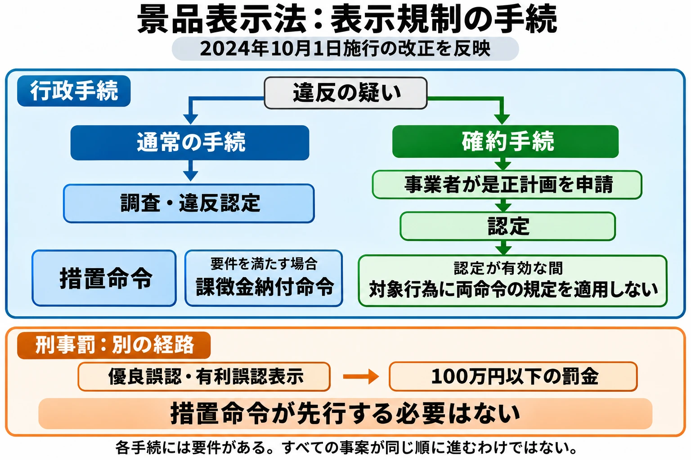

# ゲームプランナーが知っておくべき法令ガイド――仕様書の一行から、どの法律にたどり着くか

> 2026年11月23日改版：記事全体を全面的に書き直しました。内容の変更はGitの履歴から追えます。

> 本稿は法令の概要を紹介するもので、法的助言ではありません。具体的な判断は、弁護士や所属先の法務部門に確認してください。法令は改正されるため、検討する時点の最新の条文と所管官庁の資料を確認してください。

## はじめに

ゲームプランナーが法律と出会うのは、たいてい仕様書の一行である。「ピックアップの出現確率は3%」「有償コインの有効期限は購入から半年」「月額パスは自動更新」。ゲームセンターで渡す賞品や、受託開発の発注書に書く検収条件も、同じように法令への入り口になる。

たとえば月額パスを作るなら、購入直前に何を表示するかという問いから特定商取引法にたどり着く。そのパスで受け取るコインの残高をどう管理するかには、資金決済法が関わりうる。一つの企画を、売る画面、受け取るもの、終了時の扱いに分けると、相談する論点が見えてくる。本稿は、仕様書の一行から法律ごとに引ける地図である。

[ゲームと政府・業界の規制マップ](game-and-government-regulation-map.md)は、国会、省庁、自治体、業界団体、決済網といったルールを作る主体から引く地図である。ストアや決済会社の条件がどこから来たのかを知りたいときは、そちらから引くとよい。

***

## A. 課金とお金

### 1. 景品表示法

「ガチャで指定のキャラクターをそろえると、別の限定キャラクターがもらえる」。景品表示法には、こうした取引に付随する景品の規制と、購入の判断を誤らせる表示の規制という二本柱がある。消費者庁は2012年5月、有料ガチャで異なる種類のアイテムを特定の組み合わせでそろえさせるコンプガチャについて、既存の告示で禁止される「カード合わせ」に当たるとの見解を示し、同年7月1日から運用基準を施行して執行を始めた。[[1](#ref-1)]

表示の側では、『FFBE幻影戦争』の1周年キャンペーンがある。5つのガチャで、「召喚は1回ごとに、その提供割合にもとづいて抽選を行います」などと案内したが、実際の抽選の仕組みは表示と異なっていた。消費者庁は2021年6月28日付でgumiとスクウェア・エニックスに措置命令を出した。『KOF98 UM OL』では、ピックアップの「クーラ」が単発で3%の確率で出るように見えたが、実際は0.333%だった。10連でも、アイテムに割り当てられた1枠を除く9枠のうち8枠は0.333%だった。消費者庁はアワ・パームに2018年1月26日に措置命令を出し、2021年3月29日に課徴金納付命令を出した。[[2](#ref-2)][[3](#ref-3)][[4](#ref-4)]

確率表をレビューするときは、数値と一緒に「何を1回と数えるか」を見る。確定枠や引き直しがあれば、その条件を表示文言と実装の両方で確かめる。配信者への宣伝依頼も表示の問題である。2023年10月1日からは、事業者が関与した広告などで、その事業者の表示だと一般消費者が判別しにくいものが、景品表示法の告示で規制されている。[[5](#ref-5)]

2024年10月1日施行の改正では、違反の疑いについて事業者が自主的な是正計画を申請し、消費者庁が認定する確約手続が導入された。認定が有効な間は、対象行為に措置命令や課徴金納付命令の規定が適用されない。一定の再違反には課徴金の割増しが設けられ、実際より著しく良く見せる優良誤認表示や、取引条件を著しく有利に見せる有利誤認表示には、措置命令を前提としない刑事罰（100万円以下の罰金）も新設された。[[6](#ref-6)]

図は2024年10月1日施行の改正を反映した手続の概念図である。[[6](#ref-6)]

規制が形になった経緯は[コンプガチャと行政の対応](complete-gacha-administrative-tools-and-display-enforcement.md)と[日本のガチャ規制の歴史](gacha-regulation-japan-history.md)で読める。広告の表示は[ゲーム配信・VTuberのPR表記](stealth-marketing-game-streaming-vtuber-pr-disclosure.md)、確率表示を信頼してもらう条件は[オンラインオリパの確率表示](online-oripa-probability-disclosure-industry-trust.md)につながる。

### 2. 資金決済法

「先にコインを買い、あとでアイテムと交換する」。資金決済法はこうして預かった価値の扱いにも関わる。有償で発行し、残高を記録して後日代金の支払いに使えるゲーム内通貨は、前払式支払手段に当たりうる。対象となる発行者は、3月末・9月末の基準日に未使用残高が1,000万円を超えると、その半額以上を発行保証金の供託などで保全する。自社でだけ使える仕組みか、他社でも使えるかによって、届出・登録の扱いも変わる。発行から6か月以内に限り使えるものには適用除外がある。[[7](#ref-7)][[8](#ref-8)]

2016年4月、毎日新聞は『LINE POP』の「宝箱の鍵」について、前払式支払手段に当たる可能性が社内で指摘された後、LINEが用途を制限する仕様変更で供託を逃れたと報じた。LINEは関東財務局の立入検査を受けたことを認め、届出をしなかった疑いによる検査ではなく、定期的なものだと反論した。ゲーム内アイテムの判断基準は明確でないとし、公開や更新の前に専任法務が使用場面などを調べ、難しいものは外部弁護士にも相談すると説明した。報道と会社の見解が分かれた例であり、鍵という同じ名前でも、何を受け取るために、どの場面で使えるかが判断に関わる。[[9](#ref-9)][[10](#ref-10)]

企画書には、購入した分と無償で配った分をどう記録し、どちらから消費するかまで書く。有効期限は起算日と残高画面での見せ方を決める。対象となる前払式支払手段の利用を終了する場合の払戻しを見据え、終了時にどの残高が対象かを特定できるようにしておく。外部への移転や売買を予定するなら、暗号資産に当たるかなど別の論点も生じる。NFTという呼び名だけで扱いは決まらず、決済に使える範囲や取引の実態が関わる。[[7](#ref-7)][[8](#ref-8)][[11](#ref-11)]

入口の設計は[任天堂のプリペイドカード・ダウンロードカード](nintendo-prepaid-download-cards-payment-services-act.md)に、出口は[サービス終了の設計](service-shutdown-design-and-practice.md)と[『文豪ストレイドッグス 迷ヰ犬怪奇譚』の終了と払戻し](bungo-stray-dogs-mayoi-inu-bankruptcy-shutdown-refund-gap.md)に詳しい。[障害時の補償](live-service-game-incident-compensation-framework.md)では運営上の補償の考え方を、[P2Eの開発](p2e-game-development-planner-checklist.md)と[Next BAYの事例](next-bay-rmt-crypto-regulatory-friction.md)ではゲームの外で価値を取引する設計を扱う。

### 3. 特定商取引法

月額パスを申し込むとき、プレイヤーが最後に見る画面には何が書いてあるか。特定商取引法は、通信販売などで生じやすいトラブルを防ぐ法律である。2022年6月1日施行の改正で、通信販売の最終確認画面などに分量、価格、支払時期・方法、提供時期、申込みの撤回・解除に関する事項、期限がある場合の申込期間などを表示する義務が設けられた。[[12](#ref-12)][[13](#ref-13)]

2025年11月に消費者庁が公表したBIZMの事例では、解約手続きをしない限り毎月届く美容クリームの定期購入が、最終確認画面で2本目以降の購入を義務づけられないかのように表示されていた。消費者庁は、こうした表示などを理由に、通信販売業務の一部を6か月間停止するよう命じた。月額パスでも、何が次回に続き、いつ支払いが発生するのかは、注文を確定する前に伝える情報である。[[14](#ref-14)][[15](#ref-15)]

初回特典の値段を確認した同じ流れで、次回以降の金額と更新条件を読めるか。解約方法と期限は見つかるか。申し込む側と解約する側の両方の画面を並べると、ゲーム内の案内からストアや販売サイトの手続へ移るところで説明が切れていないかを確かめられる。[[13](#ref-13)]

購入直前の表示事項は消費者庁のガイドラインを参照できる。ゲーム内から別の決済に進む場合の全体像は、[スマホ新法とゲーム業界](smartphone-software-competition-act-game-industry-impact.md)で扱う。[[13](#ref-13)]

### 4. 消費者契約法

「データが消失した場合、当社は一切の責任を負わない」。障害時の扱いを利用規約に書くときは、事業者と消費者の契約を扱う消費者契約法が関わる。第8条は、事業者の債務不履行などによって消費者に生じた損害を賠償する責任を全部免除する条項などを無効とする。[[16](#ref-16)][[17](#ref-17)]

たとえば、運営側の契約上の義務違反で購入済みデータが失われた場合まで、補償の余地を一律に排除する条項なら、全免責として無効になりうる。条項の効力と、個別のデータ消失について実際に損害賠償の責任を負うかは、それぞれ検討する事項である。[[16](#ref-16)][[17](#ref-17)]

サービス終了、アカウント停止、障害は、プレイヤーから見ればいずれも「使えなくなった」場面だが、運営側が取る手順は異なる。停止の理由と通知方法、調査や復旧の窓口、購入済みのものの扱いを場面ごとに書き出すと、規約と実際の運用をすり合わせやすい。

条項の考え方は、消費者庁の逐条解説で第8条から第10条を確認できる。[[17](#ref-17)]

### 5. スマホソフトウェア競争促進法（スマホ新法）

「コインの購入ボタンから、自社の決済画面へ進める」。この選択肢が広がった背景には、スマートフォンのアプリ配信や決済などで競争を促すスマホソフトウェア競争促進法がある。公正取引委員会はApple Inc.、iTunes株式会社、Google LLCを指定し、同法は2025年12月18日に全面施行された。[[18](#ref-18)][[19](#ref-19)]

Appleは日本でのiOSの変更として、代替アプリマーケットプレイスを通じた配信と、Appleのアプリ内購入以外の決済処理を発表した。代替ストアによる配信と、アプリ内で購入時に選べる決済の追加は、それぞれ条件を確認する必要がある。[[20](#ref-20)]

プランナーが図にしたいのは、購入ボタンから支払い、購入履歴、問い合わせまでの一連の流れである。決済経路ごとに誰が販売し、誰が通貨を発行するかを確認すると、特商法上の申込み表示や、資金決済法上の発行者の表示がどこに必要かを検討しやすい。[[7](#ref-7)][[13](#ref-13)]

配信と決済の選択肢を日本のゲーム事業に引きつけて読むなら、[スマホ新法とゲーム業界](smartphone-software-competition-act-game-industry-impact.md)へ。

***

## B. 遊技と賞品

### 6. 風営法

「遊技の結果に応じ、店頭で物品を渡す」。ゲームセンターなどは、営業の形態によって風営法上の「5号営業」に当たり、遊技結果に応じて賞品を提供することが禁止される。風営法はこうした営業の許可や運営上の規制を定める。[[21](#ref-21)]

クレーンゲームには、機械で釣り上げるなどした物品で、小売価格がおおむね1,000円以下のものを提供する場合、遊技結果に応じた賞品提供に当たらないとする警察庁の解釈運用基準がある。2022年3月1日の改正で示された取扱いである。2026年7月、警察庁は「遊技場営業について」で、アミューズメントカジノ等を挙げ、5号営業で遊技結果に応じた商品の提供が禁止されることを改めて周知した。[[22](#ref-22)][[23](#ref-23)][[24](#ref-24)]

メダルゲームで増えたメダルは、次に遊ぶために使える。現金に換えたり、景品と交換したりする設計は別の扱いになる。店舗向けの企画では、機械が何を出すかと、カウンターで何を渡すかを一緒に確認する。年少者の入場時間を案内するなら、法令と出店先の都道府県の条例を確認する。[[21](#ref-21)][[23](#ref-23)]

遊技機ごとの扱いは[クレーンゲームの景品規制](crane-game-prize-regulation-difficulty-online-history.md)と[メダルゲームで換金・景品交換ができない理由](medal-game-no-cash-prize-industry-structure.md)、店舗の成り立ちは[ゲームセンターの歴史](arcade-game-center-history.md)へ。

### 7. 刑法の賭博罪

「大会参加費を集め、その一部を優勝者への賞金にする」。この一行では、参加者が出した金銭を勝敗によって取り合う構造が、刑法の賭博罪との関係で問題になりうる。経済産業省の資料でも、eスポーツ大会で参加料から賞金を出す場合について注意を促している。[[25](#ref-25)][[26](#ref-26)]

同じ大会の賞金を景品表示法から見ると、消費者庁は、個々の大会の実態に照らし、仕事の報酬等と認められる賞金は景品類に当たらないと説明している。大会が景品規制の対象となるかという問いと、参加者間で財産を賭ける構造かという問いは、別々に確認する。[[26](#ref-26)][[27](#ref-27)]

法務に見せる企画書には、参加費の使途、賞金の原資、誰が支払って誰が受け取るかを書く。オンラインオリパでも、有料の抽選でカードを受け取る仕組みに加え、引いた結果を事業者が買い戻すなどの経路があれば、購入から換金までつなげて確認したい。

大会の計画は[eスポーツ大会の賞金と賭博罪・風営法](esports-tournament-prize-gambling-and-amusement-business-law.md)、カード販売の仕組みは[オンラインオリパと確率表示](online-oripa-probability-disclosure-industry-trust.md)を参照できる。

***

## C. 知的財産

### 8. 著作権法

「他社作品の対戦ルールを参考にし、キャラクターと画面は自分たちで作る」。著作権法が保護するのは創作的な表現である。ゲームではプログラム、映像、音楽、キャラクターの具体的な絵や造形などが保護されうる。ルールやアイデアそのものと、画面や文章、コードに落とし込んだ具体的な表現との区別が、企画を検討する入り口になる。[[28](#ref-28)][[29](#ref-29)]

たとえば任天堂は、個人が任天堂のゲームの映像や画像を投稿するときの条件をガイドラインで示している。対象となる投稿や収益化の方法には条件がある。第三者の音楽やキャラクターが入る場面では、自社が許諾できる範囲も確認が必要になる。[[29](#ref-29)][[30](#ref-30)]

プレイヤーが作るステージや衣装などのUGCをゲーム内で公開するなら、他人の素材が持ち込まれたときの対応と、運営が投稿作品を紹介・再配布できる範囲を決める。生成AIでは学習段階と生成物の公開段階で論点が変わる。Modや二次創作についても、権利者が対応を見送ってきた経緯と、利用条件として明示された許諾は区別して読む。[[28](#ref-28)][[31](#ref-31)]

素材の制作には[生成AIと著作権](generative-ai-copyright-game-industry-guide.md)、公開には[配信・二次創作ガイドラインの設計](game-streaming-fan-creation-guideline-design.md)がつながる。[Modの線引き](modding-merits-demerits-culture-law-developers.md)、[同人と黙認](tacit-tolerance-doujin-ip-enforcement.md)、[無許諾移植](unauthorized-ports-ai-speed-is-not-permission.md)、[ソニーとテンセントの訴訟](sony-tencent-horizon-light-of-motiram-lawsuit.md)では、作品の利用や類似性が争点になる場面を追っている。

### 9. 不正競争防止法と商標法

「有名ゲームの略称に似た名前でイベントを開く」。商標法は、登録された名称やロゴなどを、指定された商品・サービスとの関係で保護する。不正競争防止法にも、広く知られた他社の表示との混同を起こす行為や、著名な表示を無断で自らの営業表示として使う行為を規制する仕組みがある。[[32](#ref-32)][[33](#ref-33)]

任天堂は2017年2月24日、公道カートを貸し出すマリカーを提訴した。知財高裁は2019年5月30日の中間判決で「マリカー」などの表示の営業上の使用や、マリオなどのコスチュームの貸与を不正競争行為と認めた。2020年1月29日の終局判決では5,000万円の損害賠償と差止めなどを命じた。最高裁が同年12月24日付で上告審として受理しないと決定し、判決が確定した。別途、特許庁の無効審判で「マリカー」の商標登録を無効とする審決も確定した。[[34](#ref-34)][[35](#ref-35)][[36](#ref-36)]

企画段階の名称確認には、正式名と略称、ロゴと告知画像、どのサービスに付けるかまで添える。作品名だけを検索すると、衣装や宣伝の組み合わせから生じる誤認を見落としやすい。名称の調べ方は[ゲームの仕組みをめぐる特許・公開ライセンス・商標](game-mechanics-patents-open-licenses-and-trademarks.md)の商標の節に詳しい。

運営のルールでは、ゲーム内通貨・アイテムなどを現金で取引するRMTにも出会う。たとえば『ファイナルファンタジーXIV』は、不正プログラムやRMTで得たアイテムや通貨がゲーム内の経済やバランスに影響すると説明し、RMTを禁止している。[[37](#ref-37)]規約上の禁止と、不正競争防止法などが個別の取引に関わるかは別の問いである。[日本のRMTの歴史](rmt-history-japan-why-games-ban-real-money-trading.md)と[公式RMTの設計](official-rmt-design-diablo-wow-eve-taskbar-hero.md)に、取引を止める場合と公式に取り込む場合の事例がある。

### 10. 特許法

「フィールド上で照準を合わせ、道具を投げて捕獲する」。遊びの説明を実装に近い粒度まで落とすと、特許が関わることがある。特許法が保護するのは特許を取得した発明で、ゲームでも処理の組み合わせや操作に応じた制御が対象になりうる。権利の範囲を確かめる入り口は、発明の構成を記した「請求項」である。[[38](#ref-38)]

2024年9月18日、任天堂とポケモンは『Palworld / パルワールド』が複数の特許権を侵害するとして、ポケットペアに対し差止めと損害賠償を求めて提訴した。ポケットペアは同年11月、原告が侵害を主張する3件の対象特許を公表した。この事例では、キャラクターの見た目を比べるだけでは見えてこない、操作や処理の仕組みが争点になる。[[39](#ref-39)][[40](#ref-40)]

相談に持っていく資料では、企画書上の機能名に加え、操作の順序と各段階で変わる画面やゲーム内の状態を示す。別案で変わるのが演出だけなのか、処理の組み合わせまで変わるのかが分かると、請求項と照らして検討しやすくなる。

調査と取得の考え方は[ゲームシステム特許のリスクと取得戦略](game-system-patents-risks-and-strategy-for-planners.md)、事例は[パルワールド訴訟とゲーム設計](palworld-nintendo-patent-lawsuit-and-game-design-analysis.md)、権利を開放する例は[ゲームの仕組みをめぐる特許・公開ライセンス・商標](game-mechanics-patents-open-licenses-and-trademarks.md)へ。

***

## D. データと年齢

### 11. 個人情報保護法と海外の規制

「離脱した地点を調べるため、プレイログをアカウントにひもづけて保存する」。個人情報保護法は、個人を識別できる情報などの取り扱いに関わる。取得時の利用目的や安全管理に加え、2022年4月施行の改正で、個人の権利利益を害するおそれがある所定の漏えい等について、個人情報保護委員会への報告と本人への通知が義務化された。[[41](#ref-41)][[42](#ref-42)]

カプコンは、改正施行前の2020年に発生した不正アクセスについて、2021年4月に情報流出の調査結果と再発防止策を公表した。発覚後に影響を調べるには、どのシステムがどの情報を持っていたかを追える必要がある。データを取る仕様と、事故が起きた際に影響範囲を確認できる仕様は、同じ設計の中にある。[[43](#ref-43)]

海外向けでは、EUの一般データ保護規則（GDPR）など、配信先や処理の実態に応じた規制が関わる。GDPRではデータ処理に適法な根拠が必要で、同意はその一つである。同意に基づく場合は、自由な意思で具体的な説明を受けた上で示されたことや、同意を撤回できることが問われる。[[44](#ref-44)]

法務に共有する資料には、取得する項目と目的、ひもづける識別子、保存期間、分析ツールなどへの送信先をまとめる。事故発生後の動きは[個人データ漏えいの最初の48時間](personal-data-breach-first-48-hours-game-company.md)、同意と計測の設計は[GDPRとゲームのテレメトリー](gdpr-consent-gate-game-telemetry-design.md)へ。

### 12. 年齢区分（CERO）と条例

CEROの年齢区分は業界の自主規制である。家庭用ゲームを表現内容に応じて区分し、Zは18歳以上のみを対象とする。店舗での販売や陳列には、これとは別に、都道府県の青少年健全育成条例に基づく有害図書類の指定などが関わることがある。[[45](#ref-45)][[46](#ref-46)]

2005年6月7日、神奈川県は条例に基づき『グランド・セフト・オートIII』を有害図書類に指定して告示した。[[47](#ref-47)] 同年12月には京都府も、条例に基づき『グランド・セフト・オートIII』と『グランド・セフト・オート・バイスシティ』を青少年に有害な図書類に指定した。Z区分の販売を自主規制として扱う場面と、条例の指定や規定を根拠に販売を制限する場面では、店頭で似た対応を取るとしても確認する資料が異なる。[[45](#ref-45)][[46](#ref-46)]

香川県のネット・ゲーム依存症対策条例は、家庭でのルールづくりに使用時間の目安を設けている。作品の表現を区分するCEROや、具体的な製品を指定する有害図書類の仕組みとは、企画で見る箇所が異なる。年齢に関する仕様を決めるときは、作品の表現、販売方法、プレイ時間の案内のどこに関わるルールかを確認するとよい。[[48](#ref-48)]

国内の販売と指定の経緯は[CERO Zと『GTA III』](cero-z-rating-gta3-ordinance-link.md)、海外の審査は[各国のゲームレーティング](game-global-rating-regulations.md)、条例の経緯は[香川県のゲーム条例](kagawa-game-ordinance-process-lawsuit-aftermath.md)へ。[ルールを作る主体から引く地図](game-and-government-regulation-map.md)でも、条例と自主規制の関係を扱っている。

***

## E. 会社と会社

### 13. 取適法

「検収後の追加修正は、当初の見積もりに含める」。受託開発の発注書にこの一行があるときは、会社と会社の委託取引を適正にする中小受託取引適正化法（取適法）が関わりうる。プレイヤーとの契約ではなく、事業者間の発注と受注を扱う法律である。下請法を改正した取適法は2026年1月1日に施行され、同日以降に発注する対象取引に適用される。適用を判断する基準に従業員数が加わり、代金の協議に応じない一方的な決定や、手形による支払いなどが禁止された。[[49](#ref-49)][[50](#ref-50)]

公正取引委員会は旧下請法の違反行為事例として、ソフトウェア開発で打合せの結果を書面に残さず、受託側から確認されても明確に指示しなかったのに、納入時に仕様が違うとして無償でのやり直しを求めた例を挙げている。ゲーム開発でも、打合せの口頭指示が積み重なると、追加の作業なのか、約束していた成果物の修正なのかが見えにくくなる。[[51](#ref-51)]

発注時には成果物と代金、納期、検収条件を関係者で共有する。仕様を変えるときは、変えた箇所、追加の作業、費用や納期への影響を記録する。レビューをするプランナーが直接契約を結ばなくても、何をいつ頼んだかを発注担当に返せる状態にしておく。[[50](#ref-50)]

発注・検収の実務は[ゲーム開発の外注と取適法](game-development-subcontracting-toriteki-law.md)、販売委託も含めた契約は[インディーゲームのパブリッシング契約](indie-game-publishing-contract-revenue-recoup-ip.md)へ。

***

## 横断マップ

| 仕様の場面 | 関わる法律 | 詳しい記事 |
| --- | --- | --- |
| ガチャの確率や確定枠を書く、配信者に宣伝を依頼する | 景品表示法 | [ガチャ規制](gacha-regulation-japan-history.md)・[PR表記](stealth-marketing-game-streaming-vtuber-pr-disclosure.md) |
| 有償コインの期限やサービス終了時の残高の扱いを決める | 資金決済法 | [プリペイドカード](nintendo-prepaid-download-cards-payment-services-act.md)・[サービス終了の設計](service-shutdown-design-and-practice.md) |
| 月額パスの購入直前に更新条件を見せる | 特定商取引法 | [スマホ新法とゲーム業界（外部決済）](smartphone-software-competition-act-game-industry-impact.md)・消費者庁のガイドライン[[13](#ref-13)] |
| データ消失やアカウント停止時の責任を規約に書く | 消費者契約法 | 消費者庁の逐条解説[[17](#ref-17)] |
| ストア外の決済や代替ストアでの配信を選ぶ | スマホソフトウェア競争促進法 | [スマホ新法とゲーム業界](smartphone-software-competition-act-game-industry-impact.md) |
| クレーンゲームの物品やメダルの扱いを決める | 風営法 | [クレーンゲームの景品](crane-game-prize-regulation-difficulty-online-history.md) |
| 大会参加費と賞金の原資を決める | 刑法の賭博罪 | [eスポーツ大会と賞金](esports-tournament-prize-gambling-and-amusement-business-law.md) |
| 投稿されたステージを公式が紹介する、外部素材を使う | 著作権法 | [配信・二次創作ガイドライン](game-streaming-fan-creation-guideline-design.md) |
| タイトルの略称や他社作品に似たロゴを使う | 不正競争防止法・商標法 | [特許・公開ライセンス・商標](game-mechanics-patents-open-licenses-and-trademarks.md) |
| 他作品に似た操作や処理の組み合わせを採用する | 特許法 | [ゲームシステム特許](game-system-patents-risks-and-strategy-for-planners.md) |
| プレイログを保存し、外部の分析ツールに送る | 個人情報保護法・GDPRなど | [漏えい時の初動](personal-data-breach-first-48-hours-game-company.md)・[GDPRとテレメトリー](gdpr-consent-gate-game-telemetry-design.md) |
| 年齢区分を表示し、店頭での販売条件を決める | 青少年健全育成条例など・CEROの自主規制 | [CERO Zと条例](cero-z-rating-gta3-ordinance-link.md) |
| 外注する成果物の検収後に追加修正を依頼する | 取適法 | [ゲーム開発の外注と取適法](game-development-subcontracting-toriteki-law.md) |

***

## 法務に相談するとき

相談は、企画書に画面や数字を置き始めた段階からできる。ガチャなら抽選単位と確定枠、通貨なら買うところから使い切るところまでの流れを添える。広告の表現は画像と掲載先、賞品は入手条件と原資、外部決済は経路ごとの販売者と問い合わせ先まで見せる。取得するデータは、そのデータが流れる相手と利用目的を一緒に渡す。検討中の案が複数あるときは、変更できる箇所も書いておく。

実装に入ったら、最初に相談した前提と、できあがった画面や挙動を照らし合わせる。確率表は実装と、販売条件は購入と解約の画面と、外注の仕様は発注書と変更記録と突き合わせる。運営中に用途や対象を増やすときも、どの前提が変わったかが分かれば、相談を続きから始められる。

「コインを買えるようにする」の一行に、誰が発行し、何に使え、最後に残ったらどうなるかを書き添える。法令の名前を覚えることより先に、その一行を見た法務と開発が、同じプレイヤーの行動を思い浮かべられるところまで企画を具体化したい。

***

## References

1. [消費者庁「インターネット上の取引と「カード合わせ」に関するQ&A」][1] — 消費者庁、日付記載なし。Q9、Q10参照。

[1]: https://www.caa.go.jp/policies/policy/representation/fair_labeling/faq/card/

2. [消費者庁「株式会社gumi及び株式会社スクウェア・エニックスに対する景品表示法に基づく措置命令について」][2] — 消費者庁、2021年6月29日公表。命令は6月28日付。

[2]: https://www.caa.go.jp/notice/entry/024759/

3. [アワ・パーム「『クーラ限定ガチャ』の表示に関する消費者庁からの措置命令について」][3] — 『THE KING OF FIGHTERS ’98 ULTIMATE MATCH Online』公式サイト、2018年1月26日。

[3]: https://kof98.fingerfun.co.jp/t3/166/3030/1500006659.html

4. [消費者庁「アワ・パーム・カンパニー・リミテッドに対する景品表示法に基づく課徴金納付命令について」][4] — 消費者庁、2021年3月29日。表示内容と実際の確率も記載。

[4]: https://www.caa.go.jp/notice/assets/representation_210329_01.pdf

5. [消費者庁「令和5年10月1日からステルスマーケティングは景品表示法違反となります。」][5] — 消費者庁、日付記載なし。

[5]: https://www.caa.go.jp/policies/policy/representation/fair_labeling/stealth_marketing/

6. [消費者庁「令和5年改正景品表示法に関する解説動画」][6] — 消費者庁、日付記載なし。掲載資料「〖令和6年10月1日施行〗改正景品表示法の概要」参照。

[6]: https://www.caa.go.jp/policies/policy/representation/fair_labeling/movie_explanation/

7. [資金決済に関する法律][7] — e-Gov法令検索、2009年法律第59号。

[7]: https://laws.e-gov.go.jp/law/421AC0000000059

8. [金融庁「資金決済法 Q&A」][8] — 金融庁、日付記載なし。前払式支払手段の説明を参照。

[8]: https://www.fsa.go.jp/common/about/pamphlet/shin-kessai.pdf

9. [ITmedia「LINE、「LINE POPの仕様変更で供託金逃れ」報道に反論　ゲーム内アイテムめぐり」][9] — ITmedia NEWS、2016年4月6日。毎日新聞の報道内容を紹介。

[9]: https://www.itmedia.co.jp/news/article/1604/06/1160406078/

10. [LINE株式会社「一部報道内容に関する当社の見解について」][10] — LINE株式会社、2016年4月6日。

[10]: https://www.lycorp.co.jp/news/archive/L/ja/ja20160406_A.pdf

11. [金融庁「事務ガイドライン（第三分冊：金融会社関係）16 暗号資産交換業者関係」][11] — 金融庁、I－1－1「暗号資産の範囲及び該当性の判断」参照。

[11]: https://www.fsa.go.jp/common/law/guide/kaisya/16.pdf

12. [消費者庁「令和3年特定商取引法・預託法の改正について」][12] — 消費者庁、日付記載なし。2022年6月1日施行分を参照。

[12]: https://www.caa.go.jp/policies/policy/consumer_transaction/amendment/2021/

13. [消費者庁「通信販売の申込み段階における表示についてのガイドライン」][13] — 消費者庁、2024年11月19日付通達別添9。

[13]: https://www.no-trouble.caa.go.jp/pdf/20241119la02_09.pdf

14. [消費者庁「現行法令における規律の状況」][14] — 消費者庁、2026年1月22日。特定商取引法の執行例を参照。

[14]: https://www.caa.go.jp/policies/policy/consumer_transaction/meeting_materials/assets/consumer_transaction_cms101_260122_07.pdf

15. [消費者庁「通信販売業者〖 株式会社BIZM 〗に対する行政処分について」][15] — 消費者庁、2025年11月6日公表。

[15]: https://www.caa.go.jp/notice/entry/044086/

16. [消費者契約法][16] — e-Gov法令検索、2000年法律第61号。

[16]: https://laws.e-gov.go.jp/law/412AC0000000061

17. [消費者庁「第2節 消費者契約の条項の無効(第8条～第10条)」][17] — 消費者庁、日付記載なし。

[17]: https://www.caa.go.jp/policies/policy/consumer_system/consumer_contract_act/annotations/assets/consumer_system_cms203_230915_12.pdf

18. [公正取引委員会「スマホソフトウェア競争促進法（スマホ法）」][18] — 公正取引委員会、日付記載なし。

[18]: https://www.jftc.go.jp/msca/

19. [公正取引委員会「スマホソフトウェア競争促進法に関する業務」][19] — 公正取引委員会、令和6年度年次報告第11章。指定事業者を参照。

[19]: https://www.jftc.go.jp/soshiki/nenpou/r6nenpou/r6nenpou_11syou.pdf

20. [Apple「Apple、日本でのiOSにおける変更を発表」][20] — Apple Newsroom、2025年12月17日。

[20]: https://www.apple.com/jp/newsroom/2025/12/apple-announces-changes-to-ios-in-japan/

21. [風俗営業等の規制及び業務の適正化等に関する法律][21] — e-Gov法令検索、1948年法律第122号。

[21]: https://laws.e-gov.go.jp/law/323AC0000000122

22. [警察庁「風俗営業等の規制及び業務の適正化等に関する法律等の解釈運用基準について（通達）」][22] — 警察庁、2022年3月1日。

[22]: https://www.npa.go.jp/laws/notification/seian/hoan/hoan20220301-1.pdf

23. [警察庁「風俗営業等の規制及び業務の適正化等に関する法律等の解釈運用基準について（通達）」][23] — 警察庁、2026年7月1日。

[23]: https://www.npa.go.jp/laws/notification/seian/hoan/hoantsutatu2/R080701kaisiyaku.pdf

24. [警察庁「遊技場営業について」][24] — 警察庁、2026年7月。

[24]: https://www.npa.go.jp/bureau/safetylife/hoan/yugijoueigilyou.html

25. [刑法][25] — e-Gov法令検索、1907年法律第45号。第185条参照。

[25]: https://laws.e-gov.go.jp/law/140AC0000000045#Mp-At_185

26. [経済産業省「【観点3】法令等との関係性」][26] — 経済産業省、2025年6月。eスポーツイベントの賞金に関する解説を参照。

[26]: https://www.meti.go.jp/policy/servicepolicy/stadiumarenaguidebook_202506.pdf

27. [消費者庁「景品類ではないもの」][27] — 消費者庁、日付記載なし。Q54参照。

[27]: https://www.caa.go.jp/policies/policy/representation/fair_labeling/faq/premium/other/

28. [著作権法][28] — e-Gov法令検索、1970年法律第48号。

[28]: https://laws.e-gov.go.jp/law/345AC0000000048

29. [文化庁「ここが知りたい著作権」][29] — 文化庁、日付記載なし。第8問参照。

[29]: https://www.bunka.go.jp/seisaku/chosakuken/taisetsu/point/

30. [任天堂「ネットワークサービスにおける任天堂の著作物の利用に関するガイドライン」][30] — 任天堂、2018年11月29日公表。

[30]: https://www.nintendo.co.jp/networkservice_guideline/ja/index.html

31. [文化庁「AIと著作権について」][31] — 文化庁、日付記載なし。掲載資料「AIと著作権に関する考え方について」を参照。

[31]: https://www.bunka.go.jp/seisaku/chosakuken/aiandcopyright.html

32. [商標法][32] — e-Gov法令検索、1959年法律第127号。

[32]: https://laws.e-gov.go.jp/law/334AC0000000127

33. [不正競争防止法][33] — e-Gov法令検索、1993年法律第47号。

[33]: https://laws.e-gov.go.jp/law/405AC0000000047

34. [任天堂「公道カートのレンタルサービスに伴う当社知的財産の利用行為に関する知財高裁判決（中間判決）について」][34] — 任天堂、2019年5月30日。

[34]: https://www.nintendo.co.jp/corporate/release/2019/190530.html

35. [知的財産高等裁判所「平成30年（ネ）第10081号 不正競争行為差止等請求控訴事件」][35] — 裁判所、2020年1月29日判決。

[35]: https://www.courts.go.jp/app/files/hanrei_jp/285/089285_hanrei.pdf

36. [任天堂「公道カートのレンタルサービスに伴う当社知的財産の利用行為に関する訴訟の判決確定について」][36] — 任天堂、2020年12月28日。

[36]: https://www.nintendo.co.jp/corporate/release/2020/201228.html

37. [スクウェア・エニックス「リアルマネートレード（RMT）について教えてください。」][37] — ファイナルファンタジーXIV サポートセンター、日付記載なし。

[37]: https://support.jp.square-enix.com/faqarticle.php?id=5381&kid=68095&la=0

38. [特許法][38] — e-Gov法令検索、1959年法律第121号。

[38]: https://laws.e-gov.go.jp/law/334AC0000000121

39. [任天堂「株式会社ポケットペアに対する特許権侵害訴訟の提起について」][39] — 任天堂、2024年9月19日。

[39]: https://www.nintendo.co.jp/corporate/release/2024/240919.html

40. [ポケットペア「特許権侵害訴訟に関するご報告」][40] — ポケットペア、2024年11月8日。

[40]: https://www.pocketpair.jp/news/%E7%89%B9%E8%A8%B1%E6%A8%A9%E4%BE%B5%E5%AE%B3%E8%A8%B4%E8%A8%9F%E3%81%AB%E9%96%A2%E3%81%99%E3%82%8B%E3%81%94%E5%A0%B1%E5%91%8A/

41. [個人情報の保護に関する法律][41] — e-Gov法令検索、2003年法律第57号。

[41]: https://laws.e-gov.go.jp/law/415AC0000000057

42. [個人情報保護委員会「漏えい等報告・本人への通知の義務化について」][42] — 個人情報保護委員会、日付記載なし。

[42]: https://www.ppc.go.jp/news/kaiseihou_feature/roueitouhoukoku_gimuka/

43. [カプコン「不正アクセスに関する調査結果のご報告【第4報】」][43] — カプコン、2021年4月13日。

[43]: https://www.capcom.co.jp/ir/news/pdf/210413.pdf

44. [欧州議会・欧州連合理事会「Regulation (EU) 2016/679 of the European Parliament and of the Council of 27 April 2016 on the protection of natural persons with regard to the processing of personal data and on the free movement of such data, and repealing Directive 95/46/EC (General Data Protection Regulation)」][44] — EUR-Lex、2016年5月4日官報掲載。第4条、第6条、第7条参照。

[44]: https://eur-lex.europa.eu/legal-content/EN/TXT/?uri=CELEX%3A32016R0679

45. [コンピュータエンターテインメントレーティング機構「CERO審査倫理規定」][45] — CERO、日付記載なし。年齢別区分と対象を参照。

[45]: https://www.cero.gr.jp/relays/download/3/43/93/319/%3Ffile%3D/files/libs/319/202506241008217053.pdf

46. [京都府「京都府告示第６５８号」][46] — 京都府、2005年12月20日。

[46]: https://www.pref.kyoto.jp/seisho/documents/h171220kokuji.pdf

47. [鴫原盛之「【今日はなんの日？】マンガで振り返るゲーム業界：「グランド・セフト・オートIII」が神奈川県のゲームソフト有害図書類に指定・告示される（2005年6月7日）」][47] — GAME Watch、2024年6月7日。2005年5月30日に神奈川県児童福祉審議会が指定し、6月7日に県が告示。

[47]: https://game.watch.impress.co.jp/docs/kikaku/1594325.html

48. [香川県「香川県ネット・ゲーム依存症対策条例」][48] — 香川県、2020年3月24日公布。第18条参照。

[48]: https://www.pref.kagawa.lg.jp/documents/1150/jourei.pdf

49. [公正取引委員会「取適法・振興法」][49] — 公正取引委員会、日付記載なし。改正ポイント参照。

[49]: https://www.jftc.go.jp/toriteki_2025/index.html

50. [公正取引委員会「取適法施行に当たり事業者の皆様に御留意いただきたい事項」][50] — 公正取引委員会、日付記載なし。

[50]: https://www.jftc.go.jp/toriteki/toriteki_ryuijiko/

51. [公正取引委員会・中小企業庁「下請取引適正化推進講習会 テキスト」][51] — 公正取引委員会・中小企業庁、2024年11月。情報成果物作成委託の違反行為事例参照。

[51]: https://www.jftc.go.jp/houdou/panfu_files/shitauketext.pdf

----

この文書は、Perplexity、Claude、ChatGPT の3つのAIの支援を受けて著述されたものです。引用画像を除き、MIT License にて提供されています。
