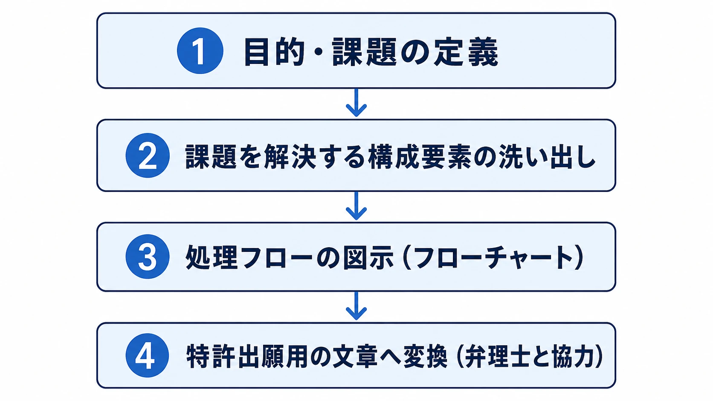

# ゲームシステムに関わる特許：プランナーが知るべき特許リスクと取得戦略

> 2026年11月18日改版：記事全体を全面的に書き直しました。内容の変更はGitの履歴から追えます。

新しい遊びの仕組みを思いついたとき、プランナーには二つの問いがある。「他社の特許に触れていないか」「自分たちの特許にできないか」。戦闘で仲間が行動する順番や、ロードを待つ間に遊べるミニゲームにも、出願され、権利となり、やがて満了を迎えた仕組みがある。その一生をたどると、二つの問いを企画のどの段階で持ち出せばよいかが見えてくる。

CEDEC 2017で、バンダイナムコエンターテインメント知的財産部の恩田明生氏は、ゲームにおける著作権と特許権の違いを説明した。著作権はキャラクターの絵や映像、文章など、具体的な表現を守る。特許権が守るのは、入力を受けて何を判定し、画面やゲームの状態をどう変えるかといった、発明として権利化された仕組みや処理の流れである。[[1](#ref-1)]

> **注意**：制度と特許の状態は2026年11月時点のものです。本稿は制度と事例の紹介であり、個別の案件への法的な助言ではありません。

***

## ゲームのどこに特許が宿るか

「先にゴールした人が勝ち」という取り決め自体は、特許庁の審査基準でいう発明に当たらない。一方、入力やゲーム内の状態を受け取り、機器とソフトウェアが連携して判定や表示を行う仕組みは、具体的な情報処理として発明の対象になりうる。その先には、出願前に知られていないことを指す「新規性」などの審査がある。[[2](#ref-2)][[3](#ref-3)]

権利の範囲を文章で定めた部分を「請求項」という。CEDEC 2016と2018の講演で示された読み方は、請求項を構成要素に分け、実装と一つずつ照らし合わせるというものだ。有効な特許について、一つの請求項に書かれた構成をすべて満たす実装を事業として無断で使えば、侵害になりうる。一つでも欠ければ、文言上は原則としてその請求項の範囲に入らない。ただし、文言が違っても法律上は同等の構成として扱われる場合があり、同じ特許に別の請求項があることもある。恩田氏も、最終判断は社内の知財部や弁理士に相談するよう念を押した。紛争に関する判断は弁護士にも委ねる。[[4](#ref-4)][[5](#ref-5)][[6](#ref-6)]

***

## 戦闘、ロード画面、壁をたどる特許の一生

出願書類に書かれた仕組みは、原則として公開され、審査を経て登録されると特許権になる。「存続期間」とは、権利が存続できる期間のことだ。満了すれば、その特許に基づく独占は終わる。昔の公報を見つけたとき、そこに何が書かれているかと同じくらい、権利がいまどの段階にあるかが大事になる。[[7](#ref-7)]

### 行動したキャラクターの時計が、また動き出す

スクウェアの「アクティヴタイムバトル（ATB）」では、キャラクターごとに時間が進み、行動できる時機が巡ってくる。スクウェアは1991年7月16日、この戦闘の処理に関わる「ビデオ・ゲーム装置，その制御方法および制御ディバイス」を出願した。出願内容は1994年に公開され、1998年に日本特許第2794230号として登録された。[[8](#ref-8)]

2016年のCEDECでは、この特許の公報が資料として配られた。登壇したスクウェア・エニックス法務知的財産部の大谷友和氏は、講演で、キャラクターごとの計測手段を持つこと、計測を始めて完了後に行動すること、行動後に再び計測を始めることの三つに分け、一つが変われば異なるアイデアになると説明した。遊ぶ側には戦闘のテンポとして伝わるものが、公報を読む側には、時間を測り直すところまで含めた一連の処理として見える。[[4](#ref-4)]

編者は、ATBをゲーム業界でゲームシステムが特許として意識された比較的初期の事例と考える。第2794230号も関連する第3571207号も満了している。権利が終わった後も公報は読めるため、当時の遊びのどこが発明として言葉になったかをたどれる。[[8](#ref-8)][[9](#ref-9)] ATBがターン制の戦闘の流れの中でどんな位置にあるかは、[ターンの間、プレイヤーは何をしているのか](turn-based-rpg-history.md)で扱っている。

### ロードを待つ間に『ギャラクシアン』が始まる

初代PlayStation版『リッジレーサー』を起動すると、本編を読み込む間に『ギャラクシアン』を遊べた。ナムコが特許にしたのは、補助ゲームを先に読み込み、本編の読み込みと並行して遊べるようにする処理だ。日本では1994年12月2日に出願し、第2742394号として登録された。米国では1995年11月27日に出願し、US5718632として登録された。遊ぶ側が経験する待ち時間は同じでも、権利は国ごとにたどる必要がある。[[10](#ref-10)][[11](#ref-11)][[12](#ref-12)]

Game Developerは2015年の記事で米国特許が同年に満了する見通しを取り上げた。米国特許は11月に満了し、電子フロンティア財団（EFF）が12月に報じた。満了を機に、開発者がロード画面のゲームを持ち寄る「Loading Screen Jam」も開かれた。EFFは、1987年にCommodore 64向けのツール「Invade-a-Load」が、読み込み中にシューティングを遊ばせていた先行例にも触れている。日本の特許も満了している。ロード時間を遊びに変える仕組みに関わる独占が終わり、開発者はこれらの特許についてナムコの許諾を得る必要がなくなった。[[10](#ref-10)][[13](#ref-13)][[11](#ref-11)][[12](#ref-12)] 待ち時間を隠す工夫の歴史の中でのこの特許の位置づけは、[ゲームにおける「ロード時間の隠蔽」技術史](history-of-hiding-load-times-in-games.md)で扱っている。

### 壁の向こうにいるキャラクターが見える

斜め上から見下ろす3Dゲームで、操作するキャラクターの手前に壁が来ると、その姿が隠れる。コナミは、遮っている壁や床を半透明にし、背後を表示するために画像データを処理する仕組みを1996年5月15日に出願した。日本特許第2902352号として登録された後、この権利はカメラの見やすさを改善する処理に関わるものとして注目された。AUTOMATONは、出願から20年に当たる2016年5月15日付で存続期間が満了したと報じた。この日を境に、同特許による独占は終わった。[[14](#ref-14)][[15](#ref-15)]

### 主な特許と存続期間

2026年11月18日時点。権利者欄は出願当時の企業名で示す。状態と出願日は各特許のGoogle Patentsを参照した。

| 番号 | 権利者 | 内容 | 出願日 | 状態 |
| --- | --- | --- | --- | --- |
| 第2794230号 [[8](#ref-8)] | スクウェア | ATB | 1991年7月16日 | 満了 |
| 第2742394号 [[11](#ref-11)] | ナムコ | ロード中の補助ゲーム | 1994年12月2日 | 満了 |
| US5718632 [[12](#ref-12)] | ナムコ | ロード中の補助ゲーム | 1995年11月27日 | 満了 |
| 第2902352号 [[14](#ref-14)] | コナミ | 壁の透過表示 | 1996年5月15日 | 満了 |
| 第3637031号 [[16](#ref-16)] | 任天堂 | 障害物に隠れたキャラクターのシルエット表示 | 2002年4月3日 | 満了 |
| 第3734820号 [[17](#ref-17)] | 任天堂 | タッチパネルでの移動操作 | 2004年9月3日 | 満了 |
| 第4262217号 [[18](#ref-18)] | 任天堂 | 画面入力による移動と位置関係に応じた動作 | 2005年4月26日 | 満了 |

### いまも権利が続いている仕組み

セガの日本特許第6075673号「情報処理装置及びプログラム」は、2016年6月17日に出願された。請求項1には、ゲーム内の行動に使う値、いわゆるスタミナを、時間経過では回復上限まで戻し、プレイヤーから回復の指示があった場合にはその上限を超えることを許容する構成が含まれる。2026年11月18日の確認時点で、Google Patentsの状態表示は「Active（存続中）」である。似た仕組みを企画書で見かけたら、実装前に公報とその時点の権利状態を確かめ、仕様とともに知財担当者へ渡せるようにしておきたい。[[19](#ref-19)]

***

## 特許が争われたとき

### 『白猫プロジェクト』と、和解後に来た満了

2018年1月10日、コロプラは『白猫プロジェクト』について任天堂から特許権侵害の訴えを受けたと公表した。任天堂が東京地裁に提訴したのは前年の2017年12月22日である。一部の操作方法などをめぐり、任天堂はアプリ提供の差し止めと、当初44億円の損害賠償に遅延損害金を加えた額を求めた。請求額は2021年2月に49億5,000万円、4月には96億9,900万円に引き上げられ、それぞれ遅延損害金も別途請求された。[[20](#ref-20)][[21](#ref-21)][[22](#ref-22)][[23](#ref-23)]

2021年8月4日、両社は和解に合意した。コロプラが今後のライセンスを含む和解金として総額33億円を支払い、任天堂が訴えを取り下げる内容である。対象は第3734820号、第4262217号、第4010533号、第5595991号、第3637031号、第6271692号の6件だった。[[24](#ref-24)][[25](#ref-25)][[26](#ref-26)][[27](#ref-27)]

スマートフォンで見慣れた操作でも、ゲーム内でそれを成立させる処理が訴訟の争点になることがある。表にある第3734820号、第4262217号、第3637031号は和解当時は存続期間内にあり、2026年11月時点では満了している。同じ番号でも、運営中に問題となった当時と、後から公報を読む現在とでは、権利の状態が違う。[[24](#ref-24)][[17](#ref-17)][[18](#ref-18)][[16](#ref-16)]

### 『パルワールド』でも仕組みが争点に

2024年9月18日、任天堂と株式会社ポケモンは、『パルワールド』が複数の特許権を侵害しているとして、開発・販売元のポケットペアに対し、差し止めと損害賠償を求めて提訴した。争点になったのはゲームシステムに関わる特許で、開発への影響や経緯は [『パルワールド』訴訟はゲームデザインをどう動かしたか――特許係争と1.0正式版までの歩み](palworld-nintendo-patent-lawsuit-and-game-design-analysis.md) で扱っている。[[28](#ref-28)]

***

## 満了を待たず、使い合う・開く

2017年6月19日、カプコンとバンダイナムコエンターテインメントは、対戦相手を探して組み合わせるオンラインマッチングに関する特許のクロスライセンスを締結した。クロスライセンスとは、契約で定めた範囲で互いの特許を使えるようにする契約である。カプコンは許諾を得た特許を『ストリートファイター』シリーズなどに活用する方針を示した。同年11月28日には、コロプラとカプコンもマルチプレイ分野の特許について同様の契約を発表した。自社の特許は、欲しい技術を使わせてもらう交渉の材料にもなる。[[29](#ref-29)][[30](#ref-30)][[31](#ref-31)]

対戦中に画面上の対象を指し、声を出さずに味方へ情報を伝える。『Apex Legends』のピングシステム（米国特許US 11,097,189）を含むアクセシビリティ関連特許5件について、EAは2021年8月24日、誰でもロイヤリティの支払いなしで利用できるようにする「Patent Pledge」を発表した。誓約には法的拘束力があり、原則として撤回しない。ただし、EAやその関連会社、パートナーに対して特許侵害訴訟などを起こした相手には、将来に向けて誓約の適用を打ち切れる。[[32](#ref-32)][[33](#ref-33)]

卓上ゲームで遊びの仕組みを開くために使われたOpen Game Licenseについては、[遊びの仕組みをどう守るか――特許、開放する契約、名前の選択](game-mechanics-patents-open-licenses-and-trademarks.md) で扱っている。

***

## 気になる特許を見つけたときの三つの手段

CEDEC 2016で大谷氏が挙げたのは、仕様を見直す、先行例を調べる、ライセンスを受けるという三つの手段だった。どの手段が取れるかは、権利の状態と請求項、ゲームの仕様、開発の日程を照らし合わせて判断する。[[4](#ref-4)]

- 仕様の変更。大谷氏は、請求項を構成する要素のうち一つを変えるという考え方を示した。変更の余地が大きい開発の序盤から中盤に使われることが多く、変更の過程で生まれたアイデアが新たな特許の候補になる場合もある。
- 自由技術（先行例）。出願前に同様の仕組みが公に知られていたなら、その技術が自由に使えたといえるかや、特許の有効性を検討する手掛かりになる。大谷氏は、ある戦闘の仕組みがそれ以前の対戦ゲームですでに使われていたと仮定して説明した。いつ、どこで、どの処理まで公開されていたかが判断の材料になる。
- 特許ライセンス。売上の一定割合や一時金を対価として、使う許諾を受ける。自社に相手が使いたい特許があれば、クロスライセンスも選択肢になる。一方、権利者が競合製品を持つ場合など、許諾を得られないこともある。[[4](#ref-4)]

プランナーがそろえるのは、実装予定の仕様、関連する請求項、先行例があれば公開日と資料である。仕様変更後の評価、先行例の法的な扱い、許諾の要否は、社内の知財部や弁理士、必要に応じて弁護士に委ねる。[[4](#ref-4)][[5](#ref-5)]

***

## 自分たちの遊びを特許にする

### 似た仕組みを探し、処理の順序を読む

調査の入口は、工業所有権情報・研修館（INPIT）が運営する無料の特許情報プラットフォーム「J-PlatPat」とGoogle Patentsである。遊びの通称だけで探すと、「情報処理装置及びプログラム」のような名称の公報を見落としやすい。誰が何を入力し、何を判定し、どんな結果が出るかという言葉でも探す。CEDEC 2018で恩田氏が示したように、見つけた請求項を構成要素に切り分け、処理順にフローチャートへ置くと、長い一文の中で何が条件になっているかを追いやすい。[[34](#ref-34)][[5](#ref-5)]

### 宝箱を開ける楽しさを文章にする

CEDEC 2017で恩田氏は「楽しませる仕組みとはフローが書ける仕組みである」と話した。講演の例は宝箱だ。何が手に入るかを楽しみにしてもらうという狙いを、キャラクターと宝箱の接触を検出し、候補からアイテムを抽選してプレイヤーに渡す、という処理に書き下す。狙った効果を出すためにどの構成が欠かせないかまで考えると、知財担当者に渡せる発明の説明になる。[[35](#ref-35)]

### ゲームを公開する前に出願する

体験版の配布や展示で仕組みが公に知られると、出願前の自社の公開でも新規性を失いうる。日本では2018年6月9日施行の改正で、新規性喪失の例外期間が6か月から1年に延びた。適用には条件や手続がある。意図しない公開が起きたら、日時、公開した内容、公開先を控え、すぐに専門家に相談する。[[2](#ref-2)][[36](#ref-36)]

日本では、出願から原則1年6か月で出願内容が公開される。出願から3年以内に出願審査請求をしなければ、出願は取り下げたものとみなされる。審査を経て特許査定を受け、所定の特許料を納付すると設定登録され、その時点で特許権が生まれる。存続期間は原則として出願日から20年で、登録日から数えるものではない。[[7](#ref-7)][[37](#ref-37)]

登録までの時間と費用も企画判断に入る。恩田氏はCEDEC 2017で、登録まで1〜5年、費用は総額で数百万円程度という見積もりを示し、製品の優位性に関わる仕組みは必要に応じて権利化しておくという考え方を紹介した。これは当時の講演で示した目安である。出願、審査請求、登録などの現行の公的手数料は特許庁の料金一覧で確認できる。[[35](#ref-35)][[38](#ref-38)]

***

## プランナーのためのチェックリスト

- 企画段階。遊びの狙いと処理の流れを書き、似た特許や先行例を探す。自社で出願したい仕組みがあれば、発表や展示の日程を知財担当者と共有する。
- 開発中。実装予定の仕様を関連する請求項と照らし合わせ、対象国で特許が存続中か満了かを確かめる。懸念があれば公報番号と仕様を知財担当者に渡す。
- リリース前後。出願や許諾に必要な手続を確認し、更新で入力、判定、表示の流れが変わるときは、変更した仕様をもとに確認し直す。

***

## まとめ

ATBは行動後に時間を測り直し、『リッジレーサー』は本編の読み込みを遊びに変え、コナミの特許では壁の向こうにいるキャラクターが見える。プレイヤーにはそれぞれ違う場面だが、公報にはどれも、ある条件から次の処理へ進む仕組みとして残っている。

特許には一生がある。出願で書き留めた仕組みが公開され、登録を経て権利になり、満了すれば、その特許で独占されていた技術は誰でも使えるようになる。存続中は権利の範囲と状態を確かめる。自分たちの遊びを処理の順に書いておけば、他社の請求項と照らし合わせて侵害を避けるためにも、自分たちの発明を説明して権利を取るためにも、同じ一枚のフローが役に立つ。

## References

1. [4Gamer編集部「［CEDEC 2017］ゲーム特許とはなにか？」][1] — 4Gamer.net、2017年。

[1]: https://business.4gamer.net/article/1709/17090503/

2. [特許庁「拒絶理由の解説」][2] — 特許庁。「新規性」「発明該当性／産業上の利用可能性」を参照。

[2]: https://www.jpo.go.jp/system/basic/otasuke-n/tokkyo/kyozetsu/kaisetsu.html

3. [特許庁「ソフトウェア関連発明に係る審査基準等について」][3] — 特許庁。

[3]: https://www.jpo.go.jp/system/laws/rule/guideline/patent/tukujitu_kijun/kaitei2/document/index/h30_software_hb_kaitei_point.pdf

4. [gamebiz編集部「【CEDEC2016】ゲーム業界における特許侵害とは何か？　回避する手段は？　スクエニ大谷氏がわかりやすく解説」][4] — gamebiz、2016年8月26日。

[4]: https://gamebiz.jp/news/167880

5. [gamebiz編集部「【CEDEC 2018】難解な“特許”の簡単な『読み方』と『探し方』」][5] — gamebiz、2018年8月30日。

[5]: https://gamebiz.jp/news/218889

6. [工業所有権情報・研修館「判例紹介　ボールスプライン事件」][6] — INPIT。最高裁1998年2月24日判決の紹介。

[6]: https://www.inpit.go.jp/content/100880992.pdf

7. [特許庁「出願から権利消滅まで」][7] — 特許庁。

[7]: https://www.jpo.go.jp/system/laws/rule/guideline/document/syutugan_tetuzuki/00_04atoz.pdf

8. [スクウェア「ビデオ・ゲーム装置，その制御方法および制御ディバイス」（JP2794230B2）][8] — Google Patents、1998年9月3日公報発行。

[8]: https://patents.google.com/patent/JP2794230B2/ja

9. [スクウェア・エニックス「ビデオ・ゲーム装置およびその制御方法」（JP3571207B2）][9] — Google Patents、2004年9月29日公報発行。

[9]: https://patents.google.com/patent/JP3571207B2/ja

10. [David Hoppe「2015: The Year We Get Loading Screen Mini-Games Back」][10] — Game Developer、2015年1月9日。

[10]: https://www.gamedeveloper.com/business/2015-the-year-we-get-loading-screen-mini-games-back

11. [ナムコ「ゲームプログラムおよびデータの読込み方法、ならびにこれを用いたゲーム装置」（JP2742394B2）][11] — Google Patents。

[11]: https://patents.google.com/patent/JP2742394B2/ja

12. [ナムコ「Recording medium, method of loading games program code means, and games machine」（US5718632）][12] — Google Patents。

[12]: https://patents.google.com/patent/US5718632A/en

13. [Electronic Frontier Foundation「The Loading Screen Game Patent Finally Expires」][13] — EFF、2015年12月。

[13]: https://www.eff.org/deeplinks/2015/12/loading-screen-game-patent-finally-expires

14. [コナミ「ビデオゲーム装置及びビデオゲームプログラムを格納したコンピュータ可読媒体」（JP2902352B2）][14] — Google Patents。

[14]: https://patents.google.com/patent/JP2902352B2/ja

15. [AUTOMATON編集部「コナミの『俯瞰視点で壁を透過表示する特許』が期間満了、3Dアクションゲームのカメラ操作などに影響」][15] — AUTOMATON、2016年5月16日。

[15]: https://automaton-media.com/articles/newsjp/konami-camera-work-patent-was-expired/

16. [任天堂「ゲーム装置およびゲームプログラム」（JP3637031B2）][16] — Google Patents。

[16]: https://patents.google.com/patent/JP3637031B2/ja

17. [任天堂「ゲームプログラム、ゲーム装置、および入力装置」（JP3734820B1）][17] — Google Patents。

[17]: https://patents.google.com/patent/JP3734820B1/ja

18. [任天堂「ゲームプログラム及びゲーム装置」（JP4262217B2）][18] — Google Patents。請求項1、9〜11を参照。

[18]: https://patents.google.com/patent/JP4262217B2/ja

19. [セガゲームス「情報処理装置及びプログラム」（JP6075673B2）][19] — Google Patents、2017年2月8日公報発行。請求項1と状態表示を2026年11月18日確認。

[19]: https://patents.google.com/patent/JP6075673B2/ja

20. [コロプラ「白猫プロジェクトに関する訴訟提起について」][20] — 『白猫プロジェクト』公式サイト、2018年1月10日。

[20]: https://colopl.co.jp/shironekoproject/news/details/20180110150000.php

21. [太田亮三「任天堂がコロプラを提訴、『白猫プロジェクト』が特許侵害と主張」][21] — ケータイ Watch、2018年1月10日。

[21]: https://k-tai.watch.impress.co.jp/docs/news/1100449.html

22. [コロプラ「（開示事項の経過・変更）当社に対する損害賠償請求訴訟の提訴額変更に関するお知らせ」][22] — 日本取引所グループ、2021年4月21日。

[22]: https://www2.jpx.co.jp/disc/36680/140120210421497573.pdf

23. [ITmedia NEWS編集部「任天堂、コロプラ訴訟で請求額を49億→96億円に引き上げ　『白猫プロジェクト』の特許権侵害巡り」][23] — ITmedia NEWS、2021年4月21日。

[23]: https://www.itmedia.co.jp/news/article/2104/21/1210421148/

24. [任天堂「特許権侵害訴訟の和解成立のお知らせ」][24] — 任天堂、2021年8月4日。

[24]: https://www.nintendo.co.jp/corporate/release/2021/210804.html

25. [コロプラ「特許権侵害訴訟の和解成立のお知らせ」][25] — コロプラ、2021年8月4日。

[25]: https://colopl.co.jp/news/info/2021080401.php

26. [コロプラ「和解による訴訟の解決及び特別損失の計上に関するお知らせ」][26] — コロプラの適時開示資料、2021年8月4日。IR BANK収録。

[26]: https://f.irbank.net/pdf/20210804/140120210804478469.pdf

27. [gamebiz編集部「【速報】コロプラ、任天堂と訴訟の和解で合意　訴訟関連引当金繰入額33億円を特別損失として計上」][27] — gamebiz、2021年8月4日。

[27]: https://gamebiz.jp/news/330605

28. [任天堂・ポケモン「株式会社ポケットペアに対する特許権侵害訴訟の提起について」][28] — 任天堂、2024年9月19日。

[28]: https://www.nintendo.co.jp/corporate/release/2024/240919.html

29. [カプコン「『ストリートファイター』シリーズなどのオンラインマッチングに関する特許クロスライセンス締結」][29] — カプコン、2017年6月19日。

[29]: https://www.capcom.co.jp/ir/news/html/170619.html

30. [4Gamer編集部「カプコンとバンダイナムコ，オンラインマッチングの特許クロスライセンス契約を締結。『ストリートファイター』シリーズなどに活用」][30] — 4Gamer.net、2017年6月19日。

[30]: https://www.4gamer.net/games/999/G999905/20170619049/

31. [コロプラ「カプコンとコロプラ、マルチプレイ分野における特許クロスライセンス契約を締結」][31] — コロプラ、2017年11月28日。

[31]: https://colopl.co.jp/news/info/2017112801.php

32. [Euronews編集部「EA opens up five accessibility patents in pledge to make gaming more inclusive」][32] — Euronews、2021年8月24日。

[32]: https://www.euronews.com/next/2021/08/24/ea-opens-up-five-accessibility-patents-in-pledge-to-make-gaming-more-inclusive

33. [Electronic Arts「EA’s Patent Pledge for Increasing Accessibility」][33] — EA。適用条件と対象の特許番号を参照。

[33]: https://www.ea.com/commitments/positive-play/accessibility-patent-pledge

34. [工業所有権情報・研修館「特許情報プラットフォーム（J-PlatPat）」][34] — INPIT。

[34]: https://www.inpit.go.jp/j-platpat_info/

35. [インサイド編集部「【CEDEC 2017】ゲームの特許は難しくない！だれでもわかる。超簡単！効果的なゲーム特許の取得方法」][35] — インサイド、2017年8月31日。

[35]: https://www.inside-games.jp/article/2017/08/31/109452.html

36. [特許庁「発明の新規性喪失の例外期間が6か月から1年に延長されます」][36] — 特許庁、2018年5月30日更新。

[36]: https://www.jpo.go.jp/system/laws/rule/guideline/patent/hatumei_reigai_encho.html

37. [特許庁「初めてだったらここを読む～特許出願のいろは～」][37] — 特許庁。

[37]: https://www.jpo.go.jp/system/basic/patent/index.html

38. [特許庁「特許庁各種パンフレット一覧」][38] — 特許庁。「産業財産権関係料金一覧」を参照。

[38]: https://www.jpo.go.jp/resources/report/sonota-info/panhu.html

----

この文書は、Perplexity、Claude、ChatGPT の3つのAIの支援を受けて著述されたものです。引用画像を除き、MIT License にて提供されています。
