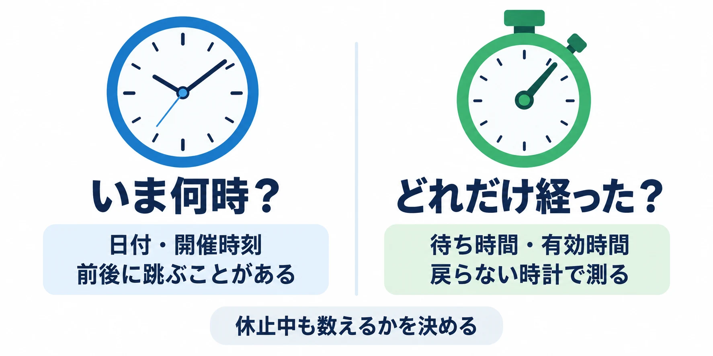
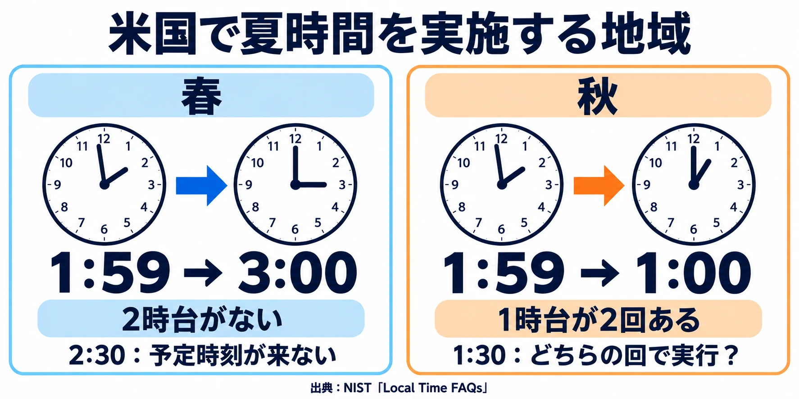

# 「毎日5時にリセット」は、どの時計の5時か――うるう秒の廃止から考える、ゲームの時間と時計

2026年10月15日、フランスで開かれた国際度量衡総会で、うるう秒を実質的に廃止することが決まった。NHKは翌16日、「地球の自転と世界の標準時のずれを1秒単位で調整してきた「うるう秒」を実質的に廃止することが、15日、フランスで開かれた国際会議で決まりました。」と伝えた。[[1](#ref-1)]

うるう秒とは、地球の自転に基づく時刻と、原子時計に基づく世界共通の基準時刻（協定世界時、UTC）のずれを調整するための1秒である。1972年以降、27回にわたり1秒を足してきた。今回の決議では、ずれを3,600秒＝1時間まで許容し、2027年5月20日からUTCを連続して進めることになった。[[1](#ref-1)] [[2](#ref-2)]

たった1秒の調整をやめる話が、なぜゲームに関係するのだろうか。仕様書に「毎日5時にリセット」「24時間後に回復」と書くとき、コンピュータは、何を見てその約束を守るのだろうか。

本稿は「ゲームプランナーのためのコンピュータ科学」の第6回である。前回の[「『敵は最大何体まで？』を仕様にする」](game-computation-budget-for-planners.md)では、短い時間の中に収める仕事の量を考えた。今回は、時間そのものをどう数えるかを扱う。判断軸は **「その時刻は、どの時計で決めるか」** である。

***

## 1. 時計は一つではない

スマートフォンの画面には一つの時刻が表示される。しかし、内部では目的に応じて性質の違う時計を使える。サーバーでも、日付を知ることと、処理にかかった時間を測ることは区別する必要がある。

まず分けたいのは、 **「いま何時か」を答える時計** と、 **「どれだけ経ったか」を測る時計** だ。壁掛け時計とストップウォッチを思い浮かべるとよい。

Androidの公式資料は、3種類の時計を区別している。日付と時刻を表す時計は、利用者や通信網が設定できるため、前にも後ろにも跳びうる。一方、起動からの経過時間を数える時計には、値が戻らない性質（単調、monotonic）が保証されるものがある。[[3](#ref-3)]

| 知りたいこと | 選ぶ時計の性質 | 仕様の例 |
|---|---|---|
| いまは何月何日の何時か | カレンダーの時刻に対応する | 指定日の5時からイベントを始める |
| 開始してからどれだけ経ったか | 戻らずに経過時間を数える | 開始から10分間だけ有効にする |

さらに、経過時間を測る時計にも違いがある。Androidには、端末が深く休んでいる間は数えないものと、その間も含めて数えるものがある。[[3](#ref-3)] 「画面を閉じていても10分で終わる」のか、「動いている間の10分」なのかで、必要な性質は変わる。

「24時間後に回復」も同じだ。日付と時刻の差で測るのか、実際に経った時間を数えるのかで、時計を変更したときの結果が変わる。プランナーは関数を選ぶ前に、 **何を待ち時間に含めるか** を伝えたい。

起動から数える時計は、端末の再起動をまたいで同じ起点を使える時計ではない。[[3](#ref-3)] アプリを閉じた間や端末を再起動した後も期限を守る仕様なら、復帰時に何を基準として残り時間を確かめ直すかも必要になる。「戻らない時計を使う」という一行だけで、長期間の期限管理まで完成するわけではない。

***

## 2. 時計が戻ると、何が起きるか

時計が戻ることは、実際の障害にもつながった。

2017年の元日、Cloudflareでは、うるう秒に伴って時計が戻り、通信先の応答時間を測った値が負になった。その値が後の計算へ渡り、インターネット上の名前から接続先を調べる仕組み（DNS）のサーバーソフトウェアで異常終了（panic）が起きた。ピーク時には、CloudflareへのDNS問い合わせの約0.2%が影響を受けた。[[4](#ref-4)]

同社のJohn Graham-Cummingは、原因となった思い込みを「the belief that time cannot go backwards」と表現した。「時間は後ろへ進まない」という思い込みである。報告は、戻りうる時計を使う際の予防策として「always check whether the difference between two timestamps is negative」とも述べている。二つの時刻の差が負になっていないか、必ず確かめるという教訓だ。[[4](#ref-4)]

ゲームでも、似た問題を考えられる。以下は仕組みを示す架空の例である。

| 順番 | 時計が示した時刻 | 起きたこと |
|---|---|---|
| 1 | 10時00分00秒 | 待ち時間の計測を始める |
| 2 | 9時59分59秒 | 時計が後ろへ修正される |
| 3 | 後の時刻 − 前の時刻＝−1秒 | 経過時間として負の値が出る |

負の値をどう扱うかによって、残り時間が増えたり、計算が失敗したりする。負数を扱えない数の形式へそのまま変換すれば、巨大な正の値になる場合もある。逆に時計が前へ跳べば、十分な時間が経っていないのに期限へ到達したと判断しかねない。

経過時間は戻らない時計で測るのが基本になる。戻りうる時計の差を使う箇所では、異常な差が出たら判定を保留して基準を確かめ直すなど、復帰の仕方を決めておく。単に負の値をゼロへ置き換えれば、正しく経った時間まで復元できるわけではない。

時計の進め方をならす対策もある。Googleは2008年以来、うるう秒を一度に跳ばす代わりに、前後の時間へ薄めて吸収する方式（smear）を使ってきた。推奨は「24-hour linear smear from noon to noon UTC」。UTCの正午から翌正午までの24時間へ、一定の割合で調整を分散する方式である。[[5](#ref-5)]

跳びを避けるように時計をならす対策と、跳んでも壊れない計算を用意する対策がある。前者を使う環境でも、後者への配慮は残る。利用者による変更など、ほかの原因でも時計は変わるからだ。

端末の時計を進める不正や、サーバー側での回復判定、UTCでの保存は[「スタミナ・エネルギー制の設計実務」](stamina-energy-system-design-practices.md)で扱っている。

***

## 3. 「毎日5時」は、どこの5時か

日付と時刻を使う仕様では、どの地域の時計を基準にするかが次の問題になる。同じ標準時と時刻のルールを使う地域の区分（タイムゾーン）を指定しなければ、「5時」だけでは世界の中の一つの瞬間に定まらない。

日次更新を午前に置く実例もある。スクウェア・エニックスは、2016年7月の『グリムノーツ』の公式告知で「ゲーム内の日付は午前4時00分に更新されます」と明記していた。[[6](#ref-6)] 日付の境界は、ゲームの都合に合わせて決められる。

ここからは、架空のゲームの「毎日5時」を考えよう。日本時間の5時に全世界で一斉に切り替えるのか、プレイヤーがいる地域の5時に順番に切り替えるのか。この二つは、体験の異なる設計である。

地域ごとの開催例として、『Pokémon GO』の「天空リサーチデイ」がある。日本語版は「日本時間2025年12月20日14:00から17:00まで」、英語版は「Saturday, December 20, 2025, from 2:00 p.m. to 5:00 p.m. local time」と案内している。[[7](#ref-7)] [[8](#ref-8)] その土地の14時から遊べる方式であり、全世界で同じ瞬間に始める方式とは違う。

企画上、地域ごとに同じ生活時間帯へ届けたいのか、全員を同時に参加させたいのかを選ぶことになる。旅行で地域を移った人についても、現在地、アカウントに登録した地域、選んだサーバーのどれを使うかを決める必要がある。

また、アプリを起動したときの時刻設定が、そのまま続くとは限らない。Appleの公式資料は、大きな時刻変化をアプリへ知らせる場面として、日付の切り替わり、通信会社による時刻更新、夏時間への移行と終了を挙げている。[[9](#ref-9)] 日付が変わること自体は時計の逆戻りではないが、画面に表示する日付や、その日に受け取れるものを見直すきっかけになる。

開催日時の決め方は[「期間限定イベント設計の実務」](limited-time-event-design-practices.md)、日本時間午前4時区切りとUTCの暦日で1日の集計が変わる話は[「ダッシュボードの指標を一致させる」](dashboard-metric-consistency-data-pipeline-operations.md)にもつながる。遊びと集計で「今日」の区切りが違うなら、その違いを共有したい。

***

## 4. 日本の時刻は、世界の中では単純なほうである

日本で暮らしていると、全国で「5時」が通じ、季節が変わっても時計を1時間動かさずに済む。この環境では、地域や季節によって時計の読み方が変わることを見落としやすい。

日本の標準時はUTCより9時間進んでいる。[[10](#ref-10)] 現在は夏の間だけ時計を進める制度（夏時間）を使っていない。国立天文台の説明では「昭和23年から昭和26年の間だけ、夏時刻が使われていました。」とされる。1952年4月11日の法律第84号「夏時刻法を廃止する法律」で廃止され、同日施行となった。[[11](#ref-11)] [[12](#ref-12)]

海外へ目を向けると、米国とその領土では9つのタイムゾーンが使われている。[[13](#ref-13)] 「米国の5時」でも、まず地域を決める必要がある。

さらに、米国で夏時間を実施する地域では、3月第2日曜日の現地2時に時計を3時へ進め、11月第1日曜日の現地2時に1時へ戻す。ハワイやアリゾナ州の大部分など、実施しない地域もある。[[14](#ref-14)]

このルールでは、春の切り替え日に2時台が存在せず、秋の切り替え日には1時台が2回ある。「毎日2時30分に配布」なら春のその日は予定時刻が来ない。「毎日1時30分に配布」なら秋のその日は同じ表示の時刻が2回来る。どちらも、どう実行するかを決める必要がある。

たとえば、存在しない時刻は時計を進めた直後へ繰り越す、2回ある時刻は最初の1回だけ実行する、といった選択が考えられる。これは本稿の仕様例であり、地域の時計のルールだけからゲームの配布方針が決まるわけではない。

NIST「Local Time FAQs」の切り替え規則をもとに作成。[[14](#ref-14)]

更新を5時に置けば、この米国の例の欠ける時間帯・重なる時間帯からは外れる。それでも、切り替えを挟む5時から翌5時までの実際の長さは、春は23時間、秋は25時間になる。[[14](#ref-14)] **「現地の毎日5時」と「24時間ごと」は、同じ約束ではない。**

地域差は1時間単位とも限らない。MicrosoftのWindows既定タイムゾーンの表記では、日本はUTC+09:00、インドはUTC+05:30、ネパールはUTC+05:45である。[[15](#ref-15)] この値から計算すると、インドは日本より3時間30分、ネパールは3時間15分遅い。日本時間5時に一斉更新する設計なら、それぞれ1時30分と1時45分に当たる。時差の「時間」の部分だけを扱う仕様では、こうした地域を表せない。

サーバーが使う固定の基準時刻で一斉更新すれば、全員の切り替えの瞬間を一つに定められる。代わりに、地域によって更新は昼間や深夜になる。現地の生活時間へ合わせるか、全員の同時性をそろえるか。守りたい遊びから選ぶことがプランナーの判断になる。

***

## 5. うるう秒がなくなって、何が変わり、何が残るか

今回の決議では、2027年5月20日からUTCにうるう秒による1秒の調整を入れず、地球の自転に基づく時刻との差を1時間まで許容する。1秒を減らす調整である負のうるう秒は一度も実施されておらず、決議はその導入が基盤システムへ与えるリスクにも触れている。[[2](#ref-2)] 移行によって、うるう秒に由来する不連続と、未経験の減算への備えという課題が取り除かれる。

ただし、個々の端末やサーバーの時計が、すべて自動的に戻らなくなるという意味ではない。利用者による時計の変更や、通信網による時刻の補正は残る。[[3](#ref-3)] 夏時間の切り替えや地域をまたぐ移動では、現地の時計表示も変わる。

BIPMの決議の前文にも「changes of an hour are regularly introduced when daylight-saving time is used」とある。夏時間を使うときには1時間の変更が定期的に行われている、という指摘だ。[[2](#ref-2)] 世界共通の基準時刻を連続させることと、その土地の時計表示が変わることは別の話なのである。

決議は、ずれが1時間に近づいたときの調整手続きを定めていない。[[2](#ref-2)] 「これからは1時間まとめて動かす」と読み替えず、今回決まった許容幅と移行日を押さえればよい。

ゲームの仕様へ持ち帰る教訓は変わらない。 **時計は変わりうるものとして、時刻を決める基準と、経過時間を測る基準を選ぶ。**

***

## 6. 仕様書に書くこと

「毎日5時」「24時間後」という一行を見つけたら、次の点をエンジニアとすり合わせたい。

- その時刻は、サーバーの時計で決めるか、端末の時計で決めるか。
- 「毎日5時」は、どのタイムゾーンの5時か。地域ごとに切り替えるか、全世界で一斉に切り替えるか。
- 地域ごとの場合、旅行や設定変更で地域が変わった人を、どの地域に属するものとして扱うか。
- 夏時間の切り替え日に、存在しない時刻・2回ある時刻をどう扱うか。同じ日の権利を重ねて付与しないか。
- 「翌日の同じ時刻」と「24時間後」のどちらを約束するか。
- 経過時間は戻らない時計で測るか。休止中も数えるか。再起動後は何を基準に期限を確かめ直すか。
- 時刻の差が負になったり、急に大きくなったりしたとき、表示と判定をどう立て直すか。
- 端末の時計が変更されたとき、何を信用し、何を信用しないか。
- 日付が変わる瞬間をまたいだ操作を、昨日と今日のどちらに属するものとして扱うか。[「同時操作・繰り返し操作を仕様にする」](game-concurrent-and-repeated-operations-for-planners.md)で扱った、昨日の操作の再確認と今日の新しい操作を区別できるか。

時計の実装方法を一人で決める必要はない。いつ、誰に、何回、どれだけ待ってもらうかを言葉にすれば、選ぶ時計に必要な性質が見えてくる。仕様書の時間に関する一行を書くとき、最後に立ち返る問いは **「その時刻は、どの時計で決めるか」** である。

## References

1. [NHK「『うるう秒』廃止決定 秒の新定義も検討へ 国際度量衡総会」][1] — NHK、2026年10月16日6:38、15:14更新。1972年以降の調整回数と、15日の決定に関する報道（2026年10月16日確認）。

[1]: https://news.web.nhk/newsweb/na/nd-20261016de60174

2. [国際度量衡総会「Resolution 5 (2026): On the technical actions needed to ensure the continuity of UTC」][2] — BIPM、第28回国際度量衡総会、2026年。移行日、許容幅、負のうるう秒、夏時間に関する前文を参照。DOI: 10.59161/CGPM2026RES5E。正文は仏語。

[2]: https://www.bipm.org/en/cgpm-2026/resolution-5

3. [Android Developers「SystemClock」][3] — Google、公開日記載なし（2026年10月16日確認）。日付と時刻の時計、休止を含まない起動後の時計、休止を含む起動後の時計の説明を参照。

[3]: https://developer.android.com/reference/android/os/SystemClock

4. [John Graham-Cumming「How and why the leap second affected Cloudflare DNS」][4] — Cloudflare Blog、2017年1月1日。影響規模、負の応答時間による異常終了、「The one character fix」を参照。当時の実装に関する報告。

[4]: https://blog.cloudflare.com/how-and-why-the-leap-second-affected-cloudflare-dns/

5. [Google「Leap Smear」][5] — Google for Developers、2023年10月23日最終更新（2026年10月16日確認）。2008年以来の対処と、UTC正午から翌正午への24時間の推奨方式を参照。

[5]: https://developers.google.com/time/smear

6. [スクウェア・エニックス「スマートフォン向け『グリムノーツ』1,200万ダウンロード突破のお知らせ」][6] — SQUARE ENIX、2016年7月8日。ログインボーナスの注意事項にある午前4時の日付更新を参照。当時の告知の例。

[6]: https://www.jp.square-enix.com/company/ja/news/2016/html/130b40ae1a97dd77ce41a9ba4b75847e.html

7. [Pokémon GO「天空に思いをはせて…『天空リサーチデイ』がやってきます」][7] — Pokémon GO公式サイト、2025年。日本語版の開催時間を参照（2026年10月16日確認）。

[7]: https://pokemongo.com/ja/news/celestial-research-day-2025

8. [Pokémon GO「Get ready for an astronomically cool Celestial Research Day!」][8] — Pokémon GO公式サイト、2025年。英語版の現地時間による開催案内を参照（2026年10月16日確認）。

[8]: https://pokemongo.com/news/celestial-research-day-2025

9. [Apple「significantTimeChangeNotification」][9] — Apple Developer Documentation、公開日記載なし（2026年10月16日確認）。Discussionに挙げられた通知の発生例を参照。

[9]: https://developer.apple.com/documentation/uikit/uiapplication/significanttimechangenotification

10. [情報通信研究機構「日本標準時をつくる」][10] — NICT、公開日記載なし（2026年10月16日確認）。日本標準時とUTCの9時間差を参照。

[10]: https://www2.nict.go.jp/sts/jst/mission/page2.html

11. [国立天文台暦計算室「暦Wiki／時刻／夏時刻」][11] — 国立天文台、公開日記載なし（2026年10月16日確認）。日本での実施期間を参照。

[11]: https://eco.mtk.nao.ac.jp/koyomi/wiki/BBFEB9EF2FB2C6BBFEB9EF.html

12. [衆議院「夏時刻法を廃止する法律」][12] — 制定法律情報、1952年4月11日、法律第84号。法律本文と附則の施行日を参照。

[12]: https://www.shugiin.go.jp/internet/itdb_housei.nsf/html/houritsu/01319520411084.htm

13. [米海軍天文台「U.S. Time Zones」][13] — USNO、公開日記載なし（2026年10月16日確認）。米国とその領土で使われる9つのタイムゾーンを参照。

[13]: https://aa.usno.navy.mil/faq/us_tzones

14. [米国国立標準技術研究所「Local Time FAQs」][14] — NIST、公開日記載なし（2026年10月16日確認）。夏時間の開始・終了と、実施しない地域を参照。23時間・25時間という日次間隔は記載された切り替え規則からの計算。

[14]: https://www.nist.gov/pml/time-and-frequency-division/local-time-faqs

15. [Microsoft「Default Time Zones」][15] — Microsoft Learn、公開日記載なし（2026年10月16日確認）。Windowsの既定値の表にあるJapan、India、Nepalを参照。日本との時差と更新時刻は表のUTCとの差から計算した値。

[15]: https://learn.microsoft.com/en-us/windows-hardware/manufacture/desktop/default-time-zones?view=windows-11

----

この文書は、Perplexity、Claude、ChatGPT の3つのAIの支援を受けて著述されたものです。引用画像を除き、MIT License にて提供されています。
