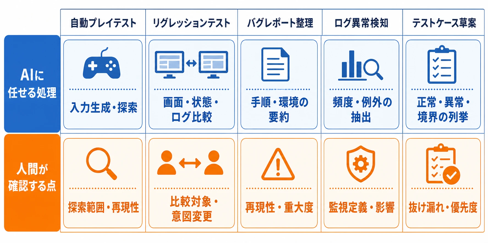
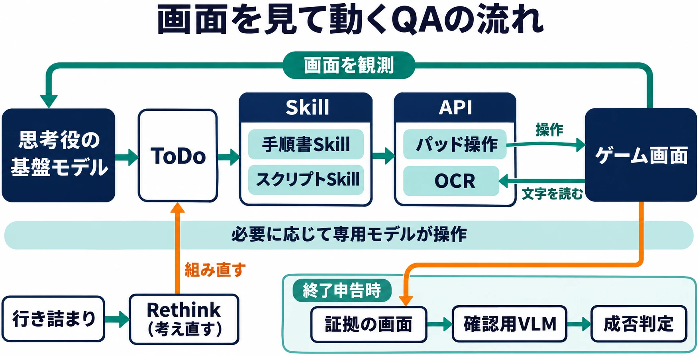
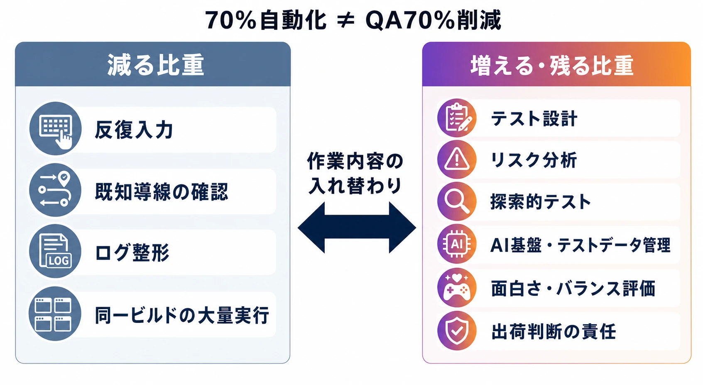
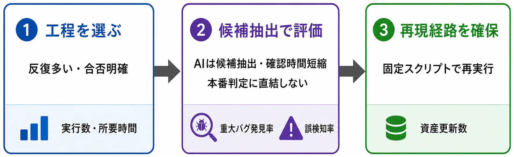

# 「70%自動化」は何の70%か――生成AIをQAに入れるときの判断と、人が担う境界

> 2026年11月23日改版：記事全体を全面的に書き直しました。内容の変更はGitの履歴から追えます。

## はじめに：「QAの7割AI化」という見出し

「QAの7割AI化」。2025年11月7日、Game*Sparkの記事の見出しには、前日にスクウェア・エニックス・ホールディングスが発表した目標が、そう縮められて載った。中期経営計画の進捗報告では、東京大学松尾・岩澤研究室との共同研究を進め、2027年末までにゲーム開発のQA・デバッグ作業の70%を自動化する目標が示されている。QAはゲームの品質を確かめる取り組みであり、見つかった不具合の原因を調べて直す作業がデバッグである。[[1](#ref-1)][[2](#ref-2)]

7割とは、何を数えたときの7割なのか。そして、残りの3割にはどんな仕事が残るのか。例えば、AIが一晩かけて新しいビルドを遊び、朝には「不具合らしいもの」が山ほど届いていたとする。前日より多くの箇所を調べられたとして、出荷できるかどうかは、その一覧のどこを見れば分かるだろう。

***

## 1. 70%は何を数えた数字か

テスト手順を100件並べて、そのうち70件を自動で実行できれば、手順数で見た自動化率は70%だ。ところが、その70件が短いメニュー操作に集中していれば、残る30件の確認にテスト時間の大半がかかることもある。実行時間を測るのか、準備や報告確認まで含む工数を測るのか、検出対象とした不具合の件数を数えるのかで、同じ70%の中身は変わる。

進捗報告が示したのは、QA作業を効率化するための目標である。70%の分母や集計方法は公表資料から読み取れない。QA担当者の採用、配置、外部委託をどう扱うかも記されておらず、この目標から人員削減や採用停止は断定できない。[[1](#ref-1)]

2026年1月に公表されたGDCの業界調査には、2,300人を超える業界関係者が回答した。36%が仕事で生成AIツールを使い、52%は生成AIがゲーム業界に悪影響を与えていると答えた。ゲーム業界全般についての調査であり、二つの回答は同じ人の中でも両立する。CESAの「CEDEC ゲーム開発技術ロードマップ」プロダクション分野の2025年度版では、テスト計画やテストケース、自動テスト、異常検知にAIがどう関わるかを整理している。導入への見方が分かれるなか、工程ごとに何を任せ、その結果をどう確かめるかが現場の問いになる。[[3](#ref-3)][[4](#ref-4)]

***

## 2. 最初に決めるのは、出荷を止める人

冒頭の朝をもう少し追ってみる。報告の一つに「ボスが第2形態へ移行しない」とある。映像にはボスが倒れずに立っている場面が映っている。移行条件を満たしていたなら進行不能かもしれない。条件を満たす前なら、映像のとおりに動くのが正しい。その日の出荷を止めるかどうかで必要な確認も変わる。

QAディレクターは、何を確かめるテストか、どのリスクを優先するか、どこまで確認すれば完了とするかを決める。テクニカルディレクターは、ゲームエンジンやビルド（テストにかける実行版）、ログ（動作の記録）をつなぎ、CI/CDという、変更を継続的にビルド・テストして統合や配布につなげる仕組みの中で動かせるかを判断する。プロダクションは、確認や改修にかかる費用、開発期間、リリース日を調整する。小規模チームでは一人が複数の役を兼ねる。夜間テストを走らせる前に、再試験を誰が指示し、どの条件で誰が出荷を止めるかまで決めておくと、朝の報告に対して取るべき行動が明確になる。

プランナーがこの判断を支えるのは、仕様を観測できる言葉で書いたときだ。例えば「HPが30%以下で、イベントの成立を示す内部フラグが立ったときに、第2形態へ一度だけ移行する。切断後の再接続で移行演出は再発生しない」と書く。HPとフラグがそろった時点、移行の回数、再接続後の挙動を確かめれば、映像に映る一場面を合否の判断に使える。

***

## 3. AIが入りやすい工程

同じ朝、別の報告にはメニューの表示崩れが映っている。録画の該当箇所、直前の入力、発生したビルドまでそろえば、担当者はすぐに確認に入れる。長い録画の中から候補を探し、散らばった記録をひとまとめにする。こうした作業は、出荷の承認を人が担う体制のまま試せる。

| 工程 | AIに任せる処理 | 人が確認する点 |
| --- | --- | --- |
| 自動プレイテスト | 画面に応じて入力を組み立て、既知の導線や分岐をたどる | 探索の範囲、再現性、実際のプレイで遭遇する可能性 |
| リグレッションテスト | 変更前後の画面・状態・ログを比較し、既存機能への影響を拾う | 比較する条件がそろっているか、意図した変更か |
| バグレポート整理 | 録画・ログ・入力履歴から、発生環境と再現手順の草案を作る | 記録と一致するか、手順で再現するか、影響はどの程度か |
| ログ異常検知 | 例外や、普段と異なる頻度・状態の候補を抽出する | 監視対象として妥当か、プレイヤーに影響があるか |
| テストケース草案 | 仕様と過去の報告を基に、正常時・例外時・条件の境目のケースを列挙する | 抜け漏れ、優先度、合否を確かめる手段 |

リグレッションテストは、修正や機能追加に伴って、以前は動いていた機能が壊れていないかを確かめるものだ。例えばメニューを整理した後、セーブから復帰したときだけ選択位置がずれる。変更前と後で同じセーブを読み込み、同じ場面を比べれば、差分を手がかりに調査できる。

ソニー・インタラクティブエンタテインメントとアルバータ大学の研究者によるVideoGameQA-Benchは、VLM（画像や動画を言葉と結びつけて扱う視覚言語モデル）の性能を測る共通課題集である。個々の機能を画面で確かめる視覚的なユニットテスト、変更前後の見た目を比べるビジュアルリグレッション、小さな表示異常の検出、画像や映像を基にしたバグレポート生成などを試している。細かな差分の識別や、長い動画のどこで異常が起きたかの特定には、評価対象のモデルが苦戦した。掲載された課題を導入候補として眺めるなら、その課題で何を取りこぼしたかまで一緒に読むと、確認に残す工程を決めやすい。[[5](#ref-5)][[6](#ref-6)]

***

## 4. 台本どおりに動くテストと、画面を見て動くテスト

店のメニューを開き、商品を一つ買い、所持金が価格分だけ減ったかを確かめる。開始状態と操作順が決まっていれば、同じ手順と合格条件をスクリプトにして、更新のたびに繰り返せる。Unity Test Frameworkは、エディター上でのEdit Modeと、ゲームの実行時の振る舞いを調べるPlay Modeのテストを扱う自動テスト基盤の一例である。[[7](#ref-7)]

一方、「道具屋に行ってやくそうを3つ買う」とだけ渡した場合、店までの移動も、その場のメニューで何を選ぶかも、テストの途中で決めることになる。生成AIを含む方式では、その判断を画面や手順の記録に基づいて組み立てられる。

| 比較軸 | スクリプト型 | 生成AIを含む方式 |
| --- | --- | --- |
| 操作 | 決めておいた入力と検証を実行する | 指示と観測した状態から手順を選び、操作を組み立てる |
| 強み | 安定した条件で繰り返しやすく、合否が明快 | 手順の草案づくりや、固定しづらい経路の探索を補える |
| 弱み | 固定した入力列は画面や導線の変更で崩れやすい | 選ぶ操作や判定が揺れ、誤検知や再現性の管理が要る |
| 保守 | テストコード、開始状態、期待結果を更新する | 指示文、再利用する手順、判定基準、参照データを更新する |
| 人の役割 | 操作と期待結果を定義する | 探索範囲を決め、証拠や結果を確かめ、手順を整える |

2026年7月22日のCEDEC2026では、スクウェア・エニックスのAI&エンジン開発ディビジョンから岩崎浩氏とボエダ ゴティエ氏が登壇し、「スクリプト不要、仕込みも最小限。動画と生成AIで挑むゲームQAの現在地」で、この買い物のデモを紹介した。専用テスト機能を仕込んでいない、製品版に近いROM（ゲームの実行用データ）を使い、内部座標を取得せずに画面から状態を読み、仮想ゲームパッドで操作した。[[8](#ref-8)][[9](#ref-9)]

講演では、思考役の基盤モデルが目標をToDo（途中で達成する小目標）に分け、操作を専用モデルが担う構成が示された。間に入るのが操作手順を再利用する「Skill」である。自然言語で手順を示す手順書Skillと、コードを実行するスクリプトSkillがあり、パッド操作やOCR（画面内の文字の読み取り）などをAPIと呼ばれる呼び出し口から使う。行き詰まりを検知すると「Rethink」でToDoを組み直す。終了を申告するときには証拠の画面を提出させ、確認用のVLMが判定する。購入後の所持金しか映っていなければ、減ったことを確かめるため、購入前の画面も必要になる。[[9](#ref-9)]

繰り返し確かめたい条件は固定スクリプトで再現できるようにしておく。そこへ、固定した入力列では書きにくい探索や手順づくりを、記録して更新できる層として足す。講演の詳しい内容と他社の方式の違いは、[カプコン、スクウェア・エニックス、miHoYoの自動プレイQAを比べた記事](autoplay-qa-agents-capcom-square-enix-mihoyo.md)で扱っている。

参照9を基に、操作・観測・判定の関係を整理した概念図。[[9](#ref-9)]

***

## 5. 人が引き受ける三つの判断

### 面白さとバランスを評価する

ボスの攻撃間隔を短くしたところ、リトライが増えたとする。予兆を読めるようになってあと一歩まで迫った人と、なぜ被弾したか分からずに同じ攻撃で倒れた人が、集計では同じ一回に数えられる。AIで被ダメージやクリア時間を比較し、その数字が生まれた場面はプレイテストで確かめる。予兆を見て何を試したか、失敗の理由を本人がどう捉えたかまで聞くと、攻撃頻度と予兆のどちらを調整するかが見えてくる。[プレイテストの設計と運用](playtest-design-and-operation-methodology-for-planners.md)では、その観察を次の修正につなげる方法を扱っている。

### 「バグか仕様か」の境目を決める

設計時に想定していなかった足場へ登り、目標に早く着くルートが見つかったとする。別解として残せば、プレイヤーが地形を読む楽しさにつながる。そこで必須イベントを飛ばしてしまい、戻れない進行状態が残るなら、修正の優先度は上がる。AIに任せやすいのは、手順や発生条件、仕様との差、似た過去事例の整理だ。遊び方として残すかどうかは、どんな自由を渡したいのか、進行や公平性への影響をどこまで受け入れるのかをチームで決める。[『ドンキーコング バナンザ』の自由度を支えるQA](cedec2026-donkey-kong-bananza-qa-freedom-design.md)と、[QA・デバッグからマスターアップまでのガイド](qa-debugging-and-master-up-guide.md)も、この判断を別の角度から扱っている。

### 誤検知と見逃しをどこまで許容するか決める

背景の光の揺れを異常と報告するのが誤検知であり、実際に映った表示崩れを拾い損ねるのが見逃しである。VideoGameQA-Benchで細部や長い動画に難しさが見えたように、映像の種類によって調べる負担は変わる。2026年のGBQAは、LLM（大規模言語モデル）を使ってゲームを自律的に探索するエージェントのバグ発見能力を評価した。人が確認済みの不具合を対象にしても、最も成績のよかったモデルが見つけられたのは48.39%で、自律的な発見は依然として難しいと報告されている。[[6](#ref-6)][[10](#ref-10)]

軽い表示差分の候補なら、確認に使える時間に合わせて拾う範囲を調整できる。進行不能や有償通貨の二重付与なら、見逃した場合の影響が大きい。既知の重大バグを含む検証用のビルドで検出力を確かめ、人の確認や別経路のテストを重ねる。何を重大と扱い、どの程度の誤検知に確認時間を使えるかは、テストを始める前に人が決める。

***

## 6. 入力を繰り返す時間が減ったあと

同じメニューを何度も開く時間が減れば、手動で未知の分岐を試したり、新しい仕様のリスクを洗い出したりできる。その時間を生むためにも、自動実行する基盤を整備し、AIに渡すテストデータを管理する人が要る。誤検知が続く場面を分析し、別の担当者でも同じビルドと入力で再現できるように記録を整える仕事も生まれる。

運営を続けるライブサービスでは、更新のたびに確認対象が増える。端末やOSが増えたところに、期間イベントの報酬が加わる。更新前に離脱したプレイヤーが戻れば、古い進行状態のまま新しいイベントに入れるかも確かめることになる。一本のテストを短くしても、組み合わせが増えれば総工数が下がらないことはある。空いた時間で何を新たに調べられたかを見ると、仕事の変化を捉えやすい。

***

## 7. 仕様書の一行から、テストが増えていく

仕様書に「クエスト報酬を受け取れる」とある。ここに「クエスト達成済みで未受取の状態から受取ボタンを押すと、報酬が一度だけ付与され、受取済みの状態がサーバーに保存される」と書き足す。すると、一度押す、連打する、付与直後に通信が切れて再接続する、ログインし直して再度受け取ろうとする、と候補が枝分かれする。画面に受取済みと出たか、所持数がいくつ増えたか、サーバーに付与記録が何件あるかまで決めておけば、画面の表示と実際の付与が食い違ったときにも気づける。

| 項目 | 書く内容 | テストでの使い道 |
| --- | --- | --- |
| 状態 | 初回起動、クエスト達成済み、通信切断中、所持数の上限など | 再現時の前提をそろえる |
| 入力 | 操作、順番、待ち時間、キャンセル、再接続 | 正常時の手順と条件の境目を試す |
| 期待結果 | 画面、数値、フラグ、サーバーへの保存、通知 | 合否の基準にする |
| 例外 | 二重押下、途中離脱、異常値、権限不足 | 通常の流れから外れた状態を試す |
| 観測点 | ログやイベントの名前、画面要素、計測値 | 合否の根拠を記録に残す |
| 優先度 | 進行不能、課金、対戦公平性、軽微な表示差など | 実行順と報告の確認順を決める |

過去のバグレポートをAIに渡すときは、チケットがどう閉じられたかも記録に含める。修正済みなら再発防止の材料にできる。仕様として採用した挙動なら、その判断と適用範囲を添える。環境依存の報告には端末やOSなどの条件を付け、誤報はそう分かるように残す。同じ「二重付与」という件名でも、現在のテストに引き継ぐ条件は変わる。

***

## 8. どこから始め、何で測るか

最初に試すなら、更新のたびに確認し、合否を記録で確かめられる工程を一つ選ぶ。例えば、クエスト報酬の受取前後で、所持数と付与ログを照合する。初期はAIの報告を調査候補として扱い、人が従来の手順で確認しながら、見つけた件数と読む時間を比べる。入力履歴、ビルド、開始時のセーブやアカウント状態を残し、問題が起きたときに固定スクリプトで同じ操作を再実行できる経路を確保する。探索で偶然見つかったケースも、手順を固定できれば次の更新から繰り返せる。

| 測るもの | 記録の取り方 |
| --- | --- |
| 1ビルドあたりの実行数と所要時間 | 同程度の範囲を調べた回で、実行件数と完了までの時間を比べる |
| 重大バグの発見率と再現までの時間 | 既知の重大バグを含む検証用ビルドで分母を定め、検出から再現確認まで測る |
| 誤検知率と人の確認時間 | 確認したAI報告のうち誤検知と判断した割合と、その確認にかかった時間を記録する |
| 仕様変更後に更新したテスト資産の数 | スクリプト、手順書、指示文、参照データなど、変更に伴い直した資産を数える |
| 手動探索に回せた時間と見つかった問題の種類 | 空いた時間のうち実際に手動探索に使った分と、そこで見つけた問題を記録する |
| 人がAIの判定を覆した件数と理由 | 仕様との差、証拠不足、意図した変更など、覆した理由を記録する |

簡単なテストが増えれば、実行数はすぐに伸びる。導入前後で集計対象と重大度の基準をそろえ、再現の早さや誤検知を読む時間も比べると、出荷の判断に使える情報が増えたかを確かめられる。

***

## 結び：「QAの7割AI化」の、その翌朝

「QAの7割AI化」という見出しをもう一度読む。7割が手順数なのか工数なのかで、残る仕事の量は変わる。けれど、朝の報告を前にして出荷を判断するには、ボスが第2形態へ移る条件を満たしていたか、報酬がサーバーで本当に一度だけ付いたかを確かめる手がかりが要る。

何を観測し、どの結果を合格とし、どの失敗で誰が出荷を止めるか。その取り決めを人が書いておけば、一晩の探索で届いた報告を、次のテストや修正に使える。プランナーにとって、その仕事は仕様書の一行から始まる。

## References

1. [スクウェア・エニックス・ホールディングス「中期経営計画 進捗報告（2025年3月期～2027年3月期）」][1] — スクウェア・エニックス・ホールディングス、2025年11月6日。5ページ「国内のAI利活用推進」。

[1]: https://www.hd.square-enix.com/jpn/ir/library/pdf/20251106_01.pdf

2. [失野「スクエニが事業改革を加速、『QAの7割AI化』と『海外スタジオ閉鎖』など開発体制を抜本的に見直し」][2] — Game*Spark、2025年11月7日。

[2]: https://www.gamespark.jp/article/2025/11/07/159216.html

3. [GDC「GDC 2026 State of the Game Industry Reveals Impact of Layoffs, Generative AI, and More」][3] — GDC Festival of Gaming、2026年1月29日。

[3]: https://gdconf.com/article/gdc-2026-state-of-the-game-industry-reveals-impact-of-layoffs-generative-ai-and-more/

4. [CESA「CEDEC ゲーム開発技術ロードマップ（プロダクション分野）2025年度版」][4] — CEDEC、2025年。「QA」の節。

[4]: https://cedec.cesa.or.jp/2026/uploads/2025_roadmap_PRD_1208.pdf

5. [Nabajeet Barman・Abhijay Ghildyal・Saman Zadtootaghaj・Mohammad Reza Taesiri・Cor-Paul Bezemer「VideoGameQA-Bench: Evaluating Vision-Language Models for Video Game Quality Assurance」][5] — Sony Interactive Entertainment、2025年12月23日。

[5]: https://sonyinteractive.com/en/news/blog/videogameqa-bench-evaluating-vision-language-models-for-video-game-quality-assurance/

6. [Mohammad Reza Taesiri・Abhijay Ghildyal・Saman Zadtootaghaj・Nabajeet Barman・Cor-Paul Bezemer「VideoGameQA-Bench: Evaluating Vision-Language Models for Video Game Quality Assurance」][6] — arXiv:2505.15952、2025年5月21日初公開。NeurIPS 2025 Datasets and Benchmarks Track採録。

[6]: https://arxiv.org/abs/2505.15952

7. [Unity「How to run automated tests for your games with the Unity Test Framework」][7] — Unity、公開日記載なし。

[7]: https://unity.com/how-to/automated-tests-unity-test-framework

8. [岩崎 浩・ボエダ ゴティエ「スクリプト不要、仕込みも最小限。動画と生成AIで挑むゲームQAの現在地」][8] — CEDEC2026、2026年7月22日。公式セッション情報。

[8]: https://cedec.cesa.or.jp/2026/timetable/detail/s6985e6f038961/

9. [ハル飯田「スクエニが挑む自動QAシステム実用化。内部座標を取得せず、AIがゲーム画面のみ見てルート構築&自律テスト〖CEDEC2026〗」][9] — ゲームメーカーズ、2026年10月19日。

[9]: https://gamemakers.jp/article/2026_10_19_147601/

10. [Shufan Jiang・Chios Chen・Zhiyang Chen「GBQA: A Game Benchmark for Evaluating LLMs as Quality Assurance Engineers」][10] — arXiv:2604.02648、2026年4月3日。

[10]: https://arxiv.org/abs/2604.02648

----

この文書は、Perplexity、Claude、ChatGPT の3つのAIの支援を受けて著述されたものです。引用画像を除き、MIT License にて提供されています。
