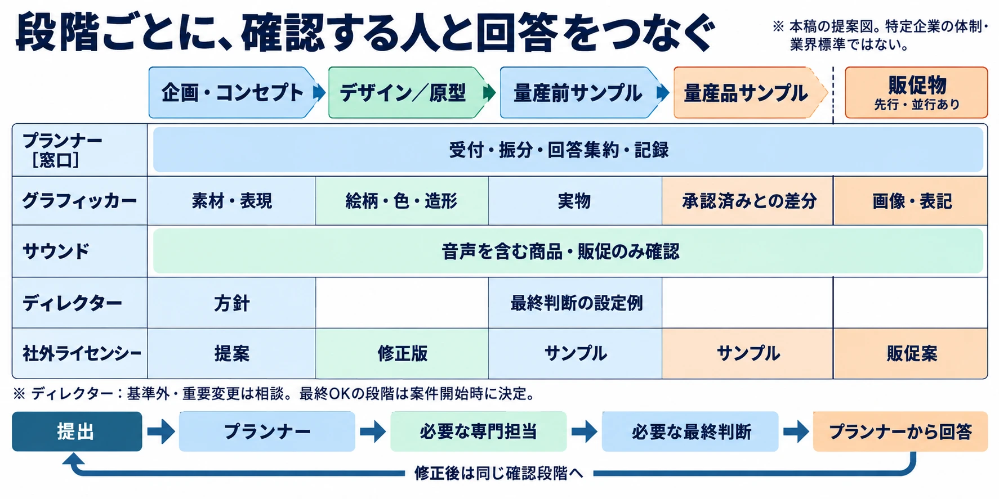
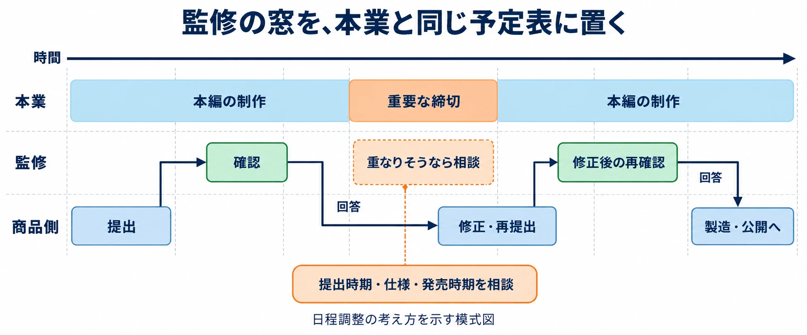

# 監修を『割り込み』から『予定された作業』に変える――自社ゲームのグッズ・音源監修とプランナーの制作進行

## はじめに――ゲームの外の商品にも、開発者の時間が要る

ゲームのIP、つまり作品やキャラクターなどの知的財産が育つと、グッズやサウンドトラックといった、ゲームの外で楽しめる商品も増えていく。サウンドトラックだけでも、CD、ヴァイナル（アナログレコード）、音楽配信という展開がある。

そこで必要になるのが、商品が作品の意図や品質に合っているかを確認する「監修」である。最終的な責任をディレクターが持つ体制でも、絵柄や造形を実際に確認するのは担当のグラフィッカー、音源を聴くのはサウンド担当、という分担になりやすい。

彼らにはゲーム本編の締切がある。商品側から届く確認依頼は、開発の予定に入っていなければ、「本来の仕事ではない作業」として横から割り込む。商品化に賛成していても、確認に使う時間が自然に生まれるわけではない。

ここでプランナーが担うのは、監修の制作進行である。必要な人へ、必要な段階で、判断できる材料を渡し、回答をまとめて次の工程へつなぐ。本稿では、その役回りを「監修を予定された作業に変える」という軸で整理する。

***

## 1. 誰が作る商品でも、社内の確認は発生する

対象を、まず三つに分けておこう。

| 対象 | 商品を作る側 | 社内で予定に載せたい確認 |
| --- | --- | --- |
| 自社で作るグッズ | 社内のグッズ担当や制作担当 | 企画、絵柄、色、造形、実物、告知の内容 |
| 社外が作るグッズ | ライセンシー（商品化の許諾を受けて作る会社） | 提案が作品に合うか、提供素材の使い方、試作品や製品、告知の内容 |
| 音源の商品化 | 社内の音楽担当や、制作・販売を担う社外の会社 | 収録内容、音源の版、曲情報、ジャケット、媒体ごとの提出物 |

社外のライセンシーが制作を引き受けても、社内で確認する時間は必要である。自社制作と同様に、担当者が資料を読み、差分を見て、必要なら戻す。その工数を商品側の予定から落としてしまうと、発売準備が進んでから開発側へ確認が集中する。

役割は案件の開始時に、次のように整理できる。これは本稿で提案する分担であり、実際の職制に合わせて調整する。

| 担当 | 主な役割 | 進行役が明らかにすること |
| --- | --- | --- |
| ディレクター | 作品としての最終判断、基準から外れる提案の判断 | 自分で確認する段階と、担当者へ委ねる範囲 |
| グラフィッカー | 絵柄、色、造形などの専門確認 | 確認対象、比較する資料、確認できる時期 |
| サウンド担当 | 音源、収録内容、曲情報の専門確認 | 必要な別版、試聴する版、情報の確定時期 |
| プランナー | 窓口、資料整理、日程調整、回答の集約と記録 | 誰に何を頼み、いつまでに誰へ返すか |

専門担当者の「この部分は問題なし」と、商品全体の「最終OK」は区別する。プランナーは、その違いが依頼元にも分かる形で回答する必要がある。

***

## 2. 監修は段階ごとに予定する

商品の監修は、完成品を一度見れば終わる仕事ではない。企画では商品の狙いを、デザインでは絵柄や表記を、実物では画面上の資料だけでは分からない色や形を確認する。修正が入れば、その修正を確かめる作業も発生する。

ゲーム業界外の版元の公開例として、The Astrid Lindgren Companyは、コンセプト、量産前サンプル、量産品サンプルの3段階からなる承認手順を示している。量産前サンプルとは、本格的な生産に入る前に仕上がりを確認する試作品である。同社は返答の目安を約5営業日とし、広告や販促物も承認対象にしている。[[1](#ref-1)]

これは同社の一例であり、ゲーム会社の標準日数や標準工程を示すものではない。自社で必要な段階と回答期限は、案件ごとに決める必要がある。

段階が増えれば、同じグラフィッカーやサウンド担当へ何度も確認が回る。「監修あり」という予定を一つ置くより、各段階の提出、社内確認、回答、修正後の再確認を分けたほうが、必要な時間を把握しやすい。

また、販促物は商品完成後に初めて現れるとは限らない。予約開始の告知や販売ページが先に必要なら、その確認は商品の制作と並行して予定する。

***

## 3. 音源には、商品として仕上げる作業がある

### ゲーム用と鑑賞用の版を区別する

『STEINS;GATE』などを手がける作曲家の阿保剛氏は、ゲーム本編で繰り返し再生するループ版と、音楽鑑賞メニューやサウンドトラック向けに終わりを付けた版を必ず作ると説明し、「曲数としては、2倍作っていることになります」と語っている。[[2](#ref-2)]

これは阿保氏の制作方法であり、すべての案件で曲数や工数が倍になるという意味ではない。ただし、サウンドトラック化には、ゲーム内の音源を書き出すことに加えて、鑑賞用の版を整える仕事がありうると分かる。

進行を引き受けたら、まず「商品に使う版はそろっているか」をサウンド担当と確認する。曲の終わり方や収録範囲を決める作業と、完成した音を聴いて確認する作業は別である。マスタリング、すなわち収録曲全体の音量や音質を整えて商品用の最終音源に仕上げる工程があるなら、その提出と確認も予定に置く。

### ヴァイナルは製造の期間から逆算する

ヴァイナルには、音源の完成後に物理的な製造期間が必要になる。2021年のCBC Newsの報道では、当時の生産期間について「少なくとも6か月」という業界関係者の説明があり、デジタルやCDに数か月遅れて発売する例や、別媒体から約11か月遅れる例も紹介された。[[3](#ref-3)]

これは当時の需給状況を伝える報道であり、現在の標準納期ではない。実際の案件では、製造先へ生産期間と音源の提出期限を確かめ、その前にサウンド担当の確認と修正の時間を確保する。CD・配信と同日に出すか、媒体ごとに発売日を分けるかも、早い段階で判断したい。

### 配信は曲情報も成果物にする

スクウェア・エニックスは2019年6月、FFシリーズのサウンドトラックをストリーミング配信へ展開した。ファミ通.comが掲載した同社発表では3,000曲以上が対象とされ、国内配信予定一覧には計76タイトルが並んでいる。[[4](#ref-4)]

配信の準備では、音源に加えて曲名、曲順、作曲者や演奏者などのクレジットもサウンド担当と詰める必要がある。音を確認する依頼と、曲情報を確認する依頼を分け、どの音源ファイルとどの曲情報が対応するかをそろえて渡す。音源だけが完成していても、曲情報の確定が残っていれば提出は完了しない。

***

## 4. 予定が崩れるのは、二つの締切がぶつかるからだ

監修の負担には、確認そのものの時間に加えて、本業から頭を切り替える時間がある。American Psychological Association（米国心理学会）の解説は、作業の切り替えによる短い中断の積み重ねが、生産的な時間の最大40％を失わせうるという心理学者David Meyerの見解を紹介している。また、複雑な作業や不慣れな作業では切り替えの時間が増えるとしている。[[5](#ref-5)]

この数字はゲーム会社の監修工数を測ったものではない。監修時間へ一律に40％を加算する根拠には使えないが、短い確認を何度も差し込むことにも負担がある、という視点は持てる。

監修には、ゲーム本編のマイルストーン（開発の節目となる締切）と、イベントや商品の発売日という社外の締切がある。商品側の発売日だけを見て監修を割り当てると、本編の重要な確認時期と衝突する。両方を同じ担当者の時間で処理しようとすれば、どちらかの締切や確認の質が崩れかねない。

予定表に必要なのは、商品側の希望日と、社内で実際に確認できる日時の両方である。その差が見えれば、商品仕様、提出時期、発売時期などを調整する相談を早く始められる。

***

## 5. プランナーが制作進行として整える五つのこと

### 窓口を一本にし、専門担当へ届く依頼を整える

サイバーコネクトツーの体制は、窓口を設ける意味を考える参考になる。入部春彦氏と田島和氏が登壇したCEDEC 2024の講演を伝える4Gamerの記事によれば、宣伝広報課の専任の「グッズ室」が企画、進行管理、在庫管理、販売までを一括して担う。同記事は、その効果を次のように説明している。[[6](#ref-6)]

> デザイン室と開発チームの仲立ちをグッズ室が行うため，デザイン室も開発チームも本来の業務の妨げにならない範囲で，グッズ制作に協力できる。

同社のデザイン室はUIやイラストなどゲーム開発にも関わるため、作品への理解が深いという。線画を使ったデザインや文字柄によって作画コストを抑える工夫もあり、2023年には約200アイテムを制作したと報告されている。[[6](#ref-6)]

この事例から、進行役が取り入れたいのは、依頼を受けてから専門担当へ渡すまでの整理である。プランナーが窓口を担う場合も、商品の用途、今回の確認範囲、前回からの変更、回答期限をまとめる。担当者から来た指摘は、依頼元が修正に移れる形で集約して返す。

専門的な打ち合わせが必要なら、担当者同士が直接話す機会も設ける。その場合も、決まった内容と次の提出物は窓口へ戻し、個別の会話だけで工程が進まないようにする。

### 本業の予定を先に置き、監修の窓を確保する

まず、グラフィッカーとサウンド担当の本業のマイルストーンを確認する。そのうえで、担当者と監修に使う時間を合意し、予定表に「監修の窓」を設ける。空き時間を進行役が一方的に埋めるのではなく、確認作業として時間を確保するのである。

次に、依頼元と各段階の提出期限、こちらからの回答期限、戻しと再提出の予定回数を約束する。回数は無条件の打ち切りではなく、必要な時間を見積もる前提である。想定を超える修正や重要な変更が出たときの相談先と、日程を見直す条件も決めておく。

提出物が遅れれば、確保した監修の窓で確認できないこともある。そのときは次に確認できる時期と、製造・告知への影響を依頼元へ伝える。発売日が近いという理由だけで、担当者の本業へ押し込む運用に戻さないことが大切だ。

### 判断基準を文書にし、相談が必要な差分を分ける

[既刊のメディアミックス記事](cedec2026-media-mix-strategy-idolmaster-bluearchive-heaven-burns-red.md)では、「何を基準に戻し、どの差分なら許容するのかを文書化」する必要を述べた。制作進行では、それを依頼時に使える資料へ落とし込む。

たとえば、承認済み素材を指定どおり使い、事前に定めた基準にも合うものは、委任された範囲で即OKを返せる。一方、キャラクターの印象や作品の設定に関わる変更、基準にない表現は、ディレクターへ判断を求める。どちらへ分けるか自体を、先に合意しておくのである。

専門担当者には、「今回は何を決める段階か」も示す。原型を見る段階なら形状を中心に、量産前サンプルなら実物の色や仕上がりを中心に、と確認の焦点をそろえる。造形の見方は、ゲーム内3Dを対象にした[監修基礎の記事](3d-model-supervision-basics-for-planners.md)も参考になる。

戻しをまとめるときは、必須の修正と任意の提案を区別する。社内で指示が食い違った場合は、進行役が判断者へ確認してから返す。依頼元が複数の指示の間で迷う状態を残さない。

### 素材を使い回せる形で残す

サイバーコネクトツーは、途中成果物を含むあらゆる資料を保存しているとGameBusiness.jpで紹介されている。4Gamerの講演レポートでも、設定資料、没案、絵コンテ、モデルデータなどを商品に活用する例が挙げられている。[[7](#ref-7)][[6](#ref-6)]

素材を再利用できれば、商品ごとに開発者へ描き直しや探し直しを頼む負担を減らせる。進行役は、保存場所に加えて、素材の版、用途、承認状態を分かるようにしておきたい。

没案が残っていることと、商品への使用が承認されていることは別である。最新版の設定資料、公開済みの素材、商品化のために別途判断が必要な途中成果物を区別し、渡す前に使用範囲を確認する。

### 最終OKを出す人と、承認の対象を記録する

最終OKは、対象を特定できる形で残す。商品名だけでなく、ファイル名や版、サンプルの識別情報、承認者、承認日、条件の有無を記録する。条件付きの回答なら、何が満たされれば次へ進めるかも書く。

プランナーは専門確認がそろったことを確かめ、合意した最終判断者へ回す。その承認結果を依頼元へ返し、関係者が同じ版を参照できる場所へ残す。承認後に変更が入った場合は、変更内容に応じて必要な担当者へ再確認を依頼する。

「前にOKだったはず」という記憶より、どの状態を誰が承認したかが分かる記録のほうが、次の工程を支えられる。

***

## 6. 引き受けるときの点検表

最初の打ち合わせでは、次の項目を依頼元と社内の担当者で埋めるとよい。未決定の項目には、決める担当と期限を付ける。

| 点検項目 | 確認すること |
| --- | --- |
| 窓口と専門担当 | 依頼と回答を誰が集約し、絵・造形・音を誰が確認するか |
| 最終判断者 | 誰が、どの段階で最終OKを出すか。委任する範囲はどこか |
| 段階ごとの締切 | 提出、社内確認、回答、修正後の再確認をそれぞれ予定したか |
| 戻しの回数と変更時の相談 | 予定する修正の往復と、超過時に日程を見直す手順を合意したか |
| 本業との衝突 | 開発のマイルストーンと重ならず、担当者の監修時間を確保できるか |
| 判断資料と基準 | 基準となる設定資料、承認済みの版、前回との差分がそろっているか |
| 音源の別版 | 鑑賞用の終わり方など、商品用に作る版や仕上げ作業が必要か |
| ヴァイナルの生産期間 | 製造先の納期と提出期限を確認し、媒体別の発売日を決めたか |
| 配信の曲情報 | 曲名、曲順、クレジットと音源ファイルの対応を誰が確定するか |
| 販促物の範囲と期限 | ジャケット、販売ページ、広告、予約告知のどこまでを監修し、いつ確認するか |
| 記録と素材の置き場 | 承認対象の版、指摘、修正結果、最終OK、再利用素材をどこへ残すか |

商品を出すかどうかの採算判断は、[企業ブースの記事にある貢献利益の考え方](comic-market-corporate-booth-participation-practice.md)へつながる。監修の予定を組む段階では、必要な確認作業を見えるようにし、商品化の判断材料として渡すことが先である。

***

## おわりに――確認の時間まで含めて、商品の予定を作る

グッズも音源も、ゲームの魅力を別の形で届ける商品である。その品質を支えるには、作品を理解している開発者の確認が要る。

プランナーが窓口を整え、本業と両立する監修の窓を確保し、判断基準と承認記録を残す。そうすれば、担当者はいつ何を見るのかを把握でき、依頼元も次へ進むための条件を理解できる。

監修を「頼まれたら差し込む仕事」から「最初から予定に載せる仕事」へ変える。そのために確認の時間まで含めて商品の予定を作ることが、制作進行としてのプランナーの仕事である。

## References

1. [The Astrid Lindgren Company「Approval process」][1] — The Astrid Lindgren Company、日付記載なし。ゲーム業界外の版元による承認手順の例。

[1]: https://astridlindgren.com/es/the-company/product-licensing/approval-process

2. [押野由宇「『STEINS;GATE』などを手がけるゲームミュージッククリエイター・阿保 剛ハイレゾ作品集の魅力を本人に聞いた」][2] — PHILE WEB、2016年2月26日。1ページ目のループ版と鑑賞用の版に関する発言を参照。

[2]: https://www.phileweb.com/interview/article/201602/26/353.html

3. [David Friend（The Canadian Press）「Not just Adele: Soaring vinyl sales have been causing capacity woes for years, industry insiders say」][3] — CBC News、2021年11月17日。2021年当時の生産状況についての報道。

[3]: https://www.cbc.ca/1.6253630

4. [ファミ通.com編集部「『FF』シリーズのサントラがストリーミング音楽配信サービスに登場！ 各サービス加入者は3000曲以上が聞き放題」][4] — ファミ通.com、2019年6月11日。スクウェア・エニックスの発表と国内配信予定一覧を掲載。

[4]: https://www.famitsu.com/news/201906/11177788.html

5. [American Psychological Association「Multitasking: Switching costs」][5] — American Psychological Association、2006年3月20日。作業切り替えの実験とDavid Meyerの見解を紹介。英文の内容は本稿による要約。

[5]: https://www.apa.org/topics/research/multitasking

6. [高橋祐介「求められているのは『遊び』だけではない！『ゲーム開発の副産物で収益化！？ゲーム会社のグッズ制作ノウハウ』聴講レポート［CEDEC 2024］」][6] — 4Gamer.net、2024年8月24日。サイバーコネクトツーの入部春彦氏・田島和氏による講演のレポート。

[6]: https://www.4gamer.net/games/999/G999905/20240824020/

7. [気賀沢昌志「ゲームの途中成果物でユーザーを楽しませる―サイバーコネクトツーのオリジナルグッズ戦略【CEDEC2024】」][7] — GameBusiness.jp、2024年9月4日。途中成果物を含む資料の保存方針を参照。

[7]: https://www.gamebusiness.jp/article/2024/09/04/23458.html

----

この文書は、Perplexity、Claude、ChatGPT の3つのAIの支援を受けて著述されたものです。引用画像を除き、MIT License にて提供されています。
