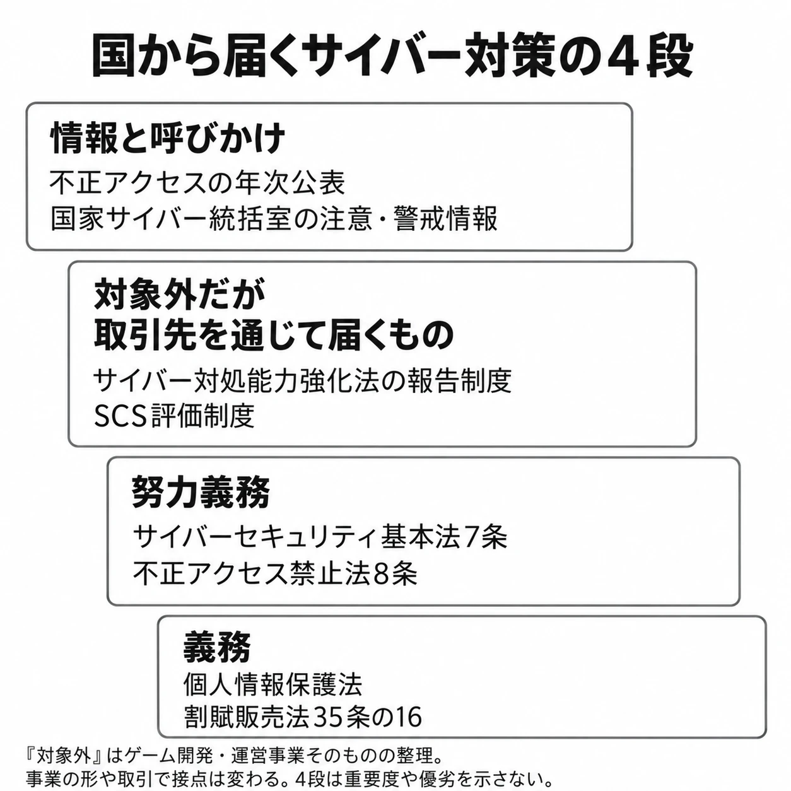

# その対策は、義務か、努力か、取引の条件か――サイバー対処能力強化法から不正アクセス禁止法まで、国がゲーム会社に求めるものを並べる

> **注意**：本稿は2026年10月31日時点の制度を整理するものです。個々の事業への当てはまり方は、事業の形、契約、システムの構成によって異なります。具体的な対応は、最新の法令・資料と自社の実態をもとに、法務部門や専門家に確認してください。

「この対策は、国から求められている」。会議でそう説明されたとき、まず確かめたいことがある。法律で実施が義務づけられているのか。取り組む努力を求められているのか。それとも、取引先の条件や政府の注意喚起なのか。

どれも運営の判断材料になるが、届く経路と、求められることは異なる。そこで本稿の判断軸を、 **「その対策は、義務か、努力か、取引の条件か」** とする。

「情シスとプレイヤーのあいだを走る」本編の第1回から第5回では、影響の説明、仕様の悪用、外部依存、縮退運転、ログインの本人確認を通じて、プランナーが情シスとプレイヤーのあいだで何をするかを考えてきた。この番外編では、その外側にある国の決まりを地図にする。

完結済みの「ゲームと行政のあいだ」[第1回「規制の地図」](game-and-government-regulation-map.md)では、国会・省庁・自治体・業界団体・決済網から、ルールが届く経路を整理した。今回はそのサイバー版である。

| 段 | まず確かめる問い | 代表例 |
|---|---|---|
| 義務 | 自社の事業や事象が、法律の対象に当たるか | 個人情報の漏えい等の報告、カード番号等の適切な管理 |
| 努力義務 | 法律が、誰に、どの方向の努力を求めているか | 自主的な対策、供給するプログラムへの配慮、認証機能の検証 |
| 対象外だが届くもの | 取引先の義務や調達方針から、何を依頼されるか | 基幹インフラの報告を支える情報提供、SCS評価制度 |
| 情報と呼びかけ | 公表資料や注意喚起を、自社の判断にどう使うか | 不正アクセスの統計、認証強化や脆弱性対応の呼びかけ |

この4段は、対策の重要度を順位づけるものではない。同じ認証強化でも、法律上の努力義務、取引上の条件、政府の推奨が重なることがある。以下では、それぞれの根拠を分けて見ていく。

***

## 義務――報告すること、カード情報を適切に管理すること

### 個人情報の漏えい等は、既存の報告制度につながる

個人情報保護法は、個人情報の適正な取扱いと個人の権利利益の保護を目的とする法律である。一定の個人データの漏えい等には、個人情報保護委員会への報告と本人への通知が必要になる。対象や初動の整理は、[個人情報漏えいの最初の48時間](personal-data-breach-first-48-hours-game-company.md)で扱っている。

ここでは、ゲーム会社にも、扱う情報と発生した事象によって直接届く報告義務がある、と押さえておこう。[[1](#ref-1)]

### カード決済の経路によって、持つべき問いが変わる

割賦販売法は、分割払いやクレジット取引などのルールを定め、購入者等を保護する法律である。その35条の16第1項は、カード番号等を扱う事業者に、漏えい・滅失・毀損の防止など、適切な管理に必要な措置を講じる義務を課している。対象として列挙される者には、カード決済で商品・権利を売る販売業者や、サービスを提供する事業者も含まれる。[[2](#ref-2)]

ゲームでは、決済の経路を見れば接点をつかみやすい。

| 決済の形の例 | 運営側で確かめたいこと |
|---|---|
| アプリストアの課金だけを利用する | ストア側が決済を扱う中で、自社が受け取る情報と担う業務は何か |
| 月額制MMOなどで直接カード決済を受ける | カード加盟店としての立場、番号等の取扱い、決済代行会社との役割分担はどうなっているか |
| アプリ内課金とは別に、公式Webストアでカード課金を受ける | Web側の販売主体、決済画面・システムの管理主体、委託先との分担はどうなっているか |

これは事業の形を考えるための例であり、個別企業の適用を判定する表ではない。 **カード番号を自社に保存しているかだけで、義務の有無を決めない** ことも大切である。条文は販売・役務提供などの立場を列挙しており、同条3項には、番号等の取扱いを委託した相手に対する必要な指導その他の措置も定められている。[[2](#ref-2)]

本シリーズ[第1回](it-team-to-players-no-impact-statement-capcom-2020.md)で扱ったカプコンは、2020年11月16日の発表で、ネット販売等の決済をすべて外部委託し、自社はカード情報を保有していないため、その流出はないと説明した。これは、その被害について影響範囲を示した説明である。決済の委託先と情報の所在を把握することが、プレイヤーへの説明にもつながる。[[3](#ref-3)]

### 決済経路が増えると、管理する範囲も変わりうる

スマホソフトウェア競争促進法、正式には「スマートフォンにおいて利用される特定ソフトウェアに係る競争の促進に関する法律」は、スマートフォンの基本ソフトやアプリストアなどに関する競争を促す法律である。2025年12月18日に全面施行され、指定事業者が、代替決済手段や関連するWebページの利用を妨げる行為などを禁じている。安全性の確保等に関する例外も定められている。[[4](#ref-4)][[5](#ref-5)]

一方、2026年2月5日、モバイル・コンテンツ・フォーラム、日本オンラインゲーム協会、日本eスポーツ協会、コンピュータエンターテインメント協会など計7団体は共同声明を公表した。声明は、AppleとGoogleの日本向け新規約について、リンクを介した代替決済への誘導に手数料や新たな条件が課されていると指摘している。これは、制度への業界団体の見解である。[[6](#ref-6)]

法律が禁じる行為と、各社の規約に対する団体の主張は、分けて読む必要がある。そのうえで編者は、今後、プラットフォームの課金以外に自社の課金システムを使う事業者が増えると考える。そのぶん、割賦販売法上の管理義務を検討する場面も身近になるだろう。

決済画面への導線を増やす企画は、カード情報の管理や委託先との分担を見直す契機にもなる。決済網のルールそのものについては、「ゲームと行政のあいだ」[第6回](payment-network-invisible-regulation-japan-platforms.md)も参照してほしい。

***

## 努力義務――自主的な対策と、利用者を支える設計

### 事業者としての努力と、プログラムの供給者としての努力

サイバーセキュリティ基本法は、国全体のサイバーセキュリティ施策の基本理念と、国や事業者などの責務を定める法律である。7条1項は、事業者に、自主的かつ積極的にサイバーセキュリティを確保する努力と、国・地方公共団体の施策に協力する努力を求めている。[[7](#ref-7)]

同条2項は、情報システムや、その一部を構成するプログラムなどの「供給者」に向けた規定である。利用者が安全性・信頼性を確保するために行う措置に配慮した設計・開発、適切な維持管理に必要な情報の継続的な提供など、利用者の対策を支援する取組に努めるよう求めている。[[7](#ref-7)]

本稿では、ゲームを提供する会社も、プログラムの供給者としてこの規定を読むことができると整理する。自社の社内ネットワークを守ることに加え、利用者が安全に遊ぶための仕組みや案内を、提供する側から考えるのである。

たとえば、更新が必要なときに利用者へ伝える方法や、セキュリティ設定へ迷わず進める画面をどう用意するか。これらは本稿の設計上の例であり、条文が個別の画面構成を指定しているわけではない。本編[第2回](abuse-case-column-in-game-specs.md)で扱った、仕様に悪用のされ方を書き込む視点ともつながる。

### アカウントを管理する側にも、努力を求める条文がある

不正アクセス禁止法、正式には「不正アクセス行為の禁止等に関する法律」は、不正アクセスや、それを助長する行為などを禁じ、ネットワークの秩序を保つための法律である。同法は、攻撃する側の行為に加え、アクセスを管理する側の防御にも触れている。[[8](#ref-8)]

2条1項の「アクセス管理者」とは、ネットワークにつながるコンピューターについて、そのネットワーク経由の利用に関する動作を管理する者をいう。プレイヤーのアカウントでログインさせ、サーバーの利用を管理するゲーム運営は、この立場に当たる。実際の管理主体は、運営・認証の構成に照らして見る必要がある。[[8](#ref-8)]

8条は、アクセス制御機能を設けたアクセス管理者に、ID・パスワードなどの適正な管理に努めること、常にその機能の有効性を検証すること、必要と認めるときは速やかに機能の高度化などの防御措置に努めることを求めている。[[8](#ref-8)]

ここで扱った努力義務の規定自体には、罰則が設けられていない。ただし、不正アクセス行為そのものには別の禁止規定と罰則がある。「不正アクセス禁止法には罰則がない」という意味ではない。[[7](#ref-7)][[8](#ref-8)]

本稿の読み方では、[第5回](account-takeover-phishing-how-login-proves-identity.md)で扱ったワンタイムパスワードや2段階認証も、防御機能を高める努力の具体的な形の一つである。何を導入し、プレイヤーにどう使ってもらうかという運営判断に、条文の方向性がつながってくる。

***

## 対象外だが届くもの――取引先の義務と、調達の条件

### サイバー対処能力強化法の報告義務は、誰に向くか

サイバー対処能力強化法、正式には「重要電子計算機に対する不正な行為による被害の防止に関する法律」は、重要なコンピューターへのサイバー攻撃による被害を防ぐための法律であり、「能動的サイバー防御法」と呼ばれることもある。同法と関係する整備法のうち、官民連携の強化やアクセス・無害化措置に係る規定は、2026年10月1日に施行された。アクセス・無害化措置は国側の対処の仕組みであり、ゲーム会社にその実施を義務づけるものではない。[[9](#ref-9)]

本稿で見るのは、官民連携の中にある報告制度である。一定のサイバー攻撃等について報告義務を負うのは、「特別社会基盤事業者」である。基幹インフラを守る経済安全保障推進法の指定を土台にした対象であり、ゲーム事業者全体へ一律に報告義務を課す仕組みではない。[[10](#ref-10)]

経済安全保障推進法は、重要な物資やインフラなどを通じて経済面の安全保障を確保する法律である。正式名称は「経済施策を一体的に講ずることによる安全保障の確保の推進に関する法律」という。その50条は、基幹インフラに当たる事業の範囲と、一定の基準に該当する事業者を指定する仕組みを定めている。[[11](#ref-11)]

内閣府の整理では、医療の追加前の対象は、電気、ガス、石油、水道、鉄道、貨物自動車運送、外航貨物、港湾運送、航空、空港、電気通信、放送、郵便、金融、クレジットカードの15分野である。2026年7月1日時点の指定事業者数は258者であり、医療分野を加える改正法は同年6月17日に公布された。医療の追加には、公布から1年6か月以内の政令で定める日から施行するという別の時点が設けられている。[[12](#ref-12)]

ゲームの開発・運営という事業そのものは、この列挙に入っていない。ただし、会社名や業界名だけで対象外と決めるのではなく、兼営する事業や指定の有無を見る必要がある。

対象事業者の報告期限について、関係府省の解説は次のように整理している。[[10](#ref-10)]

| 報告の段階 | 解説で示された期限 |
|---|---|
| 速報：DDoS攻撃事案 | 認知後、可能なかぎり速やかに |
| 速報：ランサムウェア事案・その他のサイバー攻撃事案 | 認知した日から3〜5日以内 |
| 詳報：攻撃や被害の全容を整理する報告 | 認知した日から30日以内 |

DDoSは大量の通信などでサービスの利用を妨げる攻撃、ランサムウェアはデータの暗号化などとともに金銭等を要求する攻撃である。速報と詳報に分ける形は個人情報保護法の漏えい等の報告と似ているが、対象事業者、対象となる事象、報告先をそれぞれの制度で判断する必要がある。

### 所有者が別でも、取引先の報告に関係しうる

取引先を通じた接点は、コンピューターの範囲にある。関係府省の解説は、対象事業者が使用するコンピューターについて、自社所有に限らず、グループ会社・システムベンダー・その他の供給者が実質的に所有するものや、クラウドサービスも該当しうると説明している。対象は、重要設備の機能停止・低下につながるおそれなどの要件を満たすものである。[[10](#ref-10)]

したがって、ゲーム会社がシステムやサービスを提供する事業も行い、基幹インフラ事業者がそれを対象システムで利用しているなら、届出や被害報告に必要な情報の提供を求められうる。単に電力や決済のサービスを購入しているだけで、ゲーム会社に同じ報告義務が移るという話ではない。

解説は、他の組織に情報提供を求める際、独占禁止法や中小受託取引適正化法、フリーランス法などに違反しないよう留意することも明記している。順に、公正な競争、委託取引の適正化、フリーランスとの取引の適正化などを支える法律である。[[10](#ref-10)] 取引適正化の考え方は、[ゲーム開発と取適法](game-development-subcontracting-toriteki-law.md)につながる。

ここで分けたいのは、 **国へ報告する義務の主体と、その報告を支える情報を持つ相手** である。取引先の制度対応を支えるために、どの情報を、誰が、どの範囲で提供するか。自社が直接の報告義務を負わない場合にも、契約や運用の調整事項になる。

### SCS評価制度は、取引で対策状況を示す道具になる

SCS評価制度は、「サプライチェーン強化に向けたセキュリティ対策評価制度」の略称である。取引先を起点とする侵入や、製品・サービスの供給停止のリスクを減らすため、対策状況を段階で示す仕組みである。

経済産業省が2025年12月26日に公表した制度構築方針は、当時は「案」であった。その案は、★3・★4・★5の段階で対策状況を可視化し、発注元が委託先に適切な段階を提示して対策を促す形を想定していた。企業どうしに対策レベルを競わせる格付け制度ではない、としている。[[13](#ref-13)]

| 段階 | 2025年12月の案で示された評価の形 |
|---|---|
| ★3 | 専門家確認付きの自己評価 |
| ★4 | 第三者評価 |
| ★5 | 今後検討 |

その後、2026年3月に経済産業省と国家サイバー統括室が制度構築方針を公表した。IPAの2026年10月28日更新ページによれば、制度はIPAが運営し、★3・★4は2027年3月の受付開始に向けて準備が進められている。[[14](#ref-14)]

ゲーム会社にも一律に★の取得を義務づける法律という位置づけではない。一方、取引先が委託する仕事に必要な段階を条件として示せば、受注する側は対応を検討することになる。 **法律上の義務と、仕事を受けるために調整する条件は、別の経路から届く** のである。

[第3回「外部依存の棚卸し」](external-dependency-inventory-when-partners-stop.md)では、ゲーム会社が外部サービスに依存する側として考えた。ここでは立場が逆になる。自社が供給する仕組みの停止や侵害が、取引先にどう届くかを説明する側になる。

***

## 情報と呼びかけ――国は、判断の材料も出している

### 統計の「17件」と「9件」は、数える対象が異なる

不正アクセス禁止法10条に基づき、国家公安委員会・総務大臣・経済産業大臣は、毎年少なくとも1回、不正アクセス行為の発生状況などを公表する。2026年3月12日の公表では、2025年の不正アクセス行為の認知件数は7,190件だった。[[15](#ref-15)]

ゲームに関する数値は、次のように二つの表に現れる。[[15](#ref-15)]

| 資料の区分 | 2025年の件数 | 何を数えているか |
|---|---:|---|
| 不正アクセス後の行為別認知件数：「オンラインゲームの不正操作」 | 17件 | 認知した不正アクセスの後に行われた行為による分類 |
| 識別符号窃用型で不正に利用されたサービス別検挙件数：「オンラインゲーム」 | 9件 | ID・パスワードなどを不正に使う型の不正アクセスについて、検挙したもののサービス別分類 |

認知と検挙、行為とサービスという異なる切り口である。17件のうち9件を検挙した、とは読めない。また、この数値は資料の定義に沿って把握された件数であり、ゲームのアカウント被害全体の規模を示す数字ではない。

### 利用者への呼びかけと、管理者への呼びかけを並べる

同じ資料の「防御上の留意事項」は、プレイヤーと運営側の双方につながる内容を含んでいる。[[15](#ref-15)]

| 相手 | 資料が促していること |
|---|---|
| 利用権者、つまり利用を認められた人 | オンラインゲーム等で、ワンタイムパスワード等による認証など、ゲーム会社等が推奨する対策を積極的に利用する |
| アクセス管理者 | 二要素認証・二経路認証に加え、パスキーのようなフィッシングに耐性のある認証技術を積極的に導入し、認証を強化する |

二要素認証は、知識・持ち物・身体的特徴のうち二つの要素を組み合わせる方法、二経路認証は別々の通信経路を使う方法である。パスキーは、正規サイト以外では認証が機能しない仕組みにより、偽サイトへの誘導に耐性を持つ認証技術である。[[15](#ref-15)]

この資料は、ゲーム会社が利用者に対策を勧める場面まで具体的に挙げている。[第5回](account-takeover-phishing-how-login-proves-identity.md)で考えた、認証の仕組みとプレイヤーへの案内をつなぐ仕事は、こうした公表資料にも接点がある。資料中の推奨事項と、8条が定める努力義務は、根拠と具体性を分けて読むと整理しやすい。

### 緊急の注意喚起も、運営が判断するための入力になる

2025年7月に発足した国家サイバー統括室は[[16](#ref-16)]、PHPの重大な脆弱性への対応で注意・警戒情報を出し、首相もXで呼びかけた。その経緯は[PHPの緊急対応と停止判断](php-emergency-maintenance-who-decides-to-stop.md)で扱った。

また、2026年2月の首相ビデオメッセージにおける多要素認証の呼びかけは、[第5回](account-takeover-phishing-how-login-proves-identity.md)で紹介している。

こうした情報は、対策の見直しや緊急対応の判断材料になる。実際にどの機能を止めるか、更新できるまでどう運用するか、プレイヤーへ何を案内するかは、自社の構成と影響を踏まえて決める。本編[第4回](degraded-operation-what-to-keep-which-clocks-to-stop.md)で扱った、残す機能と止める時計の整理にもつながる。

***

## 4段の地図を、運営の判断につなぐ

最後に、国から届くものを一つの表へ戻しておこう。「対象外だが届くもの」の段は、ゲーム事業そのものを直接の対象としない報告制度や、法的な取得義務によらない評価制度との接点を指している。

| 段 | 主な決まり・資料 | ゲーム会社に求めていること | 本シリーズのどの回とつながるか |
|---|---|---|---|
| 義務 | 個人情報保護法、割賦販売法 | 対象となる漏えい等の報告・本人通知。事業の形に応じたカード番号等の適切な管理 | 第1回：影響範囲と、その説明の根拠 |
| 努力義務 | サイバーセキュリティ基本法7条、不正アクセス禁止法8条 | 自主的な対策、利用者の対策を支える設計・情報提供、アクセス制御機能の検証と必要な高度化 | 第2回：悪用を考えた仕様。第5回：認証と利用者への案内 |
| 対象外だが届くもの | サイバー対処能力強化法の報告制度、SCS評価制度 | 対象となる取引先への情報提供や、委託・調達条件としての対策状況の提示を検討する | 第3回：依存関係を、依存される側から見る |
| 情報と呼びかけ | 不正アクセスの年次公表、国家サイバー統括室の注意・警戒情報、首相の呼びかけ | 情報を判断材料として、認証強化、更新、停止、利用者への案内を具体化する | 第4回：継続・停止の判断。第5回：認証強化 |

国の決まりの多くは、ゲーム会社に細かな手順まで指定していない。報告の対象や期限を定める制度がある一方、どの機能をどう守り、誰に何を伝えるかには、事業者が自ら決める余地が大きい。

その中身を作ることが、本編で扱ってきたプランナーの仕事でもある。情報の所在を確かめ、悪用を仕様に書き、依存関係を洗い出し、止める範囲を決め、本人確認をプレイヤーの行動につなぐ。国の決まりを読んだ先で、そのゲームに必要な運営へ落とし込むのである。

## References

1. [e-Gov法令検索「個人情報の保護に関する法律」][1] — e-Gov法令検索、平成15年法律第57号。26条。

[1]: https://laws.e-gov.go.jp/law/415AC0000000057

2. [e-Gov法令検索「割賦販売法」][2] — e-Gov法令検索、昭和36年法律第159号。35条の16第1項・第3項。

[2]: https://laws.e-gov.go.jp/law/336AC0000000159

3. [カプコン「不正アクセスによる情報流出に関するお知らせとお詫び」][3] — カプコン、2020年11月16日。

[3]: https://www.capcom.co.jp/ir/news/html/201116.html

4. [公正取引委員会「スマホソフトウェア競争促進法に基づく遵守報告書の公表について」][4] — 公正取引委員会、2026年2月17日。全面施行日を参照。

[4]: https://www.jftc.go.jp/houdou/pressrelease/2026/feb/260217_sumaho_junshuhoukoku.html

5. [e-Gov法令検索「スマートフォンにおいて利用される特定ソフトウェアに係る競争の促進に関する法律」][5] — e-Gov法令検索、令和6年法律第58号。8条。

[5]: https://laws.e-gov.go.jp/law/506AC0000000058

6. [モバイル・コンテンツ・フォーラムほか7団体「緊急共同声明 スマホソフトウェア競争促進法が全面施行 国際的なイコールフッティングと真に自由で公正な市場の実現に向けた要望」][6] — モバイル・コンテンツ・フォーラム、2026年2月5日。pp.1–3。

[6]: https://www.mcf.or.jp/mcfxswp/wp-content/uploads/2026/02/mcf_iken_20260205.pdf

7. [e-Gov法令検索「サイバーセキュリティ基本法」][7] — e-Gov法令検索、平成26年法律第104号。7条。

[7]: https://laws.e-gov.go.jp/law/426AC1000000104

8. [e-Gov法令検索「不正アクセス行為の禁止等に関する法律」][8] — e-Gov法令検索、平成11年法律第128号。2条1項、8条、10条、罰則。

[8]: https://laws.e-gov.go.jp/law/411AC0000000128

9. [内閣府「サイバー対処能力強化法及び同整備法の施行に関する関係省庁会議」][9] — 内閣府、2026年。2026年10月1日施行の範囲を参照。

[9]: https://www.cao.go.jp/minister/2609_t_furukawa/photo/2026_005.html

10. [内閣府・総務省・法務省・財務省・厚生労働省・農林水産省・経済産業省・国土交通省「サイバー対処能力強化法に基づく特別社会基盤事業者による特定侵害事象等の報告等に関する制度の解説（特定重要電子計算機の届出及び特定侵害事象等の報告）」][10] — 内閣府、2026年10月1日。1-2（p.5）、2-1-1（p.8）、6-2（p.57）、7-1（pp.59–60）。頁は資料内の表記。

[10]: https://www.cao.go.jp/cybersecurity/pdf/cyber_kaisetsu_202610.pdf

11. [e-Gov法令検索「経済施策を一体的に講ずることによる安全保障の確保の推進に関する法律」][11] — e-Gov法令検索、令和4年法律第43号。50条。

[11]: https://laws.e-gov.go.jp/law/504AC0000000043

12. [内閣府「経済安全保障推進法の特定社会基盤役務の安定的な提供の確保に関する制度について」][12] — 内閣府、2026年7月1日時点。p.1。医療追加に係る施行の注記を含む。

[12]: https://www.cao.go.jp/keizai_anzen_hosho/suishinhou/infra/doc/infra_gaiyou.pdf

13. [経済産業省「サプライチェーン強化に向けたセキュリティ対策評価制度に関する制度構築方針（案）」][13] — 経済産業省、2025年12月26日。案の段階の制度設計を参照。

[13]: https://www.meti.go.jp/press/2025/12/20251226001/20251226001.html

14. [情報処理推進機構「SCS評価制度の詳細情報」][14] — IPA、2026年10月28日更新。制度の根拠となる2026年3月の方針、段階別評価、今後のスケジュールを参照。

[14]: https://www.ipa.go.jp/security/scs/details.html

15. [国家公安委員会・総務大臣・経済産業大臣「不正アクセス行為の発生状況及びアクセス制御機能に関する技術の研究開発の状況」][15] — 警察庁、2026年3月12日。本文pp.1–2、7、9–10（PDFの2–3、8、10–11頁）。

[15]: https://www.npa.go.jp/news/release/2026/R080312_access.pdf

16. [首相官邸「国家サイバー統括室発足式」][16] — 首相官邸、2025年7月1日。

[16]: https://www.kantei.go.jp/jp/103/actions/202507/01hossokushiki.html

----

この文書は、Perplexity、Claude、ChatGPT の3つのAIの支援を受けて著述されたものです。引用画像を除き、MIT License にて提供されています。
