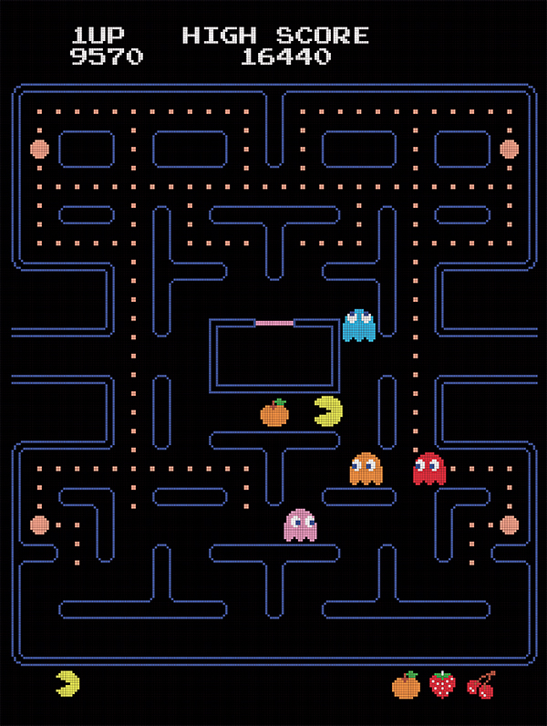
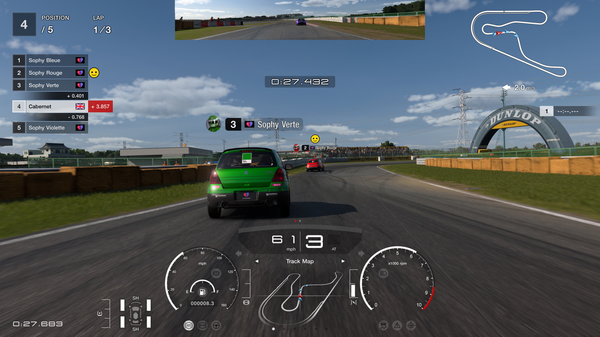
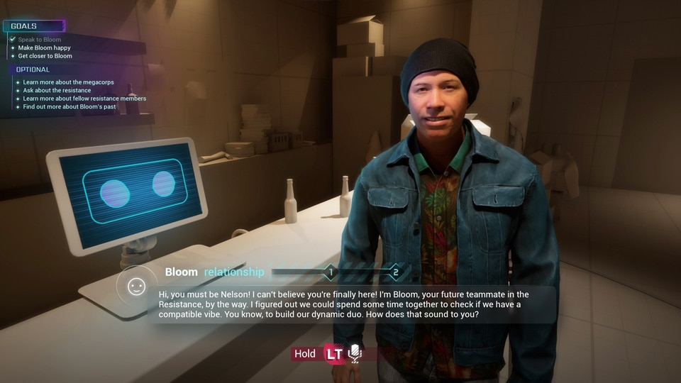

# ゲームのAIは何のために賢くなってきたのか——『パックマン』から生成AIまで、ゲームAIの役割の変遷

> 2026年11月12日改版：記事全体を全面的に書き直しました。内容の変更はGitの履歴から追えます。

## 1. はじめに

迷路で追いかけてくるモンスターも、作戦を伝えると自分で呪文を選ぶ仲間も、ゲームでは「AI」と呼ばれてきた。40年以上前から、ゲーム開発者はプレイヤーの操作に応じてキャラクターや展開を動かす仕組みを作っていた。一方で、ゲームは機械学習の研究にも使われる。こちらでは、画面を手がかりに攻略法を学べるか、人間の名手に勝てるかといった問いが出発点になる。本稿では、ゲーム内の仕組みとゲームを題材にした研究の両方を、「プレイヤーに対して何をするために作られたか」という問いでたどる。

スクウェア・エニックスで『ファイナルファンタジーXV』などのAIに携わった開発者・研究者の三宅陽一郎氏は、ゲームAIを三つの役割から捉え、互いに連携させる「MCS-AI動的連携モデル」を提案している。個々のキャラクターが何をするかを決めるのが「キャラクターAI」、地形を把握して通れる経路などを扱うのが「スパーシャルAI（ナビゲーションAI）」、ゲーム全体を見渡して展開を調整するのが「メタAI」である。[[1](#ref-1)][[2](#ref-2)]協力ゲームなら、味方が救助を決めるのはキャラクターAI、倒れた仲間までの経路を扱うのはスパーシャルAI、次に敵の群れが現れるタイミングを決めるのはメタAI、という具合だ。

***

## 2. 賢く見せる——『パックマン』

敵の役割は、追われる緊張と、そこから逃れたときの安堵を作ることだった。

ナムコの業務用（アーケード）ゲーム『パックマン』（1980年）では、プレイヤーは迷路でエサを食べながらモンスターをかわす。開発者の岩谷徹氏は、経営学の研究者で聞き手を務めた生稲史彦氏らのオーラル・ヒストリーで、モンスターを恐ろしげな見た目から遠ざけ、憎めない存在にしようとした経緯を語っている。初期のモンスターは全員赤だった。[[3](#ref-3)][[4](#ref-4)]

追いかけっこを成立させる工夫は、モンスターの動きと迷路の両方にあった。袋小路をなくし、迷路の反対側へ抜けられるワープトンネルを設けた。パワーエサを取れば、一時的にパックマンが追う側に回れる。モンスターにも、まとまって攻め寄せては散る動きが加わった。岩谷氏によれば、こうした工夫にはプレイヤーのフラストレーションをためない狙いがあった。[[4](#ref-4)]

*画像出典（引用）：ゲーム文化保存研究所「[パックマン](https://igcc.jp/database/pac-man/)」。画像提供：バンダイナムコエンターテインメント。迷路の通路とモンスターの位置関係を示すゲーム画面。*

モンスターが寄ってくると、プレイヤーは先の曲がり角まで考える。モンスターが散れば、さっきまで通れなかった道へ向かえる。敵の賢さは、プレイヤーがその動きをどう読み、どんな切り抜け方を思いつくかに表れる。次にRPGでAIに求められたのは、その判断力をプレイヤーの味方として発揮することだった。

***

## 3. 任せられる仲間になる——『ドラゴンクエストIV 導かれし者たち』

仲間の役割は、プレイヤーが決めた方針を具体的な行動に移すことだった。

エニックスが1990年にファミコン向けに発売した『ドラゴンクエストIV 導かれし者たち』では、第5章から、主人公以外の仲間が「作戦」に従って自動で行動する。主人公には引き続きプレイヤーが直接命令する。作戦は「みんながんばれ」「ガンガンいこうぜ」「いのちだいじに」「じゅもんせつやく」「じゅもんつかうな」「いろいろやろうぜ」の6種類だ。攻勢に出るか、仲間の生存を優先するかをプレイヤーが決め、誰がどの呪文を使うかは仲間に委ねる。[[5](#ref-5)]

その委任を語るときに今も引き合いに出されるのが、即死呪文が効かないボスにクリフトがザラキを繰り返す場面だ。発売35周年の回顧記事でも、仲間の判断に任せるもどかしさを象徴するエピソードとして取り上げられている。[[5](#ref-5)]

任せる仕組みでは、期待が外れたときにプレイヤーが取れる手も設計の一部になる。「じゅもんつかうな」に切り替えればザラキを止められるが、有用な呪文まで止まる。どこまで細かく介入できるかによって、同じ自動戦闘でも任せやすさは変わる。『ファイナルファンタジーXII』でプレイヤーが仲間の行動条件を組む方式は、[仲間に任せるとき、プレイヤーは何を決めるのか](gambit-system-for-turn-based-rpg-combat-ai.md)で扱っている。

***

## 4. 複雑さに耐える設計へ——『Halo 2』と『F.E.A.R.』

敵の役割は、戦況の変化に応じて動き、プレイヤーにその場での判断を求めることだった。

2000年代のアクション・シューティングで、敵に攻撃、退避、援護といった行動を増やすと、開発側では切り替えの管理が難しくなる。たとえば「攻撃中に危険が迫ったら退避する」という条件は、援護中や移動中にも必要になり得る。有限状態機械（FSM）は、現在の状態と切り替えの条件で振る舞いを記述する仕組みだが、状態ごとに遷移を手で書き並べると、行動を足すたびに確認箇所が増える。開発者は、振る舞いを増やしても扱える構造を求めた。[[6](#ref-6)][[7](#ref-7)]

Bungieの『Halo 2』（2004年）では、振る舞いを階層にまとめた。Damian Isla氏はGDC 2005の発表録で、この構造を階層型の有限状態機械、あるいはビヘイビアツリーとして説明している。ビヘイビアツリーは、条件や優先順位に沿って枝をたどり、キャラクターの振る舞いを選ぶ仕組みだ。中核のグラフには約50の振る舞いがあった。同じ振る舞いを複数の枝から参照するため、厳密には、向きのある接続をたどって元に戻る経路がない「有向非巡回グラフ」である。[[6](#ref-6)]

Monolith Productionsの『F.E.A.R.』（2005年）では、実行する状態を「移動する」「アニメーションを再生する」「スマートオブジェクトを使う」の三つに絞った。スマートオブジェクトとは、キャラクターに利用方法を伝えられるゲーム内の物や設備である。どの行動をどの順に取るかは、目標から逆算して手順を組むGOAPで、ゲームの実行中に決める。Jeff Orkin氏はGDC 2006で、経路探索に用いられるA*で行動の組み合わせも探索し、学術分野の計画手法ではSTRIPSに最も近いと説明した。[[7](#ref-7)]

階層から振る舞いを選ぶ方法と、目標に向けて行動の順序を組み立てる方法は、どちらも戦況に応じて敵が動いているとプレイヤーに感じさせるための設計だ。技法ごとの違いと選び方は、[敵AI設計の実務――FSM・ビヘイビアツリー・GOAP・Utility AIをどう選び、どう運用するか](enemy-ai-design-practices.md)で扱っている。個々の敵がうまく動くようになると、次に問われるのは、敵がいつ、どれだけ続けて現れると面白いかである。

***

## 5. 体験を演出する——『ザナック』から『Left 4 Dead』へ

ゲーム全体を見渡すAIの役割は、プレイヤーの行動や戦況に応じて、挑戦の強さや緊張の間隔を変えることだった。

その早い例が、コンパイルのMSX用シューティング『ザナック』（1986年）である。現行の配信元D4エンタープライズは、連射の多さや要塞の破壊など、プレイスタイルに応じて難度が変わる「ALC（自動難易度調整機能）」を本作の魅力に挙げている。個々の敵が何をするかに加え、プレイヤーの行動にゲーム全体がどう応じるかを設計していた例だ。[[8](#ref-8)]

Valveの協力型サバイバルゲーム『Left 4 Dead』（2008年）では、AI Directorが襲撃と休息の間隔を調整した。Michael Booth氏の2009年の講演資料は、本作のAI全体の目標に、さまざまな状況でも安定して振る舞うこと、人間の代わりを務められる味方を用意すること、繰り返し遊べること、劇的なペース配分を作ることの四つを挙げている。敵やアイテムは一定の構造を保ちながら、どこに出るかに変化を持たせた。Booth氏はこれを「Structured Unpredictability」と呼んでいる。[[9](#ref-9)]

AI Directorは、受けたダメージや近くで倒れた敵などを手がかりに、生存者ごとの「感情の高ぶり」を推定する。高ぶりが十分に上がるとピークを短く維持し、その後は大きな脅威の投入を抑える。戦闘が沈静化し、小休止を挟むと、再び盛り上げに入る。この「Adaptive Dramatic Pacing」が変えるのは、脅威を投入する頻度、つまりペースだとBooth氏は説明している。脅威の難しさに当たる振幅は、この仕組みの調整対象から外れている。[[9](#ref-9)]

次の襲撃までに立て直す時間を作ることと、襲撃そのものを易しくすることでは、プレイヤーに起こる変化が違う。前者が『Left 4 Dead』のペース配分であり、後者を含む難度調整の実務は、[難易度設計とダイナミックディフィカルティ――「ちょうどよい挑戦」を壊さず運用する実務](difficulty-design-and-dynamic-adjustment.md)で扱っている。

三宅陽一郎氏・水野勇太氏・里井大輝氏の論文は、ゲーム全体を動的に制御する「メタAI」の発想を1980年代の開発にさかのぼって捉えている。「メタAI」の呼称が使われるのは2005年以降で、2008年以降は、近い意味で「AI Director」も使われるようになったという。個体の判断に加えて、ゲーム全体の展開を調整する役割にも名前がついたのである。[[10](#ref-10)]

***

## 6. 人間に勝つ研究から、遊び相手へ

研究では人間の腕前がAIを測る基準になり、製品ではプレイヤーが競い合える相手を作ることが目標になった。

ゲームには、操作の結果がスコアや勝敗として返ってくるという研究上の利点がある。強化学習は、行動の結果として得られる報酬を手がかりに、より良い行動の選び方を学ぶ方法だ。DeepMindが2015年2月に『Nature』で発表したDQNは、画面のピクセルとスコアから得られる報酬だけを手がかりに、同じアルゴリズムと設定でAtari 2600の49本を学習した。43本で従来の機械学習手法を上回り、半数以上でプロのテスターの75%以上の水準に達した。研究が測ったのは、共通の学習方法で多様なゲームを攻略できるかどうかだった。[[11](#ref-11)][[12](#ref-12)]

2019年4月13日には、OpenAI Fiveが『Dota 2』の世界王者OGに勝利した。OpenAIによれば、eスポーツの世界王者に勝った初のAIである。同年10月30日に発表されたDeepMindのAlphaStarは、『StarCraft II』の全3種族でグランドマスターに達し、Battle.netでプレイヤーの99.8%を上回った。最終版はカメラの表示範囲と操作頻度にプロ選手の承認を得た制限を設け、人間に近づけた条件で対戦した。[[13](#ref-13)][[14](#ref-14)]

Sony AIとポリフォニー・デジタルらが開発したGT Sophyは、研究から遊び相手への橋渡しを示す。成果は2022年2月10日発行の『Nature』に掲載された。その後は、人間に近い運転操作やペナルティを避ける走り方も学ばせた。2023年2月には『グランツーリスモ7』の期間限定モード「Race Together」で、一般のプレイヤーが初めて対戦できるようになった。[[15](#ref-15)][[16](#ref-16)]

*画像出典（引用）：グランツーリスモ・ドットコム「[グランツーリスモ・ソフィーとのレースが体験できる新イベント『レース・トゥギャザー』を期間限定で開催！](https://www.gran-turismo.com/jp/gt7/news/00_5962264.html)」、2023年2月20日。© Sony Interactive Entertainment Inc. Developed by Polyphony Digital Inc.*

速い相手を作ることと、競って楽しい相手を作ることには、それぞれ設計の手間がかかる。レースなら、ラップタイムに加えて、並走や追い越しのときに相手がどう振る舞うかが遊びの質を左右する。

***

## 7. 話す——生成AIの時代

NPCの役割は、プレイヤー自身の言葉を受け取り、その場の会話や行動に反映することへ広がった。

Ubisoftが2024年3月のGDCで公開した「NEO NPC」は、同社初のプレイヤー向け生成AIの試作である。プレイヤーは声でNPCと会話する。開発チームはInworld AIの技術を使い、NPCごとに背景、知っていること、話し方を設定した。NVIDIA ACEに含まれるAudio2Faceは、発話に合わせて表情をリアルタイムに動かす。会話の内容と、話している人物としての見え方を組み合わせた試作だ。[[17](#ref-17)][[18](#ref-18)]

*画像出典（引用）：Ubisoft「[How Ubisoft’s New Generative AI Prototype Changes the Narrative for NPCs](https://news.ubisoft.com/en-gb/article/5qXdxhshJBXoanFZApdG3L)」、2024年3月19日。© Ubisoft Entertainment. 会話相手の表情と字幕、関係性の表示を示す試作画面。*

同社が2025年11月21日に発表した「Teammates」は、プレイヤーが声で味方のNPCに指示を出す、実際に遊べる研究プロジェクトだ。声で伝えた意図が味方の行動に反映される点で、『ドラゴンクエストIV』の作戦と同じく実行を任せる仕組みであり、方針を伝える方法が広がっている。[[19](#ref-19)]

プレイヤーが自由に話せるほど、NPCには想定外の問いかけも届く。まだ知り得ない出来事を尋ねられたとき、何を知っていて、どう答える人物なのか。声で命令されたとき、どこまで実行するのか。自由な入力を受け入れながら、物語とキャラクターの一貫性を保つことが設計課題になる。国内の事例は、[『ドラゴンクエストX』おしゃべりスラミィに学ぶ、生成AIコンパニオンの「自由を絞る」設計](dragon-quest-x-slamy-generative-ai-companion-design.md)で扱っている。

***

## 8. むすび

ここまでの流れを表にまとめる。

| 年代 | 代表例 | プレイヤーに対するAIの役割 |
| --- | --- | --- |
| 1980年 | 『パックマン』 | 追われる緊張と逃げ切る機会を作る |
| 1990年 | 『ドラゴンクエストIV 導かれし者たち』 | 作戦を受け取り、仲間の行動を決める |
| 2004〜2005年 | 『Halo 2』『F.E.A.R.』 | 戦況に応じて動き、プレイヤーに判断を迫る |
| 1986年・2008年 | 『ザナック』『Left 4 Dead』 | プレイに応じて難度や襲撃のペースを変える |
| 2015〜2023年 | DQN、OpenAI Five、AlphaStar、GT Sophy | 人間の成績を研究の基準にし、製品では競い合う相手になる |
| 2024〜2025年 | NEO NPC、Teammates | 声で伝えた言葉に応じて話し、指示を行動に移す |

ゲームAIを作る前に、プレイヤーに対して何をする役かを決める。敵なら振る舞いがどう見えるか、仲間なら何を任せられるか、ゲーム全体を扱うならどこで緊張を高め、どこで休ませるかを考える。

判断を任せる仕組みには、期待が外れたときに方針を切り替えられる手段も用意する。対戦相手を作るときは、どれだけ強いかと、プレイヤーがどんな駆け引きを楽しめるかをそれぞれ確かめる。その役割が決まれば、AIにどんな賢さが要るかも具体的になる。

## References

1. [GAME Watch「スクエニ・三宅陽一郎氏、2020年度人工知能学会論文賞を受賞」][1] — GAME Watch、2021年6月22日。

[1]: https://game.watch.impress.co.jp/docs/news/1333156.html

2. [三宅陽一郎「デジタルゲームにおける人工知能の動的連携モデルとその実装」][2] — 東京大学、2021年。博士論文。

[2]: https://repository.dl.itc.u-tokyo.ac.jp/records/2006149

3. [バンダイナムコエンターテインメント「HISTORY」][3] — PAC-MAN公式サイト。

[3]: https://www.pacman.com/en/history/

4. [生稲史彦・福田一史・鴫原盛之「岩谷徹 第3回インタビュー前半：『キューティQ』『パックマン』におけるゲーム開発・企画の手法」][4] — 一橋大学イノベーション研究センター、IIR Working Paper WP#19-07、2019年2月。pp. 34–36、40、44–45。

[4]: https://pubs.iir.hit-u.ac.jp/admin/ja/pdfs/file/2245

5. [アサミリナ「「ドラクエ4」35周年！ 延々とザラキを唱えるクリフトにぐぬぬ。AI戦闘やキャラクター、カジノなど今でも愛される要素満載の名作RPG」][5] — GAME Watch、2025年2月11日。ファミコン版の回顧記事。

[5]: https://game.watch.impress.co.jp/docs/kikaku/1660147.html

6. [Damian Isla「GDC 2005 Proceeding: Handling Complexity in the Halo 2 AI」][6] — Game Developer、2005年3月11日。

[6]: https://www.gamedeveloper.com/programming/gdc-2005-proceeding-handling-complexity-in-the-i-halo-2-i-ai

7. [Jeff Orkin「Three States and a Plan: The A.I. of F.E.A.R.」][7] — Game Developers Conference、2006年。著者の旧公開先は現在リンク切れのため、講演論文のミラーを参照。講演はGDC Vaultに収録。

[7]: https://www.gamedevs.org/uploads/three-states-plan-ai-of-fear.pdf

8. [D4エンタープライズ「EGGコンソール ザナック MSX」][8] — EGGコンソール公式サイト、2025年1月23日配信。配信元による商品説明。

[8]: https://www.amusement-center.com/project/egg/console/detail.php?date=20250220&id=ecsw0052

9. [Michael Booth「The AI Systems of Left 4 Dead」][9] — Valve、2009年。講演資料の「Goals of Left 4 Dead AI」「Structured Unpredictability」「Adaptive Dramatic Pacing」を参照。

[9]: https://cdn.fastly.steamstatic.com/apps/valve/2009/ai_systems_of_l4d_mike_booth.pdf

10. [三宅陽一郎・水野勇太・里井大輝「「メタAI」と「AI Director」の歴史的発展」][10] — デジタルゲーム学研究、13巻2号、pp. 1–12、2020年。

[10]: https://www.jstage.jst.go.jp/article/digraj/13/2/13_1/_article/-char/ja

11. [Volodymyr Mnihほか「Human-level control through deep reinforcement learning」][11] — Nature、518巻、2015年2月26日号。

[11]: https://pubmed.ncbi.nlm.nih.gov/25719670/

12. [Dharshan Kumaran・Demis Hassabis「From Pixels to Actions: Human-level control through Deep Reinforcement Learning」][12] — Google Research、2015年2月25日。

[12]: https://research.google/blog/from-pixels-to-actions-human-level-control-through-deep-reinforcement-learning/

13. [OpenAI「OpenAI Five defeats Dota 2 world champions」][13] — OpenAI、2019年4月15日。試合は4月13日。

[13]: https://openai.com/index/openai-five-defeats-dota-2-world-champions/

14. [DeepMind「AlphaStar: Grandmaster level in StarCraft II using multi-agent reinforcement learning」][14] — DeepMind、2019年10月30日。

[14]: https://deepmind.google/blog/alphastar-grandmaster-level-in-starcraft-ii-using-multi-agent-reinforcement-learning/

15. [Sony AI「Sony AI Showcases the Latest Evolution of Gran Turismo Sophy at Gran Turismo World Series 2022 Exhibition Race」][15] — Sony AI、2022年11月28日。

[15]: https://ai.sony/news/sonyai017

16. [Sony AI「Sony AI in Partnership with Polyphony Digital Announces First Global Release of Gran Turismo Sophy for Gran Turismo 7」][16] — Sony AI、2023年2月20日。

[16]: https://ai.sony/news/sonyai018

17. [Ubisoft「How Ubisoft's New Generative AI Prototype Changes the Narrative for NPCs」][17] — Ubisoft News、2024年3月。

[17]: https://news.ubisoft.com/en-gb/article/5qXdxhshJBXoanFZApdG3L

18. [Ubisoft「Ubisoft Unveils ‘NEO NPCs’, its First Prototype For GenAI-powered Characters and Gameplay」][18] — Ubisoft、2024年3月19日。GDCでの発表に合わせたプレスリリース。

[18]: https://staticctf.ubisoft.com/8aefmxkxpxwl/Mw2s4KjssknqHHh1VIf8V/720296810ecc3deae51778a219732c7f/PRESS_RELEASE_GDC_UbisoftUnveilsNEONPC_190324.pdf

19. [Ubisoft「Ubisoft Reveals Teammates – An AI Experiment to Change the Game」][19] — Ubisoft News、2025年11月21日。

[19]: https://news.ubisoft.com/en-gb/article/3mWlITIuWuu0MoVuR6o8ps/ubisoft-reveals-teammates--an-ai-experiment-to-change-the-game

----

この文書は、Perplexity、Claude、ChatGPT の3つのAIの支援を受けて著述されたものです。引用画像を除き、MIT License にて提供されています。
