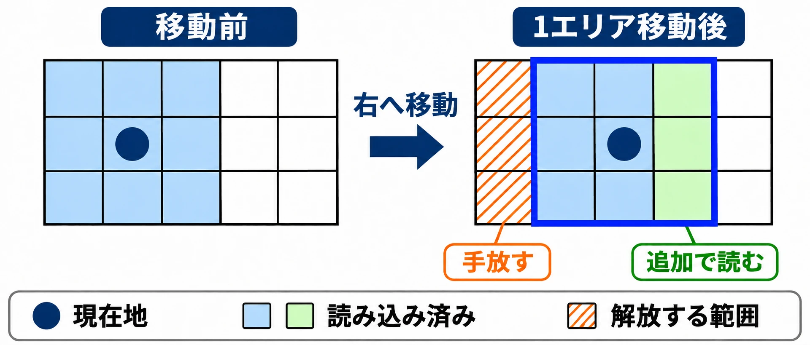

# ゲームにおける「ロード時間の隠蔽」技術史：黎明期から現代リマスターまで

> 2026年11月6日改版：記事全体を全面的に書き直しました。内容の変更はGitの履歴から追えます。

## はじめに：待ち時間を、どんな体験にするか

部屋へ入る前に扉が開く。エレベーターの中で仲間が話す。次の場所へ向かう間に、ゲームの裏側ではデータの準備が進む。

ROMカートリッジからCD-ROMへ移る時代、読み込みの待ち時間はゲーム設計の大きな課題になった。初代『バイオハザード』の開発に参加した神谷英樹氏は、その変化を振り返り、次の部屋を読み込む間、扉が開く様子を約6秒見る必要があったとVGCのインタビューで語っている。[[1](#ref-1)]

CD-ROMから必要なデータを取り出すには、読み取り位置を探し、データを転送する時間がかかる。1999年にエニックスが出願したゲームのデータ処理に関する公開公報でも、CD-ROMのシーク、つまり読み取り位置の探索と、データの読み出しに伴う待ちが課題として挙げられている。[[2](#ref-2)]

そこで必要になるのが、 **技術の制約を、プレイヤーが体験する「移行」としてどう設計するか** という判断である。同じ待ち時間でも、無言で止まるのか、次の部屋への不安を感じるのか、仲間の会話を聞くのかで、その意味は変わる。

本稿では4つの手法と作品の事例をたどり、読み込みが速くなった後に、その移行をどう扱うかまで考える。

***

## ロード隠蔽の4分類

以下は、プレイヤーに何をさせるかと、データをいつ準備するかに注目した本稿の整理である。実際のゲームでは複数の手法が重なる。

| 分類 | 基本の考え方 | 本稿で扱う例 |
|---|---|---|
| **演出型** | 扉の開閉など、場面が変わる演出に待ちを重ねる | 『バイオハザード』、『メトロイドプライム』の扉 |
| **地形型** | 通路や乗り物で移動を区切り、その間に準備する | 『Tony Hawk's American Wasteland』のトンネル、『Mass Effect』のエレベーター |
| **先読み型** | 必要になる前に、周囲のデータを用意する | 『ドラゴンクエストVII』と同時期のエニックスの出願に記された方式 |
| **遊戯型** | 本編を準備する間、別の小さなゲームを遊ばせる | PlayStation版『リッジレーサー』の『ギャラクシアン』 |

演出型と地形型は「待つ間の体験」を作り、先読み型は「待ちが表に出る前の準備」を行う。遊戯型は、待つ時間に別の遊びを与える方法だ。各例の出典と適用範囲は、以下のケースで扱う。

***

## ケーススタディ：制約を移行へ変える

### バイオハザード（1996年）：扉の向こうを待つ

『バイオハザード』では、部屋の移動に扉が開く演出が挟まる。神谷氏は前述のインタビューで、扉が開く間に次の部屋をロードしていたと説明している。扉と読み込みの関係は、開発に参加した人物の証言として捉えられる。[[1](#ref-1)]

扉は、次の部屋をすぐには見せない。取っ手が動き、扉が開き、その先へ進む。この順番を通して、プレイヤーは「次に何がいるか」を考える時間を持つ。ランカスター大学が公開する学術誌『The Luminary』の論考も、扉のイメージが読み込み画面を覆うとともに、緊張を生み出す働きを論じている。[[3](#ref-3)]

初代『バイオハザード2』（1998年）のディレクターでもある神谷氏は、旧作の扉による読み込みの制約と、2019年の『バイオハザード RE:2』を対比している。リメイクではその問題がなくなり、別の部屋からゾンビが入り込むこともできるようになったという。[[1](#ref-1)]

ここから読み取れるのは、移行の仕組みが敵の行動範囲にも関わることだ。部屋を区切る扉は、ホラーの間を作ると同時に、部屋同士をどのようにつなぐかという設計の条件でもあった。

### ドラゴンクエストVII（2000年）と同時期の出願：周囲を先に用意する

『ドラゴンクエストVII エデンの戦士たち』の開発チームには、メインプログラムを担当した山名学氏が名を連ねる。文化庁メディア芸術祭の作品紹介にも、その役割が記載されている。[[4](#ref-4)]

同作の発売前年、1999年8月24日、株式会社エニックスは、山名氏と川本昌之氏を発明者とする「ビデオゲームデータ処理装置、方法および記録媒体」を特許出願した。2001年3月13日に公開された特開2001-062140、出願番号は特願平11-274922である。ここで扱うのは公開公報に記された方式であり、登録特許の取得を示すものではない。また、公報に作品名はなく、同作の実装との対応を断定するものでもない。[[2](#ref-2)]

方式の中心は、 **今いる場所と、その周りのデータをまとめて準備すること** だ。

- **エリアごとに記録する**：フィールドを区分し、各エリアのゲームデータをCD-ROMに記録する。
- **現在地と周辺を読み込む**：管理情報を内部メモリへ、データ部分をバッファメモリへ用意する。
- **移動に合わせて入れ替える**：新しく隣接するエリアを読み込み、隣接しなくなったエリアを消す。[[2](#ref-2)]

バッファメモリは、使うデータを一時的に置く場所である。移動先のデータがそこにあれば、必要になってからディスクへ取りに行く待ちを減らせる。

プランナーの判断に置き換えると、「次に必要になる場所をどこまで絞れるか」が重要になる。道の分岐や移動速度は、先に準備する範囲を考える条件になる。先読み型では、画面に何かを表示して待たせる前に、プレイヤーの移動とデータの準備をかみ合わせるのである。

*特開2001-062140の段落0025〜0026に基づく模式図。現在地を含む周囲3列・3行を用意し、移動に合わせて読み込む範囲を入れ替える。*[[2](#ref-2)]

### リッジレーサー（1994年）とナムコの特許：待つ間にも遊ぶ

PlayStation版『リッジレーサー』では、本編の読み込み中に『ギャラクシアン』を遊べた。GIGAZINEは、この例と、ナムコが保有していたロード中ミニゲームの特許を紹介している。[[5](#ref-5)]

ナムコは1994年12月2日に日本で「ゲームプログラムおよびデータの読込み方法、ならびにこれを用いたゲーム装置」を出願した。対応する米国の特許番号はUS5718632である。小さな補助ゲームを実行しながら、本編のプログラムを読み込む構成が公報に記されている。[[6](#ref-6)][[7](#ref-7)]

AUTOMATONは、日本では2014年12月2日に権利が消滅したと見られると報じた。米国での2015年11月27日の期限については、同媒体が満了予定を伝え、その後GIGAZINEが特許の消滅と、それを機に開催された「Loading Screen Jam」を紹介している。[[6](#ref-6)][[5](#ref-5)]

当時の報道は、特許が他社による同種のミニゲーム採用の制約になっていたと伝えている。ここでは、業界全体への影響を一括して評価するより、待ち時間の活用にも権利上の条件が関わっていたという歴史として押さえたい。

遊戯型の設計では、本編の準備完了と、ミニゲームを終えるタイミングを合わせる必要がある。盛り上がったところで急に打ち切るのか、区切りまで遊べるのか。本編へ戻る瞬間まで含めて移行を作ることになる。

### メトロイドプライム（2002年）：扉を境目にする

『メトロイドプライム』の扉について、GamesRadarのDustin Bailey氏は、ゆっくり開く扉がロード時間を隠していると説明している。これはRetro StudiosのシニアエンジニアだったZoid Kirsch氏の開発秘話を紹介する記事で、扉についての説明は記者の地の文である。[[8](#ref-8)]

この例を演出型として見ると、扉は「向こう側が準備できるまで見せない境目」になる。プレイヤーが見える範囲を区切ることは、次の空間をいつ提示するかを決めることでもある。

### Tony Hawk's American Wasteland（2005年）：トンネルで時間を確保する

『Tony Hawk's American Wasteland』のリードデザイナーだったAlan Flores氏は、GamesRadarの取材に対し、従来型のステージを読み込み用のトンネルでつないだと説明している。トンネルの中でステージの読み込みと解放を隠し、必要な時間を確保するためにスケーターの速度も落としたという。[[9](#ref-9)]

これは地形型の働きが分かりやすい例だ。トンネルの長さと移動速度によって、次の場所へ到着するまでの時間を作る。

設計上は、「ロード画面が出ないこと」と「移動が気持ちよいこと」の両方を見たい。同じ通路を何度も通るなら、長さや速度制限が繰り返しの負担になる。画面を途切れさせずにつなぐ効果と、移動の手触りを合わせて評価する必要がある。

### Mass Effect（2007年）：エレベーターで仲間と過ごす

『Mass Effect』のエレベーターでは、移動中に仲間の会話やニュースが流れた。Game Informerは、シタデルの長い移動と、その途中に挟まる会話を振り返っている。[[10](#ref-10)]

BioWareのCasey Hudson氏はGame Developerのインタビューで、初代ではエレベーターの遅さが不満になり、『Mass Effect 2』（2010年）では、そのとき行っていることに合わせたロード画面へ方針を変えたと説明している。一方、続編ではエレベーターの復活を望む声もあったという。[[11](#ref-11)]

エレベーターは移動を制限する地形型であり、会話を聞かせる演出型でもある。待ちを場面の中に残す方法と、ロード画面で区切る方法では、プレイヤーが感じる連続性が変わる。会話の価値と、繰り返し移動するテンポの両方を考えるケースである。

### ゴッド・オブ・ウォー（2018年）：カメラを切らずにつなぐ

『ゴッド・オブ・ウォー』は、カメラのカットやロード画面で進行を分断しない作りを目指した。撮影監督のDori Arazi氏は、当初は不可能だと思ったが、非常に困難ながら実現できたと語っている。[[12](#ref-12)]

Arazi氏がPlayStation.Blogに寄せた記事でも、Cory Barlog氏のカットを入れないカメラという構想と、それを実現する撮影・制作上の試行が説明されている。[[13](#ref-13)]

ここで注目したいのは、移行を含めた見せ方を作品全体の方針にしたことだ。操作する場面と物語を見せる場面をどうつなぐかは、読み込みの都合と一緒に設計する必要がある。ムービーの方式やゲーム画面とのつながりについては、[プリレンダーとリアルタイムの判断を扱う記事](prerendered-vs-realtime-cutscenes-for-planners.md)も参照してほしい。

***

## コラム：リマスターとSSD時代、何を残すか

### 読み込みが速くなると、移行の条件が変わる

SIEの公式FAQによると、PS5の内蔵SSDの読み取り帯域は、非圧縮データで5.5GB/sである。[[14](#ref-14)]

SIEの技術解説「The Road to PS5」で示された比較では、PS4のHDDは1GBの読み込みに20秒、PS5では2GBを0.27秒で読み込むという。AV Watchもこの説明を報じている。 **比べているデータ量は1GBと2GBで異なる**。これは技術説明上の比較であり、各ゲームのロード画面の長さをそのまま表す数字ではない。[[15](#ref-15)][[16](#ref-16)]

読み込みの待ちが短くなれば、かつて必要だった移行の長さも見直せる。そこで問われるのは、その時間にプレイヤーが何を得ていたかだ。転送時間とデータ量の関係は、[データ量と転送時間の入門記事](planner-network-intro-extra-data-size-and-transfer-time.md)でも扱っている。

### Mass Effect Legendary Edition（2021年）：会話を残し、先へ進める

『Mass Effect Legendary Edition』のエレベーターは、短縮とスキップを組み合わせた。GamesRadarが紹介した比較映像では、初代のPC版で52秒だったシタデルのエレベーター移動が、リマスターでは14秒になっている。これは紹介された場面の比較であり、すべての機種や移動で共通の秒数ではない。[[17](#ref-17)]

Game Informerの取材では、会話やニュースが早く始まるよう調整され、ロードが終わった段階で残りの会話などをスキップするか選べると説明されている。会話を聞く時間と、技術的に必要な待ち時間を切り分けた形だ。[[10](#ref-10)]

一方、InverseのTomas Franzese氏は、リマスター版をXbox Series Xで遊び、『Mass Effect 2』のロード中の映像と音楽が短く切り上げられ、雰囲気の一部が薄れたと評している。これは同氏の体験に基づく評価である。[[18](#ref-18)]

同じシリーズでも、短縮を歓迎する移動と、長さに雰囲気を感じる映像がある。「ロードが短いほどよい」という性能上の目標を、演出の再生時間まで一律に当てはめるかは、別の判断になる。

### ラチェット＆クランク パラレル・トラブル（2021年）：速さを遊びにする

Insomniac Gamesの『ラチェット＆クランク パラレル・トラブル』では、次元の裂け目を通って別の場所へ移る。SIEの公式解説は、PS5のSSDにより、数秒で世界全体を入れ替え、ロード画面を挟まず次元を移動できると説明している。[[19](#ref-19)]

この例は、 **読み込みの速さそのものを遊びの見せ場にする設計** と捉えられる。次の場所を準備するための長い道を歩かせる代わりに、景色が一変する移動を楽しませる。高速な読み込みは、待ちを減らすだけでなく、場所のつなぎ方を変える条件になる。

### リマスター制作で選べる4つの方針

次の表は、ここまでの事例から本稿が整理した設計上の選択肢である。

| 方針 | 何をするか | 判断の手がかり |
|---|---|---|
| **演出保持** | 準備が終わっても、演出を所定の区切りまで見せる | 緊張や場面の余韻に、その長さが必要か |
| **スキップオプション付き保持** | 演出を残し、準備完了後は先へ進める | 初見の会話と、周回時のテンポを両立したいか |
| **撤廃・シームレス化** | 待ちのための区切りを取り除く | 区切りをなくすことで、移動や戦闘がよくなるか |
| **再設計** | 新しい読み込み条件に合わせて移行自体を作り直す | 敵の追跡や空間の接続など、遊びも変えたいか |

残す理由と短くする理由を、演出ごとに言葉にするとよい。「懐かしいから残す」場合も、どの音、間、会話が記憶に結びついているのかまで分ければ、保持する部分を選びやすい。

***

## 現代ゲームデザインへの示唆：移行をデザインする

扉は次の部屋への不安を作り、エレベーターは仲間と過ごす時間を作る。先読みは、プレイヤーが必要とする場所を先回りして用意する。ミニゲームは、本編を待つ時間に別の目的を与える。

これらを企画へ生かすなら、移行の仕様を次の順で考えたい。

1. **いつまでに準備が必要か**：次の部屋が見える瞬間、操作を戻す瞬間など、期限を決める。
2. **その間に何を体験させるか**：移動、会話、緊張、短い遊びのどれが、その場面に合うかを考える。
3. **準備が早く終わったらどうするか**：即座に進む、演出を続ける、スキップを出す、という扱いを決める。
4. **繰り返しても成立するか**：初見だけでなく、往復や周回、失敗後の再挑戦でも確かめる。

目指すのは、 **「ロードを隠す」のではなく「移行をデザインする」** ことだ。技術の制約があるときは、その時間を体験の流れへ組み込む。制約が小さくなったときは、そこで生まれた会話や緊張に、なお意味があるかを見直す。

待ちのためだけに必要だった長さと、体験の一部として必要な長さを分ける。その判断は、古いゲームを作り直すときにも、新しいハードで遊びを考えるときにも役立つ。

## References

英文資料の発言・説明は、内容を要約して日本語で記した。

1. [Andy Robinson「Interview: PlatinumGames on next-gen and its next steps」][1] — VGC、2020年5月21日。神谷英樹氏の回答。初代の扉による読み込みと『バイオハザード2』『RE:2』の比較。

[1]: https://www.videogameschronicle.com/features/interviews/interview-platinumgames-on-next-gen-and-its-next-steps/

2. [株式会社エニックス「ビデオゲームデータ処理装置、方法および記録媒体」特開2001-062140][2] — 公開特許公報、2001年3月13日。Google Patents掲載の公報本文、特に段落0002〜0005、0020、0025〜0026。書誌情報は[J-GLOBAL](https://jglobal.jst.go.jp/detail?JGLOBAL_ID=200903051111461227)にも掲載。

[2]: https://patents.google.com/patent/JP2001062140A/ja

3. [Hannah Boaden「Resident Evil & Doorways: An Exploration of Transitional Spaces in Visual Culture」][3] — The Luminary、第7号、2016年夏、ランカスター大学公開。扉による読み込み画面の隠蔽と緊張に関する箇所。

[3]: https://www.lancaster.ac.uk/luminary/issue%207/Article%201.pdf

4. [文化庁「ドラゴンクエストⅦ～エデンの戦士たち～」][4] — 文化庁メディア芸術祭、第4回デジタルアート（インタラクティブ）部門大賞。開発チームと担当の記載。

[4]: https://www.bunka.go.jp/j-mediaarts-festival/award/single/dragon-quest-vii-warrior-of-edden/index.html

5. [GIGAZINE編集部「ゲームの『最も退屈な時間』であるロード時間にミニゲームをプレイする特許が消滅、海外ではロード画面でプレイできるミニゲームを集めた『Loading Screen Jam』が開催」][5] — GIGAZINE、2015年12月4日。

[5]: https://gigazine.net/news/20151204-loading-screen-jam/

6. [Shuji Ishimoto「ナムコの『ロード画面中にミニゲームが遊べる特許』が国内外で権利消滅の見通し、海外では『ロード画面ゲームジャム』が開催される」][6] — AUTOMATON、2015年11月26日。日本の経過情報と米国の満了予定を報じた記事。

[6]: https://automaton-media.com/articles/newsjp/loading-screen-mini-games-patent-will-be-expired-at-united-states/

7. [Namco「Recording medium, method of loading games program code means, and games machine」US5718632A][7] — 米国特許公報、1998年2月17日。Google Patents掲載。

[7]: https://patents.google.com/patent/US5718632A/en

8. [Dustin Bailey「Metroid Prime devs reveal the game's weirdest secrets」][8] — GamesRadar、2022年11月11日。扉の説明は記者の地の文。

[8]: https://www.gamesradar.com/metroid-prime-devs-reveal-the-games-weirdest-secrets/

9. [Alex Avard「The secret art of the video game loading screen, and why they won’t be going away anytime soon」][9] — GamesRadar、2019年。Alan Flores氏への取材。

[9]: https://www.gamesradar.com/the-secret-art-of-the-video-game-loading-screen-and-why-they-wont-be-going-away-anytime-soon/

10. [Liana Ruppert「Mass Effect Legendary Edition Changes Iconic Elevator Sequences」][10] — Game Informer、2021年2月3日。Mac Walters氏、Kevin Meek氏への取材。

[10]: https://gameinformer.com/2021/02/03/mass-effect-legendary-edition-changes-iconic-elevator-sequences

11. [Kris Graft「Mass Effect 3's Creative Challenges」][11] — Game Developer、2012年3月2日。Casey Hudson氏へのインタビュー、連続した物語とロード画面に関する回答。

[11]: https://www.gamedeveloper.com/design/-i-mass-effect-3-i-s-creative-challenges

12. [Robert Ramsey「No Load Screens, No Camera Cuts in God of War Seemed 'Impossible' Says Dev」][12] — Push Square、2018年3月21日。Dori Arazi氏の発言を紹介。

[12]: https://www.pushsquare.com/news/2018/03/no_load_screens_no_camera_cuts_in_god_of_war_seemed_impossible_says_dev

13. [Dori Arazi「The Art of the Scene: Cinematic Challenges in God of War」][13] — PlayStation.Blog、2018年9月28日。

[13]: https://blog.playstation.com/2018/09/28/the-art-of-the-scene-cinematic-challenges-in-god-of-war/

14. [SIE「PS5: The Ultimate FAQ」][14] — PlayStation.Blog、2020年11月9日。SSDの非圧縮読み取り帯域。

[14]: https://blog.playstation.com/2020/11/09/ps5-the-ultimate-faq/

15. [SIE「Unveiling New Details of PlayStation 5: Hardware Technical Specs」][15] — PlayStation.Blog、2020年3月18日。マーク・サーニー氏の公式技術解説「The Road to PS5」掲載ページ。

[15]: https://blog.playstation.com/2020/03/18/unveiling-new-details-of-playstation-5-hardware-technical-specs/

16. [中林暁「PS5は超高速SSD搭載、CPU性能など技術解説動画が公開」][16] — AV Watch、2020年3月19日。公式解説の1GB・20秒と2GB・0.27秒の比較を報道。

[16]: https://av.watch.impress.co.jp/docs/news/1241852.html

17. [GamesRadar「Mass Effect Legendary Edition includes the option to skip the elevator loading screens」][17] — GamesRadar、2021年2月。Crystal McCord氏による説明と比較映像を紹介。

[17]: https://www.gamesradar.com/mass-effect-legendary-edition-includes-the-option-to-skip-the-elevator-loading-screens/

18. [Tomas Franzese「Mass Effect remaster exposes an unexpected shortcoming of next-gen」][18] — Inverse、2021年5月18日。Xbox Series Xでの体験に基づく批評。

[18]: https://www.inverse.com/gaming/mass-effect-legendary-edition-loading-screens

19. [SIE「How PS5 helped make Ratchet & Clank: Rift Apart possible」][19] — PlayStation公式サイト。SSDと次元移動に関する解説。

[19]: https://www.playstation.com/en-us/editorial/how-ps5-helped-make-ratchet-and-clank-rift-apart-possible/

----

この文書は、Perplexity、Claude、ChatGPT の3つのAIの支援を受けて著述されたものです。引用画像を除き、MIT License にて提供されています。
