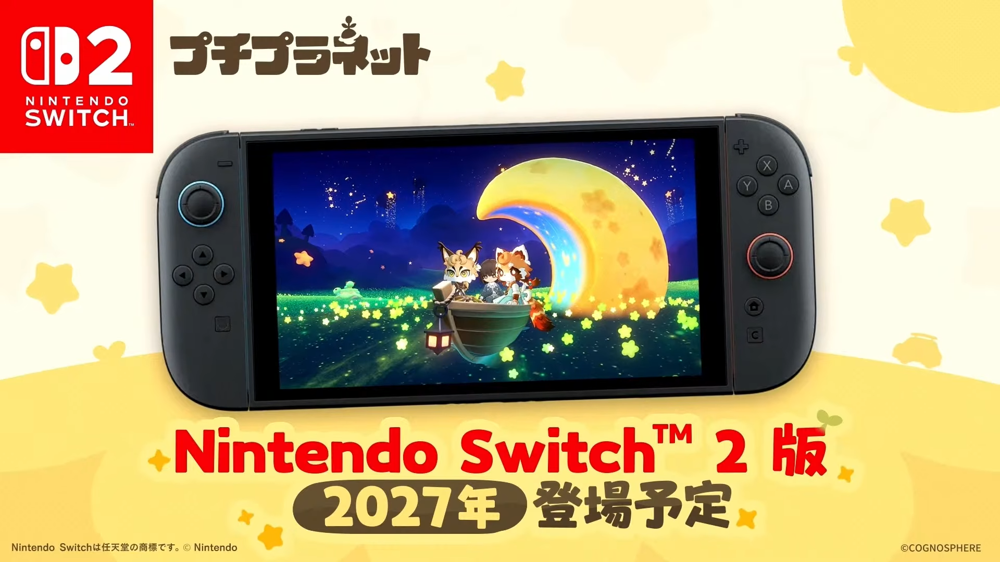

# 自国にない機種へ出す——HoYoverse『プチプラネット』Switch 2版が示すパブリッシング判断

ゲームを届ける機種は、パブリッシャーの本国の事情だけで決まるものではない。海外に需要があり、その機種で遊ぶ人と作品のジャンルが合うなら、本国で公式販売されていない機種も展開先になる。

2026年11月1日に告知された、HoYoverseの新作『プチプラネット』Nintendo Switch 2版は、この判断軸を考える具体例である。中国本土でのSwitch 2の発売発表は、2026年11月2日時点で確認できていない。一方で、中国発のゲーム企業が海外へ作品を届ける入口は広がっている。

***

## 速報：Switch 2版は2027年、PC・スマートフォン版が先行

YouTube「プチプラネット」公式チャンネルで11月1日に配信された「『プチプラネット』リリース予告番組」で、Nintendo Switch 2版が2027年に登場予定と告知された。告知画面には、機種名とともに「2027年 登場予定」と明記されている。[[1](#ref-1)]

PC・iOS・Android版は、2026年12月4日に基本プレイ無料でリリース予定である。Switch 2版はその後の展開となる。HoYoverseの発表文を掲載した電ファミニコゲーマーの記事でも、両者の時期が分けて示されている。[[2](#ref-2)]

出典：[『プチプラネット』リリース予告番組](https://www.youtube.com/live/APPc11eocMM)（YouTube「プチプラネット」公式チャンネル、2026年11月1日）。©COGNOSPHERE

中国側でも報道が続き、通販情報サイト「什么值得买」の11月2日付記事は、米哈游（miHoYo）が任天堂のゲーム機へ作品を出す初めての例と位置づけている。[[3](#ref-3)] この位置づけを踏まえると、今回のニュースは、同社が新しい販売先へ踏み出す発表としても読める。

***

## 中国本土では、オンライン作品を届ける前提が変わった

任天堂は2025年4月のSwitch 2発売発表で、発売予定地域を日本、北米、欧州、豪州、アジア地域とし、中国を除いていた。[[4](#ref-4)] 同月の日本経済新聞の報道を紹介したGame*Sparkによれば、任天堂は中国本土での発売を当面見送り、販売を担うテンセントはSwitch 2についての協議の有無にコメントを控えた。[[5](#ref-5)] その後の中国本土での発売発表は、本稿の確認範囲では見つかっていない。

初代Switchについても、中国版Switchのeショップでの販売は2026年3月31日、オンライン関連サービスは5月15日に終了した。[[6](#ref-6)] 経緯は既刊の[『原神』のクロスプラットフォーム設計を扱った記事](genshin-impact-unified-cross-platform-design.md)に譲る。

『原神』や『プチプラネット』のようにオンラインサービスを前提とする作品にとっては、この終了が市場成立の条件に直結する。中国版Switchのオンラインサービスを利用して、新たな継続運営作品を届ける市場は成り立たなくなった、と整理できる。中国本土における任天堂機向けの事業と、海外の任天堂機向けの事業を分けて考える必要がある。

この隔たりは、Switch 2の発表当初にも論点になっていた。中国のゲーム業界メディアGameLookは2025年4月、初期ラインナップに中国企業のゲームが見当たらないことを取り上げた。中国版Switchの運営調整による先行きの不確かさや、中国企業に開発機材が提供されていなかった可能性を挙げている。これは同メディアの分析であり、機材の供給実態を任天堂が説明したものではない。[[7](#ref-7)]

編者の読みでは、今回の告知は、その時点の状況が変わったことを示す一例である。少なくともHoYoverseは、中国本土での本体発売を待つことなく、Switch 2向けの作品展開を具体的な予定として示したのである。

***

## 海外の需要と、作品を遊ぶ人の一致を見る

### 海外市場だけでも事業を考えられる規模がある

中国音像与数字出版協会のゲーム出版工作委員会が公表した『2025年中国游戏产业报告』について、新華社は、中国の自主開発ゲームの2025年の海外売上が204.55億ドルだったと報じている。年間の海外売上が1,000億元相当を超えるのは6年連続である。[[8](#ref-8)] 中国のゲーム企業にとって、海外は継続的に大きな売上が生まれる市場である。

受け皿となるSwitch 2も、任天堂IRでは2026年6月末時点の世界累計販売台数が2,368万台に達している。これは全世界での連結累計販売数量であり、中国本土での公式販売を含まない市場の規模である。[[9](#ref-9)]

編者の読みとしては、自国の市場で回収することを前提にしなくても、海外のSwitch 2利用者へ届ける事業を検討できる状況にある。ただし、産業全体の海外売上やハードの累計台数から、『プチプラネット』個別の採算まで計算できるわけではない。

### 暮らしをつくる遊びに、既存の需要がある

ESRBの概要によれば、『プチプラネット』は空っぽの惑星を探索し、隣人と交流するシミュレーションゲームである。釣り、虫取り、作物の栽培、景観のカスタマイズなどができる。[[10](#ref-10)] 日々の小さな活動を重ね、自分の暮らす場所を育てる作品だと捉えられる。

任天堂機には、こうした遊びに近い作品の販売実績がある。Switchの『あつまれ どうぶつの森』は、2026年6月末時点で5,029万本を販売した。[[11](#ref-11)] Switch 2でも、ポケモン社が「スローライフ・サンドボックスゲーム」と説明する『ぽこ あ ポケモン』が登場している。[[12](#ref-12)] 同作の任天堂IR上の販売実績は、同時点で368万本である。ただし、この数値は任天堂が発売・販売する海外分のみであり、全世界合計ではない。任天堂のソフト販売実績にはダウンロード版やハードウェア等への同梱分も含まれる。[[13](#ref-13)]

編者は、これらを「暮らしをつくり、住人と交流する遊びに親しむ人へ届く可能性」の根拠として読む。初代Switchでの実績とSwitch 2での実績は区別する必要があり、既存IPの買い切り作品の販売本数が、そのまま基本無料作品の利用者数になるわけでもない。それでも、作品の遊びと機種のプレイヤー層を照らし合わせる材料にはなる。

HoYoverseは、Switch 2を選んだ理由を公式には説明していない。海外の需要とジャンルの相性を重視したという見方は、ここに並べた公開データを根拠とする編者の読みである。

***

## 約4か月前、予兆は公開データにあった

今回の機種展開には、正式告知より早く見つけられる手がかりがあった。北米のレーティング機関ESRBの公開データベースにある『Petit Planet』の登録には、対象機種として「Windows PC, Nintendo Switch 2」と記されている。発行元はCOGNOSPHERE PTE. LTD、年齢区分はE（全年齢）で、内容に関する記述子は付いていない。利用者間の交流を示す「Users Interact」と、ランダムアイテムを含むゲーム内購入を示す「In-Game Purchases (Includes Random Items)」も表示されている。[[10](#ref-10)]

中国のゲームメディア「游民星空」は、2026年6月30日にこのレーティング情報を取り上げ、PCに加えてSwitch 2向けにも展開されると報じていた。[[14](#ref-14)] 11月の公式告知から約4か月前に、機種展開の可能性を公開情報から予想できたのである。

プランナーが競合を調べる際にも、レーティング機関のデータベースは使える。作品名だけでなく、対象機種、発行元、課金や交流に関する表示を記録すれば、競合がどの機種へ準備を進めているかを考える材料になる。

ただし、レーティング登録は発売の約束ではない。『Petit Planet』のページには登録日や審査日も表示されないため、6月30日の報道日を登録日として扱うこともできない。確認した日と表示内容を残し、後から公式発表と照らし合わせる調べ方が適している。

***

## 編者の想定：『原神』Switch 2版はありうるか

ここからは、今回の発表を受けた編者の想定である。まず、その土台となる事実を整理する。

miHoYoは2020年1月14日、『原神』のNintendo Switch版を発表した。発表時点の発売時期は未定であり、同時に公開された公式ティザーページは2026年11月2日時点でも公開されている。[[15](#ref-15)][[16](#ref-16)] この発表の対象は初代Switchであり、Switch 2版ではない。Switch版は同月時点で発売されておらず、実現に至っていない理由を外から一つに決めることはできない。

編者の想定では、『プチプラネット』の開発を通じてSwitch 2の開発機材と開発の知見が社内にそろうなら、別作品を同機種へ展開する検討もしやすくなる。任天堂はSwitch 2について、初代SwitchからCPU・GPUの性能が大きく向上したと説明している。[[4](#ref-4)] 機材や経験の蓄積と性能上の余地を合わせると、『原神』の移植も検討対象になりうる状況へ近づく、という想定は立つ。ただし、開発体制の共有範囲や移植の動作検証結果が公表されたわけではない。

この想定を裏付ける新しい登録は、現時点では見当たらない。2026年11月2日時点で確認したESRBの『原神』の2件の登録は、対象機種がいずれもWindows PCで、Switch・Switch 2の記載はない。[[17](#ref-17)][[18](#ref-18)] 参考までに、『崩壊：スターレイル』にはPCとPS5の登録があり、『ゼンレスゾーンゼロ』にはPC、PS5、Xbox Seriesの登録がある。[[19](#ref-19)][[20](#ref-20)][[21](#ref-21)][[22](#ref-22)]

これらはESRBの登録内容であり、各作品の配信機種を網羅する一覧ではない。『原神』のSwitch 2版が登録されていないことも、将来の移植を否定する証拠にはならない。一方で、『プチプラネット』の発表だけで『原神』にも計画があるとは言えない。

編者が今後の手がかりと考えるのは、ESRBへの『原神』Switch 2版の登録である。それが現れれば、移植に向けた準備の兆しとして読める。

***

## プランナーへの示唆：国籍から、遊ぶ人へ視点を移す

機種選択の判断軸は、その機種で、誰が、どんなジャンルを遊んでいるかにある。自国に公式販売がなくても、海外の需要と作品の相性が見込めるなら、展開先として検討する意味がある。今回の発表は、その判断が具体的な配信予定として表れた例である。

企画段階では、次の三つを合わせて確認したい。

- **需要と作品の相性**：ハードの普及台数に加え、近い遊びを持つ作品の実績を調べる。販売地域や料金モデルの違いも併記する。
- **地域ごとの配信条件**：配信できる地域、必要な審査、レーティングの課金・交流表示を確かめる。
- **オンラインサービスの前提**：アカウント、購入、更新、セーブデータの扱いを機種ごとに整理し、継続して遊べる条件を押さえる。

既刊の[「端末を増やし、体験を分岐させない設計」](genshin-impact-unified-cross-platform-design.md)は、入口を増やした後の体験を扱った。今回の論点は、その一歩手前にある。海外のどのプレイヤーへ、どの機種を入口として作品を届けるのか。その問いから考えると、「自国にない機種へ出す」という判断にも、事業上の筋道が見えてくる。

## References

1. [「プチプラネット」公式チャンネル「『プチプラネット』リリース予告番組」][1] — YouTube、2026年11月1日。引用画像の出典。

[1]: https://www.youtube.com/live/APPc11eocMM

2. [蚊取「HoYoverse新作スローライフゲーム『プチプラネット』Nintendo Switch 2版が2027年にリリースへ！」][2] — 電ファミニコゲーマー、2026年11月1日。HoYoverseの発表文を掲載。

[2]: https://news.denfaminicogamer.jp/news/261101o

3. [什么值得买「米哈游首款主机游戏给了任天堂：星布谷地NS2版，值得等吗？」][3] — 什么值得买、2026年11月2日。任天堂機への初展開に関する同記事の位置づけを参照。

[3]: https://post.smzdm.com/p/a4q42rkx/

4. [任天堂「Nintendo Switch 2 を2025年6月5日に発売」][4] — 任天堂、2025年4月2日。発売予定地域、CPU・GPUの性能向上に関する説明。

[4]: https://www.nintendo.co.jp/corporate/release/2025/250402.html

5. [ずんこ。「『スイッチ2』中国の発売無期限延期、販売会社テンセントもコメント控える。どうなる厳しい政府規制」][5] — Game*Spark、2025年4月11日。日本経済新聞の報道の紹介を参照。

[5]: https://www.gamespark.jp/article/2025/04/11/151362.html

6. [问舟「腾讯国行 Switch 将于 2026 年 3 月 31 日起逐步停止任天堂 e 商店和其他网络相关运营服务」][6] — IT之家、2024年11月26日。テンセントのサービス終了告知を掲載。

[6]: https://www.ithome.com/0/813/359.htm

7. [GameLook「Switch 2首发阵容“中国游戏缺席”，但仍给中国厂商开了任天堂大门！」][7] — 腾讯新闻、2025年4月4日。GameLook公式アカウント掲載。開発機材については同メディアの推測。

[7]: https://news.qq.com/rain/a/20250403A0A82800

8. [邢拓・程思琪「2025年国内游戏市场实际销售收入超3500亿元」][8] — 新華網、2025年12月19日。『2025年中国游戏产业报告』の数値を報道。中国語資料の要約は本稿による。

[8]: https://www.xinhuanet.com/20251219/71b9f7db89c84eee968cddeeeb86baf1/c.html

9. [任天堂「ゲーム専用機販売実績」][9] — 任天堂IR、2026年6月末時点。2026年11月2日確認。

[9]: https://www.nintendo.co.jp/ir/finance/hard_soft/index.html

10. [ESRB「Petit Planet」][10] — ESRB、2026年11月2日確認。登録日・審査日の表示なし。ゲーム概要の要約は本稿による。

[10]: https://www.esrb.org/ratings/41124/petit-planet/

11. [任天堂「主要タイトル販売実績 Nintendo Switchソフト」][11] — 任天堂IR、2026年6月末時点。2026年11月2日確認。

[11]: https://www.nintendo.co.jp/ir/finance/software/switch.html

12. [ポケモン「ポケモンセンターで『ぽこ あ ポケモン』の早期購入特典を手に入れよう！」][12] — ポケットモンスターオフィシャルサイト、2025年11月11日。ジャンルと遊びの説明を参照。

[12]: https://www.pokemon.co.jp/info/2025/11/251111_gm01.html

13. [任天堂「主要タイトル販売実績 Nintendo Switch 2 ソフト」][13] — 任天堂IR、2026年6月末時点。『ぽこ あ ポケモン』は任天堂が発売・販売する海外分のみ。2026年11月2日確認。

[13]: https://www.nintendo.co.jp/ir/finance/software/index.html

14. [超级无敌真新人「重磅爆料！米哈游《星布谷地》要登陆任天堂Switch2」][14] — 游民星空、2026年6月30日。ESRBの公開情報に基づく報道。

[14]: https://www.gamersky.com/news/202606/2164878.shtml

15. [miHoYo「株式会社miHoYoの新作タイトル『原神』、Nintendo Switchでのリリースが決定」][15] — PR TIMES、2020年1月14日。

[15]: https://prtimes.jp/main/html/rd/p/000000015.000048345.html

16. [miHoYo「原神 Nintendo Switch ティザーサイト」][16] — miHoYo、2026年11月2日確認。

[16]: https://genshin.mihoyo.com/switch/#/

17. [ESRB「Genshin Impact」（COGNOSPHERE PTE. LTD）][17] — ESRB、2026年11月2日確認。対象機種はWindows PC。

[17]: https://www.esrb.org/ratings/39201/genshin-impact/

18. [ESRB「Genshin Impact」（miHoYo Limited）][18] — ESRB、2026年11月2日確認。対象機種はWindows PC。

[18]: https://www.esrb.org/ratings/37211/genshin-impact/

19. [ESRB「Honkai: Star Rail」（Windows PC）][19] — ESRB、2026年11月2日確認。

[19]: https://www.esrb.org/ratings/38856/honkai-star-rail/

20. [ESRB「Honkai: Star Rail」（PlayStation 5）][20] — ESRB、2026年11月2日確認。

[20]: https://www.esrb.org/ratings/40180/honkai-star-rail/

21. [ESRB「Zenless Zone Zero」（Windows PC）][21] — ESRB、2026年11月2日確認。

[21]: https://www.esrb.org/ratings/39814/zenless-zone-zero/

22. [ESRB「Zenless Zone Zero」（PlayStation 5, Xbox Series）][22] — ESRB、2026年11月2日確認。

[22]: https://www.esrb.org/ratings/40986/zenless-zone-zero/

----

この文書は、Perplexity、Claude、ChatGPT の3つのAIの支援を受けて著述されたものです。引用画像を除き、MIT License にて提供されています。
