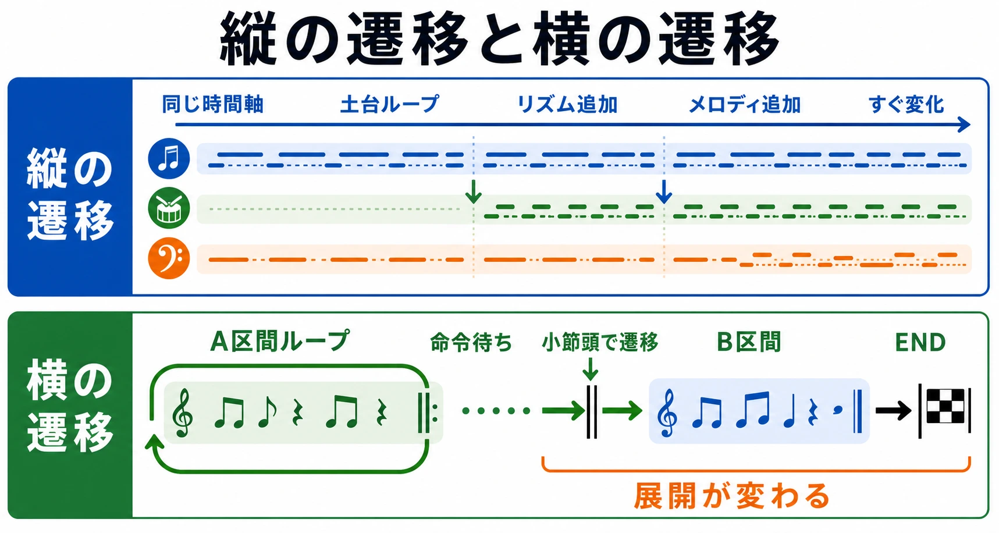

# インタラクティブ／アダプティブミュージック――変化するゲーム音楽の設計と実装

> 2026年11月15日改版：記事全体を全面的に書き直しました。内容の変更はGitの履歴から追えます。

## はじめに：なぜゲーム音楽は変化するのか

映画では、音楽をあらかじめ決まった映像の長さに合わせて作れる。ゲームでは、敵に気づかれる瞬間も、ボスの残り体力が半分になる瞬間も、プレイヤーの行動で前後する。探索開始から一定の時間で曲を盛り上げても、そのときプレイヤーはまだ敵を探しているかもしれない。

そこで、ゲームから「敵に見つかった」「戦闘が終わった」といった情報を受け取り、演奏中の音楽を変える。本稿では、この手法を指して **インタラクティブミュージック** と **アダプティブミュージック** を同じ意味で使う。変化のさせ方は、楽器を加える、曲の次の区間を選ぶ、別の曲へ移るなどさまざまである。[[1](#ref-1)]

短い音楽素材を用意し、ゲームの状態や選択ルールに従ってその場で曲を組み立てる考え方は、 **プロシージャルミュージック** と呼ばれる。後述する『ファンタシースターオンライン2』のように、音楽が状況に応じて変わり、その場で組み立ても行う例がある。

***

## 第1章：2つの基本技術

楽譜を思い浮かべると違いが分かりやすい。縦には同時に鳴る楽器の譜面が並び、横には左から右へ時間が流れる。縦の遷移は今の位置で「どの楽器を鳴らすか」、横の遷移は「次にどの区間を演奏するか」を変える。[[1](#ref-1)]


*図：縦の遷移は同じ時間軸上で楽器の層を足し引きし、横の遷移は曲の区間そのものを切り替える。*

### 縦の遷移（Vertical Remixing）で編成を変える

同じテンポと位置で進む複数のトラック（楽器や音のまとまり）を重ね、状況に応じて各トラックの音量を変える。探索中はピアノだけを聞かせ、敵が近づいたら低音の弦楽器を足す、といった使い方だ。音量はその場で変えられ、二つの編成を入れ替えるなら、一方を徐々に小さくしながらもう一方を大きくするクロスフェードも使える。[[1](#ref-1)]

同じ旋律を保ったまま緊張を高めたい場面に向く。重ねる素材は拍の位置や和音の流れをそろえる必要があり、テンポや曲の展開を大きく変える場面では、区間自体を差し替えるほうが設計しやすい。

### 横の遷移（Horizontal Resequencing）で展開を変える

曲を探索、戦闘、勝利などの区間に分け、ゲームの状態に応じて次に鳴らす区間を選ぶ。探索用の区間をループ（繰り返し再生）して待ち、敵と交戦したら戦闘用の区間へ進む。次の区間で旋律やテンポを変えられるため、ボスの形態変化のような大きな節目を演出しやすい。[[1](#ref-1)]

曲の流れを保つため、小節（拍をいくつかまとめた区切り）の境目やフレーズの終わりまで待つことがある。BPMは1分間の拍数を表す。4拍子で四分音符が毎分120拍（♩=120）なら、8小節は約16秒だ。8小節の終わりでしか出られない区間では、入った直後に遷移の指示が来ると、ほぼ16秒待つことになる。[[1](#ref-1)]

**プリエンド** は、本格的な展開や締めくくりの手前で待機し、次の区間へつなぐための部分である。ここを1小節ごとに抜けられるようにすれば、同じテンポで待ち時間は約2秒まで縮まる。一方、どの小節から出ても自然につながるように作ると、和音やリズムの変化をつけにくくなり、単調に聞こえやすい。[[1](#ref-1)]

| 比較項目 | 縦の遷移 | 横の遷移 |
|---|---|---|
| 変化できる要素 | 楽器の編成、伴奏、リズムの重なり | 旋律、伴奏、曲の展開 |
| テンポ・拍子 | 重ねる素材で共有する | 区間ごとに変えられる |
| 遷移の待ち時間 | 音量を即時に変えられる。拍に合わせる設計も可能 | 拍や小節など、設定した切り替え地点まで待つことがある |
| 得意な場面 | 緊張の高まりなど、元の曲を保ったままの変化 | 戦闘開始や形態変化など、大きな節目 |
| 作曲上の負担 | 重ね方ごとの聴こえ方を確認する | 区間をまたぐ全ての接続を確認する |

『BLUE PROTOCOL』では、敵の強さに応じて二つの手法を使い分けた。強い敵ではフィールド曲から緊張感のある戦闘曲へ全面的に切り替える。弱い敵ではリズム、ピアノ、低音の弦楽器だけを変え、旋律と金管楽器は残す。同じフィールド曲を起点に、強敵との遭遇には横の遷移を、弱い敵との戦闘には縦の遷移を使った例である。フィールドでは、伴奏6種類、旋律8種類、ピアノのフレーズ4種類をランダムに組み合わせ、講演資料の説明ではおよそ150通り以上、時間にして約70分ぶんの変化を用意した。[[1](#ref-1)]

***

## 第2章：歴史的な実例——黎明期から現代へ

### 2-1. iMUSE（LucasArts、1991年〜）

Michael Land氏とPeter McConnell氏が開発したiMUSEは、『Monkey Island 2: LeChuck's Revenge』（1991年）で初めて使われた。米国特許第5,315,057号は、1991年11月25日に出願され、1994年5月24日に登録された。権利者はLucasArts Entertainment Companyである。特許では、曲中に演奏を分岐できる地点（decision point）を設け、予測できないゲーム内の出来事に応じて演奏の続きを選ぶ仕組みが説明されている。[[2](#ref-2)][[3](#ref-3)]

特許の実施例では、演奏指示を伝えるデータ規格であるMIDIを使い、再生中に演奏を制御する。LucasArtsのJesse Harlin氏によると、『Monkey Island 2』でもMIDIの素材を重ね、場面に応じて拍をそろえながらトラックを滑らかに切り替えていた。[[2](#ref-2)][[3](#ref-3)]

### 2-2. スーパーマリオワールド（1990年）

近藤浩治氏はGDC 2007で、ヨッシーに乗ると打楽器のトラックが加わり、降りると消える例を紹介した。旋律を保ったまま編成を変える縦の遷移である。近藤氏は、パワーアップを曲の変更で示す方法もあるが、それでは乗り降りのたびに曲の切り替えが頻繁に起きてしまうため、旋律を変えないこの手法を選んだと説明している。[[4](#ref-4)][[5](#ref-5)]

### 2-3. ゼルダの伝説 時のオカリナ（1998年）

近藤氏は「社長が訊く」で、ダンジョンからフィールドへ戻るたびに同じ曲が頭から流れるのを避けたかったと振り返っている。そこで戦闘用を含む約20個の8小節の部品を作り、フィールドではランダムに鳴らした。各部品の終わりを、どの部品にもつながるコード（和音）にしてある。敵に近づくと、その流れの中で戦闘の曲へ滑らかに移る。[[6](#ref-6)]

### 2-4. ゼルダの伝説 ブレス オブ ザ ワイルドからティアーズ オブ ザ キングダムへ

『ゼルダの伝説 ブレス オブ ザ ワイルド』（2017年）のフィールドでは、環境音が常に聞こえる構成とし、繰り返し流れる曲の代わりにピアノの短いフレーズをランダムに鳴らして変化をつけた。戦闘に入ると環境音から戦闘曲へ移り、終われば環境音へ戻る。複数の条件が重なったときに何を鳴らすかは、優先度で決める。[[7](#ref-7)]

フィールドの環境音の設計は、[ゲームにおける環境音と3Dオーディオ](game-ambient-sound-and-3d-audio-planner-guide.md) で扱っている。

『ゼルダの伝説 ティアーズ オブ ザ キングダム』（2023年）は、前作の滑らかな戦闘曲への移行を踏まえ、戦闘中も進行に応じて音楽を切り替え続ける。謎解きでプレイヤーが苦労しているときは、音楽の音量を下げる。楽団員の演奏はBGMやキャラクターの動きと同期し、楽器の音は効果音と同じように3D空間に置かれる。制作には、処理を表す箱（ノード）を線でつなぎ、楽器の遷移を編集する専用ツールを使った。固定の曲を含め、全曲がそのツールで作られている。[[8](#ref-8)][[9](#ref-9)]

サウンドの話は36分付近から始まる。

<div style="aspect-ratio: 16 / 9; width: 100%; margin: 1.5rem 0;">
  <iframe
    src="https://www.youtube.com/embed/N-dPDsLTrTE"
    title="Tunes of the Kingdom: Evolving Physics and Sounds for 'The Legend of Zelda: Tears of the Kingdom'"
    style="width: 100%; height: 100%; border: 0;"
    allow="accelerometer; autoplay; clipboard-write; encrypted-media; gyroscope; picture-in-picture; web-share"
    allowfullscreen>
  </iframe>
</div>

*Tunes of the Kingdom: Evolving Physics and Sounds for 'The Legend of Zelda: Tears of the Kingdom'（GDC公式チャンネル、GDC 2024の講演。英語）*

### 2-5. エースコンバット7 スカイズ・アンノウン（2019年）

開発にはUnreal Engine 4.18と音の再生や変化を制御するサウンドミドルウェアのWwise 2017.1.4を使用した。常駐サウンドメモリ（サウンド用に確保しておくメモリ）は155 MB、日英の音声は約20,000、BGMは合計5時間を超える。[[10](#ref-10)]

戦闘時間がプレイヤーによって変わるため、曲の途中にループする「踊り場」を設け、演出の条件がそろうまで待つ。ミッション19「灯台」では、軌道エレベーターのバリアを突破する場面に曲の盛り上がりを合わせた。「Daredevil」は遷移に使うパーツを分けて録音し、追加コンテンツ（DLC）のミッション曲では約100パーツに分け、8分音符単位まで細かく切った。カットシーンへの切り替えには8分音符単位のプリエンドを使った。2023年の講演資料では、遅延を0.15秒以下に抑えたと説明し、まとめのスライドでは0.2秒以下と示している。[[10](#ref-10)][[11](#ref-11)][[1](#ref-1)]

自機が雲に入ると、BGMの高音域を弱めるローパスフィルターがかかり、音がこもる。ミッション終盤の追撃では、撃墜のタイミングが前後しても曲の終結部（アウトロ）へ移るよう、DLCのミッション曲を設計した。音色の変化で雲に入った感覚を伝える一方、曲の展開の変化でプレイヤーが決めた撃墜の瞬間を受け止める設計である。[[10](#ref-10)][[11](#ref-11)]

### 2-6. ポケットモンスター スカーレット・バイオレット（2022年）

フィールド曲はToby Fox氏が基礎を作り、それをもとにゲームフリークがさまざまなアレンジを作曲した。一つの曲をもとに、複数の聴こえ方を用意した例である。[[12](#ref-12)]

### 2-7. ファンタシースターオンライン2 SYMPATHY（2012年〜）

セガのSYMPATHYは、数秒ほどの短い音楽素材「クリップ」を大量に用意し、その場でBGMを組み立てる仕組みである。「ヒーロー度」「ピンチ度」「盛り上がり度」の3つのパラメータ（選択を左右する値）を使って、どのクリップを鳴らすかを決める。曲の入れ替えを一度だけ行う設計に比べ、短い部品の選択を繰り返すことで、その時々の戦況を音楽の流れに反映できる。[[13](#ref-13)][[14](#ref-14)]

### 2-8. ファイナルファンタジーXV MAGI（2016年）

MAGIはMusic API for Gaming Interactionの略で、スクウェア・エニックスのオーディオプログラマー、岩本翔氏が開発した。ループ内の自然につなげられる地点をあらかじめ指定し、ゲーム側の条件を満たしたら、利用できる最も近い地点で次の曲や区間につなぐ。[[15](#ref-15)]

チョコボに乗って歩きから走りに移ると曲調が変わる。歩きから走りへは短く、走りから歩きへは長めに移行する設計だ。ボス戦ではメインテーマ、プリエンドテーマ、エンドテーマの3段階を使い、プリエンドからエンドへはシーンとの整合を優先する。多くの曲はインタラクティブにする前提で作られていなかったため、MAGIは曲中のテンポや拍子の変化を扱え、曲に合わせて独自の同期点（切り替えの目印）も挿入できるようになっていた。[[15](#ref-15)][[16](#ref-16)]

<div style="aspect-ratio: 16 / 9; width: 100%; margin: 1.5rem 0;">
  <iframe
    src="https://www.youtube.com/embed/jtoyunrO62I"
    title="Epic and Interactive Music in Final Fantasy XV"
    style="width: 100%; height: 100%; border: 0;"
    allow="accelerometer; autoplay; clipboard-write; encrypted-media; gyroscope; picture-in-picture; web-share"
    allowfullscreen>
  </iframe>
</div>

*Epic and Interactive Music in Final Fantasy XV（GDC公式チャンネル、GDC 2017の講演。英語）*

***

## 第3章：ゲームプランナーとサウンドディレクターの連携

ゲーム側は「何が起きたか」を把握し、サウンド側は「今どこへつなげると自然か」を判断する。たとえば「ボスの姿が変わるときに曲を盛り上げたい」という要望は、姿が変わる条件と、映像のどの瞬間に何が鳴るべきかを決めると、作曲と実装の相談に使える。

### 3-1. 役割の整理

サウンドに関わる職種の名前や分担はチームで異なる。以下は、インタラクティブミュージックに必要な仕事を3つの役割に分けた例である。[[17](#ref-17)][[18](#ref-18)]

| 役割 | 主な担当 |
|---|---|
| コンポーザー（作曲家） | 曲と楽器別の素材を作り、組み合わせや区間の接続が音楽として成立するようにする |
| サウンドデザイナー（実装担当） | 再生条件と遷移のタイミングを設定し、ゲーム上で聴こえ方を調整する |
| サウンドプログラマー | ゲーム側の変数と音の制御をつなぎ、同時再生数やメモリなど実行時の制約を扱う |

プランナーは、どんなゲームの状態があり、どの変数で表すかを定義する。「強敵と遭遇した」なら、敵のレベル差で決めるのか、敵にあらかじめ付けた分類で決めるのかまで共有する。サウンドディレクターとは、その状態をプレイヤーにどう感じてほしいかをすり合わせる。

### 3-2. 仕様書に盛り込むべき項目

以下のコードブロックはいずれも本稿の提案である。

**① BGMリスト（状態×曲の対応表）**

曲名とゲーム状態を対応づけ、同じ曲でも編成が変わるなら、その違いが分かるように記す。

```
[例：RPGのフィールド状態]
状態A：探索中 → 探索曲
状態B：敵接近 → 探索曲に警戒用の低音を追加
状態C：通常戦闘 → 通常戦闘曲
状態D：強敵と戦闘 → 強敵戦闘曲
状態E：勝利 → 勝利の短い曲を経て探索曲へ
状態F：逃走 → 探索曲へ戻る
```

曲ごとの発注資料（劇伴キュー表）の作り方は、[劇伴制作の進行管理実務](game-music-commissioning-and-production-management-for-planners.md) で扱っている。

**② トリガー定義**

トリガーは、遷移を始めるきっかけである。変数名、取りうる値、値が変わる条件を記す。勝利と逃走で扱いが違う場合は、終了の理由もサウンド側へ渡す。

```
[例：戦闘状態の変化]
変数：CombatState（列挙型。NONE／ALERT／BATTLE）
NONE → ALERT：敵の視野範囲に入った
ALERT → NONE：攻撃される前に敵の視野範囲から出た
ALERT → BATTLE：敵が攻撃を開始した
BATTLE → NONE：最後の敵を倒した、または逃走が成立した
終了イベントの値：VICTORY／ESCAPE
強敵条件：交戦中の敵にプレイヤーよりレベルが5以上高い敵がいる
```

状態とその戻り先の決め方は、[「いま何ができるか」を仕様にする](game-state-transitions-for-planners.md) で扱っている。

**③ 遷移仕様**

遷移元と遷移先を示し、どの地点で切り替えるか、間にプリエンドを挟むかまで決める。

```
[例：探索から警戒、強敵戦から勝利への遷移]
A → B：次の小節頭で警戒用の低音を加える
D → E：強敵戦闘曲の終盤でプリエンドをループし、勝利後、次の小節頭で勝利曲へ移る
E → A：勝利曲の終わりから探索曲へ戻る
```

**④ 許容遅延**

「条件が成立してから音楽の変化が聞こえるまで、最大何秒か」を決める。第1章の例では、8小節ごとなら約16秒、1小節ごとなら約2秒の待ち時間が生じうる。一方、『エースコンバット7』のカットシーンの例は0.15〜0.2秒程度に収めている。戦闘開始を知らせる場面と、探索曲を自然に収める場面では、許容できる時間が違う。[[1](#ref-1)]

**⑤ 演出優先度・上書きルール**

戦闘中にイベントが始まるなど、複数の条件が同時に成立したときに何を鳴らすか、優先された演出が終わったらどこへ戻るかを決める。『ブレス オブ ザ ワイルド』では、戦闘が始まるとフィールドの環境音が戦闘曲に譲る。講演では音量にも段階があり、環境音が最も小さく、神獣戦やボス戦の音楽が最も大きいと説明された。どの音を鳴らすかと、どのくらいの音量で聞かせるかは、それぞれ仕様にできる。[[7](#ref-7)]

### 3-3. 早期連携が生み出す価値——エースコンバット7の教訓

『エースコンバット7』では、Wwiseの導入により、従来はプログラマーに依頼していた発音箇所の指定や調整をサウンド側で直接仕込めるようになった。作れる演出の幅が広がった一方で、仕事量も大きく増えたと渡辺量氏は振り返っている。[[10](#ref-10)][[11](#ref-11)]

渡辺量氏によれば、チームはサウンドの仕様をバーティカルスライス（ゲームの一部を完成品に近い品質まで作った試作）で検証し、量産をスムーズに進めた。試作では、同じ場面を異なる速さで進めても、狙った瞬間に音楽が変化するかを確かめられる。[[10](#ref-10)]

企画段階で「曲と映像の山場を同時に迎えたい場面」を挙げておけば、サウンド側は、どこに待機区間を作り、どのくらい細かく分けて録る必要があるかを作曲や収録の前に検討できる。

### 3-4. コスト意識と費用対効果の判断

バンダイナムコスタジオが作曲経験者14人に尋ねたところ、フィールド曲と戦闘曲を行き来する想定では、フィールド曲だけを作る場合と比べて作曲工数の見積もりが平均約1.61倍だった。A→B→プリエンド→エンドと進むボス曲では、インタラクティブにしない場合の平均約1.47倍だった。収録、実装、デバッグにも手間がかかる。[[1](#ref-1)]

自然につながるほど変化は意識されにくく、どこまで効果が出たかも分かりにくい。遷移しやすさを優先すると、曲の展開も単調になりやすい。それでも回答者の半数は積極的に担当したいと答えた。自由回答では、音楽の魅力とインタラクティブ性を両立することや、可能な限り単純な設計を選ぶことが挙げられた。[[1](#ref-1)]

プランナーが要求を出す前に考えるのは二つだ。その遷移はプレイヤーの体験に必要か。単純な曲の切り替えで同じ体験を届けられるか。たとえばボスの姿が変わったことを告げるだけなら、一度の切り替えでも役目を果たせる。プレイヤーが仕掛けた一撃に曲の頂点を合わせるなら、曲の中に待てる場所を作る理由がある。

### 3-5. 実用的なコミュニケーションの型

以下の「サウンド演出申請票」は本稿の提案である。演出意図と時間の条件を先に共有できれば、仮案で示した手法も、サウンド担当と相談して変えられる。

```
【インタラクティブBGM演出申請】

担当プランナー：
シーン名／ID：

■ 演出したいこと（プレイヤー体験）
例：ボスが第二形態に変わる瞬間、その場の緊張を高めたい。

■ トリガー変数と条件
例：Boss.Phase が 1 から 2 に変わり、変身演出が始まった。

■ 変化のタイプ（仮案）
縦の遷移／横の遷移／その他（音色の変化など）

■ 許容遷移遅延（最大）
例：変身演出の開始から0.5秒以内に変化が聞こえる。

■ 優先度（他の演出との上書き関係）
例：変身演出の曲を通常戦闘曲より優先する。

■ 特記事項
例：変身演出をスキップした場合は第二形態の戦闘曲から再開する。
```

***

## 第4章：実装ツールと技術的背景

### サウンドミドルウェアの役割

サウンドミドルウェアは、ゲームエンジンから受け取った状態や値を、再生や音量の変化へ結びつける道具である。サウンド担当は編集画面で素材を配置し、何をどのタイミングで鳴らすかを設定する。代表的なツールには次のような機能がある。

| ツール | 特徴 |
|---|---|
| Wwise（Audiokinetic） | 音楽の区間を作り、トラック上にクリップを並べる。ゲームの状態で区間を切り替え、ゲーム側の値をトラックの音量などに結びつける。実行中のゲームに接続して再生を確認し、設定を調整できる。『エースコンバット7』でも採用された。[[19](#ref-19)][[20](#ref-20)][[10](#ref-10)] |
| FMOD Studio（Firelight Technologies） | タイムラインに音楽素材を並べ、ゲームのパラメータに応じた再生や、タイムライン上の区間の移動を設定できる。[[21](#ref-21)] |
| CRI ADX（CRI・ミドルウェア） | AISACで、ゲーム側のパラメータに応じて音量や音色を連続的に変える。ブロック再生では、曲を区間に分け、次の区間をゲーム内の出来事やランダムで選ぶ。遷移は区間の終わり、小節や拍などの区切り、即時から設定できる。[[22](#ref-22)][[23](#ref-23)] |

### ゲーム空間で鳴る音楽と、演出として重なる音楽

ダイエジェティックとは、ラジオや楽器のようにゲーム世界の中に音源がある音を指す。ノンダイエジェティックとは、通常の戦闘曲のように、世界の外からプレイヤーに届く演出音を指す。

『エースコンバット7』のVRモードでは、当初はBGMを鳴らさない方針だったが、最終的には演出に楽曲を導入した。エアショーモードの音楽は、空母甲板のスピーカーから流れる音として扱われる。『ティアーズ オブ ザ キングダム』の楽団は、BGMや楽団員の動きと同期しつつ、個々の楽器の音をゲームの3D空間に置く。曲がどう進むかに加えて、プレイヤーがどこからその音を聞くかも設計されている。[[10](#ref-10)][[11](#ref-11)][[8](#ref-8)][[9](#ref-9)]

***

## 第5章：今後の展望——AIと生成音楽

北谷光浩氏は、作曲者の音楽をAIに学習させ、アレンジやプリエンドを自動で作れれば、制作コストを抑えながら音楽の魅力も保てる可能性があると述べている。CEDECのゲーム開発技術ロードマップのサウンド分野（2023年度版）も、当時の最新動向に「インタラクティブミュージックの定着と手法の細分化」、数年後の動向に「ゲームと連動したジェネレーティブな楽曲演出」を挙げた。つなぎを自動で作れるようになったとき、どの場面でプレイヤーのどんな感情を後押しするかは、誰が決めるのだろうか。[[1](#ref-1)][[24](#ref-24)]

***

## まとめ：プランナーが持つべき視座

『スーパーマリオワールド』がヨッシーに乗ると打楽器を加えたように、『ゼルダの伝説 ティアーズ オブ ザ キングダム』もプレイ中の出来事を音楽に映し、戦闘の進み方に合わせて曲を変え続ける。プランナーは、プレイヤーがいる状態を言葉と変数で示し、そこで音楽が果たす役割と、変化が届くべきタイミングをサウンド担当と共有する。

> **「この音楽は、今プレイヤーが感じていることを増幅しているか？」**

## References

<a id="ref-1"></a>1. [北谷光浩「聴いて分かる！インタラクティブミュージック作曲の舞台裏！！」][1] — バンダイナムコスタジオ／Speaker Deck、2023年12月14日公開。CEDEC 2023講演資料。

[1]: https://speakerdeck.com/bandainamcostudios/behind-the-scenes-of-interactive-music-and-composition

<a id="ref-2"></a>2. [Michael Z. Land、Peter N. McConnell「Method and apparatus for dynamically composing music and sound effects using a computer entertainment system」][2] — 米国特許第5,315,057号、1994年5月24日登録。

[2]: https://patents.google.com/patent/US5315057

<a id="ref-3"></a>3. [Game Audio Network Guild「Interview with LucasArts' Jesse Harlin」][3] — Game Audio Network Guild、2010年9月20日。

[3]: https://www.audiogang.org/interview-with-lucasarts-jesse-harlin/

<a id="ref-4"></a>4. [Vincent Diamante「GDC: Koji Kondo’s Interactive Musical Landscapes」][4] — Game Developer、2007年3月8日。

[4]: https://www.gamedeveloper.com/game-platforms/gdc-koji-kondo-s-interactive-musical-landscapes

<a id="ref-5"></a>5. [GAME Watch「任天堂の近藤浩治氏、『マリオ』、『ゼルダ』のサウンドを語る」][5] — GAME Watch、2007年3月8日。GDC 2007の講演報告。

[5]: https://game.watch.impress.co.jp/docs/20070308/kondo.htm

<a id="ref-6"></a>6. [任天堂「社長が訊く『ゼルダの伝説 時のオカリナ 3D』サウンド篇」][6] — 任天堂、2011年。近藤浩治氏のフィールド曲に関する発言。

[6]: https://www.nintendo.co.jp/3ds/interview/aqej/vol1/index2.html

<a id="ref-7"></a>7. [GAME Watch編集部「【CEDEC2017】『ゼルダの伝説』で、自由度の高い『オープンエアー』の表現を支えるサウンド」][7] — GAME Watch、2017年9月2日。

[7]: https://game.watch.impress.co.jp/docs/news/1078827.html

<a id="ref-8"></a>8. [堅田ヒカル「『ゼルダの伝説 ティアキン』サウンドが『勝手に鳴る』仕組みを作った。自由で広大なハイラルを彩る音の世界【GDC 2024】」][8] — ファミ通.com、2024年3月22日。

[8]: https://www.famitsu.com/news/202403/22337814.html

<a id="ref-9"></a>9. [Bryant Francis「Did you know Tears of the Kingdom has 'a physics engine for sound'?」][9] — Game Developer、2024年4月4日。

[9]: https://www.gamedeveloper.com/audio/tears-of-the-kingdom-s-sound-designers-unintentionally-made-a-physics-engine-for-sound-

<a id="ref-10"></a>10. [GameBusiness.jp編集部「『エースコンバット7』本編/VRのサウンド開発を語るCEDECセッションレポート【CEDEC 2019】」][10] — GameBusiness.jp、2019年11月12日。

[10]: https://www.gamebusiness.jp/article/2019/11/12/16435.html

<a id="ref-11"></a>11. [バンダイナムコエンターテインメント「『CEDEC AWARDS 2019』サウンド部門 最優秀賞受賞」][11] — 『エースコンバット7 スカイズ・アンノウン』公式サイト、2019年。開発陣の座談会。

[11]: https://ace7.acecombat.jp/clm/column05.php

<a id="ref-12"></a>12. [Game*Spark編集部「『UNDERTALE』のToby Foxが『ポケモン スカーレット・バイオレット』でも楽曲提供！今回はフィールド曲を担当」][12] — Game*Spark、2022年6月2日。

[12]: https://www.gamespark.jp/article/2022/06/02/119029.html

<a id="ref-13"></a>13. [4Gamer編集部「［CEDEC 2012］PSO2の「途切れないBGM」はこうやってできている。セガが語る「BGMのプロシージャル生成」」][13] — 4Gamer、2012年8月20日。

[13]: https://www.4gamer.net/games/120/G012075/20120820076/

<a id="ref-14"></a>14. [ファミ通.com編集部「『PSO2』の特徴的なサウンド表現が実例で説明されたセッションの模様をリポート【CEDEC 2015】」][14] — ファミ通.com、2015年9月9日。

[14]: https://www.famitsu.com/news/201509/09088051.html

<a id="ref-15"></a>15. [中村聖司「『FFXV』サウンドのコアテクノロジー『MAGI』の全貌が公開」][15] — GAME Watch、2017年3月4日。

[15]: https://game.watch.impress.co.jp/docs/news/1047790.html

<a id="ref-16"></a>16. [Winifred Phillips「Video game music systems at GDC 2017: tools and tips for composers」][16] — Game Developer、2017年8月16日。

[16]: https://www.gamedeveloper.com/audio/video-game-music-systems-at-gdc-2017-tools-and-tips-for-composers

<a id="ref-17"></a>17. [塚越「ゲームサウンドクリエーターの役割」][17] — SEGA TECH Blog、2018年6月25日。

[17]: https://techblog.sega.jp/entry/2018/06/25/100000

<a id="ref-18"></a>18. [コロプラ「ゲームの世界を音でかたちに！『サウンドクリエイターのお仕事』」][18] — ピンと！、公開日記載なし。

[18]: https://pinmark.colopl.co.jp/entries/16908195

<a id="ref-19"></a>19. [Audiokinetic「The Wwise Project Adventure」][19] — Audiokinetic、Wwise 2014.1.1版。「Adventures in Music」を参照。

[19]: https://www.audiokinetic.com/download/documents/WwiseProjectAdventure_en.pdf

<a id="ref-20"></a>20. [Audiokinetic「Wwise User’s Guide 2015.1.9」][20] — Audiokinetic、Wwise 2015.1.9版。ゲームへの接続とリアルタイム編集の説明を参照。

[20]: https://www.audiokinetic.com/files/?get=2015.1.9_5624%2FWwise_UserGuide_en.pdf

<a id="ref-21"></a>21. [Firelight Technologies「FMOD Studio」][21] — FMOD公式サイト、公開日記載なし。

[21]: https://www.fmod.com/studio

<a id="ref-22"></a>22. [CRI・ミドルウェア「ADX Beginner’s Guide #12 – Interactive Music with AISAC and Selectors」][22] — CRI Middleware Blog、2024年7月8日。

[22]: https://blog.criware.com/index.php/2024/07/08/adx-beginners-guide-12-interactive-music-with-aisac-and-selectors/

<a id="ref-23"></a>23. [CRI・ミドルウェア「ADX Beginner’s Guide #13 – Interactive Music with Block Playback」][23] — CRI Middleware Blog、2024年8月3日。

[23]: https://blog.criware.com/index.php/2024/08/03/adx-beginners-guide-13-interactive-music-with-block-playback/

<a id="ref-24"></a>24. [コンピュータエンターテインメント協会「CEDEC ゲーム開発技術ロードマップ（サウンド分野）2023年度版」][24] — CEDEC、2023年度版。

[24]: https://cedec.cesa.or.jp/2024/uploads/assets/file/2023_roadmap_SND.pdf

----

この文書は、Perplexity、Claude、ChatGPT の3つのAIの支援を受けて著述されたものです。引用画像を除き、MIT License にて提供されています。
