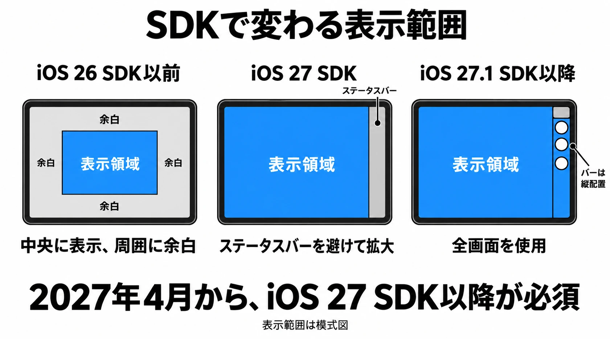
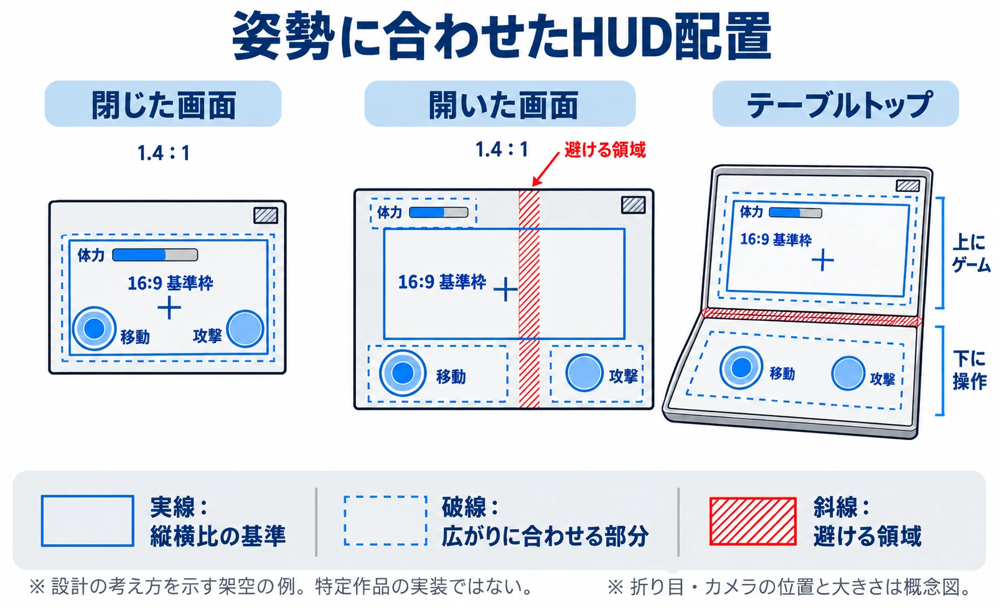

# その画面は、開いても閉じても同じ遊びになるか――iPhone Duoから考える、折りたたみ端末のゲーム画面設計

移動ボタンを押したまま端末を開く。その瞬間、ゲーム画面が広がり、ボタンの位置も変わる。キャラクターは走り続けるのか。指を離した扱いになるのか。こうした切り替わりを決めることも、折りたたみ端末の画面設計に含まれる。

2026年10月23日、Apple初の折りたたみスマートフォン「iPhone Duo」が発売された。内側は7.6インチ、外側は5.4インチで、価格は36万4,800円からである。[[1](#ref-1)] 内外のアスペクト比、つまり画面の縦横の比率は、どちらも1.4:1だ。[[2](#ref-2)]

内外で比率がそろっていても、文字の読みやすさ、指の届く範囲、途中まで折ったときに使える領域まで同じになるわけではない。プランナーが最初に置きたい判断軸は、 **「その画面は、開いても閉じても同じ遊びになるか」** である。

本稿では、Appleが示す表示の原則と提出要件を整理したうえで、ゲームの仕様に何を書くかを考える。以下のゲーム向けの設計案は、本稿の提案である。

***

## 2027年4月に重なる、二つの提出要件

2027年4月から、App Storeへ提出するアプリとゲームには、iPhone Duo用のスクリーンショットが必要になる。Appleは、Duo用のスクリーンショットを提出すると、プロダクトページに最適化を示すバッジが表示されると案内している。[[3](#ref-3)]

同じ月から、App Store ConnectへアップロードするiOS・iPadOSアプリには、iOS & iPadOS 27 SDK以降でのビルドが求められる。SDKは、アプリを作るための開発用の道具やライブラリをまとめたものだ。なお、この提出要件では、対応OSの下限をiOS 15以降とすることも示されている。 **開発に使うSDKの世代と、ユーザーに必要なOSの下限は別の条件** である。[[4](#ref-4)]

SDKの更新は、Duoで使える表示範囲にも影響する。Appleの説明は次の三段階だ。[[5](#ref-5)]

| ビルドに使うSDK | 開いた内側画面での表示 |
| --- | --- |
| iOS 26 SDK以前 | 中央に表示され、周囲に余白が残る |
| iOS 27 SDK | ステータスバーの領域を避け、画面の大部分に広がる |
| iOS 27.1 SDK以降 | 全画面を使い、ツールバーやタブバーはステータスバーの下で縦に並ぶ |

ここでいうバーの縦配置は、Appleが説明するアプリの表示である。ゲーム独自の攻撃ボタンや体力表示まで、自動的に適切な位置へ並び替わるという意味ではない。

Appleの表示例に基づく模式図。表示領域の面積や実機の寸法を示すものではない。[[5](#ref-5)] 提出要件は2027年4月から適用される。[[4](#ref-4)]

二つの要件が重なり、最適化が事実上避けられなくなる。最低限のSDK更新でもアプリの表示領域が広がり、その端末での画面をストアにも載せることになるからだ。「最適化表示そのものの義務化」と区別しつつ、企画では、広がった画面で何を見せるかを決める時期が来たと受け止めたい。

***

## 画面の形は、プレイの途中でも変わる

Appleは、固定した画面寸法や端末の向き、機種の決め打ちに頼るレイアウトを見直すよう求めている。起動時に一度だけ寸法を調べる方法では、セッションの途中に起きるリサイズ、つまり表示領域の大きさの変更を扱えない。端末が縦向きか横向きかだけでも、アプリが実際に使える領域の形は分からない。[[5](#ref-5)]

仕様の条件も、「横向きなら二列」「この機種ならこの画面」とするより、使える幅と高さに基づいて書く必要がある。サイズクラスとは、利用できる幅や高さを大まかに分類したものだが、これも機種名の代わりにはならない。画面を全面に埋める画像や映像は、領域の形に合わせて端が切れる場合があるため、重要な部分をどこまで残すかを決めたい。[[5](#ref-5)]

Duoでは、開閉、部分的な折り、回転に伴って表示先や大きさが変わる。想定される姿勢には、閉じた状態、テント形、横長に開いた状態、途中まで折った状態、縦長に開いた状態、ノートPC形がある。内側画面では、折りによって画面を分ける領域と、カメラによって表示が隠れる領域を、予約された領域として避けて配置する必要がある。[[6](#ref-6)]

セーフエリアは、システムの表示などに重要な内容を隠されないよう配置するための領域である。ゲームでは、それに加えて折りによる分割や遮蔽も踏まえ、文字や操作部品を置ける場所を考えることになる。

Appleのこれらの資料は、ゲームに特化した指針を示しているわけではない。プランナーは、画面に収まるかという原則を、見える敵、押せるボタン、続けられる操作へと置き換える必要がある。

### 飾りで埋める対応から、遊びを引き継ぐ対応へ

編者は、iPadが発売されたときに画面の比率で苦労した。それでも当時のゲームは固定レイアウトだったので、画面の周りに飾りを付けるなどで対応できた。

固定したゲーム画面の周囲を飾りで埋める方法は、基準の構図を保ちやすい。一方、プレイ中に形が変わる折りたたみでは、切り替わる瞬間の入力や進行も扱う必要がある。周囲を埋めた先に、遊びを引き継ぐ設計が待っている。

***

## 仕様に書く第一の判断：何を広げ、何を固定するか

Pokiでプロダクトを担当するIpek Kavuzlu氏は、PocketGamer.bizの取材に対し、開いたDuoの画面は、多くのゲームが基準とする16:9より正方形に近く、固定的な設計ではレターボックスになる可能性を指摘している。レターボックスとは、元の縦横比を保つため、画面の上下などに余白を置く表示だ。本稿では左右の帯も含めて扱う。同氏は、画面の大きさに応じて配置を変えるレスポンシブ設計の考え方を勧めている。[[7](#ref-7)]

Googleのゲーム向け資料には、全画面へ描画する方法、UIを画面に合わせつつゲーム本体はレターボックスにする方法、エンジン内でレターボックスを設ける方法が挙げられている。[[8](#ref-8)] どれを採るかは、見せたい遊びと制作上の条件で決まる。

| 方針 | 本稿が提案する、企画で先に決めること |
| --- | --- |
| ゲーム本体も画面に合わせて広げる | 広がった方向に何を見せるか。敵の発見や先読みの条件が変わってよいか |
| ゲーム本体の比率を保ち、UIを外側へ配置する | 構図を保つ範囲と、情報・操作に使う範囲をどう分けるか |
| ゲーム本体とUIを基準比率の枠内に保つ | 余白をどこに置き、小さい画面でも文字とボタンが使えるか |

たとえば、敵の出現を画面端で知らせるアクションゲームでは、描画範囲を広げると、敵が見える時点も変わりうる。対戦ゲームなら、端末によって得られる情報量の差を許すかも判断になる。逆に、盤面全体を把握することが大切なゲームでは、余裕のある画面を使って情報を整理できる。

仕様には、基準となる縦横比、構図を維持する範囲、追加表示を許す範囲、余白で受ける条件を書く。「全画面対応」とだけ書くと、引き伸ばす、切り取る、見える範囲を増やすという異なる結果が混ざる。

映像の演出も同じだ。顔や字幕が切れて困るなら、映像の比率を維持して余白を受ける。背景の端を切ってよいなら、残す焦点を定める。プレイ画面と演出映像が、同じ方針である必要はない。

***

## 第二の判断：HUDは、どの端に従うか

HUDは、体力や残り時間などをプレイ画面に重ねて示す情報表示である。画面が広がるときは、HUDやボタンが何を基準に動くかを決めたい。

本稿では、部品ごとに「固定する基準」と「広がりに合わせる部分」を指定することを提案する。たとえば、体力表示は安全に表示できる領域の左上、操作ボタンは指が届く右下、照準はゲーム本体の表示領域の中央、と分ける。単に「右下」と書く場合も、端末画面の右下か、余白を除いたゲーム画面の右下かを明記する。

開いた画面では内側のカメラが使われている間の位置を、途中まで折った画面では折り目を避けた結果、ボタン同士が重なるなら、並び替えの条件も必要になる。ボタンの大きさを一律に縮めると、表示は収まっても押しづらくなる。閉じた5.4インチの画面では文字と操作部品の実際の読みやすさ・押しやすさを、開いた7.6インチの画面では指の移動距離を確かめたい。

***

## 第三の判断：開閉の瞬間に、何を保つか

表示の切り替えは、遊びの途中に割り込む。本稿では、完成したレイアウトの一覧に加え、 **切り替え前から切り替え後へ、何を引き継ぐか** を仕様にすることを提案する。

| 切り替わる場面 | 仕様に書く判断の例 |
| --- | --- |
| 移動・長押し・ドラッグの途中 | 操作を継続するか、一度解除するか。再入力はいつ受け付けるか |
| カメラを動かしている途中 | 注視点や狙っている対象を保つか。構図の変化をどう吸収するか |
| ポーズ中 | 切り替え後も停止を保ち、再開は明示的な操作にするか |
| 演出や会話の途中 | 再生位置、字幕、選択肢、スキップ操作をどう引き継ぐか |
| オンラインの試合中 | 進行を止められない前提で、操作できない時間をどう扱うか |

たとえば、画面変更で長押しを解除するなら、解除を攻撃の発射とみなすのか、キャンセルとするのかで結果が違う。ポーズを挟む案も、オンライン対戦では同じように使えない。見た目の移行が滑らかでも、意図しない行動が起きれば操作の連続性は失われる。

確認項目は「開いた状態で遊べる」だけでなく、「狙いを付けながら開く」「演出中に閉じる」「ポーズ中に回転する」のように、行動と変化を組み合わせる。Googleも、開閉や回転、分割画面などでUIの欠け・重なり、タッチ操作、比率の崩れを確かめるよう勧めている。[[8](#ref-8)]

### 同じ遊びを保つか、姿勢ごとに役割を分けるか

内外で同じ遊びを提供するなら、閉じた画面でも必要な情報と操作をそろえ、開いた画面では整理や視認性を改善する、という方針を取れる。情報量が増える場合は、その増分が遊びの条件を変えてよいかを決める。

役割を分けるなら、閉じた画面では片手で遊べる範囲に絞り、開いた画面では詳細な編成や配置を扱う、といった設計も考えられる。これは一般的な企画例であり、特定作品の実装ではない。その場合は、戦闘中に閉じたらどこへ移るのか、進行を保ったまま機能を切り替えられるのかまで定める必要がある。

途中まで折って机に置くテーブルトップ姿勢では、上半分をゲーム、下半分を操作に使う案がある。Googleのゲーム向け資料にも、姿勢を検出して主画面と操作を分ける例が載っている。[[8](#ref-8)] 手で映像を隠しにくくなる一方、上半分に使える表示面積は限られる。字幕や敵の大きさ、視線と指の距離を、その姿勢で確かめたい。

***

## Androidの互換表示と、これからの設計

Androidには以前から多くの折りたたみ端末があり、ゲームのサイズ変更への対応にも段階がある。Googleの資料では、互換モードでレターボックス表示になることや、内外画面の移動に伴う挙動を試すことが説明されている。[[8](#ref-8)]

Android 16では、同OSを対象とするアプリに対し、最小幅600dp以上の大画面で、向き・縦横比・リサイズの制限を無視する変更が導入された。dpは、画素密度の違いを吸収してUIの大きさを扱う単位である。一時的に変更を回避する仕組みも設けられた。[[9](#ref-9)] Android 17を対象とするアプリでは、この開発者向けの回避手段が廃止される。[[10](#ref-10)]

ただし、アプリのカテゴリでゲームと指定したものは、この変更から除外される。[[9](#ref-9)] [[10](#ref-10)] ゲームが従来の比率を保つ互換表示で済んできた理由の一つであり、一般アプリの大画面対応の変化を、そのままゲームの義務として読むことはできない。

本稿の見立てでは、Appleのプラットフォームとしての影響力と、Duo向けの提出準備をきっかけに、Android版も含めて画面の最適化を進めるスタジオは増えると考えられる。特定のスタジオの計画を示すものではないが、基準比率、HUDの基準点、開閉時に保つ状態は、両OSで共通の企画課題として整理できる。

共通にすべきなのは設計の意図である。予約された領域や姿勢の扱い、入力の切り替えは、それぞれの環境で確かめる必要がある。

***

## 企画に持ち帰る六つの問い

AppsFlyerでゲーム分野のプロダクトを担当するAdam Smart氏は、Duoが新しいカテゴリーを生むのか、対応すべき画面サイズを増やすのかが開発者の問いになると述べている。[[7](#ref-7)] 自分たちの企画では、その問いを次の六つに分けられる。

1. **基準の縦横比は何か**：どこまでゲーム世界を広げ、どこから余白で受けるか。
2. **開いたときに増えてよい情報は何か**：敵や盤面が多く見えることで、遊びの条件が変わってよいか。
3. **HUDと操作は、どこに従うか**：画面端、ゲーム本体の枠、安全に表示できる領域のどれを基準にし、途中まで折ったときの折り目と、内側カメラの使用中の位置をどう避けるか。
4. **開閉や回転の瞬間に何を保つか**：入力、カメラ、ポーズ、演出をどう引き継ぐか。
5. **閉じた画面と開いた画面は、同じ役割か**：役割を分けるなら、プレイ中の移行をどう成立させるか。
6. **途中まで折って遊ぶ価値は何か**：上下を分けたとき、表示面積と操作性の交換が遊びに合うか。

「開いても閉じても同じ遊び」とは、画面を同じ形に保つことだけを指す言葉ではない。プレイヤーが見て判断し、指で操作した結果が、画面の変化をまたいでも意図どおりにつながることだ。その連続性を何で保証するかが、折りたたみ端末に向けて仕様に書くべき中心になる。

## References

1. [岩井祐一郎「アップル、初の折りたたみスマホ『iPhone Duo』10月23日発売 7.6インチ大画面で36.5万円から」][1] — ケータイ Watch、2026年9月10日。

[1]: https://k-tai.watch.impress.co.jp/docs/news/2139665.html

2. [小西利明「Appleが同社初の2つ折りスマートフォン『iPhone Duo』を発表。10月23日発売で36万4800円から」][2] — 4Gamer.net、2026年9月10日。内外画面のサイズと縦横比。

[2]: https://www.4gamer.net/games/990/G999013/20260910007/

3. [Apple「Prepare and submit your apps for iPhone Duo」][3] — Apple Developer News、2026年10月5日。提出用スクリーンショットの要件。

[3]: https://developer.apple.com/news/?id=kkphp5qo

4. [Apple「Submit your apps and games today」][4] — Apple Developer、2026年10月24日参照。2027年4月からの最低提出要件。

[4]: https://developer.apple.com/app-store/submitting/

5. [Apple「Three steps to make your app shine on iPhone Duo」][5] — Apple Developer、2026年10月24日参照。SDK別表示、寸法・向き・機種の仮定、全面表示のメディア。

[5]: https://developer.apple.com/iphone-duo/prepare/

6. [Apple「Preparing your app for iPhone Duo」][6] — Apple Developer Documentation。姿勢に伴う表示の変化と予約された領域。

[6]: https://developer.apple.com/documentation/technologyoverviews/preparing-your-app-for-iphone-duo

7. [Paige Cook「“Apple's new foldable changes the canvas iOS developers are designing for”: The Mobile Mavens on the iPhone Duo」][7] — PocketGamer.biz、2026年9月17日。Ipek Kavuzlu氏とAdam Smart氏の発言。発言の日本語による大意は本稿による。

[7]: https://www.pocketgamer.biz/apples-new-foldable-changes-the-canvas-ios-developers-are-designing-for-the-mobile-mavens-on-the-iphone-duo/

8. [Android Developers「Support large screen resizability」][8] — Google、2026年10月24日参照。互換表示、表示範囲の選択、姿勢対応とテスト。

[8]: https://developer.android.com/games/develop/multiplatform/support-large-screen-resizability

9. [Android Developers「Behavior changes: Apps targeting Android 16 or higher」][9] — Google、2026年10月24日参照。大画面の向き・縦横比・リサイズに関する変更とゲームの除外。

[9]: https://developer.android.com/about/versions/16/behavior-changes-16

10. [Android Developers「Restrictions on orientation and resizability are ignored」][10] — Google、2026年10月16日更新。Android 17を対象とするアプリへの変更と例外。

[10]: https://developer.android.com/about/versions/17/changes/ff-restrictions-ignored

----

この文書は、Perplexity、Claude、OpenAI Codex の3つのAIの支援を受けて著述されたものです。引用画像を除き、MIT License にて提供されています。
