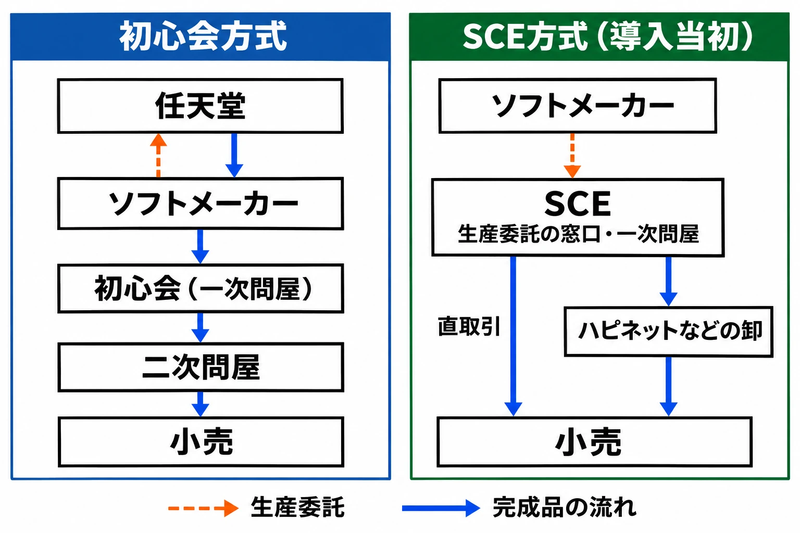

# ゲームソフトはどう店に届いたか——初心会からプレイステーションの直取引、中古裁判まで

1990年代のゲーム売り場では、発売されたばかりの人気作が品切れになる一方で、別のソフトは値下げされてワゴンに積まれていた。店が人気作を仕入れようとすると、売れ行きの鈍いソフトまで一緒に買うよう求められることがあった。新品が手に入らない客には、遊び終えた人からソフトを買い取る中古店がもう一つの行き先になった。[[1](#ref-1)]

こうした光景をつなぐのが、何本作るかを決める時期と、余ったソフトの代金を誰が負担するかである。ROMカセットからCD-ROMへ移ると、生産のリードタイム（発注から納品までの期間）が短くなり、売れ行きを見て追加する余地が広がった。プレイステーションはその余地を使って取引を組み替えたが、売れ残りを誰が引き取るかは数年のうちに変わった。[[1](#ref-1)][[2](#ref-2)]

***

## 初心会の問屋流通と、発売前の発注

ファミコンからスーパーファミコンにかけての流通を支えたのが、玩具問屋の集まりである初心会だ。問屋とは、メーカーなどから商品を仕入れ、小売店やほかの問屋に卸す業者を指す。東京大学大学院経済学研究科の和田剛明氏が2003年に発表したケース研究によれば、玩具問屋の親睦会「ダイヤ会」が、心機一転の意味を込めて「初心会」に再編された。仕入れた商品は買い取り、売れ残っても返品しないという玩具業界の慣行も引き継がれた。[[1](#ref-1)]

ROMカセットの生産には約2か月かかった。任天堂以外のソフトメーカーは、発売の約6か月前から問屋に営業し、約3か月前までに注文を取りまとめ、約2か月前に代金を全額前払いして任天堂へ生産を委託した。公正取引委員会の競争政策研究センター（CPRC）の報告書では、前納額を1本約3,000円、ロイヤリティ（製造・販売の許諾に対する対価）をそのうち約2,000円としている。東京大学経済学部の生稲史彦氏が、新宅純二郎氏の監修で作成したケース教材では、ライセンス条件として全額前払いに加え、1タイトル最低1万本の発注が挙げられている。[[1](#ref-1)][[2](#ref-2)][[3](#ref-3)]

完成品は、任天堂からソフトメーカーへ納品され、メーカーから初心会の一次問屋へ渡った。一次問屋はメーカーから直接仕入れ、二次問屋は主に一次問屋から仕入れて小売へ卸す。代表的な経路を製品の動きでたどると、 **任天堂 → ソフトメーカー → 一次問屋（初心会） → 二次問屋 → 小売 → 消費者** となる。メーカーは製造資金を先に用意し、問屋に売れなかった分も抱えた。問屋や小売は買い取った分の売れ残りをそれぞれ負担した。[[1](#ref-1)][[2](#ref-2)]

***

## 品切れと値崩れをつないだ二次問屋

発売の数か月前には、店頭で実際に何本売れるかは分からない。少なく発注した人気作は、増産を待つ間に棚から消える。多く発注したソフトは、売れ残って仕入れ代金を回収できない。このずれを商機にした二次問屋は、品薄の商品を別の問屋から探して取り次ぎ、値上がりを見込んで先に買い付け、過剰在庫を安く買い取って別の店へ転売した。[[1](#ref-1)]

新品を十分に仕入れにくい店には、客から遊び終えたソフトを買い取るという手もあった。こうして、中古を扱うゲーム専門店が品不足を補った。中古の売上はメーカーに入らないが、和田氏によれば、任天堂やソフトメーカーは当初、遊びたい客に商品が行き渡らない状況を踏まえ、中古を必要悪として黙認していた。[[1](#ref-1)]

1993年ごろに市場の伸びが一段落し、発売されるソフトの種類が増えると、売れ残りを現金に戻すための安売りが連鎖した。人気作の仕入れに売れ行きの鈍い商品を組み合わせる抱き合わせや、店頭でのワゴンセールも、在庫を抱えた側が処分を急いだ結果だった。定価で売り切れるのは、一部の人気作に限られた。[[1](#ref-1)]

次の表は、業界書籍の山下敦史『プレイステーション大ヒットの真実』（1998年）による初心会方式の推計と、高柳尚『ゲーム戦線超異常』（1996年）によるプレイステーション方式の推計を、和田氏が整理したものである。金額は1本当たり、比率は希望小売価格に対する割合を示す。実際の取引条件はタイトルやメーカーの交渉力などで変わった。小売の欄は定価で販売した場合の仕入れとの差額であり、店の経費や値引きの影響は含まない。[[1](#ref-1)]

| 取り分 | 初心会方式（9,800円） | プレイステーション方式（5,800円） |
| --- | ---: | ---: |
| 任天堂 | 3,500円（35.7％） | — |
| ソフトメーカー | 1,400〜1,792円（14.3〜18.3％） | 2,290円（39.5％） |
| 一次問屋（初心会） | 1,100〜1,108円（11.2〜11.3％） | — |
| 二次問屋 | 460〜665円（4.7〜6.8％） | — |
| ソニー・コンピュータエンタテインメント（SCE） | — | 900円＋1,160円＝2,060円（35.5％） |
| 小売 | 2,940〜3,135円（30〜32％） | 1,450円（25％） |

和田氏の論文の図6はメーカー取り分を2,190円と記すが、図中の仕入額3,190円から製造費などの900円を引くと2,290円になる。表は、和田氏の論文の本文にある39.5％と整合するCPRC報告書の2,290円を採用した。[[1](#ref-1)][[2](#ref-2)]

***

## セガは販売網を作ったが、追加生産には時間がかかった

初心会経由の販売に不満を持っていたセガは、1994年9月に、セガサターン向けの販売会社「セガ・ユナイテッド」の設立を発表した。セガサターンはCD-ROMを採用したが、セガは自前のプレス設備を持たず、リピート（売れ行きに応じた追加発注）から補充まで1か月かかることもあった。店頭の需要に間に合わせるには、引き続き売れ行きを見込んで先に作っておく必要があった。[[1](#ref-1)]

***

## SCEは一次問屋を兼ね、店の注文を集めた

ソニー・ミュージックエンタテインメントの元社長で、1993年のSCE設立に加わり、のちにSCEの会長も務めた丸山茂雄氏は、玩具流通では生産分をすべて問屋に売り渡すとメーカーの在庫がなくなり、追加生産を前提に商売する発想が生まれにくかったと振り返る。CD-ROMで売れた分を補充できれば、新品だけでも店は商売できると考えた。一方で、その仕組みを既存の問屋に受け入れてもらうのは難しいと判断したという。[[4](#ref-4)]

SCEは一次問屋の役割も担い、1994年6月ごろまでに小売との直取引を基本とする方針を固めた。取引量の少ない小売にはハピネットなどの卸を経由して供給し、配送にはジャパンレコード販売センター（JARED）なども活用した。ソフトの製造はソニー・ミュージックエンタテインメントの静岡工場が担った。SCEは発売の約2か月前から店の注文を集め、発売の約10日前まで発注の最終調整を受け付けた。初回生産数はソフトメーカーとSCEが協議して決め、小売からの受注が生産数に届かない分はSCEが引き取った。発売後は、小ロットのリピートを1〜2日で生産し、発注から3〜4日で納品できた。[[1](#ref-1)][[2](#ref-2)][[5](#ref-5)]

SCEは希望小売価格の75％で小売に卸した。この仕入れ価格の割合を **掛け率** という。希望小売価格は5,800円のソフトが過半を占めた。この価格なら、店は4,350円で仕入れ、定価で売れれば1,450円が手元に残る。SCEは小売からの返品を原則として受けなかった。音楽CDにならった返品制度も検討したが、ソフトメーカーが返品の負担を懸念して参入を控えるおそれがあり、導入を見送った。[[1](#ref-1)][[2](#ref-2)]

1994年9月中旬以降、SCEは三つの販売方針を受け入れた業者と順次特約店契約を結んだ。値引き販売の禁止、中古品の取扱い禁止、横流しの禁止である。横流し禁止とは、小売から別の販売業者へ商品を回すなど、SCEが定めた経路の外へ商品を出すことを禁じる方針だ。店は早く補充できるようになった一方、すでに仕入れた新品については返品も値下げも原則としてできなかった。[[2](#ref-2)][[5](#ref-5)]

| 比較項目 | 初心会方式 | SCEの直取引（導入当初） |
| --- | --- | --- |
| 媒体と生産期間 | ROMカセット。生産に約2か月 | CD-ROM。追加分は生産1〜2日、発注から納品まで3〜4日 |
| 発注の時期 | 発売約3か月前までに注文を集約し、約2か月前に生産委託 | 初回はメーカーとSCEが協議。店の発注は発売約10日前まで最終調整でき、発売後は少量ずつ追加 |
| メーカーの支払い | 任天堂への生産委託時に全額前払い | 月末締めの翌月末払い |
| 在庫リスクの持ち主 | メーカーが生産資金と卸せなかった分を負担。問屋・小売は買い取った分を負担 | 初回生産の受注不足分はSCE、店頭の売れ残りは仕入れた小売が負担 |
| 返品 | 完全買取で返品なし | 小売からの返品は原則なし |
| 小売の掛け率 | 取引ごとに変動。9,800円の推計例では約68〜70％ | 希望小売価格の75％ |
| 中古の扱い | 新品の品不足を補い、メーカー側は当初黙認 | 特約店の販売方針で取扱いを禁止 |

[[1](#ref-1)][[2](#ref-2)][[3](#ref-3)][[5](#ref-5)][[6](#ref-6)]

出典：和田（2003）、公正取引委員会競争政策研究センター（2009）をもとに作成。[[1](#ref-1)][[2](#ref-2)]

***

## 直取引が揺らいだ1996〜1997年

1996年2月、スクウェアの子会社デジキューブがコンビニ流通に乗り出した。各店に2〜5本ずつ置き、売れ残った商品の返品を認めた。POS（レジで販売情報を記録する仕組み）を使って日ごとの在庫を把握し、既存の配送便で補充した。少量を置いて売れた分を足す点ではSCEの方式に通じるが、コンビニ側は返品によって売れ残りの負担を抑えられた。[[1](#ref-1)]

同年4月にはコナミが自主流通、つまりソフトメーカーから小売への直接販売を始め、ナムコ、コーエー、タイトー、エニックスなども続いた。メーカーは卸の仕事を引き受ける代わりに、店から売れ行きを直接聞き、初回に何本作るかを自分で判断できるようになった。[[1](#ref-1)]

同年5月には、公正取引委員会が独占禁止法違反の疑いでSCEに立入検査を行った。その翌月、SCEは初回生産数をメーカーが決める方式を打ち出し、小売からの受注を上回る在庫は原則としてメーカーの負担に改めた。SCEがその分を預かる場合も、メーカーへの返品が条件だった。翌1997年10月には、SCEが小売の不良在庫となった約200タイトル、約70万本を1本2,000円で回収した。補充が速くても、最初に作りすぎた分や、すでに店が仕入れた分は売れ残る。[[1](#ref-1)]

公正取引委員会は1998年1月20日に排除勧告を出した。SCEが受け入れず審判となり、2001年8月1日に審決が出た。[[2](#ref-2)][[5](#ref-5)]公取委は値引き販売禁止を **再販売価格の拘束**、つまり卸した相手が次に売るときの価格を縛る行為と判断し、その拘束は1997年11月ごろに消滅したと認定した。中古品取扱い禁止は、新品の価格拘束を補強する手段として一体で評価され、単独の違反とは判断されなかった。横流し禁止は、相手の事業活動を不当に縛る **拘束条件付取引** に当たるとされ、公取委は取りやめと関係する契約条項の削除を命じた。[[5](#ref-5)]

***

## 任天堂の再編と初心会の解散

任天堂も1996年に初心会を再編した。トランプや花札を専門とする業者を外して58社から54社に絞り、主要10社を幹事問屋とした。小売への卸値は定価の65〜70％から75〜80％へ上がった。同じ定価で売るなら、店が1本ごとに確保できる差額は小さくなる。和田氏によれば、小売からは名目を変えただけと受け止められ、実態の改革も進まず、初心会は1997年に解散した。[[1](#ref-1)]

***

## 中古ゲームソフト裁判で問われた、販売後の権利

和田氏の調査では、値引き販売への拘束がなくなった後も卸値は定価の75％にとどまり、値引きやポイント還元を反映した新品の粗利率は、聞き取り先の専門店で10〜15％程度に縮んだ。新品の利益だけで店を続けるのは難しいと見た専門店が、中古販売を再開したという。中古なら、店は売れ行きに合わせて客からの買い取り価格を調整できる。メーカー側は、新品を売って開発費を回収する機会が中古に奪われることを懸念した。[[1](#ref-1)]

公取委の審決が問うたのは、SCEが取引先の価格や販売先を契約などで拘束した行為である。中古裁判で裁判所が問うたのは、著作権者が、適法に販売されたゲームソフトの再販売を差し止められるかである。争点は、ゲームが著作権法上の「映画の著作物」に当たり、権利者が **頒布権** （複製物を公衆に譲渡したり貸し渡したりすることを管理する権利）を持つか、そして最初の適法な販売で、そのうち譲渡を管理する権利が **消尽** するかだった。消尽とは、売られたその1本をさらに売るときに、権利者の許諾が要らなくなることをいう。[[5](#ref-5)][[7](#ref-7)]

1998年にメーカー側が東京と大阪で中古販売の差止めを求める訴訟を起こした。東京では、メーカーから差止めを求められた販売会社が、メーカーに差止めを請求する権利がないことの確認を求めて提訴した事件もあった。最高裁まで争われた事件の1999年の一審では、東京で販売店側、大阪でメーカー側が勝った。2001年3月の高裁では両方で販売店側が勝った。東京高裁は家庭用ゲームソフトの中古販売に頒布権の効力が及ばないと判断し、大阪高裁は頒布権を認めたうえで、譲渡する権利は消尽すると判断した。[[1](#ref-1)][[7](#ref-7)][[8](#ref-8)]

2002年4月25日、最高裁はメーカー側の上告を棄却した。対象のゲームソフトは「映画の著作物」に当たるとしたうえで、公衆に上映する目的でない家庭用ソフトの複製物については、適法に販売された時点で、頒布権のうち譲渡する権利は消尽すると判断した。こうして、メーカーが著作権を根拠に、対象ソフトの中古販売を差し止めることはできないと確定した。[[7](#ref-7)][[9](#ref-9)]

***

## 後日談　任天堂が国内卸を子会社に

2016年8月25日、任天堂は、自社商材を扱う国内最大規模の専門商社ジェスネットを子会社化すること、あわせてジェスネットがアジオカのビデオゲーム卸事業を譲り受けることを発表した（実施は2017年4月の予定）。開示に記された目的は、任天堂の商品開発力と両社の仕入れ・販売網を一体化し、開発から供給まで一貫した体制を整えて、需要に合わせた供給の判断を速めることだった。[[10](#ref-10)]

***

## いまの開発に引き寄せて読む

現在はダウンロード販売が中心で、パッケージの在庫を誰が抱えるかという問題は小さくなった。それでも、この時代の流通が直面した二つの問いは形を変えて残っている。

一つ目は、結果を見てから直せるまでの時間が、事前に決め打ちする量を決めるということだ。補充に2か月かかったROMカセットでは、発売前の見込みにすべてを賭けるしかなかった。数日で補充できたCD-ROMでは、初回を抑えて発売後の売れ行きを見て足せた。いまの開発では、この時間はアップデートを配信できるまでの期間に当たる。プラットフォームの審査を含めて修正や追加に時間がかかるなら、発売時点で入れておくべき内容は増える。すぐに直せるなら、反応を見てから足す余地が広がる。発売時に何を作り込み、何を配信後に回すかを考えるとき、この時間を前提に置く必要がある。

二つ目は、決める人と結果を負う人が分かれると、それぞれの動機がずれるということだ。初心会方式では、メーカーと問屋と小売が別々に見込みを立て、余った在庫はそれぞれが抱えた。そのずれが投げ売りと品切れを同時に生んだ。仕様を決める人と、その仕様の運用や問い合わせ対応を引き受ける人が違う場合にも、同じ構図が生まれうる。仕様を決めるときは、想定が外れたときの負担が誰に回るかまで含めて話し合っておくとよい。

また、SCEが契約で値引きと中古を縛った仕組みは、公取委の審決と中古裁判を経て崩れた。売った後の商品の扱われ方を、作り手が契約や権利だけで決めきることはできなかった。遊び手の手に渡った後にゲームがどう扱われるかは、作り手の設計の外側でも決まっていく。

## References

1. [和田剛明「家庭用テレビゲームソフトの流通―リスクとリターンの構造と市場への影響―」][1] — 赤門マネジメント・レビュー第2巻第11号、563〜580ページ、2003年11月。価格配分は図3・図6。

[1]: https://www.jstage.jst.go.jp/article/amr/2/11/2_021101/_pdf/-char/ja

2. [公正取引委員会 競争政策研究センター「プラットフォーム競争と垂直制限―ソニー・コンピュータエンタテインメント事件を中心に―」][2] — 共同研究報告書、2009年3月。第3章。

[2]: https://www.jftc.go.jp/cprc/reports/index_files/cr-0508.pdf

3. [生稲史彦（新宅純二郎監修）「The Home Video-Game Industry (1983-1996): Competitive Strategy Revolving around Industry Standards」][3] — 東京大学のケース教材。21ページ、32ページ。

[3]: https://www.gbrc.jp/content/old/PDF/GameCase.PDF

4. [電ファミニコゲーマー編集部「『久夛良木が面白かったからやってただけ』プレイステーションの立役者に訊くその誕生秘話【丸山茂雄×川上量生】」][4] — 電ファミニコゲーマー、2016年10月25日。3ページ目。

[4]: https://news.denfaminicogamer.jp/interview/ps_history/3

5. [公正取引委員会「（株）ソニー・コンピュータエンタテインメントに対する件」][5] — 審判審決、平成10年（判）第1号、2001年8月1日。

[5]: https://snk.jftc.go.jp/DC005/H130801H10J01000001_

6. [柳川範之・桑山上「家庭用ビデオゲーム産業の経済分析―新しい企業結合の視点―」][6] — 通商産業研究所ディスカッション・ペーパー、1999年12月。14、17ページ。

[6]: https://www.rieti.go.jp/jp/publications/dp/m4198j.html

7. [最高裁判所第一小法廷「著作権侵害行為差止請求事件」][7] — 判決、平成13年（受）第952号、2002年4月25日、民集56巻4号808ページ。

[7]: https://www.courts.go.jp/assets/hanrei/hanrei-pdf-52335.pdf

8. [東京高等裁判所「著作権侵害差止請求権不存在確認請求控訴事件」][8] — 判決、平成11年（ネ）第3355号、2001年3月27日。

[8]: https://www.courts.go.jp/assets/hanrei/hanrei-pdf-12586.pdf

9. [ITmedia「メーカー側敗訴確定 中古ゲーム訴訟,最高裁が上告棄却」][9] — ITmedia News、2002年4月25日。東京・大阪の両事件の上告棄却と、販売店側の記者会見。

[9]: https://www.itmedia.co.jp/news/0204/25/used_game.html

10. [任天堂株式会社「ジェスネット株式会社の子会社化及び株式会社アジオカからの事業譲受に関するお知らせ」][10] — 適時開示、2016年8月25日。

[10]: https://www.nintendo.co.jp/ir/pdf/2016/160825.pdf

英語資料の説明は、本稿で日本語に要約した。

----

この文書は、Perplexity、Claude、ChatGPT の3つのAIの支援を受けて著述されたものです。引用画像を除き、MIT License にて提供されています。
