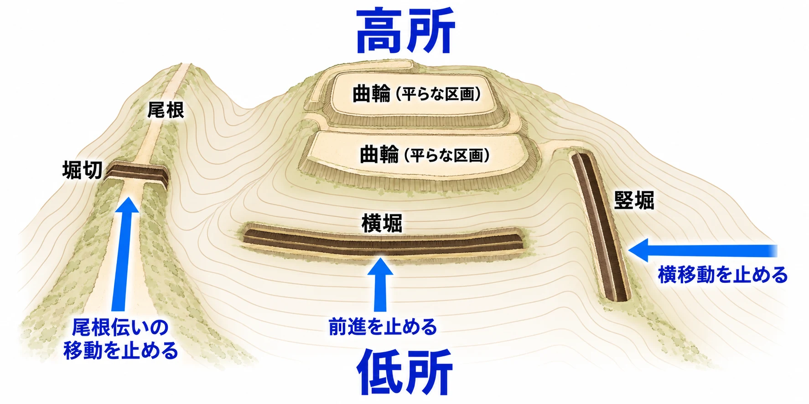

# その堀と石垣は、越えるまでの時間を作っているか――日本の城から、進路と代償を設計する

城の奥へ向かって坂を上る。前方には深い溝があり、その向こうには石垣が立ち上がっている。左右へ回れば渡れるのか。壁を登れるのか。その間に、上から見つかってしまうのか。

堀や石垣に近づいた瞬間、歩いていた道は、越え方を考える場所になる。

シリーズ「城と街から拠点をつくる」の[第2回は城の入口](japanese-castle-gate-design-koguchi-masugata.md)、[第4回は城と町の境目](walled-city-vs-castle-town-enclosure.md)を扱った。この番外編では、その境目を **「越えるまで」** に目を向ける。判断軸は、 **「その堀と石垣は、越えるまでの時間を作っているか」** である。

[第1回](castle-town-design-lynch-city-image.md)では、道や目印から拠点の街を覚えることを考えた。今回は、道の途中にある溝や壁が、進む向きと足を止める場所をどう変えるかを見ていこう。

***

## 堀は、どちら向きの移動を止めるか

堀には、水を張る水堀（みずぼり）と、水のない空堀（からぼり）がある。基本的な形と城・町の関係は第4回で扱った。ここでは、神奈川県教育委員会の資料が説明する「敵の侵入を防ぐために掘った溝」という働きを、移動の方向から考える。[[1](#ref-1)]

山城（やまじろ、山に築く城）の斜面を思い浮かべよう。城を構成する平らに整えられた区画を、曲輪（くるわ）という。[[1](#ref-1)] 攻め手は、上の曲輪へ向けて登るだけでなく、斜面を横へ動いて別の道を探すこともできる。この二つの動きを、違う向きの溝で妨げる。

**横堀（よこぼり）** は、山城の前面にある緩やかな斜面を横切る空堀だ。JAANUSの解説では、攻め手の前進を阻むためのものとされる。下から上へ向かう道の途中に、横長の溝が現れる関係である。[[2](#ref-2)] 神奈川県教育委員会の資料も、横堀を縦方向の移動を阻む堀として説明している。[[1](#ref-1)]

**竪堀（たてぼり）** は、山の斜面を縦方向に掘った空堀だ。こちらは、斜面を横方向へ移動する攻め手を阻む。JAANUSは、片側が急で反対側が緩い壁を持ち、登り出るのが難しく、中に入った敵へ石を投げることもあったと説明している。[[3](#ref-3)] 神奈川県教育委員会の資料も、竪堀の目的を「横移動を阻止する」としている。[[1](#ref-1)]

横堀を前にして「横へ回ろう」と考えても、その途中に竪堀があれば、自由には回れない。この形をゲームの地形として読むなら、 **前進を遅らせる溝と、迂回する動きを制限する溝** を組み合わせられる、という考察になる。

もう一つ、堀切（ほりきり）は、進入路を遮断するために尾根筋を断ち切るように掘られた空堀である。[[1](#ref-1)] 斜面の上下や左右だけでなく、尾根の上を歩いて近づく道にも切れ目を入れる。次に見る彦根城の大堀切では、この切れ目と橋の関係がわかりやすい。[[4](#ref-4)]

概念図。特定の城の縄張りではない。横堀・竪堀・堀切が妨げる移動方向を模式的に示した。[[1](#ref-1)] [[2](#ref-2)] [[3](#ref-3)] [[4](#ref-4)]

***

## 彦根城の大堀切――止まる場所が、撃たれる場所になる

彦根城の大堀切（おおほりきり）は、鐘の丸と太鼓丸の土塁（どるい、土を盛り上げた壁）を隔てる大きな溝である。観光庁の解説によれば、ここには落とし橋（おとしばし、攻撃時に落として通路を断てる橋）が架かり、橋を落とすと8mの落差が攻め手を阻んだ。[[4](#ref-4)]

さらに、城へ入ってきた攻め手は大堀切で止められ、天秤櫓（てんびんやぐら、守備のための建物）から弓や火縄銃で撃たれる位置に置かれた。同解説は、大堀切と落とし橋の組み合わせを、日本の城では珍しいものとしている。[[4](#ref-4)]

注目したいのは、 **「越えられない場所」と「撃たれる場所」が組になっている** 点だ。溝の深さだけでなく、そこで立ち止まった人に何が起こるかまでつながっている。

ここからは本稿の考察である。ゲームの通路にこの関係を取り入れるなら、橋を失った場所で、プレイヤーは別の道を探したり、安全な場所まで戻ったりする。その判断に使う時間も、上から狙われる時間になる。障害物の手前と守備位置を一緒に置いて初めて、「足を止める」ことが場面の緊張へつながる。

***

## 石垣は、加工と並べ方で姿を変える

石垣の表面を見ると、自然な形の石が重なる面も、四角く整えた石が並ぶ面もある。熊本城調査研究センターの嘉村哲也による資料は、石材の加工と配置を分けて分類している。[[5](#ref-5)]

まずは、石にどれだけ手を加えたかである。

| 加工による分類 | 意味 |
| --- | --- |
| 野面積（のづらづみ） | 自然石をほとんど加工せず、その形を生かして積む |
| 打込接（うちこみはぎ） | 粗割りした石を積む |
| 切込接（きりこみはぎ） | 細かく加工した石を積む |

次は、石をどのように並べたかである。目地（めじ）とは、石と石の継ぎ目を指す。

| 配置による分類 | 意味 |
| --- | --- |
| 布積（ぬのづみ） | 横方向の目地が通るように石を並べる |
| 乱積（らんづみ） | 石の大きさがそろわず、横方向の目地が通らないように積む |

以上の二つの表は、同資料の分類を整理したものだ。[[5](#ref-5)] 「加工の度合い」と「石の並び方」は、石垣を見る別々の観点になる。

角の部分にも積み方がある。角の部分の積み方である算木積（さんぎづみ）は、同資料によると16世紀後半に始まり、関ケ原の戦い後、幕府が大名を動員する天下普請（てんかぶしん）を通じて全国に広がった。また、石を積む際には、角に勾配の基準となる隅木（すみぎ）を設け、飼石（かいいし、小さな調整用の石）をかませながら積石に角度を付けていくと説明されている。[[5](#ref-5)]

これらの分類から、登りやすさへ進む部分は **本稿の考察** である。石の加工と並びが変わると、手をかけられそうな凹凸の量が違って見える。その見え方は、ゲームでプレイヤーが「ここを登れそうだ」と判断する手がかりの候補になる。

ただし、同資料は積み方ごとの登りやすさを示していない。実際の登りやすさを分類名だけで決めることはできず、「切込接なら登れない」と断定する根拠にもならない。ゲームでは、見た目にある凹凸と、実際につかめる場所の規則を合わせて設計する必要がある。

***

## ゲームでは、越え方を三つの層で設計する

ここからは、ゲームの公式解説と開発者インタビューを見たうえで、本稿の考察として「越える身体」「越えるまでの時間」「越える代償」の三つに分けて考える。

### 1．越える身体――誰なら、その壁を登れるか

『Assassin's Creed Shadows』の公式パルクール解説は、城の敷地が同心円状に連なる石垣で守られ、その中には倉庫や兵舎、物見櫓など、登れる一方で警備も厳しい建物があると説明する。ナオエと弥助は、ともに手をかける場所のない面を登れない。[[6](#ref-6)]

ナオエは鉤縄（かぎなわ、先端の鉤を引っかけて使う縄）を使い、水平な屋根の縁へ登れる。普通には登れない壁も、駆け上がった頂点で鉤縄を放ち、通常では届かない縁へ到達できる。ナオエは弥助より遠くへ跳び、高くまで届き、弥助は屋根の上の移動が全般に遅い。[[6](#ref-6)]

同作のAssociate Game DirectorであるSimonは、手がかりの規則によって、ナオエが行けて弥助が行けない場所を制御し、二人の遊び方の違いを際立たせられると説明している。[[6](#ref-6)]

『SEKIRO: SHADOWS DIE TWICE』では、ディレクターの宮崎英高が、忍者という主人公と、マップを立体的に移動するゲームデザインとの相性を語っている。同じGAME Watchの記事では、建物へ鉤縄で登り、高所から戦術を立てる遊びも紹介されている。[[7](#ref-7)]

この二つを設計の観点から読むと、壁の高さと同時に、 **越える側の身体と道具を決める** ことが重要になる。同じ石垣でも、つかんで登る人物と、上の縁へ縄をかけられる人物では、探す場所も移動に使う時間も変わる。

### 2．越えるまでの時間――何人で、どの区画を落とすか

『信長の野望・大志 with パワーアップキット』では、全国マップの城がそのまま攻城戦の舞台になる。城は複数の曲輪からなり、攻め手は城ごとに異なる進軍ルートを選んで、最終目標の天守（てんしゅ、城の中心にそびえる主要な建物）を目指す。[[8](#ref-8)]

公式サイトは、各曲輪の働きを三つの数値で説明している。[[8](#ref-8)]

| 数値 | 攻城戦での働き |
| --- | --- |
| 攻略難度 | 高いほど、兵と耐久へのダメージが小さくなる |
| 参戦上限 | 上限を超える兵を送っても、与えるダメージがそれ以上増えない |
| 耐久 | 0になると、籠城側の部隊が後退する |

山城には攻略難度が高く、参戦上限が低いものが多く、守る側は少ない兵で長く籠城（ろうじょう、城に立てこもって守ること）しやすい。「改修」で置く設備にも違いがあり、虎口（こぐち、城や曲輪の出入口）は参戦上限を半減させる。[[8](#ref-8)] 入口の現実の形は、第2回を参照してほしい。

本稿では、この仕組みを、堀や石垣が持つ「進軍を遅らせる」「大勢で一度に押し寄せにくくする」働きを、曲輪ごとの時間と兵数へ置き換えたものとして読む。これは現実との対応を考えるための解釈であり、公式の攻城戦解説そのものは、曲輪の数値と設備の効果として仕組みを説明している。

アクションなら一人が壁に取りつく数秒に注目できる。シミュレーションなら、同時に攻められる兵数と、次の区画へ進むまでの長さに注目できる。同じ「越えるまで」を、違う大きさの時間として扱えるのだ。

### 3．越える代償――時間の間に、何を失うか

『Assassin's Creed Shadows』の公式解説では、登る・跳ぶ・着地する動作は目立ち、音も出るため、警備の厳しい場所では見つかりやすいとされる。[[6](#ref-6)] 登れる道を見つけた先にも、発見される危険が残る。

『SEKIRO』について宮崎は、ステルスを、激しい戦いを有利に進めたり、一時的に態勢を立て直したりする要素と位置づけている。[[7](#ref-7)] 高所へ移る意味を、次の戦いの始め方と一緒に考えられる例である。

『大志 with パワーアップキット』では、一部の山城で行える土竜攻め（もぐらぜめ）は、一定時間後に深部の曲輪へ一気に到達する方法だ。一部の平城（ひらじろ、平地に築く城）で行える水攻めは、時間がかかる一方で、敵将と敵兵を無傷で捕らえられる。どちらも多くの金銭を必要とする。[[8](#ref-8)]

ここから導ける本稿の考察は、近道を選んだときに、減る時間と増える代償を対にすることだ。縄で登るなら見つかる危険、堀の前で止まるなら撃たれる危険、別の攻城方法を採るなら費用が判断材料になる。

彦根城の大堀切で見たように、足が止まる位置と攻撃される位置が重なると、待つ時間に意味が生まれる。ゲームではそこへ、どの人物で進むか、別の道を探すか、資源を払うかという選択を加えられる。

***

## 点検表――どこで、誰に、どれだけ時間を使わせるか

次の6問は、ここまでの事例をもとにした、ゲームの拠点や攻略空間のための点検表である。

1. **どの移動を止めるか。** 正面からの前進、斜面の横移動、尾根伝いの接近のうち、堀が妨げる方向を説明できるか。
2. **誰なら越えられるか。** 身体能力と道具による違いがあり、使える足場や縄をかける縁を見分けられるか。
3. **どこで時間を使わせるか。** 渡れる場所を探す、登る、曲輪を落とす、といった具体的な行動に時間が割り当てられているか。
4. **人数を増やすと何が変わるか。** 一度に通れる人数や攻められる兵数に限りがあり、大勢を集めるだけで待ち時間が消える構造になっていないか。
5. **時間の間に何が起こるか。** 止まった場所はどこから見られ、狙われるか。登る音や姿が、発見につながるか。
6. **別の越え方に何を払うか。** 迂回、道具、特別な攻城方法について、短縮できる時間と、危険や費用を比べられるか。

たとえば、登れる石垣の上に見張りがいて、迂回路には長い道があるなら、「短く危険な道」と「時間を使う道」を選べる。両方の所要時間と危険を確かめながら、狙った判断が生まれるよう調整できる。

堀の幅や石垣の高さを決めるときは、その手前で誰が何をするかまで描いてみたい。ゲームで持ち帰りたい判断軸は、「越えられない場所」を作ることから一歩進み、 **「越えるまでの時間と代償」を作ること** にある。

## References

1. [萩原滉「神奈川の中世城郭―小田原城支城を中心に―」][1] — 神奈川県教育委員会、2022年11月26日。令和4年度第4回考古学講座資料。城の地勢、曲輪、堀・土塁、横堀・竪堀・堀切の用語を参照。

[1]: https://www.pref.kanagawa.jp/documents/8040/r4kouza4.pdf

2. [Mary Neighbour Parent編「yokobori 横堀」][2] — JAANUS、日付記載なし。コロンビア大学Media Center for Art Historyによる公開版。英文の説明の大意は本稿による。

[2]: https://projects.mcah.columbia.edu/jaanus/node/206

3. [Mary Neighbour Parent編「tatebori 竪堀」][3] — JAANUS、日付記載なし。コロンビア大学Media Center for Art Historyによる公開版。英文の説明の大意は本稿による。

[3]: https://projects.mcah.columbia.edu/jaanus/node/766

4. [観光庁「Ōhorikiri and Tenbin Yagura（大堀切と天秤櫓）」][4] — 多言語解説文データベース、2019年度。彦根城の大堀切と落とし橋に関する解説。8mは英文の「8-meter drop」に基づく落差の表記。

[4]: https://www.mlit.go.jp/tagengo-db/en/R1-01541.html

5. [嘉村哲也「石垣の積み方～石材の回収工事からみえてきたこと～」][5] — 熊本城調査研究センター、第8回熊本城学資料、2017年6月17日。石材の加工・配置による分類、算木積の成立と普及、石を積む工程を参照。

[5]: https://www.city.kumamoto.jp/kiji00361089/3_61089_423504_up_scz6s8hv.pdf

6. [Ubisoft「Assassin’s Creed Shadows – Parkour System Overview」][6] — Ubisoft、2025年1月7日。「Parkour Up」「The Grappling Hook」「Unclimbable Surfaces」を参照。発売前の開発中ビルドに基づく公式解説。英文の大意は本稿による。

[6]: https://www.ubisoft.com/en-us/game/assassins-creed/news/4TA6gKaTvtOC1mOjZIxCZd

7. [中村聖司「『SEKIRO』ディレクター宮崎英高氏がついに台湾に上陸！」][7] — GAME Watch、2019年1月26日。宮崎英高へのインタビューと、北尾泰大による実演紹介の記録を参照。

[7]: https://game.watch.impress.co.jp/docs/interview/1166655.html

8. [コーエーテクモゲームス「『信長の野望・大志 with パワーアップキット』攻城戦」][8] — 公式サイト、日付記載なし。曲輪の数値、改修設備、山城の籠城、土竜攻め・水攻めを参照。

[8]: https://www.gamecity.ne.jp/taishi/wpk/strategy2.html

----

この文書は、Perplexity、Claude、ChatGPT の3つのAIの支援を受けて著述されたものです。引用画像を除き、MIT License にて提供されています。
