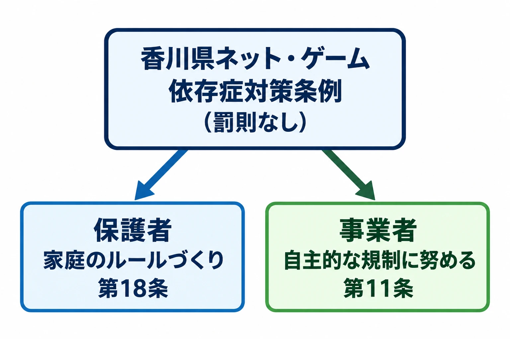

# 罰則のない決まりは、誰に何を求めているか――香川県のゲーム条例、制定の過程と訴訟、その後

「1日60分」。2020年4月に施行された香川県ネット・ゲーム依存症対策条例は、この数字とともに全国に知られた。では、県議会が議決したこの条例は、誰に何を求めているのだろうか。条文を開くと、保護者に家庭での話し合いを求める規定と、ゲームを作り提供する事業者に自主的な規制を求める規定がある。[[1](#ref-1)][[2](#ref-2)]

本稿は「ゲームと行政のあいだ」第5回である。[第1回](game-and-government-regulation-map.md)では規制が届く経路を、[第2回](diet-1986-177-and-pc-game-self-regulation.md)では国会答弁とPCゲームの自主規制を、[第3回](cero-z-rating-gta3-ordinance-link.md)では年齢表示と条例の連動を、[第4回](complete-gacha-administrative-tools-and-display-enforcement.md)ではコンプガチャを止めた行政の道具を見た。今回は、条例の宛て先から入り、制定、裁判、その後の議論をたどる。

判断軸は、 **罰則のない決まりは、誰に何を求めているか** である。

***

## 条例の宛て先を読む――保護者と事業者

正式名称は「香川県ネット・ゲーム依存症対策条例」。令和2年3月24日条例第24号として公布され、2020年4月1日に施行された。罰則は設けられていない。前文は、世界保健機関で「ゲーム障害」が疾病と認定されたことに触れ、対策の必要性を述べている。これは条例が掲げた認識である。[[1](#ref-1)]

この条例は、知事ではなく議員が案を提出する **議員提案** によって制定された。県議会で議決されたルールとして、責務や役割を定めている。[[2](#ref-2)]

### 第18条――家庭で話し合い、ルールを作って見直す

第18条1項は、保護者に対し、子どもの年齢や家庭の実情などを考慮し、使用に伴う危険性や過度の使用による弊害などを子どもと話し合い、使用のルールを作って見直すことを求めている。条例でいう「子ども」は18歳未満である。[[1](#ref-1)]

2項は、子どもの「ネット・ゲーム依存症」につながるようなコンピュータゲームの利用について、「1日当たりの利用時間が60分まで（学校等の休業日にあっては、90分まで）の時間を上限とする」ことを目安として示す。スマートフォン等の使用は、家族との連絡や学習に必要な検索などを除き、義務教育修了前は午後9時、それ以外の子どもは午後10時までにやめることを目安とする。そのうえで、保護者に家庭のルールを守らせるよう努めることを求めている。[[1](#ref-1)]

ここでいう **努力義務** は、定められた取組に努めることを求める規定である。第18条では、時間の目安を参考に家庭のルールを作り、それを守らせるための努力が求められる。数字とともに、誰が話し合い、誰が働きかけるかまで読む必要がある。[[1](#ref-1)]

### 第11条――作り手にも役割がある

第11条1項の宛て先には、ゲームソフトの開発・製造・提供などを行う事業者が含まれる。求められるのは、事業活動における予防等への配慮と、県や市町の対策への協力である。[[1](#ref-1)]

2項は、性的な刺激が著しく強いものや粗暴性を甚だしく助長するもの、射幸性の高いオンラインゲームの課金システムなどにより、子どもの福祉を阻害するおそれがあるものを挙げ、自主的な規制に努めることなどによる対策を求める。射幸性とは、偶然の結果で利益を得たいという気持ちをあおる性質である。3項は、通信サービスを提供する事業者や端末の販売・貸付業者に、フィルタリングの活用などによる対策を求めている。[[1](#ref-1)]

したがって、第11条全体を単に「努力義務」とひとまとめにするより、配慮・協力、対策の実施、自主規制に努めること、という書き分けに注目したい。

| 宛て先 | 求めること | 条文 | 強さ・求め方 |
| --- | --- | --- | --- |
| 保護者 | 子どもと話し合い、使用のルールを作り、見直す | 第18条1項 | 行うものとする |
| 保護者 | 時間の目安を参考に、家庭のルールを守らせる | 第18条2項 | 遵守させるよう努めなければならない |
| ゲームの開発・提供等の事業者 | 予防等への配慮、県・市町への協力 | 第11条1項 | 協力するものとする |
| 同上 | 子どもの福祉を阻害するおそれのあるものへの自主規制など | 第11条2項 | 自主規制に努めること等により対策を実施するものとする |
| 通信事業者・端末の販売・貸付業者 | フィルタリングの活用など | 第11条3項 | 対策を実施するものとする |

表はいずれも条例本文の要旨であり、これらに罰則はない。[[1](#ref-1)]

第18条と第11条2項に基づく関係の要約。[[1](#ref-1)]

第18条と第11条を時間制限の制度としてどう読み分けるかは、[プレイ時間の上限とコンテンツ消費設計](game-play-time-limits-content-consumption-design.md)で扱っている。ここからは、そのルールが成立し、争われた過程を見る。

***

## 制定の過程――意見の件数と原本の閲覧

**パブリックコメント** は、ルールの案を公にして意見を募り、内容を検討する手続である。今回の意見募集では回答の書式は任意で、賛否そのものを尋ねてはいなかった。[[3](#ref-3)]

KSBの2020年3月27日報道によれば、県民と事業者から計2,686件の意見が寄せられた。公開された概要版の表紙には、84%にあたる2,269件が「賛成」と記されていた。県議会は3月18日に賛成多数で条例案を可決したが、原本の閲覧が認められたのは採決後だった。[[3](#ref-3)]

3月19日に原本を閲覧した、条例案検討委員会の委員でもある県議は、賛成意見の約7割が同じような書式だったと証言した。ただし、これは県議の感覚に基づく説明である。県議は証拠があるわけではないとしたうえで、誰かが投稿を働きかけた可能性を指摘した。[[3](#ref-3)]

香川大学法学部の三野靖教授は、仮に大量の組織的な投稿があっても、それだけで違法や手続の欠陥にあたるとは言いにくいと説明した。一方で、そのような場合には、意見を募った趣旨や意味が問われるとの見方を示した。[[3](#ref-3)]

概要版に載った集計、原本を見た県議の証言、仮定を置いた専門家の見方は、それぞれ性質が異なる記録である。

***

## 訴訟――損害賠償の請求と判決の確定

2020年9月、香川県出身で当時高校3年生だった学生と母親が、条例は憲法に違反するとして、県に計160万円の損害賠償を求めて提訴した。これは、公権力の違法な行為などで受けた損害について国や自治体に賠償を求める **国家賠償請求** である。[[4](#ref-4)]

原告側は、条例の科学的根拠が不明確で、基本的人権を侵害すると主張した。県側は、利用時間の目安は依存の予防や治療の方法の一つとして専門家が指摘しているものだと説明し、条例の合理性を主張した。[[4](#ref-4)]

2022年8月30日、高松地裁は請求を棄却した。棄却とは、請求の内容を審理したうえで認めないことである。GAME Watchの報道によれば、地裁は医学的な知見が確立したとは言えないとしつつ、過度の利用が社会生活上の支障や弊害を引き起こす可能性は否定できず、条例が立法の手段として相当でないとは言えないと判断した。また、条例は原告に具体的な権利の制約を課すものではないとして、憲法に違反しないとした。[[4](#ref-4)]

上の医学的知見や支障の可能性についての記述は、裁判所が判決で示した判断である。

地裁の判決に不服があるとして高裁での審理を求める手続を、控訴という。2022年10月31日の期限までに原告側の控訴はなく、判決は確定した。[[5](#ref-5)]

***

## 判決が判断したこと、残された問い

判決の読み方を補う資料に、名古屋市立大学大学院の小林直三教授による判例コラムがある。 **評釈** とは、判決の内容や論点を研究者などが解説・検討する文章である。以下では、同コラムが紹介する判決内容と、小林教授自身が挙げる残された論点を分ける。[[6](#ref-6)]

### 判決が扱った範囲

コラムで紹介されている判決は、利用に関する規定が努力目標で、罰則もないことなどから、原告に具体的な権利の制約を課すものではないとした。また、過度の利用による支障や弊害の可能性、専門施設への相談の多さなどを、条例の必要性を支える事実として扱った。こうした、ルールの目的や必要性の根拠となる社会的な事実を **立法事実** という。[[6](#ref-6)]

パブリックコメントについては、疑義を認める具体的な根拠があるとまでは言えないとした。これは、訴訟で出された主張に対する判断である。[[6](#ref-6)]

### 評釈が挙げる、判断されなかった論点

小林教授は、判決が「ネット・ゲーム依存症」という呼称を付けることの当否には深く踏み込まなかった点を指摘している。さらに、この判決を前提とすれば、条例の是非は直接的な違憲審査よりも、政策を検討し決める過程に委ねられたと整理している。[[6](#ref-6)]

残る論点として小林教授が挙げるのは、条例で「依存症」という表現を使うことの当否と、パブリックコメントの前提になる情報の質である。罰則による直接の規制がなくても、条例の言葉が社会に影響を及ぼすという観点からの指摘だ。これは評釈者の見解であり、判決の結論そのものとは区別して読む必要がある。[[6](#ref-6)]

***

## その後――弁護士費用の裁判と県議会での議論

### 別の裁判で争われた、公金の支出

県は国家賠償請求への対応で、弁護士3人に着手金と報酬金を計約485万円支払った。この支出をめぐり、県民5人が2021年10月に別の裁判を起こした。自治体の公金の支出などの適法性を住民が争う **住民訴訟** である。提訴時には、着手金の返還と報酬金の支払い差止めなどを求めていた。[[7](#ref-7)]

高松地裁は2023年1月、争点の多さや条例の憲法適合性が争われる重要性などを理由に、住民側の訴えを退けた。高松高裁も同年11月17日、地裁の結論を支持し、控訴を却下・棄却した。[[7](#ref-7)]

住民側は、さらに最高裁に判断を求める **上告** を行った。最高裁第二小法廷は2024年4月26日付で、上告が認められる事由にあたらないなどとして退けた。最高裁はこの手続で、条例の違憲性などについて実質的な判断には踏み込んでいない。[[8](#ref-8)]

### 条例に組み込まれた「検討」の規定

条例の附則第2項は、「この条例の施行後２年を目途として、この条例の施行状況等を勘案し、検討が加えられ、必要があると認められるときは、その結果に基づいて必要な措置が講ぜられるものとする。」と定めている。罰則のない決まりに、見直しの機会があらかじめ書き込まれていたのである。[[1](#ref-1)]

KSBの2022年5月27日の報道によれば、施行2年を前に検討の開始を促す陳情が県議会に出されたが、2021年12月に賛成多数で不採択となった。2022年4月に就任した県議会議長は、現時点で見直しの必要はないとの認識を示した。香川大学の三野靖教授は、附則には一定の重みがあるものの絶対的な拘束力までは持たないとしたうえで、少なくとも見直しが必要かどうかは検討すべきだとの見方を示している。[[2](#ref-2)]

### 2024年10月――効果の検証と言葉の見直し

2024年10月の県議会文教厚生委員会では、条例の成果と、その評価の仕方が議論された。県の子ども政策推進局長は、保護者向けの講演会や医療提供体制の充実などを説明し、「一定の効果が出ている」と答えた。第三者による検証と結果の発信については、県議会に成果を報告して議論してもらっているとし、現時点では考えていないとの考えを示した。[[9](#ref-9)]

条例名の「ネット・ゲーム依存症」についても、局長は病名ではなく、条例が定義する状態像だと説明した。一方、県教委が配る依存予防の学習シートは、2024年度の改訂で表記を「ゲーム行動症（ゲーム症）」に変えていた。[[9](#ref-9)]

同報道によると、厚生労働省の専門部会は2024年9月19日、国際疾病分類ICD-11の日本語訳を了承し、「ゲーム行動症」が統一して使う用語となることになった。県は、条例制定の趣旨は変わらないとして、前文の「ゲーム障害」などの文言を改正しない考えを示した。以上は、2024年10月時点の議論である。[[9](#ref-9)]

***

## ゲーム企画に置き換える――ここからは考察

第11条は、ゲームを作り提供する側を「事業者」として宛て先に含めている。企画段階では、射幸性の高い課金システムなどへの自主規制が求められることを前提に、課金や表現の仕様を誰が点検し、どう判断を残すかを考えられる。これは本稿の設計上の考察であり、条例が個々の企画の可否を具体的に決めているという意味ではない。

第18条からは、時間管理やペアレンタルコントロールを、家庭のルールづくりを支える道具として捉える考え方が導ける。たとえば、親子が使用状況を見て話し合い、決めた内容を見直せることを設計の出発点にする。機能や報酬設計への詳しい展開は、[プレイ時間の上限とコンテンツ消費設計](game-play-time-limits-content-consumption-design.md)を参照されたい。

ただし、この考え方には限界もある。罰則のない決まりを実際にどう守るかは、受け手の取組に委ねられる部分が大きい。機能を用意しても、家庭で使われ、話し合いに役立つかは別に確かめる必要がある。条例についても、効果をどう測り、誰が検証し、どのように見直すかが問われる。2024年の県議会で交わされた、県の効果認識と第三者検証をめぐるやり取りは、その問いにつながる。

また、「60分」という数字だけが広がれば、年齢や家庭の実情を考慮すること、話し合ってルールを作ることが伝わりにくくなる可能性がある。企画書や保護者向けの案内でも、数字を示すなら、その宛て先と求め方を一緒に説明したい。

***

## 企画に持ち帰る点検表

- その決まりは、誰が提案し、どこで議決されたものか。
- 宛て先は、保護者、事業者、通信事業者のうち誰か。
- 求められるのは、対策の実施、協力、自主規制への努力のどれか。罰則はあるか。
- 時間の数字だけを取り出さず、対象、例外、家庭での話し合いまで読んでいるか。
- 裁判所の判断、当事者の主張、評釈者の見解を分けているか。
- 取組の効果を何で確かめ、誰が検証し、どう見直すかを考えているか。

次回、第6回では「決済網という見えない規制」を扱う。法律や条例に加え、代金を受け取る仕組みの条件がゲームにどう届くのかを見る。

今回、企画に持ち帰る判断軸は、 **罰則のない決まりは、誰に何を求めているか** である。

## References

1. [香川県「香川県ネット・ゲーム依存症対策条例」][1] — 香川県、2020年3月24日、条例第24号。2020年4月1日施行。前文、第2条、第11条、第18条、附則を参照。

[1]: https://www.pref.kagawa.lg.jp/documents/1150/jourei.pdf

2. [KSB瀬戸内海放送「【特集】香川県　ゲーム条例施行から2年…付則で定めた『見直し検討』の行方は？」][2] — KSBニュース、2022年5月27日。全国的な注目と議員提案による制定の経緯を参照。

[2]: https://news.ksb.co.jp/article/14631360

3. [KSB瀬戸内海放送「ゲーム依存症条例のパブコメ『賛成意見の大半は同じ書式』原本を閲覧した議員が証言　香川」][3] — KSBニュース、2020年3月27日。

[3]: https://news.ksb.co.jp/article/13851355

4. [屋敷悠太「香川県の『ゲーム対策条例』原告学生らの請求棄却」][4] — GAME Watch、2022年8月30日。判決の要旨と当事者の主張を参照。

[4]: https://game.watch.impress.co.jp/docs/news/1435927.html

5. [KSB瀬戸内海放送「香川ゲーム条例違憲訴訟 原告側が控訴せず『合憲』判決が確定」][5] — KSBニュース、2022年11月1日。控訴期限と判決確定の事実を参照。

[5]: https://news.ksb.co.jp/article/14720085

6. [小林直三「香川県ネット・ゲーム依存症対策条例合憲判決に関する一考察～高松地裁令和4年8月30日判決～」][6] — WLJ判例コラム第278号、文献番号2022WLJCC030、2022年12月26日。「2．判例要旨」「3．検討」「4．おわりに」を参照。判決内容はコラムの紹介に、残された論点は評釈者の見解に基づき要約した。

[6]: https://www.thomsonreuters.co.jp/ja/westlaw-japan/pdf/column_law/20221226.pdf

7. [KSB瀬戸内海放送「【速報】香川県のゲーム条例巡る2つ目の裁判 弁護士費用の返還など求めた住民側の控訴を却下、棄却 高松高裁」][7] — KSBニュース、2023年11月17日。

[7]: https://news.ksb.co.jp/article/15059429

8. [KSB瀬戸内海放送「香川県のゲーム条例『弁護士費用』訴訟 最高裁が住民側の上告退ける」][8] — KSBニュース、2024年5月8日。最高裁第二小法廷の2024年4月26日付決定を報じたもの。

[8]: https://news.ksb.co.jp/article/15258990

9. [KSB瀬戸内海放送「ゲーム条例の施行から4年半…香川県議会で論戦　成果の検証や『依存症』名称を巡り」][9] — KSBニュース、2024年10月2日。委員会答弁、学習シートの改訂、ICD-11日本語訳をめぐる記述を参照。

[9]: https://news.ksb.co.jp/article/15449786

----

この文書は、Perplexity、Claude、ChatGPT の3つのAIの支援を受けて著述されたものです。引用画像を除き、MIT License にて提供されています。
