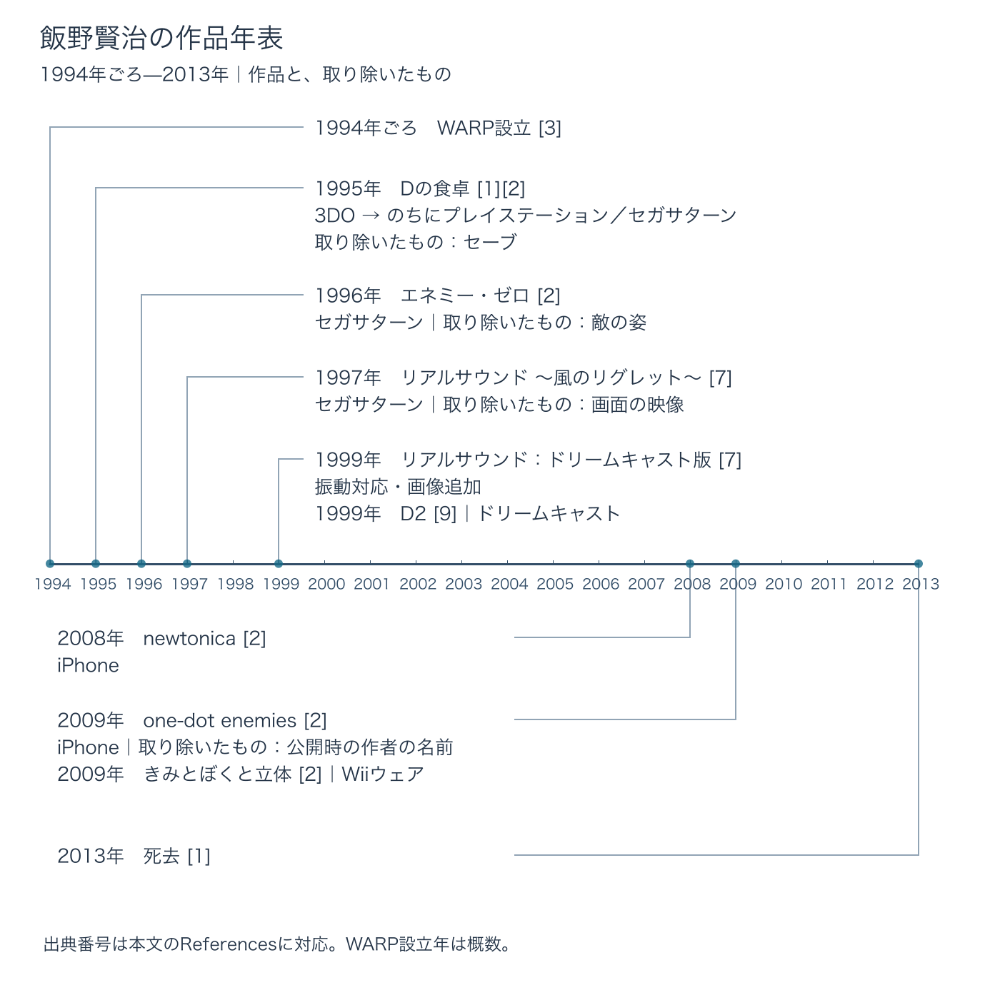

# 飯野賢治評伝——見せないことで遊ばせ、作品の外側まで設計した人

## はじめに：何を取り除けば、人は遊び、注目するのか

飯野賢治は、2013年2月20日に42歳で亡くなったゲームクリエイターである。『Dの食卓』『エネミー・ゼロ』『リアルサウンド 〜風のリグレット〜』など、遊び方そのものに特徴のある作品を残した。[[1](#ref-1)]

破天荒な発表や言動から「奇才」として語られることも多い人物だ。だが、その仕事を読む手がかりは、一つひとつの作品の具体的な判断にある。途中経過を保存するセーブをなくす。敵の姿を見せない。ついには画面から映像をなくす。後年には、自分の名前を伏せてゲームを公開した。[[2](#ref-2)]

本稿の問いは、 **何を取り除けば、人は遊び、注目するのか** である。もう一つ、その判断をゲームの中だけに閉じず、発表、取引、公開方法、会社の形へ広げた仕事を追う。この二つを重ねると、飯野が何を作り、どう世に送り出したのかが見えてくる。

***

## 1. WARPを作るまで：作り手の顔が見える会社

1970年生まれの飯野は、ゲーム開発会社Interlinkを経てEIMを起業し、1994年ごろにWARPを設立した。WARPには、のちに『ICO』で知られる上田文人や、『ファイナルファンタジーVII』や『アドベントチルドレン』に関わった野末武志らも在籍した。[[3](#ref-3)]

WARPは作品とともに、飯野個人の名前も広く知られる会社になった。その形が後の作り手にとって持った意味を示すのが、2023年の没後10年の上映会で紹介された小島秀夫の言葉である。『メタルギア』シリーズなどを手がける小島は、自分がクリエイター兼経営者となった際の手本として、WARPを挙げた。[[4](#ref-4)]

個人の名前を前に出して作品を届けると、受け手はタイトルだけでなく「この人が次に何を作るのか」にも関心を持つ。会社は制作の器であると同時に、その関心を引き受ける場所になる。ここに、飯野の仕事を「作品の外側の設計」として読む最初の手がかりがある。

***

## 2. 『Dの食卓』：セーブを取り除き、現実の2時間を使う

1995年に発売された『Dの食卓』は、主人公ローラとなって館を探索するアドベンチャーゲームである。最初の対応機種は3DO。パナソニックなどが製造した家庭用ゲーム機で、のちにソニーの家庭用ゲーム機プレイステーションと、セガの家庭用ゲーム機セガサターンにも展開された。早い時期から3DCGを取り入れ、映画のような演出で知られた作品だ。[[1](#ref-1)][[2](#ref-2)]

映像と並んで重要なのが、時間の使わせ方である。本作ではセーブもロードもできず、2時間以内にクリアしなければバッドエンドになる。[[2](#ref-2)]

セーブは、遊びを生活の都合に合わせて区切るための機能でもある。進行を保存できれば、続きは明日に回せる。『Dの食卓』はその区切りを取り除き、プレイヤーの現実の2時間を、結末へ向かうひと続きの時間に変えた。

ここからは設計上の読み取りになる。制限時間があると、迷う時間も遊びの一部になる。先へ進む方法を探しているあいだにも、結末までの猶予は減っていく。セーブを取り除く判断が、館の中の出来事と画面の前にいる人の時間を結びつけたと読める。

その代わり、まとまった時間を用意しにくい人には遊びづらくなる。プランナーが持ち帰れるのは、機能を減らすときには、何に集中してもらうのかと、どんな負担が生まれるのかを一緒に考える必要がある、という点である。

***

## 3. 『エネミー・ゼロ』：見えない敵と、見せる発表

1996年、セガサターンで発売された『エネミー・ゼロ』は、宇宙船の中で姿の見えない敵と戦う作品だ。プレイヤーは音を頼りに敵の位置を知る。[[2](#ref-2)]

敵が見えれば、目で位置を捉え、近づいてくる様子を追える。本作では、その手がかりを取り除いた。音を聞いて危険の位置を判断することが、戦うための行為になる。画面に敵が映らないからこそ、プレイヤーは見えない空間へ注意を向け続ける。この仕組みは、恐怖を「何を見せるか」だけでなく、「何を見せず、何を聞かせるか」から作る例である。

言葉の見せ方にも注文があった。脚本家の坂元裕二によると、飯野との最初の仕事は本作のセリフのリライトであり、飯野の要望で洋画の字幕のような文体にしたという。[[5](#ref-5)] 音や映像だけでなく、画面に接する言葉も演出を構成する要素だった。

### 発売機種の変更そのものを発表の見せ場にする

本作は、もともとプレイステーション向けに開発されていた。SCE（ソニー・コンピュータエンタテインメント）との対立を経てセガサターンへ移り、その変更がSCE主催の「プレイステーションエキスポ」で発表された。[[2](#ref-2)]

会場にいた週刊アスキーのACCNは、1996年の同イベントで、巨大スクリーンのPSロゴがセガサターンのロゴへ変わる演出を目撃したと記している。[[6](#ref-6)]

飯野は、発売機種が変わったという情報に、場所と見せ方を与えた。プレイステーションの催しで、そのロゴが競合機のロゴへ変わる。この発表では、観客が抱いていた予想も演出の材料になっている。作品を売る機種の決定と、その決定を伝える体験が結びついたのである。

当時の機種間競争については、別稿「[PlayStation、セガサターン、N64の市場競争](playstation-saturn-n64-market-war-history.md)」で扱っている。ここでは、発表の舞台まで含めて作品への注目を作ったことに目を向けたい。

***

## 4. 『リアルサウンド』：画面を取り除き、同じ物語を聞く

1997年7月18日にセガサターンで発売された『リアルサウンド 〜風のリグレット〜』は、画面に映像がなく、音声と音楽で進む「インタラクティブサウンドドラマ」である。物語の途中で選択を行い、結末が変わる。脚本は、『エネミー・ゼロ』に続いて飯野と仕事をした坂元裕二が担当した。[[7](#ref-7)][[2](#ref-2)]

音声のドラマをただ聞くだけでなく、自分の選択で進める。そのため、映像を取り除いても、プレイヤーが物語に関わる余地は残っている。

この発想のきっかけには、視覚障害のある人たちとの交流があった。2008年のインタビューで飯野は、目の見えない人がアクションゲームを遊んでいると知った経験を語っている。そして、モニターを消せば、見える人も見えない人も同じゲームを聞くことになり、遊び終えた後に対等に話せると考えた。[[8](#ref-8)]

ここで目指されたのは、視覚の有無によって得られる情報が変わらない遊びである。画面を取り除くことが、そのまま体験を共有するための設計になった。ただし、音声を中心とする以上、聞こえ方など別の条件は残る。「誰でも同じ」を視覚の条件に関する狙いとして読むと、この工夫の届く範囲が分かりやすい。感覚や操作の条件を変えるほかの事例は、「[感覚と操作のアクセシビリティ](game-accessibility-case-studies-senses-and-controls.md)」でも紹介している。

### 専用タイトルにする条件へ、届ける相手を組み込む

飯野は同じインタビューで、セガが本作の独占を求めた際の条件も説明している。セガが視覚障害のある人に1,000台のセガサターンを寄贈するなら、自分も1,000本のソフトを添える。その条件でセガ専用とし、後にもその約束を専用であり続ける理由として語った。[[8](#ref-8)]

ゲーム機とソフトの両方があって、初めて遊ぶ機会が生まれる。飯野は、作品内で視覚の条件を変えるだけでなく、取引の条件に届ける相手と手段を組み込んだ。画面の中の設計と、画面の外で人に届ける設計が、ここで重なっている。

1999年3月11日には、セガサターンの後継となるセガの家庭用ゲーム機、ドリームキャストでも発売された。こちらには振動への対応と画像が加わった。[[7](#ref-7)] 「映像をなくした」という特徴は、まずセガサターン版の選択として捉える必要がある。

***

## 5. 『D2』とその後：機種、会社、公開方法を変える

『D2』（『Dの食卓2』）は、1999年12月23日にドリームキャストで発売された。開発の出発点は、パナソニックが3DOの後継として開発していたM2という別の機種だった。元WARPメンバーの林田浩典によると、プラットフォームとの契約上、M2版のデータやシナリオはドリームキャスト版に使えなかったという。[[9](#ref-9)]

ここでは、契約が制作できる内容そのものに関わっている。発表や販売の条件は、完成後に付け加わるだけのものではなく、開発の途中にも影響する。『D2』の経緯は、作品の外側にある条件も、制作を考えるうえで避けて通れないことを示す。

『D2』の後、飯野は家庭用ゲームの開発から遠ざかった。[[2](#ref-2)] そのあいだにも、仕事の対象は広がっていた。友人のジェームズ・ミルキーが振り返る仕事には、TSUTAYA向けのタッチスクリーン端末、菓子会社のWebキャンペーン、自動販売機向けの決済システムなどがある。[[3](#ref-3)]

人が端末に触れ、情報を受け取り、行動する。その接点を作る仕事は、家庭用ゲームという形を離れても続いていた。

### 自分の名前も、出し方を選べる要素になる

2008年には、ゲームデザイナーの西健一と共同で、iPhoneアプリ『newtonica』を出した。西は、ラブデリックの設立メンバーの一人で、1997年にプレイステーションで発売された「アンチRPG」『moon』のゲームデザイナーである。[[10](#ref-10)]

翌2009年には、iPhoneアプリ『one-dot enemies』を飯野賢治の名前を伏せて公開し、10万ダウンロードに達した後にTwitterで自分の作品だと明かした。[[2](#ref-2)]

WARPのころには、飯野の名前そのものが作品を知る入口になっていた。『one-dot enemies』では、その有力な宣伝材料を先に出さなかった。受け手は、作者を知る前にゲームと出会い、後から誰の仕事だったかを知る。作者名を明かす順番も、公開方法を設計するための要素になる。

同じ2009年、飯野はブログで「GET BACK」を宣言し、Wiiウェアの『きみとぼくと立体』を出した。Wiiウェアは、任天堂の家庭用ゲーム機Wiiに向けたダウンロード専用ソフトの仕組みである。[[2](#ref-2)] 名前を伏せた公開と、復帰を告げる公開。そのどちらにも、作品と受け手をどう出会わせるかという判断がある。

遺作となった企画『KAKEXUN』では、クラウドファンディングで制作資金が募られたものの、目標額には届かなかった。[[3](#ref-3)] 作品を世に送り出す試みには、実現へつながらなかったものも残っている。

年表の出典：本文のReferences [[1](#ref-1)][[2](#ref-2)][[3](#ref-3)][[7](#ref-7)][[9](#ref-9)]。

***

## 6. 残された二つの問い

飯野賢治は、2013年2月20日、高血圧性心不全で死去した。享年42だった。[[1](#ref-1)]

没後10年の2023年12月には、Archipel Caravanの一環として上映会と展示が行われた。12月16日に上映とトークが行われたドキュメンタリーには、小島秀夫、上田文人、ゲームクリエイターの水口哲也らが出演した。[[4](#ref-4)] 同年にはWARPのゲーム音楽の配信と、著書2冊の電子書籍での再刊も行われた。[[7](#ref-7)] 作品、音楽、文章、関係者の証言という複数の入口から、仕事をたどる機会が作られたのである。

飯野の作品を通して、プランナーが持ち帰れる問いは二つある。

一つは、 **何を取り除けば、遊びの中心がはっきりするか** 。セーブを取り除けば時間が、敵の姿を取り除けば音が、画面の映像を取り除けば聞くことと選ぶことが、強く意識される。取り除いた先に何を残し、プレイヤーに何をしてもらうのかまで考えて、初めて設計になる。

もう一つは、 **作品をどう世に出せば、その体験が人に届くか** 。会社の顔として名前を出すこと。機種変更を発表の演出にすること。専用タイトルの条件に寄贈を組み込むこと。反対に、作者名を伏せて公開すること。飯野の仕事には、完成したゲームを包む条件にも判断があった。

遊びを作るとき、画面の中に何を置くかに加えて、何を取り除くかを考える。そして、その遊びに人が出会うまでの道筋も考える。飯野の評伝を具体的な仕事から読む意味は、この二つの問いを自分の企画へ持ち帰れることにある。

## References

1. [GameBusiness.jp編集部「『Dの食卓』や『エネミーゼロ』等で知られるゲームクリエイター飯野賢治氏が逝去、享年42歳」][1] — GameBusiness.jp、2013年2月24日。死去の日付と死因は朝日新聞の報道を伝えたもの。

[1]: https://www.gamebusiness.jp/article/2013/02/24/7547.html

2. [池谷勇人「日々是遊戯：奇才か、それとも―― 飯野賢治さんの作品をあらためて振り返る」][2] — ねとらぼ、2013年2月22日。

[2]: https://nlab.itmedia.co.jp/cont/articles/3227941/

3. [Aki Darwich（聞き手）「ゲームクリエイター『飯野 賢治』が残したもの 友人ジェームズ・ミルキーが語る奇才の人生」][3] — AUTOMATON、2015年3月6日。経歴、WARP在籍者、ゲーム以外の仕事と『KAKEXUN』について参照。『D2』の発売日は[9]に従う。

[3]: https://automaton-media.com/articles/interviewsjp/interview-james-milkey-with-eno-kenji-memory/

4. [高島おしゃむ「『Dの食卓』で知られる鬼才のゲームクリエイター・飯野賢治はどのような生き様だったのか？」][4] — 電ファミニコゲーマー、2023年12月27日。Archipel Caravanの上映・展示、ドキュメンタリー出演者、小島秀夫の発言を参照。

[4]: https://news.denfaminicogamer.jp/kikakuthetower/231227b

5. [葛西祝「【飯野賢治とは何者だったのか？第1回】『風のリグレット』「怪物」「花束みたいな恋をした」の脚本家・坂元裕二氏に聞く風雲児との日々―“300万本売れるRPG”の顛末も明かされる」][5] — Game*Spark、2023年12月17日。2ページ目の『エネミー・ゼロ』のセリフに関する坂元裕二の証言を参照。

[5]: https://www.gamespark.jp/article/2023/12/17/136909_2.html

6. [ACCN「過去にWarpして飯野賢治に会ってきた」][6] — 週刊アスキー、2014年4月29日。プレイステーションエキスポでのロゴ変更演出の目撃談を参照。

[6]: https://weekly.ascii.jp/elem/000/002/622/2622709/

7. [カワチ「音だけでプレイするゲーム『リアルサウンド ～風のリグレット～』が発売された日。夭逝したクリエイター飯野賢治氏が手掛けた【今日は何の日？】」][7] — ファミ通.com、2024年7月18日。両機種版の発売日と仕様、2023年の音楽配信・電子書籍再刊を参照。

[7]: https://www.famitsu.com/article/202407/10854

8. [Barrie Ellis「Kenji Eno (1970-2013)」][8] — IGDA Game Accessibility SIG、2013年2月22日。1up.comの2008年のインタビューを引用した記事。本文の発想とセガとの条件の説明は、掲載された英文の大意を本稿で日本語にしたもの。

[8]: https://igda-gasig.org/2013/02/22/kenji-eno-1970-2013/

9. [林與五右衛門「飯野賢治は『ゲーム』制作に飽きていた？元WARPメンバーが語る『Dの食卓2』制作秘話【飯野賢治生誕55周年】」][9] — Game*Spark、2025年11月25日。発売日と、M2版からのデータ・シナリオの使用に関する林田浩典の証言を参照。

[9]: https://www.gamespark.jp/article/2025/11/25/159857.html

10. [奥村キスコ、小山オンデマンド「伝説のRPG『moon』20年目の同窓会──ラブデリックメンバーが語る、ディレクター3人という奇跡のような開発スタイル…そして「あのころ」の始まりと終わり【座談会】」][10] — 電ファミニコゲーマー、2017年10月30日。『moon』の作品紹介と、西健一がラブデリックを設立したゲームデザイナーの一人であることを参照。

[10]: https://news.denfaminicogamer.jp/interview/171030

----

この文書は、Perplexity、Claude、ChatGPT の3つのAIの支援を受けて著述されたものです。引用画像を除き、MIT License にて提供されています。
