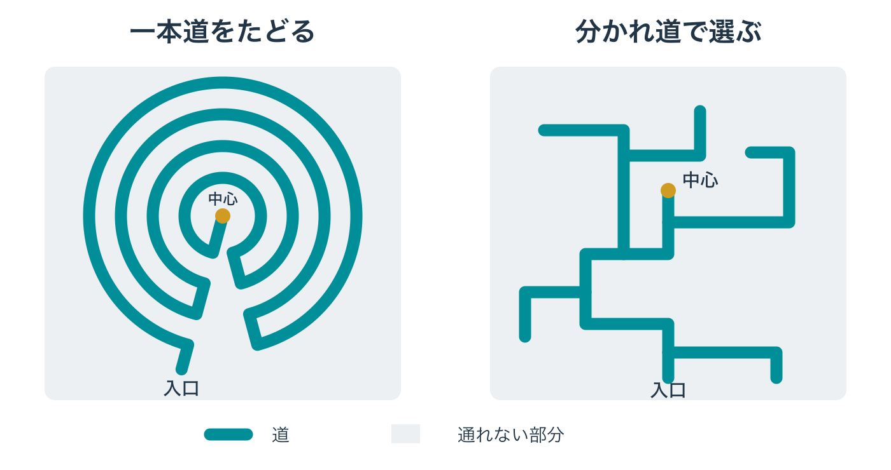

# 人が作ったのに、なぜ迷うのか――迷宮と地下から、帰り道の手がかりを設計する

城の地下牢で目を覚ます。扉を抜け、下水道へ降りると、暗い通路が先へ続いている。曲がり角の向こうは見えず、似た壁ばかりで、地上の塔も見えない。それでも、プレイヤーはどこかに外へ出る道があると考え、歩き始める。

この場面で、何を頼りに進めばよいのだろうか。水の流れか、遠くの光か、途中で見つけた地図か。そして道を間違えたとき、どこまで戻れば立て直せるのだろうか。

全7回のシリーズ「城と街から拠点をつくる」第7回・最終回は、[第1回の5要素](castle-town-design-lynch-city-image.md)のうち「道」を深める回である。持ち帰る判断軸は、 **「迷わせるのか、たどらせるのかを決め、帰り道の手がかりを用途の規則から残す」** ことだ。

***

## ダンジョンという言葉は、城の主塔につながっている

ゲームでいう **ダンジョン** は、ここでは敵や仕掛けのある探索の舞台を指す。その英語の dungeon をMerriam-Websterで引くと、第1の意味には donjon、第2の意味には、たいてい地下にある暗い牢や地下室が挙げられている。 **ドンジョン（主塔）** とは、城の内側にある主要な塔のことで、キープとも呼ばれる。[[1](#ref-1)]

同辞典は、dungeon がもともと城の主塔を指し、のちに地下室や牢を指す綴りとして使われるようになった経緯を説明している。語源は、中英語やアングロ・フランス語、俗ラテン語を経て、領主を意味するラテン語の dominus にさかのぼる。[[1](#ref-1)]

[第3回で扱った主塔](western-castle-concentric-defence-layers.md)と、地下を探索するときに使う言葉が、ここでつながる。城を目印として見上げる体験から、その内側や足元へ潜る体験へと、視点を移してみよう。

***

## 一本道をたどる迷宮と、分かれ道で迷う迷路

道の形を考えるために、本稿では二つの呼び方を使い分ける。入口から中心まで一本の道をたどる型を **迷宮** 、分かれ道で進路を選ぶ型を **迷路** と呼ぶ。日本語の名称を一律に決めるためではなく、そこで何を体験させるかを整理するための区別である。

### 芝生の迷宮――中心へ向かう道のりをたどる

イングランドのJulian's Bowerは、芝生を切って作られた、直径12m余りの円形の迷宮である。11重の同心円を縫うように一本の道が続き、中心へ至る。道筋に従って歩く限り、分かれ道で正解を選ぶ必要はない。[[2](#ref-2)]

Historic Englandの指定記録は、迷宮一般の歴史も説明している。そこでは、最古とされる型は七重の古典的な一本道の迷宮であり、中世のキリスト教では11重の道を持つ型が採用されたという。中世の型は、ひざまずいて道をたどり、罪の赦しを求める贖罪に用いられた可能性があるとされる。Julian's Bower自体の起源や修道院との関係も推定として記されている。[[2](#ref-2)]

この形から注目したいのは、中心が近くに見えても、そこへ着くまでには長い道のりをたどることだ。ゲームへ置き換えれば、歩く順番を定め、途中で景色や出来事に出会わせる設計を考えられる。

### 生け垣の迷路――進む道を選び、行き止まりから戻る

同じ指定記録によれば、より複雑なパズル型の迷路は15世紀以降、装飾庭園の要素として発達した。生け垣や花壇で道を区切り、その中で進路を選ばせる形である。[[2](#ref-2)]

ハンプトン・コート宮殿の生け垣迷路は、おそらく1690年頃、ウィリアム3世の命で作られた。宮殿を管理するHistoric Royal Palacesは、ギネスブックに現存最古の生け垣迷路として掲載されていると紹介している。多くの道と、人を惑わせる行き止まりを備え、道をすべてつなぐと半マイル、約800mになる。中心までの所要時間は平均約20分とされる。[[3](#ref-3)]

こちらでは、角を曲がった先に何があるかを確かめ、行き止まりなら戻り、別の道を試す。中心へ続く一本の道をたどるときとは、求められる判断が違う。 **「迷わせる」と「たどらせる」は、別の設計である。**

道のつながりを比べる模式図。特定の遺構を復元したものではない。

***

## 人が作った地下には、用途に沿った規則がある

地下で見通しが利かなくても、その場所を作った人には目的がある。水を運ぶ、鉱石を採る、人が作業に通う。その目的から道のつながりを考えると、暗い場所にも読み取れる規則を残せる。

### 下水道――水が集まる先がある

東京都下水道局の『東京都の下水道』2021年版によれば、23区の下水道管の長さは約16,000kmに及ぶ。管には、水が低い方へ自然に流れる **自然流下** のための傾斜がつけられている。下流へ進むにつれて管が深くなるため、深くなったところでポンプを使って地表近くまで水を引き上げ、再び流す。[[4](#ref-4)]

この引き上げを担う施設が **ポンプ所** であり、下水はそこを中継して、水を処理する水再生センターへ送られる。[[4](#ref-4)] 入り組んだ管の網にも、水を集めて送る方向があるのだ。

[地形シリーズの川の回](open-world-terrain-design-rivers.md)で扱った「流れの向き」は、人が作った地下にも持ち込める。本稿の考察として、ゲームの水路で流れに沿って進むと水の集まる場所へ着くようにすれば、プレイヤーは全体の地図を知らなくても行き先を推測できる。そこで地上へ上がれるようにするなら、集まる場所から出口へ通じる階段や通路を、もう一つの手がかりとして用意する。

### 坑道――採掘のための道が、移動にも使われる

**坑道** は、鉱石を採るためなどに地下へ掘られた通路である。『Kingdom Come: Deliverance II』の都市クッテンベルクは、現在のチェコのクトナー・ホラにあたる。開発元Warhorseのシニアゲームデザイナー、Ondřej Bittner氏は、銀の採掘が街の中で始まったことと、街全体に広がる地下の坑道をプレイヤーが移動や潜行に使えることを説明している。[[5](#ref-5)]

街の商いについては[第5回](post-towns-villages-why-people-gather.md)で扱った。今回は、採掘のために生まれた地下空間が、ゲームでは街を通り抜ける道にもなる点に注目したい。そこから本稿の考察として、鉱石を採る場所と運び出す場所を結ぶ道筋を考えれば、地下の形と、その形を読む手がかりを一緒に決められる。

***

## ゲームでは、帰り道を推測できる手がかりを残す

ここからは **本稿の考察として** 、歴史的な道の形と地下の用途を、ゲームの設計へ置き換える。開発者が説明した事例は、出典を添えて区別する。

### まず、迷わせるのか、たどらせるのかを選ぶ

一本道なら、歩く途中で何を見せるか、次の場所へ着くまでどれだけ歩かせるかを考える。曲がり角の先に光を見せる、同じ広間を違う高さから眺めさせる、といった変化を置ける。

分かれ道のある迷路なら、選んだ道をどう覚え、間違えたあとにどう戻れるかを考える。分岐の一つに特徴のある柱を置けば、「柱のところまで戻って、もう一方を試そう」と判断できる。

一つの地下に両方を組み合わせることもできる。たとえば、牢から下水道までは一本道で状況を伝え、下水道では出口を探す分岐を設ける。区間ごとに、何をたどらせ、どこで選ばせるかを決めるのである。

### 用途の規則を、戻るときにも読めるようにする

下水なら流れ、坑道なら鉱石を含む岩の筋である鉱脈や、運び出しの線路、牢なら看守が見回る通路が手がかりの候補になる。線路を置く場合は、その設備が存在する時代や技術を持つ架空の坑道として考える。

用途が決まったら、プレイヤーが頼れる規則を一つ選ぶ。「この線路は荷を集める場所へ続く」「看守は階段のある詰所へ戻る」とわかれば、道の全体像を知らなくても、次に目指す場所を決められる。

帰り道では、来たときと逆を向いて歩く。入口へ戻すつもりなら、流れをさかのぼるだけでは複数の枝へ分かれる場合もある。そこで「水が合流する場所の赤い扉」など、入ってきた枝を見分ける目印を組み合わせる。規則は方角を絞り、目印は最後の曲がり角を決める、という役割分担だ。

### 地上で知ったことを、地下でも使わせる

『ゼルダの伝説 ティアーズ オブ ザ キングダム』のディレクター、藤林秀麿氏は、地底を地上と反転する関係で作ったと説明している。地上の高い場所は地底では低く、川は壁になる。また、地上で気になる目印の地下にも何かを置き、上下のつながりを推測できるようにしたという。[[6](#ref-6)] 任天堂の公式紹介では、空島で見つかる「古びた地図」が地底の場所を示すことも紹介されている。[[7](#ref-7)]

本稿の考察として持ち帰れるのは、地上で覚えた位置関係を、地下を読むためにも使わせることだ。架空の街なら、広場の下に地下の集合場所を置く、地上の井戸と地下の水場を対応させる、といった方法を考えられる。「あの広場の下へ戻ろう」と位置を定められれば、出口へ向かう道を探す足場になる。

### 暗さで、進んだ範囲と準備の必要を伝える

藤林氏は同作の地底を、暗く怖く、準備を要する場所として説明している。回復手段が限られるため、準備して地底へ潜り、危険になれば地上へ戻る流れを作った。暗さには、自分がどこまで潜り、開拓したかをつかみやすくする働きもあるという。[[6](#ref-6)] 地底にある「破魔の根」は、周囲を明るく照らす探索のよりどころである。[[7](#ref-7)]

ここから本稿の考察として、暗さを「先が読めない状態」、光を「自分が足場を得た範囲」として使うことを考えられる。明るい場所まで戻ってから、さらに奥へ進むか、地上で準備し直すかを選ぶ。暗さは迷いや不安を生むと同時に、明るくした範囲との違いによって、探索の進み具合を見せる道具にもなる。

***

## 帰り道を歩いて、四つの問いを確かめる

次の表は、本稿の考察を設計時の点検にまとめたものである。入口から目的地へ進むときと、目的地から戻るときの両方で確かめたい。

| 観点 | 確かめること | 調整の例 |
| --- | --- | --- |
| 道の型 | 迷わせたいのか、長い道のりをたどらせたいのか | 選ばせる区間と、順番に見せる区間を決める |
| 地下の用途 | 何のために作られ、どんな規則でつながっているか | 流れ、運び出す道、看守の見回りのどれかを通す |
| 帰り道の手がかり | 戻る向きでも、行き先や曲がり角を判断できるか | 流れに加え、枝の目印、地上との対応、光や地図を残す |
| 立て直す場所 | 迷った人がどこへ戻り、次の行動を選べるか | 地上への出口や、休んで道を確かめる場所を用意する |

試しに遊んだ人へ、「戻るなら、何を頼りにするか」と尋ねてみよう。「光のある広間に戻ってから、線路をたどる」と答えられるなら、手がかりと道がつながっている。戻ろうとするたびに同じ分岐で立ち止まるなら、その場所を逆向きから見た景色を点検したい。

***

## 全7回を、5つの要素へ持ち帰る

最後に、各回で深めた判断を第1回の5要素に並べる。主に扱った要素を示しているが、実際の拠点では、道・縁・地域・結節点・目印が互いに結びついて働く。

| 回 | 深めた要素 | 持ち帰る判断軸 |
| --- | --- | --- |
| [第1回：街の覚えやすさ](castle-town-design-lynch-city-image.md) | 5要素全体 | プレイヤーは、その街を5つの要素で説明できるか |
| [第2回：日本の城の入口](japanese-castle-gate-design-koguchi-masugata.md) | 縁と道 | 入口をいくつにし、どこで足を止めさせるか |
| [第3回：西洋の城の重なる守り](western-castle-concentric-defence-layers.md) | 縁と目印 | 内と外を何段に分け、各段で何を見せ、何を越えさせるか |
| [第4回：城塞都市と城下町](walled-city-vs-castle-town-enclosure.md) | 縁と結節点 | 街を壁で囲うか。囲うなら門で何を切り替え、囲わないなら外とどうつなぐか |
| [第5回：宿場町と村](post-towns-villages-why-people-gather.md) | 結節点 | その集落は、何のために、そこにあるのか。理由から施設・間隔・形を決める |
| [第6回：廃墟](ruins-former-use-traces-layers.md) | 地域と道 | かつての用途を形に残し、失われた理由と、今の使われ方を重ねる |
| [第7回：迷宮と地下（本稿）](labyrinths-underground-way-back.md) | 道 | 迷わせるのか、たどらせるのかを決め、帰り道の手がかりを用途の規則から残す |

城や街を作るとき、そこを使う人が何のために通り、集まり、境目を越えるのかを考える。その理由を形に残すと、プレイヤーは景色から次の行動を選べるようになる。地上の塔を目指すときも、地下の暗がりから帰るときも、 **その場所を読んで動ける手がかり** を、拠点の中につないでいこう。

## References

1. [Merriam-Webster「dungeon」][1] — Merriam-Webster.com Dictionary、公開日記載なし。語義および語源・語の由来の解説を参照。2026年10月12日確認。

[1]: https://www.merriam-webster.com/dictionary/dungeon

2. [Historic England「Julian's Bower turf cut maze」][2] — National Heritage List for England、List Entry 1016428。1927年1月25日指定、1999年4月16日改訂。「Reasons for Designation」の迷宮一般の説明と、「Details」の遺構固有の記述を参照。

[2]: https://historicengland.org.uk/listing/the-list/list-entry/1016428

3. [Historic Royal Palaces「The Hampton Court Palace Maze」][3] — Google Arts & Culture、公開日記載なし。現存最古という位置づけは同機関によるギネスブックの紹介に基づく。半マイルは約800mと概算した。2026年10月12日確認。

[3]: https://artsandculture.google.com/story/KgVh-N135XYXKA

4. [東京都下水道局『東京都の下水道 2021』][4] — 東京都下水道局、2021年版。「2　下水道のしくみ」（図「下水道の3つの施設」）の、下水道管・ポンプ所の説明を参照。本文の管路延長は同年版の値。

[4]: https://www.opendata.metro.tokyo.lg.jp/gesui/sewerageintokyo2021.pdf

5. [Deep Silver「Kuttenberg: A Medieval Metropolis」][5] — Deep Silver公式サイト、個人著者名・公開日記載なし。WarhorseのOndřej Bittner氏の発言を参照。2026年10月12日確認。

[5]: https://www.deepsilver.com/games/kingdom-come-deliverance-ii/news/kuttenberg-a-medieval-metropolis

6. [世界三大三代川・卵を守る雨宮「いまだから語れる『ゼルダの伝説　ティアーズ オブ ザ キングダム』開発者インタビュー。“遊び優先”を貫いて完成させた驚異の続編【ティアキン】」][6] — ファミ通.com、2023年9月6日。青沼英二氏・藤林秀麿氏へのインタビュー。地底の地形、探索と準備、上下のつながりに関する藤林氏の説明を参照。

[6]: https://www.famitsu.com/news/202309/06314767.html

7. [任天堂「あなたの知らないハイラル vol.06 地底」][7] — 『ゼルダの伝説 ティアーズ オブ ザ キングダム』公式サイト、2025年7月18日。破魔の根と古びた地図の紹介を参照。

[7]: https://www.nintendo.com/jp/games/zelda/totk/discovery/depth/01.html

----

この文書は、Perplexity、Claude、OpenAI Codex の3つのAIの支援を受けて著述されたものです。引用画像を除き、MIT License にて提供されています。
