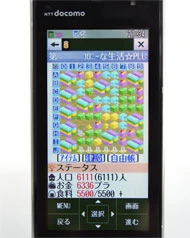
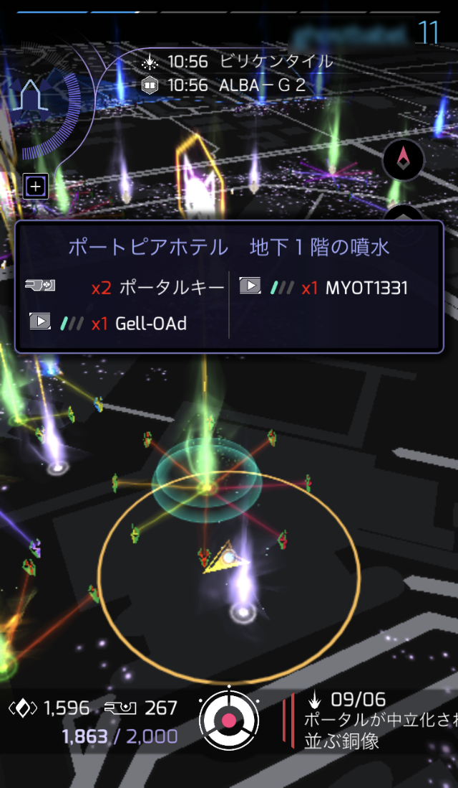
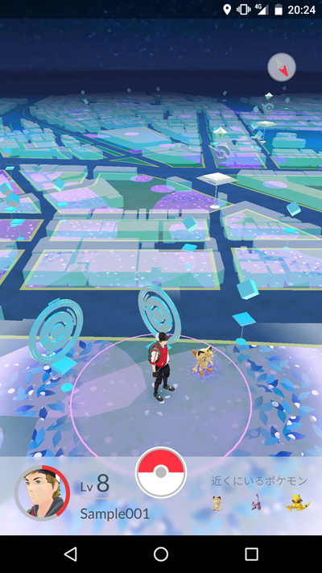

# 人はなぜ、そこへ歩いていくのか――位置情報ゲームの25年と、人が集まった場所で起きたこと

> 2026年11月20日改版：記事全体を全面的に書き直しました。内容の変更はGitの履歴から追えます。

## はじめに

2017年7月22日の朝、米シカゴのグラントパークに『ポケモンGO』のプレイヤーが集まった。配信1周年を記念する「Pokémon GO Fest」の会場である。現地を訪れた水野勝成氏の体験記には、約2万人が集まったとある。優先パスを持っていた水野氏も、午前8時過ぎに列に着き、入場できたのは午前10時を過ぎてからだった。一般入場者も2時間以上待ったという。昼過ぎからはネットワークエラーが続いた。臨時のWi-Fiスポットも移動基地局車もなく、ステージに向けて「FIX THE GAME（ゲームを直せ）」と声が上がった。[[1](#ref-1)][[2](#ref-2)]

ゲームは、人を同じ公園まで連れてくることに成功した。ところが、そこまで来た人たちが会場で遊べない。人はなぜ、そこへ歩いていくのか。そして、同じ理由で人が集まった場所では何が起きるのか。この日の会場に戻る前に、携帯電話がまだ「どのエリアにいるか」を知らせていた頃までさかのぼる。

***

## 1. 位置が「エリア」だった時代（2000〜2008年）

2000年、J-フォンの携帯電話には、端末のいる地域に合わせて情報を届ける「ステーション」が登場した。基地局測位とは、携帯電話と電波をやり取りする基地局の情報から、おおまかな現在地を割り出す方法である。「ステーション」が扱ったのは基地局の電波が届く範囲で、端末の持ち主が道路のどちら側にいるかまで知る必要はなかった。[[3](#ref-3)][[4](#ref-4)]

2003年5月、大学院に在学していた馬場功淳氏は、個人で『コロニーな生活』を始めた。きっかけになったPHS端末「AIR-EDGE PHONE」は、基地局をもとに位置を取得でき、定額で通信できた。プレイヤーは移動先で現在地を登録すると、移動距離に応じて仮想通貨「プラ」を受け取る。そのプラを使えば、画面の中のコロニーを育てられた。[[5](#ref-5)][[6](#ref-6)][[7](#ref-7)]

*画像引用: [ITmedia Mobile - コロプラの位置ゲー「コロニーな生活☆PLUS」が被災地支援に役立つ理由](https://www.itmedia.co.jp/promobile/articles/1104/15/news065.html)（掲載画像, © COLOPL。本文中の初期位置情報ゲームの画面説明に必要な範囲で引用）*

2005年5月、『コロニーな生活☆PLUS』へのリニューアルでは、移動先で位置を登録すると、その土地でしか手に入らない「お土産」が集まるようになった。遠くへ行った分だけプラが貯まる仕組みに、どこで位置を登録したかで持ち帰るものが変わる仕組みが重なった。出張や帰省でいつもと違う土地に着けば、そこが携帯電話を開く場所になる。まだ持っていないお土産を集めるなら、次の行き先にも目星がつく。[[8](#ref-8)]

2007年にNTTドコモの「iエリア」に対応すると、衛星測位機能のない携帯電話でも位置を登録できるようになり、ユーザーが急増した。このゲームから生まれた造語「位置ゲー」が商標登録されたのも、2007年である。[[6](#ref-6)][[8](#ref-8)]

携帯電話の中で集めるお土産とは別に、現地で名産品を買うと受け取れる「コロカ」もあった。コロプラと提携した名産品の店で、買い物の金額に応じてゲーム内で使えるカードがもらえる。提携店は全国に点在し、公共交通では行くのが大変な場所にある店も少なくなかった。駅に着いてから先にも、店までの道のりがある。店に立ち寄れば、手元にはゲームで使えるカードと、その店で買った品物の両方が残る。[[9](#ref-9)][[8](#ref-8)]

コロプラは東京メトロやJR各社、近鉄などとも提携し、プレイヤー向けのきっぷを発売した。旅行関連会社と組んだツアーもあった。店が訪ねる先になる一方で、鉄道や旅行会社も、そこへ向かう移動に関わった。もともと距離を稼ぐために開いていた携帯電話が、店に寄る旅のきっかけにもなっていた。[[8](#ref-8)]

2011年6月9日、東急百貨店吉祥寺店では、全国のコロカ店舗を集めた物産展が始まった。吉岡綾乃氏がBusiness Media 誠で伝えた初日の様子では、木曜日の開店前に約300人が並び、午前中の列は500人近くに達した。昼過ぎまで入場が規制され、コロプラの社員らは列に並ぶ人に水や記念品を配った。普段は各地の店まで足を運んで買う品物がこの日は吉祥寺に集まり、ゲームのクマをかたどった和菓子など、会場限定の品も並んだ。[[9](#ref-9)]

売り場には、クマを描いた山梨の印傳や、ゲームにちなんだ有田焼の箸置きも並んだ。クマの形の上生菓子が入った「銘菓セット」は、開場して間もなく売り切れた。開店直後には先着順で配る予定のノートも足りなくなった。午前中の混雑を受け、コロプラの広報担当者は、翌日以降に売り場を広げ、土日はレジを増やす予定だと取材に答えている。各地の品物を一か所で買える催しとなれば、買い物を楽しむ人を迎えるための広さやレジの数も変わってくる。[[9](#ref-9)]

出展した店には、岩手県岩泉の早野商店もあった。店頭に並んだ昆布巻きや佃煮には、陸前高田の八木澤商店のしょうゆが使われていた。馬場氏は東日本大震災を機に、東北にもある提携店を応援する方法として物産展の開催を決めたと話している。各地の店を訪ねる遊びから、店の側が一つの会場で人を迎える催しが生まれた。[[8](#ref-8)]

遠くまで移動する日には、その距離がコロニーを育てる資金になる。ゲームのために行き先を決めなくても、すでにある用事や遠出が遊びに変わった。この時代に外へ出る理由を作ったのは、移動した距離だった。

***

## 2. 地図の上に、行き先が置かれる（2008〜2015年）

2008年6月9日、AppleはGPSを内蔵したiPhone 3Gを発表した。GPSは、人工衛星からの信号を使って現在地を割り出す仕組みである。携帯端末の地図上に自分の位置を表示できれば、地図に置かれた目印にどこまで近づいたかも遊びに使える。[[10](#ref-10)]

2012年11月、Google傘下にあったNianticの『Ingress』は招待制のクローズドベータを始め、2013年12月14日に正式版となった。[[11](#ref-11)] プレイヤーは、謎の物質XMで人類を進化させようとするEnlightenedと、人類を守ろうとするResistanceの二つの陣営に分かれる。神社仏閣や名所旧跡、芸術作品といった実在の場所はゲーム内で「ポータル」となり、陣営の仲間とポータルを確保し、ポータル同士をリンクでつなぐ。ある地点へ行くことが、地図の別の場所で動く仲間の行動にも意味を持つ。[[12](#ref-12)][[13](#ref-13)]

*画像引用：[4Gamer.net「サービス開始11年目の『Ingress』」](https://www.4gamer.net/games/285/G028533/20230929017/)掲載画像。2023年掲載の画面で、ポータルとリンクが実際の地図に重なる様子を示す。© 2012-2018 Niantic, Inc.（掲載元の表記）。*

2014年7月、神奈川県横須賀市の経済部観光企画課の職員が『Ingress』に触れた。神田孝治氏の論文は、このときから横須賀での取り組みをたどっている。当時、この課は市や商工会議所、京浜急行電鉄が設立した横須賀集客促進実行委員会の事務局を担っていた。職員がゲームに触れたことをきっかけに、10月には活用に向けた取り組みが始まり、12月18日には市長が活用を宣言し、特設サイトも開設された。[[2](#ref-2)]

同じ月の20日からは、横須賀の市街地から船で渡る無人島、猿島が行き先になった。運航会社の協力で、『Ingress』のプレイヤーは船の運賃が半額になり、実質22日間で455人がこの割引を使った。仲間と実在の場所を押さえる遊びに、島へ渡る船が関わった。翌2015年10月31日の公式イベント「Ingress Mission Day Yokosuka」では、約2,000人が参加した。市内の事業者にも声がかかり、36店舗がプレイヤー向けの割引に協力した。ゲームの用事で外へ出た人を、船や店もそれぞれの場所で迎えた。[[2](#ref-2)]

2014年6月26日には『ステーションメモリーズ！』（駅メモ！）のコロプラ版が始まり、11月28日にはiOS・Android版も登場した。このゲームが地図に置いたのは、鉄道の駅である。駅に近づいて位置情報を送る「チェックイン」をすれば、その駅を集めたり、ほかのプレイヤーと駅を取り合ったりできる。いつも乗り換える駅にも、まだ降りたことのない駅にも、ゲームの上での用事ができた。[[14](#ref-14)]

歩いて稼いだ距離に加え、地図上の一点そのものが外へ出る理由になった。『Ingress』では、その一点を押さえる仲間の計画が、いつ、どこへ行くかにも関わってくる。

***

## 3. 「そこにいるかもしれない」が社会を動かす（2016年〜）

2016年7月6日、『ポケモンGO』は米国などで配信が始まり、日本では7月22日に遊べるようになった。ギネスワールドレコーズが認定した五つの記録の一つは、配信開始から1億ドルの収益に達するまでの速さで、わずか20日間だった。[[15](#ref-15)][[16](#ref-16)]

地図を開いて歩くと、周囲にポケモンが現れる。出会った個体にボールを投げ、捕まえた種類を図鑑に加える。公園に向かう前に、そこで何が見つかるかをすべて知っておく必要はない。見つけたポケモンを捕まえるという短い遊びから入れるため、陣営の作戦を覚えたり、仲間と予定を合わせたりする前に、まず一人で外へ出られる。配信直後から国や地域をまたいで広がった規模は、ギネスが同時に認定したダウンロード数や各国のストア順位にも表れている。[[2](#ref-2)][[15](#ref-15)]

*画像引用：[4Gamer.net「『Pokémon GO』、より詳しい遊び方が明らかに」](https://www.4gamer.net/games/316/G031663/20160527049/)掲載の公式スクリーンショット（2016年5月、開発中の画面）。地図上のポケストップとポケモンの配置を示す。© 2017 Niantic, Inc. © 2017 Pokémon. © 1995-2017 Nintendo/Creatures Inc. /GAME FREAK inc.（掲載元の表記）。*

地図に行くべき地点が並んでいるだけでなく、道の先に何かがいるかもしれない。その期待が「もう少し先まで歩いてみよう」という理由になる。地域や期間を限って珍しいポケモンが出ると、その期待を持った大勢が同じ場所へ向かう。[[2](#ref-2)]

IPの側から見た『ポケモンGO』の位置づけは、既刊記事「[ポケモンはなぜ巨大IPであり続けるのか――「変えない安心」と「世代ごとに変える新規性」の設計](pokemon-global-ip-core-game-design.md)」で扱っている。

***

## 4. IPを連れて歩く（2018〜2023年）

2018年6月27日、ガンホーとレベルファイブの『妖怪ウォッチ ワールド』が配信された。スマートフォンで周囲を探し、見つけた妖怪とバトルしてともだちにする。作品やキャラクターなどの知的財産を指すIPのうち、『妖怪ウォッチ』から持ち込まれたのは、身近な場所に妖怪が潜んでいるという遊びの入口だった。サービスは2022年12月23日に終了した。終了告知でディレクターの昇耕一氏は、さまざまな社会環境の変化に触れている。[[17](#ref-17)][[18](#ref-18)]

2019年に始まった『ハリー・ポッター：魔法同盟』は、魔法使いたちが力を合わせて魔法界の秘密の流出を防ぐ物語である。開発元は、現実の街で魔法界を楽しんでもらうため、プレイヤーに屋外を歩いてもらうことを狙っていた。サービスは2022年1月31日に終了した。[[19](#ref-19)]

2019年9月12日に配信された『ドラゴンクエストウォーク』では、クエストの目的地を地図の候補から決め、そこまで実際に歩く。先の道で何に出会うかという期待に加え、今日はどこまで行けば冒険が進むかを出発前に決められる。[[20](#ref-20)]

2021年11月1日、任天堂とNianticの『ピクミン ブルーム』が日本でも配信を始めた。歩くとピクミンが育ち、歩いた道には花を植えられる。一日の終わりには、その日に歩いた歩数とルートを振り返れる。いつもの道を歩いても、その日の散歩が手元に残る。[[21](#ref-21)]

2023年8月31日配信の『信長の野望 出陣』では、現実の地図を歩いて拠点を訪れ、領地を広げていく。同年9月14日配信の『モンスターハンターNow』では、道中で見つけたモンスターと戦う。一回の狩りは最大75秒。次の用事へ向かう途中でも、安全に立ち止まれる場所なら、一狩りを挟める長さである。[[22](#ref-22)][[23](#ref-23)][[24](#ref-24)]

Sensor Towerの推計では、2023年に日本の位置情報ゲームでユーザーが使った金額は6億ドルを超え、世界の約50％、米国の約1.6倍だった。日本で首位の『ドラゴンクエストウォーク』は約3億ドルで、国内のほぼ半分を占める。同社は日本での広がりを考える手がかりに、電車と徒歩で移動する日常を挙げ、『駅メモ！』を例にしている。駅への道、乗り換え、帰りの寄り道。そのどこに遊びを差し込むかで、同じ街を使うゲームでも、外へ出る理由は変わる。[[25](#ref-25)]

***

## 5. 人が集まったとき

### シカゴ：遊べなくなった会場

シカゴのグラントパークでは、午後4時20分を過ぎて、運営がステージで不具合をわびた。入場料は全額払い戻し、登録した参加者には100ドル分のポケコインと伝説のポケモン「ルギア」を贈る。会場で出るはずだった珍しいポケモンなどは、グラントパークの周囲半径2マイルまで範囲を広げ、48時間延長する対応を取った。広げた範囲のポケモンは、QRコードで参加の認証を済ませた人だけに見える。公式告知では7月24日の月曜朝までとされた。水野氏の体験記には、NianticのCEOだったジョン・ハンケ氏がステージの隅でサインに応じ、参加者の声に耳を傾ける姿も描かれている。水野氏は、ハンケ氏がそこに4〜5時間いたと見ている。[[1](#ref-1)][[26](#ref-26)]

### 横浜と鳥取：会場の外へ広がった人

8月9日から15日まで、横浜のみなとみらいでは「Pokémon GO PARK」が開かれた。水野氏の体験記では、ソフトバンクが赤レンガパークとカップヌードルミュージアムパークの周辺に移動基地局車を配備し、Wi-Fiを他社回線の利用者にも開放した。会場では多くの人がゲームを楽しめた。[[1](#ref-1)]

神田氏の論文には、初日にプレイヤーが集中して通信障害が起こり、その夜から開催時間の制限が撤廃され、範囲もみなとみらい全域へ広がったとある。歩きスマホや道路の混雑に関する苦情は、横浜市や神奈川県警に130件以上寄せられた。プレイヤーが夜も滞在し、地域の夜の静けさが失われたことも記録されている。[[2](#ref-2)]

11月24日から26日までの3日間、鳥取砂丘には、普段は見つけにくいポケモンを求めて人が訪れた。鳥取県の公表では、砂丘での参加者が約8万9,000人、経済効果は砂丘の来訪者による観光消費の推計とPR効果を合わせて約18億円だった。神田氏が記した鳥取県東部全体の数字は約12万人、経済効果は24億円である。砂丘だけを数えるか、その外に広がった来訪も含めるかで数字は変わる。砂丘に生息する稀少なエリザハンミョウが絶滅の危惧にあると分かり、翌2018年4月、砂丘の一部は柵で囲われ、立ち入り禁止になった。[[27](#ref-27)][[2](#ref-2)]

### 横須賀：人を迎える準備を重ねた街

2章で見た『Ingress』での取り組みに続いて、『ポケモンGO』が配信された2016年には、中心市街地のポケストップやジムを載せた紙の地図「横須賀中心市街地 Pokémon GO MAP」が作られ、8月21日の講演会で「ヨコスカGO宣言」とともに配られた。ポケストップはゲーム内で道具を受け取れる地点、ジムは対戦などに使う地点である。宣言は、市民がトレーナーとして身近なポケストップを見つけ、地域をより深く知ることを応援し、ほかの地域から来るトレーナーへの情報提供や交流を進め、観光と集客の可能性を探るとした。同じ年には『ポケモンGO』のプレイヤーを対象に、猿島航路などで運賃の割引も行われた。神田氏は、これを『Ingress』での割引企画の延長に位置づけている。[[2](#ref-2)]

2016年11月5日と6日には、横須賀の本町商店街、通称ドブ板通りで、バザールに合わせた『ポケモンGO』の企画が開かれた。商店街の11か所のポケストップには、ポケモンを出やすくする仕掛けが置かれた。現地で出会ったポケモンをゲームのカメラで撮り、その写真を参加店で見せると割引などの特典を受けられた。神田氏は、『Ingress』のイベントで店が割引に協力した取り組みとのつながりを指摘している。ドブ板通りで企画を担ったのは地元の事業者で、指定のハッシュタグを付けて写真を投稿できる仕掛けも加わった。[[2](#ref-2)]

その後、2018年の「Pokémon GO Safari Zone in YOKOSUKA」を主催したのも横須賀集客促進実行委員会だった。中心市街地のヴェルニー公園と三笠公園に、久里浜の「くりはま花の国」を加えた三つの会場で、普段は出会いにくいポケモンが現れる。猿島へ向かう船を使った企画から数年の間に、横須賀には、ゲームの目印を街の案内や店への立ち寄りにつなげる経験が積み重なっていた。[[2](#ref-2)]

2018年8月29日から9月2日まで開かれた横須賀のイベントは事前応募制で、参加できたのは定員の6万5,000人だった。期間中に市を訪れたプレイヤーは20万人以上、経済効果は15億円以上と発表された。神田氏の論文には、商店街にイベントの横断幕が掲げられたことや、通信状況が良かったことも記されている。[[2](#ref-2)]

### 立ち入りと安全

人を招くイベントの外でも、ゲームの地図と現地のルールはぶつかる。国内配信初日の2016年7月22日には、熊本地震で被災した熊本城の立ち入り禁止区域に入って遊ぼうとする人が現れた。法隆寺では境内での使用が禁止された。同じ日の日経の記事には、駅のホームで歩きながら遊んでいたら何度も人にぶつかりそうになった、という声も載っている。地図の目印は人が向かう理由になるが、そこで立ち止まれるか、そもそも入れるかは、現地で別に確かめる必要がある。[[28](#ref-28)][[29](#ref-29)][[16](#ref-16)]

### 通信：会場ごとの準備

通信も会場ごとに準備と対応が要る。2023年8月の大阪の「Pokémon GO Fest」では、会場の一部でドコモ回線の不具合が報じられた。[[30](#ref-30)] 遊んでいる途中で回線の状態が変わることを前提にした設計は、既刊記事「[途中で変わる回線を前提にする——ゲームプランナーのためのネットワーク入門⑤](planner-network-intro-05-cellular-4g-5g.md)」で扱っている。

2024年11月16日と17日、福岡市中央区の舞鶴公園で「Pokémon GO ワイルドエリア：福岡」が開かれ、『ポケモンGO』に初めて登場するポケモンを捕まえにプレイヤーが訪れた。NTTドコモがNianticとの協働を本格化させたのは2022年の札幌のイベントで、このときも移動基地局車を配備した。以後、Nianticから会場で必要になる通信の条件や設備について、より具体的な相談を受けるようになり、大阪、仙台と会場を移るたびに対策を重ねた。福岡では、九州支社の通信改善の取り組みにもこのイベントへの対応を掲げ、同支社が担当するイベント対策として過去最大規模の機器・設備を導入して、ゲームに特化した通信エリアを用意した。設営には通常の2倍以上の期間を取り、約2週間前から公園に設備を置き始めた。先に「Pokémon GO Fest 2024：仙台」を担当した東北支社から準備のノウハウを引き継いだことも、Nianticとのやり取りを進める助けになったという。[[31](#ref-31)]

舞鶴公園は城跡にあり、園内には高低差がある。上下方向には電波が届きにくい移動基地局車を、地形に合わせてどう置くかが検討された。市街地の公園で、周囲にはすでに基地局がいくつもあるため、車を配置した後も、会場に向けた電波と周辺の基地局の電波が干渉しないよう調整した。ゲーム内の機能の改良に伴い、必要とされる通信の条件も以前より上がっていた。ポケモンを捕まえる人も、仲間とバトルする人も、同じ時間帯に会場の回線を使う。どんな遊びがどこで行われるかは、設備を用意する側にも必要な情報だった。[[31](#ref-31)]

ゲームの設計に合わせた調整は本番直前まで続き、現地のスタッフもスマートフォンを手に、会場を実際に歩いてテストプレイした。本番中には特定のエリアで一時的に通信が集中する場面もあり、ドコモとNianticは状況を共有して人の流れを誘導し、回線がひっ迫するのを避けようとした。開催前に園内を歩いたスタッフと、開催中に園内を歩くプレイヤー。その足取りに合わせて、設営から当日の誘導まで調整が続いた。[[31](#ref-31)]

***

## 6. 外に出る理由をつくる（編者の考察）

横須賀の商店街には、ゲームの外にイベントの横断幕が掲げられた。イベントへの参加枠は6万5,000人でも、街を訪れる人はその枠に収まらない。画面の中で参加を受け付ける仕組みと、街が人を迎える仕組みには、それぞれ考えるべき定員がある。[[2](#ref-2)]

編者は、ここまでの作品に、外へ出る理由を作るいくつかの型を見る。『コロニーな生活』の距離は、すでに決まっている移動を遊びに変える。『駅メモ！』や『Ingress』の場所は、途中で立ち寄る一点を作り、『Ingress』の仲間は、そこへ行く時間にも意味を与える。『ポケモンGO』の出会いは、何が待っているか分からない道の先に期待を置く。『ドラゴンクエストウォーク』の目的地は、出発前に行き先を決める手がかりになる。『ピクミン ブルーム』の記録は、帰ってからも散歩を残す。『モンスターハンターNow』の短い戦闘は、移動の途中に一回分の遊びを置く。

強い理由を作るほど、場所や時間をそろえたときに、人もそこへ集まりやすくなる。たとえば珍しいものを一つの公園に短時間だけ置くなら、プランナーが決める時刻と範囲は、通信事業者には回線の需要、地域には通行や夜間の滞在を見込む条件になる。運営は地域や通信事業者と、入口や回遊先、現地で遊びが止まったときの案内を開催前からすり合わせられる。横浜のように時間を延ばして人を分散させる選択も、夜の街に人が残ることまで含めて考える必要がある。

2026年1月27日、コロプラは「COLOPL Gaming Maps」の開発を発表した。位置ゲー開発に最適化した地図配信とPOI管理のサービスで、POIとは公園や駅など、地図上で目印になる地点のことだ。発表時点で、開発中の新作2タイトルへの導入が決まっていた。同社は2026年9月期第2四半期の決算説明会で、有力IPとの組み合わせで国内外の既存市場でのシェアを広げる戦略と、新しい遊び方を作り、これまで位置ゲーを遊んでこなかった層を取り込む戦略を示した。[[32](#ref-32)][[33](#ref-33)][[34](#ref-34)]

ゲームの地図に一点を置くとき、その一点はプレイヤーにとって行き先になる。地域にとっては、普段から人が通り、働き、暮らす場所である。どんな人が、いつ、どれだけ来るかを想像するところまでが、外に出る理由を作る仕事だと編者は考える。

***

## まとめ

シカゴの朝、グラントパークには入場を待つ列ができていた。昼を過ぎると、その列を抜けて会場に入った人たちが、今度はゲームがつながるのを待った。そこへ歩いていく理由は、すでに十分にあった。歩いてきた人が、その場所で実際に遊び、帰れるところまで考えるとき、位置情報ゲームの企画は画面の地図から街へと続いていく。

***

## References

1. [水野勝成「おわびポケモン配る、米「ポケモンGO」イベント」][1] — 日経ビジネス電子版、2017年8月30日。日経トレンディネット2017年8月10日付記事の転載。

[1]: https://business.nikkei.com/atcl/report/16/030800018/082400380/

2. [神田孝治「『Pokémon GO』のリアルワールドイベントと地域―2018年の横須賀市における事例に注目した考察―」][2] — 立命館文學 第666号、2020年3月、131〜147頁。

[2]: https://www.ritsumei.ac.jp/acd/cg/lt/rb/666/666PDF/kanda.pdf

3. [ITmedia Mobile「あなたのいた場所が分かる～位置情報サービス『ステーション』の意外な活用法」][3] — ITmedia Mobile、2001年7月27日。

[3]: https://www.itmedia.co.jp/mobile/news/0107/27/station.html

4. [ケータイ Watch編集部「位置情報ゲーム とは」][4] — ケータイ Watch、2010年1月。

[4]: https://k-tai.watch.impress.co.jp/docs/column/keyword/341798.html

5. [ドリームゲート「第127回 株式会社コロプラ 代表取締役GM 馬場功淳」][5] — DREAM GATE。馬場氏へのインタビュー。

[5]: https://www.dreamgate.gr.jp/contents/case/interview/35757

6. [コロプラ「感謝の20周年！“位置ゲー”の原点『コロニーな生活』」][6] — ピンマーク、2025年7月30日。

[6]: https://pinmark.colopl.co.jp/entries/03738791

7. [コロプラ「位置ゲー22周年」][7] — コロプラ、2025年。

[7]: https://ichige-22nd.colopl.co.jp/

8. [吉岡綾乃「ケータイゲーム発！「コロプラ」の物産展が大盛況」][8] — Business Media 誠、2011年6月10日。2ページ目（沿革、お土産、提携、馬場氏の発言）。

[8]: https://www.itmedia.co.jp/makoto/articles/1106/10/news025_2.html

9. [吉岡綾乃「ケータイゲーム発！「コロプラ」の物産展が大盛況」][9] — Business Media 誠、2011年6月10日。1ページ目（物産展初日の様子、コロカの仕組み）。

[9]: https://www.itmedia.co.jp/makoto/articles/1106/10/news025.html

10. [Apple「Apple Introduces the New iPhone 3G」][10] — Apple Newsroom、2008年6月9日。

[10]: https://www.apple.com/newsroom/2008/06/09Apple-Introduces-the-New-iPhone-3G/

11. [Engadget「Google’s Ingress augmented reality game exits beta December 14」][11] — Engadget、2013年11月4日。

[11]: https://www.engadget.com/2013/11/04/googles-ingress-exits-beta/

12. [Niantic「Ingress」][12] — Ingress公式サイト。二つの陣営、ポータル、リンクの説明。

[12]: https://ingress.com/ja

13. [TVアニメ『イングレス』公式サイト「INGRESS」][13] — ポータルには神社仏閣や名所旧跡、芸術作品などの実在の場所が使われるとの説明。

[13]: http://ingressanime.com/ingress/

14. [モバイルファクトリー「『駅メモ！』誕生12周年！ 6月1日より記念キャンペーンを開催」][14] — モバイルファクトリー、2026年5月25日。

[14]: https://www.mobilefactory.jp/newsrelease/2026/20260525/

15. [ギネスワールドレコーズ「Pokémon GO catches five world records」][15] — ギネスワールドレコーズ、2016年8月。

[15]: https://www.guinnessworldrecords.jp/news/2016/8/pokemon-go-catches-five-world-records-439327

16. [日本経済新聞「ポケモンGO、各地でトラブル 宅地侵入や警報」][16] — 日本経済新聞、2016年7月22日。

[16]: https://www.nikkei.com/article/DGXLASDG22HB1_S6A720C1CC1000/

17. [GAME Watch「『妖怪ウォッチ ワールド』配信開始」][17] — GAME Watch、2018年6月27日。

[17]: https://game.watch.impress.co.jp/docs/news/1129814.html

18. [ファミ通.com「『妖怪ウォッチ ワールド』が12月23日にサービス終了」][18] — ファミ通.com、2022年9月7日。ディレクターの告知を掲載。

[18]: https://www.famitsu.com/news/202209/07274943.html

19. [Game*Spark「マグル達にできることはもうないのか？『ハリー・ポッター：魔法同盟』が2022年1月31日でサービス終了」][19] — Game*Spark、2021年11月3日。

[19]: https://www.gamespark.jp/article/2021/11/03/113244.html

20. [スクウェア・エニックス「スマートフォン向け位置情報ゲーム『ドラゴンクエストウォーク』2019年9月12日(木)配信決定のお知らせ」][20] — スクウェア・エニックス、2019年9月5日。

[20]: https://www.jp.square-enix.com/company/ja/news/2019/html/22213b6a54ea3703590451f0bbcebf6b.html

21. [gamebiz「Nianticと任天堂、 スマートフォンアプリ『ピクミンブルーム』の国内配信開始!」][21] — gamebiz、2021年11月1日。歩数とルートの振り返り。

[21]: https://gamebiz.jp/news/336363

22. [コーエーテクモゲームス「本日サービス開始！サービス開始記念キャンペーン開催中」][22] — コーエーテクモゲームス、2023年8月31日。

[22]: https://www.gamecity.ne.jp/news/14621.html

23. [INTERNET Watch「位置情報ゲーム“第3の波”がやって来た！」][23] — INTERNET Watch、2024年。

[23]: https://internet.watch.impress.co.jp/docs/column/chizu3/1563109.html

24. [4Gamer「『モンスターハンターNow』開発者インタビュー」][24] — 4Gamer.net、2023年9月14日。

[24]: https://www.4gamer.net/games/701/G070120/20230914054/

25. [Hideyuki Tsuji「日本の位置情報ゲームの年間収益は6億ドル以上で世界の約50％、ドラクエウォークは月間滞在時間10時間以上が30％以上」][25] — Sensor Tower、2024年2月。集計は2023年1〜12月。

[25]: https://sensortower.com/ja/blog/japan-is-the-largest-market-for-geolocation-games

26. [Pokémon GO チーム「Niantic Pokémon GO Fest Chicago Update」][26] — Pokémon GO公式サイト、2017年7月22日。

[26]: https://pokemongo.com/news/pokemongofestupdate

27. [鳥取県「Pokémon GO Safari Zone in 鳥取砂丘の開催結果について」][27] — 鳥取県、2017年12月1日。砂丘での参加者数および経済効果の内訳。

[27]: https://www.pref.tottori.lg.jp/secure/1099150/291201tiiki_houkoku_besatu.pdf

28. [J-CASTニュース「『敷地内にポケストップ』を断りたい　削除要請すると、どうなるの？」][28] — J-CASTニュース、2016年7月26日。

[28]: https://www.j-cast.com/2016/07/26273581.html?p=all

29. [産経新聞「法隆寺での『ポケモンGO』使用禁止」][29] — 産経ニュース、2016年7月25日。

[29]: https://www.sankei.com/article/20160725-DXTY6WHGYZN77HXOJLFOU62GYU/

30. [MoguLive「『Pokémon GO Fest 2023』会場でDocomo不具合」][30] — MoguLive、2023年8月4日。

[30]: https://www.moguravr.com/pokemon-go-fest-2023-6/

31. [NTTドコモ「『Pokémon GO』リアルイベント『Pokémon GO ワイルドエリア：福岡』会場の快適な通信環境を構築」][31] — NTTドコモ。

[31]: https://www.docomo.ne.jp/area/nwpr/article12/

32. [コロプラ「ゲーム専用地図配信サービス『COLOPL Gaming Maps』を開発」][32] — PR TIMES、2026年1月27日。

[32]: https://prtimes.jp/main/html/rd/p/000001881.000004473.html

33. [コロプラ「2026年9月期 第2四半期決算説明会資料」][33] — コロプラ、2026年5月7日。

[33]: https://www2.jpx.co.jp/disc/36680/140120260507517733.pdf

34. [木村英彦「コロプラ、グローバルヒットを狙う位置ゲー開発を推進　IPと新規性を武器にユーザー開拓とシェア拡大図る　「市場の成長余地はまだ大きい」」][34] — gamebiz、2026年5月14日。

[34]: https://gamebiz.jp/news/425874

----

この文書は、Perplexity、Claude、ChatGPT の3つのAIの支援を受けて著述されたものです。引用画像を除き、MIT License にて提供されています。
