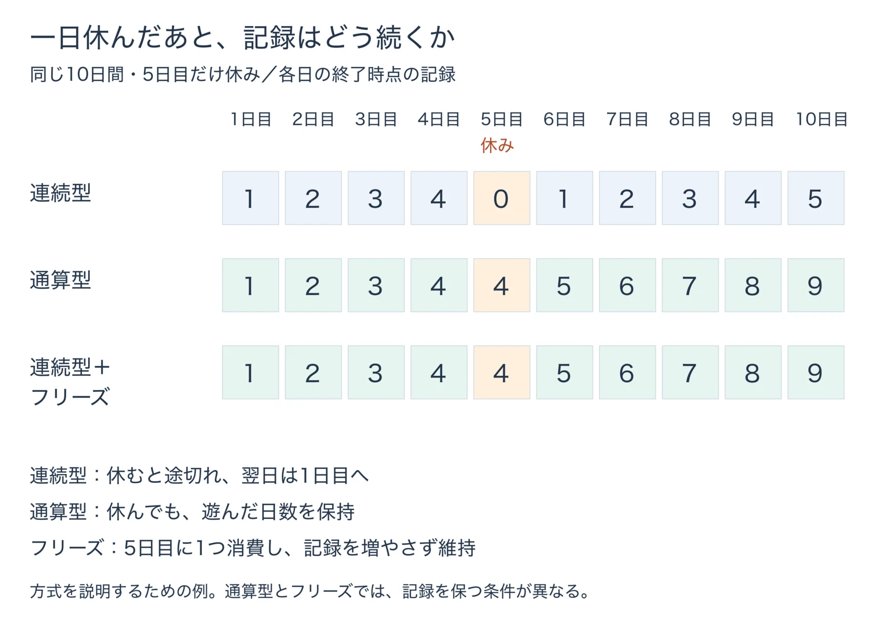
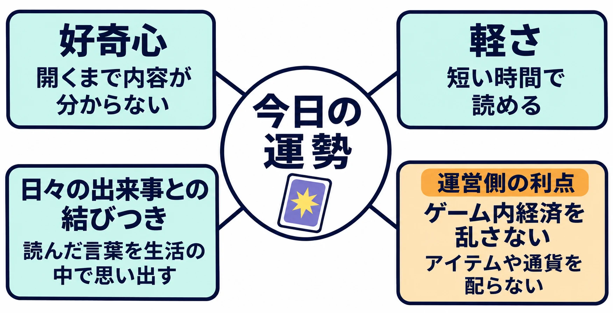

# 明日も開く理由をどう作るか――ログインボーナスと、途切れたときに失われるもの

> 2026年11月23日改版：記事全体を全面的に書き直しました。内容の変更はGitの履歴から追えます。

## はじめに

2023年12月22日、中国の国家新聞出版署がオンラインゲームの規制案を公表した。利用者の支出に上限を設ける規定と並んで、毎日のログインに報酬を出す仕組みを禁じる規定が盛り込まれていた。意見募集は2024年1月22日までで、同月には規制案が同署のウェブサイトから削除されたとロイターが報じた。[[1](#ref-1)][[2](#ref-2)][[3](#ref-3)]

朝、スマートフォンでゲームを開くと、今日の分のアイテムが届く。運営にとっては、プレイヤーと毎日顔を合わせるための小さな仕掛けだ。当局が遊び続けさせる誘因と見なしたこの仕掛けを、運営はどう設計してきたのか。毎朝開いていたゲームを一日休み、その翌日に開き直すところまで考えると、報酬の中身だけでは決められないことが見えてくる。

***

## 1. ログボが担ってきたもの

ログインボーナス（ログボ）は、ゲームを開いた日に受け取れる報酬だ。クエストを進める時間が取れない朝でも、報酬を受け取るだけならできる。運営から見れば、遊ぶ時間の長短にかかわらず、プレイヤーと接点を持てる仕組みである。

編者は、その接点で何をしてほしいかは運営の時期によって変わると考える。配信直後なら、初日に覚えた遊びを翌日も試すきっかけになる。運営が続くなかでは、前日に途中まで進めた遊びを思い出したり、更新に気づいたりする入口になる。周年なら、久しぶりに開いた人が記念イベントをのぞくきっかけにもなる。同じアイテムを配るとしても、受け取ったあとに向かう先はそれぞれ違う。

***

## 2. 一日休んだ翌日、画面には何が残るか

昨日まで伸びていた数字が、今朝は「1日目」に戻っている。昨日までに受け取ったアイテムが手元にあっても、次の節目まであと少しだった人には、積み重ねの一部が失われたように感じられる。

ジャッキー・シルバーマンとアリクサンドラ・バラシュは、運動や学習などの行動記録を対象に、連続記録の見え方が次の行動にどう影響するかを七つの研究で調べた。続いている記録を見せた場合は、途切れた記録を見せた場合よりも、その後に同じ行動を取ることが多かった。過去に実際に何をしたかが同じでも、記録の見せ方で差が出た。途切れた原因を自分にあると考えるほど差は広がり、途切れた記録を修復できると差は縮まった。ゲームのログインでも同じことが起きるかは、この研究からは分からない。[[4](#ref-4)]

語学学習アプリのDuolingoには、休む前に備えておく「連続フリーズ」がある。一つで一日分、レッスンをしなくても連続記録を維持できる。公式ブログでは、仕事や家庭の都合、息抜きが必要な日にも柔軟に休めるよう設け、一度に最大二つまで装備できるようにしたと説明している。研究で差を縮めたのは途切れたあとの修復で、Duolingoのフリーズは途切れる前の備えだ。どちらも、再開するときに以前の記録を引き継げる余地を作っている。[[4](#ref-4)][[5](#ref-5)]

休んでも、これまで遊んだ日を通算で数える方法もある。ウィリアム・グロッソは2016年のGame Developerへの寄稿で、『パズル＆ドラゴンズ』が連続型と通算型の報酬を併用した例を挙げている。四日遊んで一日休んだ場合、次に開いた日の連続記録は一日目でも、通算記録では五日目だ。連続型を使うなら、連続日数を何日まで伸ばせるかと同じくらい、途切れたときにプレイヤーの手元に何を残すかを先に決めておきたい。[[6](#ref-6)]

***

## 3. 遊び始めるまでに、何枚めくるのか

期間限定のログボが重なると、起動してすぐに受け取り画面が何枚も続くことがある。編者は、前日の続きが気になってゲームを開いたときほど、それを煩わしく感じる。一つ受け取って閉じ、次の画面でもまた押す。毎日戻ってきてほしくて用意した報酬が、遊びに入るまでの手間にもなる。

たとえば、受け取りをまとめ、内訳はあとで見返せるようにすれば、遊びたい人はすぐ先に進める。周年のように報酬と一緒に知らせたいことがあるなら、その案内をどの画面でいつ見せるかまで考えたい。また、受け取りを簡単にしても、配る量が増えれば通貨やアイテムの価値に響く。供給量と使い道の関係は、[スタミナ・行動力の設計を扱った記事](stamina-energy-system-design-practices.md)で詳しく取り上げている。

***

## 4. 中身が見えないから開きたくなる

明日も何かが届くと分かっていて、中身はその日になって初めて分かる。その小さな空白が、ゲームを開く理由になる。心理学者のジョージ・ローウェンスタインは、知っていることと知りたいことの間に隔たりがあると気づくと、好奇心が生じると考えた。これが情報ギャップ理論である。ログボに当てはめると、「今日も何かが届いている」と分かるからこそ、「今日は何だろう」と気になる。[[7](#ref-7)]

[いつ当たりが出るか分からない報酬と可変比率強化](variable-ratio-reinforcement-gacha-loot-box-psychology.md)は別の記事で扱った。ここで見たいのは、中身を知ること自体が楽しみなら、通貨やアイテムを用意しなくても翌日に開く理由を作れるという点だ。

***

## コラム：報酬のない占い

編者はフィーチャーフォン向けのゲームで、日替わりの「今日の運勢」を実装した。開くとその日の運勢が読める。アイテムも通貨も付けなかったが、それ自体が毎日ゲームを開くきっかけになった手応えがあった。編者の元上司も、PCゲームで同じような手応えを得ていた。そちらはゲームのキャラクターが世界設定の中で運勢を教えてくれる、編者の実装より占いに踏み込んだ作りだった。

今日の運勢は、開くまでは分からない。朝に少し気になったら、その場で見て閉じられる。じっくり遊ぶ時間がない日でも、そのくらいなら開ける。フィリッパ・ラリーらの日常行動の研究では、朝食のあとなど、同じ状況で行動を繰り返すうちに、意識して決めなくても行動しやすくなっていった。たとえば朝食のあとに占いを見るなら、毎日の生活のなかに収まる短さが、繰り返しやすさにつながると編者は考える。[[8](#ref-8)]

朝に読んだ運勢を、何か良いことがあったときにふと思い出すこともあるだろう。ゲームを閉じたあとも、そこで読んだ言葉がその日の出来事と結びつく。これも、翌日の運勢が気になる理由の一つになりうると編者は考える。

アイテムや通貨を配らなければ、占いそのものが供給を増やして通貨の価値を下げたり、有料で手に入れる動機を弱めたりすることはない。その一方で、日替わりの文面や絵を用意する手間はかかる。編者の経験では、開いても似た内容が続くと、今日の分を知りたい気持ちはすぐに薄れる。元上司の作品のように、キャラクターの口調や世界設定が占いに表れるなら、「今日の運勢はどうか」に加えて「あのキャラクターは今日は何と言うだろう」という楽しみができる。

どちらの作品も、SNSでの共有が一般的になる前のものだ。いま実装するなら、気に入った言葉や絵を、プレイヤーが自分で選んで共有できる形も考えられる。

***

## 5. ログボを置く前に決めること

配信直後のプレイヤーに、昨日覚えた遊びをもう一度試してほしいなら、報酬を受け取ったあと、その遊びの続きへすぐ進めるようにする。忙しい日にも気軽に顔を出してほしいなら、短い読み物を置く手もある。連続記録を育てる楽しみを渡したいなら、休んだ翌日にも通算の足跡が残るのか、あらかじめ休める日を設けるのかを決める。どの場合も、受け取りにかかる手間まで含めて、起動から遊び始めるまでを一つの流れとして見ておきたい。一定期間離れたプレイヤーに、ゲームの外から戻る理由を届ける話は、[プッシュ通知による再訪の設計](push-notification-reengagement-design.md)に譲る。

2023年12月の規制案で、毎日のログイン報酬は、遊び続けさせる誘因として扱われた。毎日開く理由を作る力があるからこそ、一日休んだあとにも開く理由が残るようにしたい。積み重ねた日数を引き継げる。起動したらすぐに続きが遊べる。あるいは、今日の運勢だけ見て閉じられる。どのくらい遊ぶかをその日ごとに自分で決められるなら、プレイヤーは自分のペースでまた戻ってこられる。

## References

1. [Josh Ye「中国、オンラインゲームの新規制案公表　利用者の支出抑制狙う」][1] — Reuters（Investing.com日本語版掲載）、2023年12月22日。

[1]: https://jp.investing.com/news/stock-market-news/article-714720

2. [ジェトロ「オンラインゲームの管理強化方案に関するパブコメを募集」][2] — ビジネス短信、2023年12月28日。

[2]: https://www.jetro.go.jp/biznews/2023/12/b02fc69d167bdafa.html

3. [kurokami「規制の緩和か、それとも撤回か？中国の『オンラインゲームに関する包括的な規制案』がウェブサイトから削除」][3] — インサイド、2024年1月25日。規制案の掲載ページが削除されたとするロイター報道を紹介。

[3]: https://www.inside-games.jp/article/2024/01/25/152052.html

4. [Jackie Silverman、Alixandra Barasch「On or Off Track: How (Broken) Streaks Affect Consumer Decisions」][4] — Journal of Consumer Research、49巻6号、1095〜1117ページ、2023年4月。リンク先はデラウェア大学の機関リポジトリに収録された著者受理版。

[4]: https://udspace.udel.edu/items/42ce576b-8e1f-429a-8541-e29e48dbcfbb

5. [Duolingo「Duolingo連続記録の裏には『習慣化』の研究があるんだって！」][5] — Duolingo Blog日本語版、2024年5月13日。著者はOsman Mansur氏。

[5]: https://blog.duolingo.com/ja/duolingo-streak-research/

6. [William Grosso「The Science & Craft of Designing Daily Rewards -- and Why FTP Games Need Them」][6] — Game Developer、2016年6月13日。コミュニティの寄稿。

[6]: https://www.gamedeveloper.com/business/the-science-craft-of-designing-daily-rewards-and-why-ftp-games-need-them

7. [George Loewenstein「The Psychology of Curiosity: A Review and Reinterpretation」][7] — Psychological Bulletin、116巻1号、75〜98ページ、1994年。

[7]: https://www.cmu.edu/dietrich/sds/docs/loewenstein/PsychofCuriosity.pdf

8. [Phillippa Lally、Cornelia H. M. van Jaarsveld、Henry W. W. Potts、Jane Wardle「How are habits formed: Modelling habit formation in the real world」][8] — European Journal of Social Psychology、40巻6号、998〜1009ページ、2010年10月。

[8]: https://doi.org/10.1002/ejsp.674

----

この文書は、Perplexity、Claude、ChatGPT の3つのAIの支援を受けて著述されたものです。引用画像を除き、MIT License にて提供されています。
